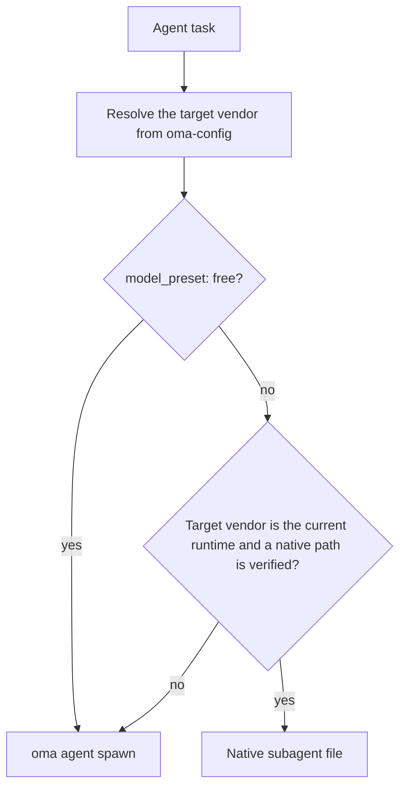
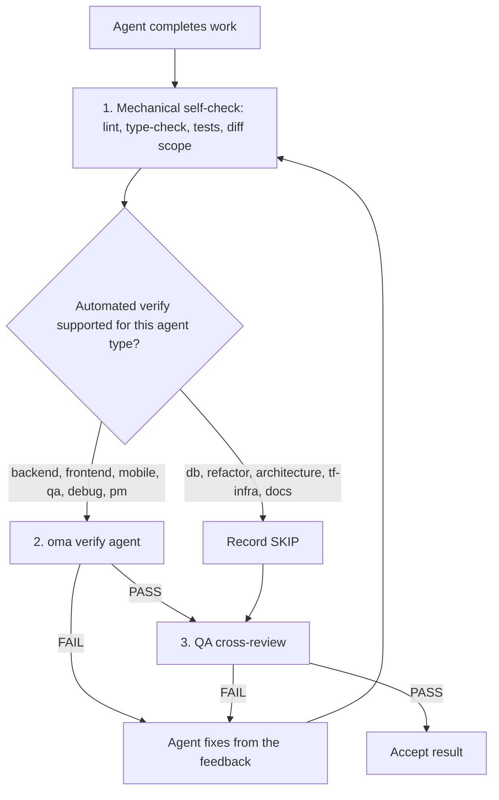

# Агенты

OMA разделяет [навыки](../getting-started/glossary.md#skill), роли dispatch и [определения агентов](../getting-started/glossary.md#agent-definition). Навык маршрутизирует и загружает доменные инструкции; каноническая роль задаёт runtime-идентичность для dispatch; сохранённое в репозитории определение даёт субагенту persona, нативную для вендора. Эти уровни намеренно пересекаются, поэтому решайте, достаточно ли одного навыка, исходя из границ задачи и критериев приёмки.

---

## Каталог навыков {#skill-catalog}

Эта таблица — авторитетный список установленных навыков. Она генерируется из frontmatter каждого `.agents/skills/<name>/SKILL.md` скриптом `cli/scripts/generate-skill-catalog.mjs`; чтобы обнаружить расхождения, запустите скрипт с `--check`. Раздел `## References` в SKILL.md каждого навыка перечисляет его файлы ресурсов и указывает, когда их читать.

<!-- oma:generated skill-catalog:start -->
<!-- Generated from SKILL.md frontmatter under .agents/skills by cli/scripts/generate-skill-catalog.mjs. Do not edit this block by hand. -->

| Skill | Use it for |
|---|---|
| [`oma-academic-writing`](https://github.com/first-fluke/oh-my-agent/blob/main/.agents/skills/oma-academic-writing/SKILL.md) | Draft and revise academic prose against a rubric, evidence, and citation requirements. Use for essays, reports, literature reviews, or academic style audits. |
| [`oma-architecture`](https://github.com/first-fluke/oh-my-agent/blob/main/.agents/skills/oma-architecture/SKILL.md) | Evaluate system boundaries and architectural tradeoffs. Use for architecture decisions, design reviews, and ADRs. |
| [`oma-backend`](https://github.com/first-fluke/oh-my-agent/blob/main/.agents/skills/oma-backend/SKILL.md) | Implement server APIs, authentication, and application data access. Schema modeling and query tuning use oma-db. |
| [`oma-brainstorm`](https://github.com/first-fluke/oh-my-agent/blob/main/.agents/skills/oma-brainstorm/SKILL.md) | Explore goals, constraints, and alternative approaches before choosing a design. Use when the user requests ideation or design exploration. |
| [`oma-coordination`](https://github.com/first-fluke/oh-my-agent/blob/main/.agents/skills/oma-coordination/SKILL.md) | Coordinate assigned specialist tasks and handoffs manually. Use when supervising a multi-agent project step by step. |
| [`oma-db`](https://github.com/first-fluke/oh-my-agent/blob/main/.agents/skills/oma-db/SKILL.md) | Design schemas and migrations, tune queries, or plan vector retrieval and database operations. Application API implementation uses oma-backend. |
| [`oma-debug`](https://github.com/first-fluke/oh-my-agent/blob/main/.agents/skills/oma-debug/SKILL.md) | Diagnose a reproducible failure, fix its cause, and verify the regression. Use for crashes, incorrect behavior, and failing tests. |
| [`oma-design`](https://github.com/first-fluke/oh-my-agent/blob/main/.agents/skills/oma-design/SKILL.md) | Define or review a visual system, DESIGN.md, or redesign direction. Use for typography, layout, color, motion, and interaction design decisions. |
| [`oma-dev-workflow`](https://github.com/first-fluke/oh-my-agent/blob/main/.agents/skills/oma-dev-workflow/SKILL.md) | Configure development tasks, git hooks, CI/CD, or release automation. Use when creating or fixing a repository development workflow. |
| [`oma-docs`](https://github.com/first-fluke/oh-my-agent/blob/main/.agents/skills/oma-docs/SKILL.md) | Check documentation references, sync docs to code changes, and detect translation drift. Use for documentation maintenance in a repository. |
| [`oma-explanation`](https://github.com/first-fluke/oh-my-agent/blob/main/.agents/skills/oma-explanation/SKILL.md) | Create an offline HTML explanation of a code change (diff, PR, branch) or of a topic, system, or question. Use when a visual walkthrough document is requested. |
| [`oma-frontend`](https://github.com/first-fluke/oh-my-agent/blob/main/.agents/skills/oma-frontend/SKILL.md) | Implement or modify web UI in React, Next.js, or Angular. Use for components, pages, styles, forms, and frontend state or data flows. |
| [`oma-hwp`](https://github.com/first-fluke/oh-my-agent/blob/main/.agents/skills/oma-hwp/SKILL.md) | Convert Hangul HWP, HWPX, or HWPML documents to Markdown with kordoc. Use for text, table, and image extraction from these formats. |
| [`oma-image`](https://github.com/first-fluke/oh-my-agent/blob/main/.agents/skills/oma-image/SKILL.md) | Generate raster images or reference-guided variations through the OMA image CLI. Use for image assets or explicit vendor comparisons; pixel editing uses an editor. |
| [`oma-market`](https://github.com/first-fluke/oh-my-agent/blob/main/.agents/skills/oma-market/SKILL.md) | Research customer pain points, trends, and competitors through the OMA market engine. Use for market discovery or voice-of-customer analysis. |
| [`oma-mobile`](https://github.com/first-fluke/oh-my-agent/blob/main/.agents/skills/oma-mobile/SKILL.md) | Implement Flutter, React Native, or native Swift apps. Use for mobile screens, widgets, platform integrations, and application data flows. |
| [`oma-observability`](https://github.com/first-fluke/oh-my-agent/blob/main/.agents/skills/oma-observability/SKILL.md) | Design or troubleshoot telemetry, SLOs, and incident diagnostics. Route to the relevant signal, system boundary, or vendor guide. |
| [`oma-orchestration`](https://github.com/first-fluke/oh-my-agent/blob/main/.agents/skills/oma-orchestration/SKILL.md) | Dispatch and supervise parallel specialist agents with durable task state. Use when automated multi-agent execution is requested. |
| [`oma-pdf`](https://github.com/first-fluke/oh-my-agent/blob/main/.agents/skills/oma-pdf/SKILL.md) | Extract PDF text, headings, tables, and images into Markdown using opendataloader-pdf. Use for PDF parsing, not PDF layout creation. |
| [`oma-pm`](https://github.com/first-fluke/oh-my-agent/blob/main/.agents/skills/oma-pm/SKILL.md) | Turn product requirements into scoped tasks with dependencies and acceptance criteria. Use for implementation planning and prioritization. |
| [`oma-qa`](https://github.com/first-fluke/oh-my-agent/blob/main/.agents/skills/oma-qa/SKILL.md) | Review changes for correctness, security, accessibility, and performance. Use for scoped quality reviews or verification plans; bug fixes use oma-debug. |
| [`oma-recap`](https://github.com/first-fluke/oh-my-agent/blob/main/.agents/skills/oma-recap/SKILL.md) | Summarize AI conversation histories for a specified date or period. Use for daily work recaps and cross-tool activity summaries. |
| [`oma-refactor`](https://github.com/first-fluke/oh-my-agent/blob/main/.agents/skills/oma-refactor/SKILL.md) | Restructure existing code while preserving observable behavior. Use for targeted technical debt or hotspot work with characterization tests. |
| [`oma-scholar`](https://github.com/first-fluke/oh-my-agent/blob/main/.agents/skills/oma-scholar/SKILL.md) | Search academic literature and generate, validate, or compare Knows paper sidecars. Use for claim/evidence analysis and literature synthesis. |
| [`oma-scm`](https://github.com/first-fluke/oh-my-agent/blob/main/.agents/skills/oma-scm/SKILL.md) | Manage Git branches, merges, conflicts, commits, and release baselines. Use for repository history and change-management operations. |
| [`oma-search`](https://github.com/first-fluke/oh-my-agent/blob/main/.agents/skills/oma-search/SKILL.md) | Find external documentation, web sources, or remote code with citations. Local code navigation uses the configured code tools. |
| [`oma-security`](https://github.com/first-fluke/oh-my-agent/blob/main/.agents/skills/oma-security/SKILL.md) | Scan application source, agent skills, and MCP components; run penetration tests against scoped web test deployments, validate findings, and configure scan gates. Use oma-qa for broad quality reviews and domain skills for remediation. |
| [`oma-skill-creation`](https://github.com/first-fluke/oh-my-agent/blob/main/.agents/skills/oma-skill-creation/SKILL.md) | Create or revise OMA skills and their references. Use for skill routing, execution contracts, conditional loading, and authoring validation. |
| [`oma-slide`](https://github.com/first-fluke/oh-my-agent/blob/main/.agents/skills/oma-slide/SKILL.md) | Create, import, revise, or export presentation decks through the OMA slide CLI. Use for HTML slides and PDF, PNG, or PPTX deck delivery. |
| [`oma-tf-infra`](https://github.com/first-fluke/oh-my-agent/blob/main/.agents/skills/oma-tf-infra/SKILL.md) | Create or review Terraform infrastructure and plans. Use for cloud resources, IAM, networking, state management, and infrastructure changes. |
| [`oma-translation`](https://github.com/first-fluke/oh-my-agent/blob/main/.agents/skills/oma-translation/SKILL.md) | Translate or revise localized UI strings and prose while preserving meaning, terminology, placeholders, and structure. |
| [`oma-video`](https://github.com/first-fluke/oh-my-agent/blob/main/.agents/skills/oma-video/SKILL.md) | Create videos through the OMA video CLI, or analyze and edit existing clips with media tools. Use for frame extraction, visual analysis, silence cuts, dubbing assembly, scripts, and composition; audio-only work uses oma-voice. |
| [`oma-voice`](https://github.com/first-fluke/oh-my-agent/blob/main/.agents/skills/oma-voice/SKILL.md) | Generate or transcribe speech with Voicebox, or process existing audio locally. Use for narration, transcripts, timed speech, and loudness conversion; video editing uses oma-video. |
<!-- oma:generated skill-catalog:end -->

---

## Роли dispatch {#dispatch-roles}

Runtime выполняет dispatch по канонической роли. У каждой роли, кроме `orchestrator`, есть одно сохранённое в репозитории определение в `.agents/agents/`, чей frontmatter `skills:` перечисляет загружаемые навыки. Первый указанный навык владеет задачей.

| Роль | Файл определения | Также принимается | Навыки |
|------|-----------------|---------------|--------|
| `orchestrator` | нет (runtime-роль координации) | | |
| `pm` | `pm-planner.md` | `pm-planner` | oma-pm |
| `architecture` | `architecture-reviewer.md` | `architecture-reviewer` | oma-architecture |
| `qa` | `qa-reviewer.md` | `qa-reviewer` | oma-qa |
| `backend` | `backend-engineer.md` | `backend-engineer` | oma-backend |
| `frontend` | `frontend-engineer.md` | `frontend-engineer` | oma-frontend, oma-design |
| `mobile` | `mobile-engineer.md` | `mobile-engineer` | oma-mobile |
| `db` | `db-engineer.md` | `db-engineer` | oma-db |
| `debug` | `debug-investigator.md` | `debug-investigator` | oma-debug |
| `refactor` | `refactor-engineer.md` | `refactor-engineer` | oma-refactor |
| `docs` | `docs-curator.md` | `docs-curator` | oma-docs |
| `tf-infra` | `tf-infra-engineer.md` | `tf-infra-engineer` | oma-tf-infra |
| `explore` | `research-explorer.md` | `research-explorer`, `explorer` | oma-search, oma-market, oma-scholar |

Также принимается суффикс `-agent` в конце (`qa-agent` разрешается в `qa`).

### Нативные файлы агентов {#native-agent-files}

Определения агентов в `.agents/agents/` — источник истины. OMA проецирует их в нативные файлы вендоров для runtime, поддерживающих пользовательские субагенты:

| Runtime | Нативные файлы агентов |
|---------|--------------------|
| Claude Code | `.claude/agents/<name>.md` |
| Codex CLI | `.codex/agents/<name>.toml` |
| Cursor | `.cursor/agents/` |
| OpenCode | `.opencode/agents/` |
| Kiro | `.kiro/agents/` |
| Grok | `.grok/agents/` |
| CommandCode | `.commandcode/agents/` |
| Qwen Code | `.qwen/agents/` |

У pi нет системы файлов агентов, поэтому `oma agent spawn` встраивает persona из определения прямо в prompt. Сгенерированные файлы обновляются командами `oma link`, `oma install` и `oma update`.

### Как выполняется dispatch роли

Когда рабочий процесс сопоставляет агенту того же вендора, что и текущий runtime, сначала используется нативный файл агента этого runtime. Для задач между вендорами применяется запасной путь `oma agent spawn`.



> **Dispatch модели для агента:** вендор, модель и effort каждой роли берутся из `.agents/oma-config.yaml` (или `.agents/oma-config.cue` с необязательным overlay `.local`). При `model_preset: auto` — значении по умолчанию для новых установок — роли без переопределения в `agents:` следуют нативным настройкам агента и модели текущего runtime; `model_preset: free` всегда выполняет dispatch через `oma agent spawn`. Подробности конфигурации — в [Моделях по агентам](../guide/per-agent-models.md); для просмотра активной матрицы используйте [`oma doctor --profile`](../cli-interfaces/commands.md#doctor).

---

## Категории навыков {#agent-categories}

| Категория | Навыки | Ответственность |
|----------|--------|---------------|
| **Идеация** | oma-brainstorm | Исследование идей, предложение подходов, создание документов проектирования |
| **Архитектура** | oma-architecture | Границы системы, модулей и сервисов, анализ в стиле ADR/ATAM/CBAM, записи компромиссов |
| **Планирование** | oma-pm | Декомпозиция требований, разбиение задач, API-контракты, назначение приоритетов |
| **Реализация** | oma-frontend, oma-backend, oma-mobile, oma-db | Написание кода в соответствующих доменах |
| **Дизайн** | oma-design | Дизайн-системы, DESIGN.md, токены, типографика, цвет, motion, доступность |
| **Инфраструктура** | oma-tf-infra | Мультиоблачное развёртывание Terraform, IAM, оптимизация затрат, policy-as-code |
| **DevOps** | oma-dev-workflow | mise task runner, CI/CD, миграции, координация релизов, автоматизация монорепозитория |
| **Наблюдаемость** | oma-observability | Конвейеры наблюдаемости, маршрутизация трассировки, сигналы MELT+P (metrics/logs/traces/profiles/cost/audit/privacy), управление SLO, криминалистика инцидентов, настройка транспорта |
| **Качество** | oma-qa | Аудит безопасности (OWASP), производительность, доступность (WCAG), ревью качества кода |
| **Отладка** | oma-debug | Воспроизведение ошибок, анализ корневых причин, минимальные исправления, регрессионные тесты |
| **Локализация** | oma-translation | Контекстно-зависимый перевод с сохранением тона, регистра и доменных терминов |
| **Координация** | oma-orchestration, oma-coordination | Автоматическая и ручная мультиагентная оркестрация |
| **Git** | oma-scm | Генерация Conventional Commits, разбиение коммитов по фичам |
| **Поиск и извлечение** | oma-search | Маршрутизатор поиска на основе намерения с оценкой доверия (документы Context7, веб, код `gh`/`glab`, локальный code intelligence) |
| **Ретроспектива** | oma-recap | Анализ истории бесед между инструментами и тематические сводки работы |
| **Обработка документов** | oma-hwp, oma-pdf | Конвертация HWP/HWPX/HWPML и PDF в Markdown для LLM/RAG |
| **Документация** | oma-docs | Сопровождение документации: сломанные ссылки, документы, затронутые diff, дрейф переводов и lint переведённых документов |
| **Объяснение** | oma-explanation | Автономные HTML-объяснения изменения кода (diff, PR, ветка, диапазон коммитов) либо темы, системы или вопроса |
| **Академическое письмо** | oma-academic-writing, oma-scholar | Подготовка и аудит академической прозы уровня публикации, научные исследования, поиск и peer review через Knows sidecar |
| **Безопасность** | oma-security | Сканирование исходного кода приложений, пакетов навыков агентов, компонентов MCP и авторизованных тестовых веб-развёртываний (Deepsec, сканеры Cisco, ARTEX) с независимой проверкой находок и шлюзами CI |
| **Рефакторинг** | oma-refactor | Поэтапная реструктуризация с сохранением поведения, поиск hotspots, characterization safety net и коммиты только рефакторинга |
| **Исследование рынка** | oma-market | Исследование болевых точек, трендов, конкурентов и discovery по сигналам сообществ с framework SWOT/Porter's 5F/PESTEL по намерению |
| **Авторинг навыков** | oma-skill-creation | Создание и проверка навыков OMA в формате SSL-lite |
| **Генерация медиа** | oma-image, oma-slide, oma-video, oma-voice | Генерация изображений, HTML-презентаций, коротких/explainer/demo-видео и локальное TTS/STT |

---

## Подробный справочник по агентам

Эти сводки описывают домен и ключевые правила каждого навыка. Источник истины — SKILL.md самого навыка: его раздел `## References` перечисляет файлы ресурсов и условие чтения каждого из них, поэтому эта страница не копирует эти списки.

### oma-brainstorm

**Домен:** Идеация по принципу «сначала дизайн» перед планированием или реализацией.

**Когда использовать:** Исследование новой идеи фичи, понимание намерения пользователя, сравнение подходов. Используйте перед `/plan` для сложных или неоднозначных запросов.

**Когда НЕ использовать:** Чёткие требования (переходите к oma-pm), реализация (переходите к доменным агентам), ревью кода (переходите к oma-qa).

**Основные правила:**
- Никакой реализации или планирования до утверждения дизайна
- Один уточняющий вопрос за раз (не пакетами)
- Сравнивать два-три жизнеспособных подхода, когда альтернативы помогают принять решение; если ограничения оставляют меньше вариантов, объяснить почему, а не выдумывать варианты
- Представлять дизайн по разделам, решая только открытые существенные вопросы
- YAGNI: проектируйте только то, что нужно

**Рабочий процесс:** 7 фаз: Контекст, Вопросы, Подходы (по желанию с отправной точкой из TRIZ-lite), Дизайн, Слепое ревью, Документация (сохранение в `docs/plans/designs/`), Переход к `/plan`.

---

### oma-architecture

**Домен:** Архитектура ПО/систем, включая границы модулей и сервисов, анализ компромиссов, синтез мнений заинтересованных сторон и протоколы решений.

**Когда использовать:** Выбор или ревью системной архитектуры, определение границ модуля/сервиса/ответственности, сравнение архитектурных вариантов с явными компромиссами, исследование архитектурных болей (амплификация изменений, скрытые зависимости, неудобные API), приоритизация архитектурных инвестиций или рефакторингов, написание архитектурных рекомендаций или ADR.

**Когда НЕ использовать:** Визуальные/дизайн-системы (используйте oma-design), планирование фич и декомпозиция задач (используйте oma-pm), реализация Terraform (используйте oma-tf-infra), диагностика багов (используйте oma-debug), ревью безопасности/производительности/доступности (используйте oma-qa).

**Методологии:** Диагностическая маршрутизация, сравнение design-twice, анализ рисков в стиле ATAM, приоритизация в стиле CBAM, протоколы решений в стиле ADR.

**Основные правила:**
- Диагностируйте архитектурную проблему до выбора метода
- Используйте самую лёгкую достаточную методологию для текущего решения
- Отделяйте архитектурный дизайн от UI/визуального дизайна и от поставки через Terraform
- Консультируйтесь с агентами-стейкхолдерами только когда решение достаточно сквозное, чтобы оправдать затраты
- Качество рекомендации важнее театра консенсуса: консультируйтесь широко, решайте явно
- Каждая рекомендация должна указывать предположения, компромиссы, риски и шаги валидации
- По умолчанию учитывайте стоимость: стоимость внедрения, эксплуатационную стоимость, сложность для команды, стоимость будущих изменений

---

### oma-pm

**Домен:** Управление продуктом, включая анализ требований, декомпозицию задач и API-контракты.

**Когда использовать:** Разбиение сложных фич, определение целесообразности, приоритизация работ, определение API-контрактов.

**Основные правила:**
- API-first дизайн: определить контракты до задач реализации
- Каждая задача имеет: агент, название, критерии приёмки, приоритет, зависимости
- Минимизировать зависимости для максимального параллельного выполнения
- Безопасность и тестирование — часть каждой задачи (не отдельные фазы)
- Задачи должны быть выполнимы одним агентом
- Выводить JSON-план и task board в рамках сессии для совместимости с оркестратором

**Вывод:** `.agents/results/plan-{sessionId}.json` с числовыми уровнями приоритета (`1` = независимые задачи, уровни с меньшим номером выполняются первыми), а также отчёт в рамках запуска `result-{agentId}-{taskId}-{runId}-{sessionId}.md` в настроенном хранилище памяти.

---

### oma-frontend

**Домен:** Веб-UI на React/Next.js или Angular с TypeScript. Проекты React используют FSD-lite; проекты Angular следуют `resources/angular-rules.md`.

**Когда использовать:** Создание пользовательских интерфейсов, компонентов, клиентской логики, стилизации, валидации форм, интеграции с API.

**Технологический стек:**
- React + Next.js (Server Components по умолчанию, Client Components для интерактивности)
- TypeScript (strict)
- TailwindCSS v4 + shadcn/ui (только чтение примитивов, расширение через cva/обёртки)
- FSD-lite: корень `src/` + фича `src/features/*/` (без кросс-фичевых импортов)

**Библиотеки (проекты React/Next.js):**
| Назначение | Библиотека |
|---------|---------|
| Даты | luxon |
| Стили | TailwindCSS v4 + shadcn/ui |
| Хуки | ahooks или @mantine/hooks |
| Утилиты | es-toolkit |
| Типы | type-fest |
| URL-состояние | nuqs |
| Серверное состояние | TanStack Query (хуки, сгенерированные orval, если существует OpenAPI-спецификация) |
| Клиентское состояние | Jotai или Zustand — выбор по назначению, без варианта по умолчанию (минимизировать использование) |
| Формы | @tanstack/react-form + Zod |
| Аутентификация | better-auth |
| Анимация | motion (`motion/react`) для новых проектов |

**Основные правила:**
- shadcn/ui в первую очередь, расширение через cva, никогда не модифицировать `components/ui/*` напрямую
- Маппинг дизайн-токенов 1:1 (никогда не хардкодить цвета)
- Request proxy: сохранять существующее соглашение Next.js 16+ `proxy.ts`; прежде чем предлагать переименование в `middleware.ts`, проверить установленную версию и маршрутизацию
- Без prop drilling более 3 уровней; используйте библиотеку клиентского состояния проекта (атомы Jotai или store Zustand)
- Абсолютные импорты с `@/` обязательны
- Цель FCP < 1 сек
- Адаптивные брейкпоинты: 320px, 768px, 1024px, 1440px

**Чек-лист шлюза качества:**
- Доступность: ARIA-лейблы, семантические заголовки, навигация с клавиатуры
- Мобильные устройства: проверено на мобильных вьюпортах
- Производительность: без CLS, быстрая загрузка
- Отказоустойчивость: Error Boundaries и Loading Skeletons
- Тесты: логика покрыта Vitest
- Качество: проходят typecheck и lint

---

### oma-backend

**Домен:** API, серверная логика, аутентификация, операции с базами данных.

**Когда использовать:** REST/GraphQL API, миграции баз данных, аутентификация, серверная бизнес-логика, фоновые задачи.

**Архитектура:** Router (HTTP) -> Service (бизнес-логика) -> Repository (доступ к данным) -> Models.

**Определение стека:** Читает манифесты проекта (pyproject.toml, package.json, Cargo.toml, go.mod и т.д.) для определения языка и фреймворка. Если специфичные для проекта соглашения отсутствуют, просит пользователя запустить `/stack-set`; эта команда материализует разрешённые ссылки `stack/` из поставляемой схемы и шаблонов.

**Основные правила:**
- Чистая архитектура: никакой бизнес-логики в обработчиках маршрутов
- Все входные данные валидируются библиотекой валидации проекта
- Только параметризованные запросы (никакой строковой интерполяции в SQL)
- JWT + Argon2id для аутентификации (bcrypt допустим для совместимости с legacy); ограничение частоты запросов на эндпоинтах аутентификации
- Асинхронность где поддерживается; аннотации типов на всех сигнатурах
- Пользовательские исключения через централизованный модуль ошибок
- Явная стратегия загрузки ORM, границы транзакций, безопасный жизненный цикл

<!-- oma-docs:ignore-start -->
Специфичные для проекта `stack/stack.yaml`, `stack/tech-stack.md`, snippets и API-шаблоны создаются через `/stack-set` при необходимости; до материализации стека они отсутствуют.
<!-- oma-docs:ignore-end -->

---

### oma-mobile

**Домен:** Кроссплатформенные и нативные мобильные приложения (Flutter, React Native и Swift native iOS).

**Когда использовать:** Нативные мобильные приложения (iOS + Android), мобильные UI-паттерны, платформенные функции (камера, GPS, push-уведомления), offline-first архитектура; нативные iOS-приложения на Swift с использованием SwiftUI и `swift-openapi-generator`.

**Архитектура:** Clean Architecture: domain -> data -> presentation. Для Swift iOS: структура проекта `App/Core/Features/Shared`.

**Технологические стеки:**
- Flutter/Dart: Riverpod/Bloc (управление состоянием), Dio с интерсепторами (API), GoRouter (навигация), Material Design 3 (Android) + iOS HIG.
- Swift native iOS (iOS 17+): SwiftUI + `@Observable` (Observation framework), Apple `swift-openapi-generator` для API-клиентов, структура `App/Core/Features/Shared`.

**Основные правила:**
- Riverpod/Bloc для управления состоянием (без raw setState для сложной логики)
- Все контроллеры освобождаются в методе `dispose()`
- Dio с интерсепторами для API-вызовов; корректная обработка offline
- Цель 60fps; тестирование на обеих платформах
- Swift: использовать `@Observable` вместо `ObservableObject` на iOS 17+; генерировать API-клиенты из OpenAPI-спецификаций через `swift-openapi-generator`

**Платформенные заготовки:** `variants/` поставляет `flutter/`, `react-native/` и `swift-ios/`, каждая со `stack.yaml`, `tech-stack.md`, `snippets.md` и шаблоном API, а также общий `stack.schema.json`. Это стартовый материал для `/stack-set`, а не обязательное чтение при правке существующего кода.

---

### oma-db

**Домен:** Архитектура баз данных для SQL, NoSQL и векторных баз данных.

**Когда использовать:** Проектирование схем, ER-диаграммы, нормализация, индексация, транзакции, планирование ёмкости, стратегия резервного копирования, проектирование миграций, архитектура векторных БД/RAG, обзор анти-паттернов, проектирование с учётом требований (ISO 27001/27002/22301).

**Рабочий процесс по умолчанию:** Исследование (определение сущностей, паттернов доступа, объёмов) -> Проектирование (схема, ограничения, транзакции) -> Оптимизация (индексы, секционирование, архивация, анти-паттерны).

**Основные правила:**
- Сначала выбрать модель, потом движок
- 3НФ по умолчанию для реляционных; документировать компромиссы BASE для распределённых
- Документировать все три слоя схемы: внешний, концептуальный, внутренний
- Целостность — первоклассная сущность: entity, domain, referential, business-rule
- Конкурентность никогда не бывает неявной: определить границы транзакций и уровни изоляции
- Векторные БД — инфраструктура поиска, а не источник истины
- Никогда не считать векторный поиск заменой лексического поиска

**Обязательные артефакты:** Резюме внешней схемы, концептуальная схема, внутренняя схема, таблица стандартов данных, глоссарий, оценка ёмкости, стратегия резервного копирования/восстановления. Для векторных/RAG: политика версий эмбеддингов, политика чанкинга, стратегия гибридного поиска.

---

### oma-design

**Домен:** Дизайн-системы, UI/UX, управление DESIGN.md.

**Когда использовать:** Создание или переработка дизайн-систем и DESIGN.md, редизайн существующего сайта или приложения (с сохранением или полной переработкой), лендинги, дизайн-токены, цветовые палитры, типографика, адаптивные макеты, обзор доступности.

**Рабочий процесс:** 7 фаз: Настройка (сбор контекста) -> Извлечение (опционально, из URL-ссылок) -> Улучшение (расширение нечётких промптов) -> Предложение (2-3 дизайн-направления) -> Генерация (DESIGN.md + токены) -> Аудит (адаптивность, WCAG, Nielsen, проверка ИИ-мусора) -> Передача.

**Применение анти-паттернов («без ИИ-мусора»):**
- Типографика: системный стек шрифтов по умолчанию; без Google Fonts по умолчанию без обоснования
- Цвет: без фиолетово-синих градиентов, без орбов/капель с градиентом, без чистого белого на чистом чёрном
- Макет: без вложенных карточек, без десктоп-only макетов, без шаблонных макетов с 3 метриками
- Анимация: без bounce easing повсюду, без анимаций > 800 мс, обязательное уважение prefers-reduced-motion
- Компоненты: без glassmorphism повсюду, все интерактивные элементы должны иметь альтернативы для клавиатуры/тача

**Основные правила:**
- Повторно использовать `.design-context.md` и `DESIGN.md`, если они есть; создавать `.design-context.md` только когда решение опирается на содержательный исследовательский проход
- Для существующего сайта или приложения следовать `resources/redesign-protocol.md` и до предложения вариантов классифицировать работу как Preserve или Overhaul
- Системный стек шрифтов по умолчанию (CJK-совместимые шрифты для ko/ja/zh)
- Минимум WCAG AA для всех дизайнов
- Responsive-first (мобильные по умолчанию)
- Представить 2-3 направления, получить подтверждение

---

### oma-tf-infra

**Домен:** Инфраструктура как код с Terraform, мульти-облако.

**Когда использовать:** Развёртывание на AWS/GCP/Azure/Oracle Cloud, конфигурация Terraform, аутентификация CI/CD (OIDC), CDN/балансировщики нагрузки/хранилище/сети, управление состоянием, инфраструктура соответствия ISO.

**Определение облака:** Читает провайдеры и префиксы ресурсов Terraform (`google_*` = GCP, `aws_*` = AWS, `azurerm_*` = Azure, `oci_*` = Oracle Cloud). Включает полную таблицу маппинга ресурсов мульти-облака.

**Основные правила:**
- Провайдер-агностичный: определять облако из контекста проекта
- Удалённое состояние с версионированием и блокировкой
- OIDC-first для аутентификации CI/CD
- Всегда plan перед apply
- IAM с минимальными привилегиями
- Тегировать всё (Environment, Project, Owner, CostCenter)
- Никаких секретов в коде
- Пинить версии всех провайдеров и модулей
- Без auto-approve в продакшене

---

### oma-dev-workflow

**Домен:** Автоматизация задач в монорепозитории и CI/CD.

**Когда использовать:** Запуск dev-серверов, выполнение lint/format/typecheck по приложениям, миграции баз данных, генерация API, i18n-сборки, продакшн-сборки, оптимизация CI/CD, валидация pre-commit.

**Основные правила:**
- Всегда использовать задачи `mise run` вместо прямых команд пакетного менеджера
- Запускать lint/test только для изменённых приложений
- Валидировать сообщения коммитов с помощью commitlint
- CI должен пропускать неизменённые приложения
- Никогда не использовать прямые команды пакетного менеджера, если существуют задачи mise

---

### oma-observability

**Домен:** Роутер наблюдаемости и трассировки на основе намерения, охватывающий уровни, границы и сигналы.

**Когда использовать:**
- Настройка конвейера: OTel SDK + Collector + бэкенд вендора
- Трассировка через границы сервисов и доменов: W3C-пропагаторы, baggage, мультитенантность, мульти-облако
- Настройка транспорта: пороги UDP/MTU, OTLP gRPC vs HTTP, топология Collector DaemonSet vs sidecar, рецепты сэмплирования
- Криминалистика инцидентов: 6-мерная локализация (code / service / layer / host / region / infra)
- Выбор категории вендора: OSS full-stack vs коммерческий SaaS vs специалист по высокой кардинальности vs специалист по профилированию
- Observability-as-code: дашборды Grafana Jsonnet, CRD PrometheusRule, YAML OpenSLO, алерты SLO burn-rate
- Мета-наблюдаемость: самочувствие конвейера, расхождение часов, ограждения кардинальности, матрица хранения
- Покрытие сигналов MELT+P: metrics, logs, traces, profiles, cost, audit, privacy
- Миграции лог-конвейеров, оцениваемые с учётом текущей поддержки upstream и требований проекта

**Когда НЕ использовать:** Наблюдаемость LLM ops / gen_ai (использовать Langfuse, Arize Phoenix, LangSmith, Braintrust), происхождение данных в data-конвейерах (OpenLineage + Marquez, dbt test, Airflow lineage), телеметрия физического уровня IoT / дата-центра (Nlyte, Sunbird, Device42), оркестрация chaos engineering (Chaos Mesh, Litmus, Gremlin, ChaosToolkit), GPU- / TPU-инфраструктура (NVIDIA DCGM Exporter), цепочка поставки ПО (sigstore, in-toto, SLSA), рабочий процесс реагирования на инциденты / пейджинг (PagerDuty, OpsGenie, Grafana OnCall), настройка одного вендора, уже покрываемая его собственным скиллом.

**Основные правила:**
- Классифицировать намерение до маршрутизации: setup | migrate | investigate | alert | trace | tune | route
- Сначала категория, а не реестр вендоров: делегировать навыкам, принадлежащим вендорам, через `resources/vendor-categories.md`; не дублировать документацию вендора
- Настройка транспорта — это ров: пороги UDP/MTU, выбор протокола OTLP, топология Collector и рецепты сэмплирования — это глубина, которую другие навыки не покрывают
- Мета-наблюдаемость не обсуждается: проверить самочувствие конвейера, синхронизацию часов (< 100 мс дрейфа), кардинальность и хранение до объявления настройки завершённой
- Предпочтение CNCF-first: Prometheus, Jaeger, Thanos, Fluent Bit, OpenTelemetry, Cortex, OpenCost, OpenFeature, Flagger, Falco
- Fluentd остаётся проектом CNCF Graduated; руководство CNCF 2025-10 по переходу с Fluentd на Fluent Bit — это руководство по миграции, а не объявление об устаревании. Выбирайте Fluentd, Fluent Bit или OTel Collector исходя из нагрузки, плагинов и эксплуатационных требований
- W3C Trace Context как пропагатор по умолчанию; транслировать в зависимости от облака (AWS X-Ray `X-Amzn-Trace-Id`, GCP Cloud Trace, Datadog, Cloudflare, Linkerd)
- Приватность раньше функций: редактирование PII, правила baggage с учётом сэмплирования, неизменяемый аудит SOC2/ISO + удаление GDPR/PIPA применяются на этапе сбора, а не только в хранилище

---

### oma-qa

**Домен:** Обеспечение качества, охватывающее безопасность, производительность, доступность и качество кода.

**Когда использовать:** Финальное ревью перед деплоем, аудиты безопасности, анализ производительности, проверка доступности, анализ покрытия тестами.

**Приоритет ревью:** Безопасность > Производительность > Доступность > Качество кода.

**Уровни серьёзности:**
- **CRITICAL**: Нарушение безопасности, риск потери данных
- **HIGH**: Блокирует запуск
- **MEDIUM**: Исправить в этом спринте
- **LOW**: Бэклог

**Основные правила:**
- Каждое замечание должно содержать файл:строка, описание и исправление
- Сначала запускать автоматические инструменты (npm audit, bandit, lighthouse)
- Без ложных срабатываний; каждое замечание должно быть воспроизводимым
- Предоставлять код исправления, а не только описания

---

### oma-debug

**Домен:** Диагностика и исправление ошибок.

**Когда использовать:** Ошибки, о которых сообщают пользователи, падения, проблемы производительности, перемежающиеся сбои, состояния гонки, регрессионные ошибки.

**Методология:** Сначала воспроизведи, потом диагностируй. Никогда не угадывай исправления.

**Основные правила:**
- Определить корневую причину, а не просто симптом
- Минимальное исправление: менять только необходимое
- Каждое исправление сопровождается регрессионным тестом
- Искать похожие паттерны в других местах
- Документировать в `.agents/results/`

**Используемые инструменты code intelligence (Gortex или Serena):**
- `find_symbol("functionName")` или навигация по символам Gortex: найти функцию
- `find_referencing_symbols("Component")` или анализ влияния Gortex: найти все использования
- `search_for_pattern("error pattern")` или поиск Gortex: найти похожие проблемы

---

### oma-translation

**Домен:** Контекстно-зависимый мультиязычный перевод.

**Когда использовать:** Перевод UI-строк, документации, маркетинговых текстов, ревью существующих переводов, создание глоссариев.

**Поток из шести сцен:** Prepare, Acquire, Reason, Act, Verify и Finalize. Метод перевода состоит из четырёх шагов: прочитать смысл и защищённый синтаксис, выбрать регистр, реконструировать текст на целевом языке и сохранить авторский стиль там, где он уместен.

**Основные правила:**
- Сначала просканировать существующие файлы локализации для соответствия соглашениям
- Переводить смысл, а не слова
- Сохранять эмоциональные коннотации
- Никогда не создавать пословный перевод
- Никогда не смешивать регистры внутри текста
- Сохранять доменную терминологию как есть

---

### oma-orchestration

**Домен:** Автоматизированная координация мультиагентной системы через запуск CLI.

**Когда использовать:** Сложные фичи, требующие нескольких агентов параллельно, автоматизированное выполнение, fullstack-реализация.

**Настройки по умолчанию:**

| Настройка | По умолчанию | Описание |
|-----------|-------------|---------|
| MAX_PARALLEL | 3 | Максимум параллельных субагентов |
| MAX_RECOVERY_ATTEMPTS | 3 | Общее число повторных попыток и гипотез исследования на задачу, включая исходную попытку |
| POLL_INTERVAL | 30 сек | Интервал проверки статуса для запусков `oma agent spawn` (нативные субагенты Claude Code возвращают результат синхронно) |

**Фазы рабочего процесса:** Планирование → Ссылки (выбор ссылок для каждой задачи) → Настройка (артефакты сессии и task board) → Выполнение (dispatch готовых задач в пределах MAX_PARALLEL) → Мониторинг → Верификация (цикл ревью) → Сбор (claims и отчёты в рамках запуска).

**Цикл ревью агент-агент:** диаграмма и ограничения цикла приведены в разделе [Поток оркестрации](#orchestration-flow).

**Доказательства сессии:** Когда это полезно, записывает существенные коррекции и замечания ревью, по которым вынесено решение, с указанием причины, влияния и верификации. Ни штрафной балл, ни приостановка, вызванная баллом, не применяются.

---

### oma-scm

**Домен:** Управление конфигурацией ПО (SCM) и Git: ветвление, слияния, worktrees, базовые линии (baselines), готовность к аудиту и Conventional Commits.

**Когда использовать:** После изменений кода (`/scm`), при конфликтах слияния, выборе стратегии ветвления, релизах/тегах или любом вопросе CM по репозиторию.

**Типы коммитов:** feat, fix, docs, style, refactor, perf, test, chore, build, ci, revert.

**Рабочий процесс (коммиты):** Анализ изменений → Разбиение по фичам при необходимости → тип → область → описание (императив, до 72 символов, строчные буквы, без точки в конце) → коммит с явными путями.

**Правила:**
- Не использовать `git add -A` или `git add .` без явного разрешения
- Никогда не коммитить файлы с секретами
- Всегда указывать файлы при индексации
- Записывать сообщение в файл и коммитить через `git commit -F <message-file>`
- Не переписывать общую историю без явного разрешения; использовать `--force-with-lease`, никогда не простой `--force`
- Трейлеры соавторства добавляются, только если действующая конфигурация `scm.co_author` их включает и задаёт имя и email.

---

### oma-coordination

**Домен:** Руководство по ручной пошаговой координации мультиагентной системы.

**Когда использовать:** Мультидоменная работа, где вы хотите пошагово контролировать запуск, мониторинг, согласование контрактов и QA вместо полностью автоматизированной оркестрации.

**Когда НЕ использовать:** Полностью автоматизированное параллельное выполнение (использовать oma-orchestration), задачи в пределах одного домена (использовать доменного агента напрямую).

**Основные правила:**
- Повторно использовать действующий план; вызывать oma-pm, только если нужно изменить декомпозицию или контракты
- Запускать независимые задачи одного приоритетного уровня параллельно, каждую в своём рабочем пространстве или с `--isolation worktree`
- Обновлять контракты для изменённых границ API до зависимой работы frontend или mobile
- QA-ревью всегда идёт последним шагом
- Возвращать блокирующие дефекты QA и обязательные пробелы в проверке ответственному агенту, затем повторно запускать затронутые проверки

**Рабочий процесс:** План (повторное использование или PM) → Запуск по приоритетному уровню → Мониторинг → QA-ревью → Исправление проблем → Поставка.

**Отличие от oma-orchestration:** Coordination — ручное и управляемое (пользователь контролирует темп), orchestrator — автоматизированное (агенты запускаются и работают с минимальным вмешательством пользователя).

---

### oma-search

**Домен:** Маршрутизатор поиска на основе намерения с оценкой доверия домена. Направляет запросы в Context7 (документы), нативный веб-поиск, `gh`/`glab` (код), локальный code intelligence (Gortex или Serena).

**Когда использовать:** Поиск официальной документации библиотек/фреймворков, веб-исследование по туториалам/примерам/сравнениям/решениям, поиск кода в GitHub/GitLab по шаблонам реализации, любые запросы, где канал поиска неясен (автомаршрутизация), другие навыки, которым нужна инфраструктура поиска (общий вызов).

**Когда НЕ использовать:** Исследование только локального кода (используйте MCP code intelligence напрямую), анализ истории Git или blame (используйте oma-scm), полное архитектурное исследование (используйте oma-architecture, который может внутренне вызывать этот навык).

**Основные правила:**
- Явный `--docs`, `--code` или `--web` выбирает маршрут; иначе классифицируйте намерение по `resources/intent-rules.md`
- Один запрос — один лучший маршрут; избегайте избыточной мульти-маршрутизации, если намерение не неоднозначно
- Оценивайте доверие к каждому результату; все нелокальные результаты получают метки доверия домена из реестра
- Другие флаги: `--strict` фильтрует результаты по доверию после оценки, `--wide` сохраняет помеченные результаты с более низким доверием, а `--gitlab` выбирает GitLab как хост кода
- Fail forward: если основной маршрут падает, изящно откатывайтесь (docs→web, web→стратегии `oma search fetch`)
- Дополнительный MCP не требуется: Context7 для документов, runtime-native для веба, CLI для кода, настроенный провайдер (Gortex или Serena) для локального
- Нейтральный относительно вендора веб-поиск: используйте то, что предоставляет текущий runtime (WebSearch, Google, Bing)
- Доверие только на уровне домена; никаких оценок на уровне подпути или страницы

---

### oma-recap

**Домен:** Анализ истории бесед из нескольких AI-инструментов (Claude, Codex, Gemini, Antigravity, Qwen, Cursor, Grok) с тематическими дневными/периодическими сводками работы.

**Когда использовать:** Суммирование дня или периода рабочей активности, понимание потока работы между несколькими AI-инструментами, анализ паттернов переключения инструментов между сессиями, подготовка ежедневных стендапов / еженедельных ретро / рабочих логов.

**Когда НЕ использовать:** Ретроспектива изменений кода на основе Git-коммитов (используйте `oma retro`), мониторинг агентов в реальном времени (используйте `oma dashboard terminal`), метрики продуктивности (используйте `oma stats get`).

**Процесс:**
1. Разрешить дату или временной диапазон из ввода на естественном языке (today, yesterday, last Monday, явная дата)
2. Получить данные беседы через `oma recap --date YYYY-MM-DD --json` для календарного дня или `oma recap --window 7d --json` для скользящего окна (`1d`, `3d`, `7d`, `2w`, `30d`); сузить выборку через `--tool`
3. Сгруппировать по содержанию (проекты и темы), а не по инструменту; окно от 3 дней и больше группируется по проекту, а не по дню
4. Извлечь темы (над чем работали, какие баги исправлены, какие инструменты изучены)
5. Отрендерить тематическую дневную/периодическую сводку

---

### oma-hwp

**Домен:** Конвертация HWP / HWPX / HWPML (корейский текстовый процессор) в Markdown с использованием `kordoc`.

**Когда использовать:** Преобразование корейских HWP-документов (`.hwp`, `.hwpx`, `.hwpml`) в Markdown, подготовка корейских государственных/корпоративных документов для контекста LLM или RAG, извлечение структурированного контента (таблицы, заголовки, списки, изображения, сноски, гиперссылки) из HWP.

**Когда НЕ использовать:** PDF-файлы (используйте oma-pdf), XLSX/DOCX (вне области), генерация/редактирование HWP (вне области), уже текстовые файлы (используйте инструмент Read напрямую).

**Основные правила:**
- Используйте `bunx kordoc@latest` для запуска (установка не требуется); всегда передавайте `@latest` или закреплённую версию
- Формат вывода по умолчанию — Markdown
- Если каталог вывода не указан, вывод идёт в тот же каталог, что и вход
- kordoc обеспечивает сохранение структуры (заголовки, таблицы, вложенные таблицы, сноски, гиперссылки, изображения)
- Защиты безопасности (ZIP-бомба, XXE, SSRF, XSS) обеспечиваются kordoc; не добавляйте свои
- Для зашифрованных или защищённых DRM HWP чётко сообщите пользователю об ограничении
- Выполните постобработку через `resources/flatten-tables.ts`, чтобы преобразовать HTML-блоки `<table>` в GFM pipe-таблицы и удалить символы Private Use Area шрифта Hancom

---

### oma-pdf

**Домен:** Конвертация PDF в Markdown с использованием `opendataloader-pdf`.

**Когда использовать:** Преобразование PDF-документов в Markdown для контекста LLM или RAG, извлечение структурированного контента (таблицы, заголовки, списки) из PDF, подготовка PDF-данных для потребления AI.

**Когда НЕ использовать:** Генерация/создание PDF (используйте соответствующие инструменты документирования), редактирование существующих PDF (вне области), простое чтение уже текстовых файлов (используйте инструмент Read напрямую).

**Основные правила:**
- Используйте `uvx opendataloader-pdf` для запуска (установка не требуется)
- Формат вывода по умолчанию — Markdown
- Если каталог вывода не указан, вывод идёт в тот же каталог, что и входной PDF
- Сохраняйте структуру документа (заголовки, таблицы, списки, изображения)
- Для сканированных PDF используйте гибридный режим с OCR
- Всегда запускайте `uvx mdformat` на выходе, чтобы нормализовать форматирование Markdown
- Валидируйте, что выходной Markdown читаем и хорошо структурирован
- Сообщайте пользователю о любых проблемах конвертации (отсутствующие таблицы, искажённый текст)

---

### oma-academic-writing

**Область:** академическая проза на английском уровня публикации: написание, редактирование и аудит эссе, отчётов, аналитических разделов, резюме для руководства, выводов и обзоров литературы.

**Когда использовать:** для подготовки или редактирования академических отчётов, эссе и аналитических разделов, написания резюме, выводов или обзоров литературы, переписывания текста с искусственным звучанием в естественный академический английский, доведения черновика до верхней категории оценивания (HD, A, top-band), а также проверки разнообразия предложений, качества глаголов, хеджирования и соответствия требованиям anti-AI.

**Когда НЕ использовать:** для перевода (используйте oma-translation), поиска источников, цитат или литературы (используйте oma-scholar), разбора рубрики и декомпозиции задачи (используйте oma-pm), документации кода, README или справочных текстов API (используйте соответствующий доменный навык), неформального или маркетингового текста, а также академического письма не на английском языке (сначала подготовьте текст на английском, затем передайте его oma-translation).

**Режимы:** `draft` (заголовок + проза + Writing Notes + Claim-Evidence Map), `revise` (исходный текст + исправленный текст + список изменений), `review` (отчёт PASS/FAIL по структуре предложений, качеству глаголов, anti-AI, конкретности, хеджированию, ясности абзацев, ритму и соответствию утверждений доказательствам).

**Основные правила:**
- Сначала цитируйте, потом судите: приведите буквальный текст рубрики или ограничения перед применением любого правила
- Каждое предложение должно быть проверяемым; не выдумывайте данные, статистику или цитаты
- Запрещённые общие глаголы (`show`, `have`, `make`, `do`, `get`, `use`, …) не должны быть основными глаголами
- Меняйте тип, длину и начало предложений; не ставьте подряд три или более предложения одного типа
- Согласуйте силу хеджирования с силой доказательств; не используйте первое лицо `I think`/`I believe`
- Каждое утверждение должно быть связано с доказательством в Claim-Evidence Map; неподтверждённые утверждения ослабляйте или удаляйте

**Рабочий процесс:** 6 шагов — READ (прочитать рубрику/черновик и процитировать ограничения), PLAN (спланировать абзацы по схеме Topic-Support-Conclude), DRAFT (написать текст по всем четырём протоколам), AUDIT (проверить anti-AI checklist), REVERSE-OUTLINE + построить Claim-Evidence Map, POLISH (прочитать вслух, проверить связность, конкретность, объём и ритм).

---

### oma-security

**Область:** сканирование и проверка безопасности исходного кода приложений, пакетов навыков агентов, компонентов MCP и авторизованных тестовых веб-развёртываний.

**Когда использовать:** при сканировании репозитория или diff исходного кода; проверке пакета навыка, MCP-сервера или его конфигурации; ограниченном тесте на проникновение против конкретного авторизованного тестового развёртывания; проверке кандидатов, найденных сканером; настройке шлюза CI для конкретного движка; диагностике учётных данных, покрытия, matchers, квоты или возобновляемого состояния сканера.

**Когда НЕ использовать:** для широкого ревью корректности, производительности, доступности или качества (используйте oma-qa), сравнения инструментов или исследования без запуска (используйте oma-search), решений по архитектуре безопасности (используйте oma-architecture), исправлений в продуктовом коде (используйте oma-debug или навык-владелец backend/frontend/mobile/инфраструктуры).

**Движок по умолчанию для каждой цели:**

| Цель | Движок по умолчанию |
|--------|----------------|
| Исходный код приложения или diff исходного кода | Deepsec (Cisco AI Deep SAST при явном выборе) |
| Каталог или пакет навыка агента | Cisco Skill Scanner |
| Исходный код, конфигурация или сервер MCP | Cisco MCP Scanner |
| Тестовое веб-развёртывание | ARTEX |
| Ограниченное локальное воспроизведение | Метод проверки Cloudflare (без внешней сети) |

**Основные правила:**
- Общее сканирование репозитория выбирает только исходный код; сканирование навыков, MCP и runtime не добавляется неявно
- Сбой или пустой результат никогда автоматически не выбирает другой движок, модель или платный анализатор
- Сохраняйте и возобновляйте существующее состояние `.deepsec/`; никогда не переинициализируйте его, чтобы стереть неудачный или шумный запуск
- Установленный ключ или инструмент не разрешает платные вызовы или расширение области; повторно используйте уже имеющееся разрешение согласно общей политике выполнения
- Каждый уникальный кандидат передаётся новому верификатору, который его не обнаруживал; статус `confirmed` требует независимого наблюдаемого доказательства
- Ни один результат не доказывает, что цель безопасна; шлюз не может пройти, пока обязательные проверки не завершены

**Результат:** по одному каталогу `.agents/results/security/<run-id>/` на вызов с `run.json`, `findings.json` и `report.md` (а также `runtime.json` для веб-runtime и `gate.json` для CI).

---

### oma-docs

**Область:** сопровождение документации в четырёх режимах: `verify` (сломанные ссылки; заново генерирует `docs/generated/doc-refs.json`), `sync` (документы, ссылающиеся на файлы, изменённые в diff), `i18n` (дрейф переводов) и `lint` (стилевые проблемы в переведённых документах).

**Когда использовать:** после рефакторинга, переименования или удаления файла для поиска устаревших ссылок в документации; перед релизом, чтобы убедиться, что CLI-команды, пути файлов и ключи конфигурации всё ещё существуют; после существенного git diff, чтобы найти документы, ссылающиеся на изменённые файлы; для регулярной проверки дрейфа переводов.

**Когда НЕ использовать:** для общего исследования исходного кода (используйте oma-search), реализации приложения (используйте профильного специалиста-владельца), перевода известного текста (используйте oma-translation).

**Основные правила:**
- Запросы только на ревью дают предложения; уже имеющийся запрос на ограниченную правку разрешает применить эти исправления без отдельного одобрения для каждого файла
- CLI выдаёт структурированные данные; host LLM выполняет синтез и готовит патчи. Не выдумывайте находки CLI и не вызывайте API LLM вендора из docs CLI
- Файлы с секретами (`.env*`, приватные ключи, учётные данные) никогда не попадают в отчёты diff или патчи
- Соблюдайте блоки игнорирования, `oma-docs: skip` и настроенные исключения
- Проверка URL делегируется `lychee` (необязательно); hook рабочего процесса запускается только при включённом `docs.auto_verify` и лишь выдаёт предупреждения

**Рабочий процесс:** `oma docs verify --json`, `oma docs sync <range> --json`, `oma docs i18n --json` или `oma docs lint --json` → изучить структурированные результаты → сверить каждое исправление с текущим кодом → применить разрешённые исправления → повторно запустить затронутые проверки. `verify` завершается с кодом 0 при чистом результате и 1, если находит сломанные ссылки.

---

### oma-explanation

**Область:** автономные самодостаточные HTML-объяснения в двух режимах: режим изменения (diff, PR, ветка или диапазон коммитов — с контекстом, интуитивным объяснением, разбором кода и тестом из пяти вопросов) и режим темы (концепция, система или вопрос в виде одностраничного визуального листа).

**Когда использовать:** для объяснения diff, pull request, ветки или диапазона коммитов либо темы, системы или вопроса в виде одной HTML-страницы, работающей офлайн.

**Рабочий процесс:** модель пишет черновик в Markdown; `oma explain render` превращает его в один HTML-файл `.agents/results/explain/{YYYY-MM-DD}-{slug}.html`, а `oma explain validate` проверяет его. Навык активируется только через `/explain`, явное упоминание навыка или делегирование; он исключён из подсказок по ключевым словам.

**Когда НЕ использовать:** для обычной страницы документации, реализации рабочей функции или слайдовой презентации (для презентаций используйте `oma-slide`).

---

### oma-image

**Область:** генерация изображений несколькими AI-вендорами с dispatch с учётом аутентификации (Codex `gpt-image-2`, модели семейства Gemini “nano-banana” в Antigravity через `agy` с внутренним выбором точной модели, Pollinations flux/zimage).

**Когда использовать:** для генерации изображений, визуальных материалов, иллюстраций, предметных фотографий, концепт-арта или mockup, сравнения результата нескольких моделей по одному prompt, а также генерации изображений по prompt внутри рабочего процесса редактора.

**Когда НЕ использовать:** для редактирования существующего изображения или обработки фотографий, генерации видео или аудио (используйте oma-video / oma-voice), создания встроенной векторной/SVG-композиции из структурированных данных, простого изменения размера или преобразования формата.

**Основные правила:**
- Уточняйте перед запуском: если объект, стиль, композиция или назначение неоднозначны, спросите или расширьте prompt и покажите пользователю расширенный вариант
- Dispatch с учётом аутентификации: запускайте только аутентифицированных вендоров; при `--vendor all` все запрошенные вендоры должны быть доступны
- Контроль стоимости: подтвердите запуск с оценкой стоимости ≥ $0.20 (`--yes`/`OMA_IMAGE_YES=1` отключает запрос); `pollinations` и `antigravity` по умолчанию бесплатны
- Безопасность пути: для вывода за пределами `$PWD` требуется `--allow-external-output`; максимальное `n` = 5
- Записанные результаты: каждый запуск создаёт рядом с изображениями `manifest.json` с prompt, вендором/моделью, входами и метаданными артефакта. Он фиксирует данные воспроизводимости, но не обещает пиксельно идентичные изображения.
- Прикреплённые изображения-образцы автоматически передаются через `--reference <path>` (codex/antigravity)

**Рабочий процесс:** PREPARE (уточнить или расширить prompt, выбрать вендора) → ACQUIRE (проверить auth, references и путь вывода) → ACT (`oma image generate`) → VERIFY (manifest, файлы, код выхода) → FINALIZE (пути к результатам и предупреждения).

---

### oma-market

**Область:** исследование рынка по сигналам сообществ: извлечение болевых точек, обнаружение трендов, позиционирование конкурентов и открытый поиск. Исследование выполняется через upstream-движок [`last30days`](https://github.com/mvanhorn/last30days-skill) (Reddit, X, YouTube, TikTok, Instagram, HN, Polymarket, GitHub, arXiv, Techmeme, Digg, LinkedIn, StockTwits, Bluesky, web и другие источники), который oma автоматически поддерживает на последнем релизе.

**Когда использовать:** для извлечения реальных болевых точек из постов сообществ, обнаружения трендов в категории за период 7/30/90/180 дней, анализа настроений и SWOT / позиционирования Porter's 5F, открытого поиска (`--discover`), исследования человека, компании или тикера, анализа сигналов найма и последующих углублённых запросов.

**Когда НЕ использовать:** для общего веб-исследования без рыночной рамки (используйте oma-search), академической литературы (используйте oma-scholar), живых дашбордов или планового мониторинга (оберните этот навык в `oma schedule <action>`).

**Основные правила:**
- Сначала detect-trap: никогда не запускайте движок без preflight (`--force` только после явного повторного подтверждения пользователя)
- Один движок, всегда последняя версия: `oma market resolve` обновляет управляемую копию (`~/.cache/oma-market/last30days/<tag>/`) перед использованием; устаревшая пользовательская копия — запасной вариант только если кэш недоступен офлайн
- Дословно следуйте `SKILL.md` разрешённого движка; единственная замена — `oma market run <args>` вместо необработанного вызова `python3 scripts/last30days.py`
- Никогда не ограничивайтесь WebSearch: отсутствие движка, Python 3.12+ или ненулевой код выхода означает остановку и отчёт
- Источники с ключами включаются только через upstream setup wizard с согласием пользователя; пропущенные источники остаются видимыми в footer
- Frameworks ссылаются только на кластеры движка; перед записью файла применяются badge первой строки и upstream LAWs
- Один brief на запуск в `.agents/results/market/{topic-slug}-{YYYYMMDD}.md`; framework автоматически выбирается по намерению (pain/trend → SWOT, competitor → SWOT + Porter's 5F, discovery → SWOT + PESTEL)

**Рабочий процесс:** detect-trap → `oma market resolve` → прочитать upstream SKILL.md → upstream pre-research (setup wizard, разрешение handle/subreddit, план запросов) → `oma market run … --emit=compact` → синтез по upstream OUTPUT CONTRACT → добавить frameworks → self-check → записать.

---

### oma-refactor

**Область:** рефакторинг с сохранением поведения: безопасная поэтапная реструктуризация с прицелом на code smell, SATD и hotspots, страховочной сеткой из characterization-тестов и коммитами только для рефакторинга.

**Когда использовать:** для рефакторинга конкретных файлов или модулей (extract, move, rename, decompose, выравнивание идиом), подготовительного рефакторинга перед feature, спасения legacy/brownfield-кода (поиск seam + characterization-тесты), выбора цели по hotspot (churn × complexity) и аудита готовности к безопасному рефакторингу.

**Когда НЕ использовать:** для исправления заявленного бага или сломанного поведения (используйте oma-debug; рефакторинг не должен менять поведение), аудита безопасности, производительности или доступности (используйте oma-qa), проектирования системы, границ модулей или ADR (используйте oma-architecture), проектирования схемы БД или механики миграций (используйте oma-db), разделения коммитов или staging (используйте oma-scm), оптимизации производительности как цели.

**Основные правила:**
- Сохраняйте поведение: контракт потребителя (с учётом Hyrum) неприкосновенен; настройка — побочный эффект, а не цель
- Проверяйте: не реструктурируйте без safety net; если он отсутствует или слаб, сначала напишите characterization (golden-master) тесты отдельными коммитами
- Работайте постепенно: одна именованная трансформация на коммит; при повторном сбое используйте Mikado (запишите предпосылку, полностью откатите и углубляйтесь рекурсивно)
- Разделяйте две роли: не смешивайте изменения поведения с коммитами рефакторинга (только тип `refactor:`)
- Учитывайте экономику: читаемость — главная цель; не рефакторьте код, который планируется удалить, или холодный код с низкой изменчивостью
- Отклонение от соглашений направляйте через ADR oma-architecture, а не локальным изменением; все метрики — proxy (Goodhart)

**Рабочий процесс:** PREPARE (классифицировать green/brownfield, проверить размеры, ранжировать hotspots) → ACQUIRE (прочитать код через symbol tools, собрать метрики и git-сигналы) → REASON (спланировать последовательность атомарных преобразований / expand-contract) → ACT (одно преобразование, сначала engine) → VERIFY (повторно запустить неизменённые тесты → commit или откат Mikado) → FINALIZE (изменение метрик и вердикт читаемости).

---

### oma-scholar

**Область:** помощник по научным исследованиям, использующий спецификацию sidecar Knows `.knows.yaml`: генерация, проверка, рецензирование, запросы и сравнение структурированных sidecar статей, а также получение данных с knows.academy.

**Когда использовать:** для чтения статьи с экономией токенов через sidecar (примерно 700 токенов только на claims против ~10K полного PDF), генерации `.knows.yaml` из черновиков/LaTeX/заметок, проверки структуры sidecar перед публикацией, подготовки peer review как sidecar, запросов или сводок существующих sidecar, структурного сравнения двух статей и поиска или получения данных с knows.academy.

**Когда НЕ использовать:** для общего веб-поиска или неакадемического контента (используйте oma-search), перевода статей (используйте oma-translation), только разбора PDF без sidecar (используйте oma-pdf), полного peer-review рабочего процесса с редакторской системой.

**Режимы:** Generate, Validate, Review, Analyze, Compare, Remote (search/fetch).

**Основные правила:**
- Целевая спецификация — v0.9.0 / профиль `paper@1`; host LLM создаёт sidecar (никогда не запускайте внешний LLM SDK из shell)
- Защита от выдумок: если DOI, venue или year не видны в источнике, полностью пропустите ключ; никогда не пишите `doi: TODO` и не угадывайте
- Точные имена полей, один объект `provenance.actor`, закрытые enum, числа без кавычек
- Claims с доказательствами используют `supported_by`; определения и открытые вопросы могут оставаться привязанными к источнику. `oma scholar lint` предупреждает, если связей меньше 1.5 на statement, но это соотношение — диагностика, а не квота
- Проверяйте перед публикацией (`oma scholar lint`); для сторонних sidecar используйте `--lenient`
- knows.academy → запасной OpenAlex для старых или не-2026 статей; публичный proxy API не требует auth

**Рабочий процесс:** PREPARE (режим и источник) → ACQUIRE (метаданные, разделы или локальный текст) → REASON (извлечь claims, evidence и relations) → ACT (generate/lint/review/analyze/compare/fetch) → VERIFY (схема, enum, ID, relations) → FINALIZE (sidecar, отчёт или сводка с оговорками).

---

### oma-skill-creation

**Область:** создание и проверка навыков OMA в Markdown-формате SSL-lite (Scheduling / Structural Flow / Logical Operations / References).

**Когда использовать:** при создании нового навыка в `.agents/skills/{name}/SKILL.md`, обновлении существующего навыка до формата SSL-lite, добавлении канонического пути команды или рабочего процесса в skill с большим количеством операций, аудите достаточности описания маршрутизации, выполнения, проверки и восстановления, решении, какие примеры держать inline, а какие перенести в `resources/`.

**Когда НЕ использовать:** для установки сторонних навыков в `$CODEX_HOME/skills` (внешний контур), создания пакета плагина Codex (внешний контур), написания общего плана проекта без авторинга навыка (используйте oma-pm), редактирования кода продукта, инфраструктуры, frontend, backend или mobile (используйте соответствующий специализированный skill).

**Основные правила:**
- Сохраняйте ровно четыре верхнеуровневых раздела: Scheduling, Structural Flow, Logical Operations, References
- Сохраняйте YAML frontmatter с понятными `name` и `description`; после редактирования description запускайте `oma skill audit` (предупреждение при ≥ 60%, ошибка при ≥ 75% коллизии по косинусной близости TF-IDF)
- Добавляйте чёткие границы `When NOT to use` с маршрутами к соседним навыкам
- Добавляйте ровно один inline canonical path (`Canonical command path` для хрупких/повторяемых команд, `Canonical workflow path` для потока, требующего суждения или исследования)
- Длинные варианты с деталями переносите в `resources/`, а не в основной текст; не создавайте внутри skill README, changelog или install docs

**Рабочий процесс:** PREPARE (назначение, triggers, границы, I/O, зависимости) → ACQUIRE (прочитать 1–3 аналогичных навыка и соглашения) → REASON (решить inline против `resources/`) → ACT (подготовить по шаблону SSL-lite) → VERIFY (структура, маршрутизация, выполнение, форматирование) → FINALIZE (изменённые файлы и отчёт проверки).

---

### oma-slide

**Область:** генерация анимационных HTML-презентаций на фиксированной сцене 1920×1080 с детерминированной проверкой, сборкой и экспортом в PDF/PNG/PPTX через CLI `oma slide`.

**Когда использовать:** при создании презентации по теме или плану, улучшении или переформатировании существующей колоды, генерации HTML для каждого слайда с анимациями и эстетикой design-doctrine, экспорте колоды в PDF/PNG/PPTX, применении именованного style preset, экспорте в Canva или импорте из Canva.

**Когда НЕ использовать:** для обычного документа без слайдов, одной генерации изображения (напрямую используйте oma-image), определения brand/design system (используйте oma-design), детерминированных операций CLI (validate/bundle/export) без генерации (вызывайте CLI `oma slide` напрямую).

**Основные правила:**
- Skill создаёт HTML; CLI выполняет всё остальное (scaffold, validate, bundle, export)
- Только локальные assets: в ``/`<video src>` запрещены удалённые URL, разрешены только `./assets/<file>`
- Для CJK на любом корейском, японском или китайском слайде обязателен шрифт Pretendard
- Обёртка `prefers-reduced-motion`, видимые состояния focus и `data-om-validate` обязательны на каждом слайде
- Максимум 3 автоисправления при валидации; затем покажите пользователю diff
- Генерацию изображений передавайте oma-image; Canva MCP необязателен и автоматически подключается только с явного согласия пользователя

**Рабочий процесс:** 7 фаз — DETECT (режим), DISCOVER (уточнить и оценить assets), STYLE (3 live preview → пользователь выбирает), GENERATE (`slide-NN.html` при 1920×1080), VALIDATE (`oma slide validate`, не более 3 циклов автоисправления), REVIEW (viewer + необязательный bbox editor), DELIVER (`bundle` + необязательный экспорт PDF/PNG/PPTX).

---

### oma-video

**Область:** генерация коротких, объясняющих и записанных человеком демонстрационных видео через CLI `oma video`, с композицией script → narration → visuals → captions → render HyperFrames.

**Когда использовать:** при генерации коротких видео (shorts/reels, 9:16) по теме, explainer (16:9/9:16) по README/коду/данным, demo/walkthrough по screen capture (`--source file`) или контролируемому headed-захвату веб-приложения любого URL (`--source web`), а также при детерминированном повторном рендеринге существующего запуска.

**Когда НЕ использовать:** для генерации одного неподвижного изображения (используйте oma-image), слайдовой колоды (используйте oma-slide; video вызывает его внутри для кадров explainer), только речевого аудио (используйте oma-voice), нелинейного монтажа готового mp4 или live streaming (контролируемый web capture входит в область).

**Основные правила:**
- Уточните или выведите режим перед запуском; покажите пользователю выведенный план, не запускайте рендер молча по расплывчатому brief
- Для поддерживаемых fallback assets ключи провайдеров необязательны; платные провайдеры (Pexels, Pixelle) включаются автоматически только при наличии их env key, но сбой compositor никогда не заменяется fallback-видео
- Контроль стоимости при ≥ `$0.20` (`--yes`/`OMA_VIDEO_YES=1` отключает запрос); лимиты — 180 секунд и 40 сцен
- Входы рендера записываются в `render-spec.json`, assets, seed и встроенный Pretendard; `OMA_VIDEO_MOCK=1` — test harness для golden fixtures, не пользовательский результат
- Demo выполняется с участием человека: web capture открывает headed browser и записывает, пока человек управляет потоком — NO credential automation; `--url` и токены маскируются в logs/manifest
- Безопасность пути (`--allow-external-output` для вывода за пределами `$PWD`)

**Рабочий процесс:** PREPARE (режим/aspect/locale, уточнить или расширить brief) → ACQUIRE (проверить доступность провайдера, путь capture и стоимость) → ACT (script → voice ∥ visuals ∥ captions → render-spec → render) → VERIFY (schema, hashes manifest, код выхода, mp4) → FINALIZE (каталог запуска, путь mp4 и предупреждения о покрытии).

---

### oma-voice

**Область:** локальное преобразование текста в речь и речи в текст через MCP-сервер Voicebox — полностью на устройстве, без облака, API-ключей и платы за вызов.

**Когда использовать:** для коротких звуков уведомлений о завершении задачи агента или блокировках, записи voiceover/narration/audio assets (mp3 или wav), транскрипции локальных аудиофайлов (mp3, wav, m4a, webm, flac) в Markdown, сравнения профилей голоса повторным запуском одного текста с разными profile id.

**Когда НЕ использовать:** для облачного TTS или высокоточных многоязычных облачных голосов, диктовки в реальном времени с терминального микрофона (используйте hotkey dictation Voicebox), загрузки образца для клонирования голоса или создания profile (это выполняется в UI настольного приложения Voicebox), видео, музыки или sound design.

**Основные правила:**
- Требуется Voicebox: при сбое handshake или `GET /health` завершитесь с однократной подсказкой установки/запуска; не повторяйте попытку и не запускайте приложение автоматически
- Требуется profile: если `voicebox_list_profiles` пуст, укажите пользователю на UI приложения и завершите работу
- Лимиты длины: TTS ограничен 5000 символами за вызов (предупреждение при 2000), STT — 30 минутами; v1 не разбивает ввод автоматически
- Прозрачность auto-invocation: уведомления запускаются только если задача дольше `auto_notify_after_sec` (по умолчанию 60 секунд); всегда объявляйте намерение одной строкой
- Безопасность пути (предупредить и запросить подтверждение для вывода за пределами `$PWD`); SIGINT не записывает частичный вывод
- Manifest обязателен при каждой генерации; контроля стоимости нет (Voicebox бесплатен)

**Рабочий процесс:** PREPARE (проверить текст/аудио/язык/путь/profile) → ACQUIRE (однократно уточнить, если сигнал отсутствует) → ACT (MCP `voicebox_speak` или `voicebox_transcribe`) → VERIFY (наличие audio/transcript и поля manifest) → FINALIZE (записать `manifest.json`, сообщить путь).

---

## Авторизация и уточнение {#charter-preflight-charter_check}

Агенты не выводят фиксированный блок предполётной проверки. Каждое определение в `.agents/agents/` ссылается на `.agents/skills/_shared/core/execution-policy.md`, который `oma agent spawn` внедряет в prompt каждого субагента вместе с `.agents/skills/_shared/runtime/result-contract.md`.

| Ситуация | Что делает агент |
|-----------|---------------------|
| Цель и разрешение ясны; остаются рутинные детали | Использует соглашения репозитория, озвучивает существенные допущения и продолжает работу |
| Предпочтение пользователя может улучшить результат | Задаёт один краткий необязательный вопрос и продолжает независимую работу |
| Недостающая информация существенно влияет на корректность или объём работы | Задаёт конкретный вопрос и приостанавливает только зависимую работу |
| Действию нужно разрешение, которое ещё не дано | Готовит результат для проверки, объясняет действие, затем спрашивает |

Запущенный субагент не может напрямую спросить пользователя. Он сообщает точный недостающий факт и уже выполненную независимую работу в структурированном результате `blocked` или `partial`, а координатор отвечает на основе имеющегося контекста или спрашивает пользователя. См. `.agents/skills/_shared/core/clarification-protocol.md`.

---

## Загрузка навыков {#two-layer-skill-loading}

Агент полностью читает SKILL.md навыка-владельца и читает файлы `resources/` по одному, только когда задача удовлетворяет заявленному trigger каждого файла: разделы чек-листа — для нерешённой проверки, error playbook — только после наблюдаемого сбоя, `common-checklist.md` — только для широкого междоменного ревью. Сложность задаёт мягкий бюджет размера; она никогда не добавляет навыки или полные чек-листы. Модель загрузки описана на странице [Навыки](./skills.md), см. также [Загрузка ресурсов по задаче](./skills.md#resource-loading-by-task).

---

## Ограниченное выполнение

Агенты работают в строгих доменных границах:

- Фронтенд-агент не будет модифицировать бэкенд-код
- Бэкенд-агент не будет трогать UI-компоненты
- БД-агент не будет реализовывать API-эндпоинты
- Агенты документируют внедоменные зависимости для других агентов

Когда в процессе выполнения обнаруживается задача из другого домена, агент документирует её в файле результатов как элемент эскалации, вместо того чтобы пытаться обработать самостоятельно.

---

## Стратегия рабочих пространств

Для мультиагентных проектов отдельные рабочие пространства предотвращают конфликты файлов:

```text
./apps/api → backend agent workspace
./apps/web → frontend agent workspace
./apps/mobile → mobile agent workspace
```

Рабочие пространства указываются флагом `-w` при запуске агентов:

```bash
oma agent spawn backend "Implement auth API" session-01 -w ./apps/api
oma agent spawn frontend "Build login form" session-01 -w ./apps/web
```

`-w` необязателен; если он опущен, рабочее пространство определяется автоматически. Используйте `--task-id`, чтобы каждый запуск соответствовал своей задаче плана, `--isolation worktree`, чтобы выделить каждому запуску собственный git worktree, и `--read-only`, чтобы ограничить проход ревью неразрушающими инструментами:

```bash
oma agent spawn backend prompts/auth-api.md session-01 --task-id task-2 --isolation worktree
oma agent spawn qa prompts/review.md session-01 --task-id task-5 --read-only
```

---

## Поток оркестрации {#orchestration-flow}

При запуске мультиагентного рабочего процесса (`/orchestrate` или `/work`):

1. **PM-агент** декомпозирует запрос в задачи с числовыми уровнями приоритета (`1` = без зависимостей; уровни с меньшим номером выполняются первыми), зависимостями и критериями приёмки. Действующий план используется повторно
2. **Инициализация сессии**: генерируется ID сессии, в настроенном хранилище памяти создаются `orchestrator-session-{sessionId}.md` и `task-board-{sessionId}.md`
3. **Задачи уровня 1** запускаются параллельно (до MAX_PARALLEL параллельных агентов)
4. **Мониторинг прогресса**: для запусков `oma agent spawn` оркестратор каждые POLL_INTERVAL опрашивает файлы `progress-{agentId}-{taskId}-{runId}-{sessionId}.md` в рамках запуска; нативные субагенты Claude Code возвращают результат синхронно
5. **Следующие уровни** запускаются после завершения их зависимостей
6. **Цикл ревью** запускается для каждого завершённого агента (см. ниже)
7. **Сбор результатов** из файлов результатов в рамках запуска и структурированных claims
8. **Финальный отчёт** с резюме сессии, изменёнными файлами, оставшимися проблемами

### Цикл ревью агент-агент

Источник: `.agents/skills/oma-orchestration/SKILL.md` (PHASE 4.5).



Самопроверка только механическая. Качество дизайна и критерии приёмки оцениваются в кросс-ревью QA, потому что агенты склонны переоценивать собственный результат.

| Счётчик | Максимум | При превышении |
|---------|-----|-------------|
| Циклы самопроверки и исправления | 3 | Всё равно перейти к кросс-ревью |
| Отклонения на кросс-ревью | 2 | Сообщить пользователю с историей ревью |
| Всего итераций цикла | 5 | Прекратить восстановление; сохранить непройденные проверки и вернуть `partial` или `failed` |

---

## Определения агентов {#agent-definitions}

`.agents/agents/` содержит 12 сохранённых в репозитории определений субагентов, являющихся источником истины, — по одному на каждую роль из таблицы [Роли dispatch](#dispatch-roles). Каждый файл задаёт идентичность агента и `skills:`, раздел протокола выполнения, указывающий на общую политику выполнения и контракт результата, а также доменные правила; некоторые добавляют резюме архитектуры или процесса. Они используются при запуске субагентов через Task/Agent tool (Claude Code) или CLI, и OMA проецирует их в [нативные файлы агентов](#native-agent-files) для каждого runtime.

---

## Оперативное состояние (хранилище памяти проекта)

Во время сессий оркестрации агенты координируются через общие файлы памяти в `.agents/state/memories/` (старые проекты используют запасной legacy-путь `.serena/memories/`). Путь или имена инструментов меняются через `memoryConfig` в `.agents/mcp.json`, а не в `.mcp.json` в корне репозитория — это список MCP-серверов Claude Code:

| Файл | Владелец | Назначение | Для остальных |
|------|-------|---------|--------|
| `orchestrator-session-{sessionId}.md` | Оркестратор | ID сессии, статус, время начала, отслеживание фаз | Только чтение |
| `task-board-{sessionId}.md` | Оркестратор | Назначения задач, приоритеты, обновления статуса | Только чтение |
| `progress-{agentId}-{taskId}-{runId}-{sessionId}.md` | Этот запуск | Пошаговый прогресс: выполненные действия, прочитанные/изменённые файлы, текущий статус | Читает оркестратор |
| `result-{agentId}-{taskId}-{runId}-{sessionId}.md` | Этот запуск | Итоговый вывод: статус (completed/failed), резюме, изменённые файлы, чек-лист критериев приёмки | Читает оркестратор |
| `session-metrics-{sessionId}.md` | Оркестратор | Необязательные доказательства сессии: существенные корректировки, переделки, рассмотренные находки ревью | Читает QA |
| `lessons-{sessionId}.md` | Оркестратор | Подкреплённые доказательствами уроки сессии | Читают все |
| `experiment-ledger-{sessionId}.md` | Оркестратор/QA | Доказательства для фактических экспериментов | Читают все |

Инструменты памяти настраиваются. По умолчанию агенты напрямую читают и записывают эти coordination-файлы нативными инструментами (`Read`, `Write`, `Edit`), но в `.agents/mcp.json` можно настроить пользовательские инструменты и базовый путь:

```json
{
  "memoryConfig": {
    "provider": "file",
    "basePath": ".agents/state/memories",
    "tools": {
      "read": "Read",
      "write": "Write",
      "edit": "Edit"
    }
  }
}
```

Дашборды (`oma dashboard terminal` и `oma dashboard web`) наблюдают за этими файлами памяти для мониторинга в реальном времени.

---

## Связанные материалы

- [Навыки](./skills.md): как выбирается навык и как загружаются его ресурсы
- [Рабочие процессы](./workflows.md): рабочие процессы со слеш-командами, которые читают навыки
- [Параллельное выполнение](./parallel-execution.md)
- [Результаты агентов и возобновление](../guide/agent-results-and-resume.md): жизненный цикл `oma agent begin` → `oma agent verify` → `oma agent finish`
- [Модели по агентам](../guide/per-agent-models.md)
- [Мониторинг через дашборд](../guide/dashboard-monitoring.md)
