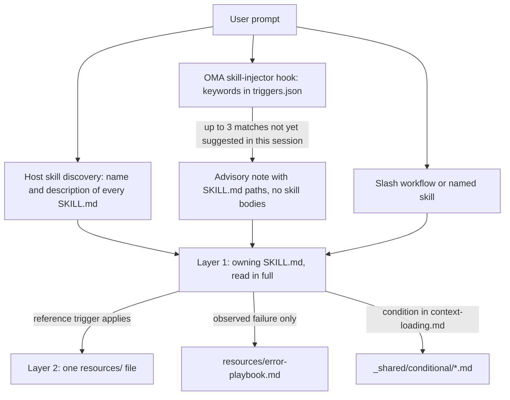
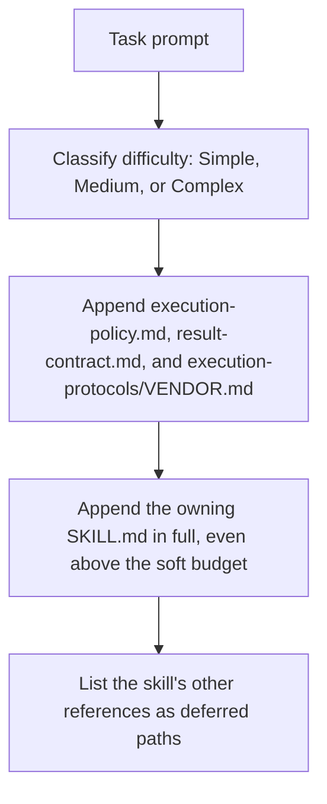

# Навыки

[Навыки](../getting-started/glossary.md#skill) — это структурированные пакеты знаний, которые дают роли диспетчеризации предметные указания. Они содержат протоколы выполнения, ссылки на технологический стек, шаблоны кода, playbook ошибок, чек-листы качества и примеры, если навык их предоставляет; всё организовано в двухслойной архитектуре для экономии токенов. Список установленных навыков приведён в [каталоге навыков](./agents.md#skill-catalog).

---

## Двухслойный дизайн

Навык попадает в контекст поэтапно. При выборе перед моделью оказывается только путь или описание; SKILL.md навыка-владельца читается полностью, как только навык выбран; вспомогательные файлы читаются по одному, когда срабатывает их trigger.



Источники: `.agents/hooks/core/skill-injector.ts`, `.agents/skills/_shared/core/skill-routing.md` и `.agents/skills/_shared/core/context-loading.md`.

### Слой 1: SKILL.md (читается, когда навык выбран)

У каждого навыка в корне есть файл `SKILL.md`. Injector hook передаёт **ссылку на путь**, а не содержимое, поэтому невыбранный навык ничего не стоит сверх своего `description`. Каждый `SKILL.md` содержит YAML frontmatter и одни и те же четыре раздела верхнего уровня; `oma skill lint` сообщает о навыке, в котором нет одного из них или тело которого длиннее 500 строк.

| Часть | Содержимое |
|------|----------|
| Frontmatter | `name` и маршрутизирующий `description` (что делает навык и когда его использовать) |
| `## Scheduling` | Цель, сигнатура намерения, когда использовать, когда НЕ использовать, ожидаемые входы и выходы, зависимости |
| `## Structural Flow` | Переходы, сбои и восстановление, состояния выхода |
| `## Logical Operations` | Канонический путь команды или рабочего процесса, область ресурсов, ограничения (guardrails) |
| `## References` | Файлы слоя 2, каждый с условием, которое оправдывает его чтение |

Текущий frontmatter `oma-frontend`:

```yaml
---
name: oma-frontend
description: "Implement or modify web UI in React, Next.js, or Angular. Use for components, pages, styles, forms, and frontend state or data flows."
---
```

Host runtime показывают модели `description` каждого навыка, поэтому он написан как маршрутизирующее предложение. Keyword hook OMA его не читает; его ключевые слова хранятся в `.agents/hooks/core/triggers.json`.

### Слой 2: resources/ (загружается по требованию)

Каталог `resources/` содержит подробные знания о выполнении. Эти файлы загружаются только когда:
1. хост или рабочий процесс выбрал навык (например, через нативное совпадение навыка или явную команду)
2. текущая задача удовлетворяет условию загрузки ссылки

Загрузкой по требованию управляет руководство по загрузке контекста (`.agents/skills/_shared/core/context-loading.md`), которое различает входные инструкции и ссылки, выбираемые по задаче.

### Что внедряет `oma agent spawn`

Диспетчеризация через CLI сама собирает prompt субагента, поэтому субагент начинает работу, уже имея в контексте контракты и навык-владелец:



Источник: `cli/commands/agent/spawn-status.ts`, `cli/platform/agent-config/loaders.ts` и `cli/platform/context-loader.ts`. Нативные субагенты получают тот же контекст задачи из `oma agent context <agent-id>` и сами читают политику и контракт результата, если runtime их не предоставил.

---

## Пример структуры файлов

```text
.agents/skills/oma-frontend/
├── SKILL.md                          ← Layer 1: read when selected
└── resources/
    ├── execution-protocol.md         ← Layer 2: step-by-step workflow
    ├── tech-stack.md                 ← Layer 2: detailed technology specs
    ├── tailwind-rules.md             ← Layer 2: Tailwind conventions
    ├── angular-rules.md              ← Layer 2: Angular-specific conventions
    ├── snippets.md                   ← Layer 2: copy-paste code patterns
    ├── error-playbook.md             ← Layer 2: error recovery procedures
    └── checklist.md                  ← Layer 2: quality verification checklist

.agents/skills/oma-backend/
├── SKILL.md
├── resources/
│   ├── execution-protocol.md
│   ├── orm-reference.md              ← Domain-specific (ORM queries, N+1, transactions)
│   ├── checklist.md
│   └── error-playbook.md
└── variants/                          ← Starter seeds for /stack-set
    ├── stack.schema.json
    ├── node/
    ├── python/
    └── rust/

.agents/skills/oma-mobile/
├── SKILL.md
├── resources/
│   ├── execution-protocol.md
│   ├── tech-stack.md
│   ├── screen-template.dart
│   ├── screen-template.swift         ← Swift native iOS screen template
│   ├── screen-template.tsx            ← React Native screen template
│   ├── checklist.md
│   └── error-playbook.md
└── variants/                          ← Platform seeds for /stack-set
    ├── README.md
    ├── stack.schema.json
    ├── flutter/                       ← stack.yaml, tech-stack.md, snippets.md, api-template.dart
    ├── react-native/                  ← stack.yaml, tech-stack.md, snippets.md, api-template.ts
    └── swift-ios/                     ← stack.yaml, tech-stack.md, snippets.md, api-template.swift

.agents/skills/oma-design/
├── SKILL.md
├── resources/
│   ├── execution-protocol.md
│   ├── anti-patterns.md
│   ├── asset-strategy.md
│   ├── checklist.md
│   ├── design-md-spec.md
│   ├── design-tokens.md
│   ├── getdesign-fetcher.md
│   ├── prompt-enhancement.md
│   ├── redesign-protocol.md
│   ├── stitch-integration.md
│   └── error-playbook.md
└── reference/                         ← Deep reference material
    ├── typography.md
    ├── color-and-contrast.md
    ├── spatial-design.md
    ├── motion-design.md
    ├── responsive-design.md
    ├── component-patterns.md
    ├── accessibility.md
    ├── visual-hierarchy.md
    └── shader-and-3d.md
```

---

## Типы ресурсов навыка

| Тип ресурса | Шаблон имени файла | Назначение | Когда загружается |
|--------------|-----------------|---------|-------------|
| **Протокол выполнения** | `execution-protocol.md` | Рабочий процесс по шагам: Analyze -> Plan -> Implement -> Verify | Когда выбранной операции нужны детали её команды или контракта |
| **Технологический стек** | `tech-stack.md` | Подробные спецификации технологий, версии и конфигурация | Выбранный фреймворк или решение по стеку |
| **Playbook ошибок** | `error-playbook.md` | Шаги от симптома к восстановлению; нехватка информации или полномочий приостанавливает только зависимое действие | Только после наблюдаемого сбоя |
| **Чек-лист** | `checklist.md` | Проверка качества для предметной области | Нужные разделы — для нерешённой проверки |
| **Фрагменты** | `snippets.md` | Готовые для копирования паттерны кода | Незнакомая реализация или структура вывода |
| **Примеры** | `examples.md` | Разобранные примеры входа и выхода (oma-pm, oma-db, oma-tf-infra, oma-observability, oma-search) | Незнакомая реализация или структура вывода |
| **Варианты** | каталог `variants/` | Стартовые заготовки для языков и фреймворков. Backend поставляет `node`, `python` и `rust`; mobile — `flutter`, `react-native` и `swift-ios`. `/stack-set` использует их, чтобы сгенерировать `stack/` проекта. | Когда настраивается соответствующий стек |
| **Шаблоны** | `screen-template.{dart,swift,tsx}` (oma-mobile), `variants/*/api-template.*` | Заготовка для нового экрана или API-модуля | При создании такого файла |
| **Ссылка на предметную область** | `orm-reference.md`, `anti-patterns.md` и т. п. | Глубокие знания предметной области для конкретных подзадач | Зависит от типа задачи |

---

## Общие ресурсы (_shared/)

Все агенты используют общую основу из `.agents/skills/_shared/`. Она организована в три категории:

### Основные ресурсы (`.agents/skills/_shared/core/`)

| Ресурс | Назначение | Когда загружается |
|----------|---------|-------------|
| **`execution-policy.md`** | Правила авторизации, уточнения, проверки и завершения для каждого навыка и рабочего процесса. | Внедряется в каждый prompt `oma agent spawn`; нативные агенты читают его, если он не предоставлен |
| **`skill-routing.md`** | Маршрутизирует по результату задачи, владельцу и реальным зависимостям; без обязательной цепочки агентов и квоты ходов. | Используется навыками оркестрации и координации |
| **`context-loading.md`** | Входной файл навыка-владельца, условные ссылки и границы загрузки в runtime. | При составлении контекста |
| **`prompt-structure.md`** | Даёт указания по передаче незнакомых задач: цель, контекст, реальные ограничения и доказательства приёмки; для задач, выполняемых напрямую, обязательного шаблона нет. | При составлении незнакомой передачи задачи; не обязательная предзагрузка |
| **`clarification-protocol.md`** | Выясняет рутинные детали по контексту и запрашивает только существенную недостающую информацию или разрешение. | При неоднозначных требованиях |
| **`code-intelligence.md`** | Использовать настроенную возможность code intelligence для поиска по коду, навигации и анализа влияния. | Поиск или навигация по коду |
| **`test-approach.md`** | `test_approach` для каждой задачи из плана PM и блок `TDD_EVIDENCE` для задач `tdd`. | Задачи, для которых план задаёт `test_approach` |
| **`context-budget.md`** | Оценки размера файлов, измерение фактического prompt, точечное чтение и checkpoints. | Длинные задачи или диагностика накладных расходов контекста |
| **`difficulty-guide.md`** | Выбирает глубину планирования и deliverables исходя из зависимостей и потребностей в проверке. | Когда для декомпозиции нужна оценка сложности |
| **`quality-principles.md`** | Указания по объёму работы, сопровождаемости, доказательствам и соразмерной проверке. | В начале рабочих процессов, ориентированных на качество (ultrawork) |
| **`vendor-detection.md`** | Определяет целевого вендора каждого агента по конфигурации и выбирает нативный dispatch или `oma agent spawn`. | Когда детали dispatch не определены |
| **`session-metrics.md`** | Необязательные доказательства сессии без диалоговых штрафных баллов и штрафных баллов оценивателя. | Запрошенная ретроспектива или существенная корректировка |
| **`common-checklist.md`** | Применимые междоменные проверки; без глобальных ограничений на число строк и без повсеместного требования catch. | Междоменное ревью, когда это уместно |
| **`lessons-learned.md`** | Фиксировать и применять уроки, подкреплённые доказательствами, с условиями версии и trigger; без автоматического порога RCA. | Используется после ошибок и в конце сессии |
| **`anti-ai-prose.md`** | Общая диагностика прозы. | Аудит академической прозы и стилевое ревью переводов |
| **`stack-verify.schema.json`** | Общие определения `verify:`, повторно используемые схемами стека backend и mobile. | Валидация схемы стека |
| **`api-contracts/`** | Необязательный шаблон контракта. Повторно используйте схемы проекта; сгенерированные контракты находятся вне исходников навыка. | Когда планируется работа через границы |

### Ресурсы runtime (`.agents/skills/_shared/runtime/`)

| Ресурс | Назначение |
|----------|---------|
| **`result-contract.md`** | Идентичность запуска, путь claim и контракт завершения для результатов агентов. Внедряется в каждый prompt `oma agent spawn`; нативные агенты следуют ему через `oma agent begin`, `oma agent verify` и `oma agent finish`. |
| **`memory-protocol.md`** | Формат файлов памяти и операции для CLI-субагентов. Определяет протоколы On Start, During Execution и On Completion с настраиваемыми memory tools (read/write/edit), включая расширение для tracking экспериментов. |
| **`event-spec.md`** | Контракт устойчивых событий рабочего процесса: события дописываются в `events.jsonl` в профиле OMA home и просматриваются через `oma state get` или `oma state list`. |
| **`execution-protocols/claude.md`** | Паттерны выполнения, специфичные для Claude Code. Внедряются командой `oma agent spawn`, когда вендор — claude. |
| **`execution-protocols/antigravity.md`** | Паттерны выполнения Antigravity CLI (`agy`). |
| **`execution-protocols/codex.md`** | Паттерны выполнения, специфичные для Codex CLI. |
| **`execution-protocols/commandcode.md`** | Паттерны выполнения CommandCode. |
| **`execution-protocols/grok.md`** | Паттерны выполнения Grok. |
| **`execution-protocols/kimi.md`** | Паттерны выполнения Kimi Code. |
| **`execution-protocols/kiro.md`** | Паттерны выполнения Kiro. |
| **`execution-protocols/opencode.md`** | Паттерны выполнения расширения OpenCode. |
| **`execution-protocols/pi.md`** | Паттерны выполнения расширения pi. |
| **`execution-protocols/qwen.md`** | Паттерны выполнения, специфичные для Qwen CLI. |

Для агентов, запущенных через CLI, протоколы выполнения конкретного вендора автоматически внедряет `oma agent spawn`. Нативные субагенты используют правила интеграции выбранного вендора.

### Условные ресурсы (`.agents/skills/_shared/conditional/`)

Эти ресурсы загружаются только тогда, когда во время выполнения соблюдаются определённые условия:

| Ресурс | Условие срабатывания | Кем загружается |
|----------|-------------------|-----------|
| **`quality-score.md`** | Нужен определённый baseline или сравнение экспериментов | Оркестратор (передаёт в prompt QA-агента) |
| **`experiment-ledger.md`** | Реальная гипотеза сравнивается с baseline или другим подходом | Координатор (ведёт общий ledger; параллельные агенты пишут результаты в рамках задачи или запуска, которые он объединяет) |
| **`exploration-loop.md`** | Повторное восстановление не удаётся, и альтернативы стоит проверить в рамках бюджета | Оркестратор (inline, перед запуском агентов для гипотез) |
| **`diagram-engine.md`** | Рабочий процесс собирается вывести структурную диаграмму (архитектура, последовательность, поток данных, жизненный цикл) | Рабочий процесс, выводящий диаграмму |

Эти ресурсы откладываются до тех пор, пока не выполнится условие каждого из них. Сама по себе сложность их не внедряет.

---

## Как выбирается навык {#how-skills-route-via-skill-routingmd}

Навык попадает в контекст тремя путями. Ни один из них сам по себе не запускает рабочий процесс и не разрешает делегирование.

1. **Нативное обнаружение хостом.** Runtime с поддержкой навыков перечисляют `name` и `description` каждого навыка; модель читает тот SKILL.md, описание которого соответствует запрошенному результату.
2. **Подсказка OMA по ключевым словам.** Там, где OMA устанавливает свой prompt hook, `skill-injector` сопоставляет prompt с мультиязычными ключевыми словами из `.agents/hooks/core/triggers.json` и добавляет рекомендательную заметку `[OMA SKILLS DETECTED: ...]` со списком до трёх путей SKILL.md. Для "Build a login form with Tailwind CSS" совпадает только ключевое слово `tailwind`, поэтому заметка предлагает `oma-frontend`.
3. **Явный вызов.** Рабочий процесс со слеш-командой, например `/plan`, `/review` или `/debug`, или упоминание навыка в prompt.

### Владелец по результату

Ограниченную задачу выполняет один навык-владелец; передачу другому навыку добавляйте только тогда, когда он даёт отдельную возможность. Эта таблица повторяет `.agents/skills/_shared/core/skill-routing.md`. Для других доменов выбирайте среди описаний установленных навыков в [каталоге навыков](./agents.md#skill-catalog).

| Запрошенный результат | Навык-владелец |
|-------------------|--------------|
| API приложения, серверная аутентификация, логика сервисов и доступа к данным | oma-backend |
| Схема, проектирование миграций, индексация, настройка запросов, операции с базой данных | oma-db |
| Веб-компоненты, страницы, формы, клиентское состояние | oma-frontend |
| Мобильные экраны, виджеты, интеграция с платформой | oma-mobile |
| Границы системы, архитектурные компромиссы, ADR | oma-architecture |
| Диагностика и исправление некорректного поведения | oma-debug |
| Ревью корректности, безопасности, доступности, производительности | oma-qa |
| Визуальная система, DESIGN.md, направление редизайна | oma-design |
| Запрошенная генерация идей или исследование альтернатив | oma-brainstorm |
| Требования, зависимости, критерии приёмки | oma-pm |
| Запрошенное параллельное выполнение специалистами | oma-orchestration |
| Запрошенная ручная мультиагентная координация | oma-coordination |
| Ветки Git, коммиты, слияния, история репозитория | oma-scm |

### Зависимости между навыками

Фиксированной цепочки выполнения нет. Упорядочивайте работу по реальным зависимостям:

- Решите открытый архитектурный или продуктовый вопрос до работы, которая от него зависит. Уже принятые решения не нужно снова проводить через архитектуру, brainstorming или PM.
- Backend и клиентская часть могут разрабатываться независимо, если их общий API-контракт пригоден к использованию. Если его нет, сначала согласуйте эту границу с соответствующими владельцами.
- Ревью может начаться по завершённой части, готовой к проверке, пока независимая реализация продолжается. Не считайте нестабильный артефакт окончательным доказательством.
- Баг, найденный во время реализации, может исправить его владелец. Подключайте помощь debug, когда этого требует диагностика; обязательной цепочки «реализация → debug» нет.
- Для междоменного дефекта определяйте нарушенный контракт и ответственного владельца по доказательствам. Несоответствие API не означает автоматически, что менять нужно backend.

### Когда подсказка навыка не появляется

Всё это поведение задаёт `.agents/hooks/core/skill-injector.ts`.

| Симптом | Причина | Что делать |
|---------|-------|------------|
| Заметки `[OMA SKILLS DETECTED]` нет вообще | Prompt начинается с `/`, для сессии активен [постоянный рабочий процесс](../getting-started/glossary.md#persistent-workflow) или сообщение является пересланным сообщением агента | Это ожидаемо: контекстом управляет рабочий процесс. Если навык нужен, назовите его |
| Ожидаемого навыка нет в заметке | Перечисляются только 3 лучших совпадения (10 баллов за каждое совпавшее ключевое слово) | Используйте более конкретный термин или назовите навык |
| Ранее предложенный навык больше не предлагается | Путь SKILL.md предлагается один раз за сессию; запись в `.agents/state/skill-sessions.json` истекает через час без новых предложений | Прежнее предложение по-прежнему действует |
| Ключевое слово игнорируется | Текст внутри блоков кода, обратных кавычек или двойных кавычек удаляется до сопоставления | Упомяните термин обычным текстом |
| oma-academic-writing, oma-docs, oma-explanation, oma-scholar или oma-skill-creation никогда не предлагаются | У этих навыков нет ключевых слов в `triggers.json` | Используйте `/docs` или `/explain` либо назовите навык; обнаружение хостом по-прежнему видит их описания |
| Подсказка называет не относящийся к делу навык | Сопоставление основано на ключевых словах и носит рекомендательный характер | Сформулируйте желаемый результат; заметка велит модели опираться на собственное суждение |

---

## Математика экономии токенов {#token-savings-math}

Измеряйте стоимость контекста, прежде чем заявлять об экономии. Слова simple, medium и complex обозначают две разные вещи:

- **Сценарии скрипта** (`routed`, `simple`, `medium`, `complex`, `all`) — кумулятивные сравнения размеров файлов, которые выводит `scripts/measure-skill-context.ts`. Это не политики загрузки, а `all` — лишь верхняя граница.
- **Сложность загрузчика** (Simple, Medium, Complex) выбирает мягкий бюджет для контекста, который внедряет диспетчеризация через CLI. См. [Загрузка ресурсов по задаче](#resource-loading-by-task).

```bash
bun scripts/measure-skill-context.ts
bun scripts/measure-skill-context.ts --skills oma-pm,oma-backend,oma-frontend --json
oma agent context backend --difficulty Medium
```

Скрипт сообщает оценки «байты UTF-8 / 4». `routed` — только входной файл; `simple`, `medium` и `complex` добавляют для сравнения гипотетические файлы протокола, примеров и стека. Их названия сохранены ради совместимости со скриптом, а не как инструкции по предзагрузке. Свежий checkout может использовать seed одной платформы как proxy размера; все платформы при этом не загружаются.

Команда context показывает фактически внедряемый контекст задачи: заголовок `## Task context (graph-selected, approximately N tokens)`, SKILL.md навыка-владельца и список отложенных ссылок. Она не включает остальную часть диалога и не охватывает все инструкции хоста и runtime, а prompt запущенного субагента больше, потому что `oma agent spawn` добавляет ещё политику выполнения, контракт результата и протокол вендора. Чтобы измерить общее число входных токенов, задержку и стоимость на конкретной модели, используйте собранный prompt или телеметрию использования. Не выводите эти показатели из размера репозитория или подсчётов по сгенерированным зеркалам.

## Загрузка ресурсов по задаче {#resource-loading-by-task}

Каждый уровень сложности начинается с навыка-владельца. Граф — это индекс ссылок; смежность не даёт права загружать другого специалиста, playbook ошибок или условный workflow экспериментов.

Загрузчик использует мягкие бюджеты в 1 500 / 4 000 / 8 000 оценочных токенов для Simple / Medium / Complex. Входной файл, превышающий бюджет, сохраняется, а о превышении сообщается. Вспомогательные ссылки остаются отложенными, если только их не выбрали явно после определения соответствующего task trigger. Обязательный входной файл никогда не заменяется меньшими несвязанными документами.

Проверка определяется риском задачи и требованиями проекта. Метка сложности не требует ни полного набора тестов, ни фиксированного ответа предполётной проверки, ни повторного одобрения уже разрешённой работы.

## Карты задач для загрузки контекста (по агентам)

Это примеры ссылок, к которым стоит обращаться, когда они нужны задаче. Используйте актуальный индекс навыка-владельца и выбирайте только применимые разделы:

### Бэкенд-агент

<!-- oma-docs:ignore-start -->

| Тип задачи | Необходимые ресурсы |
|-----------|-------------------|
| Создание CRUD API | `stack/snippets.md` и `stack/api-template.*` проекта (генерируются `/stack-set`), если они есть; иначе существующий код проекта |
| Аутентификация | `stack/snippets.md` + `stack/tech-stack.md`, если они есть |
| Миграция БД | `stack/snippets.md`, если он есть; проектирование схемы передаётся oma-db |
| Оптимизация производительности | `orm-reference.md` и любые подходящие примеры, поставляемые навыком |
| Изменение существующего кода | провайдер code intelligence проекта и соответствующие ресурсы выполнения |

<!-- oma-docs:ignore-end -->

`variants/node`, `variants/python` и `variants/rust` — стартовые заготовки для `/stack-set`; агенты не читают их при правке существующего кода.

### Фронтенд-агент

| Тип задачи | Необходимые ресурсы |
|-----------|-------------------|
| Создание компонента | snippets.md + существующие паттерны компонентов проекта |
| Реализация форм | snippets.md (form + Zod) |
| Интеграция API | snippets.md (TanStack Query) |
| Стилизация | tailwind-rules.md |
| Макет страницы | snippets.md (grid) |

### Дизайн-агент

| Тип задачи | Необходимые ресурсы |
|-----------|-------------------|
| Создание дизайн-системы | reference/typography.md + reference/color-and-contrast.md + reference/spatial-design.md + design-md-spec.md |
| Дизайн landing page | reference/component-patterns.md + reference/motion-design.md + prompt-enhancement.md |
| Аудит дизайна | checklist.md + anti-patterns.md |
| Экспорт дизайн-токенов | design-tokens.md |
| 3D / шейдерные эффекты | reference/shader-and-3d.md + reference/motion-design.md |
| Ревью доступности | reference/accessibility.md + checklist.md |

### QA-агент

| Тип задачи | Необходимые ресурсы |
|-----------|-------------------|
| Ревью безопасности | checklist.md (раздел Security) |
| Ревью производительности | checklist.md (раздел Performance) |
| Ревью доступности | checklist.md (раздел Accessibility) |
| Полный аудит | checklist.md (все разделы), плюс iso-quality.md, когда запрошено ревью по стандартам |
| Сравнение по определённым метрикам | quality-score.md (условный) |

---

## Как orchestrator составляет prompt

Когда оркестратор пишет prompt субагента (`oma-orchestration/resources/subagent-prompt-template.md`), он передаёт только данные задачи: роль агента, ID задачи, рабочее пространство, разрешённые пути, описание задачи, критерии приёмки, ссылки задачи с условиями их загрузки и существенные ограничения.

- Для диспетчеризации через CLI `oma agent spawn` уже внедряет `execution-policy.md`, `result-contract.md`, протокол выполнения вендора и SKILL.md навыка-владельца, поэтому prompt их не повторяет.
- Для нативной диспетчеризации передайте пути к этим файлам и к навыку-владельцу, если runtime их не предоставил.
- Добавляйте раздел error-playbook только после наблюдаемого сбоя, а `runtime/memory-protocol.md` — только когда агент координирует или возобновляет устойчивое состояние задачи.

Такой целевой состав не загружает ненужные ресурсы и оставляет субагенту максимум контекста для реальной работы.

---

## Доказательства сессии и ретроспективный обзор

Записи сессии фиксируют существенные корректировки, изменения объёма работы, переделки и рассмотренные находки ревью с доказательствами. Необходимое уточнение не влечёт штрафа. Прежние взвешенные баллы CD и EA и правила RCA, срабатывавшие при достижении порогов, удалены; это были инструкции в prompt, а не метрики, вычисляемые CLI.

По возможности используйте существующие результаты задач. Отдельный файл `session-metrics-{sessionId}.md` в настроенном хранилище координации необязателен. Повторяющийся сбой или запрошенная ретроспектива могут обосновать урок, но обычная непройденная проверка или оспоренная находка автоматически урока не создают. Сохраняйте исторические журналы и не переписывайте их в новый формат.

`oma stats` показывает продуктивность и сводки записанного использования и стоимости. `oma retro` группирует фактические события gate, блокеров и недостающих решений в предложения. Ни одна из команд не вычисляет баллы CD/EA по этим Markdown-артефактам.

## Декомпозиция задач и восстановление контекста

Планируйте исходя из зависимостей и независимо проверяемого поведения. Фиксированное число sprint, число файлов и оценки числа ходов не определяют ни глубину ревью, ни то, завершена ли работа. Держите тесты и обработку ошибок вместе с поведением, которое они проверяют.

При наблюдаемом застое или потере полезного контекста сохраните завершённую работу, оставшиеся критерии, релевантные пути и доказательства проверки перед возобновлением или повторной диспетчеризацией. Сохраняйте существующую работу и не дублируйте ещё выполняющуюся попытку. Само по себе соотношение ходов и прогресса не требует reset.

## Условное измерение и исследование

Определённый baseline или сравнение экспериментов активирует указания по измерению; простое наличие тестов или lint — нет. Записывайте сопоставимые метрики с указанием единиц, метода, ревизии и доказательств. Обязательные проверки корректности и безопасности остаются независимыми. В OMA нет ни составной формулы по умолчанию, ни gate по буквенной оценке, ни отката, запускаемого по баллам.

В реальном эксперименте записываются гипотеза, доказательства по baseline и варианту-кандидату, обязательные проверки, решение и принадлежащие ему файлы. Повторяющиеся сбои могут оправдать проверку другого механизма в рамках существующего бюджета восстановления. Изолируйте изменения эксперимента, сохраняйте несвязанные с ним правки и проверяйте интегрированный вариант-кандидат, прежде чем возобновлять gate.

---

## Связанные материалы

- [Агенты](./agents.md): каталог навыков, роли dispatch, определения и нативные файлы агентов
- [Рабочие процессы](./workflows.md): рабочие процессы со слеш-командами, которые читают навыки
- [Структура проекта](./project-structure.md): где находится `.agents/skills/` после установки
- [Результаты агентов и возобновление](../guide/agent-results-and-resume.md): нативный жизненный цикл `oma agent begin` → `oma agent finish`
- [Оценка навыков](../guide/skill-eval.md) и [Оптимизация навыков](../guide/skill-opt.md)
- Авторинг: используйте навык `oma-skill-creation`, затем запустите `oma skill lint` и `oma skill audit`
