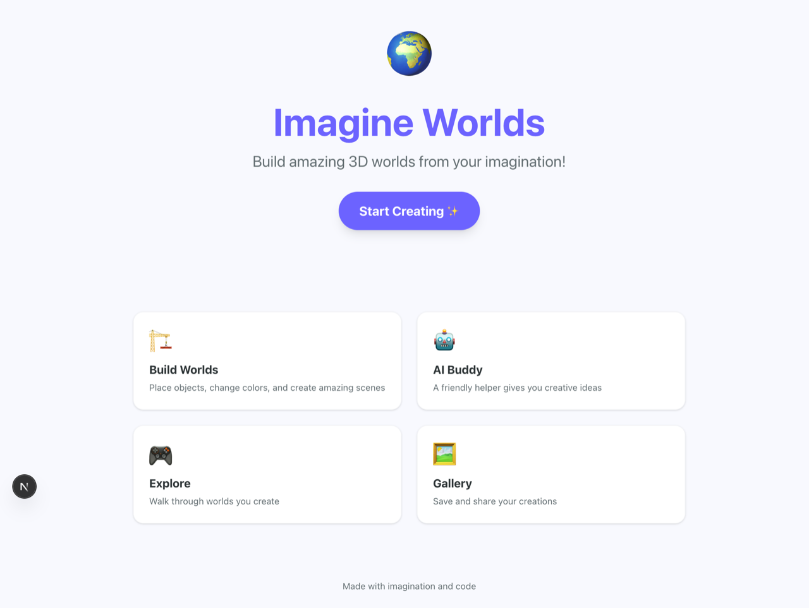
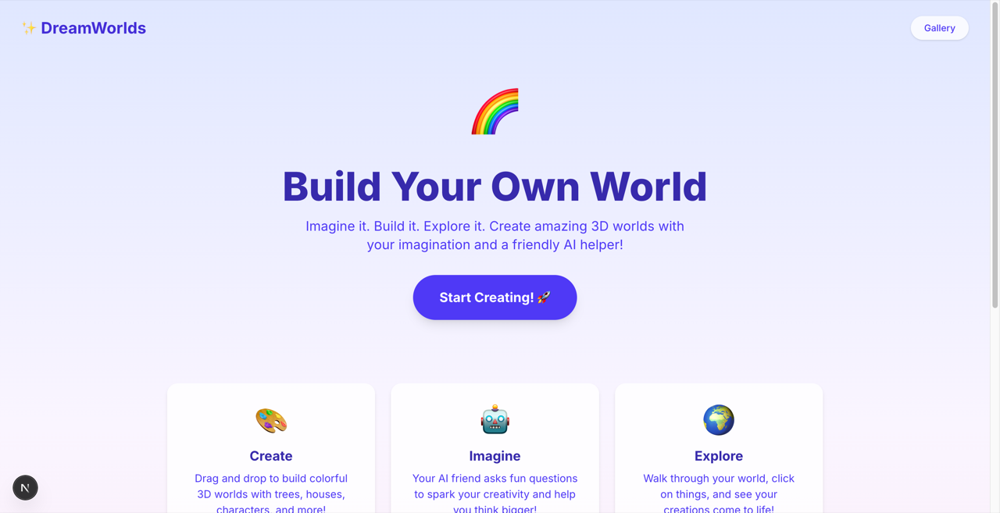

# Бенчмарки

Пять harness в Claude Code собрали один и тот же MVP творческой 3D-платформы обучения для детей по одному исходному prompt. **oh-my-agent занял первое место с результатом 80.6/100** по рубрике из пяти осей: функциональность, соответствие спецификации, визуал, инженерное качество и эффективность.

> Условия запуска: `claude-opus-4-6`, effort `max`, `--max-budget-usd 20`, `--no-session-persistence`, `--setting-sources project,local`. OAuth через авторизованный CLI `claude` пользователя (без `ANTHROPIC_API_KEY`).

---

## Сравниваемые harness

| Harness | Механизм |
|---|---|
| `vanilla` | обычный Claude Code без плагина и навыка (baseline) |
| `oma` | `oh-my-agent`, подготовленный из исходников (`.agents/` + `.claude/`) |
| `omc` | `oh-my-claudecode` через `--plugin-dir` |
| `ecc` | `everything-claude-code`, установленный в `~/.claude/` |
| `superpowers` | `superpowers` через `--plugin-dir` |

---

## Итоговая таблица

| Место | Harness | **Итого** | Func/35 | Spec/15 | Visual/20 | Eng/20 | Eff/10 |
|---|---|---|---|---|---|---|---|
| 1 | **oma** | **80.6** | 32 | 13.3 | 15.3 | 15 | 5 |
| 2 | omc | 74.1 | 33.5 | 6.7 | 14.4 | 14.5 | 5 |
| 3 | superpowers | 72.9 | 30 | 9.3 | 11.6 | 14 | 8 |
| 4 | vanilla | 70.7 | 28.5 | 11.7 | 12 | 12.5 | 6 |
| 5 | ecc | 70.2 | 28.5 | 9.7 | 13 | 15 | 4 |

### Экономика запусков

| Harness | Ходы | Длительность | Стоимость | Файлы (src) |
|---|---|---|---|---|
| vanilla | 42 | 8m 56s | $2.37 | 16 |
| oma | 31 | 15m 56s | $4.04 | 21 |
| omc | 61 | 9m 02s | $1.92 | 14 |
| ecc | 79 | 10m 20s | $3.84 | 22 |
| superpowers | 39 | 8m 13s | $1.28 | 18 |

---

## Сравнение целевых страниц

| vanilla | oma | omc | ecc | superpowers |
|---|---|---|---|---|
|  |  |  |  |  |

Полные сравнения отдельных экранов (world builder, панель AI, галерея, состояние save→reload) находятся в [отчёте бенчмарка на GitHub](https://github.com/first-fluke/oh-my-agent/tree/main/benchmarks).

---

## Как вычисляются оси

| Ось | Вес | Основные сигналы | Инструменты |
|---|---|---|---|
| **Функциональность** | 35 | завершение сборки, запуск dev-сервера (HTTP 200 ≤45s), 5 проверок пользовательских сценариев, lint, ts-clean | `pm install/build/lint`, curl, chrome-devtools MCP, `tsc --noEmit` |
| **Спецификация** | 15 | 13 явно указанных результатов prompt, бонус за настоящий API | LLM-judge с brace-balanced JSON extractor |
| **Визуал** | 20 | анти-паттерны, удобство для детей, согласованность дизайн-системы, доступность | LLM-judge по скриншотам |
| **Инженерное качество** | 20 | охват кода, строгий TS, максимальный размер файла и глубина каталога, маркеры отложенных заглушек, отсутствие захардкоженных ключей | статический анализ (jq + grep + find) |
| **Эффективность** | 10 | число ходов, длительность по часам, стоимость на файл | JSON результата `claude -p` |

Judge спецификации и визуала запускаются для каждого harness 3 раза через `judge-multi.sh`, а оценки отдельных пунктов усредняются по раундам. Реализация находится в [`benchmarks/scoring/multiaxis/`](https://github.com/first-fluke/oh-my-agent/tree/main/benchmarks/scoring/multiaxis).

---

## Ограничения

1. **Переопределение prompt в superpowers:** оно было необходимо для запуска harness в неинтерактивном режиме (навык мозгового штурма с `<HARD-GATE>` блокирует одношаговые запуски). Результат показывает, что «superpowers может сделать после обхода шлюза», а не полностью сопоставимое сравнение.
2. **Усреднение нескольких judge по спецификации и визуалу, один запуск сценариев:** оценка сценариев требует работающего dev-сервера, поэтому выполняется один раз. Разницу в сценариях менее примерно 2 баллов считайте шумом. Для каждого harness построена одна версия.
3. **Нормализация стоимости:** ось эффективности использует стоимость на файл; абсолютная стоимость ($1.28–$8.19 для пяти запусков) в оценку не входит.
4. **Штраф oma за `lint-clean` сделан намеренно:** oma намеренно оставляет проверку lint и типов хукам Git (hk) и CI, а не встраивает правила, специфичные для ESLint, в навыки агентов. В одношаговом бенчмарке это даёт -5 за `lint-clean`, но в реальном рабочем процессе те же проблемы будут остановлены pre-push до отправки в удалённый репозиторий.

---

## Воспроизведение

```bash
# Run all harnesses (sequential, ~45 min, ~$15-20 in API spend)
./benchmarks/run.sh

# Multiaxis scoring per harness (5-axis, 100pt) — single judge round
for h in vanilla oma omc ecc superpowers; do
  ./benchmarks/scoring/multiaxis/score.sh \
    /tmp/oma-benchmark-<timestamp>/projects/$h \
    $h \
    /tmp/oma-benchmark-<timestamp>/results/$h.json \
    /tmp/oma-benchmark-<timestamp>/multiaxis/$h
done

# Generate the report
./benchmarks/scoring/multiaxis/build-report.sh \
  /tmp/oma-benchmark-<timestamp> \
  $(pwd)
```

Полный narrative каждого harness, исходные оценки и скриншоты хранятся в [`benchmarks/README.md`](https://github.com/first-fluke/oh-my-agent/blob/main/benchmarks/README.md). Этот файл создаётся `build-report.sh` из `multiaxis/*.json` каждого запуска, поэтому он всегда соответствует последним артефактам подсчёта.
