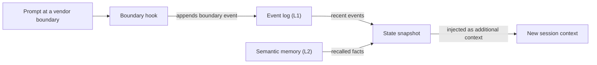

# Глоссарий

## Строительные блоки {#building-blocks}

### Навык (skill) {#skill}

Навык — это пакет предметных знаний в `.agents/skills/oma-<name>/`. Его `SKILL.md` попадает в контекст, когда задача маршрутизируется на этот навык, а файлы из `resources/` загружаются только тогда, когда они нужны задаче. Навык определяет, как агент работает в одном домене; многоэтапный процесс он не задаёт. См. [Навыки](../core-concepts/skills.md).

### Рабочий процесс (workflow) {#workflow}

Рабочий процесс — это многоэтапный процесс, определённый в `.agents/workflows/<name>.md`. Его запускают слеш-командой, например `/plan` или `/orchestrate`; если включён хук определения ключевых слов, процесс также может внедрить совпавшая фраза-триггер. Рабочие процессы координируют один или несколько навыков и агентов. См. [Рабочие процессы](../core-concepts/workflows.md) и [Выбор навыка или рабочего процесса](../core-concepts/workflows.md#choosing-a-skill-or-workflow).

### Определение агента {#agent-definition}

Определение агента — это закоммиченный в репозиторий файл субагента в `.agents/agents/`, например `backend-engineer.md` или `qa-reviewer.md`. Он задаёт идентичность агента, загружаемые навыки (frontmatter `skills:`), раздел протокола выполнения и предметные правила. OMA проецирует эти файлы в нативные форматы вендоров, например `.claude/agents/*.md` и `.codex/agents/*.toml`. В документации словом «агент» также называют роль dispatch (`backend`, `qa`, `explore`) и навык, например `oma-backend`. См. [Определения агентов](../core-concepts/agents.md#agent-definitions).

## Пресеты {#presets}

### Пресет навыков {#skill-preset}

Пресет навыков — это набор навыков, который установщик добавляет в проект, например `all`, `fullstack`, `backend` или `research`. Общие ресурсы `_shared/` устанавливаются с любым пресетом. Пресет навыков не влияет на то, какая модель запускает агента. См. [Пресеты](./installation.md#presets).

### Пресет моделей {#model-preset}

Пресет моделей — это значение `model_preset` в `.agents/oma-config.yaml` (или `.cue`). Он определяет, какой вендор и какая модель используются для каждого агента. `auto`, значение по умолчанию для новых установок, следует собственным настройкам агентов и моделей текущего runtime; фиксированные пресеты, такие как `claude`, `codex` или `mixed`, закрепляют их. Переопределения `agents.<id>` имеют приоритет над пресетом, кроме режима `free`, где `free.model` заменяет закреплённые модели отдельных агентов. См. [Встроенные пресеты](../guide/per-agent-models.md#built-in-presets).

## Выполнение рабочих процессов {#workflow-execution}

### Постоянный рабочий процесс {#persistent-workflow}

Постоянный рабочий процесс продолжает работу между ходами, пока работа не будет завершена или пока вы его не деактивируете. Постоянные рабочие процессы — `/orchestrate`, `/work`, `/ultrawork` и `/ralph`; постоянный режим включается только явным вызовом. Пока такой процесс активен, хук повторно внедряет `[OMA PERSISTENT MODE: ...]` в каждый запрос, а Stop-хук не даёт сессии завершиться, пока не будет достигнут лимит подкрепления или тайм-аут устаревания. Чтобы деактивировать процесс, скажите `workflow done`. См. [Механика постоянного режима](../core-concepts/workflows.md#persistent-mode-mechanics).

### Stop gate {#stop-gate}

Stop gate — это необязательная проверка завершения, которую вы прикрепляете к активному постоянному рабочему процессу командой `oma goal set --gate typecheck|test|lint`. После этого Stop-хук позволяет процессу завершиться, только когда проходит одноимённый скрипт из `package.json`. Сбои gate учитываются в лимите подкрепления, поэтому проваленный gate не может блокировать остановку бесконечно. См. [`goal set`](../cli-interfaces/commands.md#goal-set).

## Сессии и состояние {#sessions-and-state}

Слово «сессия» в OMA имеет два значения: сессия, которую отслеживает сам OMA, и сессия разговора в используемом AI CLI или IDE. Различайте их, когда читаете файлы состояния или параметры команд.

### Сессия OMA {#oma-session}

Сессия OMA — это работа, которую OMA отслеживает под собственным ID сессии, независимо от разговора у вендора. Оркестрация использует этот ID в именах плана, доски задач, файлов прогресса и результатов, а также записей запусков агентов; оркестратор генерирует его в формате `session-YYYYMMDD-HHMMSS`. Состояние рабочих процессов использует ID сессии OMA (`sid`) как ключ [журнала событий](#event-log), который просматривают `oma state list` и `oma state get <sid>`. См. [Стратегия ID сессий](../guide/multi-agent-project.md#session-id-strategy).

### ID сессии вендора {#vendor-session-id}

ID сессии вендора — это ID разговора, который назначает AI CLI или IDE, например ID сессии Claude Code или Codex. OMA записывает его в событиях как `vendorSid`, и файлы состояния постоянного режима именуются по нему (`.agents/state/<workflow>-state-<vendor-session-id>.json`). Если сессия OMA активна, а запрос приходит из другой сессии вендора, от другого вендора или из только что сжатой сессии, хук записывает событие `boundary` и внедряет снимок состояния, чтобы работа продолжилась в новом контексте. См. [`state`](../cli-interfaces/commands.md#state).

Если семантическая память недоступна, снимок строится только из локальных событий.

### Журнал событий {#event-log}

Журнал событий — это append-only запись сессии OMA, которая хранится как `events.jsonl` в `${OMA_STATE_HOME:-~/.oma}/u/<profile>/sessions/<sid>/`. Каждая строка — одно событие, например `session.created`, `workflow.phase`, `gate.passed`, `decision.made` или `session.ended`. Рабочие процессы добавляют обязательные решения через `oma state emit` и проверяют их через `oma state verify`; читайте журнал через `oma state get` или `oma state trajectory`, а не открывая файл напрямую. См. [`state`](../cli-interfaces/commands.md#state).

## Ревью и доказательства {#review-and-evidence}

### Judge {#judge}

У слова «judge» два значения. В `/ralph` judge — это фаза после каждой итерации ultrawork, которая сверяет каждый критерий завершения с фактическим состоянием проекта и записывает PASS, FAIL, REGRESSED или BLOCKED. Её выполняет отдельно запущенный агент со свежим контекстом, поэтому оркестратор не оценивает собственную работу. В оценке и оптимизации навыков `judge` — тип проверяющего по умолчанию: модель оценивает вывод варианта по рубрике и возвращает PASS или FAIL. См. [/ralph](../core-concepts/workflows.md#ralph) и [проверяющий judge](../guide/skill-eval.md#judge-default).

### Cross-context review (CCR) {#cross-context-review-ccr}

Cross-context review — это правило, по которому каждый шаг ревью в `/ultrawork` выполняется в новом субагенте-ревьюере с изолированным контекстом. Ревьюер получает только проверяемые артефакты, переданные по пути (diff, изменённые файлы, план, предыдущие результаты, вывод тестов), и руководство для своего ревью; он никогда не видит историю основной сессии или рассуждения исполнителя. Каждый ревьюер записывает структурированный вердикт, который собирает координатор фазы. См. [/ultrawork](../core-concepts/workflows.md#ultrawork).

### Charter {#charter}

Charter — это preflight-блок `CHARTER_CHECK`, который агенты реализации раньше записывали перед написанием кода. Текущие определения агентов не требуют фиксированного preflight-вывода. Вместо этого агенты следуют общей политике выполнения: формулируют существенные допущения, задают вопросы только тогда, когда недостающая информация влияет на корректность или объём работы, и приостанавливают только ту часть работы, которая зависит от ответа. Запущенный субагент не может спросить вас напрямую, поэтому сообщает о недостающем факте в результате со статусом `blocked` или `partial`. См. [Авторизация и уточнения](../core-concepts/agents.md#charter-preflight-charter_check).

### Запись запуска и claim {#run-record-and-claim}

Запись запуска — это машиночитаемая квитанция одной попытки агента, которая хранится в каталоге состояния проекта для профиля, `~/.oma/u/<profile>/projects/<project-hash>/agent-runs/` (старые версии использовали `.agents/state/agent-runs/`); `oma agent begin` создаёт её и сохраняет снимок контракта задачи. Claim — это собственный отчёт агента по соответствующему пути `.claim.json` со статусом `completed`, `partial`, `blocked` или `failed`, а также изменёнными файлами, незавершённой работой и артефактами. `oma agent finish` сверяет claim с текущим контрактом, квитанциями проверок и хешами артефактов, поэтому claim с устаревшими доказательствами не остаётся в статусе completed. См. [Результаты агентов и возобновление](../guide/agent-results-and-resume.md).

## Память и провайдеры {#memory-and-providers}

### Память L1 и L2 {#l1-and-l2-memory}

L1 — это [журнал событий](#event-log): локальное append-only состояние рабочих процессов, которое читают `oma state verify` и снимок на границе сессии. L2 — семантическая память, то есть извлекаемые факты, которые предоставляет выбранный провайдер `providers.semantic_memory`: `agentmemory` (по умолчанию), `honcho` или `none`. Обязательные решения хранятся в L1, поэтому они переживают границы сессий без L2. У «L1» и «L2» есть и другие значения: Layer 1 и Layer 2 навыка — это его `SKILL.md` и каталог `resources/`, загружаемый по требованию, а `oma docs verify` сообщает о «L2 references» — ссылках на файлы, URL, CLI, скрипты, переменные окружения и конфигурацию, которые он извлекает из документации. См. [`memory`](../cli-interfaces/commands.md#memory) и [Семантическая память Honcho](../guide/configuration-reference.md#honcho-semantic-memory).

### Провайдер возможности {#capability-provider}

Провайдер возможности — это внешний инструмент или сервис, который OMA использует для одной возможности; он выбирается в разделе `providers` файла `.agents/oma-config.yaml`. Возможности: документация (`docs`, по умолчанию `context7`), веб-поиск (`web`, по умолчанию `native`), code intelligence (`code_intelligence`, по умолчанию `serena`) и семантическая память (`semantic_memory`, по умолчанию `agentmemory`). После смены провайдера выполните `oma link`. См. [Ключи верхнего уровня](../guide/configuration-reference.md#top-level-keys) и [Важные значения по умолчанию](./important-defaults.md).

## Планы и исходные файлы {#plans-and-source-files}

### План {#plan}

План — это машиночитаемая декомпозиция задач в `.agents/results/plan-<sessionId>.json`, которую записывает `/plan` и используют `/orchestrate` и `/work`; `/orchestrate` создаёт план, если пригодного плана нет. Каждая задача указывает своего агента, рабочее пространство, зависимости, критерии приёмки и обязательные проверки, а записи запусков сохраняют снимок этого контракта. План не связан с разрешением моделей по агентам, которое показывает `oma doctor --profile` и которое на некоторых страницах называется унаследованным планом. См. [/plan](../core-concepts/workflows.md#plan) и [Запуск нативного выполнения](../guide/agent-results-and-resume.md#start-a-native-run).

### SSOT {#ssot}

Единый источник истины (single source of truth, SSOT) — это каталог `.agents/`: `<project>/.agents/` при установке в проект или `~/.oma/.agents/` при глобальной установке. В нём находятся навыки, рабочие процессы, определения агентов, правила и конфигурация, а `oma install`, `oma update` и `oma link` создают из него нативные файлы вендоров (`.claude/`, `.codex/` и другие). Редактируйте `.agents/` и запускайте `oma link`, а не правьте созданные файлы. Некоторые страницы называют SSOT более узкий источник, например манифест запланированных агентов. См. [.agents/: источник истины](../core-concepts/project-structure.md#agents-the-source-of-truth).
