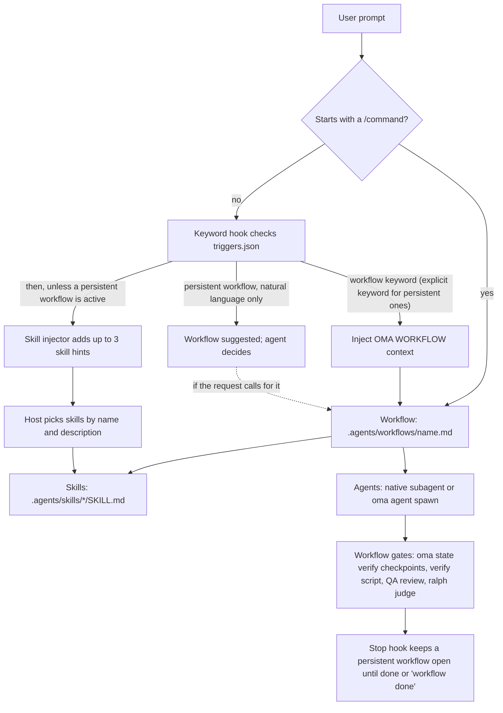

# Введение

oh-my-agent — это фреймворк оркестрации нескольких агентов для IDE и CLI с поддержкой AI. Вместо того чтобы поручать всё одному AI-помощнику, oh-my-agent распределяет работу между 33 пакетами навыков и 13 каноническими ролями диспетчеризации. Двенадцать хранимых в репозитории файлов определений субагентов предоставляют повторно используемые роли для реализации, ревью, планирования, отладки, документации, исследований и инфраструктуры. `research-explorer.md` сопоставляется с канонической ролью `explore`; `orchestrator` — это runtime-роль координации без отдельного файла определения.

OMA выполняет механические проверки, когда вы вызываете их или выбираете рабочий процесс, в который они входят. `oma verify agent <agent-type>` запускает проверки для выбранного типа агента; `/ralph` добавляет проверку на основе артефактов и цикл [judge](./glossary.md#judge); включённые Stop-хуки поставщика ([stop gate](./glossary.md#stop-gate)) могут удерживать рабочий процесс открытым, пока выполняются его настроенные проверки. Одной загрузки навыка недостаточно для приёмки, а обычный prompt не запускает автоматически все шлюзы рабочего процесса. Определяйте завершённость по критериям приёмки рабочего процесса и созданным файлам.

Вся система находится в переносимом каталоге `.agents/` внутри проекта. Можно переключаться между Claude Code, Codex CLI, Antigravity CLI или IDE, Cursor, OpenCode и другими поддерживаемыми инструментами, сохраняя конфигурацию агента вместе с кодом.

Если вы только знакомитесь с OMA, начните с [быстрого старта](./quick-start.md), затем прочитайте [важные настройки по умолчанию](./important-defaults.md). Установка создаёт [SSOT](./glossary.md#ssot) и интеграции поставщиков; первой полезной проверкой будет `oma doctor`, а первой полезной задачей — небольшое изменение в одной предметной области. Переходите к `/work` или `/orchestrate`, только если задаче нужна координация.

---

## Парадигма нескольких агентов

Традиционные AI-помощники для разработки часто обрабатывают frontend, backend, базы данных, безопасность и инфраструктуру в одном контексте prompt. Это может привести к следующему:

- **Размывание контекста**: загрузка знаний по каждой области расходует окно контекста
- **Неясное владение**: у задачи на несколько областей нет явной границы для каждой части
- **Ручная координация**: сложные функции, затрагивающие несколько областей, требуют передачи работы, которую выбирает хост или пользователь

oh-my-agent решает эту проблему специализацией:

1. **У каждого навыка есть основная область.** Навык frontend знает React/Next.js, shadcn/ui, TailwindCSS v4 и архитектуру FSD-lite. Навык backend знает паттерн Repository-Service-Router, параметризованные запросы и аутентификацию JWT. Области могут пересекаться на границах, поэтому по критериям приёмки задачи решайте, нужен ли второй навык или координирующий рабочий процесс.

2. **Агенты могут работать параллельно.** Пока backend-агент создаёт API, frontend-агент может работать в собственном workspace. Оркестратор координирует работу через долговечные файлы и квитанции, привязанные к запуску.

3. **Рекомендации по качеству встроены.** Навыки содержат предметные чек-листы, инструкции по ошибкам и правила [charter](./glossary.md#charter). Charter preflight сужает область до написания кода; ревью QA запускается, когда его включает выбранный рабочий процесс или когда вы сами его запрашиваете.

---

## Текущий каталог: 33 навыка, 12 определений, 21 рабочий процесс

Каталог разделяет три вещи, которые легко перепутать:

- **[Навыки](./glossary.md#skill)** — 33 пакета знаний предметных областей в `.agents/skills/*/SKILL.md`. Они маршрутизируются по намерению, выраженному естественным языком, и постепенно загружают ресурсы.
- **[Определения агентов](./glossary.md#agent-definition)** — 12 файлов в `.agents/agents/`. Они предоставляют нативные для поставщиков роли субагентов и ссылаются на один или несколько навыков.
- **[Рабочие процессы](./glossary.md#workflow)** — 21 определение процессов в `.agents/workflows/`. Четыре процесса [постоянные](./glossary.md#persistent-workflow) (`orchestrate`, `work`, `ultrawork` и `ralph`); остальные завершаются отчётом и не сохраняют постоянный режим.

Ниже сохранён подробный каталог навыков. Если имя или описание меняется, авторитетным источником служит frontmatter актуального `SKILL.md`.

Двенадцать файлов определений, хранящихся в репозитории, покрывают 13 runtime-ролей через псевдонимы: `research-explorer.md` сопоставляется с `explore`, а `orchestrator` существует только в runtime. Остальные файлы определений соответствуют именованным ролям из раздела [агентов](../core-concepts/agents.md).

### Идеи, архитектура и планирование

| Agent | Role | Key Capabilities |
|-------|------|-----------------|
| **oma-brainstorm** | Идеи с приоритетом дизайна | Изучает намерение пользователя, предлагает 2–3 подхода с анализом компромиссов и создаёт документы дизайна до написания кода. Рабочий процесс из 6 фаз: Context, Questions, Approaches, Design, Documentation, Transition to `/plan`. |
| **oma-architecture** | Специалист по системной архитектуре | Границы модулей, сервисов и владения, анализ компромиссов, синтез мнений участников. Методики: диагностическая маршрутизация, сравнение design-twice, анализ в стиле ATAM, приоритизация в стиле CBAM, записи решений ADR. По умолчанию учитывает стоимость. |
| **oma-pm** | Продуктовый менеджер | Разбивает требования на приоритетные задачи с зависимостями. Определяет API-контракты. Создаёт `.agents/results/plan-{sessionId}.json` и доску задач для сессии. Поддерживает концепции ISO 21500, анализ рисков ISO 31000 и управление ISO 38500. |

### Реализация

| Agent | Role | Tech Stack & Resources |
|-------|------|----------------------|
| **oma-frontend** | Специалист по UI/UX | React, Next.js, TypeScript, TailwindCSS v4, shadcn/ui, архитектура FSD-lite. Библиотеки: luxon (даты), ahooks или @mantine/hooks (хуки), es-toolkit (утилиты), Jotai/Zustand (состояние клиента), TanStack Query через хуки, созданные orval (состояние сервера), @tanstack/react-form + Zod (формы), better-auth (аутентификация), nuqs (состояние URL). Ресурсы: `execution-protocol.md`, `tech-stack.md`, `tailwind-rules.md`, `snippets.md`, `angular-rules.md`, `error-playbook.md`, `checklist.md`. |
| **oma-backend** | Специалист по API и серверу | Чистая архитектура (Router-Service-Repository-Models). Не зависит от стека; определяет Python/Node.js/Rust/Go/Java/Elixir/Ruby/.NET по манифестам проекта. JWT + Argon2id для аутентификации. Ресурсы: `execution-protocol.md`, `orm-reference.md`, `checklist.md`, `error-playbook.md`. Поддерживает `/stack-set` для создания ссылок `stack/` для конкретного языка. |
| **oma-mobile** | Кроссплатформенная мобильная разработка | Flutter, Dart, Riverpod/Bloc для управления состоянием, Dio с interceptors для API-вызовов, GoRouter для навигации. Чистая архитектура: domain-data-presentation. Material Design 3 (Android) + iOS HIG. Цель — 60fps. Также поддерживает нативную разработку под iOS на Swift: SwiftUI + `@Observable` (iOS 17+), Apple `swift-openapi-generator` для API-клиентов, структура проекта `App/Core/Features/Shared`. Ресурсы: `execution-protocol.md`, `tech-stack.md`, `screen-template.dart`, `screen-template.swift`, `screen-template.tsx`, `checklist.md`, `error-playbook.md`; варианты для платформ создаются через `/stack-set`. |
| **oma-db** | Архитектура баз данных | Моделирование SQL, NoSQL и векторных баз данных. Проектирование схем (по умолчанию 3NF), нормализация, индексация, транзакции, планирование ёмкости, стратегия резервного копирования. Поддерживает проектирование с учётом ISO 27001/27002/22301. Ресурсы: `execution-protocol.md`, `document-templates.md`, `anti-patterns.md`, `vector-db.md`, `iso-controls.md`, `checklist.md`, `error-playbook.md`. |

### Дизайн

| Agent | Role | Key Capabilities |
|-------|------|-----------------|
| **oma-design** | Специалист по дизайн-системам | Создаёт DESIGN.md с токенами, типографикой, цветовыми системами, motion-дизайном (motion/react, GSAP, Three.js), адаптивными layout и соответствием WCAG 2.2. Рабочий процесс из 7 фаз: Setup, Extract, Enhance, Propose, Generate, Audit, Handoff. Применяет анти-паттерны (без «AI slop»). Необязательная интеграция Stitch MCP. Ресурсы: `design-md-spec.md`, `design-tokens.md`, `anti-patterns.md`, `prompt-enhancement.md`, `stitch-integration.md`, а также каталог `reference/` с руководствами по типографике, цвету, пространству, motion, адаптивности, компонентам, доступности и шейдерам. |

### Инфраструктура, DevOps и observability

| Agent | Role | Key Capabilities |
|-------|------|-----------------|
| **oma-tf-infra** | Infrastructure-as-code | Terraform для нескольких облаков (AWS, GCP, Azure, Oracle Cloud). Аутентификация с приоритетом OIDC, IAM с минимальными привилегиями, policy-as-code (OPA/Sentinel), оптимизация стоимости. Поддерживает AI-контроли ISO/IEC 42001, непрерывность ISO 22301 и документацию архитектуры ISO/IEC/IEEE 42010. Ресурсы: `multi-cloud-examples.md`, `cost-optimization.md`, `policy-testing-examples.md`, `iso-42001-infra.md`, `checklist.md`. |
| **oma-dev-workflow** | Автоматизация задач монорепозитория | task runner mise, конвейеры CI/CD, миграции баз данных, координация релизов, git hooks, проверки перед коммитом. Ресурсы: `validation-pipeline.md`, `database-patterns.md`, `api-workflows.md`, `i18n-patterns.md`, `release-coordination.md`, `troubleshooting.md`. |
| **oma-observability** | Маршрутизатор observability по намерению | Охват сигналов MELT+P (метрики/логи/трейсы/профили/стоимость/аудит/приватность), настройка транспорта (UDP/MTU, OTLP gRPC или HTTP, топология Collector, sampling), передача W3C Trace Context, управление SLO и предупреждения о burn rate, расследование инцидентов (локализация по 6 измерениям), meta-observability (самодиагностика, синхронизация часов, cardinality, хранение). Приоритет CNCF; Fluentd устарел (используйте Fluent Bit или OTel Collector). |

### Качество и отладка

| Agent | Role | Key Capabilities |
|-------|------|-----------------|
| **oma-qa** | Контроль качества | Аудит безопасности (OWASP Top 10), анализ производительности, доступность (WCAG 2.2 AA), ревью качества кода. Уровни: CRITICAL/HIGH/MEDIUM/LOW с file:line и кодом исправления. Поддерживает характеристики качества ISO/IEC 25010 и соответствие тестирования ISO/IEC 29119. Ресурсы: `execution-protocol.md`, `iso-quality.md`, `checklist.md`, `verify-ship-protocol.md`, `error-playbook.md`. |
| **oma-debug** | Диагностика и исправление ошибок | Методология с приоритетом воспроизведения. Анализ первопричины, минимальные исправления, обязательные регрессионные тесты, поиск похожих паттернов. Использует MCP-инструменты code intelligence (Gortex или Serena) для трассировки символов. Ресурсы: `execution-protocol.md`, `common-patterns.md`, `debugging-checklist.md`, `bug-report-template.md`, `error-playbook.md`. |
| **oma-refactor** | Рефакторинг с сохранением поведения | Безопасная поэтапная перестройка, защищённая characterization-тестами. Поиск горячих точек (complexity × churn), выбор code-smell/SATD, откат по методу Mikado при сбое, expand-contract для состояния, коммиты только рефакторинга (без смешивания изменения поведения). Преобразования с приоритетом движка (переименование IDE, jscodeshift/ast-grep), метрики через `uvx lizard` / `uvx radon`. Успех определяется читаемостью; метрики — лишь приближение. |

### Локализация, координация и git

| Agent | Role | Key Capabilities |
|-------|------|-----------------|
| **oma-translation** | Контекстная локализация | Шесть сцен: Prepare, Acquire, Reason, Act, Verify, Finalize. Метод перевода состоит из четырёх шагов: понять смысл и защищённый синтаксис, выбрать регистр, воссоздать текст на целевом языке и сохранить уместный авторский стиль. Профили языков (`resources/lang/{code}.md`) задают регистр и типографику. Ресурсы: `translation-rubric.md`, `anti-ai-patterns.md`, `lang/{ko,ja,zh,en}.md`. |
| **oma-orchestration** | Автоматический координатор нескольких агентов | Параллельно запускает CLI-субагентов, координирует работу через долговечные файлы сессии, доски задач, прогресса и результатов и отслеживает циклы проверки. Настраивается через MAX_PARALLEL (по умолчанию 3), MAX_RETRIES (по умолчанию 2), POLL_INTERVAL (по умолчанию 30s). Включает цикл ревью между агентами и необязательные доказательства сессии. Ресурсы: `subagent-prompt-template.md`, `memory-schema.md`. |
| **oma-scm** | Управление конфигурацией ПО (SCM) + Git | Обрабатывает стратегии ветвления, workflows merge/rebase/conflict, worktree, базовые состояния и отслеживание состояния релиза. Также ведёт по Conventional Commit с безопасной индексацией; trailers соавторов берутся из действующей конфигурации `scm.co_author`, если она включена. |
| **oma-coordination** | Руководство по ручному workflow команды | Пошаговое руководство по координации PM, Frontend, Backend, Mobile и QA-агентов через CLI `oma agent spawn`. Начинается с декомпозиции PM, запускает задачи одного приоритета в отдельных workspace, отслеживает файлы прогресса и результатов в рамках запуска, согласует API/data-контракты до работы frontend/mobile и завершается ревью QA. Ручной аналог `oma-orchestration`. |

### Поиск, ретроспектива и обработка документов

| Agent | Role | Key Capabilities |
|-------|------|-----------------|
| **oma-search** | Маршрутизатор поиска по намерению | Направляет запросы в Context7 (документация), нативный веб-поиск, `gh`/`glab` (код) и локальный code intelligence (Gortex или Serena). Для всех нелокальных результатов рассчитывает доверие домена. Маршрутизация fail-forward (docs→web→fetch). Флаги: `--docs`, `--code`, `--web`, `--strict`, `--wide`, `--gitlab`. |
| **oma-recap** | Ретроспектива работы в разных инструментах | Анализирует историю диалогов Grok, Claude, Codex, Gemini, Qwen, Cursor и Antigravity. Разбирает ввод даты или окна на естественном языке, группирует по инструменту и сессии, извлекает темы, создаёт дневные или периодические сводки и фиксирует, когда CLI ограничивает запрошенное окно 30 днями. |
| **oma-hwp** | HWP/HWPX/HWPML → Markdown | Конвертация корейских документов через `bunx kordoc@latest`. Сохраняет заголовки, таблицы (включая вложенные), сноски, гиперссылки и изображения. Постпроцессор `flatten-tables.ts` удаляет символы Hancom Private Use Area. |
| **oma-pdf** | PDF → Markdown | Конвертация PDF через `uvx opendataloader-pdf`. Сохраняет заголовки, таблицы, списки и изображения; для сканов использует гибридный OCR; результат нормализуется через `uvx mdformat`. |

### Академическое и исследовательское письмо

| Agent | Role | Key Capabilities |
|-------|------|-----------------|
| **oma-academic-writing** | Английская проза публикационного качества | Создаёт, редактирует и проверяет эссе, отчёты, резюме для руководителей, заключения и обзоры литературы. Одновременно применяет четыре протокола: Sentence Structure (4 типа, разная длина и начальные конструкции), Verb (запрещённые общие глаголы заменяются по иерархическому академическому корпусу), Hedging (сила формулировки соответствует доказательствам) и соответствие Anti-AI. Шлюз rubric «цитата до суждения», Claim-Evidence Map, обратное планирование. Режимы: `draft` / `revise` / `review`. |
| **oma-scholar** | Companion sidecar для научных статей | Ищет, создаёт, проверяет, рецензирует и сравнивает научные статьи через спецификацию sidecar Knows `.knows.yaml` (v0.9.0 / `paper@1`). Доступ к claim/evidence/relation экономит токены (~700 токенов только для claims против ~10K полного PDF). `oma scholar search/resolve/get/lint` работает через knows.academy с автоматическим fallback на OpenAlex для статей до 2026 года. Защита от выдуманных данных: неизвестные поля пропускаются, а не угадываются. |

### Безопасность

| Agent | Role | Key Capabilities |
|-------|------|-----------------|
| **oma-security** | Сканирование и проверка безопасности | Сканирует исходный код приложений, навыки агентов и MCP-компоненты; проводит тесты на проникновение для ограниченных тестовых веб-развёртываний, проверяет находки и настраивает шлюзы сканирования. Движки по умолчанию в зависимости от цели: Deepsec для исходного кода приложения или diff, Cisco Skill Scanner для пакетов навыков агентов, Cisco MCP Scanner для MCP-компонентов и ARTEX для тестовых веб-развёртываний. Для широкого ревью качества используйте `oma-qa`, а для исправлений — навыки соответствующих областей. |

### Документация и мета-инструменты

| Agent | Role | Key Capabilities |
|-------|------|-----------------|
| **oma-docs** | Детектор дрейфа документации | Режим `verify` детерминированно проверяет `docs/**/*.md` на битые ссылки (пути файлов, CLI-команды, ключи конфигурации, переменные окружения, скрипты) и завершается с кодом 0/1; режим `sync` сопоставляет git diff с кандидатами документов и создаёт предложения патчей для host LLM, подтверждаемые для каждого документа (автоматически не применяет). Проверка URL делегируется `lychee`; CLI выводит структурированный JSON, а host LLM выполняет весь синтез (без вызовов SDK поставщика). Никогда не изменяет `.agents/`. |
| **oma-skill-creation** | Специалист по созданию навыков в формате SSL-lite | Создаёт, обновляет и проверяет навыки OMA в формате SSL-lite с четырьмя обязательными разделами (Scheduling / Structural Flow / Logical Operations / References). Классифицирует тип навыка, вставляет ровно один канонический inline-путь, применяет cross-route `When NOT to use` и запускает `oma skill audit` для поиска совпадений описаний (warn ≥ 60%, fail ≥ 75% TF-IDF cosine). Длинные варианты помещает в `resources/`. |
| **oma-explanation** | Объяснение изменений кода | Превращает diff, PR, ветку или диапазон коммитов в автономное offline HTML-объяснение с разделами Background, Intuition, Code и Quiz. Workflow `/explain` проверяет итоговый артефакт и записывает его в `.agents/results/explain/`. |

### Исследование рынка

| Agent | Role | Key Capabilities |
|-------|------|-----------------|
| **oma-market** | Анализатор сигналов сообщества | Запускает upstream-движок `last30days` (Reddit с настоящими upvote и комментариями, X, транскрипции YouTube, TikTok, HN, Polymarket, GitHub, arXiv, Techmeme, Bluesky, web и другие источники) через `oma market run`; oma **всегда** держит движок на последнем релизе (`~/.cache/oma-market/`), пропускает каждый запуск через `detect-trap`, классифицирует намерение (pain / trend / competitor / discovery) и добавляет разделы SWOT / Porter's 5F / PESTEL. Создаёт один brief, соответствующий LAW, в `.agents/results/market/{slug}-{YYYYMMDD}.md`. |

### Медиа и создание контента

| Agent | Role | Key Capabilities |
|-------|------|-----------------|
| **oma-image** | Маршрутизатор изображений между поставщиками | Диспетчеризация с учётом аутентификации к Codex (`gpt-image-2` через ChatGPT OAuth, CLI-first), моделям семейства Antigravity Gemini «nano-banana» через CLI `agy` + Gemini Code Assist (точная модель выбирается внутри) и Pollinations (бесплатные `flux`/`zimage`). Перед генерацией выполняет протокол уточнения и усиления, принимает до 10 reference images, имеет ограничитель стоимости (подтверждение при ≥ $0.20) и создаёт `manifest.json` для воспроизводимости. CLI: `oma image generate`, `oma image doctor` и `oma image vendor list`. |
| **oma-slide** | Генератор насыщенных анимацией HTML-презентаций | Создаёт выразительные презентации без «AI slop» на фиксированной сцене 1920×1080, затем детерминированно проверяет геометрию, собирает однофайловый HTML и экспортирует PDF/PNG/PPTX через CLI `oma slide`. Пресеты стиля и смелые шаблоны, правило CJK→Pretendard, обязательны `prefers-reduced-motion` и видимый focus, цикл автоисправлений validate максимум из 3 попыток. Изображения делегируются `oma-image`; экспорт и импорт через необязательный Canva MCP. |
| **oma-video** | Маршрутизатор коротких видео, explainers и demos | Создаёт shorts/reels (9:16), explainers (16:9) и demos с записью человеком (16:9) через CLI `oma video`. Детерминированная шина ресурсов (`script.json` → `timing.json` → `render-spec.json`) подаёт данные в managed-композитор HyperFrames; провайдеры ресурсов могут использовать локальные fallback, но отсутствие композиции/тулчейна или ошибка render завершают запуск с ошибкой. Human capture никогда не автоматизирует credentials. |
| **oma-voice** | Локальный TTS и STT | Управляет Voicebox MCP-сервером для уведомлений на устройстве, TTS ресурсов и транскрипции без облачных вызовов и оплаты отдельных вызовов. TTS по умолчанию создаёт WAV, который можно локально перекодировать в MP3; транскрипция принимает пути к аудио или base64. Вызовы TTS ограничены 5000 символами, входы STT — 30 минутами; сохранённые запуски ресурсов или транскрипции записывают manifest. |

---

## Модель постепенного раскрытия

oh-my-agent использует двухслойную архитектуру навыков, чтобы не исчерпать окно контекста:

**Слой 1: SKILL.md (загружается при маршрутизации навыка)**
Содержит идентичность агента, условия маршрутизации, основные правила и рекомендации «when to use / when NOT to use». Этот слой загружается целиком, когда агент не выполняет активную задачу.

**Слой 2: resources/ (загружается по требованию)**
Содержит протоколы выполнения, ссылки на технологический стек, фрагменты кода, playbook ошибок, чек-листы и примеры. Эти ресурсы загружаются только при вызове агента для задачи и лишь в объёме, относящемся к конкретному типу задачи (на основе оценки сложности и соответствия задачи ресурсам в `context-loading.md`).

Сколько контекста это экономит, зависит от навыков и задачи, поэтому измеряйте, а не полагайтесь на готовую цифру. См. [математику экономии токенов](../core-concepts/skills.md#token-savings-math): там есть скрипт и объяснение того, что учитывают его оценки.

---

## .agents/: единый источник истины (SSOT)

Всё необходимое oh-my-agent находится в каталоге `.agents/`:

```text
.agents/
├── oma-config.yaml   # Shared preferences and provider/model settings
├── oma-config.cue    # Optional schema-backed configuration
├── mcp.json          # MCP server configuration
├── skills/           # 33 skill directories + _shared resources
│   ├── _shared/      # Core resources used by all agents
│   └── oma-{skill}/  # Per-skill SKILL.md + resources/variants
├── workflows/        # 21 workflow definitions
├── agents/           # 12 subagent definitions
├── hooks/            # Hook sources, including core/triggers.json
├── rules/            # Project rules projected into vendor files
├── config/           # Shipped defaults (defaults.yaml)
├── results/          # Plans (plan-{sessionId}.json) and agent results
└── state/            # Active workflow state files
```

Каталог `.claude/` существует только как слой интеграции с IDE. Он содержит символические ссылки обратно в `.agents/`, а также хуки для обнаружения ключевых слов и статусную строку HUD. Каталог `.agents/state/memories/` хранит runtime-состояние координации во время сессий оркестрации (в старых проектах используется устаревший путь `.serena/memories/`).

Из этой архитектуры следуют свойства конфигурации агента:
- **Переносимость**: переключайте IDE без повторной настройки
- **Контроль версий**: фиксируйте `.agents/` вместе с кодом
- **Совместное использование**: участники команды получают одинаковую настройку агентов

---

## Поддерживаемые IDE и CLI-инструменты

oh-my-agent работает с выбранными IDE и CLI с поддержкой AI через их нативную загрузку навыков и prompt либо через создаваемые файлы интеграции:

| Инструмент | Способ интеграции | Параллельные агенты |
|------|-------------------|----------------|
| **Claude Code** | Нативные навыки + Agent tool | Agent tool для настоящего параллелизма |
| **Antigravity CLI/IDE** | Навыки и настройки MCP, спроецированные для `agy` | `oma agent spawn` |
| **Codex CLI** | Навыки загружаются автоматически | Параллельные запросы, опосредованные моделью |
| **Cursor** | Навыки через интеграцию `.cursor/` | `@agent-name` + `oma agent spawn` |
| **OpenCode** | Навыки + in-process plugin bridge + созданные субагенты (`.opencode/agents/`) | `oma agent spawn --vendor opencode` |
| **Kimi Code CLI** | Хуки + навыки в `~/.kimi-code/` (запись в HOME требует согласия; SSOT `.agents/skills/` также читается нативно); проектный Serena MCP | `oma agent spawn --vendor kimi` |

Запуск агентов адаптируется к каждому выбранному поставщику через обнаружение поставщика и активную конфигурацию. Runtime того же поставщика может использовать нативных субагентов; для работы между поставщиками используется `oma agent spawn`. Правила диспетчеризации см. в разделе [параллельного выполнения](../core-concepts/parallel-execution.md).

---

## Как проходит запрос

Диаграмма показывает, что происходит между prompt и готовым результатом. Хук ключевых слов, инжектор навыков и Stop-хук работают только на хостах, где включена интеграция хуков. Хук ключевых слов и инжектор навыков последовательно обрабатывают один и тот же prompt, а внедрённый ими контекст объединяется.



Источники: `.agents/hooks/core/keyword-detector.ts` (пропуск slash-команд, сопоставление триггеров, предложение постоянных рабочих процессов), `.agents/hooks/core/skill-injector.ts`, `.agents/hooks/core/persistent-mode.ts` и файлы рабочих процессов в `.agents/workflows/`. Не в каждом рабочем процессе есть все шлюзы: `/orchestrate` запускает скрипт проверки, `/review` — ревью QA, а `/ralph` добавляет [judge](./glossary.md#judge).

---

## Система маршрутизации навыков

Хост выбирает навык по именам и описаниям установленных навыков. Карта маршрутизации OMA (`.agents/skills/_shared/core/skill-routing.md`) определяет, какой навык отвечает за какой результат; маршрутизируйте по запрошенному результату и его зависимостям, а не только по ключевому слову. Выбор навыка не запускает рабочий процесс и не разрешает делегирование.

| Запрошенный результат | Ответственный навык |
|---|---|
| API приложения, серверная аутентификация, логика сервисов и доступа к данным | oma-backend |
| Схема, проектирование миграций, индексация, настройка запросов, эксплуатация баз данных | oma-db |
| Веб-компоненты, страницы, формы, состояние клиента | oma-frontend |
| Мобильные экраны, виджеты, интеграция с платформой | oma-mobile |
| Границы системы, архитектурные компромиссы, ADR | oma-architecture |
| Диагностика и исправление некорректного поведения | oma-debug |
| Ревью корректности, безопасности, доступности, производительности | oma-qa |
| Визуальная система, DESIGN.md, направление редизайна | oma-design |
| Запрошенный поиск идей или исследование альтернатив | oma-brainstorm |
| Требования, зависимости, критерии приёмки | oma-pm |
| Запрошенное параллельное выполнение специалистами | oma-orchestration |
| Запрошенная ручная координация нескольких агентов | oma-coordination |
| Ветки Git, коммиты, слияния, история репозитория | oma-scm |

Для других областей хост выбирает навык по описаниям установленных навыков. У работы на несколько областей нет фиксированной цепочки: сначала решается неустоявшийся архитектурный или продуктовый вопрос, а работа над backend и клиентом может идти параллельно, как только их общий API-контракт пригоден к использованию.

---

## Статусная строка HUD

При запуске в Claude Code oh-my-agent показывает постоянный индикатор `[OMA]` в статусной строке со следующими данными:
- название модели (например, Opus, Sonnet)
- использование контекста с цветовой маркировкой (зелёный < 70%, жёлтый 70–85%, красный > 85%)
- состояние активного рабочего процесса (если запущен постоянный рабочий процесс)

HUD работает через `.claude/hooks/hud.ts`, используя возможность хуков `statusLine` в Claude Code.

---

## Автоматическое обнаружение рабочих процессов

Для запуска рабочих процессов не нужно вводить `/command`. Система хуков oh-my-agent сопоставляет ваш естественно-языковой ввод с ключевыми словами из `.agents/hooks/core/triggers.json` (они встроены в бинарный файл `oma` и общие для всех поставщиков) и поддерживает 11 языков (английский, корейский, японский, китайский, испанский, французский, немецкий, португальский, русский, нидерландский и польский).

- **Действенный ввод** (например, «plan the auth feature») → рабочий процесс загружается автоматически
- **Информационный ввод** (например, «what is orchestrate?») → отфильтровывается, рабочий процесс не запускается
- **Явный `/command`** → хук пропускает обнаружение, чтобы избежать дублирования
- **Постоянные рабочие процессы** (`orchestrate`, `work`, `ultrawork`, `ralph`), найденные только по естественному языку, предлагаются, но не запускаются; постоянный режим включается, когда prompt содержит явное ключевое слово рабочего процесса (например, `ultrawork` или `ralph`)
- **Активные постоянные рабочие процессы** повторно внедряют контекст в каждое сообщение, пока вы не скажете «workflow done»

Каждое событие хука проходит через канонический ABI `oma hook run`: поставщик вызывает `oma-hook.sh --vendor <v> --event <nativeEvent>`, который передаёт событие встроенной цепочке обработчиков и выводит в stdout диалект поставщика (всегда завершается с кодом 0 и работает в режиме fail-open).

---

## Поддержка нескольких поставщиков

oh-my-agent не ограничен Claude Code. Поставщики с поддержкой хуков используют один ABI `oma hook run`, а поставщики с расширениями — свой in-process bridge:

| Поставщик | Доставка хуков | StatusLine |
|--------|--------------|------------|
| **Claude Code** | `oma-hook.sh --vendor claude --event UserPromptSubmit` / `PreToolUse` / `Stop` | `bun .claude/hooks/hud.ts` (напрямую, без изменений) |
| **Codex CLI** | `oma-hook.sh --vendor codex --event UserPromptSubmit` / `PreToolUse` / `Stop` | — |
| **Qwen Code** | `oma-hook.sh --vendor qwen --event UserPromptSubmit` / `PreToolUse` / `Stop` | путь `bun` через `ui.statusLine` |
| **Cursor** | `oma-hook.sh --vendor cursor --event beforeSubmitPrompt` / `preToolUse` / `stop` | — |
| **Grok** | `oma-hook.sh --vendor grok --event UserPromptSubmit` / `PreToolUse` / `Stop` | — |
| **Kiro** | `oma-hook.sh --vendor kiro --event userPromptSubmit` / `preToolUse` / `stop` | — |
| **Kimi Code** | `oma-hook.sh --vendor kimi --event UserPromptSubmit` / `PreToolUse` / `Stop` (TOML `[[hooks]]` только глобально в `~/.kimi-code/config.toml`) | — |
| **Antigravity** | `.agents/hooks.json` → `bun .agents/hooks/core/*.ts` (`PreInvocation` / `PostToolUse` / `Stop`) | `statusLine` → `~/.gemini/antigravity-cli/settings.json` |
| **CommandCode** | `oma-hook.sh --vendor commandcode --event SessionStart` / `PostToolUse` / `Stop` | — |
| **OpenCode** | In-process bridge (`installOpencodePlugin`) — через `oma hook run` не маршрутизируется | — |
| **pi** | In-process bridge (`installPiExtension`) — через `oma hook run` не маршрутизируется | — |

Каталог `.agents/` остаётся источником истины. Установка связывает или проецирует его навыки, рабочие процессы, хуки и определения агентов с выбранными поставщиками; возможности зависят от поставщика. Нативные субагенты того же поставщика и агенты между поставщиками, запущенные через CLI, читают этот источник.

---

## Что дальше

- **[Установка](./installation.md)**: три способа установки, пресеты, настройка CLI и проверка
- **[Агенты](/docs/core-concepts/agents)**: подробный разбор 33 навыков, 13 ролей диспетчеризации и charter preflight
- **[Навыки](/docs/core-concepts/skills)**: объяснение двухслойной архитектуры
- **[Рабочие процессы](/docs/core-concepts/workflows)**: все 21 рабочий процесс с триггерами и фазами
- **[Руководство по использованию](/docs/guide/usage)**: реальные примеры — от одной задачи до полной оркестрации
