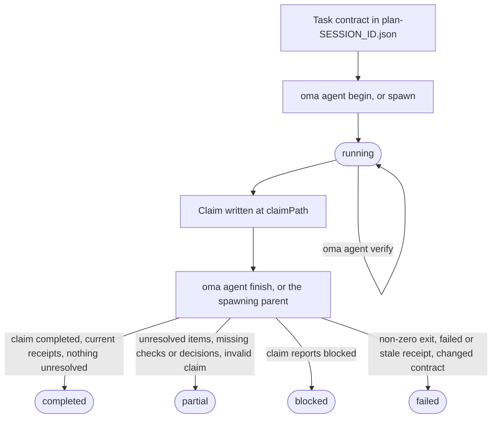
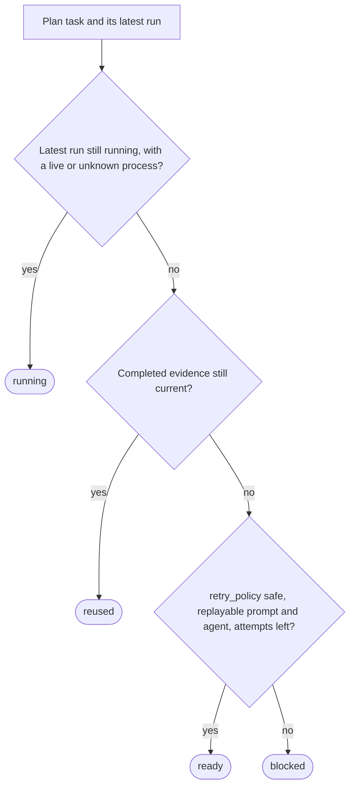

# Результаты агентов и возобновление

OMA рассматривает результат агента как небольшую запись evidence, а не только как exit code процесса. Run сохраняет ID task и session, fingerprint workspace, verification receipt, изменённые файлы, нерешённую работу и hash artifact. Благодаря этому coordinator может повторно использовать завершённую задачу, только пока её acceptance contract и input остаются совпадающими.

Используйте этот жизненный цикл напрямую при запуске native agent. Рабочие процессы и `oma agent spawn` создают те же записи автоматически и оставляют завершение управляемого run родительскому координатору. Термины, используемые здесь, описаны в глоссарии: [запись запуска и claim](../getting-started/glossary.md#run-record-and-claim) и [план](../getting-started/glossary.md#plan).

## Жизненный цикл вкратце

| Шаг | Команда | Что записывается | Что сохранить |
| --- | --- | --- | --- |
| 1. Contract | Отредактируйте `.agents/results/plan-SESSION_ID.json` | `acceptance_criteria` и `required_checks` task | ID сессии, ID task |
| 2. Begin | `oma agent begin AGENT TASK SESSION_ID --workspace .` | Запись run со статусом `running` | `runId`, `claimPath` |
| 3. Context (необязательно) | `oma agent context AGENT --difficulty Medium` | Ничего | Context для prompt |
| 4. Verify | `oma agent verify RUN_ID --required` | Один receipt на каждую проверку | Exit code |
| 5. Claim | Запишите JSON по пути `claimPath` | Файл claim | Ничего |
| 6. Finish | `oma agent finish RUN_ID CLAIM_PATH` | Итоговый статус | `status` |
| 7. Recover | `oma agent resume SESSION_ID --dry-run`, затем без `--dry-run` | Checkpoint восстановления и lease сессии | Статус каждой task |

`oma agent spawn` и `oma agent parallel` выполняют шаги 2 и 6 за вас: parent-процесс начинает run и завершает его, когда child выходит.



Claim также может напрямую сообщить `partial` или `failed`. Finish никогда не повышает claim: он понижает claim `completed`, если его evidence не подтверждается, а ненулевой exit code делает любой run `failed`.

## Запуск native run {#start-a-native-run}

Сначала определите task и его `acceptance_criteria` и `required_checks` в плане `.agents/results/plan-SESSION_ID.json`. Для небольшой общей проверки проекта план может содержать одну task, например:

```json
{
  "tasks": [
    {
      "id": "docs",
      "agent": "docs",
      "task": "Review README.md and report any documentation issues",
      "workspace": ".",
      "acceptance_criteria": [
        { "id": "diff-clean", "description": "The current Git diff has no whitespace errors" }
      ],
      "required_checks": [
        { "id": "whitespace", "criteria": ["diff-clean"], "command": ["git", "diff", "--check"], "cwd": "." }
      ],
      "retry_policy": "manual"
    }
  ]
}
```

Эта проверка доказывает только отсутствие ошибок пробелов в Git diff; замените task, criterion и check настоящим acceptance contract проекта. Из корня проекта начните run:

```bash
oma agent begin docs docs SESSION_ID --workspace .
```

Замените `SESSION_ID` ID сессии из плана. Команда `begin` печатает JSON с созданными UUID `runId` и `claimPath`, например:

```json
{
  "runId": "<generated-run-id>",
  "taskId": "docs",
  "sessionId": "<your-session-id>",
  "status": "running",
  "claimPath": ".agents/state/agent-runs/<generated-run-id>.claim.json"
}
```

Значения в угловых скобках — placeholder; используйте фактические значения из своего run. Успешный begin создаёт запись run в `.agents/state/agent-runs/` и сохраняет snapshot task contract. Путь claim всегда указывает на запись run с `.claim.json` вместо `.json`.

## Загрузите context и выполните task

Перед редактированием загрузите ссылки, выбранные графом:

```bash
oma agent context docs --difficulty Medium
```

Сложность должна быть `Simple`, `Medium` или `Complex`. Команда печатает context, собранный для выбранного agent. Если context на основе графа отсутствует, исправьте определение task или продолжите документированный native-путь поиска; не создавайте фиктивный context receipt.

Выполняйте task в workspace, записанном `begin`. Пока run активен, не меняйте session plan. Если task меняет acceptance criteria или required checks, после обновления плана начните новый run.

## Запишите verification

Запустите каждую проверку, закреплённую acceptance contract:

```bash
oma agent verify RUN_ID --required
```

Замените `RUN_ID` UUID, который вернула команда `begin`. Команда выполняет объявленные argv и сохраняет настоящий exit code и fingerprint workspace до и после. Одну точную команду можно записать, если она входит в contract task:

```bash
oma agent verify RUN_ID -- git diff --check
```

Форму с точной командой используйте только для проверки, включённой в contract task; иначе сохраняйте `required_checks` в плане и используйте `--required`, чтобы receipt доказывал объявленные acceptance criteria.

Используйте `--affected PATH...` только когда граф содержит полный выбор тестов для этих путей. Проверки для каждого run выполняются последовательно. Ненулевой exit code или изменение workspace во время проверки делает receipt недействительным.

## Запишите claim и завершите run

Для task, которые выбирают API contract, политику аутентификации, модель данных,
стратегию миграции, владельца состояния, область доступа к инфраструктуре или другое
решение, от которого зависит дальнейшая работа, объявите `required_decisions` в task
до dispatch:

```json
"required_decisions": [
  {
    "subject": "db.migration-strategy",
    "description": "Choose the compatibility window and rollback strategy for the account migration."
  }
]
```

Не указывайте это поле для task, которые следуют уже принятому решению. Требования
закрепляются вместе с task contract и не могут быть удалены или изменены после dispatch.
Список предлагаемых subject для agent можно получить командой
`oma state decisions list --agent db-engineer --json`. Эти subject — варианты
выбора, которые стоит использовать при необходимости; каталог не делает каждый выбор обязательным.

Запишите файл claim по точному пути, который вернул `begin`:

```json
{
  "status": "completed",
  "changedFiles": [],
  "unresolved": [],
  "artifacts": []
}
```

`status` принимает одно из значений `completed`, `partial`, `blocked` или `failed`. Пути задаются относительно корня проекта, каждый artifact должен быть обычным файлом внутри workspace. Используйте `verificationSkipped` только для конкретного review, у которого нет исполняемой проверки; это не превращает неудачную проверку в успешную.

Включите существенные решения в необязательный массив `decisions` в claim:

```json
"decisions": [
  {
    "subject": "db.migration-strategy",
    "decision": "Use an expand-and-contract migration; retain the old column for one release.",
    "rationale": "Both deployed app versions must work during the rollout; rollback switches reads to the retained column.",
    "alternatives": ["Replace the column during a maintenance window"],
    "evidence": ["docs/account-migration.md"]
  }
]
```

Parent сохраняет каждое решение как событие `decision.made` в сессии run
и прикрепляет к нему фактические ID agent, task и run. Отсутствие обязательного решения
оставляет результат partial, даже если исполняемые проверки прошли. Решения из
другой task или попытки не могут удовлетворить требование. Receipt закрепляет
ID событий решений и hash их содержимого; при повторном использовании проверяется, что эти события
по-прежнему существуют, корректны и их содержимое не изменилось.
Необязательные решения тоже записываются. Read-only agent возвращают тот же массив в
своём claim `OMA_RESULT_JSON`, чтобы parent мог его сохранить.

После записи claim завершите native run:

```bash
oma agent finish RUN_ID CLAIM_PATH
```

Подставьте оба параметра из JSON begin. `CLAIM_PATH` — созданный путь `.claim.json`; не придумывайте другое имя файла.

Команда finish проверяет claim, текущий contract, актуальные receipt и hash artifact. Завершённый claim с устаревшим evidence становится failed или partial. Команда откажется завершить managed run, жизненным циклом которого управляет parent-процесс.

## Поведение spawned и native run

`oma agent spawn` и `oma agent parallel` создают run, внедряют в prompt child его identity и инструкции результата, а parent может получить exit code child. Child должен записать claim и сообщить artifact; parent завершает managed receipt. Read-only child возвращает одну строку `OMA_RESULT_JSON: {...}`; parent сохраняет её, а объяснение `verificationSkipped` остаётся отдельным от исполняемой проверки.

Читаемые человеком файлы результата в `.agents/results/` и заметки memory в `.agents/state/memories/` помогают отслеживать прогресс. Машинно-читаемый receipt в `.agents/state/agent-runs/` — evidence, используемый для повторного применения и возобновления.

## Проверьте восстановление перед повтором

Сначала спросите OMA, что будет сделано:

```bash
oma agent resume SESSION_ID --dry-run
```

Отчёт классифицирует каждую task как `reused`, `ready`, `running` или `blocked` и указывает причину:



Зависимость, которая не находится в состоянии `reused`, возвращает зависимую task `reused` в `ready` (или в `blocked`, если её нельзя воспроизвести), а task `ready`, зависимость которой находится в `blocked` или `running`, становится `blocked`. Корректный завершённый receipt используется повторно только тогда, когда его contract, input, hash artifact и evidence зависимостей по-прежнему актуальны. Живой managed process или native run без evidence активности не дублируется.

Когда отчёт разрешает безопасное выполнение, возобновите готовые task в порядке зависимостей:

```bash
oma agent resume SESSION_ID
```

Автоматический replay требует `retry_policy: "safe"`, воспроизводимого prompt и agent в плане либо сохранённом dispatch. По умолчанию используется `manual`. `--max-attempts` по умолчанию равен `3`, включая первую попытку:

```bash
oma agent resume SESSION_ID --max-attempts 2
```

OMA записывает checkpoint восстановления в `.agents/state/agent-resume/` и использует lease сессии, чтобы два coordinator не могли повторить одну сессию. Во время восстановления план закреплён. Если изменился план или зависимость, либо более поздняя попытка изменила прежний input, затронутые task переходят в blocked и требуют нового verification run.

Возобновление начинает новую попытку; оно не восстанавливает прерванный разговор с моделью. Перед возобновлением прерванного native run пометьте старый run как `partial` или `failed`, указав фактический результат и нерешённую работу. Затем изучите отчёт dry-run и повторите только task с безопасным путём восстановления.

## Примеры восстановления

| Ситуация | Действие | Ожидаемый результат |
| --- | --- | --- |
| Обязательная проверка завершилась ошибкой | Исправьте task, снова выполните `oma agent verify RUN_ID --required`, затем завершите её новым claim. | Последний receipt заменяет неудачный результат, если fingerprint workspace актуален. |
| Процесс завершился до claim | Пометьте run как partial или failed, затем выполните `oma agent resume SESSION_ID --dry-run`. | Старая попытка сохраняется; безопасная task получает `ready`, а manual task — `blocked`. |
| Изменилась зависимость | Повторите зависимость и снова изучите отчёт. | Возможность повторного использования зависимой task отменяется, даже если её файлы не изменились. |
| Изменились план или input | После стабилизации плана начните новый run. | Новый run сохраняет snapshot нового contract; старое evidence не используется повторно. |
| Task требует решения | Запишите её как `blocked` с объяснением. | Resume оставит её blocked, пока не будут предоставлены решение и prompt. |

## Дальнейшие шаги

- Сообщения об ошибках `begin`, `verify`, `finish` и `resume`: [Устранение неполадок](./troubleshooting.md#find-your-error)
- Ошибки разбора, отсутствие инструментов vendor, состояние dashboard, расписания и устаревшие данные evaluation: [Устранение неполадок](./troubleshooting.md)
- Наблюдение за managed run во время работы: [Мониторинг через dashboard](./dashboard-monitoring.md)
- Определение планов с task contract: [Мультиагентные проекты](./multi-agent-project.md)
