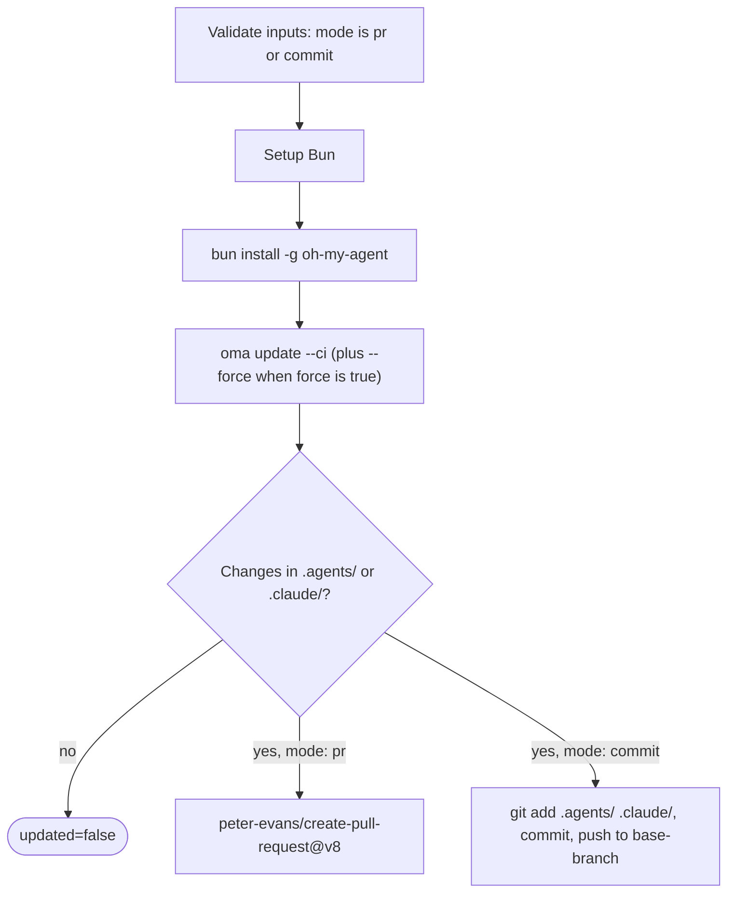

# Руководство: автоматические обновления

## Обзор

GitHub Action oh-my-agent (`first-fluke/oma-update-action@v1`) автоматически обновляет навыки агентов проекта, запуская `oma update` в CI. Он поддерживает два режима: создание pull request для проверки или прямой коммит в ветку.

---

## Быстрая настройка

<!-- oma-docs:ignore-start -->
Добавьте этот файл в проект как `.github/workflows/update-oh-my-agent.yml`:
<!-- oma-docs:ignore-end -->

```yaml
name: Update oh-my-agent

on:
  schedule:
    - cron: '0 9 * * 1'  # Every Monday at 9am UTC
  workflow_dispatch:        # Allow manual trigger

permissions:
  contents: write
  pull-requests: write

jobs:
  update:
    runs-on: ubuntu-latest
    steps:
      - uses: actions/checkout@v4

      - uses: first-fluke/oma-update-action@v1
```

Это минимальная конфигурация. Когда установленный компонент изменился, action завершается с `updated=true`, выводом версии и pull request. Если файловых изменений нет, он завершается с `updated=false` и без PR.

---

## Все входы action

| Вход | Тип | Обязателен | По умолчанию | Описание |
|:-----|:----|:----------|:-------------|:---------|
| `mode` | string | Нет | `"pr"` | Способ применить изменения. `"pr"` создаёт pull request. `"commit"` напрямую отправляет изменения в базовую ветку. |
| `base-branch` | string | Нет | `"main"` | Базовая ветка для PR (в режиме `pr`) или целевая ветка для прямых коммитов (в режиме `commit`). Он не меняет извлекаемую ветку; задайте в `actions/checkout` параметр `ref:` с той же веткой. |
| `force` | string | Нет | `"false"` | Передаёт `--force` в `oma update`. При значении `"true"` перезаписывает пользовательские файлы конфигурации (`oma-config.yaml`, `mcp.json`) и каталоги `stack/`. Обычно они сохраняются. |
| `pr-title` | string | Нет | `"chore(deps): update oh-my-agent skills"` | Пользовательский заголовок pull request. Используется только в режиме `pr`. |
| `pr-labels` | string | Нет | `"dependencies,automated"` | Метки, добавляемые в PR через запятую. Используются только в режиме `pr`. |
| `commit-message` | string | Нет | `"chore(deps): update oh-my-agent skills"` | Пользовательское сообщение коммита. Используется в обоих режимах (как сообщение коммита PR или прямого коммита). |
| `token` | string | Нет | `${{ github.token }}` | Токен GitHub для создания PR. Используйте Personal Access Token (PAT), если PR должен запускать другие рабочие процессы (стандартный `GITHUB_TOKEN` не запускает workflow для созданных им PR). |

---

## Все выходы action

| Выход | Тип | Описание | Доступен |
|:------|:----|:---------|:---------|
| `updated` | string | `"true"`, если после `oma update` обнаружены изменения. `"false"`, если всё уже актуально. | Всегда |
| `version` | string | Версия oh-my-agent после обновления. Читается из `.agents/skills/_version.json`. | Когда `updated` равен `"true"` |
| `pr-number` | string | Номер pull request. | Только в режиме `pr`, когда PR создан |
| `pr-url` | string | Полный URL созданного pull request. | Только в режиме `pr`, когда PR создан |

---

## Подробные примеры

### Пример 1: режим PR по умолчанию

Самая распространённая настройка. Каждый понедельник создаёт PR, если доступно обновление.

```yaml
name: Update oh-my-agent

on:
  schedule:
    - cron: '0 9 * * 1'
  workflow_dispatch:

permissions:
  contents: write
  pull-requests: write

jobs:
  update:
    runs-on: ubuntu-latest
    steps:
      - uses: actions/checkout@v4

      - uses: first-fluke/oma-update-action@v1
        id: update

      - name: Summary
        if: steps.update.outputs.updated == 'true'
        run: |
          echo "Updated to version ${{ steps.update.outputs.version }}"
          echo "PR: ${{ steps.update.outputs.pr-url }}"
```

**Что происходит:**
- репозиторий извлекается;
- устанавливается Bun, затем oh-my-agent глобально;
- выполняется `oma update --ci`;
- проверяется наличие изменений в `.agents/` или `.claude/`;
- при наличии изменений `peter-evans/create-pull-request@v8` создаёт PR в ветке `chore/update-oh-my-agent`;
- PR получает метки `dependencies,automated`, а в его описании указывается новый номер версии.

### Пример 2: прямой коммит с PAT

Для команд, которым нужно применять обновления сразу, без этапа проверки PR. Используется PAT, чтобы коммит мог запускать последующие рабочие процессы.

```yaml
name: Update oh-my-agent (Direct)

on:
  schedule:
    - cron: '0 6 * * *'  # Daily at 6am UTC
  workflow_dispatch:

permissions:
  contents: write

jobs:
  update:
    runs-on: ubuntu-latest
    steps:
      - uses: actions/checkout@v4
        with:
          ref: develop
          token: ${{ secrets.OH_MY_AGENT_PAT }}

      - uses: first-fluke/oma-update-action@v1
        with:
          mode: commit
          token: ${{ secrets.OH_MY_AGENT_PAT }}
          commit-message: "chore: auto-update oh-my-agent skills"
          base-branch: develop
```

**Что происходит:**
- ветка `develop` извлекается с использованием PAT. `ref: develop` обязателен: `base-branch` задаёт только цель push, а action отправляет тот `HEAD`, который получился при checkout;
- выполняется `oma update --ci`;
- если есть изменения, Git настраивается для `github-actions[bot]`, затем изменения напрямую коммитятся в `develop`;
- PAT обеспечивает запуск рабочих процессов, реагирующих на push в `develop`.

**Важно:** используйте `secrets.OH_MY_AGENT_PAT` (Fine-Grained PAT с разрешением Contents: Write), а не `github.token`. Стандартный `GITHUB_TOKEN` создаёт коммиты, которые не запускают другие рабочие процессы; это может нарушить CI-пайплайны, ожидающие события push.

### Пример 3: условное уведомление

Обновление с уведомлением Slack, когда доступна новая версия.

```yaml
name: Update oh-my-agent

on:
  schedule:
    - cron: '0 9 * * 1'
  workflow_dispatch:

permissions:
  contents: write
  pull-requests: write

jobs:
  update:
    runs-on: ubuntu-latest
    steps:
      - uses: actions/checkout@v4

      - uses: first-fluke/oma-update-action@v1
        id: update

      - name: Notify Slack
        if: steps.update.outputs.updated == 'true'
        uses: slackapi/slack-github-action@v2
        with:
          webhook: ${{ secrets.SLACK_WEBHOOK }}
          webhook-type: incoming-webhook
          payload: |
            {
              "text": "oh-my-agent updated to v${{ steps.update.outputs.version }}. PR: ${{ steps.update.outputs.pr-url }}"
            }

      - name: Skip notification
        if: steps.update.outputs.updated == 'false'
        run: echo "Already up to date, no notification needed."
```

**Основной шаблон:** используйте `steps.update.outputs.updated == 'true'`, чтобы запускать последующие шаги только после фактического обновления. Это избавляет от шума в запусках без изменений.

### Пример 4: режим force с пользовательскими метками

Для проектов, которым при обновлении нужно вернуть все файлы конфигурации к значениям по умолчанию.

```yaml
name: Update oh-my-agent (Force)

on:
  workflow_dispatch:  # Manual trigger only for force updates

permissions:
  contents: write
  pull-requests: write

jobs:
  update:
    runs-on: ubuntu-latest
    steps:
      - uses: actions/checkout@v4

      - uses: first-fluke/oma-update-action@v1
        with:
          force: 'true'
          pr-title: "chore(deps): force-update oh-my-agent skills (reset configs)"
          pr-labels: "dependencies,automated,force-update"
          commit-message: "chore(deps): force-update oh-my-agent skills"
```

**Предупреждение:** режим force перезаписывает `oma-config.yaml`, `mcp.json` и каталоги `stack/`. Используйте его только для полного сброса настроек. Для обычных обновлений не указывайте вход `force`.

---

## Как это работает внутри

Action — это [составной action](https://docs.github.com/en/actions/creating-actions/creating-a-composite-action), определённый в `action/action.yml`. Сначала он проверяет, что `mode` равен `pr` или `commit`, затем выполняет приведённые ниже шаги и завершается pull request или прямым коммитом:



### Шаг 1: настройка Bun

```yaml
- uses: oven-sh/setup-bun@v2
```

Устанавливает runtime Bun, необходимый для запуска CLI oh-my-agent.

### Шаг 2: установка oh-my-agent

```bash
bun install -g oh-my-agent
```

Устанавливает CLI глобально из npm registry. После этого доступна команда `oma`.

### Шаг 3: запуск oma update

```yaml
- name: Run oma update
  shell: bash
  env:
    FORCE: ${{ inputs.force }}
  run: |
    FLAGS="--ci"
    if [ "$FORCE" = "true" ]; then
      FLAGS="$FLAGS --force"
    fi
    oma update $FLAGS
```

Входные значения попадают в скрипт через `env:`, а не через интерполяцию `${{ }}` внутри `run:`, поэтому значение входа не может быть выполнено как shell-код.

Флаг `--ci` запускает обновление в неинтерактивном режиме (пропускает все вопросы и выводит обычный текст вместо анимации индикатора). Флаг `--force` при включении перезаписывает пользовательские файлы конфигурации.

Что `oma update --ci` делает внутри:

1. скачивает `prompt-manifest.json` из основной ветки, чтобы получить номер последней версии;
2. сравнивает его с локальной версией в `.agents/skills/_version.json`;
3. если версии совпадают, завершает работу с сообщением «Already up to date.»;
4. если доступна новая версия, скачивает и распаковывает последний тарбол;
5. сохраняет пользовательские файлы (если не указан `--force`): `oma-config.yaml`, `mcp.json` и каталоги stack;
6. копирует новые файлы в существующий каталог `.agents/`;
7. восстанавливает сохранённые файлы;
8. обновляет адаптации поставщиков (хуки, настройки, определения агентов) для поставщиков из списка `vendors:` в конфигурации (пустой список означает, что ни для каких). Без списка `vendors:` обновляются только поставщики, каталоги которых уже существуют в проекте;
9. обновляет символические ссылки CLI.

Action вызывает `oma update --ci` без `--with-new-skills`. Это обновляет установленный набор навыков и сообщает о новых доступных навыках; намеренно запускайте `oma update --with-new-skills`, если проект должен добавить новые навыки в рамках обновления.

### Шаг 4: проверка изменений

```bash
if [ -n "$(git status --porcelain .agents/ .claude/ 2>/dev/null)" ]; then
  echo "updated=true" >> "$GITHUB_OUTPUT"
  if [ -f ".agents/skills/_version.json" ]; then
    VERSION=$(jq -r '.version' .agents/skills/_version.json)
    echo "version=$VERSION" >> "$GITHUB_OUTPUT"
  fi
else
  echo "updated=false" >> "$GITHUB_OUTPUT"
fi
```

Проверяет, изменил ли `oma update` какие-либо файлы в `.agents/` или `.claude/`. Затем устанавливает выходы `updated` и `version`. Изменения вне этих двух каталогов (например, `.codex/` или `AGENTS.md`) не устанавливают `updated=true`.

Дальше, в зависимости от входа `mode`:

- **режим `pr`:** `peter-evans/create-pull-request@v8` создаёт PR в ветке `chore/update-oh-my-agent`. PR содержит новый номер версии, ссылку на репозиторий oh-my-agent и настроенные метки. Если ветка уже существует (например, из предыдущего незакрытого PR), обновляется существующий PR.

- **режим `commit`:** Git настраивается для `github-actions[bot]`, в индекс добавляются `.agents/` и `.claude/`, выполняется коммит с настроенным сообщением и отправка в базовую ветку.

---

## См. также

- [Глобальная установка](./global-install.md): `oma update --global` и особенности CI для установок на уровне пользователя
- [Справочник конфигурации](./configuration-reference.md#update-and-ownership-rules): какие файлы конфигурации сохраняет `oma update`
- [Интеграция в существующий проект](./integration.md): файлы, которые `oma update` обновляет в проекте
