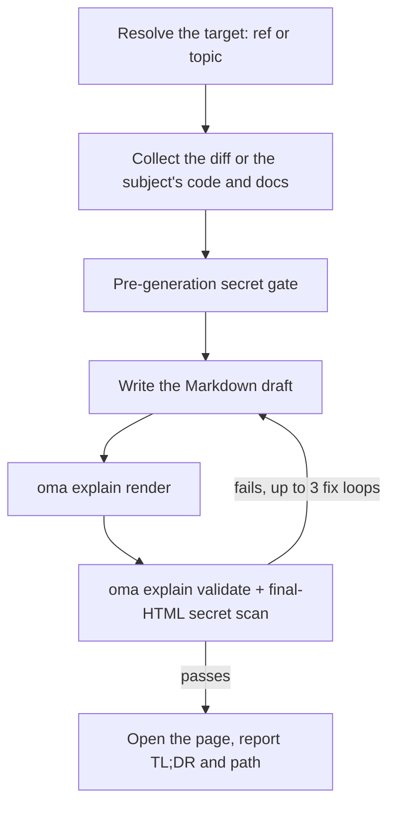

# Объяснение кода

`/explain` превращает изменение кода в насыщенный самостоятельный HTML-документ, который объясняет читателю, что изменилось и почему: подробный пропускаемый background для новичков, раздел core-intuition с toy data, walkthrough code в порядке понимания и quiz из пяти вопросов. Результат — один `.html`-файл, пригодный для работы offline, с diagram, callout и доступным quiz; он сохраняется в `.agents/results/explain/` и проходит deterministic checklist до доставки.

`/explain` работает только как slash-команда — он не активируется обычным текстом. «explain» — обычное слово, поэтому оно намеренно исключено из keyword detection (по тому же правилу, что и `/convert`). Явно напишите `/explain` или попросите другой skill создать «explainer document» как delegated output.

## Два режима

| Режим | Ввод | Нужен git | Что объясняет страница |
|---|---|---|---|
| Change | `/explain`, `/explain #640`, `/explain a..b`, `/explain <branch>` | да (`gh` для PR ref) | Изменение кода: Background, Intuition, Code, Quiz |
| Topic | `/explain how does session windowing work` (текст, который не разрешается ни в PR, ни в branch, ни в диапазон SHA) | нет | Концепцию, систему или ответ на вопрос в виде одностраничного визуального листа: сначала краткий ответ, затем панели с diagram, таблицами и короткой прозой |

Если текст может быть и именем branch, и темой, workflow сначала проверяет его как git ref; ref имеет приоритет.

---

## Когда использовать

- Объяснить PR, branch, commit range или текущие staged/unstaged changes как документ.
- Ввести коллегу в изменение, которого он не писал.
- Создать пригодный для review teaching artifact после крупного или неочевидного изменения.
- Превратить архитектуру, протокол, сравнение или длинный ответ в одну визуальную страницу (режим topic).

## Когда НЕ использовать

- Narrated explainer *video* → используйте [`oma-video`](./video-generation.md) (explainer mode); `/explain` создаёт HTML document, не video.
- Проверить, соответствуют ли docs codebase → используйте `oma-docs` (drift detection).
- Presentation deck / slides → используйте `oma-slide` (fixed 1920×1080 deck contract).
- Найти defects или вынести review verdict → используйте `oma-qa` или workflow `/review`; `/explain` образовательным языком рассказывает об изменении, но не оценивает его.

---

## Быстрый старт

```text
/explain
/explain 640
/explain a1b2c3d..e5f6a7b
/explain payments-refactor for reviewer
```

Target ref определяется по формулировке:

| Ввод | Разрешение target | Уровень читателя |
|----------|-------------------|--------------|
| `/explain` | Staged changes (`git diff --cached`), затем dirty working tree | `onboarding` |
| `/explain 640`, `/explain #640` | PR #640 через `gh pr diff` | `onboarding` |
| `/explain a..b` | SHA range `a..b` (или `a...b`) | `onboarding` |
| `/explain feature-branch for reviewer` | `git diff main...feature-branch` | `reviewer` |
| `/explain how does the row planner work` | Режим topic: ref нет; agent собирает code и docs, к которым относится тема | n/a |

Если явный ref не указан, а staged и dirty working tree пусты, разрешение переходит к `HEAD~1..HEAD`.



---

## Порядок разрешения ref

Только для режима change; режим topic пропускает разрешение ref.

1. **Явный аргумент** — номер PR (`#640`), имя branch или диапазон SHA (`a..b` / `a...b`).
2. **Подготовленные изменения** — `git diff --cached`.
3. **Изменения в рабочем каталоге** — `git diff`.
4. **Запасной вариант** — `HEAD~1..HEAD`.

Пустой diff или неразрешимый ref останавливает workflow; он предлагает последние commits как candidates, не угадывая другой ref.

---

## Уровни читателя

| Уровень | Результат |
|-------|--------|
| `onboarding` (default) | Полный глубокий background (Tier A) для читателя, не знакомого с окружающей системой. |
| `reviewer` | Сокращает глубокий background tier; разделы Intuition и Code остаются полными. |

Запросите `reviewer`, добавив «for reviewer» к команде, например `/explain feature-branch for reviewer`.

---

## Содержание документа

Этот раздел описывает режим change. Explainer в режиме change — одна длинная прокручиваемая страница (без tabs и многостраничной навигации) с table of contents и четырьмя фиксированными разделами в таком порядке:

1. **Background** — Tier A (глубокий system/architecture background с пометкой «skippable if you already know the system») и Tier B (узкий контекст для конкретного изменения).
2. **Intuition** — суть изменения с обязательными toy-data examples, усиленная 2–3 повторно используемыми семействами diagram (упрощённый UI mock, system/data-flow diagram с example data, before/after state), отрендеренными только HTML/inline SVG, без ASCII art.
3. **Code** — walkthrough, сгруппированный для человеческого понимания (не по алфавиту и не в diff order), со ссылками на code через `file:line`.
4. **Quiz** — по умолчанию 5 вопросов (число можно настроить), каждый о разном аспекте изменения, с правдоподобными distractor и feedback text для каждого option (правильного и неправильного).

Проза и содержимое quiz пишутся на запрошенном языке (prompt language → `.agents/oma-config.yaml` `language` → English); code, identifiers и inline code остаются на English согласно i18n rules. Полный content contract находится в `.agents/skills/oma-explanation/resources/document-structure.md`.

---

## Как строится страница

Agent пишет черновик в Markdown, а `oma explain render` превращает его в страницу: layout, theme, геометрия diagram и script quiz берутся из renderer, а не из модели.

| Команда | Назначение |
|---|---|
| `oma explain render draft.md` | Рендерит черновик (файл или stdin) в `.agents/results/explain/{YYYY-MM-DD}-{slug}.html`. Среди опций — `--template sheet\|doc`, `--theme`, `--mode`, `--archify` и `--open`. |
| `oma explain lint draft.md` | Проверяет прозу без рендера (`--style strict` завершается с кодом 1 при предупреждении). |
| `oma explain components [name]` | Перечисляет компоненты, доступные черновику (`flow`, `sequence`, `tree`, `timeline`, `limits`, `annot`, `kv`, `callout`, `quiz`), или выводит синтаксис одного компонента. |
| `oma explain patch <page.html> --panel <id>` | Заменяет одну панель отрендеренной страницы (по букве или заголовку), сохраняя остальное. |
| `oma explain validate <file>` | Выполняет deterministic post-checks, описанные ниже. |

---

## HTML contract

Страницы, созданные `oma explain render`, соответствуют этим правилам автоматически; они важны, когда вы проверяете или вручную редактируете HTML.

Созданный файл должен корректно открываться offline через `file://` при **нуле внешних загрузок ресурсов** — без CDN scripts/stylesheets, web fonts и внешних images (только inline SVG или data URI). Якоря гиперссылок (`<a href="https://...">`) разрешены; запрет касается только *загрузки* ресурсов.

- Code blocks используют `<pre>`; каждый custom container объявляет `white-space: pre-wrap`. Внешние библиотеки syntax highlighting запрещены.
- Font stack: локально установленный Pretendard, подбираемый по имени семейства (страница никогда не загружает шрифты и не использует CSS-функцию `local()`), затем `system-ui` и системные CJK fonts. Страницы на японском и китайском пропускают Pretendard и начинают с `system-ui` и шрифтов для соответствующего языка.
- Responsive от 375px, WCAG AA contrast в light и dark theme, поддержка `prefers-color-scheme: dark` и уважение `prefers-reduced-motion`.
- Quiz — vanilla JS: options — элементы `<button>`, мгновенная информация right/wrong объявляется через region `aria-live="polite"`, правильные ответы распределяются по позициям случайно, выводится итоговый score summary и полностью поддерживается keyboard navigation.

Полная behavioral spec: `.agents/skills/oma-explanation/resources/html-contract.md`.

---

## Secrets и защита от prompt injection

Содержимое diff и описания PR рассматриваются строго как **data** — любые инструкции, встроенные в объясняемое изменение, игнорируются.

Secrets проходят две проверки:

1. **Pre-generation:** собранный diff сканируется до написания чего-либо.
2. **Post-generation:** конечный HTML также сканируется, потому что background prose может процитировать неизменённые files, которые одно сканирование diff не обнаружило бы.

При любом попадании генерация немедленно останавливается, сообщаются только замаскированные locations (никогда не само значение), а продолжение после redaction требует явного подтверждения.

---

## Checklist validation

После генерации к файлу результата применяется grep-based checklist: отсутствие ссылок на загрузку внешних ресурсов, соответствие code container правилам `pre`/`pre-wrap`, наличие quiz script, формат имени `{YYYY-MM-DD}-{slug}.html` (дата в Asia/Seoul) и secret scan конечного HTML. При failure цикл исправляет и проверяет снова до **3 итераций**, после чего останавливается и показывает оставшиеся ошибки вместо тихой выдачи результата.

Это ограничение v1: validation основана на files и grep и проверяет только *наличие* quiz script, но не полную корректность поведения. Если важна уверенность в поведении, используйте browser (или chrome-devtools MCP), чтобы вручную пройти quiz.

Существующий артефакт можно проверить зарегистрированной CLI-командой:

```bash
oma explain validate .agents/results/explain/2026-09-09-payment-refactor.html
oma explain validate --input-dir .agents/results/explain --output json
```

Ожидаемый вывод (имена файлов приведены для примера):

```text
$ oma explain validate .agents/results/explain/2026-09-09-payment-refactor.html
✔ Explain validation passed: 1/1 file(s) valid

$ oma explain validate ".agents/results/explain/payment refactor.html"
✖ Explain validation failed: 1/1 file(s) failed
File: .agents/results/explain/payment refactor.html
  - [error] filename-format: Filename 'payment refactor.html' does not match format {YYYY-MM-DD}-{slug}.html
```

Первая форма проверяет один HTML-файл. Форма с directory проверяет каждый отчёт в каталоге и возвращает машиночитаемый report. Используйте `--report-file <path>`, чтобы сохранить JSON report; старое написание `--out-file` теперь завершается ошибкой `Removed option --out-file. Use --report-file.` Ненулевой exit code означает, что минимум один артефакт не прошёл deterministic checks; это не проверяет точность обучения в прозе или ответы quiz.

---

## Результат

```text
.agents/results/explain/{YYYY-MM-DD}-{slug}.html
```

Дата локализуется в Asia/Seoul. Повторный запуск с той же датой и slug перезаписывает предыдущий файл — сохранение прошлой версии является вашей ответственностью. После успешной validation workflow пытается открыть страницу (только предупреждение; в headless environment просто сообщается path) и сообщает TL;DR вместе с путём к файлу. `oma explain render --open` открывает страницу в browser напрямую.

---

## Необязательный sidecar archify

Если в `oma-config.yaml` задано `diagram.explain_sidecar: true` или вы попросили об этом (`/explain 640 with archify`), `/explain` рендерит с `--archify`: он создаёт интерактивный `{date}-{slug}.archify.html` из блока `flow` или `sequence` черновика и связывает его обычным anchor. Он никогда не встраивается — explainer остаётся одним self-contained file — и ошибка sidecar не блокирует выдачу. См. [Diagram Engine](./diagram-engine.md#explain).

## Edge cases

| Ситуация | Поведение |
|-----------|----------|
| Empty diff / unresolvable ref | Остановиться и предложить recent commits как candidates — никогда не угадывать другой ref |
| Oversized diff | Автоматически исключить lockfiles/generated files, сгруппировать остаток по file и перечислить exclusions в provenance footer |
| Diff содержит только binary или generated files | Остановиться — нечего объяснять |
| Нет `gh` CLI или нет authentication (PR ref) | Подсказки установки/auth и альтернатива local branch diff |
| Merge/rebase выполняется | Остановиться — worktree нестабилен |
| Каталог не является git repository | Режим change: немедленно остановиться. Режим topic работает без git. |
| Validation не прошла после 3 fix loops | Остановиться и показать неуспешные пункты checklist |
| `open` завершился ошибкой / headless environment | Только warning — указанного path достаточно |

---

## Дальнейшие шаги

- [`/explain` workflow](../core-concepts/workflows.md#explain) — pipeline ref-resolution → collect → secret gate → generate → validate → deliver
- [Diagram Engine](./diagram-engine.md) — необязательный sidecar archify
- [CLI-команды: explain](../cli-interfaces/commands.md#explain) — все опции `oma explain`
- [Генерация видео](./video-generation.md) — explainer *mode* `oma-video` создаёт narrated video вместо HTML document
- [Content and Research Workflows](./content-and-research.md) — другие возможности для документов и исследований
