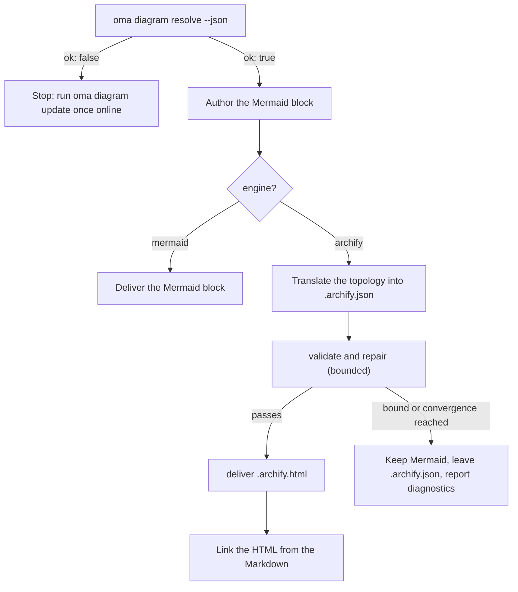

# Diagram Engine

`/architecture` (ADR, рекомендации, review) и `/explain` (explainers изменений кода) создают структурные диаграммы. Для `/architecture` это всегда **Mermaid** blocks внутри Markdown-артефакта (`/explain` рисует собственные inline SVG diagram) и — когда можно разрешить [archify](https://github.com/tt-a1i/archify), что является обычным случаем — дополнительно **interactive validated HTML diagram** рядом с артефактом: dark/light theme, pan-zoom, search, tracing отношений, PNG/SVG/WebM export, render из typed JSON spec.

Mermaid никуда не исчезает: это текстовый SSOT, живущий в Markdown и Git diff. archify — производный артефакт.

---

## Всегда последняя версия archify — ничего устанавливать не нужно {#always-the-latest-archify--nothing-to-install}

archify — agent skill под лицензией MIT (Node ≥ 18, без runtime dependencies). oh-my-agent не полагается на однажды установленную вами копию; он поддерживает **собственную управляемую копию** и отслеживает последний release:

- Cache: `~/.cache/oma-diagram/archify/<tag>/` плюс указатель `state.json`.
- Перед каждым использованием `oma diagram resolve` запрашивает у GitHub последний release tag (не чаще одного раза за `check_interval_min`, по умолчанию 60 min), загружает source tarball при появлении нового tag (atomic каталог на tag; старые tag очищаются), иначе использует cache copy.
- Сетевые ошибки никогда не критичны: используется cache copy и сообщается `stale` с причиной. Только первый запуск без сети и cache переключается на user-installed skill copy, а затем на Mermaid.

```bash
# Illustrative output; the release tag, cache path, and quality can vary.
oma diagram update          # force a check / download now
oma diagram resolve
# engine:   archify  (requested: auto)
# reason:   archify 2.15.0 via managed:v2.15.0 (current)
# root:     /Users/you/.cache/oma-diagram/archify/v2.15.0
# bin:      /Users/you/.cache/oma-diagram/archify/v2.15.0/bin/archify.mjs
# version:  2.15.0
# quality:  showcase
# sidecar:  off (explain)
oma diagram resolve --offline   # never touch the network
```

Порядок разрешения (побеждает первое совпадение, одинаков во всех runtime вендоров):

1. `diagram.archify.path` в `oma-config.yaml` — явная pin, отключающая auto-latest.
2. Переменная окружения `ARCHIFY_HOME` — явная pin.
3. **Последняя управляемая версия** (`~/.cache/oma-diagram/archify`).
4. Каталоги skill, установленные пользователем: `.agents` / `.claude` / `.codex` / `.cursor` / `.qwen` / `.kiro` `/skills/archify` в проекте, затем те же пути под `~`, а также `~/.raven/workspace/skills/archify`.

<!-- oma-docs:ignore-start -->
Установка считается найденной, только если управляемая или закреплённая archify installation содержит `bin/archify.mjs`.
<!-- oma-docs:ignore-end -->

---

## Конфигурация

Неполный раздел в `.agents/oma-config.yaml` (отсутствующие keys используют показанные defaults):

```yaml
diagram:
  engine: auto                # auto | archify | mermaid
  explain_sidecar: false      # /explain also writes an archify sidecar
  archify:
    managed: true             # false = never download; use pins / skill dirs only
    channel: stable           # stable (latest GitHub Release) | main (HEAD of main)
    check_interval_min: 60    # minutes between remote checks; 0 = every call
    path: null                # explicit install dir (pin)
    quality: showcase         # showcase | standard  → --quality
    open: false               # pass --open to deliver
```

### Какой engine запускается {#which-engine-runs}

Одно решение охватывает значение config, разрешается ли archify и что выдаёт workflow. «Разрешается» означает, что любой шаг [порядка разрешения](#always-the-latest-archify--nothing-to-install) находит установку: pin, управляемую последнюю копию или каталог skill, установленный пользователем.

| `diagram.engine` | archify разрешается? | `oma diagram resolve --json` | Результат `/architecture` |
|---|---|---|---|
| `auto` (default) | да | `engine: archify`, `ok: true` | Mermaid block + связанный `.archify.html` |
| `auto` | нет (например, первый запуск offline или `managed: false` без skill dir) | `engine: mermaid`, `ok: true` | Только Mermaid; report предлагает один раз online выполнить `oma diagram update` |
| `archify` | да | `engine: archify`, `ok: true` | Mermaid block + связанный `.archify.html` |
| `archify` | нет | `engine: mermaid`, `ok: false`, exit 1 | Workflow останавливается с подсказкой `oma diagram update` вместо тихого downgrade |
| `mermaid` | не проверяется | `engine: mermaid`, `ok: true` | Только Mermaid; archify никогда не вызывается |

`oma diagram resolve --engine <auto|archify|mermaid>` переопределяет config для одного вызова, а prompt может сделать то же для одного запуска (`/explain 640 with archify`).

---

## CLI

```bash
oma diagram resolve [--engine auto|archify|mermaid] [--refresh] [--offline] [--json]
oma diagram update  [--json]
oma diagram archify <archify args…>
```

`oma diagram update` принудительно обновляет копию и завершается с code 1, если не удаётся разрешить ни одну установку archify.

`oma diagram archify` запускает разрешённый исполняемый файл archify с `ARCHIFY_UPDATE_CHECK_DISABLED=1` (без сети) и передаёт exit code, поэтому `validate` / `deliver` / `visual-check` ведут себя ровно так, как описывает archify:

```bash
oma diagram archify guide "show the auth request lifecycle" --json
oma diagram archify validate architecture adr-auth.archify.json --quality showcase --json
oma diagram archify deliver  architecture adr-auth.archify.json adr-auth.archify.html --quality showcase --json
oma diagram archify visual-check adr-auth.archify.html --json   # exit 2 = no Chrome (skipped), or archify itself could not be resolved
```

`--json` у `resolve` возвращает `{ ok, requested, engine, quality, open, explainSidecar, archify?: { root, bin, version, source, status?, note? }, reason, probed }` — `source` равен `managed:<tag>`, `config:…`, `env:…` или label skill-dir; `status` (`fresh` / `current` / `stale`) и `note` задаются для managed copies.

---

## Использование в workflow

Общий protocol находится в `.agents/skills/_shared/conditional/diagram-engine.md`. `/architecture` выполняет такую последовательность:

1. `oma diagram resolve --json`.
2. Сначала всегда напишите Mermaid block.
3. При `engine: archify`: переведите Mermaid topology в archify JSON IR (`architecture` / `sequence` / `dataflow` / `lifecycle` / `workflow`), читая из installation только соответствующую schema и один example.
4. `validate` → repair → `deliver` с ограничениями: остановка, когда spec проходит проверку, когда срабатывает convergence rule archify, после 3 попыток repair, после 10 минут в сумме или когда повторяется тот же diagnostic. Semantic labels никогда не удаляются только ради прохождения.
5. Свяжите HTML — никогда не встраивайте его.



### `/architecture`

Только для structural decisions (boundaries, dependencies, data flow). Output рядом с Markdown artifact в `.agents/results/architecture/`:

```text
adr-notification-service.md            # Mermaid block + "Interactive:" link
adr-notification-service.archify.json  # frozen spec (kept even on failure)
adr-notification-service.archify.html  # delivered viewer
```

### `/explain` {#explain}

Opt-in, поскольку собственный contract explainer (один self-contained file, theming через CSS variables) не позволяет встроить второй полный HTML document. Включите через `diagram.explain_sidecar: true`, передайте `oma explain render --archify` или попросите в prompt («with archify»). Здесь нет ни Mermaid block, ни написанного вручную JSON: renderer выводит spec archify из блока `flow` или `sequence` черновика (панели с пометкой `{archify}`), выполняет `deliver` (один раз откатываясь с качества `showcase` на `standard`) и подключает `{date}-{slug}.archify.html` обычным `<a href>`. Команда сообщает `linked`, `skipped` (с причиной) или `failed` (первый diagnostic). Workflow не зацикливается на неудачном sidecar, и ошибка sidecar никогда не блокирует explainer.

---

## Режимы ошибок

Неразрешимый archify описан в [таблице выбора engine](#which-engine-runs). Остальные случаи:

| Ситуация | Результат |
|---|---|
| Проверка update не удалась (offline, rate-limited) | Используется cache copy и сообщается `stale` с причиной |
| `validate` никогда не достигает convergence | Mermaid остаётся доставленной diagram; последний `.archify.json` оставляется человеку, diagnostics сообщаются verbatim |
| Нет Chrome для `visual-check` | Сообщается как `skipped`, никогда как pass |
| `oma diagram archify …` завершается с exit 2 | Либо отсутствует Chrome (`visual-check`), либо archify не удалось разрешить; сначала проверьте `oma diagram resolve --json` |

---

## Дальнейшие шаги

- [Объяснение кода](./code-explainer.md) — workflow `/explain` и его необязательный sidecar archify
- [`/architecture` workflow](../core-concepts/workflows.md#architecture) — ADR и review, содержащие Mermaid block
- [Семантика oma-config.yaml](./oma-config-semantics.md) — как объединяется раздел `diagram:`
- [CLI-команды: diagram](../cli-interfaces/commands.md#diagram) — полный список опций
- [Исследование рынка](./market-research.md) — тот же шаблон managed-latest для engine last30days
- archify upstream: [tt-a1i/archify](https://github.com/tt-a1i/archify)
