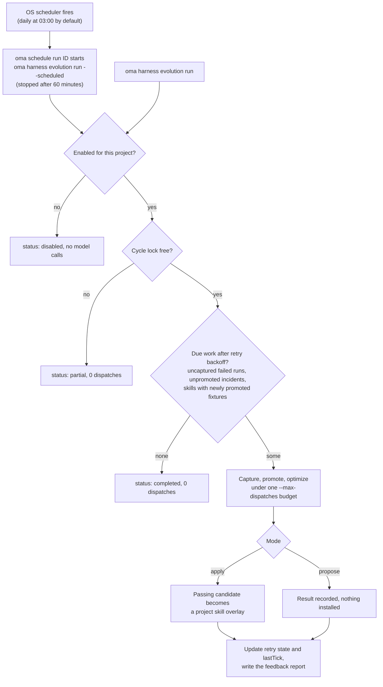

# Эволюция harness проекта

OMA может собирать evidence из отслеживаемых запусков агентов и сбоев процессов в цикле обратной связи. Цикл можно запускать по расписанию или вручную. Автоматические изменения skill **отключены, пока вы не включите их для проекта**. У каждого цикла конечный бюджет model calls, а применяемое изменение должно пройти существующие gate оценки skill.

Автоматический путь улучшает документы skill. Изменения процедуры optimizer или maintainer остаются отдельной [мета-оптимизацией](./skill-opt.md#meta-optimization-the-procedure-as-the-candidate), которую запускают вручную.

## Включение для проекта

Выполните из корня проекта:

```bash
# Example allowance: at most 300 model dispatches per scheduled cycle
oma harness evolution enable --max-dispatches 300

# Evaluate proposals without applying them
oma harness evolution enable --max-dispatches 300 --mode propose

# Choose a schedule in the operating system's local time
oma harness evolution enable --max-dispatches 300 --cron "0 3 * * *"

oma harness evolution status --json
```

`enable` выводит сохранённые настройки и ID задания планировщика:

```json
{
  "enabled": true,
  "scheduleId": "sch_abcdefgh2345",
  "mode": "apply",
  "maxDispatches": 300
}
```

`status --json` возвращает `config`, `schedule` (запись планировщика или `exists: false`), `pending` (число незавершённых повторных попыток), `conflicts` (конфликты overlay по каждому skill) и `state` (повторные попытки и `lastTick`).

Расписание по умолчанию — ежедневно в 03:00 по местному времени, режим по умолчанию — `apply`. `--max-dispatches` обязателен при включении и должен быть положительным целым числом. Значение в примере — это лимит вызовов, а не оценка стоимости и не обещание, что цикл завершится. Более крупные наборы fixture и повторный grading расходуют больше вызовов.

<!-- oma-docs:ignore-start -->
Настройки сохраняются в `.agents/evolution/harness-evolution.json`. Сгенерированное evidence, состояние повторных попыток и lock цикла находятся в `.agents/state/harness-evolution/`.
<!-- oma-docs:ignore-end -->

Включение регистрирует встроенное задание в существующем [планировщике ОС](./scheduled-agents.md) OMA; оно появляется в `oma schedule list` с agent `__builtin__`. В момент срабатывания `oma schedule run <id>` запускает `oma harness evolution run --scheduled` в этом проекте и останавливает его через 60 минут, поэтому подбирайте `--max-dispatches` так, чтобы цикл укладывался в час. Повторное включение обновляет задание проекта, а не создаёт ещё одно. Останавливайте расписание командой `oma harness evolution disable`, а не `oma schedule delete`, чтобы сохранённые настройки оставались согласованными.

```bash
# Run one cycle now under the saved mode and budget
oma harness evolution run --json

# Stop future cycles; retain evidence and applied improvements
oma harness evolution disable
```

`run --json` возвращает `status` (`completed`, `partial` или `disabled`), `dispatchesUsed` и `maxDispatches`. Если lock удерживает другой цикл, `run` возвращает `partial` с 0 dispatch. Цикл, остановившийся с ошибкой (например, из-за исчерпанного лимита), завершается с этой ошибкой и записывает `partial` или `failed` в `state.lastTick`.

Отключённый проект не выполняет работу с моделью через команду evolution, включая запоздавший вызов по расписанию. Отключение не откатывает уже применённые изменения.

## Что происходит автоматически

Диаграмма показывает один цикл — независимо от того, запустил его планировщик или вы вручную.



1. **Запись evidence завершения.** Запуски, отслеживаемые OMA, оставляют локальные ссылки на свой результат и evidence проверки. Этот шаг завершения не делает дополнительных model calls. Повторное завершение одного и того же запуска не создаёт дубликатов evidence.
2. **Сбор сбоев по расписанию.** Цикл сканирует подходящие неудавшиеся запуски, выводит ожидания из записанных контрактов их задач и проверяет, что предложенная регрессионная fixture действительно отклоняет сохранённый неудачный output.
3. **Оптимизация затронутых skill.** Инциденты группируются по skill. Каждый skill оптимизируется при существующих проверках training, validation, final-test, isolation и negative-transfer.
4. **Применение или отчёт.** В режиме `apply` прошедший проверки candidate становится project overlay для skill. В режиме `propose` цикл записывает результат, не устанавливая его.
5. **Отчёт об изменениях.** Используйте status и существующую историю продвижений, чтобы просмотреть результаты. Применённые изменения также попадают в уведомление об эволюции следующей сессии.

OMA не наблюдает автоматически каждый нативный диалог и каждое исправление со стороны пользователя. Входные данные — это evidence запусков, которые OMA действительно отслеживает. Для запуска без сохранённого output или контракта приёмки может потребоваться [спецификация инцидента](./harness-incidents.md#capture-an-incident), написанная вручную.

## Бюджет и повторные попытки

Цикл делит один лимит вызовов между записью инцидентов, составлением rubric, маршрутизацией, grading, оптимизацией skill, соседними task и финальной оценкой. Model call списывается с лимита до dispatch. Вызовы, повторённые слоем выполнения, тоже учитываются. Более строгий лимит constitution у skill по-прежнему действует.

Когда лимит исчерпан, оценка остаётся неполной, а затронутый candidate не может быть применён. Report фиксирует расход и незавершённую работу. Одновременно выполняется только один цикл проекта.

Создание fixture не помечает оптимизацию инцидента как завершённую. Прерванная или неудавшаяся оптимизация остаётся в ожидании и может возобновиться после backoff без дублирования fixture. Backoff удваивается после каждой неудачной попытки: 2, 4, 8, … минут, максимум 1024 минуты (около 17 часов). Полностью оценённый результат без приемлемого изменения записывается как обработанный, поэтому то же evidence не запускает неограниченно повторяющуюся оптимизацию. Новое evidence может запустить очередную попытку.

Переключение из режима proposal в режим apply делает неприменённые proposal допустимыми для обработки. Для применения по-прежнему нужны актуальная оценка и неизменённое исходное содержимое; старый proposal — это не безусловная инструкция на запись.

## Постоянные overlay для skill

Автоматические изменения хранятся отдельно от управляемых определений skill, в принадлежащей пользователю области evolution проекта — `.agents/evolution/skills/<skill>/` (с записью `overlay.json`). Оценка и ссылки на skill vendor внутри проекта используют эффективный body, выбранный из управляемой базы и подходящего для неё overlay. Установки vendor в области HOME не перенаправляются на project overlay. Неуправляемую копию в каталоге vendor проекта нужно разрешить до автоматического применения. Ресурсы skill остаются доступными по своим относительным путям.

Overlay записывает базу, относительно которой он оценивался. После `oma update`:

- Неизменившаяся база продолжает использовать свой overlay.
- Изменившаяся база оставляет overlay сохранённым, но помечает его как конфликт и использует обновлённую базу. Прежняя оценка не может подтвердить, что overlay безопасен на новой базе.

Правка, сделанная во время выполнения оптимизации, не позволяет candidate перезаписать изменённое содержимое. Status сообщает о конфликтах для проверки.

## Проверка и отмена изменений

```bash
oma harness evolution status --json
oma skill promotions --all
oma skill rollback --skill oma-docs
```

Записи о продвижении сохраняют hash candidate и родителя, evidence оценки и пригодный для проверки патч. Откат первого overlay возвращает использование управляемой базы; откат более позднего overlay возвращает предыдущий overlay. Неизвестные правки сохраняются: откат отказывается отбрасывать содержимое, которое больше не совпадает с записанным candidate.

Ручной `oma skill optimize --apply` по-прежнему записывает управляемый `SKILL.md`, но отказывается работать, пока для этого skill активен project overlay (`[oma skill opt] an active project overlay owns this skill; ...`). Сначала откатите overlay командой `oma skill rollback --skill <id>` или позвольте циклу эволюции применить изменение. Запланированная эволюция явно выбирает путь применения через overlay.

## Границы evidence

Успешный программный тест подтверждает, что компоненты связаны правильно, а правила оценки работают. Он не доказывает, что повторяющиеся автоматические изменения со временем улучшают реальную работу проекта. Прежде чем увеличивать лимит или расширять автоматизацию, изучите фактические продвижения, затраты, regression и историю откатов. Продвижение процедуры уровня L5 этим запланированным циклом обратной связи не вызывается.

## См. также

- [Регрессионные кейсы инцидентов](./harness-incidents.md) — запись, продвижение и воспроизведение инцидентов, которые обрабатывает этот цикл.
- [Оптимизация skill](./skill-opt.md) — gate, которые проходит каждое применяемое изменение.
- [Агенты по расписанию](./scheduled-agents.md) — планировщик ОС, который запускает цикл.
