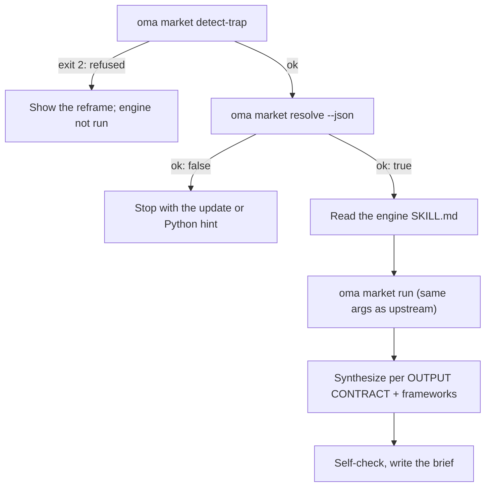

# Исследование рынка

`oma-market` отвечает на вопрос «что люди на самом деле говорят о X за последние N дней» — о проблемах, трендах, отношении к конкурентам и поиске новых возможностей — используя источники сообществ с реальными показателями вовлечённости: Reddit (upvotes и лучшие comments), X, YouTube transcripts, TikTok, Instagram, Hacker News, Polymarket, GitHub, arXiv, Techmeme, Digg, LinkedIn, StockTwits, Bluesky, web и другие.

Само исследование выполняется через upstream engine [**last30days**](https://github.com/mvanhorn/last30days-skill) (MIT, Python 3.12+). oh-my-agent не создаёт его fork: он поддерживает **управляемую копию, всегда обновлённую до последнего release**, защищает каждый запуск gate и добавляет сверху слой стратегических framework. Частота release, число stars и покрытие provider принадлежат upstream project и могут меняться.

---

## Быстрый старт

Попросите agent обычным языком. Фразы вроде «исследование рынка», «pain points», «анализ конкурентов», «voice of customer» или «выявление трендов» активируют skill `oma-market`:

```text
Найди главные проблемы, на которые разработчики жалуются в VS Code remote containers за последние 30 дней.
Сравни настроения сообщества о Cursor и Windsurf за последние 90 дней, frameworks swot,5f.
```

| Чем управлять | Эффект |
|---|---|
| «A vs B» или `--vs B` | Intent competitor: upstream comparison flow + SWOT + Porter's 5F |
| `--days 7`, `30`, `90` или `180` | Окно исследования |
| `--intent pain`, `trend`, `competitor` или `discovery` | Переопределяет автоматическую классификацию intent |
| `--frameworks none` или список вроде `swot,5f,pestel` | Отключает разделы framework или выбирает их |

Результат — один отчёт в `.agents/results/market/{topic-slug}-{YYYYMMDD}.md`. Его первая строка — badge engine (`🌐 last30days v<version> · synced <date>`), за ней следуют упорядоченные evidence clusters со ссылками, разделы framework и footer engine со списком пропущенных источников.

| Работают без key | Требуют upstream setup wizard (key или cookies) |
|---|---|
| Reddit, Hacker News, GitHub, Polymarket, arXiv, Techmeme, Digg, web | X, YouTube transcripts, TikTok, Instagram и другие источники с key; пропущенные источники перечислены в footer |

---

## Всегда последняя версия engine (нужен Python 3.12+) {#always-the-latest-engine--nothing-to-install}

```bash
# Illustrative output; the release tag, cache path, and Python version vary.
oma market resolve
# engine:   last30days
# reason:   last30days 3.21.1 via managed:v3.21.1 (current)
# root:     ~/.cache/oma-market/last30days/v3.21.1
# skill:    ~/.cache/oma-market/last30days/v3.21.1/SKILL.md
# version:  3.21.1
# python:   python3.14 (3.14.7, PATH)
# save_dir: <workspace>/.agents/results/market/raw
```

- Кэш: `~/.cache/oma-market/last30days/<tag>/` плюс `state.json`.
- Перед каждым использованием `resolve` запрашивает у GitHub последний release (не чаще одного раза за `check_interval_min`, по умолчанию 60 min), загружает более новый tag в собственный каталог (старые tag удаляются), иначе использует cache. При сетевых ошибках используется копия из cache со статусом `stale`.
- Python: `LAST30DAYS_PYTHON` → `market.python` → `python3.14`, `python3.13`, `python3.12`, `python3`, `python` в PATH (версия должна быть ≥ 3.12) → `uv python find '>=3.12'`. Если interpreter не найден, `resolve` завершается неуспешно и печатает подсказку по установке; skill останавливается, а не скатывается к исследованию одним web search.
- Конфигурация engine и API key хранятся в `~/.config/last30days/` (их записывает upstream setup wizard с вашего согласия), поэтому переживают обновления engine.

Порядок разрешения (побеждает первое совпадение): `market.path` → `LAST30DAYS_HOME` → **последний управляемый release** → пользовательские копии (`.agents|.claude|.codex|.cursor|.qwen|.kiro/skills/last30days` в проекте и под `~`, затем plugin cache Claude Code).

```bash
oma market update            # force a check / download now
oma market resolve --offline # never touch the network
oma market run -- --help     # the engine's own flags (without `--`, oma prints its own help)
```

---

## Конфигурация

```yaml
market:
  managed: true                   # false = never download; pins / skill dirs only
  channel: stable                 # stable (latest Release) | main (HEAD)
  check_interval_min: 60          # 0 = check on every call
  path: null                      # explicit engine dir (pin)
  python: null                    # interpreter override
  save_dir: .agents/results/market/raw
```

---

## Как работает запуск



1. `oma market detect-trap "<topic>"` — отклоняет темы-ловушки по ключевым словам и темы демографического шопинга (exit 2) и предлагает переформулировку. Пустая тема или тема длиннее 200 символов завершается с exit 4.
2. `oma market resolve --json` — engine и Python; останавливается при `ok: false`.
3. Agent полностью читает `SKILL.md` разрешённого engine и следует ему: setup wizard при первом запуске, разрешение handle / subreddit / hashtag до исследования (если доступен WebSearch), планирование query, precondition gate.
4. `oma market run "<topic>" <flags> --emit=compact` — те же аргументы, что и upstream-вызов `python3 scripts/last30days.py`; `--save-dir` добавляется из `market.save_dir`.
5. Синтез следует upstream OUTPUT CONTRACT (badge в первой строке, упорядоченные evidence clusters, LAWs 1–8), затем oma добавляет разделы framework, ссылающиеся только на clusters engine:

| Intent | Формирование запроса к engine | Framework |
|---|---|---|
| pain | тема в форме жалобы, `--days 30`, `--deep` при малом объёме данных | SWOT |
| trend | `--days 7/30/90/180`, `--discover "<domain>"` для «что сейчас в топе» | SWOT |
| competitor | `"A vs B"` → upstream comparison flow | SWOT + Porter's 5F |
| discovery | `--discover`, затем дополнительные `--drill` | SWOT + PESTEL |

6. Self-check, затем запись `.agents/results/market/{topic-slug}-{YYYYMMDD}.md`.

---

## Режимы ошибок

| Ситуация | Результат |
|---|---|
| Тема отклонена detect-trap | Показывается переформулировка; engine не запускается. `--force` — только после явного повторного подтверждения пользователя |
| Нет engine в cache и нет сети | `ok: false` → выполните `oma market update`, когда появится сеть |
| Нет Python 3.12+ | `ok: false` с подсказкой по установке (brew / apt / `uv python install 3.12`) или задайте `LAST30DAYS_PYTHON` / `market.python`; замены одним web search нет |
| Проверка release не удалась | Используется engine из cache со статусом `stale` |
| Источники без key | Пропускаются внутри engine и перечисляются в footer; включите их через upstream setup wizard |

---

## Дальнейшие шаги

- [Workflow для контента и исследований](./content-and-research.md) — выбор подходящей возможности для других задач исследования и работы с документами
- [Diagram Engine](./diagram-engine.md) — тот же паттерн управляемого последнего release для archify
- [Семантика oma-config.yaml](./oma-config-semantics.md) — как объединяется раздел `market:`
- [CLI Commands: market](../cli-interfaces/commands.md#market) — полный список опций
- Upstream: [mvanhorn/last30days-skill](https://github.com/mvanhorn/last30days-skill)
