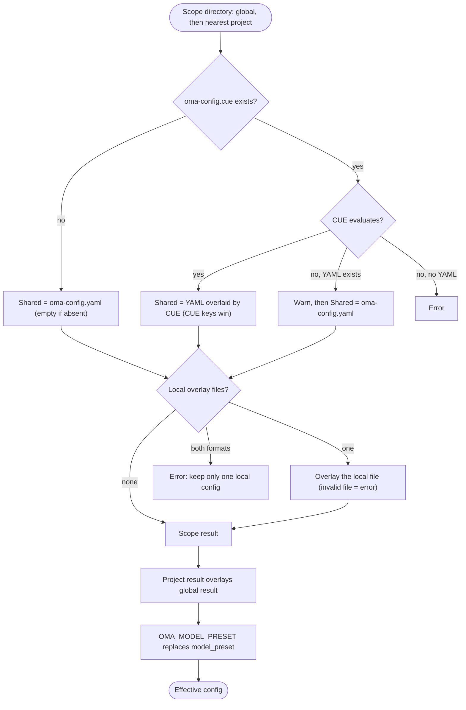

## Обзор

OMA читает глобальные значения по умолчанию из `$OMA_HOME/.agents/` (по умолчанию `~/.oma/.agents/`),
а затем накладывает на них ближайший проектный каталог `.agents/`, найденный выше рабочего каталога.
В каждой области могут быть следующие слои:

- **Общий**: `.agents/oma-config.yaml` и `.agents/oma-config.cue`. Если существуют оба файла и CUE успешно вычисляется, каждый ключ, заданный в файле CUE, переопределяет тот же ключ в файле YAML; ключи, которые есть только в YAML, остаются значениями по умолчанию. Если файл CUE не удаётся вычислить, OMA выводит предупреждение и использует только файл YAML.
- **Локальный**: `.agents/oma-config.local.cue` или `.agents/oma-config.local.yaml` (один файл, накладывается на общий результат; этот файл следует держать приватным).

Общие и локальные настройки проекта переопределяют глобальные. Разные корни
проектов-предков никогда не объединяются; пустой ближайший каталог `.agents/` всё равно является
границей проекта. Глобальные значения по умолчанию не меняют идентичность проекта. Поддерживаемые ключи и значения по умолчанию описаны в
[справочнике конфигурации](/docs/guide/configuration-reference).

## Порядок разрешения

OMA выполняет одни и те же шаги для глобальной области и для ближайшей проектной области, а затем объединяет оба результата:



Если проектный каталог `.agents/` не найден или поиск доходит до самого глобального каталога `.agents/`, используется только глобальный результат.

## Таблица приоритетов {#precedence-table}

Более поздние строки имеют приоритет. Обычные карты объединяются рекурсивно; массивы, скаляры и `null` заменяют предыдущее значение.

| Порядок | Слой | Правило |
|:-----:|-------|------|
| 1 | Глобальный `oma-config.yaml` | Значения по умолчанию под глобальным файлом CUE, если существуют оба. |
| 2 | Глобальный `oma-config.cue` | Переопределяет глобальный YAML ключ за ключом. Если вычисление завершается ошибкой (например, отсутствует CLI `cue`) и YAML существует, OMA выводит `[config] CUE evaluation failed at ... Falling back to oma-config.yaml` и использует только YAML. |
| 3 | Глобальный `oma-config.local.cue` или `oma-config.local.yaml` | Только один файл. Некорректный локальный файл вызывает ошибку. |
| 4 | Проектный `oma-config.yaml` | Ближайший проектный `.agents/` в рабочем каталоге или выше него. |
| 5 | Проектный `oma-config.cue` | Переопределяет строку 4 ключ за ключом, с тем же запасным вариантом, что и в строке 2. |
| 6 | Проектный `oma-config.local.cue` или `oma-config.local.yaml` | Только один файл. Некорректный локальный файл вызывает ошибку. |
| 7 | `OMA_MODEL_PRESET` | Непустое значение заменяет `model_preset` для этого процесса. Пустое значение вызывает ошибку. |

:::tip[Какой файл редактировать?]
Если существует `.agents/oma-config.cue`, заданный в нём ключ переопределяет тот же ключ в `oma-config.yaml`. Измените этот ключ в файле CUE или поместите значение, специфичное для машины, в локальное наложение. `oma doctor --profile` перечисляет загруженные файлы в разделе **Configuration sources**.
:::

Для локального переопределения проекта укажите в локальном файле только изменённые конечные значения. Например, выбор локальной модели можно не помещать в общий файл:

```yaml
# .agents/oma-config.local.yaml
model_preset: claude
agents:
  backend:
    model: anthropic/claude-sonnet-5-5
```

Запускайте команду из проекта, чтобы выбрать ближайший каталог `.agents/`. Некорректный локальный файл вызывает явную ошибку; перед повторной попыткой исправьте или удалите его.

## Проверка конфигурации

```bash
oma doctor --profile                           # loaded files, resolved preset, per-role model and CLI
cue export --out json .agents/oma-config.cue   # what the CUE layer evaluates to (requires the cue CLI)
```

| Симптом или сообщение | Причина | Решение |
|--------------------|-------|-----|
| Изменение в YAML ни на что не влияет | `oma-config.cue` задаёт тот же ключ | Измените ключ в файле CUE или переопределите его в локальном файле |
| `[config] CUE evaluation failed at ... Falling back to oma-config.yaml` | Отсутствует CLI `cue`, или файл CUE не вычисляется | Установите `cue` или исправьте ошибку, о которой сообщает `cue export` |
| `Both local CUE and YAML configs exist in ...; keep only one local config.` | Два локальных файла наложения | Удалите один из них |
| `OMA_MODEL_PRESET must be non-empty` | Переменная экспортирована, но пуста | `unset OMA_MODEL_PRESET` |
| `Unknown model_preset "..."` | Опечатка или отсутствует запись `custom_presets` | Используйте пресет, названный в сообщении об ошибке |
| `Legacy preset name "..." is no longer valid` | Ключ из времён до переименования, например `claude-only` | Переименуйте его, как указано в сообщении, или выполните `oma update` |
| `[model-registry] User inline model "..." failed validation` | Неполная или некорректная запись `models:` | См. [Встраивание slug моделей](/docs/guide/per-agent-models#inlining-model-slugs) |

## Значения по умолчанию

| Ключ | По умолчанию | Когда применяется |
|-----|--------------|------------------|
| `auto_update_cli` | `true` | Оба файла отсутствуют или ключ не задан |
| `serena.mode` | `bridge` | Оба файла отсутствуют или ключ не задан |
| `serena.auto_update` | `true` | Оба файла отсутствуют или ключ не задан |
| `telemetry` | `false` | Оба файла отсутствуют или ключ не задан |
| `language` | `en` | Оба файла отсутствуют или ключ не задан |
| `model_preset` | Требуется | Поставляемый шаблон проекта использует `auto`; схема требует непустое значение. |
| `translation_voice` | `balanced` | Оба файла отсутствуют или ключ не задан |
| `timezone` | Часовой пояс системы | Оба файла отсутствуют или ключ не задан |

## Зачем нужен такой порядок чтения

Для пользовательских значений по умолчанию редактируйте `~/.oma/.agents/oma-config.yaml` (если задан `OMA_HOME`: `<OMA_HOME>/.agents/oma-config.yaml`).
Общие и локальные файлы проекта переопределяют эти значения,
не наследуя настройки посторонних проектов-предков. Выбор `none` в проекте
для семантической памяти переопределяет глобальный выбор AgentMemory.

## Примечания

- `language` в `oma-config.yaml` управляет языком ответов агента. Он **не** используется для определения языка предупреждений при установке и обновлении: они используют локаль системы (`$LANG`), поскольку во время установки `oma-config.yaml` ещё не загружен.
- `auto_update_cli` использует проектные переопределения раньше глобальных значений по умолчанию и по умолчанию включён, если ни одна из областей его не задаёт.
- `telemetry` (по умолчанию `false`) сопоставляется с собственной настройкой отказа каждого поставщика, которую `oma install` / `oma update` / `oma link` записывает следующим образом: Claude `DISABLE_TELEMETRY` + `CLAUDE_CODE_DISABLE_FEEDBACK_SURVEY`, Gemini/Qwen `privacy.usageStatisticsEnabled`, Codex `analytics.enabled` + `feedback.enabled`, Grok `[features] telemetry`, Antigravity (agy) `enableTelemetry` в `~/.gemini/antigravity-cli/settings.json`. Значение `telemetry: true` снова включает участие, удаляя отказ OMA для данного поставщика.
- `diagram` (движок `auto` / `archify` / `mermaid`, `explain_sidecar`, `archify.managed|channel|check_interval_min|path|quality|open`) — разреженный раздел переопределений навыка, аналогичный `video` / `image`; см. [Diagram Engine](/docs/guide/diagram-engine).
- `video.hyperframes.check_interval_min` ограничивает частоту проверки последней версии инструментальной цепочки HyperFrames для каждого запуска и heygen-com/hyperframes (`oma video compose`, `oma update`). Поставляемая схема CUE пока не определяет `video.hyperframes`, поэтому `cue export` отклоняет этот ключ внутри блока схемы (`field not allowed`); задайте его в `oma-config.yaml` или в локальном наложении YAML.
- `market` (`managed|channel|check_interval_min|path|python|save_dir`) настраивает всегда актуальный движок `last30days` за `oma market`; см. [Market Research](/docs/guide/market-research).
- Типизированная схема runtime охватывает `providers`, `free`, `agents`, `models`, `custom_presets`, `vendors`, `session`, `docs` и разреженные разделы навыков. В поставляемых шаблонах также есть блоки, принадлежащие потребителям, например `scm`, `memory`, `serena_reaper` и `mcp`; их потребители владеют вложенными ключами. Не выводите ключ по этому списку — используйте [справочник конфигурации](/docs/guide/configuration-reference) и руководство по соответствующему блоку.
- Безопасно редактировать `oma-config.yaml` напрямую. `oma install` и `oma update` заменяют поля на уровне регулярных выражений и сохраняют пользовательские ключи, которыми они не управляют (например, пользовательские переопределения `agents:` и `session.quota_cap`).
- `oma update` дополнительно добавляет ключи верхнего уровня из поставляемого шаблона, которых нет в вашем файле, со значениями шаблона и маркером `# Added by oma update`. Уже имеющиеся ключи никогда не изменяются — существующее содержимое остаётся побайтно неизменным. Намеренно удалённые ключи появятся снова со значением шаблона; чтобы отказаться от них, задайте значение явно, а не удаляйте ключ.
