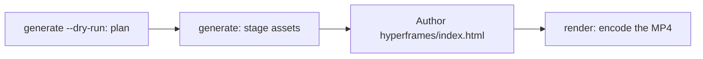

# Генерация видео

`oma-video` — видеомаршрутизатор oh-my-agent. По brief из одной строки он собирает script, narration, visuals и captions, затем записывает план в run directory. Этапы провайдеров не требуют key и могут использовать local или deterministic fallback; настоящий MP4 всё равно требует работающий compositor и корректную composition.

Skill активируется по словам «shorts», «reels», «screencast» или фразам вроде «make a video», «explainer video», «demo video», «walkthrough video» или «video from README», а также когда другому skill нужно видео как side effect.

> **TL;DR** `oma video generate` планирует run и подготавливает assets. С compositor HyperFrames по умолчанию он не кодирует MP4: создайте `<runDir>/hyperframes/index.html` (workflow `/video` делает это за вас), затем выполните `oma video render <runDir>`. При первом запуске начните с `oma video doctor --install`.

---

## Когда использовать {#when-to-use}

- Превратить brief, README, code или data в короткий clip.
- Создать narrated explainer или запись demo/walkthrough.
- Повторяемый pipeline «brief → `.mp4`», который нужно запускать детерминированно.

## Когда НЕ использовать {#when-not-to-use}

- Один still image → используйте [`oma-image`](/docs/guide/image-generation).
- Live screen broadcast / streaming → вне scope (oma никогда не записывает экран; запись предоставляете вы).
- Отдельный narration audio → используйте `oma-voice`.

---

## Режимы в одном взгляде {#modes-at-a-glance}

| Режим | Соотношение сторон | Что он собирает |
|------|--------|------------------|
| `shorts` | 9:16 | Вертикальный short-form clip (script → narration → visuals → captions). |
| `explainer` | 16:9 | Горизонтальный explainer из README, code или data brief. |
| `demo` | derived | Walkthrough из вашей собственной записи экрана, переданной с `--capture <file>`. `--source web --url <url>` лишь сохраняет замаскированный URL как context; oma никогда не открывает браузер, не записывает экран и не автоматизирует login. |

Режим выбирает разумные значения по умолчанию; нужные flags задайте, когда требуются другие.

---

## Быстрый старт {#quick-start}

В агенте `/video three quick tips for better focus` выполняет все шаги ниже за вас. Вручную pipeline состоит из четырёх шагов:



```bash
oma video doctor --install   # first run only: HyperFrames toolchain, Chrome Headless Shell, Pretendard

# 1. Plan from an agent-authored script (schema: .agents/skills/oma-video/resources/script-schema.md)
oma video generate "three quick tips for better focus" --mode shorts --script ./script.json --dry-run --output json

# 2. Stage assets (narration needs --voice <profile>; the default is a silent video)
oma video generate "three quick tips for better focus" --mode shorts --script ./script.json --output json

# 3. Author <runDir>/hyperframes/index.html per its AUTHORING.md, then encode
oma video compose <runDir>
oma video render <runDir> --output json

# Demo from your own recording; without --polish the recording itself becomes the output
oma video generate "product walkthrough" --mode demo --capture ./capture.mp4
```

<!-- oma-docs:ignore-start -->

| Шаг | Команда | Результат |
|---|---|---|
| План | `generate --dry-run` | `script.json`, `render-spec.json`, `manifest.json`; без рендеринга |
| Подготовка assets | `generate` | visuals, captions, необязательные audio и music, scaffold `hyperframes/` и предупреждение `composition pending` |
| Создание composition | правка `hyperframes/index.html` | composition |
| Рендер | `render <runDir>` | `{mode}-{slug}.mp4` и обновлённый manifest |

<!-- oma-docs:ignore-end -->

Без `--script` CLI строит детерминированный skeleton из трёх сцен по тексту brief. `--locale` задаёт языковой tag для narration и captions, но не переводит их; пишите brief или `script.json` на целевом языке.

Каждый run печатает свой run directory. Фиксированный `--seed` стабилизирует входные данные детерминированного планирования; live provider output и capture footage всё ещё могут различаться. Повторно отрендерите существующий run directory, если нужно использовать сохранённые render spec и assets.

Другие инструменты, вызывающие `oma video generate --output json`, разбирают JSON envelope из stdout: `{exitCode, runDir, manifestPath, scriptPath, renderSpecPath, warnings, error}`. Ключа `outputs` нет — пути output/asset нужно читать из manifest по `manifestPath`.

---

## Всегда последняя HyperFrames — composition создаёте вы {#always-latest-hyperframes--you-author-the-composition}

oh-my-agent **не поставляет код HyperFrames composition**. Каждый run получает собственный project в `<runDir>/hyperframes/`, созданный `oma video compose` на последней npm HyperFrames (toolchain cache `~/.cache/oma-video/hyperframes/<version>/`, общий через symlink `node_modules`) с [heygen-com/hyperframes](https://github.com/heygen-com/hyperframes) на HEAD (`~/.cache/oma-video/hyperframes-skills/`). Agent создаёт исходник сгенерированной composition по `AUTHORING.md` scaffold, skills и mode spec из `.agents/skills/oma-video/resources/hyperframes-authoring/`.

```bash
oma video generate "…"                     # → render-spec.json + <runDir>/hyperframes/ (composition pending)
oma video compose <runDir> --output json   # refresh scaffold / print the contract (idempotent)
#   author hyperframes/index.html as instructed by AUTHORING.md
oma video render <runDir> --output json    # lint → render with the cached HyperFrames CLI → ffprobe; exit 1 on any failure
```

- Проверки последней версии (npm + GitHub) ограничены `video.hyperframes.check_interval_min` (default 60; `0` = каждый compose). `oma update` учитывает этот интервал; `oma video doctor --upgrade` принудительно запускает проверку; offline run использует cached toolchain и сообщает `stale`.
- Воспроизводимость живёт в run dir: `render-spec.json`, authored composition source и версия toolchain в generated HyperFrames package metadata. Повторный render того же run использует этот render contract; новый run проверяет последнюю HyperFrames.
- Ошибка lint или render **не** скрывается placeholder (он существует только для `OMA_VIDEO_MOCK=1`): `oma video render` завершается с code 1 и diagnostics, а agent исправляет composition с помощью latest skills. Поломка на новом release HyperFrames — ошибка composition, а не причина закреплять версию.

```yaml
video:
  hyperframes:
    check_interval_min: 60    # 0 = check on every compose
```

---

## Справочник CLI {#cli-reference}

```bash
oma video generate <brief...> [options]
oma video doctor [--install|--upgrade|--install-mpt|--install-strudel]  # toolchain readiness / provisioning
oma video compose <runDir>       # prepare HTML project and authoring contract
oma video render <runDir>        # re-render from render-spec.json (deterministic)
oma video provider list         # provider availability + key/fallback status
```

### Основные флаги {#key-flags}

| Флаг | Назначение |
|------|---------|
| `--mode <m>` | `shorts` \| `explainer` \| `demo`. |
| `--aspect <a>` | `9:16` \| `16:9` \| `1:1` \| `auto`. |
| `--locale <lang>` | Языковой tag narration/caption. |
| `--captions <s>` | `tiktok` \| `lower-third` \| `none` (alignment без key). |
| `--visual <m>` | `auto` \| `generate` \| `stock` \| `aigc` \| `slide`. |
| `--voice <profile>` | Голос narration или `none` (default); если не задавать, видео будет без звука с оценочным timing captions. |
| `--music <mode>` | `upbeat`, `calm`, `cinematic`, `lofi`, `piano` или `none`. |
| `--compositor <c>` | `hyperframes` (default) \| `mpt`. |
| `--capture <path>` | Ваша запись для demo mode: `.mp4`, `.mov`, `.webm` или `.mkv`, хранящаяся внутри проекта. |
| `--source <k>` | Источник demo capture: `file` или `web` (default: `file`). |
| `--url <url>` | Context URL для `--source web`, сохраняется в `manifest.json` в замаскированном виде. Обязателен с `--source web`; никогда не запускает capture и не заменяет `--capture`. |
| `--polish` | Наложить HyperFrames composition на captured footage. |
| `--device`, `--ready-selector`, `--show-cursor`, `--capture-timeout`, `--capture-stop` | Принимаются, но не используются: oma не управляет браузером и не записывает экран. |
| `--output-dir <path>` | Базовый output directory. Пути вне `$PWD` требуют `--allow-external-output`. |
| `--allow-external-output` | Разрешить output paths вне `$PWD`. |
| `--max-usd <n>` | Потолок стоимости (default `0.2`). Когда текущая оценка его достигает, run останавливается с exit 1; перезапустите с `-y` или большим значением. |
| `--duration <sec>` | Целевая длина в секундах (1–180) или `auto`. |
| `--seed <n>` | Deterministic seed. |
| `--dry-run` | Вывести script / render-spec / manifest и пропустить render. |
| `--script <path>` | Созданный agent `script.json` для injection (заменяет skeleton; управляет narration, on-screen text и visual prompt каждой сцены). |
| `-y, --yes` | Разрешить провайдеров, чья оценка достигает `--max-usd` (то же, что `OMA_VIDEO_YES=1`). |
| `--timeout <sec>` | Лимит времени в целых секундах на каждый вызов провайдера визуала или музыки (default `600`). Суффиксы единиц не разбираются: `2m` означает 2 секунды. |
| `--output <f>` | Output CLI: `text` (default) или `json`. |
| `--no-brief-in-manifest` | Сохранить SHA-256 brief вместо исходного brief. |

---

## Провайдеры без обязательного key {#key-optional-providers}

Этапы провайдеров разрешаются через **real branch** и, если этап это поддерживает, через **deterministic fallback**. Поэтому отсутствующие key могут оставить запланированный run с estimated timing или local assets. Compositor — обязательный final stage и не имеет обычного placeholder fallback:

| Возможность | Реальная ветка (что её включает) | Запасной вариант |
|------------|-------------|----------|
| script | созданный agent `script.json`, переданный через `--script <path>` (его пишет workflow `/video`) | детерминированный skeleton из трёх сцен по тексту brief |
| voice | `oma-voice` (Voicebox, local) с `--voice <profile>` | видео без звука с estimated timing (`--voice none`, default) |
| visual | `oma-image`, `oma-slide`, stock clips Pexels при заданном `PEXELS_API_KEY` | placeholder asset |
| visual: `aigc` | ещё не подключён; `RUNNINGHUB_API_KEY` включает провайдера, который всё равно пишет placeholder | placeholder asset |
| caption | `.srt` и `.vtt`, выровненные по `timing.json`, на языке script | то же; перевод на `--locale` ещё не подключён |
| music | фоновая музыка Strudel после `oma video doctor --install-strudel` | без музыкальной дорожки |
| capture | запись, которую вы передаёте через `--capture <file>` | нет: без `--capture` demo mode печатает инструкции по записи и завершается с exit 3 |
| compositor | HyperFrames (managed) или MoneyPrinterTurbo | compositor fallback отсутствует; run завершается с diagnostics |

Автоматизации учётных данных нет: любой on-screen login вы выполняете сами во время записи; URL и query token маскируются в log и manifest.

Captions рендерятся как **static windowed cues** — единственная строка caption, активная на текущем frame, с CSS wrapping и без per-word animation.

---

## Инструменты и `doctor` {#toolchain-and-doctor}

Тяжёлая toolchain (`node_modules` managed HyperFrames project, встроенный шрифт Pretendard, checkout MoneyPrinterTurbo, музыкальный проект Strudel, Chrome Headless Shell) **подготавливается по запросу**, а не поставляется в package. Обычный `doctor` только сообщает состояние и ничего не устанавливает:

```bash
oma video doctor
```

Он сообщает о `node`, `chromium`, `ffmpeg`, `ffprobe`, `hyperframes-toolchain`, `hyperframes-skills`, `pretendard-font`, `mpt-project`, `strudel`, `voicebox`, `oma-image`, `pixelle` и `cap`, а для отсутствующих печатает подсказку установки. Авторитетный список выводит `oma video doctor --output json`. Базовый вариант требует Node.js 22+, toolchain HyperFrames и её браузер Chrome, FFmpeg/FFprobe и `oma-image`. Для настоящего MP4 также нужен authored HTML.

Для provision toolchain используйте install flags:

```bash
oma video doctor --install             # warm the latest HyperFrames toolchain + Chrome Headless Shell + Pretendard + heygen-com/hyperframes
oma video doctor --upgrade             # force a latest-version check now
oma video doctor --install-mpt         # MoneyPrinterTurbo checkout (clone + venv + deps) for --compositor mpt
oma video doctor --install-strudel     # Strudel music renderer for --music (installs AGPL-3.0-or-later packages locally)
```

`--install` также загружает встроенный Pretendard font (pinned release) в общий toolchain cache — это часть determinism boundary. При сетевой ошибке появляется warning и render переключается на system fonts; различия браузера и ОС всё равно могут влиять на закодированный output.

---

## Структура результата {#output-layout}

```text
.agents/results/videos/{timestamp}-{shortid}-{mode}/
├── script.json          # scenes + narration
├── render-spec.json     # the deterministic render contract
├── timing.json          # per-segment timing (voicebox-stt or estimated)
├── captions.srt / .vtt
├── audio/narration-01.wav     # one track; absent when the video is silent
├── music/                     # pattern.strudel, bgm.wav, bgm.mp3 (with --music and Strudel installed)
├── visuals/scene-*.{png,svg,…}
├── hyperframes/         # index.html, AUTHORING.md, local assets and toolchain link
├── {mode}-{slug}.mp4    # the rendered output (slug derived from the script title)
└── manifest.json        # providers, assets, cost, warnings
```

`render-spec.json` + assets — граница воспроизводимости.

---

## Устранение неполадок {#troubleshooting}

<!-- oma-docs:ignore-start -->

| Симптом | Причина / исправление |
|---------|-------------|
| MP4 не создан | Compositor, composition или toolchain check завершился ошибкой. Запустите `oma video doctor`, затем `oma video compose <runDir>` и исправьте указанную composition перед повтором `oma video render <runDir>`. |
| Narration без звука (`source: estimated`) | `--voice` по умолчанию равен `none`, или Voicebox недоступен. Передайте `--voice <profile>` с профилем из приложения Voicebox и запустите сервер `oma-voice` или примите estimated timing. |
| Demo run завершается с exit 3 и инструкциями по записи | Файл `--capture` не передан (в том числе с `--source web`); oma не записывает экран. Запишите сценарий в Cap, QuickTime или OBS, сохраните запись внутри проекта и перезапустите с `--capture ./walkthrough.mp4`. |
| `--capture` отклонён (exit 4) | Файл не существует, находится вне каталога проекта или не является `.mp4` / `.mov` / `.webm` / `.mkv`. Скопируйте запись в проект, например в `./captures/demo.mp4`. |
| Run останавливается на потолке стоимости (exit 1) | Текущая оценка достигла `--max-usd`. Перезапустите с `-y` или большим `--max-usd`. |
| `--out path "…" is outside $PWD. Use --allow-external-out to override.` (exit 1) | `--output-dir` указывает за пределы проекта. Перезапустите с `--allow-external-output` (сообщение всё ещё показывает старое имя флага) или выберите каталог внутри проекта. |
| `oma video doctor` показывает `oma-image` как отсутствующий | Если в деталях написано `Removed option --format. Use --output.`, сбоем завершилась сама проверка готовности, и о ваших вендорах она ничего не говорит; проверьте их напрямую через `oma image doctor`. Иначе ни один вендор изображений не готов, и visuals переключаются на placeholder: запустите `oma image doctor` и настройте одного вендора. |
| Первый render медленный | Browser HyperFrames / checkout MPT подготавливаются один раз; следующие run используют cache. |

<!-- oma-docs:ignore-end -->

---

## Дальнейшие шаги {#next-steps}

- [`/video` workflow](../core-concepts/workflows.md#video) — pipeline brief → script → assets → render-spec → HyperFrames.
- [Генерация изображений](./image-generation.md) — still-image router, повторно используемый как video visual provider.
- [Workflows для контента и исследований](./content-and-research.md) — voice, slides и другие возможности для контента.
- [Команды CLI: video](../cli-interfaces/commands.md#video) — полный список опций `oma video`.
