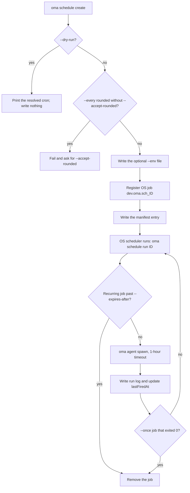
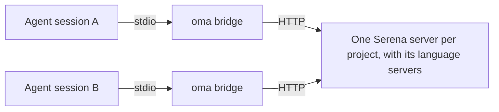
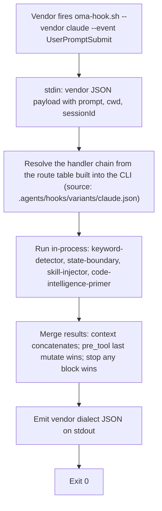

# Lệnh CLI

Sau khi cài đặt toàn cục (`bun install --global oh-my-agent`), dùng `oma` hoặc `oh-my-agent`. Để dùng một lần mà không cần cài đặt, chạy `npx oh-my-agent`.

Có thể đặt biến môi trường `OH_MY_AG_OUTPUT_FORMAT` thành `json` để JSON trở thành đầu ra mặc định trên các lệnh dùng chung tùy chọn `--json` / `--output`. Một `--output text` tường minh vẫn được ưu tiên.

Nếu một lệnh thất bại với `Unknown command`, `Unexpected argument` hoặc `Removed option`, xem [Cách viết đã bị loại bỏ](#aliases) trên trang này; với các sự cố về cài đặt, hook và runtime, xem [Khắc phục sự cố](../guide/troubleshooting.md).

## Bắt đầu từ một task

Chọn lệnh nhỏ nhất đủ để trả lời câu hỏi của bạn. Mỗi lệnh bên dưới in ra một đường dẫn hoặc báo cáo mà bạn có thể kiểm tra trước khi chuyển sang bước tiếp theo.

| Tác vụ | Bắt đầu tại đây | Kết quả mong đợi |
|:-----|:-----------|:----------------|
| Cài đặt hoặc sửa chữa một project | `oma install` rồi `oma doctor` | Các tài nguyên đã cài đặt và một báo cáo sức khỏe; dùng `oma doctor --profile` khi câu hỏi liên quan đến việc phân giải model. |
| Tìm một lệnh hoặc tùy chọn từ agent | `oma describe` hoặc `oma describe "image generate"` | JSON mô tả đối số, tùy chọn và các lệnh lồng nhau. |
| Tạo ảnh | `oma image generate "<prompt>" --output json` | Đường dẫn ảnh và một manifest trong `.agents/results/images/`. |
| Lập kế hoạch hoặc render video | `oma video generate "<brief>" --dry-run` | Một run directory chứa các artifact lập kế hoạch; chỉ compose và render sau khi composition đã được author. |
| Tạo một code explainer tương tác | `/explain` | Một artifact HTML tự chứa (self-contained) đã được validate trong `.agents/results/explain/`. |
| Resolve một diagram engine | `oma diagram resolve --output json` | Engine Mermaid hoặc archify được chọn kèm lý do. |
| Nghiên cứu tín hiệu cộng đồng | `oma market detect-trap "<topic>"` | Một kết quả preflight; chỉ tiếp tục với `oma market resolve --output json` và lần chạy upstream khi preflight pass. |
| Chuyển đổi hoặc kiểm tra một bài báo khoa học | `oma scholar search "<query>"` | Kết quả tìm kiếm từ Knows, OpenAlex hoặc Semantic Scholar; lấy sidecar bằng `oma scholar get`. |
| Xây dựng một slide deck | `oma slide create --output-dir <dir>` | Một working directory có thể author, validate, bundle và export. |
| Rà soát drift của tài liệu | `oma docs verify --json` | Một báo cáo có cấu trúc về các tham chiếu hỏng và reference index được tạo lại. |
| Lên lịch một agent định kỳ | `oma schedule create backend "<task>" --every 2h --dry-run` | Biểu thức cron đã resolve; không có gì được đăng ký cho đến khi bạn chạy lại mà không có `--dry-run`. |
| Kiểm tra chất lượng skill hoặc harness | `oma skill lint` hoặc `oma skill audit` | Các báo cáo offline; xem [Chọn lệnh skill hoặc harness](#choosing-a-skill-or-harness-command) trước khi dùng bất kỳ lệnh nào gọi model. |

Các tên chuẩn bên dưới lấy từ `oma describe`. Chỉ các đường dẫn phân tách bằng dấu cách này được chấp nhận: các cách viết cũ như `slide new`, `slide viewer`, `image list-vendors`, `video list-providers`, dạng dấu hai chấm như `agent:parallel`, và các tên ngắn `viz`, `s`, `img` đều thất bại với `Unknown command` hoặc `Unexpected argument`. Xem [Bí danh và cách viết đã bị loại bỏ](#aliases).

## Bề mặt lệnh hiện tại

Bản đồ này giúp các phần tham chiếu dài bên dưới dễ lướt hơn và giúp tìm thấy các nhóm lệnh ít dùng hơn. Dùng `--help` của từng nhóm hoặc `oma describe <path>` để xem cú pháp đối số chính xác; [Tùy chọn CLI](./options.md) chứa toàn bộ ma trận flag của registry.

| Nhóm | Đường dẫn đã đăng ký |
|:-------|:-----------------|
| `install` | `install` |
| `describe` | `describe` |
| `uninstall` | `uninstall` |
| `update` | `update`, `update mcp` |
| `link` | `link` |
| `intel` | `intel`, `intel suggest` |
| `market` | `market`, `market detect-trap`, `market resolve`, `market update`, `market run` |
| `doctor` | `doctor` |
| `profile` | `profile`, `profile list`, `profile show`, `profile create`, `profile use`, `profile run` |
| `home` | `home`, `home migrate` |
| `retro` | `retro` |
| `recap` | `recap` |
| `docs` | `docs`, `docs verify`, `docs sync`, `docs i18n`, `docs lint` |
| `emit` | `emit` |
| `cleanup` | `cleanup` |
| `bridge` | `bridge` |
| `verify` | `verify`, `verify agent`, `verify triggers` |
| `vault` | `vault`, `vault store`, `vault get`, `vault list`, `vault delete` |
| `star` | `star` |
| `visualize` | `visualize` |
| `search` | `search`, `search providers`, `search web`, `search fetch`, `search meta`, `search media`, `search archive`, `search trust`, `search code`, `search doctor`, `search api`, `search api fetch`, `search api search`, `search rss`, `search rss fetch`, `search rss google` |
| `harness` | `harness`, `harness eval`, `harness incident`, `harness incident scan`, `harness incident capture`, `harness incident show`, `harness incident export`, `harness incident promote`, `harness incident reproduce`, `harness feedback`, `harness evolution`, `harness evolution enable`, `harness evolution status`, `harness evolution disable`, `harness evolution run` |
| `slide` | `slide`, `slide validate`, `slide bundle`, `slide edit`, `slide doctor`, `slide create`, `slide preview`, `slide export`, `slide export pdf`, `slide export png`, `slide export pptx`, `slide import`, `slide import pptx`, `slide asset`, `slide asset fetch-video`, `slide style`, `slide style list`, `slide style preview`, `slide style get` |
| `scholar` | `scholar`, `scholar search`, `scholar resolve`, `scholar get`, `scholar lint` |
| `image` | `image`, `image generate`, `image doctor`, `image vendor`, `image vendor list` |
| `video` | `video`, `video generate`, `video doctor`, `video compose`, `video render`, `video provider`, `video provider list` |
| `serena` | `serena`, `serena check`, `serena setup`, `serena reap`, `serena daemon`, `serena daemon gc`, `serena reaper`, `serena reaper enable`, `serena reaper disable` |
| `explain` | `explain`, `explain render`, `explain lint`, `explain patch`, `explain components`, `explain validate` |
| `diagram` | `diagram`, `diagram resolve`, `diagram update`, `diagram archify` |
| `help` | `help` |
| `version` | `version` |
| `dashboard` | `dashboard`, `dashboard terminal`, `dashboard web` |
| `auth` | `auth`, `auth status` |
| `hook` | `hook`, `hook run`, `hook probe`, `hook script` |
| `state` | `state`, `state emit`, `state migrate`, `state get`, `state list`, `state repair`, `state verify`, `state decisions`, `state decisions list`, `state inject-log`, `state inject-log list`, `state inject-log get`, `state summary`, `state trajectory`, `state heal-check`, `state activate`, `state archive`, `state purge` |
| `ralph` | `ralph`, `ralph verify` |
| `goal` | `goal`, `goal set` |
| `stats` | `stats`, `stats get`, `stats reset` |
| `agent` | `agent`, `agent context`, `agent resume`, `agent begin`, `agent verify`, `agent finish`, `agent spawn`, `agent status`, `agent parallel`, `agent review` |
| `model` | `model`, `model check`, `model probe`, `model propose` |
| `memory` | `memory`, `memory keys`, `memory init`, `memory setup`, `memory daemon`, `memory daemon status`, `memory daemon start`, `memory daemon stop`, `memory daemon restart`, `memory service`, `memory service install`, `memory service uninstall`, `memory status`, `memory retry`, `memory retry drain`, `memory import`, `memory maintain`, `memory maintain backup`, `memory maintain prune`, `memory maintain vacuum`, `memory gc`, `memory upgrade` |
| `skill` | `skill`, `skill audit`, `skill lint`, `skill eval`, `skill optimize`, `skill meta-optimize`, `skill procedure`, `skill evolution-stats`, `skill promotions`, `skill rollback`, `skill matrix` |
| `schedule` | `schedule`, `schedule create`, `schedule list`, `schedule delete`, `schedule run`, `schedule sync` |

`oma describe` cũng liệt kê `agent parallel-supervisor`, `schedule inspect` và `schedule builtin-evolution-add`. Các lệnh khác gọi chúng ở bên trong; bạn không chạy chúng bằng tay.

Khi một lệnh chuyển các đối số còn lại cho một công cụ khác, registry cố ý để ngỏ các tùy chọn của lệnh đó. Điều này áp dụng cho `market run` và `diagram archify`; hãy đọc help của upstream đã resolve trước khi chạy một thao tác làm thay đổi dữ liệu hoặc có truy cập mạng.

---

## Thiết lập và cài đặt

### install

`oma` không kèm đối số sẽ khởi chạy trình cài đặt tương tác. `oma install` là dạng tường minh và nhận các tùy chọn chọn provider.

```bash
oma
oma install
oma install --web-search native --code-intelligence gortex --semantic-memory agentmemory
```

| Tùy chọn | Giá trị chấp nhận |
|:-------|:----------------|
| `--web-search <provider>` | `native`, `brave` |
| `--code-intelligence <provider>` | `serena`, `gortex` |
| `--semantic-memory <provider>` | `agentmemory`, `honcho`, `none` |
| `--honcho-url <url>` | Origin của Honcho API (mặc định cho kết nối mới: `http://127.0.0.1:8000`) |
| `--honcho-workspace <id>` | ID workspace Honcho (mặc định cho kết nối mới: `oma`) |

Khi bị bỏ qua, `--web-search`, `--code-intelligence` và `--semantic-memory` giữ nguyên lựa chọn provider đã lưu. `--honcho-url` và `--honcho-workspace` cấu hình một kết nối Honcho mới khi provider đó được chọn. Flag gốc `-y, --yes` bỏ qua các prompt và dùng giá trị mặc định; `--global` nhắm tới `$OMA_HOME/.agents/` (mặc định `~/.oma/.agents/`). Bản cài đặt project vẫn ở `<cwd>/.agents/` ngay cả khi đã đặt `OMA_HOME`.

**Hoạt động:**
1. Kiểm tra thư mục legacy `.agent/` và di chuyển sang `.agents/` nếu tìm thấy.
2. Phát hiện và đề xuất gỡ bỏ các công cụ cạnh tranh.
3. Hỏi loại project (All, Fullstack, Frontend, Backend, Mobile, DevOps, Custom).
4. Nếu chọn backend, hỏi biến thể ngôn ngữ (Python, Node.js, Rust, Other).
5. Hỏi về symlink cho GitHub Copilot.
6. Tải tarball mới nhất từ registry.
7. Cài đặt tài nguyên dùng chung, workflow, config và các skill đã chọn.
8. Cài đặt vendor adaptation cho các vendor đã chọn (setting cục bộ trong project; không âm thầm ghi cấu hình vendor ở cấp HOME).
9. Tạo symlink CLI.
10. Đề xuất git config **toàn cục** được khuyến nghị (cần xác nhận để opt-in):
    - `rerere.enabled=true` — tái sử dụng cách giải quyết merge conflict khi nhiều agent cùng làm việc
    - `init.defaultBranch=main` — branch mặc định nhất quán cho repo mới
    - Bỏ qua hoàn toàn khi dùng `--yes` / CI (thay vào đó in gợi ý sửa thủ công)
11. Đề xuất cấu hình MCP khi phù hợp.
12. Đề nghị star repo trên GitHub nếu `gh` đã được xác thực.

**Ví dụ:**
```bash
cd /path/to/my-project
oma
# Follow the interactive prompts
```

### doctor

Kiểm tra sức khỏe cho các bản cài đặt CLI, cấu hình MCP và trạng thái skill.

```text
oma doctor [--json] [--output <format>] [--profile] [--heal-check <agent-type>]
```

**Tùy chọn:**

| Flag | Mô tả |
|:-----|:-----------|
| `--json` | Xuất dạng JSON. Lệnh thoát với mã `1` khi số `issues` trong báo cáo lớn hơn 0. |
| `--output <format>` | Định dạng đầu ra (`text` hoặc `json`) |
| `--profile` | Hiển thị ma trận sức khỏe của profile. Cho biết model slug đã phân giải, CLI và trạng thái xác thực của từng agent dựa trên `model_preset` đang hoạt động và các override `agents:`. Xem [Cấu hình model theo từng agent](../guide/per-agent-models.md). |
| `--heal-check <agent-type>` | Đưa kiểm tra cổng self-healing của agent đó vào báo cáo. |

**Kiểm tra:**
- Cài đặt CLI: `claude`, `codex`, `qwen`, `agy`, `grok`, `kiro-cli`, `kimi` và `pi` (phiên bản và đường dẫn).
- Trạng thái xác thực của từng CLI.
- Cấu hình MCP cho Claude Code (`~/.claude.json`) và Codex (`~/.codex/config.toml`).
- Skill đã cài: những skill nào đang có và trạng thái của chúng.
- Thư mục memory store: sự tồn tại và số lượng file của `.agents/state/memories/` (project cũ hơn fallback về đường dẫn legacy `.serena/memories/`).
- Marker cài đặt kép (project so với global) và các cảnh báo liên quan.
- Git config **toàn cục** được khuyến nghị (`gitRecommended` trong JSON):
  - `rerere.enabled=true`
  - `init.defaultBranch=main`
  - Mỗi chỗ không khớp được tính vào tổng số issue (`issues` trong JSON)
- Tệp ngữ cảnh vendor của project (block OMA trong `AGENTS.md` khi đã cài Codex, Qwen hoặc Claude Code ≥ 2.1.277).
- AgentMemory, tình trạng state/hooks, chẩn đoán Serena reaper và các bộ đếm issue liên quan.

**Tự sửa chữa:** Nếu phát hiện thiếu skill, `doctor` đề xuất cài đặt chúng theo cách tương tác. Nếu git config được khuyến nghị bị thiếu hoặc sai, lệnh đề xuất cùng các bản sửa toàn cục dạng opt-in mà install/update sử dụng.

**Ví dụ:**
```bash
# Interactive text output
oma doctor

# JSON output for CI pipelines
oma doctor --json

# Pipe to jq for specific checks
oma doctor --json | jq '.clis[] | select(.installed == false)'

# Inspect the profile resolution matrix
oma doctor --profile
```

### update

Cập nhật skill lên phiên bản mới nhất từ registry.

```text
oma update [-f, --force] [--with-new-skills] [--ci] [-y, --yes] [--all] [--vendor <vendors>]
```

**Tùy chọn:**

| Flag | Mô tả |
|:-----|:-----------|
| `-f, --force` | Ghi đè các file config do người dùng tùy chỉnh (`oma-config.yaml`, `mcp.json`, các thư mục `stack/`) |
| `--with-new-skills` | Cài đặt các skill mới có trong bản phát hành này; nếu không có flag này, chỉ làm mới các skill đã cài. |
| `--ci` | Chạy ở chế độ CI không tương tác (bỏ qua prompt, đầu ra văn bản thuần) |
| `-y, --yes` | Bỏ qua prompt. Phạm vi vendor không đổi: chỉ các thư mục vendor đã tồn tại được cập nhật, trừ khi truyền `--all` hoặc `--vendor`. |
| `--all` | Tạo/cập nhật mọi vendor được hỗ trợ ở phạm vi project. |
| `--vendor <vendors>` | Tạo/cập nhật các vendor cụ thể. Nhận danh sách phân tách bằng dấu phẩy, chẳng hạn `claude,qwen`. |

**Hoạt động:**
1. Lấy `prompt-manifest.json` từ registry để kiểm tra phiên bản mới nhất.
2. So sánh với phiên bản cục bộ trong `.agents/skills/_version.json`.
3. Thoát nếu đã ở phiên bản mới nhất.
4. Tải và giải nén tarball mới nhất.
5. Giữ nguyên các file do người dùng tùy chỉnh (trừ khi dùng `--force`).
6. Sao chép các file mới đè lên `.agents/`.
7. Khôi phục các file đã giữ lại.
8. Cập nhật vendor adaptation và làm mới symlink. Theo mặc định, bước này chỉ động đến các thư mục vendor đã tồn tại trong project.
9. Đề xuất git config **toàn cục** được khuyến nghị (cùng cơ chế opt-in như install: `rerere.enabled`, `init.defaultBranch`). Bỏ qua khi dùng `--yes` / `--ci`.

**Ví dụ:**
```bash
# Standard update (preserves config)
oma update

# Force update (resets all config to defaults)
oma update --force

# CI mode (no prompts, no spinners)
oma update --ci

# CI mode with force
oma update --ci --force

# Update existing vendors without prompts
oma update --yes

# Create/update every supported project-scoped vendor
oma update --all

# Create/update only Claude and Qwen integrations
oma update --vendor claude,qwen

# Also refresh browser MCP selections
oma update mcp --ci
```

`oma update mcp` có các tùy chọn `--yes`, `--ci`, `--all` và `--vendor <vendors>` riêng. Lệnh này chọn các browser MCP server được hỗ trợ (Aside, Chrome DevTools hoặc Firefox DevTools) cho các vendor phạm vi project đã chọn.

### uninstall

Xem trước hoặc gỡ bỏ các file do OMA sở hữu khỏi install root đã chọn:

```bash
oma uninstall --dry-run
oma uninstall --yes
```

`--dry-run` liệt kê những gì sẽ bị gỡ mà không thay đổi file. `--yes` bỏ qua prompt xác nhận. Theo mô tả lệnh đã đăng ký, lệnh giữ lại `oma-config.yaml`, `mcp.json` và các skill do người dùng viết. Nếu bản xem trước có một file bạn vẫn cần, hãy dừng lại và giữ đầu ra dry-run để rà soát.

### link

Tạo lại các file vendor-native từ source of truth `.agents/` mà không cần cài đặt lại.

```text
oma link [vendors...] [--dry-run] [--global]
```

`--dry-run` xem trước những gì sẽ được ghi mà không thay đổi file.

**Ví dụ:**

```bash
# Preview the files link would write
oma link --dry-run

# Regenerate all configured vendors
oma link

# Regenerate only Claude and Codex files
oma link claude codex

# Regenerate the global install (~/.oma/.agents/) from any directory
oma link opencode --global
```

Không có `--global`, link nhắm tới `<cwd>/.agents/`; khi có, link nhắm tới `~/.oma/.agents/` (hoặc `$OMA_HOME/.agents/`). `OMA_HOME` không thay đổi đích của project. Xem [Cài đặt toàn cục](../guide/global-install.md).

**Hoạt động:**
1. Dựng lại các file agent vendor-native từ `.agents/agents/`
2. Làm mới hook và setting cục bộ cho các vendor đã chọn
3. Tạo lại block tích hợp `AGENTS.md` cho mọi vendor đã cấu hình, bao gồm cả Claude Code. `CLAUDE.md` và `GEMINI.md` không bao giờ được tạo hoặc nhận block OMA. Claude Code ≥ 2.1.277 hỗ trợ đọc `AGENTS.md` trực tiếp nhưng bỏ qua nó bất cứ khi nào tồn tại `CLAUDE.md`, vì vậy khi có `CLAUDE.md` do user sở hữu, link sẽ thêm một dòng import `@AGENTS.md` duy nhất; `oma update` cũng gỡ block OMA legacy khỏi `CLAUDE.md` khi phát hiện version đó
4. Làm mới liên kết MCP của Cursor và symlink skill của CLI khi cần

Dùng lệnh này sau khi sửa `.agents/agents/`, `.agents/workflows/`, `.agents/rules/` hoặc định nghĩa hook.

**Hành vi model:**
- Native dispatch cùng vendor dùng model được định nghĩa trong file agent vendor đã tạo.
- Fallback dispatch bên ngoài dùng `default_model` của từng vendor từ `.agents/skills/oma-orchestration/config/cli-config.yaml`.

**Hành vi dispatch:**
- Nếu vendor đích khớp với runtime hiện tại và runtime đó hỗ trợ native role agent, OMA dùng native dispatch.
- Nếu không, OMA fallback về `oma agent spawn`.

### Cấu hình lại một bản cài đặt có sẵn {#setup-workflow}

Không có workflow `/setup`. Để thay đổi một project đã cài, hãy chạy lại `oma install`, dùng `oma update mcp` chỉ cho browser MCP server, hoặc chạy `/tools` bên trong một session agent để bật hoặc tắt các công cụ MCP. Kiểm tra việc phân giải model theo từng agent bằng `oma doctor --profile`; các model pin theo từng agent nằm dưới `agents:` trong `.agents/oma-config.yaml` ([Cấu hình model theo từng agent](../guide/per-agent-models.md)).

---

## Giám sát và số liệu

### dashboard terminal {#dashboard}

Khởi động dashboard terminal để giám sát agent theo thời gian thực.

```text
oma dashboard terminal [--project-root <path>]
```

Theo dõi `<project>/.agents/state/memories/`, trong đó project là `--project-root` (mặc định: thư mục hiện tại). Không có fallback tự động về đường dẫn legacy `.serena/memories/`. Hiển thị giao diện box-drawing với trạng thái session, bảng agent và luồng hoạt động. Cập nhật mỗi khi có file thay đổi. Nhấn `Ctrl+C` để thoát.

Có thể ghi đè thư mục memories bằng biến môi trường `MEMORIES_DIR`.

**Ví dụ:**
```bash
# Standard usage
oma dashboard terminal

# Custom memories directory
MEMORIES_DIR=/path/to/.agents/state/memories oma dashboard terminal
```

### dashboard web

Khởi động dashboard web.

```text
oma dashboard web [--project-root <path>]
```

Khởi động một HTTP server tại `http://127.0.0.1:9847` với kết nối WebSocket để cập nhật trực tiếp. Mở URL được in ra trong trình duyệt để xem dashboard.

**Biến môi trường:**

| Biến | Mặc định | Mô tả |
|:---------|:--------|:-----------|
| `DASHBOARD_PORT` | `9847` | Cổng cho HTTP/WebSocket server |
| `MEMORIES_DIR` | `<project-root>/.agents/state/memories` | Đường dẫn tới thư mục memories; được ưu tiên hơn `--project-root` |

**Ví dụ:**
```bash
# Standard usage
oma dashboard web

# Custom port
DASHBOARD_PORT=8080 oma dashboard web
```

### stats

Xem số liệu năng suất.

```text
oma stats get [--json] [--output <format>]
oma stats reset [--json] [--output <format>]
```

**Tùy chọn:**

| Flag | Mô tả |
|:-----|:-----------|
| `--json` | Xuất dạng JSON |
| `--output <format>` | Định dạng đầu ra (`text` hoặc `json`) |

**Số liệu được theo dõi:**
- Số session
- Skill đã dùng (kèm tần suất)
- Task đã hoàn thành
- Tổng thời gian session
- Số file thay đổi, số dòng thêm, số dòng xóa
- Timestamp cập nhật gần nhất

**Telemetry chi phí** (tổng hợp từ mọi file `session-cost-*.md` trong `.agents/state/memories/`):
- Tổng số input token (ước tính theo số ký tự của prompt, chưa tính output token)
- Tổng số lần spawn
- Chi phí USD ước tính theo bảng đơn giá input token thận trọng cho từng vendor (Claude $3/M, Codex $5/M, Gemini $0.3/M, Qwen $0/M, Cursor $5/M, Antigravity $0.3/M)
- Phân tích theo từng vendor (token · spawn · USD)

Ước tính này là mức sàn, không phải số tiền chính xác theo hóa đơn. Cấu hình `session.quota_cap` trong `.agents/oma-config.yaml` để áp ngân sách cứng tại thời điểm spawn; xem trang Vì sao chọn oh-my-agent trong mục Bắt đầu để biết bộ công cụ ưu tiên chất lượng mà các giới hạn này thuộc về.

Số liệu được lưu trong `.agents/state/metrics.json`; file legacy `.serena/metrics.json` được đọc nếu có. Dữ liệu được thu thập từ thống kê git và các file memory.

**Ví dụ:**
```bash
# View current metrics
oma stats get

# JSON output
oma stats get --json

# Reset all metrics
oma stats reset
```

### recap

Tóm tắt lịch sử hội thoại với các công cụ AI qua các session Claude, Codex, Gemini, Antigravity, Qwen, Cursor và Grok.

```text
oma recap [--window <period>] [--date <date>] [--tool <tools>] [--top <n>] [--sort <metric>] [--mermaid] [--graph] [--json] [--output <format>]
```

**Tùy chọn:**

| Flag | Mô tả | Mặc định |
|:-----|:-----------|:--------|
| `--window <period>` | Khoảng thời gian: `1d`, `3d`, `7d`, `2w`, `30d` | `1d` |
| `--date <date>` | Ngày cụ thể (`YYYY-MM-DD`); được ưu tiên hơn `--window` | |
| `--tool <tools>` | Bộ lọc phân tách bằng dấu phẩy: `grok,claude,codex,gemini,qwen,cursor,antigravity` | tất cả |
| `--top <n>` | Hiển thị N project/chủ đề hàng đầu | |
| `--sort <metric>` | Sắp xếp theo `count` hoặc `duration` | `count` |
| `--mermaid` | Xuất dạng biểu đồ Gantt của Mermaid | |
| `--graph` | Mở đồ thị tương tác trong trình duyệt | |
| `--json` / `--output <format>` | Đầu ra machine-readable | `text` |

**Ví dụ:**

```bash
oma recap                                     # Today (1d)
oma recap --window 7d                         # Last week
oma recap --date 2026-04-20 --tool grok,claude
oma recap --window 7d --mermaid > week.mmd
oma recap --window 30d --graph                # Interactive browser graph
```

### retro

Retrospective kỹ thuật với số liệu và xu hướng.

```text
oma retro [window] [--json] [--output <format>] [--interactive] [--compare]
```

**Đối số:**

| Đối số | Mô tả | Mặc định |
|:---------|:-----------|:--------|
| `window` | Khoảng thời gian `<n>h`, `<n>d` hoặc `<n>w` (ví dụ `24h`, `7d`, `2w`). Không chấp nhận đơn vị tháng; hãy dùng `30d`. | 7 ngày gần nhất |

**Tùy chọn:**

| Flag | Mô tả |
|:-----|:-----------|
| `--json` | Xuất dạng JSON |
| `--output <format>` | Định dạng đầu ra (`text` hoặc `json`) |
| `--interactive` | Chế độ tương tác với nhập liệu thủ công |
| `--compare` | So sánh khoảng thời gian hiện tại với khoảng trước đó có cùng độ dài |

**Hiển thị:**
- Tóm tắt ngắn gọn có thể chia sẻ ngay (số liệu trên một dòng)
- Bảng tóm tắt (commit, file thay đổi, dòng thêm/xóa, contributor)
- Xu hướng so với lần retro trước (nếu có snapshot trước đó)
- Bảng xếp hạng contributor
- Phân bố thời gian commit (histogram theo giờ)
- Các session làm việc
- Phân tích theo loại commit (feat, fix, chore, v.v.)
- Hotspot (các file thay đổi nhiều nhất)

**Ví dụ:**
```bash
# Last 7 days (default)
oma retro

# Last 30 days
oma retro 30d

# Last 2 weeks
oma retro 2w

# Compare with previous period
oma retro 7d --compare

# Interactive mode
oma retro --interactive

# JSON for automation
oma retro 7d --json
```

---

## Global home, session và local profile {#global-home-sessions-and-local-profiles}

### home migrate

Sao chép các định nghĩa toàn cục và metadata runtime do OMA sở hữu vào home hợp nhất:

```bash
oma home migrate --dry-run --json
oma home migrate --json
oma schedule sync
```

`OMA_HOME` chọn storage root toàn cục, mặc định là `~/.oma`. Các định nghĩa
dùng `.agents/` của nó; schedule dùng `schedule/`; Serena và chỉ mục tên key của vault
dùng `state/`. Profile storage dùng `u/` trừ khi `OMA_STATE_HOME` chọn tường minh
một profile root khác.

Quá trình migrate giữ nguyên nội dung gốc, bỏ qua các bản sao giống hệt, hợp nhất tên
key của vault và báo cáo xung đột tại đích hoặc dữ liệu đang được sử dụng. Các thư mục
skill do OMA sở hữu đã được xác minh có thể được lưu trữ trong `$OMA_HOME/backup/legacy-global-skills/`
trước khi các đường dẫn khám phá cũ của chúng trở thành managed link trỏ tới bản sao đã migrate.
Skill của người dùng và link ngoại lai được giữ nguyên tại chỗ. Lệnh không di chuyển
thông tin xác thực của vendor, secret trong OS Keychain hay dữ liệu memory bên ngoài. Install/update
toàn cục tự động chạy quá trình migrate này. Việc đăng ký job với OS là riêng biệt:
chạy `oma schedule sync` sau khi migrate nếu có schedule.

### state list

Liệt kê các session workflow OMA của project hiện tại. Chế độ khám phá toàn cục tường minh
liệt kê session trên nhiều project trong local profile đã chọn:

```bash
oma state list
oma state list --all-projects --json
oma state list --all-projects --project /path/to/project
oma state list --all-projects --search migration
```

`--all-projects` chỉ đọc. Không thể kết hợp nó với việc kích hoạt session hoặc
các thao tác bảo trì. Việc đọc và ghi session thông thường vẫn giữ phạm vi project của chúng.
Session legacy của các repository khác phải được migrate sang home storage trước
thì mới xuất hiện trong danh sách tổng hợp.

### profile

Quản lý các local storage profile trong `~/.oma/u/<slot>/`. Slot là
số nguyên thập phân không âm; chúng tách biệt với model preset và
tài khoản đăng nhập của provider.

```bash
oma profile list --json
oma profile create 1
oma profile show
eval "$(oma profile use 1 --shell zsh)"
oma profile show
oma profile run 1 -- oma state list --all-projects --json
```

`profile use` in ra lệnh kích hoạt cho shell; eval kết quả đó sẽ đặt `OMA_PROFILE` trong
shell hiện tại. Khi chạy riêng, lệnh không sửa shell cha, không thay đổi
các ứng dụng đang chạy và không lưu một giá trị mặc định riêng cho CLI. Các lệnh CLI
và vendor hook được khởi chạy từ shell đã kích hoạt sẽ kế thừa cùng profile đó.
Mặc định là profile `0`; storage theo `OMA_HOME` (mặc định `~/.oma`). Một `OMA_STATE_HOME` tường minh chỉ ghi đè profile storage.
`profile run <slot> -- <command> [args...]` chỉ chọn profile cho riêng lệnh
đó và các tiến trình con của nó. Dấu phân cách giữ các tùy chọn của lệnh con như `--help`
và `--json` gắn với lệnh con.

---

## Quản lý agent

### agent spawn

Spawn một tiến trình subagent.

```text
oma agent spawn <agent-id> <prompt> <session-id> [--vendor <vendor>] [-w <workspace>] [--isolation <mode>]
```

**Đối số:**

| Đối số | Bắt buộc | Mô tả |
|:---------|:---------|:-----------|
| `agent-id` | Có | Loại agent. Một trong: `orchestrator`, `architecture`, `qa`, `pm`, `backend`, `frontend`, `mobile`, `db`, `debug`, `refactor`, `docs`, `tf-infra`, `explore` |
| `prompt` | Có | Mô tả task. Có thể là văn bản inline hoặc đường dẫn tới một file. |
| `session-id` | Có | Định danh session (định dạng: `session-YYYYMMDD-HHMMSS`) |

**Tùy chọn:**

| Flag | Mô tả |
|:-----|:-----------|
| `--vendor <vendor>` | Ghi đè CLI vendor: `antigravity`, `claude`, `codex`, `cursor`, `opencode`, `qwen`, `grok`, `pi` |
| `-w, --workspace <path>` | Thư mục làm việc của agent. Tự động phát hiện từ config monorepo nếu bỏ qua. |
| `--resumed-from <run-id>` | Liên kết một lần retry với run ID trước đó. |
| `--task-id <id>` | Task ID trong session plan. Mặc định là agent ID. |
| `--isolation <mode>` | Chế độ cô lập cho từng lần spawn. Hiện hỗ trợ `worktree`: tạo một git worktree mới tại `${tmpdir}/oma-worktrees/{sessionId}/{agentId}` trên branch `oma/{sessionId}/{agentId}` và chạy agent ở đó. Worktree được giữ lại sau khi thoát; các lệnh merge hoặc discard được in ra để review thủ công (không tự động merge). |
| `--read-only` | Giới hạn agent được spawn ở các tool không phá hủy (vô hiệu các flag auto-approve). Được `oma skill eval --live` dùng nội bộ cho cả hai eval arm. |
| `--fallback-vendors <vendors>` | Opt-in một chuỗi có thứ tự, phân tách bằng dấu phẩy, gồm tối đa ba CLI vendor đã cấu hình. Việc tiếp tục yêu cầu một lỗi quota/rate-limit/tạm thời được nhận diện và một checkpoint safe-handoff mới. |

**Thứ tự phân giải vendor:** flag `--vendor` > override `agents:` trong `oma-config.yaml` > mặc định agent của `model_preset` đang hoạt động.

**Phân giải prompt:** Nếu đối số prompt là đường dẫn tới một file tồn tại, nội dung file được dùng làm prompt. Nếu không, đối số được dùng làm văn bản inline. Các execution protocol riêng của từng vendor được tự động nối thêm vào.

**Mã thoát:**

| Mã | Ý nghĩa |
|:-----|:--------|
| `0` | Run record kết thúc với trạng thái `completed`. |
| `3` | Tiến trình vendor thoát với mã 0, nhưng run không kết thúc thành một run `completed` đã được xác minh (ví dụ `partial`, `blocked` hoặc `failed`), và một event `blocker.raised` với mã `spawn.incomplete-result` được ghi lại. Cũng được trả về khi một vendor kế nhiệm trong `--fallback-vendors` không thể khởi động. Đừng coi lần spawn đó là đã hoàn tất. |
| `130` | Bị ngắt (Ctrl+C hoặc SIGTERM). |
| khác | Bản thân tiến trình vendor thất bại; exit code của nó được chuyển tiếp nguyên vẹn. |

Xem [Kết quả agent và resume](../guide/agent-results-and-resume.md) để biết run record và claim quyết định trạng thái `completed`.

**Ví dụ:**
```bash
# Inline prompt, auto-detect workspace
oma agent spawn backend "Implement /api/users CRUD endpoint" session-20260324-143000

# Prompt from file, explicit workspace
oma agent spawn frontend ./prompts/dashboard.md session-20260324-143000 -w ./apps/web

# Override vendor to Claude
oma agent spawn backend "Implement auth" session-20260324-143000 --vendor claude -w ./api

# Allow a prepared task handoff to another configured vendor
oma agent spawn backend "Implement auth" session-20260324-143000 --vendor claude --fallback-vendors codex,qwen -w ./api

# Mobile agent with auto-detected workspace
oma agent spawn mobile "Add biometric login" session-20260324-143000

# Run inside an isolated git worktree (useful for hypothesis spawns or
# when parallel agents would touch shared files)
oma agent spawn backend "Try a Drizzle-based rewrite" session-20260324-143000 --isolation worktree
```

**Failover vendor:** các candidate fallback phải có vendor entry trong
cấu hình CLI đã cài. Mỗi attempt dùng cấu hình model của vendor đích
và đi qua các kiểm tra quota session hiện có. Proxy multi-provider `pi`
bị loại khỏi tính năng vendor fallback ban đầu này.
Không có credential provider bổ sung hay route API trả phí nào được tạo.

Khi bật failover, task nhận hướng dẫn chuẩn bị một
safe-handoff record riêng cho run trong `.agents/results/`. Run kế nhiệm đọc
record đó và kiểm tra workspace trước khi tiếp tục phần việc còn lại.
Hết quota mà không có checkpoint dùng được sẽ dừng lại với một record
needs-review. Việc hủy, lỗi task thông thường và run đã hoàn tất không khởi động
attempt khác. `--read-only` không miễn yêu cầu checkpoint.

Session event ghi lại lý do chuyển đổi cùng vendor nguồn/đích; mỗi
attempt có run identity riêng và run kế nhiệm liên kết tới run trước đó.
Điều này áp dụng cho các subprocess do `oma agent spawn` khởi chạy; nó không
tự động chuyển một cuộc hội thoại tương tác đang diễn ra trong ứng dụng của vendor.
Bỏ qua `--fallback-vendors` sẽ giữ cách thực thi một vendor thông thường.

### agent status

Kiểm tra trạng thái của một hoặc nhiều subagent.

```text
oma agent status <session-id> [agent-ids...] [--project-root <path>]
```

**Đối số:**

| Đối số | Bắt buộc | Mô tả |
|:---------|:---------|:-----------|
| `session-id` | Có | Session ID cần kiểm tra |
| `agent-ids` | Không | Danh sách agent ID phân tách bằng dấu cách. Nếu bỏ qua, không có đầu ra. |

**Tùy chọn:**

| Flag | Mô tả | Mặc định |
|:-----|:-----------|:--------|
| `--project-root <path>` | Project có run record, memory và file PID được kiểm tra | Thư mục hiện tại |

**Giá trị trạng thái:**
- `running`, `completed`, `partial`, `blocked`, `failed`: trạng thái của run record mới nhất cho agent đó trong session. Một record `running` mà tiến trình runner đã biến mất được báo là `failed`.
- `stale`: run được ghi là `completed`, nhưng evidence của nó không còn hợp lệ.
- `legacy-<status>`, `unverified`, `legacy-completed`: đọc từ một file `result-<agent>.md` cũ hơn hoặc một file trạng thái tạm thời khi không có run record.
- `running` / `crashed` từ một file PID: tiến trình còn sống, hoặc đã biến mất.
- `crashed`: không tìm thấy run record, file kết quả, file trạng thái hay file PID nào.

**Định dạng đầu ra:** Mỗi agent một dòng: `{agent-id}:{status}`

**Ví dụ:**
```bash
# Check specific agents
oma agent status session-20260324-143000 backend frontend

# Output:
# backend:running
# frontend:completed

# Check another project
oma agent status session-20260324-143000 qa --project-root /path/to/project
```

### agent parallel

Chạy nhiều subagent song song.

```text
oma agent parallel [tasks...] [--session-id <id>] [--vendor <vendor>] [-i, --inline] [--no-wait]
```

**Đối số:**

| Đối số | Bắt buộc | Mô tả |
|:---------|:---------|:-----------|
| `tasks` | Có | Đường dẫn file YAML task, hoặc (với `--inline`) các đặc tả task inline |

**Tùy chọn:**

| Flag | Mô tả |
|:-----|:-----------|
| `--session-id <id>` | Gắn kết quả vào một session có sẵn; các giá trị `id` trong YAML trở thành task ID |
| `--vendor <vendor>` | Ghi đè CLI vendor cho tất cả agent |
| `-i, --inline` | Chế độ inline: chỉ định task dưới dạng đối số `agent:task[:workspace]` |
| `--no-wait` | Chế độ nền (khởi động agent và trả về ngay) |

**Định dạng file YAML task:**
```yaml
tasks:
  - id: user-api        # optional task ID
    agent: backend
    task: "Implement user API"
    workspace: ./api    # optional, auto-detected if omitted
  - agent: frontend
    task: "Build user dashboard"
    workspace: ./web
```

`id`, `agent`, `task` và `workspace` thuộc cùng một mục danh sách, vì vậy hãy thụt lề chúng dưới `-`.

**Định dạng task inline:** `agent:task` hoặc `agent:task:workspace` (workspace phải là `.` hoặc bắt đầu bằng `./` hoặc `/`).

**Thư mục kết quả:** `<project-root>/.agents/results/parallel-<timestamp>-<id>/` chứa file log của từng agent.

**Ví dụ:**
```bash
# From YAML file
oma agent parallel tasks.yaml

# Inline mode
oma agent parallel --inline "backend:Implement auth API:./api" "frontend:Build login:./web"

# Background mode (no wait)
oma agent parallel tasks.yaml --no-wait

# Override vendor for all agents
oma agent parallel tasks.yaml --vendor claude
```

### agent review

Chạy code review bằng một AI CLI bên ngoài (codex, claude, qwen hoặc grok).

```text
oma agent review [--vendor <vendor>] [-p <prompt>] [-w <path>] [--no-uncommitted]
```

**Tùy chọn:**

| Flag | Mô tả |
|:-----|:-----------|
| `--vendor <vendor>` | CLI vendor cần dùng: `codex`, `claude`, `qwen` hoặc `grok`. Mặc định là `codex` khi vendor phân giải từ config không được hỗ trợ. |
| `-p, --prompt <prompt>` | Prompt review tùy chỉnh. Nếu bỏ qua, prompt code review mặc định được dùng. |
| `-w, --workspace <path>` | Đường dẫn cần review. Mặc định là thư mục làm việc hiện tại. |
| `--no-uncommitted` | Bỏ qua việc review các thay đổi chưa commit. Khi được đặt, chỉ các thay đổi đã commit trong session được review. |

**Hoạt động:**
- Tự động phát hiện session ID hiện tại từ môi trường hoặc hoạt động git gần đây.
- Với `codex`: dùng lệnh con native `codex review`.
- Với `claude`, `qwen`: tạo một yêu cầu review dựa trên prompt và gọi CLI với prompt review đó.
- Theo mặc định, review các thay đổi chưa commit trong thư mục làm việc.
- Với `--no-uncommitted`, chỉ review các thay đổi đã commit trong session hiện tại.

**Ví dụ:**
```bash
# Review uncommitted changes with default vendor
oma agent review

# Review with codex (uses native codex review command)
oma agent review --vendor codex

# Review with claude using a custom prompt
oma agent review --vendor claude -p "Focus on security vulnerabilities and input validation"

# Review a specific path
oma agent review -w ./apps/api

# Review only committed changes (skip working tree)
oma agent review --no-uncommitted

# Review committed changes in a specific workspace with qwen
oma agent review --vendor qwen -w ./apps/web --no-uncommitted
```

### goal set

Gắn một goal contract vào workflow liên tục đang hoạt động (orchestrate, ultrawork, work, ralph). Contract được Stop hook của chế độ liên tục thực thi một cách cơ học — việc hoàn tất không còn phụ thuộc vào phán đoán của model.

```text
oma goal set [--workflow <name>] [--session-id <id>] [--gate <keyword>] [--budget-minutes <n>] [--description <text>]
```

Truyền ít nhất một trong các tùy chọn `--gate`, `--budget-minutes` hoặc `--description`; nếu không, lệnh thất bại với `Nothing to set`. Xem [Workflow liên tục](../getting-started/glossary.md#persistent-workflow) và [Stop gate](../getting-started/glossary.md#stop-gate) trong bảng thuật ngữ.

**Tùy chọn:**

| Flag | Mô tả |
|:-----|:-----------|
| `--gate <keyword>` | Stop gate xác định: `typecheck`, `test` hoặc `lint`. Ánh xạ tới script cùng tên trong package.json, chạy dưới dạng mảng argv không qua shell. Khi được đặt, Stop hook chỉ cho phép workflow kết thúc **khi script này pass**; nếu thất bại, hook chặn lại kèm phần cuối của đầu ra để agent biết cần sửa gì. Lệnh dạng tự do bị từ chối — giá trị gate nằm trong một state file mà agent có thể ghi, nên thực thi chuỗi tùy ý từ đó sẽ vượt qua lớp phân quyền. |
| `--budget-minutes <n>` | Ngân sách thời gian thực tính từ lúc kích hoạt workflow. Khi vượt quá, Stop hook vô hiệu hóa workflow và cho phép dừng giữa chừng một cách trung thực (verdict do máy xác định, được ghi là `gate.failed` với `gate: "budget"` trên session event trail). |
| `--description <text>` | Mô tả mục tiêu cho người đọc. Chỉ mang tính thông tin. |
| `--workflow <name>` | Workflow đích khi có nhiều workflow liên tục đang hoạt động. |
| `--session-id <id>` | Hậu tố vendor session ID của state file; chỉ cần khi có nhiều workflow liên tục đang hoạt động. |

**Ghi chú hành vi:**
- Gate pass → workflow bị vô hiệu hóa, `gate.passed` được phát ra và việc dừng được cho phép.
- Mỗi lần chạy gate có ngân sách 25 giây (`OMA_GATE_TIMEOUT_MS` chỉ có thể giảm mức này). Gate thất bại và timeout đều được tính vào giới hạn reinforcement (5), nên một gate luôn đỏ không thể chặn việc dừng mãi mãi; cơ chế hết hạn do quá cũ sau 2 giờ vẫn là chốt chặn cuối cùng. Chỉ nên dùng `--gate test` khi script `test` hoàn tất trong phạm vi ngân sách đó một cách thoải mái.
- Không có goal contract, chế độ liên tục hoạt động y như trước (chỉ có reinforcement prompt) — contract hoàn toàn là opt-in.

**Ví dụ:**
```bash
# After starting /ultrawork: require typecheck to pass before the session may end
oma goal set --gate typecheck

# Bound an autonomous run: stop honestly after 2 hours even if incomplete
oma goal set --workflow ultrawork --gate typecheck --budget-minutes 120
```

---

## Agent theo lịch {#scheduled-agents}

### Vòng đời của schedule {#schedule-lifecycle}

Một scheduled job lần lượt đi qua các lệnh bên dưới. Chính OS scheduler, chứ không phải một tiến trình `oma` đang chạy, kích hoạt mỗi lần chạy.



| Giai đoạn | Kích hoạt bởi | Điều gì xảy ra | Được ghi tại |
|:------|:-------------|:-------------|:------------|
| Xem trước | `schedule create ... --dry-run` | Resolve cron expression và in mọi ghi chú làm tròn của `--every` | chỉ stdout |
| Đăng ký | `schedule create` | Ghi file `--env` khi được yêu cầu, đăng ký OS job, rồi ghi manifest entry | OS scheduler; `~/.oma/schedule/schedules.json`; `~/.oma/schedule/env/<id>` |
| Kích hoạt | OS scheduler | Chạy `oma schedule run <id>`; một job lặp lại đã vượt quá tuổi `--expires-after` sẽ bị xóa thay vì được chạy | — |
| Chạy | `schedule run` | Chạy `oma agent spawn` cho job với timeout 1 giờ | `~/.oma/schedule/runs/<id>/` |
| Ghi nhận | `schedule run` | Cập nhật `lastFiredAt`; chỉ xóa job `--once` sau một lần chạy thoát với mã 0 | manifest |
| Kiểm tra và sửa chữa | `schedule list`, `schedule sync` | So sánh manifest với OS scheduler và sửa drift | — |
| Xóa | `schedule delete <id>` | Xóa job khỏi manifest và OS scheduler | — |

`~/.oma` là `OMA_HOME` mặc định. Với các triệu chứng như một job không bao giờ kích hoạt, xem [Khắc phục sự cố](../guide/troubleshooting.md).

### schedule create

Đăng ký một scheduled agent job. Bắt buộc phải có đúng một trong `--cron` hoặc `--every`.

```text
oma schedule create <agent-id> <prompt> (--cron <expr> | --every <phrase>) [--vendor <vendor>] [-w <path>] [--once] [--expires-after <duration>] [--env <KEY1,KEY2>] [--dry-run] [--accept-rounded]
```

**Đối số:**

| Đối số | Bắt buộc | Mô tả |
|:---------|:---------|:-----------|
| `agent-id` | Có | Agent ID được truyền cho `oma agent spawn` khi job kích hoạt, ví dụ `backend`, `frontend`, `qa`, hoặc một alias file agent như `qa-reviewer`. Giá trị này không được validate cho đến khi job kích hoạt. |
| `prompt` | Có | Mô tả task được truyền cho agent khi job kích hoạt |

**Tùy chọn:**

| Flag | Mô tả |
|:-----|:-----------|
| `--cron "<expr>"` | Cron expression 5 trường (ví dụ `"0 9 * * *"`). Loại trừ lẫn nhau với `--every`. |
| `--every "<phrase>"` | Interval ngôn ngữ tự nhiên: `5m`, `2h`, `1d`, `every 20m`, `every 5 minutes`. Một giá trị không phải là bước cron gọn (ví dụ `7m`) sẽ được làm tròn, và job **không** được đăng ký trừ khi bạn thêm `--accept-rounded`. Loại trừ lẫn nhau với `--cron`. |
| `--vendor <vendor>` | Ghi đè CLI vendor truyền cho `oma agent spawn`: `antigravity`, `claude`, `codex`, `cursor`, `opencode`, `qwen`, `grok`, `pi`. Mặc định tự động phát hiện. |
| `-w, --workspace <path>` | Thư mục làm việc của agent. Mặc định là thư mục hiện tại lúc đăng ký. |
| `--once` | Chế độ một lần: kích hoạt một lần, rồi tự xóa sau một lần chạy thành công. |
| `--expires-after <duration>` | Xóa một job lặp lại ở lần kích hoạt đầu tiên sau khi job đạt tuổi này. Chỉ định số ngày nguyên với đơn vị `d`, ví dụ `30d`; `0` nghĩa là vô thời hạn. Một số trần như `30`, và các giá trị như `12h` hoặc `2w`, đều bị từ chối. |
| `--env <KEY1,KEY2>` | Capture các env var được nêu tên vào `~/.oma/schedule/env/<id>` (0600) để inject lúc chạy. Chỉ các key được liệt kê mới được capture; không bao giờ dump toàn bộ env. |
| `--dry-run` | In cron đã resolve và mọi ghi chú làm tròn mà không tạo OS job, manifest entry hay file env. |
| `--accept-rounded` | Đăng ký một interval mà `--every` đã làm tròn, sau khi đã xem lại bản xem trước. |

**Hoạt động:**
1. Parse và validate cron expression (hoặc chuyển phrase `--every` thành cron). Với `--dry-run`, lệnh dừng tại đây.
2. Với `--env`, ghi các biến được liệt kê vào `~/.oma/schedule/env/<id>`.
3. Đăng ký job với OS scheduler: launchd trên macOS; trên Linux là một systemd timer `--user`, hoặc crontab của người dùng khi không có systemd; Task Scheduler (`schtasks`) trên Windows; crontab trên các hệ POSIX khác. OS job gọi `oma schedule run <id>` theo interval đã cấu hình.
4. Ghi job vào `~/.oma/schedule/schedules.json` (global manifest, permission 0600).

**Ví dụ:**
```bash
# Exact cron: weekdays at 9 AM
oma schedule create qa-reviewer "Run QA review on latest changes" --cron "0 9 * * 1-5"

# Natural language: every 2 hours
oma schedule create backend "Check for slow queries" --every "2h"

# One-shot, pinned vendor and workspace
oma schedule create pm "Generate sprint plan" --cron "0 9 * * 1" --once --vendor claude -w /path/to/project

# Capture specific env vars for the job
oma schedule create backend "Sync external data" --cron "0 * * * *" --env SYNC_API_KEY,SYNC_TARGET_URL

# Expire a recurring job after 30 days
oma schedule create backend "Check for slow queries" --every "2h" --expires-after 30d

# Preview a rounded interval, then register it
oma schedule create backend "Check logs" --every 7m --dry-run
oma schedule create backend "Check logs" --every 7m --accept-rounded
```

Bản xem trước cho `--every 7m` in ra:

```text
Preview: requested interval resolves to */6 * * * *
Note: Requested every 7m -- 7 is not a divisor of 60; rounded to every 6m (*/6 * * * *).
Preview only: no OS job, manifest entry, or env file was written.
```

Xem [hướng dẫn Scheduled Agents](../guide/scheduled-agents.md) để biết toàn bộ quy trình từng bước.

### schedule list

Liệt kê mọi scheduled job trên tất cả project, nhóm theo project, kèm trạng thái drift so với OS.

```text
oma schedule list [--json] [--output <format>]
```

**Tùy chọn:**

| Flag | Mô tả |
|:-----|:-----------|
| `--json` | Xuất dạng JSON |
| `--output <format>` | Định dạng đầu ra (`text` hoặc `json`) |

**Trạng thái drift:**

| Trạng thái | Ý nghĩa | Cách sửa |
|:------|:--------|:-------|
| `synced` | Manifest entry và OS job khớp nhau | — |
| `stale` | Registration trong OS gọi một lệnh mà CLI hiện tại không còn chấp nhận | `oma schedule sync` (`oma update` cũng làm việc này) |
| `missing-in-os` | Một manifest entry không có OS job | `oma schedule sync` |
| `orphan-in-os` | OS có một job không có trong manifest | `oma schedule sync --prune` |

**Ví dụ:**
```bash
oma schedule list
oma schedule list --json | jq '.jobs[] | select(.drift != "synced")'
```

### schedule delete

Xóa một scheduled job khỏi cả manifest lẫn OS scheduler.

```text
oma schedule delete <id>
```

**Đối số:**

| Đối số | Bắt buộc | Mô tả |
|:---------|:---------|:-----------|
| `id` | Có | Job ID lấy từ `schedule list` (định dạng: `sch_` theo sau là 12 ký tự từ `a-z` và `2-7`) |

**Ví dụ:**
```bash
oma schedule delete sch_k7d2mq4xa3pz
```

### schedule run

Thực thi một scheduled job theo ID. Đây là entry point được OS scheduler gọi khi đến giờ chạy. Thông thường không gọi thủ công, nhưng có thể dùng để debug một job.

```text
oma schedule run <id>
```

**Hoạt động:**
1. Tra cứu `<id>` trong manifest (thoát với mã khác 0 nếu không tìm thấy).
2. Xóa một job lặp lại đã vượt quá tuổi `--expires-after`, thay vì chạy nó.
3. Nạp các env var đã capture từ `~/.oma/schedule/env/<id>` và inject chúng.
4. Gọi `oma agent spawn <agentId> <prompt> schedule-<id>-<epoch-ms> [--vendor <vendor>] --workspace <workspace>` với timeout 1 giờ. `--vendor` chỉ được truyền khi job có giá trị này.
5. Ghi kết quả vào `~/.oma/schedule/runs/<id>/<timestamp>.md`.
6. Cập nhật `lastFiredAt` trong manifest. Một job `--once` chỉ bị xóa sau một lần chạy thoát với mã 0; một job một lần bị thất bại sẽ kích hoạt lại vào thời điểm khớp tiếp theo.
7. Báo lỗi rõ ràng khi xác thực hết hạn: thoát với mã khác 0 và in `re-auth required: <vendor>` ra stderr. Các lỗi khác cũng thoát với mã khác 0. Không bao giờ âm thầm báo thành công.

**Ví dụ:**
```bash
# Invoke manually to debug a job
oma schedule run sch_k7d2mq4xa3pz
```

### schedule sync

Đồng bộ lại manifest với OS scheduler. Sửa drift sau khi migrate hệ thống hoặc reset OS scheduler.

```text
oma schedule sync [--prune]
```

**Tùy chọn:**

| Flag | Mô tả |
|:-----|:-----------|
| `--prune` | Đồng thời xóa các OS job không có trong manifest (orphan-in-os). Không có `--prune`, các job mồ côi chỉ được báo cáo chứ không bị xóa. |

**Ví dụ:**
```bash
# Repair missing-in-os jobs
oma schedule sync

# Repair missing-in-os AND remove orphans
oma schedule sync --prune
```

---

## Quản lý memory

### memory init

Khởi tạo schema cho coordination memory store.

```text
oma memory init [--json] [--output <format>] [--force]
```

**Tùy chọn:**

| Flag | Mô tả |
|:-----|:-----------|
| `--json` | Xuất dạng JSON |
| `--output <format>` | Định dạng đầu ra (`text` hoặc `json`) |
| `--force` | Ghi đè các file schema trống hoặc đã tồn tại |

**Hoạt động:** Tạo cấu trúc thư mục `.agents/state/memories/` với các file schema ban đầu mà agent và workflow dùng để đọc và ghi coordination state.

**Ví dụ:**
```bash
# Initialize memory
oma memory init

# Force overwrite existing schema
oma memory init --force
```

---

## Tích hợp và tiện ích

### auth status

Kiểm tra trạng thái xác thực của tất cả CLI được hỗ trợ.

```text
oma auth status [--json] [--output <format>]
```

**Tùy chọn:**

| Flag | Mô tả |
|:-----|:-----------|
| `--json` | Xuất dạng JSON |
| `--output <format>` | Định dạng đầu ra (`text` hoặc `json`) |

**Kiểm tra:** GitHub CLI (`gh`), Claude CLI, Codex CLI, Command Code, Cursor CLI, Qwen CLI, Antigravity CLI (`agy`), Grok, Kimi Code CLI, Kiro CLI, pi và OpenCode CLI. `--json` in một giá trị boolean cho mỗi key, ví dụ `{ "github": true, "claude": true, "codex": false, ... }`.

**Ví dụ:**
```bash
oma auth status
oma auth status --json
```

### bridge

Proxy MCP stdio tới một Serena server dùng chung theo từng project.

```text
oma bridge [url] [--context <name>]
```

**Đối số:**

| Đối số | Bắt buộc | Mô tả |
|:---------|:---------|:-----------|
| `url` | Không | Kết nối tới một endpoint do bên gọi quản lý thay vì resolve một daemon dùng chung. `OMA_BRIDGE_URL` có tác dụng tương tự. |

**Tùy chọn:**

| Flag | Mô tả |
|:-----|:-----------|
| `--context <name>` | Serena context cho daemon (mặc định `ide`); daemon được phân biệt theo context này |

**Hoạt động:** Đây là lệnh mà MCP entry serena của mọi vendor chạy theo mặc định —
bạn không gọi nó thủ công. Stdio transport của Serena cấp cho mỗi agent session
một tiến trình Python riêng cùng toàn bộ stack language server, nên chi phí tăng
theo số session đang mở. Bridge gom tất cả lại thành một server cho mỗi
project: nó resolve project root từ thư mục làm việc, khởi động một
Serena HTTP server được ghim bằng `--project` nếu chưa có server nào chạy, rồi proxy
session sang server đó.

Việc ghim `--project` rất quan trọng — một server khởi động mà không có nó sẽ để lộ
tool `activate_project`, cho phép bất kỳ session nào tráo đổi project ngay dưới chân
mọi session khác.

**Kiến trúc:**



**Vòng đời:** session đầu tiên khởi động server, các session sau dùng lại nó, và
mỗi proxy tự đăng ký như một client. Khi session cuối cùng tách ra, server
được giữ ấm trong 10 phút — khởi động lại trong khoảng này sẽ gắn lại vào server — nếu không thì
bridge khởi động tiếp theo sẽ tắt nó. Không có fallback stdio tự động: nếu
server dùng chung không thể khởi động, kết nối MCP thất bại với
`Shared Serena is unavailable for <root>`. Chạy `oma doctor`, rồi thử lại kết nối
MCP.

Để không dùng cơ chế này (opt out), đặt `serena.mode: stdio` trong `.agents/oma-config.yaml`.

**Ví dụ:**
```bash
# Connect to a server you manage yourself
oma bridge http://localhost:12341/mcp
```

### verify

Xác minh đầu ra của subagent theo các tiêu chí mong đợi.

```text
oma verify agent <agent-type> [-w <workspace>] [--session-id <id>] [--task-id <id>] [--run-id <id>] [--json] [--output <format>]
oma verify triggers [--corpus <path>] [--max-false-fire <pct>] [--max-missed-fire <pct>] [--json] [--output <format>]
```

**Đối số của `verify agent`:**

| Đối số | Bắt buộc | Mô tả |
|:---------|:---------|:-----------|
| `agent-type` | Có | Một trong: `backend`, `frontend`, `mobile`, `qa`, `debug`, `pm` |

**Tùy chọn:**

| Flag | Mô tả | Mặc định |
|:-----|:-----------|:--------|
| `-w, --workspace <path>` | Đường dẫn workspace cần xác minh | Thư mục hiện tại |
| `--session-id <id>` | Chọn session plan và các báo cáo | |
| `--task-id <id>` | Chọn phạm vi và báo cáo của một task; cần session ID hoặc run ID | |
| `--run-id <id>` | Chọn chính xác báo cáo của run; suy ra session/task từ receipt cục bộ của nó | |
| `--json` | Xuất dạng JSON | |
| `--output <format>` | Định dạng đầu ra (`text` hoặc `json`) | |

**Hoạt động:** Chạy các kiểm tra đã cấu hình cho loại agent đã chỉ định, bao gồm test, kiểm tra tĩnh và việc tuân thủ phạm vi. Các kiểm tra code của workspace vẫn kiểm tra workspace khi một task hoặc run được chọn.

Khi có nhiều session plan hoặc run receipt khớp, việc xác minh thất bại và yêu cầu một định danh tường minh thay vì chọn file theo tên. Một run mới chưa có báo cáo không thể dùng lại báo cáo của run trước đó. `--run-id` kiểm tra agent và workspace của receipt trước khi dùng session/task của nó. Không có receipt cục bộ, hãy cung cấp cả ba ID. Báo cáo TDD legacy không có phạm vi chỉ được chấp nhận với plan legacy `.agents/plan.json`.

`verify triggers` đo độ chính xác của keyword-detector trên một corpus prompt đã gán nhãn. Các ngưỡng phần trăm đóng vai trò gate. Đường dẫn đã đăng ký là `verify agent`; cách viết top-level cũ `oma verify <agent-type>` bị từ chối với `Unexpected argument`.

**Kiểm tra chung (mọi loại agent):**
- **Kiểm tra phạm vi**: Đọc phạm vi task trong `.agents/results/plan-{sessionId}.json`. So sánh các file thay đổi theo `git diff` với các mẫu phạm vi đã định nghĩa. Thất bại nếu có file bị sửa ngoài phạm vi được giao cho agent.
- **Charter Preflight**: Xác minh báo cáo kết quả đã chọn chứa block `CHARTER_CHECK:` được điền đúng, không còn placeholder nào chưa điền.
- **Bằng chứng TDD**: Yêu cầu báo cáo đã chọn của mỗi task áp dụng phải chứa chính xác task ID của nó và các mục `red:` và `green:` riêng, không rỗng. Báo cáo từ session khác hoặc lần retry khác không thể thay thế báo cáo đã chọn.
- **Secret hardcode**: Quét các file `.py`, `.ts`, `.tsx`, `.js`, `.dart` để tìm các mẫu như `password = "..."`, `api_key = "..."` (loại trừ file test/ví dụ).
- **Comment TODO/FIXME**: Đếm các comment `TODO`, `FIXME`, `HACK`, `XXX` (cảnh báo nếu tìm thấy).

**Kiểm tra riêng theo agent:**

| Loại agent | Kiểm tra bổ sung |
|:-----------|:-----------------|
| `backend` | Kiểm tra cú pháp Python (`py_compile`), phát hiện SQL injection (f-string + từ khóa SQL), chạy test Python (`pytest`) |
| `frontend` | Biên dịch TypeScript (`tsc --noEmit`), phát hiện inline style (`style={{`), việc dùng kiểu `any` (thất bại nếu > 3), test frontend (`vitest`) |
| `mobile` | Phân tích Flutter/Dart (`flutter analyze` hoặc `dart analyze`), test Flutter (`flutter test`) |
| `qa` | Xác minh tự kiểm tra |
| `debug` | Chạy test Python hoặc test frontend tùy theo loại project phát hiện được |
| `pm` | Xác thực rằng `.agents/results/plan-{sessionId}.json` tồn tại và là JSON hợp lệ |

**Định dạng đầu ra:**
Mỗi kiểm tra báo `PASS`, `FAIL`, `WARN` hoặc `SKIP` kèm thông báo chi tiết. Kết quả tổng thể là `ok: true` chỉ khi không có kiểm tra nào thất bại.

**Ví dụ:**
```bash
# Verify backend output in default workspace
oma verify agent backend

# Verify frontend in specific workspace
oma verify agent frontend -w ./apps/web

# JSON output for CI
oma verify agent backend --json

# Verify one run's scope and evidence
oma verify agent backend --run-id run-123 --json
```

### hook run {#hook}

Dispatch một vendor hook event qua entry point hook duy nhất của oma. Đây là ABI chuẩn được wrapper `oma-hook.sh` do mỗi vendor tạo ra gọi tới. Cũng có thể dùng trực tiếp lệnh này để debug hoặc test handler chain một cách cô lập.

```text
oma hook run --vendor <v> --event <nativeEvent> [--matcher <tool>]
```

**Tùy chọn:**

| Flag | Bắt buộc | Mô tả |
|:-----|:---------|:-----------|
| `--vendor <v>` | Có | Định danh vendor. Một trong: `antigravity`, `claude`, `codex`, `commandcode`, `cursor`, `grok`, `kimi`, `kiro` hoặc `qwen`. (Vendor `pi` **không** hợp lệ ở đây — nó dùng bridge `installPiExtension` trong process thay vì `oma hook run`.) |
| `--event <e>` | Có | Tên native hook event như đã đăng ký trong setting của vendor (ví dụ `UserPromptSubmit`, `PreToolUse`, `Stop`) |
| `--matcher <m>` | Không | Tên tool / matcher tùy chọn được chuyển tiếp từ hook registration (ví dụ `Bash`) |

**Contract của stdin / stdout:**
- **stdin**: JSON payload dạng vendor-native (cùng object mà vendor truyền cho các hook process).
- **stdout**: JSON theo dialect của vendor (hoặc văn bản thuần với prompt của kiro) khi có handler kích hoạt; rỗng khi không handler nào tạo đầu ra.
- **exit code**: luôn là `0` (fail-open — lỗi được ghi ra stderr và agent không bao giờ bị chặn).

**Luồng dữ liệu runtime:**



**Debug handler chain một cách cô lập:**

```bash
# Test what keyword-detector injects for a given prompt (Claude)
echo '{"prompt":"orchestrate the auth feature","cwd":"/path/to/project"}' \
  | oma hook run --vendor claude --event UserPromptSubmit

# Test a Bash pre_tool block (Claude): scm-guard denies staging a likely-secret file
echo '{"tool_name":"Bash","tool_input":{"command":"git add .env"},"cwd":"/path/to/project"}' \
  | oma hook run --vendor claude --event PreToolUse --matcher Bash

# Test persistent-mode Stop enforcement (Codex)
echo '{"cwd":"/path/to/project"}' \
  | oma hook run --vendor codex --event Stop

# Test Antigravity prompt-time injection (agy fires PreInvocation)
echo '{"prompt":"brainstorm","cwd":"/path/to/project"}' \
  | oma hook run --vendor antigravity --event PreInvocation
```

Stdout rỗng nghĩa là chain không làm gì (no-op) với event đó. Một tên event mà route table của vendor không đăng ký (ví dụ `BeforeTool` với `antigravity`) sẽ chạy một chain rỗng và không in gì. Một JSON object trên stdout là vendor dialect mà agent session sẽ nhận.

**Ghi chú phạm vi:**
- Các entry `statusLine`/hud không được định tuyến qua `oma hook run` (phần hiển thị hot-path vẫn đi theo đường `bun` trực tiếp).
- Vendor pi dùng bridge `installPiExtension` trong process của nó, không dùng `oma hook run`.
- Các lần giao hook trùng lặp từ việc cài đặt kép project + global bị loại bỏ ngay trong `oma hook run` (payload giống hệt do một wrapper `oma-hook.sh` khác khởi chạy); các event khác nhau, kể cả các tool call song song, luôn chạy.

Xem `cli/commands/hook/command.ts` để biết cách triển khai router và `cli/commands/hook/probe/` để xem ma trận tương thích theo từng vendor.

**Ví dụ:**
```bash
# Inspect Claude keyword-detection output for a real prompt
echo '{"prompt":"plan the new checkout feature","cwd":"'$(pwd)'"}' \
  | oma hook run --vendor claude --event UserPromptSubmit

# Verify a Qwen Stop event fires the persistent-mode block
echo '{"cwd":"'$(pwd)'"}' | oma hook run --vendor qwen --event Stop

# Check Antigravity hook output format
echo '{"prompt":"brainstorm","cwd":"'$(pwd)'"}' \
  | oma hook run --vendor antigravity --event PreInvocation
```

`oma hook script --vendor <v> --script <name>` chạy một hook handler đã cài qua memory adapter của CLI.

---

### hook probe

Thăm dò khả năng tương thích hook theo từng vendor và in ma trận coverage.

```text
oma hook probe [--vendor <list>] [--output <fmt>] [--hooks-dir <dir>]
```

**Tùy chọn:**

| Flag | Mô tả | Mặc định |
|:-----|:-----------|:--------|
| `--vendor <list>` | Các vendor cần probe, phân tách bằng dấu phẩy | `claude,codex,cursor,grok,kimi,kiro,qwen,antigravity` |
| `--output <fmt>` | Định dạng đầu ra: `text`, `md` hoặc `json` | `text` |
| `--hooks-dir <dir>` | Ghi đè thư mục `.agents/hooks/core` | Tự động phát hiện |

**Kiểm tra:** Với mỗi vendor, kiểm tra xem các core hook script (`keyword-detector`, `persistent-mode`, v.v.) có mặt hay không và variant JSON có ánh xạ event đúng tới handler chain hay không. Exit code là `1` nếu bất kỳ vendor nào báo trạng thái `failed`.

**Ví dụ:**
```bash
# Text matrix for all vendors
oma hook probe

# Markdown matrix (useful in CI PR comments)
oma hook probe --output md

# JSON for programmatic consumption
oma hook probe --output json | jq '.results[] | select(.status == "failed")'

# Probe a subset of vendors
oma hook probe --vendor claude,codex,antigravity
```

---

### vault

Quản lý API key và các secret khác trong keychain của OS (macOS Keychain, Linux Secret Service hoặc Windows Credential Manager), dựa trên `@napi-rs/keyring`. Giá trị không bao giờ xuất hiện trong shell history hay file môi trường; chỉ tên key được theo dõi trong `~/.oma/state/vault-index.json` để `oma vault list` có thể liệt kê mà không làm lộ giá trị secret.

```text
oma vault store <name> [--value <value>]
oma vault get <name>
oma vault list [--json]
oma vault delete <name>
```

**Lệnh con:**

| Lệnh con | Mô tả |
|:------------|:-----------|
| `store <name>` | Hỏi giá trị secret (nhập ẩn) và ghi nó dưới tên `name` trong keychain của OS. `--value <value>` nhận giá trị inline cho trường hợp không tương tác (hiển thị trong shell history; nên dùng prompt). |
| `get <name>` | In giá trị đã lưu ra stdout mà không trang trí gì thêm để có thể dùng trong shell: `export ANTHROPIC_API_KEY=$(oma vault get anthropic)`. Thoát với mã `2` khi key không tồn tại. |
| `list` | Liệt kê tên các key đã lưu kèm timestamp `createdAt`. Giá trị không bao giờ được hiển thị. |
| `delete <name>` | Xóa secret khỏi keychain và index. Cách viết cũ `vault rm` bị từ chối. |

**Quy tắc đặt tên key:** 1-64 ký tự thuộc `[A-Za-z0-9._-]`. Ví dụ: `anthropic`, `openai-prod`, `github_pat`, `sentry.dsn`.

**Dependency native:** Native module `@napi-rs/keyring` được nạp lazy; nếu nạp thất bại (ví dụ Linux headless không có `libsecret` hoặc `gnome-keyring`), lệnh báo một lỗi rõ ràng kèm gợi ý cài đặt thay vì âm thầm fallback.

**Ví dụ:**
```bash
# Store with a hidden interactive prompt
oma vault store anthropic

# Non-interactive (note: value is visible in shell history)
oma vault store openai --value sk-test-...

# Use in a shell pipeline
export ANTHROPIC_API_KEY=$(oma vault get anthropic)
oma agent spawn backend "Refactor /api/auth" session-20260517-150000

# List entries (names only)
oma vault list

# Remove
oma vault delete anthropic
```

### cleanup

Dọn dẹp các tiến trình subagent mồ côi và file tạm.

```text
oma cleanup [--dry-run] [-y, --yes] [--json] [--output <format>]
```

**Tùy chọn:**

| Flag | Mô tả |
|:-----|:-----------|
| `--dry-run` | Hiển thị những gì sẽ được dọn mà không thay đổi gì |
| `-y, --yes` | Bỏ qua prompt xác nhận và dọn tất cả |
| `--json` | Xuất dạng JSON |
| `--output <format>` | Định dạng đầu ra (`text` hoặc `json`) |

**Dọn dẹp:**
- Các file `subagent-*.pid` mồ côi trong thư mục tạm của OS (`os.tmpdir()`: thường là `/tmp` trên Linux, `$TMPDIR` trên macOS, `%TEMP%` trên Windows).
- Các file `subagent-*.log` mồ côi trong cùng thư mục đó.
- **Serena language server mồ côi** — khi một MCP client (ví dụ Claude) thoát, `serena start-mcp-server` của nó được gán lại cho init và các LSP con (`tsserver`, `pyright`, …, hàng trăm MB) tiếp tục chạy mà không có client. Lệnh này thu hồi chúng. Trường hợp *rảnh nhưng vẫn còn gắn kết* được xử lý riêng bởi [`serena reap`](#serena).
- Các thư mục Gemini Antigravity (brain, implicit, knowledge) trong `.gemini/antigravity/`.

**Ví dụ:**
```bash
# Preview what would be cleaned
oma cleanup --dry-run

# Clean with confirmation prompts
oma cleanup

# Clean everything without prompts
oma cleanup --yes

# JSON output for automation
oma cleanup --json
```

### serena

Thu hồi bộ nhớ từ các language server theo project của Serena. Serena spawn một
stack LSP (`tsserver`, `pyright`, …, ~300 MB) cho mỗi project đang mở và giữ ấm nó trong
suốt session — khi mở nhiều project, mức dùng này cộng dồn lại. Reaper kill
các LSP con đang rảnh; Serena tự phục hồi và spawn lại chúng ở tool call tiếp theo (không
cần khởi động lại).

```text
oma serena reap [--dry-run] [--quiet]
oma serena reaper enable [--dry-run]
oma serena reaper disable [--dry-run]
oma serena daemon gc [--quiet]
oma serena check [--project <path>] [--dart-sdk <path>] [--timeout <duration>] [--staged]
oma serena setup
```

**Lệnh con:**

| Lệnh | Mô tả |
|:--------|:-----------|
| `serena reap` | Thu hồi các LSP đang rảnh một lần ngay bây giờ. Lần chạy tương tác luôn thực thi; `--quiet` (đường chạy theo lịch) tuân theo opt-in `enabled`. |
| `serena reap --dry-run` | Xem trước các mục tiêu sẽ bị thu hồi và lượng bộ nhớ dự kiến được giải phóng — không bao giờ kill. |
| `serena reaper enable` | Cài một background task chạy `serena reap --quiet` mỗi 5 phút (launchd / systemd timer / Windows Task Scheduler). |
| `serena reaper disable` | Gỡ background task đó. |
| `serena daemon gc` | Dừng các Serena daemon dùng chung không có client nào trong suốt khoảng grace period rảnh. `--quiet` ẩn đầu ra cho task dọn dẹp định kỳ. |
| `serena check` | Phân tích một Dart package qua Serena LSP dùng chung được quản lý. `--project` mặc định là `apps/mobile`; `--timeout` (mặc định `60s`) áp dụng cho cả khởi động lẫn phân tích; `--staged` từ chối các input khác với Git index. |
| `serena setup` | Sửa adapter được quản lý và cài launcher tương thích `oma-dart-check`. |

**Chính sách:** `lru` (mặc định) giữ ấm `keepWarm` project hoạt động gần đây nhất
và thu hồi phần còn lại; `idle` thu hồi mọi project rảnh quá `idleMinutes`. Một
khoảng `graceSeconds` bảo vệ các tool call đang thực hiện.

**Cấu hình** (`.agents/oma-config.yaml`, opt-in — tắt theo mặc định):

```yaml
serena_reaper:
  enabled: false     # gates the scheduled (--quiet) path; interactive reap always runs
  policy: lru        # lru | idle
  keepWarm: 2        # LRU: keep this many most-recently-active projects warm
  idleMinutes: 10    # idle threshold / LRU secondary floor
  graceSeconds: 90   # in-flight protection; SIGTERM→SIGKILL window
```

Thông tin chẩn đoán (trạng thái KEEP/REAP theo project và nguồn tín hiệu hoạt động) được
hiển thị bởi [`oma doctor`](#doctor). Các Serena LSP mồ côi (client đã chết) được thu hồi
bởi [`oma cleanup`](#cleanup) bất kể setting này.

**Ví dụ:**
```bash
# See what would be reclaimed across all open projects
oma serena reap --dry-run

# Reap idle LSPs once, right now
oma serena reap

# Turn on automatic 5-minute background reaping
#   (set serena_reaper.enabled: true in oma-config.yaml first)
oma serena reaper enable

# Turn it back off
oma serena reaper disable
```

### visualize

Trực quan hóa cấu trúc project dưới dạng đồ thị phụ thuộc.

```text
oma visualize [--focus <node-or-path>] [--affected <paths...>] [--json] [--output <format>]
```

**Tùy chọn:**

| Flag | Mô tả |
|:-----|:-----------|
| `--focus <node-or-path>` | Chỉ chọn các tham chiếu mà node hoặc đường dẫn đó cần (theo bắc cầu) |
| `--affected <paths...>` | Tìm các định nghĩa, workflow và kiểm tra bị ảnh hưởng bởi thay đổi ở các đường dẫn này |
| `--json` | Xuất dạng JSON |
| `--output <format>` | Định dạng đầu ra (`text` hoặc `json`) |

**Hoạt động:** Phân tích cấu trúc project và tạo đồ thị phụ thuộc thể hiện quan hệ giữa skill, agent, workflow và tài nguyên dùng chung.

**Ví dụ:**
```bash
oma visualize
oma visualize --json
```

### search

Các primitive tìm kiếm cơ học bao gồm fetch, metadata, RSS, media, code và chấm điểm độ tin cậy. Hầu hết các lệnh con xuất JSON ra stdout (in đẹp với `--pretty`); `rss google` in ra một URL.

```text
oma search <subcommand> ...
```

**Lệnh con:**

| Lệnh con | Mục đích |
|:-----------|:--------|
| `fetch <url>` | Fetch URL qua pipeline strategy tự leo thang (api → probe → impersonate → browser → archive) |
| `api fetch <url>` | Fetch qua platform API handler khớp với URL (strategy đầu tiên mà `fetch` thử) |
| `api search <query>` | Tìm kiếm từ khóa dạng fan-out trên các nền tảng có hỗ trợ (`--platforms <list>`) |
| `meta <url>` | Trích xuất metadata OGP / JSON-LD / Schema.org |
| `rss fetch <url>` | Phát hiện và parse feed RSS / Atom |
| `rss google <query>` | Tạo URL RSS của Google News cho một truy vấn (`--locale`, mặc định `en-US`) |
| `web <query>` | Tìm kiếm bằng web provider đã chọn (`--provider`, `--limit`, `--timeout`) |
| `providers` | Liệt kê các provider đã đăng ký mà không gửi request mạng |
| `media <url>` | Trích xuất metadata media qua `yt-dlp` (1858 trang) |
| `archive <url>` | Fetch qua fallback AMP / archive.today / Wayback |
| `trust <domain>` | Xác định mức / điểm tin cậy của một domain |
| `code <query>` | Tìm code qua `gh` (GitHub) hoặc `glab` (GitLab) |
| `doctor` | Kiểm tra dependency (Chrome, `python3` + `curl_cffi`, `yt-dlp`, `gh`) |

**Tùy chọn chung cho các lệnh con nhận URL/query:**

| Flag | Mô tả | Mặc định |
|:-----|:-----------|:--------|
| `--timeout <duration>` | Timeout cho mỗi strategy, ví dụ `15s` (không được `trust` hoặc `code` chấp nhận) | `15s` (`30s` với `media`) |
| `--locale <value>` | Header `Accept-Language` | `en-US,en;q=0.9` |
| `--pretty` | In đẹp đầu ra JSON | `false` |

**Tùy chọn bổ sung của `fetch`:**

| Flag | Mô tả |
|:-----|:-----------|
| `--only <strategies>` | Các strategy cần chạy, phân tách bằng dấu phẩy (`api,probe,impersonate,browser,archive`) |
| `--skip <strategies>` | Các strategy cần bỏ qua, phân tách bằng dấu phẩy |
| `--include-archive` | Thêm strategy archive làm fallback cuối cùng |

**Tùy chọn bổ sung của `media`:**

| Flag | Mô tả |
|:-----|:-----------|
| `--subs` | Ghi phụ đề |
| `--sub-lang <list>` | Ngôn ngữ phụ đề, phân tách bằng dấu phẩy (mặc định: `en`) |
| `--format <spec>` | Format spec của yt-dlp |

**Tùy chọn bổ sung của `code`:**

| Flag | Mô tả | Mặc định |
|:-----|:-----------|:--------|
| `--host <github\|gitlab>` | Máy chủ | `github` |
| `--language <lang>` | Bộ lọc ngôn ngữ | |
| `--repo <owner/repo>` | Giới hạn theo kho lưu trữ | |
| `--limit <n>` | Số kết quả tối đa | `20` |

**Mã thoát:** `0` ok, `1` error, `2` blocked, `3` not-found, `4` invalid-input, `5` auth-required, `6` timeout.

**Ví dụ:**

```bash
# Auto-escalating fetch
oma search fetch https://example.com/article --pretty

# Force a single strategy
oma search fetch https://example.com --only browser

# Cross-platform keyword search via API handlers
oma search api search "RAG patterns" --platforms hackernews,reddit

# Find a repo's trust score
oma search trust github.com

# Code search (defaults to GitHub)
oma search code "useEffect cleanup" --language ts --limit 10

# Verify your local dependencies
oma search doctor
```

Registry cũng cung cấp các helper khám phá tường minh sau:

```bash
# Inspect which providers are registered without making a network request
oma search providers --json

# Use the selected web provider with bounded output
oma search web "latest browser automation" --limit 10 --timeout 30s --pretty

# Fetch metadata and feeds directly
oma search meta https://example.com/article --pretty
oma search media https://example.com/video --subs --sub-lang en --pretty
oma search archive https://example.com/article --pretty

# Platform API and RSS routes
oma search api fetch https://example.com/article --pretty
oma search api search "RAG patterns" --platforms hackernews,reddit --pretty
oma search rss fetch https://example.com/feed.xml --pretty
oma search rss google "browser automation"
```

`search` xuất JSON ngay cả khi không có `--json` (ngoại trừ `rss google`, lệnh này in ra một URL). `--pretty` chỉ thay đổi cách trình bày; nó không thay đổi schema kết quả. `search web` nhận `--provider`, `--limit`, `--timeout`, `--json` và `--pretty`. Nếu một strategy bị chặn hoặc thiếu dependency, hãy dùng bảng exit code ở trên và chạy lại `oma search doctor` trước khi đổi strategy.

### image

Tạo ảnh AI đa vendor với cơ chế dispatch song song có nhận biết trạng thái xác thực.

```text
oma image <subcommand> ...
```

**Lệnh con:**

| Lệnh con | Mục đích |
|:-----------|:--------|
| `generate <prompt...>` | Tạo ảnh qua `pollinations` (flux/zimage, miễn phí), `codex` (gpt-image-2 qua ChatGPT OAuth) hoặc `antigravity` (nano-banana qua gói Gemini Code Assist, không cần key) |
| `doctor` | Kiểm tra trạng thái xác thực và cài đặt của từng vendor |
| `vendor list` | Liệt kê các vendor đã đăng ký và các model được hỗ trợ |

**Tùy chọn của `image generate`:**

| Flag | Mô tả | Mặc định |
|:-----|:-----------|:--------|
| `--vendor <name>` | `auto` \| `pollinations` \| `codex` \| `antigravity` \| `all` | `auto` |
| `--size <size>` | Bất kỳ `WxH` nào có cạnh chia hết cho 16, trong khoảng 16–3840 và tỷ lệ khung hình 1:3–3:1; cũng chấp nhận `auto`. | `1024x1024` |
| `--quality <level>` | `low` \| `medium` \| `high` \| `auto` | `auto` |
| `-n, --count <n>` | Số lượng ảnh (1..5) | `1` |
| `--output-dir <path>` | Thư mục đầu ra | `.agents/results/images/{timestamp}-{shortid}/` (hậu tố `-compare` khi chạy nhiều vendor) |
| `--allow-external-output` | Cho phép đường dẫn đầu ra nằm ngoài `$PWD` | `false` |
| `--model <name>` | Ghi đè model riêng theo vendor; bị `antigravity` bỏ qua vì model của vendor này không được công khai. | mặc định của vendor |
| `--timeout <duration>` | Timeout cho mỗi ảnh | `180s` |
| `-r, --reference <path>` | Ảnh tham chiếu; có thể lặp lại flag hoặc phân tách bằng dấu phẩy. Được hỗ trợ trên `codex` và `antigravity`; bị từ chối trên `pollinations`. Mỗi ảnh là PNG/JPEG/GIF/WebP ≤5MB (được xác thực bằng magic byte), tối đa 10 ảnh. | |
| `-y, --yes` | Bỏ qua bước xác nhận chi phí | `false` |
| `--no-prompt-in-manifest` | Lưu SHA256 của prompt thay vì văn bản gốc | `false` |
| `--dry-run` | In kế hoạch và ước tính chi phí; không thực thi | `false` |
| `--output <format>` | Định dạng đầu ra của CLI: `text` \| `json` | `text` |

Mỗi lần chạy ghi một `manifest.json` bên cạnh các ảnh đã tạo, ghi lại vendor, model, prompt (hoặc hash), kích thước, chất lượng và chi phí.

**Ví dụ:**

```bash
# Needs at least one authenticated vendor: POLLINATIONS_API_KEY (free key),
# a Codex login, or a signed-in agy. Check first with: oma image doctor
oma image generate "minimalist sunrise over mountains"

# Specific vendor + size + count, skip cost prompt
oma image generate "logo concept" --vendor codex --size 1024x1024 -n 3 -y

# All vendors in parallel for comparison
oma image generate "cat astronaut" --vendor all

# Cost estimate without spending
oma image generate "test prompt" --dry-run

# Use a reference image to guide style / subject (codex or antigravity)
oma image generate "same otter in dramatic lighting" --vendor codex -r ~/Downloads/otter.jpeg

# Multiple references (repeatable or comma-separated)
oma image generate "blend these styles" --vendor antigravity -r a.png -r b.png
oma image generate "blend these styles" --vendor antigravity -r a.png,b.png

# Per-vendor doctor check
oma image doctor --output json
```

### video

Lập kế hoạch, author và render video short-form, explainer và demo. `generate` tạo brief, script, render spec và run manifest; cần có composition và compositor hoạt động trước khi render được một MP4 thật.

```text
oma video generate "three ways to reduce build times" --mode shorts --dry-run --output json
oma video generate "product walkthrough" --mode demo --capture ./capture.mp4 --output json
oma video doctor --output json
oma video provider list --output json
oma video compose <runDir> --output json
oma video render <runDir> --output json
```

`generate` nhận `--mode shorts|explainer|demo`, `--aspect`, `--locale`, `--captions`, `--visual`, `--voice`, `--music`, `--duration`, `--compositor hyperframes|mpt`, `--capture`, `--source file|web`, `--url`, `--device`, `--ready-selector`, `--show-cursor`, `--polish`, `--capture-timeout` và `--capture-stop duration:<seconds>|selector:<css>`. Dùng `--source web --url <url>` để capture bằng browser; `--source file` là mặc định. `--output-dir` chọn run root, `--allow-external-output` cho phép path nằm ngoài `$PWD`, `--max-usd` đặt trần chi phí, `-y, --yes` bỏ qua bước xác nhận chi phí, `--seed` cố định input planning, `--timeout` giới hạn thời gian của mỗi lần gọi provider visual và music, `--script` inject một `script.json` do agent viết và `--no-brief-in-manifest` lưu hash của brief thay vì nội dung brief. `--dry-run` dừng sau bước planning. `--output text|json` điều khiển CLI envelope.

`doctor` kiểm tra toolchain HyperFrames/MPT đã cache và nhận `--install`, `--upgrade`, `--install-mpt` và `--install-strudel`. `provider list` báo availability và trạng thái key của provider. `compose` scaffold hoặc làm mới composition của run và báo authoring contract; `render` chạy lint, render và probe output. Thiếu compositor, composition hoặc dependency của toolchain đều là lỗi. Đường `OMA_VIDEO_MOCK=1` chỉ dành cho test là chế độ placeholder duy nhất; một lần chạy bình thường không bao giờ thay thế bằng MP4 là file text hay file rất nhỏ.

Output JSON thành công chứa `runDir`, `manifestPath`, `scriptPath` và `renderSpecPath`; manifest ghi lại các provider đã chọn, input và asset đã tạo. Sau `compose`, hãy author composition đã sinh theo `AUTHORING.md` của nó, rồi chạy lại `render`. Nếu thiếu provider key, chạy `oma video doctor`; nếu capture thất bại, kiểm tra URL, selector, device và timeout; nếu render thất bại, sửa các diagnostics của composition trước khi thử lại.

### star

Star oh-my-agent trên GitHub.

```text
oma star
```

Không có tùy chọn. Yêu cầu `gh` CLI đã được cài đặt và xác thực. Star repository `first-fluke/oh-my-agent`.

**Ví dụ:**
```bash
oma star
```

### describe

Mô tả các lệnh CLI dưới dạng JSON để introspection lúc runtime.

```text
oma describe [command-path]
```

**Đối số:**

| Đối số | Bắt buộc | Mô tả |
|:---------|:---------|:-----------|
| `command-path` | Không | Lệnh cần mô tả. Nếu bỏ qua, mô tả chương trình gốc. |

**Hoạt động:** Xuất một JSON object gồm tên, mô tả, đối số, tùy chọn và lệnh con của lệnh. Được AI agent dùng để hiểu các khả năng hiện có của CLI. Đường dẫn dùng dấu cách, ví dụ `skill eval`; dạng dấu hai chấm và các cách viết đã bị loại bỏ khác trả về `Unknown command`.

**Ví dụ:**
```bash
# Describe all commands
oma describe

# Describe a specific command
oma describe "agent spawn"

# Describe a subcommand
oma describe "agent parallel"
```

---

## Lệnh nghiên cứu và artifact

Các nhóm lệnh này hữu ích khi đầu ra là một artifact nghiên cứu, một bài trình bày hoặc một báo cáo. Phần mô tả ở đây được cố ý viết ngắn; các hướng dẫn được liên kết giải thích workflow và các lựa chọn khôi phục.

### intel suggest

Đề xuất công việc sản phẩm từ các tín hiệu thị trường và repository:

```bash
oma intel suggest --topic "developer onboarding" --target ./my-product --dry-run
oma intel suggest --config .agents/intel.yaml --json
```

`--config` cung cấp toàn bộ cấu hình. Với các lần chạy một lần, `--topic`, `--target`, `--repos`, `--since` và `--last-commits` chọn input. `--output-dir` điều khiển báo cáo cục bộ, còn `--fixture` cung cấp một JSON fixture cục bộ để review một cách xác định. `--create-issue` tạo issue trên GitHub cho các candidate được chấp nhận và yêu cầu một target đã cấu hình cùng bước xác nhận; kết hợp nó với `--base-repo <owner/name>` để chọn repository, và chỉ dùng `--yes` trong bối cảnh tự động hóa đã được phê duyệt. `--dry-run` và `--json` là các cách kiểm tra an toàn.

### market

Nhóm market ủy quyền cho engine upstream `last30days` đã resolve. Bắt đầu với gate và resolver:

```bash
TOPIC="browser automation pain points"
oma market detect-trap "$TOPIC"
oma market resolve --output json
oma market run "$TOPIC" --days 30 --emit=compact
```

`market detect-trap` trả về exit 2 kèm một cách diễn đạt lại (reframe) cho các chủ đề rơi vào keyword trap hoặc quá rộng; `--force` chỉ bỏ qua gate đó khi người dùng muốn tiếp tục một cách tường minh. `market resolve` nhận `--refresh` và `--offline`, còn `market update` làm mới cache của engine được quản lý. `market run` chuyển các đối số còn lại cho Python engine đã resolve và thêm `--save-dir` từ `market.save_dir` khi có truyền chủ đề. Đọc [Nghiên cứu thị trường](../guide/market-research.md) trước khi chọn các flag upstream; đầu ra `--help` của nó thuộc về engine được quản lý và thay đổi theo từng bản phát hành.

### docs

Dùng nhóm docs để kiểm tra drift của tài liệu. Các lệnh này thiên về báo cáo; `sync` liệt kê các candidate cho host agent và tự nó không sửa file.

```bash
oma docs verify --json
oma docs verify --no-urls --report-file .agents/results/docs-drift.md
oma docs sync HEAD~3..HEAD --json
oma docs i18n --json --min-severity HIGH
oma docs lint --json --locales ko,ja
```

`verify` kiểm tra các tham chiếu cục bộ và tạo lại `docs/generated/doc-refs.json`; `--urls-sync` chờ lượt kiểm tra URL tùy chọn bằng `lychee`. `sync` mặc định dùng các thay đổi đã stage, sau đó là `HEAD~1..HEAD`, và phát ra các candidate `{doc, changedFiles, matchedRefs}`. `i18n` báo cáo drift về cấu trúc giữa bản tiếng Anh và bản dịch, còn `lint` báo cáo các vấn đề văn phong của tài liệu đã dịch. Không lệnh con nào trong số này tự động sửa tài liệu.

### slide

`oma slide` làm việc trên một working directory gồm các HTML slide fragment 1920×1080. Quy trình tối thiểu chạy được là:

```bash
oma slide create --output-dir .agents/results/slides/demo
# author slide-01.html and meta.json in that directory
oma slide validate --workspace .agents/results/slides/demo --output json
oma slide preview --workspace .agents/results/slides/demo
oma slide bundle --workspace .agents/results/slides/demo
```

Quality gate báo cáo các phát hiện về overflow, overlap và cỡ chữ. Dùng `--slide <file>` để kiểm tra một slide và `--report-file <path>` với đầu ra JSON. Chỉ export sau khi đã validate:

```text
oma slide export pdf --workspace <dir> --output-file <file> --mode capture
oma slide export png --workspace <dir> --output-dir <dir> --resolution 1080p
oma slide export pptx --workspace <dir> --output-file <file>
```

Export PPTX đang ở giai đoạn thử nghiệm và dựa trên raster. `slide import pptx <file>`, `slide asset fetch-video <url>` và `slide style list|preview|get <slug>` đảm nhận asset đầu vào và việc khám phá style. Xem [oma-slide](../guide/content-and-research.md#slides-and-presentations) để đưa ra quyết định authoring và nắm các ràng buộc của fixed stage.

### scholar

Tìm kiếm bài báo và metadata của công trình, sau đó validate sidecar trước khi chia sẻ:

```bash
oma scholar search "vision language action" --limit 10
oma scholar resolve "Attention Is All You Need"
oma scholar get --section statements "knows:generated/reconvla/1.0.0"
oma scholar get "10.48550/arXiv.1706.03762"
oma scholar lint paper.knows.yaml
```

`search` có thể giới hạn kết quả OpenAlex bằng `--year-min` và buộc dùng các provider fallback bằng `--always-fallback`. `get --section` nhận `statements`, `evidence`, `relations`, `artifacts` hoặc `citation`. `lint --lenient` hạ các tham chiếu chéo bị treo giữa các record xuống mức cảnh báo; `--fail-on-warning` khiến cảnh báo bị tính là thất bại trong CI. CLI tìm trong Knows trước, sau đó fallback sang OpenAlex và Semantic Scholar; nó không gửi sidecar lên upstream.

### explain

`/explain` là quy trình soạn nội dung. CLI kết xuất bản nháp do quy trình viết ra và kiểm tra kết quả:

```bash
oma explain render draft.md --archify
oma explain render draft.md --template doc --theme card
oma explain lint draft.md
oma explain components flow
oma explain patch .agents/results/explain/2026-09-09-change.html --panel C panel.md
oma explain validate .agents/results/explain/2026-09-09-change.html
oma explain validate --input-dir .agents/results/explain --output json --report-file .agents/results/explain/report.json
```

`render` chuyển một bản nháp Markdown (một file, hoặc stdin với `-`) thành một trang HTML độc lập, lưu tại `.agents/results/explain/{YYYY-MM-DD}-{slug}.html`; dùng `--output-file` để chọn đường dẫn khác. Bản nháp chỉ chứa nội dung: mỗi tiêu đề `## ` là một bảng, bên trong là các khối thành phần (`flow`, `sequence`, `tree`, `timeline`, `limits`, `annot`, `kv`, `callout`, `quiz`). Trình kết xuất tự tính bố cục sơ đồ, xếp các bảng thành hàng và áp dụng giao diện (`--theme blueprint|card`, `--mode auto|light|dark`). `--style off|warn|strict` đặt mức kiểm tra câu chữ; với `strict`, chỉ một cảnh báo cũng làm lệnh thất bại. `--archify` tạo sơ đồ archify tương tác từ một khối `flow` hoặc `sequence` rồi gắn liên kết; nếu bước này lỗi, trang vẫn được ghi. `components [name]` in cú pháp của một thành phần. `patch` thay một bảng dựa trên bản nháp được nhúng trong trang. `render --template sheet|doc` chọn giữa lưới các bảng và một cột có mục lục. `lint` chỉ kiểm tra câu chữ của bản nháp, không kết xuất.

Truyền một file hoặc `--input-dir`, không truyền cả hai. Việc validate bao quát contract HTML tự chứa và báo các lỗi dạng machine-readable; nó không đánh giá độ chính xác của phần giải thích. Xem [Code Explainer](../guide/code-explainer.md).

### diagram

Resolve engine trước khi một workflow xuất sơ đồ cấu trúc:

```text
oma diagram resolve --output json
oma diagram resolve --engine mermaid --offline
oma diagram update
oma diagram archify validate architecture <stem>.archify.json --quality showcase --json
oma diagram archify deliver architecture <stem>.archify.json <stem>.archify.html --quality showcase --json
```

`diagram resolve` nhận `--engine auto|archify|mermaid`, `--refresh` và `--offline`. `diagram update` làm mới bản archify được quản lý. `diagram archify` chuyển các đối số còn lại cho executable upstream đã resolve và truyền lại exit code của nó. Mermaid vẫn là source of truth dạng Markdown; HTML là artifact phái sinh. Xem [Diagram Engine](../guide/diagram-engine.md).

## Kiểm tra state, model và memory

Các nhóm lệnh sau cung cấp workflow state bền vững và chẩn đoán model/provider. Ưu tiên `--dry-run` cho các thao tác kiểu dọn dẹp và `--json` khi một chương trình khác sẽ sử dụng kết quả.

### state

```text
oma state list --json
oma state list --all-projects --project /path/to/project --search migration
oma state get <session-id> --json
oma state trajectory <session-id>
oma state trajectory <session-id> --open
oma state decisions list work --json
oma state verify --workflow work --checkpoint remediation-choice --instance <finding-id> --json
oma state archive --older-than 90d --dry-run --json
oma state purge --older-than 90d --dry-run --json
```

`state verify` yêu cầu `--workflow`, `--checkpoint` và `--instance`; liệt kê các checkpoint của một workflow bằng `state decisions list <workflow>`. `state summary [session-id]` xuất bản tóm tắt session vào coordination store, và `state heal-check --agent <type>` báo cáo liệu self-healing có được phép cho một agent hay không.

`state emit` ghi một [L1](../getting-started/glossary.md#l1-and-l2-memory) event với category và metadata session tường minh. `state migrate` chuyển các session legacy sang profile đã chọn. `state repair` sửa các state file bị lỗi định dạng. `state decisions list` và `state inject-log list|get` kiểm tra các quyết định bắt buộc và các mục audit về injection. `state trajectory` ghép các L1 event của một session với transcript của các vendor session tương ứng. Kết quả là một bản ghi theo từng lượt gồm prompt, phản hồi của model, tool call, thời gian thực thi và lượng token sử dụng; `--open` mở bản ghi này trong web dashboard tại `/trajectory`. Transcript được đọc từ kho session riêng của từng vendor: Claude Code, Codex, Antigravity, Grok, Qwen Code, Kiro, pi, Command Code, Kimi, DeepSeek Harness và Cursor. Các biến `CLAUDE_CONFIG_DIR`, `CODEX_HOME`, `KIMI_SHARE_DIR` và `DSH_HOME` được tôn trọng. Kiro chỉ ghi thời gian cho prompt, còn Cursor không ghi thời gian lẫn kết quả tool, nên transcript của Cursor được hiển thị toàn bộ thay vì cắt theo session. Vendor không có transcript đọc được chỉ hiển thị L1 event. `state activate`, `state archive` và `state purge` là các hành động tường minh; các flag hành động dạng boolean cũ bị từ chối. Chỉ archive hoặc purge sau khi đã xem kết quả dry-run, vì các lệnh này thay đổi state cục bộ.

### model

```bash
oma model check --json
oma model check --owner openai --fail-on-drift
oma model probe openai/gpt-5 --timeout 30s --json
oma model propose --owner anthropic --json
```

`model check` so sánh registry với danh sách model trực tiếp của vendor và có thể probe các candidate mới. `model probe` thử một slug với CLI của vendor tương ứng. `model propose` xuất một patch `models:` cho `oma-config`; chỉ dùng `--write` khi bạn thực sự muốn thay đổi cấu hình. Tình trạng sẵn sàng và quota của vendor có thể khiến probe thất bại ngay cả khi entry trong registry hợp lệ.

### agent evidence commands

Các native agent run dùng một trình tự có evidence làm căn cứ:

```bash
SESSION_ID="session-$(date +%Y%m%d-%H%M%S)"
oma agent context docs --difficulty Medium
oma agent begin docs docs "$SESSION_ID" --workspace .
# Use the runId and claimPath printed by begin.
oma agent verify "<run-id>" --required
# Or record one check and its real exit code
oma agent verify "<run-id>" -- bun run test
oma agent finish "<run-id>" "<claim-path>"
# Inspect, then resume a session
oma agent resume "$SESSION_ID" --dry-run
```

`agent context` nạp context do graph chọn; `begin` bắt đầu một run và in ra run ID được tạo cùng claim path; `verify` nhận run ID đó và thực thi các check đã ghim (`--required`), thu hẹp chúng bằng `--affected`, hoặc chạy lệnh đứng sau `--` và ghi lại exit code của lệnh đó; `finish` nhận run ID và đường dẫn claim file. `agent resume <session-id> --dry-run` báo cáo các task ready và có thể reuse, còn `agent resume <session-id> --max-attempts <n>` (mặc định `3`) chỉ retry các task mà plan cho phép. `agent verify` và `agent resume` nhận `--project-root <path>` để nhắm tới một project khác. Xem [Kết quả agent và resume](../guide/agent-results-and-resume.md) để biết cấu trúc của plan và claim. Các lệnh này dành cho execution contract của OMA; công việc thông thường của người dùng có thể dùng `agent spawn`, `agent parallel` hoặc `agent review` thay thế.

### memory

```bash
oma memory status --json
oma memory keys --kind connection --dry-run --json
oma memory init --json
oma memory setup --port 3111 --dry-run --json
oma memory import --source claude --since 7d --dry-run --json
oma memory gc --scope sessions --keep 20 --dry-run --json
```

`memory gc --scope` nhận `all` (mặc định), `sessions` hoặc `serena`. `--max-age <duration>` cần có đơn vị, ví dụ `50d`; `0` tắt việc dọn dẹp theo tuổi.

`memory keys` cấu hình kết nối Honcho hoặc credential cho embedding; `--dry-run` xem trước các đích đến mà không đọc hay ghi key. `memory setup` chuẩn bị một AgentMemory endpoint và có thể tùy chọn `--install` hoặc `--start` nó. `memory daemon` và `memory service` quản lý tiến trình cục bộ hoặc việc tích hợp OS service. `memory maintain backup|prune|vacuum`, `memory retry drain`, `memory upgrade` và `memory gc` là các thao tác bảo trì; hãy kiểm tra đầu ra JSON hoặc dry-run của chúng trước khi áp dụng.

## Quản lý skill

### Chọn lệnh skill hoặc harness {#choosing-a-skill-or-harness-command}

Hãy bắt đầu với các lệnh offline. Các lệnh được đánh dấu **live** gọi model qua các vendor CLI bạn đã cấu hình, việc này tốn quota hoặc tiền; hầu hết các lệnh đó in bản xem trước chi phí và yêu cầu xác nhận trừ khi bạn truyền `--yes`.

| Mục tiêu | Lệnh | Gọi model | Ghi | Điều kiện tiên quyết |
|:-----|:--------|:------------|:-------|:-------------|
| Kiểm tra mức chồng lấn description giữa các skill | `oma skill audit` | Không | Không ghi gì | Các skill đã cài |
| Lint việc soạn SKILL.md | `oma skill lint [--skill <id>]` | Không | Không ghi gì | Các skill đã cài |
| Phát lại các verdict utility đã ghi | `oma skill eval --skill <id>` (mock, mặc định) | Không | Không ghi gì | Task fixture trong `.agents/eval/<id>/` với `_rollouts/` đã ghi; cần ít nhất 5 task chấm điểm được để ra quyết định |
| Đo utility của skill | `oma skill eval --skill <id> --live [--record]` | **Live**: một arm baseline và một arm treatment cho mỗi task (lặp lại với `--trials`), cộng thêm các lần gọi judge | `_rollouts/` chỉ khi có `--record` | Task fixture |
| Đề xuất chỉnh sửa SKILL.md | `oma skill optimize --skill <id> --live` | **Live**, mỗi epoch | Evolution evidence; SKILL.md không thay đổi | Ít nhất 5 task fixture |
| Áp dụng một chỉnh sửa cải thiện | `oma skill optimize --skill <id> --live --apply` | **Live**, mỗi epoch | SKILL.md (bản gốc được sao lưu trước); các skill `oma-*` còn cần `--yes` | Cả validation lẫn mức lift của final-test đều cải thiện thực sự |
| Hoàn tác chỉnh sửa được áp dụng gần nhất | `oma skill rollback --skill <id>` | Không | SKILL.md | Một promotion đã được ghi lại |
| Xem lại lịch sử evolution | `oma skill promotions --skill <id>`, `oma skill evolution-stats --skill <id>` | Không | Không ghi gì | Các lần chạy optimization đã ghi |
| Tinh chỉnh chính optimizer | `oma skill meta-optimize --skill <ids...> --live` | **Live**, nhiều lần chạy bên trong (bắt buộc `--live`) | File procedure chỉ khi có `--apply` | Các skill held-out có fixture |
| Kiểm tra native skill discovery | `oma skill matrix [--live]` | **Live** chỉ khi có `--live` (chạy CLI `claude` và `codex`); nếu không thì in kế hoạch | Một báo cáo JSON chỉ khi có `--report <path>` | Đã cài các vendor CLI |
| Phát lại một phép so sánh harness | `oma harness eval --suite <yaml> --candidate <dir>` (mock, mặc định) | Không | Không ghi gì | Một lần chạy đã ghi khớp với suite, baseline và candidate |
| So sánh một harness overlay | `oma harness eval --suite <yaml> --candidate <dir> --live [--record]` | **Live**: một arm baseline và một arm candidate cho mỗi task | Một bản ghi chỉ khi có `--record` | Suite và fixture nằm trong project |
| Biến một run thất bại thành fixture | `oma harness incident scan`, rồi `capture --spec <file>`, rồi `promote <id>` | Chỉ `promote`: một lần gọi routing khi bỏ qua `--skill`; với `--draft`, một bản nháp rubric của opt-agent và một lần kiểm tra của judge | Incident record; regression fixture | Một agent run bị failed, blocked hoặc partial |
| Tối ưu các skill đứng sau incident | `oma harness feedback [--live \| --apply]` | **Live** chỉ khi có `--live` hoặc `--apply` | Fixture; các chỉnh sửa SKILL.md được chấp nhận chỉ khi có `--apply` | Các incident đã capture, hoặc `--scan-runs` |
| Chạy feedback theo lịch | `oma harness evolution enable --max-dispatches <n>` | **Live**, tối đa bằng ngân sách cho mỗi lần chạy theo lịch | Một scheduled job (xem [Agent theo lịch](#scheduled-agents)); mặc định `--mode apply`, hoặc `--mode propose` | Một OS scheduler |

`skill optimize` không có `--live` thoát với mã `1`: CLI không có nguồn proposal đã ghi cho optimization dạng mock. Để phát lại các lần evaluation offline, dùng `oma skill eval`. Với kết quả "no coverage" hoặc "insufficient", xem [Khắc phục sự cố](../guide/troubleshooting.md).

### skill audit {#skills-audit}

Kiểm tra các skill đã cài để phát hiện description chồng lấn, tính tổng quát kiểu black-hole và việc routing suy giảm theo kích thước thư viện.

```text
oma skill audit [--json] [--output <format>]
```

**Tùy chọn:**

| Flag | Mô tả |
|:-----|:-----------|
| `--json` | Xuất dạng JSON cho CI/CD |
| `--output <format>` | Định dạng đầu ra (`text` hoặc `json`) |

**Kiểm tra:**
- **Độ tương đồng description theo từng cặp**: độ tương đồng cosine TF-IDF giữa mọi cặp skill đã cài. Cảnh báo khi ≥ 60%, thất bại khi ≥ 75%.
- **Phát hiện black-hole**: đánh dấu mọi skill có độ tương đồng trung bình với tất cả skill khác là một outlier dương (≥ mean + 1.5 × stddev), cho thấy description quá chung chung và có thể chiếm quyền routing.
- **Suy giảm theo kích thước thư viện**: cảnh báo khi cài hơn 60 skill (độ chính xác routing suy giảm theo hàm logarit khi thư viện lớn dần).
- **Kiểm tra độ tập trung**: cảnh báo khi một skill phình thành một bundle — hơn 20 tài liệu tham chiếu (các file `.md` ngoài `SKILL.md`, không tính các cây vendored) hoặc phần thân `SKILL.md` dài hơn 25.000 ký tự. Skill tập trung hoạt động tốt hơn bundle (SkillsBench, arXiv:2602.12670); cách sửa là tách skill, không phải xóa.

**Mã thoát:** `0` khi mọi phát hiện đều nằm trong vùng warn hoặc không có phát hiện nào; `1` khi có ít nhất một cặp nằm trong vùng fail.

**Ví dụ:**
```bash
oma skill audit
oma skill audit --json | jq '.findings'
```

### skill lint {#skills-lint}

Phát hiện authoring smell (dấu hiệu viết kém) ở từng skill: lỗi chất lượng bên trong một `SKILL.md` duy nhất, khác với `skill audit` vốn kiểm tra quan hệ *giữa* các skill. Dựa trên phân loại skill smell của arXiv:2607.01456 (hơn 99% file SKILL.md ngoài thực tế có ít nhất một smell).

```text
oma skill lint [--skill <id>] [--json] [--output <format>]
```

**Tùy chọn:**

| Flag | Mô tả |
|:-----|:-----------|
| `--skill <id>` | Lint một skill duy nhất |
| `--json` | Xuất dạng JSON cho CI/CD |
| `--output <format>` | Định dạng đầu ra (`text` hoặc `json`) |

**Dấu hiệu chung (mọi skill):**

| Dấu hiệu | Mức độ | Ý nghĩa |
|:------|:---------|:--------|
| `missing-name` | fail | `name` trong frontmatter bị thiếu hoặc rỗng |
| `missing-description` | fail | `description` trong frontmatter bị thiếu hoặc rỗng — routing phụ thuộc vào trường này |
| `weak-description` | warn | description ngắn hơn 40 ký tự — quá sơ sài để làm căn cứ routing |
| `body-too-long` | warn | phần thân SKILL.md dài hơn 500 dòng — chuyển chi tiết vào `resources/` theo cơ chế progressive disclosure |
| `template-placeholder` | warn | còn sót văn bản `{Placeholder}` bên ngoài code span |
| `broken-reference` | fail | tham chiếu tới một file `resources/`, `config/`, `scripts/` hoặc `assets/` không tồn tại |
| `verbose-description` | warn | description dài hơn 350 ký tự — chỉ giữ trong đó các trigger routing và các trường hợp loại trừ, chuyển chi tiết thao tác sang tài liệu tham chiếu |
| `malformed-frontmatter` | fail | SKILL.md không bắt đầu bằng một YAML frontmatter mapping hợp lệ |
| `invalid-directory`, `missing-skill-file`, `unreadable-skill-file` | fail | skill được chọn bằng `--skill` không phải là thư mục, không có SKILL.md, hoặc không đọc được |

**Dấu hiệu SSL-lite** (việc kiểm tra SSL-lite là bắt buộc khi tên khai báo của skill hoặc tên thư mục/bí danh được công bố bắt đầu bằng `oma-`, kể cả khi không có `## Scheduling`; bí danh không có tiền tố không thể bỏ qua tên khai báo `oma-`. Các skill thông thường không có tiền tố chọn dùng định dạng này bằng cách thêm `## Scheduling`):

| Dấu hiệu | Mức độ | Ý nghĩa |
|:------|:---------|:--------|
| `ssl-structure` | fail | các section cấp cao nhất lệch khỏi `Scheduling / Structural Flow / Logical Operations / References` |
| `canonical-path` | fail | không có đúng một `### Canonical command path` hoặc `### Canonical workflow path` |
| `missing-boundaries` | warn | không có `### When NOT to use` — skill không có ranh giới sẽ chiếm quyền routing |
| `empty-failure-recovery` | warn | `### Failure and recovery` bị thiếu hoặc rỗng (chấp nhận bullet hoặc hàng bảng) — mã hóa các cơ chế thất bại theo SkillLens |

**Mã thoát:** `0` khi không có dấu hiệu mức fail; `1` khi có ít nhất một dấu hiệu mức fail.

**Ví dụ:**
```bash
oma skill lint
oma skill lint --skill oma-scholar
oma skill lint --json | jq '.smells'
```

### skill eval {#skills-eval}

Đo utility của từng skill: việc load một skill có thực sự cải thiện kết quả của các held-out task hay không? Đây là phần bổ trợ về *utility* cho `skill audit` (vốn đo sự chồng lấn ranh giới giữa các description). Trong khi `audit` hỏi “hai skill có trùng nhau không?”, `eval` hỏi “skill này có giúp ích không?”

```text
oma skill eval [--skill <id>] [--mock | --live] [--record] [--yes]
               [--task-dir <path>] [--max-tasks <n>] [--trials <n>]
               [--neg-transfer] [--routing] [--require-coverage]
               [--json] [--output <format>]
```

**Tùy chọn:**

| Flag | Mô tả |
|:-----|:-----------|
| `--skill <id>` | Skill ID cần đánh giá (tên đơn giản, không có dấu phân cách đường dẫn). Mặc định là `_all`. |
| `--mock` | Replay các rollout đã ghi từ `_rollouts/` (mặc định; xác định, không dispatch LLM). An toàn cho CI. |
| `--live` | Dispatch agent trực tiếp — chạy hai arm (baseline và treatment) cho mỗi task qua dispatch nội bộ. In bản xem trước chi phí và hỏi xác nhận trừ khi có `--yes`. |
| `--record` | Ghi các live rollout đã capture (kể cả verdict của judge) vào `_rollouts/` để replay bằng `--mock` về sau. Chỉ có ý nghĩa khi dùng với `--live`. |
| `--yes` | Bỏ qua prompt xác nhận sau bản xem trước chi phí. Chỉ có ý nghĩa khi dùng với `--live`. |
| `--task-dir <path>` | Ghi đè thư mục task fixture (phải nằm trong workspace root). Mặc định: `.agents/eval/<skill>/`. |
| `--max-tasks <n>` | Giới hạn số task được đánh giá (áp dụng theo thứ tự sắp xếp xác định). |
| `--trials <n>` | Lặp lại mỗi arm n lần theo thứ tự xen kẽ (1–10; chỉ với `--live`). |
| `--neg-transfer` | Lấy mẫu thêm các task lân cận cùng domain để phát hiện negative transfer (tắt theo mặc định). |
| `--routing` | Đo mức kích hoạt: model sẽ load skill đã cài nào cho mỗi task (`--live` đo trực tiếp; mock phát lại bản ghi). |
| `--require-coverage` | Thoát với mã khác 0 khi tìm thấy ít hơn 5 task (tránh việc CI báo xanh một cách âm thầm). |
| `--json` | Xuất dạng JSON cho CI/CD |
| `--output <format>` | Định dạng đầu ra (`text` hoặc `json`) |

**Cách hoạt động:**

Với mỗi task fixture trong `.agents/eval/<skill>/`:
1. **Baseline arm** — task prompt được dispatch mà không load skill.
2. **Treatment arm** — `SKILL.md` được thêm vào đầu prompt rồi dispatch.
3. Mỗi arm được checker của nó chấm điểm (mặc định là judge; assert hoặc regex cho các lựa chọn opt-in xác định).
4. `utilityLift = weighted_mean(treatment scores) − weighted_mean(baseline scores)`.

**Quyết định:**

| Quyết định | Điều kiện |
|:---------|:---------|
| `pass` | `utilityLift ≥ 5%` |
| `warn` | `0% < utilityLift < 5%` |
| `fail` | `utilityLift ≤ 0%` (mã thoát 1) |
| `insufficient` | Ít hơn 5 task có thể chấm điểm (mã thoát 1 chỉ khi có `--require-coverage`) |

**Chế độ khuyến nghị:** Dùng `--live` với judge checker để đo utility thực tế của skill. Dùng `--mock` để replay offline các verdict judge đã ghi hoặc để chạy các contract check `assert`/`regex` xác định.

**Chọn chế độ:** chỉ các flag quyết định chế độ. Một lần chạy là live chỉ khi truyền `--live`; replay mock là mặc định. Không có biến môi trường nào ghi đè điều này, vì vậy hãy giữ `--live` ngoài các lệnh CI.

**Mã thoát:** `0` khi pass hoặc warn; `1` khi fail hoặc insufficient kèm `--require-coverage`.

**Ví dụ:**
```bash
# Replay recorded rollouts (CI-safe)
oma skill eval --skill oma-scholar

# Live run with cost preview
oma skill eval --skill oma-scholar --live

# Live run, record results for future mock replay, skip prompt
oma skill eval --skill oma-scholar --live --record --yes

# JSON output for CI
oma skill eval --skill oma-scholar --json

# Fail CI when no tasks exist
oma skill eval --skill oma-scholar --require-coverage

# Limit to 10 tasks
oma skill eval --skill oma-scholar --max-tasks 10
```

Xem [hướng dẫn Đánh giá Utility của Skill](../guide/skill-eval.md) để biết định dạng fixture trong `.agents/eval/` và các loại checker.

---

### skill optimize {#skills-opt}

Tối ưu `SKILL.md` của một skill bằng cơ chế persistent evolution theo phong cách WikiSkill. Maintainer tổng hợp rollout evidence có thể quan sát thành scoped knowledge, Proposer tạo các edit add/delete/replace có giới hạn, và các kết quả bị từ chối được lưu lại qua các lần chạy. Candidate phải cải thiện nghiêm ngặt trên held-out validation split; `--apply` còn yêu cầu cải thiện nghiêm ngặt trên final-test split do runner sở hữu. Cơ sở nghiên cứu: WikiSkill (arXiv:2608.27454).

```text
oma skill optimize [--skill <id>] --live [--dry-run | --apply]
                   [--max-epochs <n>] [--edits-per-epoch <k>] [--lr <chars>]
                   [--memory <mode>] [--yes] [--json] [--output <format>]
```

**Tùy chọn:**

| Flag | Mặc định | Mô tả |
|:-----|:--------|:-----------|
| `--skill <id>` | `_all` | Skill ID cần tối ưu (tên đơn giản, không có dấu phân cách đường dẫn). |
| `--dry-run` | **có (mặc định)** | Đề xuất edit và in diff mà không thay đổi `SKILL.md`; evolution evidence được tạo ra vẫn được ghi lại. |
| `--apply` | — | Áp dụng các edit được chấp nhận; sao lưu bản gốc trước khi ghi atomic và chỉ ghi một cải tiến đã được validate. |
| `--mock` | — | Không chạy được từ CLI: optimization không có nguồn proposal đã ghi và thoát với mã `1`. Để phát lại các lần evaluation, dùng `oma skill eval --mock`. |
| `--live` | bắt buộc | Dispatch LLM optimizer trực tiếp — phát sinh model call thật ở mỗi epoch. In bản xem trước chi phí và hỏi xác nhận trừ khi có `--yes`. |
| `--max-epochs <n>` | `8` | Số epoch tối ưu tối đa. |
| `--edits-per-epoch <k>` | `4` | Số candidate edit được đề xuất mỗi epoch. |
| `--lr <chars>` | `600` | Textual learning-rate budget: số ký tự thay đổi ròng tối đa cho mỗi edit. |
| `--memory <mode>` | `recall` | `recall` dùng lại tri thức evolution đã lưu; `none` bắt đầu từ memory rỗng để so sánh với cùng ngân sách. |
| `--yes` | — | Bỏ qua bước xác nhận sau bản xem trước chi phí (chỉ với `--live`). |
| `--json` | — | Xuất dạng JSON cho CI/CD. |
| `--output <format>` | `text` | Định dạng đầu ra (`text` hoặc `json`). |

**Dependency cứng:** Cần ít nhất 5 task fixture trong `.agents/eval/<skill>/`. Báo lỗi kèm thông báo rõ ràng khi tìm thấy ít hơn. Xem [hướng dẫn Đánh giá Utility của Skill](../guide/skill-eval.md) để biết cách viết chúng.

**Chia train/validation/test:** Fixture được chia một cách xác định theo tỷ lệ 60/20/20. Maintainer và Proposer chỉ thấy evidence của TRAIN, việc chọn candidate dùng các held-out VALIDATION task, và TEST split do runner sở hữu được giữ ẩn cho đến khi evolution kết thúc. `--apply` chỉ ghi khi cả validation lift lẫn final-test lift đều cải thiện nghiêm ngặt.

**Lưu ý về SSOT:** Các skill có ID bắt đầu bằng `oma-` sẽ bị `oma update` ghi đè. Với các skill đó, không nên dùng `--apply` — hãy dùng `--dry-run` mặc định và đưa diff đề xuất lên upstream. Với các skill `oma-*`, `--apply` chỉ ghi khi đồng thời truyền `--yes`; nếu không, lệnh in cảnh báo và không ghi gì. Skill do người dùng viết có thể áp dụng thoải mái.

**Mã thoát:** `0` khi tối ưu hoàn tất; `1` khi không đủ fixture, chạy mà không có `--live`, hoặc đối số không hợp lệ.

**Ví dụ:**
```bash
# Propose edits with a cost preview (SKILL.md unchanged)
oma skill optimize --skill oma-scholar --live

# Skip confirmation and apply only if validation and final-test lift improve
# (--yes is also required to apply to an oma-* skill)
oma skill optimize --skill oma-scholar --live --apply --yes

# JSON output
oma skill optimize --skill oma-scholar --live --json

# Tune epochs and edits budget
oma skill optimize --skill oma-scholar --live --max-epochs 4 --edits-per-epoch 2 --lr 300

# Offline alternative: replay recorded evaluations
oma skill eval --skill oma-scholar --json
```

Xem [hướng dẫn Tối ưu hóa Skill](../guide/skill-opt.md) để có phần walkthrough end-to-end đầy đủ và chi tiết về cơ chế bảo vệ SSOT / overfitting.

---

### harness eval

So sánh một candidate overlay `.agents/` với OMA harness hiện tại trên các repository task ghép cặp và cô lập. Target agent và vendor route được giữ cố định; các deterministic check chấm điểm file và đầu ra do mỗi arm tạo ra.

```text
oma harness eval --suite <path> --candidate <path> [--partition <name>]
                 [--mock | --live | --action <mode>] [--transcript <path>]
                 [--record] [--record-file <path>] [--yes]
                 [--timeout <duration>] [--require-coverage]
                 [--json] [--output <format>]
```

| Flag | Mô tả |
|:-----|:------------|
| `--suite <path>` | Suite YAML bắt buộc. Suite và các fixture workspace phải nằm trong project root. |
| `--candidate <path>` | Candidate root bắt buộc, chứa một overlay `.agents/` có phạm vi. |
| `--partition <name>` | `validation` (mặc định) hoặc `final-test`. |
| `--mock` | Kiểm tra các verdict đã ghi khớp với suite, baseline và candidate (mặc định; không replay agent). |
| `--action <mode>` | `inspect`, `rescore`, `fixture-replay` hoặc `rerun`. |
| `--transcript <path>` | Transcript của tool fixture cho `fixture-replay`. |
| `--live` | Chạy baseline arm và candidate arm qua target agent của suite. |
| `--record` | Lưu một live run để replay ở chế độ mock về sau. Yêu cầu `--live`. |
| `--record-file <path>` | Ghi đè đường dẫn recording; đường dẫn này phải nằm trong project root. |
| `--yes` | Bỏ qua bước xác nhận chi phí của live run. |
| `--timeout <duration>` | Timeout cho mỗi arm kèm đơn vị, giống nhau cho baseline và candidate. Mặc định: `15m`. Cách viết cũ `--timeout-minutes` bị từ chối. |
| `--require-coverage` | Thoát với mã khác 0 khi có ít hơn năm paired task có thể chấm điểm. |
| `--json` | Xuất toàn bộ kết quả đánh giá dưới dạng JSON. |
| `--output <format>` | Định dạng đầu ra (`text` hoặc `json`). |

**Cổng quyết định:** để pass cần ít nhất 5 paired task đã chấm điểm, lift ít nhất 5 điểm phần trăm và không có regression nào. Với ít nhất 5 cặp, mọi regression hoặc lift âm đều dẫn đến fail, còn lift dưới 5 điểm mà không có regression là `warn`. Một lỗi dispatch luôn dẫn đến fail. Coverage dưới mức tối thiểu là `insufficient` và chỉ thoát với mã khác 0 khi có `--require-coverage`.

**Cô lập:** file của candidate chỉ có thể thay thế nội dung `.agents/agents`, `.agents/rules`, `.agents/skills` và `.agents/workflows` trong candidate arm tạm thời. Hook, config, state, eval fixture, symlink, vendor variant, thay đổi frontmatter thực thi của protected agent và các vendor harness file do fixture sở hữu đều bị từ chối. Một arm thất bại nếu nó sửa đổi các protected definition trong lúc thực thi. Việc khám phá vendor dựa trên HOME bị từ chối khi live evaluation. Primary agent route được cố định; việc ghim model cho nested subagent chưa được áp dụng.

```bash
# Generate a live measurement and recording
oma harness eval --suite harness-eval/suite.yaml --candidate candidate --live --record

# Replay the same measurement in CI
oma harness eval --suite harness-eval/suite.yaml --candidate candidate --mock --require-coverage --json
```

Xem [hướng dẫn Đánh giá Harness](../guide/harness-eval.md) để biết schema của suite, các check được hỗ trợ, mô hình cô lập và các giới hạn hiện tại.

### harness incident promote

Biến một sự cố đã ghi nhận thành fixture hồi quy cho skill mà agent gây lỗi đã thực thi.

```text
oma harness incident promote <id> [--skill <id>] [--draft] [--force] [--json]
```

Không có `--skill`, một lần gọi routing live sẽ chọn skill, và skill trong định nghĩa agent là phương án fallback. `--draft` yêu cầu opt-agent soạn nháp một judge rubric khi các check không phải là output assertion. `--force` chấp nhận một fixture không thể validate dựa trên đầu ra quan sát được.

Các lệnh incident khác:

| Lệnh | Mục đích | Tùy chọn chính |
|:--------|:--------|:------------|
| `oma harness incident scan` | Liệt kê các agent run bị failed, blocked hoặc partial mà chưa incident đã capture nào tham chiếu tới | `--limit <n>`, `--skeleton <run-id>` (in khung đặc tả) |
| `oma harness incident capture --spec <path>` | Capture một incident từ một file đặc tả JSON | `--run <id>` nhập metadata quan sát được từ một agent run |
| `oma harness incident show <id>` | Hiển thị nguồn gốc của incident | `--json` |
| `oma harness incident export <id>` | Xuất fixture của incident | `--json` |
| `oma harness incident reproduce <id> --candidate <path>` | Đánh giá một candidate overlay `.agents/` trên incident; không có `--action` thì bắt đầu một live run mới | `--action inspect\|rescore\|fixture-replay\|rerun`, `--record`, `--record-file`, `--transcript`, `--yes`, `--timeout <duration>` (`15m`) |

### harness feedback

Thăng cấp mọi sự cố chưa được thăng cấp và, với `--live` hoặc `--apply`, tối ưu từng skill bị ảnh hưởng trên suite đã mở rộng của nó.

```text
oma harness feedback [--scan-runs] [--live] [--apply] [--max-epochs <n>] [--incident <ids...>] [--json]
```

`--apply` ngụ ý `--live` và chỉ ghi các chỉnh sửa được chấp nhận đã vượt qua mọi gate. `--max-epochs` mặc định là `1`. `--scan-runs` trước tiên capture các run thất bại chưa được capture thành incident từ task contract của chúng.

Xem [hướng dẫn Ca hồi quy của sự cố](../guide/harness-incidents.md).

### harness evolution

Lên lịch các chu kỳ feedback có giới hạn ngân sách cho project hiện tại.

```text
oma harness evolution enable --max-dispatches <n> [--cron <expr>] [--mode apply|propose]
oma harness evolution status
oma harness evolution run
oma harness evolution disable
```

`enable` đăng ký một scheduled job (cron mặc định `0 3 * * *`, chế độ mặc định `apply`) với ngân sách dispatch model hữu hạn cho mỗi lần chạy; `disable` gỡ job đó. `run` bắt đầu một chu kỳ ngay bây giờ, còn `status` hiển thị cấu hình và scheduled job của nó. Xem [hướng dẫn Harness Evolution](../guide/harness-evolution.md).

---

### help

Hiển thị thông tin trợ giúp.

```text
oma help
```

Hiển thị toàn bộ nội dung trợ giúp với tất cả lệnh hiện có.

### version

Hiển thị số phiên bản.

```text
oma version
```

Xuất phiên bản CLI hiện tại rồi thoát.

---

## Khắc phục sự cố {#troubleshooting}

| Triệu chứng | Nguyên nhân | Cách sửa |
|:--------|:------|:----|
| `Unknown command: ... Use oma --help.` | Một alias ngắn (`viz`, `s`, `img`), một cách viết dấu hai chấm (`agent:parallel`, `memory:init`), hoặc dạng số nhiều `skills audit` / `lint` / `eval` / `opt` | Dùng đường dẫn chuẩn trong [Bí danh và cách viết đã bị loại bỏ](#aliases) |
| `Unexpected argument for oma <path>. Use --help.` | Một lệnh con đã đổi tên, chẳng hạn `vault rm`, `search api <url>` hoặc `verify backend` | `vault delete`, `search api fetch <url>`, `verify agent backend` |
| `Removed option -r. Use --project-root.` (cũng như `--root`, `--session`, `--timeout-minutes`, `--max-age-days`) | Tùy chọn đã được đổi tên | Dùng cách viết mà thông báo in ra: `--project-root`, `--session-id`, `--timeout`, `--expires-after` hoặc `--max-age` |
| `Invalid duration: 30. Include a unit, e.g. 30s or 2m.` | Một tùy chọn thời lượng như `--expires-after` hoặc `--max-age` nhận một số trần | Thêm đơn vị, ví dụ `30d` |
| `Interval was rounded. Review with --dry-run, then re-run with --accept-rounded to register it.` | Giá trị `--every` không phải là một bước cron gọn | Xem trước bằng `--dry-run`, rồi thêm `--accept-rounded` hoặc dùng `--cron` |
| `Nothing to set: pass at least one of --gate, --budget-minutes, --description` | `oma goal set` được chạy mà không có contract | Thêm `--gate`, `--budget-minutes` hoặc `--description` |

Với các sự cố về cài đặt, vendor, hook, dashboard và schedule, xem [hướng dẫn Khắc phục sự cố](../guide/troubleshooting.md).

---

## Biến môi trường

| Biến | Mô tả | Dùng bởi |
|:---------|:-----------|:--------|
| `OH_MY_AG_OUTPUT_FORMAT` | Đặt thành `json` để JSON trở thành đầu ra mặc định; một `--output text` tường minh được ưu tiên | Các lệnh dùng chung tùy chọn `--json` / `--output` |
| `DASHBOARD_PORT` | Cổng cho dashboard web | `dashboard web` |
| `MEMORIES_DIR` | Ghi đè đường dẫn thư mục memories | `dashboard terminal`, `dashboard web` |
| `OMA_BRIDGE_URL` | Kết nối `oma bridge` tới một Serena endpoint do bên gọi quản lý, giống đối số `url` | `bridge` |
| `OMA_GATE_TIMEOUT_MS` | Giảm ngân sách 25 giây của stop gate do `oma goal set --gate` đặt | Stop hook của persistent-mode |
| `OMA_HOOK_DEDUP` | Đặt thành `0` để tắt việc chặn giao trùng lặp trong `oma hook run`. | `hook run` |
| `OMA_HOOK_DEDUP_DIR` | Ghi đè thư mục claim riêng dùng để chặn các lần giao hook trùng lặp (mặc định: `$XDG_RUNTIME_DIR/oma-hook-dedup`, nếu không thì `<tmpdir>/oma-hook-dedup-<uid>`). | `hook run` |

`oma skill eval` không có biến môi trường nào ghi đè chế độ của nó; chỉ `--live` mới khiến một lần chạy là live.

---

## Bí danh và cách viết đã bị loại bỏ {#aliases}

`oma` là alias duy nhất: đó là tên binary ngắn của `oh-my-agent`, và cả hai đều được cài cùng package.

Các cách viết cũ bị từ chối với `Unknown command`, `Unexpected argument` hoặc `Removed option`. Hãy dùng dạng chuẩn:

| Cách viết cũ | Dùng |
|:-------------|:----|
| `viz`, `s`, `img`, `vid`, `sl` | `visualize`, `search`, `image`, `video`, `slide` |
| Các dạng dấu hai chấm như `agent:parallel`, `memory:init`, `schedule:add` | `agent parallel`, `memory init`, `schedule create` |
| `skills audit`, `skills lint`, `skills eval`, `skills opt`, `skills matrix` | `skill audit`, `skill lint`, `skill eval`, `skill optimize`, `skill matrix` |
| `verify <agent-type>` | `verify agent <agent-type>` |
| `vault rm` | `vault delete` |
| `search api <url>`, `search api:search`, `search rss <url>`, `search rss:google` | `search api fetch <url>`, `search api search`, `search rss fetch <url>`, `search rss google` |
| `slide new`, `slide viewer`, `image list-vendors`, `video list-providers` | `slide create`, `slide preview`, `image vendor list`, `video provider list` |
| `-r`, `--root` | `--project-root` |
| `--session` | `--session-id` |
| `--timeout-minutes <n>` | `--timeout <duration>` |
| `--max-age-days <n>` | `--expires-after <duration>` (`schedule create`) hoặc `--max-age <duration>` (`memory gc`) |

Chỉ `schedule:run` và `serena daemon:gc` vẫn được resolve, để các entry OS scheduler do các phiên bản cũ đăng ký tiếp tục hoạt động.
