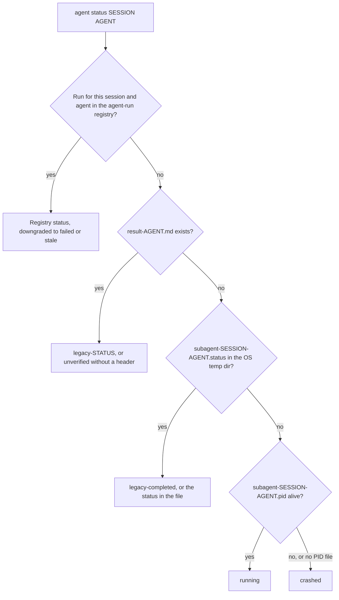

# Tùy chọn CLI

## Tra cứu nhanh

| Tôi muốn... | Dùng |
|:-------------|:----|
| Chạy mà không có prompt | `-y` / `--yes` (cũng được chấp nhận: `OMA_YES=1`, `CI=true`); `oma update --ci` để có output thuần, không tương tác |
| Lấy JSON | `--json`, `--output json` hoặc `OH_MY_AG_OUTPUT_FORMAT=json`. Xem [Tùy chọn output](#output-options) để biết các ngoại lệ |
| Nhắm tới bản cài đặt toàn cục | `-g` / `--global` hoặc `OMA_INSTALL_GLOBAL=1`; `OMA_HOME` dời thư mục gốc lưu trữ toàn cục |
| Xem trước khi thay đổi bất cứ thứ gì | `--dry-run` ở những lệnh có liệt kê flag này. Xem [Các lệnh hỗ trợ JSON](#commands-supporting-json-output) |
| Xem các flag của một lệnh | `oma <command> --help`, `oma describe "<command>"` hoặc [registry](#complete-public-option-registry) ở cuối trang này |
| Sửa một script bị hỏng sau khi nâng cấp | [Lệnh và tùy chọn đã đổi tên](#renamed-commands-and-options) |
| Rẽ nhánh theo lỗi trong script | [Mã thoát](#exit-codes) |

---

## Tùy chọn toàn cục {#global-options}

Các tùy chọn này có sẵn trên lệnh gốc `oma` / `oh-my-agent`:

| Flag | Mô tả |
|:-----|:-----------|
| `-g, --global` | Thao tác trên bản cài đặt toàn cục của OMA (`~/.oma/.agents/` hoặc `$OMA_HOME/.agents/`) thay vì `<cwd>/.agents/` |
| `-y, --yes` | Bỏ qua prompt ở những lệnh có hỗ trợ xác nhận; các kiểm tra an toàn riêng của từng lệnh vẫn được áp dụng. Cũng chấp nhận `OMA_YES=1` và `CI=true` |
| `-V, --version` | Xuất số phiên bản rồi thoát |
| `-h, --help` | Hiển thị trợ giúp cho lệnh |

Mọi lệnh con cũng hỗ trợ `-h, --help` để hiển thị nội dung trợ giúp riêng của lệnh đó.

`--global` đặt thư mục gốc cài đặt cho toàn bộ tiến trình, nên `install`, `update`, `link` và `uninstall` đều phân giải về bản cài đặt toàn cục bất kể thư mục hiện tại:

| Chế độ | Cách chọn | Vị trí `.agents/` |
|:-----|:-----------------|:--------------------|
| Project (mặc định) | không cần gì | `<cwd>/.agents/` |
| Toàn cục | `--global` hoặc `OMA_INSTALL_GLOBAL=1` | `$OMA_HOME/.agents/` (mặc định `~/.oma/.agents/`) |

`OMA_HOME=<abs-path>` thay đổi thư mục gốc lưu trữ toàn cục; giá trị này phải là đường dẫn tuyệt đối. Bản cài đặt project vẫn dùng cwd. Chạy `oma home --json` để hiển thị các vị trí đã phân giải, và `oma home migrate --dry-run` để xem trước việc di chuyển dữ liệu cũ. Xem [Cài đặt toàn cục](../guide/global-install.md).

---

## Lệnh và tùy chọn đã đổi tên {#renamed-commands-and-options}

Đường dẫn lệnh dùng dấu cách, không dùng dấu hai chấm, và một số lệnh cũng như tùy chọn đã được đổi tên. Các cách viết cũ bị từ chối, không được giữ lại làm bí danh:

- Một lệnh cũ thất bại với `Unknown command: ... Use oma --help.` hoặc `Unexpected argument for oma <group>. Use oma <replacement>.`
- Các tên nhóm đứng riêng `dashboard`, `state` và `stats` giờ in trợ giúp của nhóm thay vì chạy.
- Một tùy chọn cũ thất bại với `Removed option <old>. Use <new>.`; các flag hành động đã bị xóa của `state` và `stats` thất bại với `Removed option <old>. Use an explicit action; see oma --help.`

Chỉ `schedule:run` và `serena daemon:gc` vẫn còn được phân giải, để các mục OS scheduler do phiên bản cũ ghi vẫn tiếp tục hoạt động.

| Lệnh cũ | Dùng bây giờ |
|:------------|:--------|
| mọi đường dẫn dấu hai chấm `a:b` (`agent:spawn`, `state:emit`, ...) | đường dẫn phân tách bằng dấu cách (`agent spawn`, `state emit`) |
| `dashboard`, `dashboard:web` | `dashboard terminal`, `dashboard web` |
| `hook --vendor ...` | `hook run --vendor ...` |
| `intel run` | `intel suggest` |
| `state`, `state:get <id>` | `state list`, `state get <id>` |
| `state --activate` / `--archive` / `--purge` | `state activate` / `state archive` / `state purge` |
| `state:required-decisions` | `state decisions list` |
| `state:inject-log ... --entry <file>` | `state inject-log list`, `state inject-log get <session-id> <file>` |
| `stats`, `stats --reset` | `stats get`, `stats reset` |
| `memory:retry-drain` | `memory retry drain` |
| `vault rm` | `vault delete` |
| `search api <url>`, `search rss <url>` | `search api fetch <url>`, `search rss fetch <url>` |
| `search api:search`, `search rss:google` | `search api search`, `search rss google` |
| `skills audit` / `lint` / `eval` / `promotions` / `rollback` / `procedure` / `meta-optimize` / `evolution-stats` / `matrix` | `skill ...` (số ít) |
| `skills opt` | `skill optimize` |
| `slide new`, `slide viewer` | `slide create`, `slide preview` |
| `slide pdf` / `png` / `pptx` | `slide export pdf` / `png` / `pptx` |
| `slide import-pptx`, `slide fetch-video`, `slide styles ...` | `slide import pptx`, `slide asset fetch-video`, `slide style ...` |
| `image list-vendors`, `video list-providers` | `image vendor list`, `video provider list` |
| `schedule:add`, `schedule:remove` | `schedule create`, `schedule delete` |
| `verify <agent-type>` | `verify agent <agent-type>` |

| Tùy chọn cũ | Dùng bây giờ |
|:-----------|:--------|
| `-m, --model <vendor>` | `--vendor <vendor>` |
| `-r, --root <path>` | `--project-root <path>` |
| `--sid`, `--session` | `--session-id <id>` |
| `--format <fmt>` | `--output <format>` (`search media --format` không thay đổi) |
| `--out <dir>`, `--out-dir` | `--output-dir <path>` |
| `--out <file>`, `--out-file` | `--output-file <path>`; `--report-file <path>` trên `slide validate` và `explain validate` |
| `--dir` | `--workspace <path>` trên các lệnh `slide`, `--output-dir <path>` trên `slide create`, `--input-dir <path>` trên `explain validate` |
| `--max` | `--limit <n>` trên `scholar search` |
| `--allow-external-out` | `--allow-external-output` |
| `--timeout <seconds>`, `--timeout <ms>`, `--timeout-minutes` | `--timeout <duration>` (`30s`, `2m`). Bắt buộc có đơn vị ở những chỗ giá trị cũ tính bằng mili giây hoặc phút |
| `--max-age-days` | `--max-age <duration>`; `--expires-after <duration>` trên `schedule create` |

---

## Tùy chọn output {#output-options}

Nhiều lệnh hỗ trợ output machine-readable cho pipeline CI/CD và tự động hóa. Có ba cách yêu cầu output JSON.

### 1. Flag --json

```bash
oma stats get --json
oma doctor --json
oma cleanup --json
```

Flag `--json` chỉ có trên những đường dẫn lệnh có liệt kê flag này. Đừng suy ra khả năng hỗ trợ từ cả một nhóm lệnh: ví dụ, các lệnh con cấp cuối của `image`, `video` và `slide` cung cấp `--output` ở những chỗ registry liệt kê, còn `search` luôn in JSON.

### 2. Flag --output

```bash
oma stats get --output json
oma doctor --output text
```

Trên hầu hết các lệnh, `--output` nhận `text` hoặc `json`. Flag này có cùng chức năng với `--json` nhưng còn cho phép bạn yêu cầu rõ output dạng text, hữu ích khi biến môi trường được đặt thành `json`.

**Kiểm tra hợp lệ:** Nếu truyền định dạng không hợp lệ, CLI báo lỗi: `Invalid output format: {value}. Expected one of text, json`.

### 3. Biến môi trường OH_MY_AG_OUTPUT_FORMAT

```bash
export OH_MY_AG_OUTPUT_FORMAT=json
oma stats get # outputs JSON
oma doctor # outputs JSON
oma retro # outputs JSON
```

Đặt biến môi trường này thành `json` để JSON trở thành mặc định trên các lệnh có hỗ trợ. Chỉ `json` được nhận dạng; mọi giá trị khác đều bị bỏ qua và output vẫn là text.

### Cách chọn định dạng

Flag trên dòng lệnh được ưu tiên hơn biến môi trường. Truyền cả `--json` lẫn một `--output` không phải JSON là lỗi, không phải một quy tắc ưu tiên.

| Bạn truyền | Biến chưa được đặt | `OH_MY_AG_OUTPUT_FORMAT=json` |
|:---------|:---------------|:------------------------------|
| không truyền gì | text | JSON |
| `--json` hoặc `--output json` | JSON | JSON |
| `--output text` | text | text |
| `--json --output text` | lỗi: `--json conflicts with --output. Choose one output format.` | cùng lỗi đó |

Một số lệnh dùng giá trị định dạng riêng:

| Lệnh | Điều khiển định dạng |
|:---------|:---------------|
| `search ...` | Luôn là JSON; `--pretty` chỉ thụt lề. `search providers` và `search web` cũng nhận `--json` |
| `describe` | Luôn là JSON |
| `image ...`, `video ...` | `--output text\|json` (mặc định `text`) |
| `slide validate` | `--output json\|concise` (mặc định `concise`) |
| `explain validate` | `--output concise\|json` (mặc định `concise`) hoặc `--json` |
| `hook probe` | `--output text\|md\|json` |

### Các lệnh hỗ trợ JSON {#commands-supporting-json-output}

Mọi lệnh nhận `--json` hoặc `--output` đều báo `supportsJsonOutput: true` trong `oma describe`, và [registry](#complete-public-option-registry) ở cuối trang này liệt kê các flag theo từng đường dẫn. Các lệnh luôn in JSON mà không cần flag (`describe` và hầu hết các subcommand `search`) không được đánh dấu. Để liệt kê các đường dẫn này từ CLI:

```bash
oma describe | jq -r '.. | objects | select(.supportsJsonOutput? == true) | .path'
```

Dùng `select(.supportsDryRun? == true)` theo cách tương tự để tìm các lệnh có `--dry-run`.

---

## Tùy chọn theo lệnh

### install

```text
oma install [--web-search <provider>] [--code-intelligence <provider>] [--semantic-memory <provider>] [--honcho-url <url>] [--honcho-workspace <id>]
```

Trình cài đặt tương tác ghi các thiết lập provider đã chọn vào `.agents/oma-config.yaml`. Khi có `.agents/oma-config.cue`, tệp đó được ưu tiên hơn, nên các lựa chọn mà cấu hình CUE chưa có sẽ được ghi vào lớp phủ cục bộ bị gitignore `.agents/oma-config.local.yaml`; lựa chọn DevTools của trình duyệt và tham chiếu vault của `oma memory keys` cũng theo cùng quy tắc, còn lựa chọn vendor CLI và `oma model propose --write` theo quy tắc này khi không có `oma-config.yaml`. Các flag provider chọn integration cho web-search, code-intelligence và semantic-memory; `--honcho-url` và `--honcho-workspace` cấu hình dịch vụ memory Honcho khi provider đó được chọn. Flag gốc `-y, --yes` được áp dụng khi luồng cài đặt yêu cầu xác nhận.

### doctor

```text
oma doctor [--json] [--output <format>] [--profile] [--heal-check <agentType>]
```

| Flag | Mô tả | Mặc định |
|:-----|:-----------|:--------|
| `--json` | Xuất JSON thay vì văn bản đã định dạng. | `false` |
| `--output <format>` | Định dạng output tường minh (`text` hoặc `json`). Xem [Tùy chọn output](#output-options). | `text` |
| `--profile` | Hiển thị ma trận sức khỏe profile (slug model đã phân giải, CLI và trạng thái xác thực của từng agent theo `model_preset` đang hoạt động và các override `agents:`). Xem [Cấu hình model theo từng agent](../guide/per-agent-models.md). | `false` |
| `--heal-check <agentType>` | Bao gồm kiểm tra cổng tự phục hồi (self-healing gate) cho một agent. | |

Với `--json`, báo cáo có các trường cấp cao nhất `ok` và `issues`, và `doctor` thoát với mã `1` khi `issues` lớn hơn 0.

### update

```text
oma update [-f | --force] [--with-new-skills] [--ci] [-y | --yes] [--all] [--vendor <vendors>]
oma update mcp [-y | --yes] [--ci] [--all] [--vendor <vendors>]
```

| Flag | Viết tắt | Mô tả | Mặc định |
|:-----|:------|:-----------|:--------|
| `--force` | `-f` | Ghi đè các file config do người dùng tùy chỉnh trong lúc cập nhật. Ảnh hưởng tới: `oma-config.yaml`, `mcp.json`, các thư mục `stack/`. Nếu không có flag này, các file đó được sao lưu trước khi cập nhật và khôi phục sau đó. | `false` |
| `--with-new-skills` | | Cài các skill được thêm vào registry kể từ lần cài đặt hiện tại. | `false` |
| `--ci` | | Chạy ở chế độ CI không tương tác. Bỏ qua mọi prompt xác nhận, dùng output console thuần thay vì spinner và animation. Bắt buộc cho pipeline CI/CD khi không có stdin. | `false` |
| `--yes` | `-y` | Bỏ qua prompt. Không tạo các thư mục vendor còn thiếu trừ khi dùng kèm `--all` hoặc `--vendor`. | `false` |
| `--all` | | Tạo/cập nhật mọi vendor phạm vi project được hỗ trợ. | `false` |
| `--vendor <vendors>` | | Tạo/cập nhật danh sách vendor phân tách bằng dấu phẩy, ví dụ `claude,qwen`. | Chỉ các thư mục vendor đã có |

`oma update mcp` dùng cùng các tùy chọn `--yes`, `--ci`, `--all` và `--vendor` khi chọn browser MCP server. Lệnh này không dùng `--force` hay `--with-new-skills`.

**Hành vi với --force:**
- `oma-config.yaml` được thay bằng mặc định của registry.
- `mcp.json` được thay bằng mặc định của registry.
- Thư mục `stack/` của backend (tài nguyên theo ngôn ngữ) được thay thế.
- Mọi file khác luôn được cập nhật bất kể flag này.

**Hành vi với --ci:**
- Không gọi `console.clear()` khi bắt đầu.
- `@clack/prompts` được thay bằng `console.log` thuần.
- Prompt phát hiện công cụ cạnh tranh bị bỏ qua.
- Lỗi được throw thay vì gọi `process.exit(1)`.

**Phạm vi vendor:**
- `oma update` chỉ cập nhật các thư mục vendor đã tồn tại.
- `oma update --yes` dùng cùng phạm vi vendor nhưng không hiện prompt.
- `oma update --all` tạo/cập nhật mọi vendor phạm vi project được hỗ trợ.
- `oma update --vendor claude,qwen` chỉ tạo/cập nhật các vendor được liệt kê.

### stats

```text
oma stats get [--json | --output <format>]
oma stats reset [--json | --output <format>]
```

| Flag | Mô tả | Mặc định |
|:-----|:-----------|:--------|
| `--json` | Xuất JSON. `stats get` in đối tượng số liệu; `stats reset` in `{"reset":true}`. | `false` |
| `--output <format>` | Xuất `text` hoặc `json`. | `text` |

`oma stats reset` là lệnh reset; `oma stats get --reset` thất bại với `Removed option --reset`.

:::note
`stats get` không chỉ đọc dữ liệu. Mỗi lần gọi được tính là một session và cộng diff của 10 commit gần nhất vào các bộ đếm file và dòng tích lũy trong `.agents/state/metrics.json`, vì vậy đừng poll lệnh này.
:::

### retro

```text
oma retro [window] [--json] [--output <format>] [--interactive] [--compare]
```

| Flag | Mô tả | Mặc định |
|:-----|:-----------|:--------|
| `--interactive` | Luồng nhập có hướng dẫn kiểu cũ: hỏi bạn đã hoàn thành những gì, các bài học chính và bước tiếp theo. Bỏ qua window, `--compare` và `--json`. | `false` |
| `--compare` | So sánh khoảng thời gian hiện tại với khoảng trước đó có cùng độ dài. Hiển thị số liệu chênh lệch (ví dụ: commit +12, dòng thêm -340). | `false` |

**Định dạng đối số window:** một số theo sau là `h`, `d` hoặc `w`.
- `24h`: 24 giờ
- `7d`: 7 ngày
- `2w`: 2 tuần
- Bỏ trống để dùng mặc định (7 ngày)

Không hỗ trợ đơn vị tháng: `oma retro 1m` thất bại với `Invalid window: 1m. Use: 24h, 7d, 14d, 30d, 2w`.

### cleanup

```text
oma cleanup [--dry-run] [-y | --yes] [--json] [--output <format>]
```

| Flag | Viết tắt | Mô tả | Mặc định |
|:-----|:------|:-----------|:--------|
| `--dry-run` | | Chế độ xem trước. Liệt kê mọi item sẽ được dọn nhưng không thay đổi gì. Exit code là 0 bất kể kết quả tìm thấy. | `false` |
| `--yes` | `-y` | Bỏ qua mọi prompt xác nhận. Dọn mọi thứ mà không hỏi. Hữu ích trong script và CI. | `false` |

**Những gì được dọn:**
1. File PID mồ côi: `/tmp/subagent-*.pid` khi tiến trình được tham chiếu không còn chạy.
2. File log mồ côi: `/tmp/subagent-*.log` khớp với các PID đã chết.
3. Thư mục Gemini Antigravity: `.gemini/antigravity/brain/`, `.gemini/antigravity/implicit/`, `.gemini/antigravity/knowledge/`. Các thư mục này tích lũy trạng thái theo thời gian và có thể phình to.

### agent spawn

```text
oma agent spawn <agent-id> <prompt> <session-id> [options]
```

| Flag | Viết tắt | Mô tả | Mặc định |
|:-----|:------|:-----------|:--------|
| `--resumed-from` | — | Liên kết lần retry với run ID trước đó. | |
| `--fallback-vendors` | — | Chuỗi vendor fallback tường minh, có thứ tự, phân tách bằng dấu phẩy. | |
| `--task-id` | — | Task ID từ session plan. | Agent ID |
| `--vendor` | — | Ghi đè vendor CLI. `--help` liệt kê `antigravity`, `claude`, `codex`, `cursor`, `opencode`, `qwen`, `grok` và `pi`. | Phân giải từ config |
| `--workspace` | `-w` | Thư mục làm việc cho agent. Nếu bỏ qua hoặc đặt thành `.`, CLI tự phát hiện workspace từ các file cấu hình monorepo (pnpm-workspace.yaml, package.json, lerna.json, nx.json, turbo.json, mise.toml). | Tự phát hiện hoặc `.` |
| `--isolation` | — | Chế độ cô lập: `worktree` tạo một git worktree cho mỗi lần spawn; mặc định là `none`. | `none` |
| `--read-only` | — | Giới hạn agent được spawn ở các tool không phá hủy và tắt các flag tự động duyệt. | `false` |

**Kiểm tra hợp lệ:**
- `agent-id` và `session-id` không được chứa `..`, `?`, `#`, `%` hoặc ký tự điều khiển. `agent spawn` không có danh sách agent ID cố định; việc định tuyến model và vendor nhận diện `orchestrator`, `architecture`, `qa`, `pm`, `backend`, `frontend`, `mobile`, `db`, `debug`, `refactor`, `docs`, `tf-infra` và `explore`, cùng các bí danh như `backend-engineer`, `qa-reviewer` và `research-explorer`.
- `--vendor` phải là một vendor ID của oma: `antigravity`, `claude`, `codex`, `commandcode`, `copilot`, `cursor`, `grok`, `hermes`, `kimi`, `kiro`, `opencode`, `pi`, `qwen` hoặc `zcode`. Bảng bên dưới bao quát tám vendor mà `--help` nêu tên.

**Hành vi riêng theo vendor:**

| Vendor | Lệnh | Flag tự động duyệt | Flag prompt |
|:-------|:--------|:-----------------|:-----------|
| antigravity | `agy` | `--dangerously-skip-permissions` | `-p` |
| claude | `claude` | (không có) | `-p` |
| codex | `codex` | `--sandbox workspace-write` | (không có; prompt là đối số vị trí) |
| cursor | `cursor-agent` | tùy vendor | `-p` |
| opencode | `opencode` | tùy vendor | `-p` |
| qwen | `qwen` | `--yolo` | `-p` |
| grok | `grok` | tùy vendor | `-p` |
| pi | `pi` | bị tắt ở chế độ `--read-only` | prompt là đối số vị trí |

Có thể ghi đè các mặc định này trong `.agents/skills/oma-orchestration/config/cli-config.yaml`.

Codex giữ nguyên sandbox workspace-write của nó. oma bật quyền truy cập mạng và thêm project root, OMA state home (`~/.oma`) cùng các cache package-manager hiện có làm thư mục có thể ghi. `oma update` thay thế `cli-config.yaml`, nên hãy đặt chế độ lâu dài bằng `OMA_CODEX_SANDBOX`: `read-only`, `workspace-write` (mặc định) hoặc `danger-full-access` (không sandbox và không cần approval).

### agent status

```text
oma agent status <session-id> [agent-ids...] [--project-root <path>]
```

| Flag | Mô tả | Mặc định |
|:-----|:-----------|:--------|
| `--project-root <path>` | Project có agent-run registry và các file `.agents/state/memories/result-{agent}.md` được đọc. `-r` và `--root` đã bị xóa và thất bại với `Removed option -r. Use --project-root.` | Thư mục làm việc hiện tại |

Lệnh in một dòng `{agent-id}:{status}` cho mỗi agent được yêu cầu. Với mỗi agent, lệnh dùng nguồn đầu tiên tồn tại:



| Trạng thái | Ý nghĩa |
|:-------|:--------|
| `running`, `completed`, `partial`, `blocked`, `failed` | Trạng thái được ghi trong agent-run registry |
| `failed` | Cũng được báo khi một run đã đăng ký đang ở `running` nhưng tiến trình runner của nó không còn |
| `stale` | Run đã đăng ký ở trạng thái `completed`, nhưng evidence kết quả của nó không còn hợp lệ |
| `legacy-<status>` | Không có run đã đăng ký; `result-{agent}.md` có header `## Status: <status>` |
| `unverified` | Không có run đã đăng ký; `result-{agent}.md` không có header trạng thái |
| `legacy-completed` | Không có run hay file kết quả; file `.status` của session ghi `completed` (mọi giá trị khác được in nguyên trạng) |
| `crashed` | Không tìm thấy gì, hoặc file PID cũ trỏ tới một tiến trình đã chết |

Xem [Kết quả agent và resume](../guide/agent-results-and-resume.md) để biết cách các run được ghi lại.

### agent parallel

```text
oma agent parallel [tasks...] [--session-id <id>] [--vendor <vendor>] [-i | --inline] [--no-wait]
```

| Flag | Viết tắt | Mô tả | Mặc định |
|:-----|:------|:-----------|:--------|
| `--session-id <id>` | — | Session ID cho mọi run được spawn. Truyền cùng ID này cho `oma agent status`. | Tên thư mục run, `parallel-<timestamp>-<suffix>` |
| `--vendor` | — | Ghi đè vendor CLI áp dụng cho mọi agent được spawn. | Phân giải theo từng agent từ config |
| `--inline` | `-i` | Diễn giải đối số task thành chuỗi `agent:task[:workspace]` thay vì đường dẫn file. | `false` |
| `--no-wait` | | Chế độ nền. Khởi động mọi agent và trả về ngay, không chờ hoàn tất. Danh sách PID và log được lưu vào `.agents/results/parallel-<timestamp>-<suffix>/`. | `false` (chờ hoàn tất) |

**Định dạng task inline:** `agent:task` hoặc `agent:task:workspace`
- Workspace được phát hiện bằng cách kiểm tra đoạn cuối cùng (phân tách bởi dấu hai chấm) có bắt đầu bằng `./`, `/` hoặc bằng đúng `.` hay không.
- Ví dụ: `backend:Implement auth API:./api` -- agent=backend, task="Implement auth API", workspace=./api.
- Ví dụ: `frontend:Build login page` -- agent=frontend, task="Build login page", workspace=tự phát hiện.

**Định dạng file task YAML:**

```yaml
tasks:
  - id: api            # optional; default <agent>-<index>
    agent: backend
    task: "Implement user API"
    workspace: ./api   # optional; auto-detected when omitted
  - agent: frontend
    task: "Build user dashboard"
```

### recap

```text
oma recap [--window <period>] [--date <date>] [--tool <tools>] [--top <n>] [--sort <metric>] [--mermaid] [--graph] [--json] [--output <format>]
```

| Flag | Mô tả | Mặc định |
|:-----|:-----------|:--------|
| `--window <period>` | Khoảng thời gian dạng `<n>h`, `<n>d` hoặc `<n>w` (ví dụ `1d`, `3d`, `7d`, `2w`, `30d`). Giá trị trên 30 ngày bị giới hạn ở 30 ngày kèm cảnh báo. Bị bỏ qua khi đặt `--date`. | `1d` |
| `--date <date>` | Ngày cụ thể (`YYYY-MM-DD`). Được ưu tiên hơn `--window`. | |
| `--tool <tools>` | Lọc session theo công cụ. Phân tách bằng dấu phẩy: `antigravity`, `claude`, `codex`, `cursor`, `gemini`, `grok`, `qwen`. | mọi công cụ |
| `--top <n>` | Chỉ hiển thị N project/chủ đề hàng đầu trong phần tóm tắt. | không giới hạn |
| `--sort <metric>` | Sắp xếp session theo `count` hoặc `duration`. | `count` |
| `--mermaid` | Xuất biểu đồ Gantt Mermaid thay cho phần tóm tắt mặc định. `--json` được ưu tiên hơn. | `false` |
| `--graph` | Mở đồ thị tương tác trong web dashboard (`/recap`). Được ưu tiên hơn `--mermaid` và `--json`. | `false` |

### search

```text
oma search <subcommand> [...]
```

Mọi subcommand `search` đều ghi JSON ra stdout mà không cần flag nào; `providers` và `web` cũng nhận `--json`. Không subcommand nào nhận `--output`. `--pretty` chỉ thay đổi cách thụt lề.

| Subcommand | Tùy chọn đáng chú ý |
|:-----------|:---------------|
| `providers` | `--json`, `--pretty` |
| `web <query>` | `--provider <id>`, `--limit <n>` (mặc định `10`), `--timeout <duration>` (mặc định `15s`), `--json`, `--pretty` |
| `fetch <url>` | `--only`, `--skip`, `--include-archive`, `--timeout <duration>` (mặc định `15s`), `--locale`, `--pretty` |
| `meta <url>` / `archive <url>` / `api fetch <url>` / `rss fetch <url>` | `--timeout <duration>` (mặc định `15s`), `--locale` (mặc định `en-US,en;q=0.9`), `--pretty` |
| `api search <query>` | `--platforms <list>`, `--timeout <duration>`, `--locale`, `--pretty` |
| `rss google <query>` | `--locale` (mặc định `en-US`) |
| `media <url>` | `--subs`, `--sub-lang <list>` (mặc định `en`), `--format <spec>`, `--timeout <duration>` (mặc định `30s`), `--pretty` |
| `code <query>` | `--host <github\|gitlab>` (mặc định `github`), `--language`, `--repo`, `--limit` (mặc định `20`), `--pretty` |
| `trust <domain>` | `--pretty` |
| `doctor` | không có (chạy kiểm tra binary cho Chrome / `python3 curl_cffi` / `yt-dlp` / `gh`) |

`search` dùng thang mã thoát chung; xem [Mã thoát](#exit-codes).

### image

```text
oma image <subcommand> [...]
```

Định dạng output được điều khiển theo từng subcommand qua `--output <text|json>`.

`image generate` chấp nhận:

| Flag | Viết tắt | Mô tả | Mặc định |
|:-----|:------|:-----------|:--------|
| `--vendor <name>` | | `auto` \| `pollinations` \| `codex` \| `antigravity` \| `all`. `auto` chọn theo cấu hình `image:` đang hoạt động và thông tin xác thực khả dụng. | `auto` |
| `--size <size>` | | `WxH` với cả hai cạnh chia hết cho 16, trong khoảng 16–3840, tỷ lệ khung hình 1:3–3:1, hoặc `auto`. | Mặc định theo nhà cung cấp |
| `--quality <level>` | | `low` \| `medium` \| `high` \| `auto`. | Mặc định theo nhà cung cấp |
| `--count <n>` | `-n` | Số lượng ảnh, 1..5. | `1` |
| `--output-dir <dir>` | | Thư mục output. Phải nằm trong `$PWD` trừ khi đặt `--allow-external-output`. | `.agents/results/images/{timestamp}/` |
| `--allow-external-output` | | Cho phép đường dẫn `--output-dir` nằm ngoài `$PWD`. | `false` |
| `--model <name>` | | Ghi đè model riêng theo vendor. Model của antigravity do `agy` chọn. | Mặc định theo nhà cung cấp |
| `--timeout <duration>` | | Timeout cho từng ảnh, dùng giá trị duration. | Mặc định theo nhà cung cấp |
| `--reference <path>` | `-r` | Ảnh tham chiếu để chuyển style/subject. Có thể lặp lại (`-r a.png -r b.png`) hoặc phân tách bằng dấu phẩy. Được kiểm tra kích thước (≤5MB), định dạng (PNG/JPEG/GIF/WebP qua magic bytes) và số lượng (≤10). Hỗ trợ trên `codex` và `antigravity`; bị từ chối với exit 4 trên `pollinations`. | |
| `--yes` | `-y` | Bỏ qua prompt xác nhận chi phí. | `false` |
| `--no-prompt-in-manifest` | | Lưu SHA256 của prompt thay vì văn bản gốc trong `manifest.json`. | `false` |
| `--dry-run` | | In kế hoạch và ước tính chi phí; không thực thi. | `false` |
| `--output <format>` | | `text` \| `json`. | `text` |

`image doctor` và `image vendor list` chấp nhận `--output <text|json>`. Dùng `image vendor list` để khám phá vendor; cách viết cũ `image list-vendors` sẽ thất bại.

### video

```text
oma video generate <brief...> [options]
oma video doctor [--output <format>] [--install|--upgrade|--install-mpt|--install-strudel]
oma video compose <run-dir> [--output <format>] [--refresh] [--offline]
oma video render <run-dir> [--output <format>]
oma video provider list [--output <format>]
```

`video generate` nhận các tùy chọn điều khiển planning và capture `--mode`, `--aspect`, `--locale`, `--captions`, `--visual`, `--voice`, `--music`, `--duration`, `--compositor`, `--capture`, `--source`, `--url`, `--device`, `--ready-selector`, `--show-cursor`, `--polish`, `--capture-timeout` và `--capture-stop`. Lệnh này cũng nhận `--output-dir`, `--allow-external-output`, `--max-usd`, `--seed`, `--timeout`, `--script`, `--dry-run`, `--yes`, `--output` và `--no-brief-in-manifest`. Capture bằng browser dùng `--source web --url <url>`; `file` là source mặc định. Một lần render bình thường cần composition đã được author và compositor hoạt động; placeholder chỉ giới hạn ở đường test `OMA_VIDEO_MOCK=1`.

`video doctor` báo cáo hoặc provision toolchain HyperFrames/MPT/Strudel. `compose` chuẩn bị composition contract của run, còn `render` chạy lint, render và probe output. `provider list` báo trạng thái provider và key. Xem [Tạo video](../guide/video-generation.md) để biết run manifest và trình tự khắc phục sự cố.

### memory init

```text
oma memory init [--json] [--output <format>] [--force]
```

| Flag | Mô tả | Mặc định |
|:-----|:-----------|:--------|
| `--force` | Ghi đè các file schema trống hoặc đã có trong `.agents/state/memories/`. Nếu không có flag này, các file hiện có sẽ không bị động đến. | `false` |

### verify

```text
oma verify agent <agent-type> [-w <workspace>] [--session-id <id>] [--task-id <id>] [--run-id <id>] [--json] [--output <format>]
oma verify triggers [--corpus <path>] [--max-false-fire <pct>] [--max-missed-fire <pct>] [--json] [--output <format>]
```

| Flag | Viết tắt | Mô tả | Mặc định |
|:-----|:------|:-----------|:--------|
| `--workspace` | `-w` | Đường dẫn tới thư mục workspace cần xác minh. | Thư mục làm việc hiện tại |
| `--session-id <id>` | | Chọn session plan và các báo cáo. Bắt buộc khi có nhiều plan, trừ khi một run receipt xác định được session. | |
| `--task-id <id>` | | Chọn phạm vi và báo cáo của một task. Cần `--session-id` hoặc `--run-id`. | |
| `--run-id <id>` | | Chọn chính xác báo cáo của một run. Suy ra session/task từ receipt local; nếu không có receipt, hãy truyền rõ cả hai ID. | |

**Loại agent:** `backend`, `frontend`, `mobile`, `qa`, `debug`, `pm`.

`verify triggers` đo độ chính xác của keyword detector trên một corpus đã gắn nhãn. Các ngưỡng phần trăm đóng vai trò cổng kiểm tra; dùng output JSON khi job CI cần xem từng phát hiện riêng lẻ. Cách viết cũ `oma verify <agent-type>` sẽ thất bại; hãy dùng `verify agent <agent-type>`.

---

## Mã thoát {#exit-codes}

**Thang chung (`image`, `video`, `search`):**

| Mã | Ý nghĩa |
|:-----|:--------|
| `0` | thành công |
| `1` | lỗi chung |
| `2` | bị chặn, hoặc provider từ chối vì lý do an toàn |
| `3` | không tìm thấy |
| `4` | input không hợp lệ |
| `5` | cần xác thực, hoặc binary của provider chưa được cài |
| `6` | hết thời gian chờ (timeout) |

**Theo từng lệnh:**

| Lệnh | Mã |
|:--------|:------|
| `doctor --json` | `0` không có vấn đề, `1` có một hoặc nhiều vấn đề |
| `verify agent` | `0` mọi kiểm tra đều đạt, `1` một kiểm tra thất bại hoặc loại agent không hợp lệ, `2` không tìm thấy workspace |
| `verify triggers` | `0` nằm trong ngưỡng, `1` vượt quá một ngưỡng |
| `docs verify` | `1` tìm thấy tham chiếu hỏng |
| `vault get` | `1` tên key không hợp lệ, `2` không có mục đó |

---

## Ví dụ thực tế

### Pipeline CI: cập nhật và xác minh

```bash
# Update in CI mode, then fail the job when doctor reports any issue
oma update --ci
oma doctor --json | jq -e '.ok' > /dev/null
```

### Thực thi agent hàng loạt kèm giám sát trạng thái

```bash
# Choose the session ID first and pass it to both commands
SESSION_ID="session-$(date +%Y%m%d-%H%M%S)"
oma agent parallel tasks.yaml --session-id "$SESSION_ID" --no-wait

# Check status every 5 seconds
watch -n 5 "oma agent status $SESSION_ID backend frontend mobile"
# Without `watch` (stock macOS), loop instead:
# while sleep 5; do oma agent status "$SESSION_ID" backend frontend mobile; done
```

### Dọn dẹp trong CI sau khi chạy test

```bash
# Clean up all orphaned processes without prompts
oma cleanup --yes --json
```

### Xác minh nhận biết workspace

```bash
# Verify each domain in its workspace
oma verify agent backend -w ./apps/api
oma verify agent frontend -w ./apps/web
oma verify agent mobile -w ./apps/mobile
```

### Retro kèm so sánh cho buổi đánh giá sprint

```bash
# Two-week sprint retro with comparison to previous sprint
oma retro 2w --compare
```

### Script kiểm tra sức khỏe đầy đủ

```bash
#!/usr/bin/env bash
set -euo pipefail

echo "=== oh-my-agent Health Check ==="

report="$(mktemp)"
# doctor exits 1 when it finds issues; keep the report and continue
oma doctor --json > "$report" || true

# Check CLI installations
jq -r '.clis[] | "\(.name): \(if .installed then "OK (\(.version // "unknown"))" else "MISSING" end)"' "$report"
jq -r '"Issues: \(.issues)"' "$report"

# Check auth status (an object of booleans keyed by github and each vendor ID)
oma auth status --json | jq -r 'to_entries[] | "\(.key): \(if .value then "authenticated" else "not authenticated" end)"'

echo "=== Done ==="
```

### Dùng describe cho agent introspection

```bash
# An AI agent can discover available commands
oma describe | jq '.command.subcommands[] | {name, description}'

# Get details about a specific command
oma describe "agent spawn" | jq '.command.options[] | {flags, description}'
```

---

## Registry tùy chọn public đầy đủ {#complete-public-option-registry}

Mỗi hàng là một đường dẫn lệnh chạy được độc lập; các nhóm chỉ in trợ giúp bị lược bỏ, và các cờ gốc dùng chung được mô tả ở [Tùy chọn toàn cục](#global-options). Giá trị mặc định xuất hiện cạnh tùy chọn tương ứng. Chạy `oma describe "<path>"` để xem JSON đầy đủ của một đường dẫn.

:::note
Bảng này được tạo từ `oma describe`. Đừng sửa bằng tay: chạy `node cli/scripts/generate-cli-reference.mjs` để tạo lại, hoặc thêm `--check` để báo lỗi khi bảng đã lỗi thời.
:::

<!-- oma:generated cli-registry:start -->

| Command | Arguments | Options | Description |
|:--|:--|:--|:--|
| `agent begin` | `<agent-id> <task-id> <session-id>` | `--timeout-seconds <seconds>`, `--deadline <timestamp>`, `--project-root <path>`, `-w, --workspace <path>` | Start an evidence-backed native agent run |
| `agent context` | `<agent-id>` | `--project-root <path>`, `--difficulty <level>` (default: `Medium`) | Load graph-selected context for a native dispatch prompt |
| `agent finish` | `<run-id> <result-file>` | `--project-root <path>` | Validate a native agent result against its verification receipts |
| `agent parallel` | `[tasks...]` | `--timeout-seconds <seconds>`, `--deadline <timestamp>`, `--session-id <id>`, `--vendor <vendor>`, `-i, --inline`, `--no-wait` | Run multiple sub-agents in parallel |
| `agent resume` | `<session-id>` | `--timeout-seconds <seconds>`, `--deadline <timestamp>`, `--project-root <path>`, `--dry-run`, `--max-attempts <count>` (default: `3`) | Resume safe incomplete tasks, reusing current acceptance evidence |
| `agent review` | — | `--session-id <id>`, `--timeout-seconds <seconds>`, `--deadline <timestamp>`, `--vendor <vendor>`, `-p, --prompt <prompt>`, `-w, --workspace <path>`, `--no-uncommitted` | Run code review using external CLI (codex/claude/qwen/grok) |
| `agent spawn` | `<agent-id> <prompt> <session-id>` | `--resumed-from <run-id>`, `--timeout-seconds <seconds>`, `--deadline <timestamp>`, `--fallback-vendors <vendors>`, `--task-id <id>`, `--vendor <vendor>`, `-w, --workspace <path>`, `--isolation <mode>`, `--read-only` | Spawn a subagent (prompt can be inline text or a file path) |
| `agent status` | `<session-id> [agent-ids...]` | `--project-root <path>` (default: current directory) | Check status of subagents |
| `agent verify` | `<run-id> [command...]` | `--timeout-seconds <seconds>`, `--deadline <timestamp>`, `--project-root <path>`, `--required`, `--affected <paths...>` | Execute verification argv after -- and record its real exit code |
| `auth status` | — | `--json`, `--output <format>` | Check authentication status of all supported CLIs |
| `bridge` | `[url]` | `--context <name>` (default: `ide`), `--oma-home <path>`, `--oma-state-home <path>` | Proxy MCP stdio to a shared per-project Serena server (started on demand) |
| `cleanup` | — | `--dry-run`, `-y, --yes`, `--json`, `--output <format>` | Clean up orphaned subagent processes and temp files |
| `dashboard terminal` | — | `--project-root <path>` | Start terminal dashboard (real-time agent monitoring) |
| `dashboard web` | — | `--project-root <path>` | Start web dashboard on http://127.0.0.1:9847 |
| `describe` | `[command-path]` | — | Describe CLI commands as JSON for runtime introspection |
| `diagram archify` | `[args...]` | — | Run the installed archify CLI (doctor \| guide \| validate \| deliver \| visual-check …) with update checks disabled |
| `diagram resolve` | — | `--engine <engine>`, `--refresh`, `--offline`, `--json`, `--output <format>` | Report which diagram engine workflows should use, and where archify lives |
| `diagram update` | — | `--json`, `--output <format>` | Download the latest archify release into oma's managed cache (~/.cache/oma-diagram/archify) |
| `docs i18n` | — | `--json`, `--min-severity <level>` (default: `MEDIUM`) | Detect drift between English source docs (web/docs) and i18n translations (web/i18n/{lang}/...). Emits structural signals (line count, heading count, last-commit timestamp) per pair so the host LLM can decide which translations need a diff-sync patch. The CLI never edits translations. |
| `docs lint` | — | `--json`, `--locales <list>` | Lint translated docs for content-level anti-patterns (em-dashes in CJK targets, etc.). Complements `oma docs i18n` (structural drift) with style/anti-pattern checks per oma-translation SKILL.md § Stage 4. The CLI never auto-fixes — it only reports issues for the host LLM to restructure. |
| `docs migrate` | — | `--dry-run`, `--json` | Consolidate engineering decisions and result reports into their canonical directories |
| `docs sync` | `[diff-range]` | `--json` | Given a git diff, list docs that reference changed files. The host LLM (skill runtime) is expected to read this list plus the diff and propose patches per the SKILL.md contract — the CLI never auto-edits docs. Default diff-range: --cached (staged changes), fallback to HEAD~1..HEAD. |
| `docs verify` | `[path]` | `--json`, `--report-file <path>`, `--no-urls`, `--urls-sync` | Extract file, link, and script references from docs and report broken targets. Regenerates docs/generated/doc-refs.json as a side effect. Exit code: 0 = clean, 1 = broken refs found. URL link checking is delegated to `lychee` (install: brew install lychee). |
| `doctor` | — | `--profile`, `--heal-check <agentType>`, `--json`, `--output <format>` | Check CLI installations, MCP configs, and skill status |
| `emit` | — | `--target <target>` (default: `all`), `--output-dir <path>` (default: `.`), `--json`, `--output <format>` | Emit standards-conformant artifacts from the .agents/ SSOT (Agent Skills spec, Agent Plugins package, Claude Code plugin marketplace, AGENTS.md, cli/AGENTS.md) |
| `explain components` | `[name]` | `--json`, `--output <format>` | List the components a draft can use, or print one component's syntax |
| `explain lint` | `[file]` | `--style <level>`, `--lang <code>`, `--json`, `--output <format>` | Check the prose of a draft (file or stdin) without rendering |
| `explain patch` | `<html> [file]` | `--panel <id>`, `--open`, `--json`, `--output <format>` | Replace one panel of a rendered page from its embedded draft (new panel from file or stdin) |
| `explain render` | `[file]` | `--output-file <path>`, `--template <name>`, `--theme <name>`, `--mode <mode>`, `--style <level>`, `--lang <code>`, `--archify`, `--no-archify`, `--open`, `--json`, `--output <format>` | Render a Markdown draft (file or stdin) into one self-contained HTML explanation |
| `explain validate` | `[file]` | `--input-dir <path>`, `--output <format>` (default: `concise`), `--report-file <path>`, `--json` | Validate self-contained explain HTML report artifacts |
| `goal set` | — | `--workflow <name>`, `--session-id <id>`, `--gate <keyword>`, `--budget-minutes <n>`, `--description <text>`, `--json`, `--output <format>` | Attach a goal contract (deterministic stop gate / wall-clock budget) to an active persistent workflow |
| `goal status` | — | `--workflow <name>`, `--session-id <id>`, `--check-fresh`, `--json`, `--output <format>` | Show the latest gate pass for an OMA session |
| `harness eval` | — | `--suite <path>`, `--candidate <path>`, `--partition <name>` (default: `validation`), `--mock`, `--action <mode>`, `--transcript <path>`, `--live`, `--record`, `--record-file <path>`, `--yes`, `--timeout <duration>` (default: `15m`), `--require-coverage`, `--json`, `--output <format>` | Compare a candidate .agents overlay with the current baseline |
| `harness evolution disable` | — | `--json`, `--output <format>` | Disable harness evolution and remove its scheduled job |
| `harness evolution enable` | — | `--max-dispatches <n>`, `--cron <expr>` (default: `0 3 * * *`), `--mode <mode>` (default: `apply`), `--json`, `--output <format>` | Enable scheduled harness evolution with a dispatch budget |
| `harness evolution run` | — | `--scheduled`, `--json`, `--output <format>` | Run one harness evolution tick now |
| `harness evolution status` | — | `--json`, `--output <format>` | Show the evolution config, schedule, pending retries, and overlay conflicts |
| `harness feedback` | — | `--live`, `--apply`, `--max-epochs <n>` (default: `1`), `--incident <ids...>`, `--scan-runs`, `--json`, `--output <format>` | Promote captured incidents to skill fixtures and optimize the affected skills |
| `harness incident capture` | — | `--spec <path>`, `--run <id>`, `--json`, `--output <format>` | Record a failure from an incident spec as a captured incident |
| `harness incident export` | `<id>` | `--json`, `--output <format>` | Export a captured incident as a one-task eval suite |
| `harness incident promote` | `<id>` | `--skill <id>`, `--draft`, `--force`, `--json`, `--output <format>` | Turn a captured incident into a regression fixture for a skill |
| `harness incident reproduce` | `<id>` | `--candidate <path>`, `--action <mode>`, `--record-file <path>`, `--transcript <path>`, `--record`, `--yes`, `--timeout <duration>` (default: `15m`), `--json`, `--output <format>` | Inspect, rescore, replay, or rerun a captured incident against a candidate |
| `harness incident scan` | — | `--limit <n>`, `--skeleton <run-id>`, `--json`, `--output <format>` | List failed, blocked, or partial agent runs that no captured incident references yet |
| `harness incident show` | `<id>` | `--json`, `--output <format>` | Show a captured incident and its provenance |
| `help` | — | — | Show help information |
| `home` | — | `--json`, `--output <format>` | Inspect and migrate OMA global storage |
| `home migrate` | — | `--dry-run`, `--json`, `--output <format>` | Copy legacy OMA global files; preserve originals |
| `hook probe` | — | `--vendor <list>`, `--output <format>` (default: `text`), `--hooks-dir <dir>` | Probe per-vendor L1 hook compatibility and print a matrix |
| `hook run` | — | `--vendor <v>`, `--event <e>`, `--matcher <m>` | Dispatch a vendor hook event through the centralised oma hook router |
| `image doctor` | — | `--output <format>` (default: `text`) | Check authentication and install status per vendor |
| `image generate` | `<prompt...>` | `--vendor <name>` (default: `auto`), `--size <size>`, `--quality <level>`, `-n, --count <n>`, `--output-dir <path>`, `--allow-external-output`, `--model <name>`, `--timeout <duration>`, `-r, --reference <path>`, `-y, --yes`, `--no-prompt-in-manifest`, `--dry-run`, `--output <format>` (default: `text`) | Generate images via pollinations (flux/zimage, free), codex (gpt-image-2, ChatGPT OAuth), or antigravity (gemini nano-banana via `agy` CLI, free with Gemini Code Assist sign-in) |
| `image vendor list` | — | `--output <format>` (default: `text`) | List registered vendors and supported models |
| `install` | — | `--web-search <provider>`, `--code-intelligence <provider>`, `--semantic-memory <provider>`, `--honcho-url <url>`, `--honcho-workspace <id>` | Install oh-my-agent skills and configurations |
| `intel suggest` | — | `--config <path>`, `--topic <topic>`, `--target <target>`, `--repos <repos>`, `--since <window>`, `--last-commits <n>`, `--output-dir <path>`, `--dry-run`, `--fixture <path>`, `--create-issue`, `--base-repo <owner/name>`, `--yes`, `--json`, `--output <format>` | Suggest high-value product work from market/code intelligence |
| `link` | `[vendors...]` | `--dry-run` | Regenerate vendor files (.claude/, .cursor/, etc.) from .agents/ SSOT |
| `market detect-trap` | `<topic>` | `--force` | Preflight check that refuses keyword-trap queries |
| `market resolve` | — | `--refresh`, `--offline`, `--json`, `--output <format>` | Report the last30days engine oma will run (managed latest, pin, or local copy) and the Python it uses |
| `market run` | `[args...]` | — | Run the last30days engine (scripts/last30days.py) with the given arguments; --save-dir defaults to market.save_dir |
| `market update` | — | `--json`, `--output <format>` | Download the latest last30days release into oma's managed cache (~/.cache/oma-market/last30days) |
| `memory daemon restart` | — | `--port <port>` (default: `3111`), `--dry-run`, `--json`, `--output <format>` | Restart the OMA-owned AgentMemory daemon |
| `memory daemon start` | — | `--port <port>` (default: `3111`), `--dry-run`, `--json`, `--output <format>` | Start AgentMemory in the background |
| `memory daemon status` | — | `--json`, `--output <format>` | Show daemon status |
| `memory daemon stop` | — | `--dry-run`, `--json`, `--output <format>` | Stop the OMA-owned AgentMemory daemon |
| `memory gc` | — | `--scope <scope>` (default: `all`), `--keep <count>`, `--max-age <duration>`, `--dry-run`, `--json`, `--output <format>` | Garbage-collect project-local memory: prune old L1 sessions and ephemeral Serena files |
| `memory import` | — | `--source <source>` (default: `all`), `--since <since>` (default: `30d`), `--dry-run`, `--force-partial`, `--json`, `--output <format>` | Import vendor conversation history into AgentMemory |
| `memory init` | — | `--force`, `--json`, `--output <format>` | Initialize the coordination store in .agents/state/memories |
| `memory keys` | — | `--kind <kind>` (default: `connection`), `--profile <name>` (default: `oma`), `--key-env <name>` (default: `LLM_OPENAI_API_KEY`), `--from-env <name>`, `--dry-run`, `--json`, `--output <format>` | Configure Honcho connection or local embedding credentials |
| `memory maintain` | `<action>` | `--keep <count>` (default: `5`), `--dry-run`, `--json`, `--output <format>` | Maintain AgentMemory local storage: backup, prune, vacuum |
| `memory maintain backup` | — | `--keep <count>` (default: `5`), `--dry-run`, `--json`, `--output <format>` | Back up AgentMemory local storage |
| `memory maintain prune` | — | `--keep <count>` (default: `5`), `--dry-run`, `--json`, `--output <format>` | Delete AgentMemory backups beyond --keep |
| `memory maintain vacuum` | — | `--keep <count>` (default: `5`), `--dry-run`, `--json`, `--output <format>` | Run SQLite VACUUM on AgentMemory storage |
| `memory retry drain` | — | `--dry-run`, `--json`, `--output <format>` | Drain queued semantic-memory deliveries |
| `memory service install` | — | `--port <port>` (default: `3111`), `--dry-run`, `--json`, `--output <format>` | Install AgentMemory launchd/systemd service integration |
| `memory service uninstall` | — | `--dry-run`, `--json`, `--output <format>` | Uninstall AgentMemory launchd/systemd service integration |
| `memory setup` | — | `--endpoint <url>`, `--port <port>`, `--install`, `--start`, `--dry-run`, `--json`, `--output <format>` | Prepare AgentMemory endpoint configuration |
| `memory status` | — | `--json`, `--output <format>` | Show selected semantic-memory provider health |
| `memory upgrade` | — | `--port <port>`, `--dry-run`, `--json`, `--output <format>` | Stop, backup, upgrade, restart, and health-check AgentMemory |
| `model check` | — | `--json`, `--fail-on-drift`, `--owner <name>`, `--probe` | Check model registry against live vendor model lists |
| `model probe` | `<slug>` | `--json`, `--timeout <duration>` | Probe a model slug against its vendor CLI to verify it is accepted |
| `model propose` | — | `--json`, `--owner <name>`, `--write`, `--timeout <duration>` | Run model:check --probe internally and generate an oma-config `models:` patch for accepted candidates |
| `profile create` | `<slot>` | `--json`, `--output <format>` | Create a local profile |
| `profile list` | — | `--json`, `--output <format>` | List local profiles |
| `profile run` | `<slot> <command> [args...]` | — | Run one command with OMA_PROFILE set for the child process |
| `profile show` | `[slot]` | `--json`, `--output <format>` | Show a local profile |
| `profile use` | `<slot>` | `--shell <shell>`, `--json`, `--output <format>` | Print shell code to activate an existing profile |
| `ralph verify` | — | `--session-id <id>`, `--newer-than <iso>`, `--no-emit`, `--json`, `--output <format>` | Verify ralph EXEC artifacts (anti-circumvention gate, ralph.md Step 1.3) |
| `recap` | — | `--window <period>` (default: `1d`), `--date <date>`, `--tool <tools>`, `--top <n>`, `--sort <metric>` (default: `count`), `--mermaid`, `--graph`, `--json`, `--output <format>` | Recap AI tool conversation history |
| `retro` | `[window]` | `--interactive`, `--compare`, `--json`, `--output <format>` | Engineering retrospective with metrics & trends |
| `schedule create` | `<agent-id> <prompt>` | `--cron <expr>`, `--every <phrase>`, `--vendor <vendor>`, `-w, --workspace <path>`, `--once`, `--expires-after <duration>`, `--env <keys>`, `--dry-run`, `--accept-rounded` | Register a scheduled agent job |
| `schedule delete` | `<id>` | — | Remove a scheduled job from manifest and OS scheduler |
| `schedule list` | — | `--json`, `--output <format>` | List scheduled jobs with OS drift state (synced/stale/missing-in-os/orphan-in-os), grouped by project |
| `schedule run` | `<id>` | `--oma-home <path>`, `--oma-state-home <path>`, `--registration <identity>` | Execute a scheduled job by id (invoked by OS scheduler; not normally called directly) |
| `schedule sync` | — | `--prune` | Re-sync manifest → OS scheduler (registers missing jobs, rewrites stale commands). Use --prune to remove orphan OS jobs. |
| `scholar get` | `<id>` | `--section <name>` | Fetch a sidecar (knows record_id) or work metadata (W-id, DOI, arXiv:&lt;id&gt;, CorpusId:&lt;n&gt;, S2 paperId) |
| `scholar lint` | `<file>` | `--lenient`, `--fail-on-warning` | Validate a .knows.yaml or .knows.json sidecar (v0.9.0) |
| `scholar resolve` | `<query...>` | — | Find best paper match across knows.academy, OpenAlex, Semantic Scholar |
| `scholar search` | `<query...>` | `--limit <n>` (default: `10`), `--year-min <year>`, `--always-fallback` | Search papers (knows.academy → OpenAlex → Semantic Scholar) |
| `search api fetch` | `<url>` | `--timeout <duration>` (default: `15s`), `--locale <value>` (default: `en-US,en;q=0.9`), `--pretty` | Fetch a URL through its matched platform API |
| `search api search` | `<query>` | `--platforms <list>`, `--timeout <duration>` (default: `15s`), `--locale <value>` (default: `en-US,en;q=0.9`), `--pretty` | Fan-out keyword search across platforms that support it |
| `search archive` | `<url>` | `--timeout <duration>` (default: `15s`), `--locale <value>` (default: `en-US,en;q=0.9`), `--pretty` | Fetch via AMP / archive.today / Wayback |
| `search code` | `<query>` | `--host <github\|gitlab>` (default: `github`), `--language <lang>`, `--repo <owner/repo>`, `--limit <n>` (default: `20`), `--pretty` | Search code via gh / glab |
| `search doctor` | — | — | Check dependencies (Chrome, python3 curl_cffi, yt-dlp, gh) |
| `search fetch` | `<url>` | `--only <strategies>`, `--skip <strategies>`, `--include-archive`, `--timeout <duration>` (default: `15s`), `--locale <value>` (default: `en-US,en;q=0.9`), `--pretty` | Fetch URL via auto-escalating strategy pipeline |
| `search media` | `<url>` | `--subs`, `--sub-lang <list>` (default: `en`), `--format <spec>`, `--timeout <duration>` (default: `30s`), `--pretty` | Extract media metadata via yt-dlp (1858 sites) |
| `search meta` | `<url>` | `--timeout <duration>` (default: `15s`), `--locale <value>` (default: `en-US,en;q=0.9`), `--pretty` | Extract OGP / JSON-LD / Schema.org from URL |
| `search providers` | — | `--json`, `--pretty` | List registered search providers and inspect selection without network calls |
| `search rss fetch` | `<url>` | `--timeout <duration>` (default: `15s`), `--locale <value>` (default: `en-US,en;q=0.9`), `--pretty` | Discover and parse RSS/Atom feed for a URL |
| `search rss google` | `<query>` | `--locale <value>` (default: `en-US`) | Build Google News RSS URL for a query |
| `search trust` | `<domain>` | `--pretty` | Resolve trust level / score for a domain |
| `search web` | `<query>` | `--provider <id>`, `--limit <n>` (default: `10`), `--timeout <duration>` (default: `15s`), `--json`, `--pretty` | Search with the selected web provider (Brave has a CLI adapter) |
| `serena check` | — | `--project <path>` (default: `apps/mobile`), `--dart-sdk <path>`, `--timeout <duration>` (default: `60s`), `--staged` | Analyze a Dart package using the managed shared Serena LSP |
| `serena daemon gc` | — | `--quiet` | Stop shared Serena daemons with no clients after the idle grace period |
| `serena reap` | — | `--dry-run`, `--quiet` | Kill idle Serena LSP children to reclaim memory (Serena self-heals on next tool call) |
| `serena reaper disable` | — | `--dry-run` | Uninstall the periodic Serena Reaper scheduled task |
| `serena reaper enable` | — | `--dry-run` | Install the periodic Serena Reaper scheduled task (runs every 5 minutes) |
| `serena setup` | — | — | Repair the managed adapter and install the oma-dart-check compatibility launcher |
| `skill audit` | — | `--json`, `--output <format>` | Check frontmatter description similarity between installed skills |
| `skill eval` | — | `--skill <id>`, `--mock`, `--live`, `--record`, `--yes`, `--task-dir <path>`, `--max-tasks <n>`, `--trials <n>`, `--require-coverage`, `--neg-transfer`, `--routing`, `--json`, `--output <format>` | Measure per-skill utility lift (treatment vs baseline on held-out tasks) |
| `skill evolution-stats` | — | `--skill <id>`, `--json`, `--output <format>` | Aggregate recorded optimization runs: proposals, acceptance, verified improvements, rollbacks, by memory mode and procedure |
| `skill lint` | — | `--skill <id>`, `--json`, `--output <format>` | Detect per-skill authoring smells (frontmatter, structure, broken refs) |
| `skill matrix` | — | `--suite <path>`, `--project-root <path>`, `--skills <names>`, `--delivery <mode>` (default: `native`), `--vendors <ids>` (default: `claude,codex`), `--cases <ids>`, `--live`, `--yes`, `--timeout-seconds <n>` (default: `120`), `--claude-model <model>`, `--codex-model <model>`, `--report <path>`, `--json`, `--output <format>` | Test native skill discovery, references and output contracts across CLI vendors |
| `skill meta-optimize` | — | `--target <part>` (default: `optimizer`), `--skill <ids...>`, `--anchor <ids...>`, `--repeats <n>` (default: `3`), `--candidates <n>` (default: `2`), `--max-epochs <n>` (default: `1`), `--edits-per-epoch <k>` (default: `4`), `--live`, `--apply`, `--memory <mode>` (default: `none`), `--yes`, `--json`, `--output <format>` | Propose and score changes to the evolution procedure itself on held-out skills; promote only with a paired bootstrap interval above zero |
| `skill optimize` | — | `--skill <id>`, `--dry-run`, `--apply`, `--mock`, `--live`, `--max-epochs <n>` (default: `8`), `--edits-per-epoch <k>` (default: `4`), `--lr <chars>` (default: `600`), `--yes`, `--memory <mode>` (default: `recall`), `--json`, `--output <format>` | Optimize a skill's SKILL.md to maximize measured held-out utility lift |
| `skill procedure` | — | `--export`, `--json`, `--output <format>` | Show the evolution procedure (optimizer/maintainer prompts, constitution) and its hashes; --export writes editable defaults |
| `skill promotions` | — | `--skill <id>`, `--all`, `--json`, `--output <format>` | List recorded SKILL.md promotions and rollbacks for a skill, or every skill and the procedure with --all |
| `skill rollback` | — | `--skill <id>`, `--json`, `--output <format>` | Restore the SKILL.md body replaced by the most recent recorded promotion |
| `slide asset fetch-video` | `<url>` | `--workspace <path>`, `--output-name <name>` | Download video via yt-dlp into ./assets/ and print local ref |
| `slide bundle` | — | `--workspace <path>`, `--output-file <path>`, `--inline-fonts` | Merge per-slide files into a single self-contained .html deliverable |
| `slide create` | — | `--output-dir <path>` (default: `my-deck`), `--force` | Scaffold a new slide working directory with starter HTML, assets/, and meta.json |
| `slide doctor` | — | — | Probe required deps (chrome, puppeteer-core) and optional deps (yt-dlp, pptxgenjs) |
| `slide edit` | — | `--workspace <path>`, `--port <n>` (default: `0`) | Open browser bbox editor (node:http server at 127.0.0.1, dispatches to oma agent runner) |
| `slide export pdf` | — | `--workspace <path>`, `--output-file <path>`, `--mode <mode>` (default: `capture`) | Export slides to PDF via puppeteer-core |
| `slide export png` | — | `--workspace <path>`, `--output-dir <path>`, `--resolution <res>` (default: `1080p`) | Export each slide as a PNG image via puppeteer-core |
| `slide export pptx` | — | `--workspace <path>`, `--output-file <path>` | [EXPERIMENTAL] Export to PPTX via pptxgenjs (raster-backed, gradients rasterized) |
| `slide import pptx` | `<file>` | `--workspace <path>` | Import a .pptx file into slide fragments via officeparser (bunx, best-effort) |
| `slide preview` | — | `--workspace <path>` | Build viewer.html (deck-stage web component + speaker-notes panel, toggle with `n`) |
| `slide style get` | `<slug>` | `--refresh` | Fetch a bold template design.md (always-latest main; cached for offline fallback) |
| `slide style list` | — | — | List available style presets (vendored + bold-template index) |
| `slide style preview` | `<slug>` | — | Preview a style preset in the terminal |
| `slide validate` | — | `--workspace <path>`, `--output <format>` (default: `concise`), `--slide <file>`, `--report-file <path>` | Geometric quality gate — renders slides via puppeteer-core and checks overflow/overlap/font-size |
| `star` | — | — | Star oh-my-agent on GitHub |
| `state activate` | `<session-id>` | `--category <category>` (default: `main`), `--archived`, `--all-projects`, `--project <project>`, `--search <text>`, `--older-than <duration>` (default: `90d`), `--dry-run`, `--json`, `--output <format>` | Set the active session for a category |
| `state archive` | — | `--category <category>` (default: `main`), `--archived`, `--all-projects`, `--project <project>`, `--search <text>`, `--older-than <duration>` (default: `90d`), `--dry-run`, `--json`, `--output <format>` | Move inactive terminal sessions to the state archive |
| `state decisions list` | `[workflow]` | `--agent <id>`, `--json`, `--output <format>` | List workflow checkpoints or available agent decision subjects |
| `state emit` | `<kind> [payload]` | `--session-id <id>`, `--category <category>` (default: `main`), `--vendor <vendor>`, `--vendor-sid <vendorSid>`, `--parent-event-id <eventId>`, `--causality-key <key>`, `--ts <iso>`, `--no-mirror`, `--json`, `--output <format>` | Append an OMA L1 workflow event |
| `state get` | `<sid>` | `--json`, `--output <format>` | Inspect one OMA L1 session by ID |
| `state heal-check` | — | `--agent <agentType>`, `--json`, `--output <format>` | Check whether self-healing is allowed for an agent |
| `state inject-log get` | `<session-id> <file>` | `--json`, `--output <format>` | Print one inject audit log entry for a session |
| `state inject-log list` | `<sid>` | `--entry <file>`, `--json`, `--output <format>` | List or view per-boundary inject audit logs |
| `state list` | — | `--category <category>` (default: `main`), `--archived`, `--all-projects`, `--project <project>`, `--search <text>`, `--older-than <duration>` (default: `90d`), `--dry-run`, `--json`, `--output <format>` | Inspect OMA L1 workflow state |
| `state migrate` | — | `--runtime`, `--include-active`, `--dry-run`, `--json`, `--output <format>` | Migrate project state to the home profile |
| `state purge` | — | `--category <category>` (default: `main`), `--archived`, `--all-projects`, `--project <project>`, `--search <text>`, `--older-than <duration>` (default: `90d`), `--dry-run`, `--json`, `--output <format>` | Delete inactive sessions older than --older-than |
| `state repair` | — | `--dry-run`, `--json`, `--output <format>` | Repair OMA L1 workflow state files |
| `state summary` | `[sid]` | `--category <category>` (default: `main`), `--json`, `--output <format>` | Export a session summary to the coordination store |
| `state trajectory` | `[sid]` | `--category <category>` (default: `main`), `--open`, `--width <columns>`, `--sequence`, `--ascii`, `--json`, `--output <format>` | Show a session trajectory: L1 events joined with vendor transcripts |
| `state verify` | — | `--workflow <workflow>`, `--checkpoint <checkpoint>`, `--instance <id>`, `--session-id <id>`, `--category <category>` (default: `main`), `--no-emit-missing`, `--json`, `--output <format>` | Verify required L1 events for a workflow checkpoint |
| `stats get` | — | `--json`, `--output <format>` | View productivity metrics |
| `stats reset` | — | `--json`, `--output <format>` | Reset productivity metrics data |
| `uninstall` | — | `--dry-run`, `-y, --yes` | Remove oh-my-agent's owned files (preserves oma-config.yaml, mcp.json, and user-authored skills) |
| `update` | — | `-f, --force`, `--with-new-skills`, `--ci`, `-y, --yes`, `--all`, `--vendor <vendors>` | Update skills to latest version from registry |
| `update mcp` | — | `-y, --yes`, `--ci`, `--all`, `--vendor <vendors>` | Choose browser MCP servers (Aside, Chrome DevTools, Firefox DevTools) |
| `vault delete` | `<name>` | — | Remove a secret from the keychain and the index |
| `vault get` | `<name>` | — | Print stored value to stdout (for: export KEY=$(oma vault get &lt;name&gt;)) |
| `vault list` | — | `--json` | List stored secret names (values never displayed) |
| `vault store` | `<name>` | `--value <value>` | Store a secret under &lt;name&gt; (interactive password prompt) |
| `verify agent` | `<agent-type>` | `-w, --workspace <path>` (default: current directory), `--session-id <id>`, `--task-id <id>`, `--run-id <id>`, `--json`, `--output <format>` | Run the check battery on one agent's output (backend, frontend, mobile, qa, debug, pm) |
| `verify triggers` | — | `--corpus <path>`, `--max-false-fire <pct>`, `--max-missed-fire <pct>`, `--json`, `--output <format>` | Measure keyword-detector trigger accuracy against a labeled prompt corpus |
| `version` | — | — | Show version number |
| `video compose` | `<runDir>` | `--output <format>` (default: `text`), `--refresh`, `--offline` | Scaffold the run's Hyperframes project on the latest toolchain + heygen-com/hyperframes; prints the authoring contract |
| `video doctor` | — | `--output <format>` (default: `text`), `--install`, `--upgrade`, `--install-mpt`, `--install-strudel` | Check video provider and compositor readiness |
| `video generate` | `<brief...>` | `--mode <mode>`, `--aspect <aspect>`, `--locale <lang>`, `--captions <style>`, `--visual <mode>`, `--voice <profile>`, `--music <mode>`, `--duration <sec>`, `--compositor <name>`, `--capture <path>`, `--source <kind>` (default: `file`), `--url <url>`, `--device <name>`, `--ready-selector <css>`, `--show-cursor`, `--polish`, `--capture-timeout <sec>`, `--capture-stop <mode>`, `--output-dir <path>`, `--allow-external-output`, `--max-usd <n>`, `--seed <n>`, `--timeout <duration>`, `-y, --yes`, `--dry-run`, `--script <path>`, `--output <format>` (default: `text`), `--no-brief-in-manifest` | Generate a video run directory from a brief |
| `video provider list` | — | `--output <format>` (default: `text`) | List video providers and availability |
| `video render` | `<runDir>` | `--output <format>` (default: `text`) | Re-render a run directory from render-spec.json |
| `visualize` | — | `--focus <node-or-path>`, `--affected <paths...>`, `--json`, `--output <format>` | Visualize project structure as a dependency graph |

<!-- oma:generated cli-registry:end -->

---

## Xem thêm

- [Lệnh CLI](./commands.md): hành vi và ví dụ theo từng lệnh.
- Các file rule của vendor (`.cursor/rules`, ...) được tạo lại bằng [`oma link <vendor>`](./commands.md#link), không phải bằng một lệnh `export` riêng.
- [Tham chiếu cấu hình](../guide/configuration-reference.md): các key cấu hình mà những flag này ghi đè.
- [Cập nhật tự động](../guide/automated-updates.md): chạy `oma update` từ GitHub Action.
- [Giám sát dashboard](../guide/dashboard-monitoring.md): `agent status` và các dashboard.
- [Cài đặt toàn cục](../guide/global-install.md): thư mục gốc cài đặt project và toàn cục.
- [Khắc phục sự cố](../guide/troubleshooting.md)
