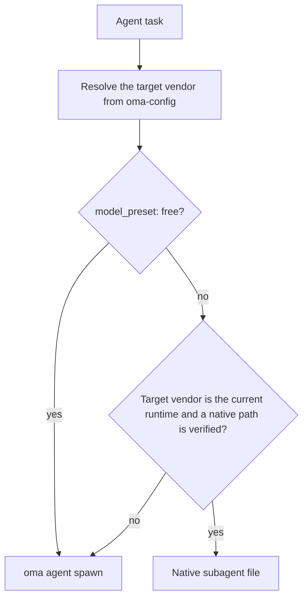
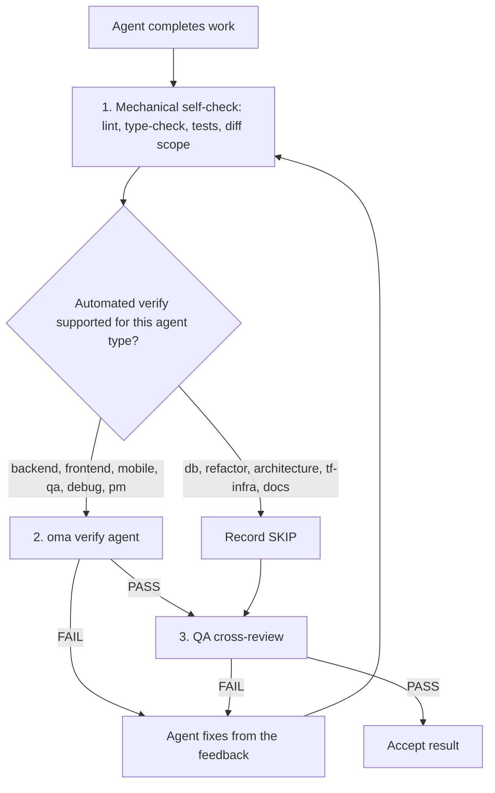

# Các agent

OMA tách [skill](../getting-started/glossary.md#skill), vai trò dispatch và [định nghĩa agent](../getting-started/glossary.md#agent-definition). Skill định tuyến và tải hướng dẫn theo lĩnh vực; vai trò chuẩn là danh tính runtime dùng để điều phối; định nghĩa đã lưu trong repository cung cấp cho subagent một persona native theo vendor. Các lớp này chồng lấn có chủ đích, vì vậy hãy dựa vào ranh giới task và tiêu chí chấp nhận để quyết định một skill đã đủ hay chưa.

---

## Danh mục skill {#skill-catalog}

Bảng này là danh sách chính thức các skill đã cài đặt. Bảng được `cli/scripts/generate-skill-catalog.mjs` tạo từ frontmatter của mỗi `.agents/skills/<name>/SKILL.md`; chạy script với `--check` để phát hiện drift. Phần `## References` trong SKILL.md của mỗi skill liệt kê các file tài nguyên và thời điểm cần đọc chúng.

<!-- oma:generated skill-catalog:start -->
<!-- Generated from SKILL.md frontmatter under .agents/skills by cli/scripts/generate-skill-catalog.mjs. Do not edit this block by hand. -->

| Skill | Use it for |
|---|---|
| [`oma-academic-writing`](https://github.com/first-fluke/oh-my-agent/blob/main/.agents/skills/oma-academic-writing/SKILL.md) | Draft and revise academic prose against a rubric, evidence, and citation requirements. Use for essays, reports, literature reviews, or academic style audits. |
| [`oma-architecture`](https://github.com/first-fluke/oh-my-agent/blob/main/.agents/skills/oma-architecture/SKILL.md) | Evaluate system boundaries and architectural tradeoffs. Use for architecture decisions, design reviews, and ADRs. |
| [`oma-backend`](https://github.com/first-fluke/oh-my-agent/blob/main/.agents/skills/oma-backend/SKILL.md) | Implement server APIs, authentication, and application data access. Schema modeling and query tuning use oma-db. |
| [`oma-brainstorm`](https://github.com/first-fluke/oh-my-agent/blob/main/.agents/skills/oma-brainstorm/SKILL.md) | Explore goals, constraints, and alternative approaches before choosing a design. Use when the user requests ideation or design exploration. |
| [`oma-coordination`](https://github.com/first-fluke/oh-my-agent/blob/main/.agents/skills/oma-coordination/SKILL.md) | Coordinate assigned specialist tasks and handoffs manually. Use when supervising a multi-agent project step by step. |
| [`oma-db`](https://github.com/first-fluke/oh-my-agent/blob/main/.agents/skills/oma-db/SKILL.md) | Design schemas and migrations, tune queries, or plan vector retrieval and database operations. Application API implementation uses oma-backend. |
| [`oma-debug`](https://github.com/first-fluke/oh-my-agent/blob/main/.agents/skills/oma-debug/SKILL.md) | Diagnose a reproducible failure, fix its cause, and verify the regression. Use for crashes, incorrect behavior, and failing tests. |
| [`oma-design`](https://github.com/first-fluke/oh-my-agent/blob/main/.agents/skills/oma-design/SKILL.md) | Define or review a visual system, DESIGN.md, or redesign direction. Use for typography, layout, color, motion, and interaction design decisions. |
| [`oma-dev-workflow`](https://github.com/first-fluke/oh-my-agent/blob/main/.agents/skills/oma-dev-workflow/SKILL.md) | Configure development tasks, git hooks, CI/CD, or release automation. Use when creating or fixing a repository development workflow. |
| [`oma-docs`](https://github.com/first-fluke/oh-my-agent/blob/main/.agents/skills/oma-docs/SKILL.md) | Check documentation references, sync docs to code changes, and detect translation drift. Use for documentation maintenance in a repository. |
| [`oma-explanation`](https://github.com/first-fluke/oh-my-agent/blob/main/.agents/skills/oma-explanation/SKILL.md) | Create an offline HTML explanation of a code change (diff, PR, branch) or of a topic, system, or question. Use when a visual walkthrough document is requested. |
| [`oma-frontend`](https://github.com/first-fluke/oh-my-agent/blob/main/.agents/skills/oma-frontend/SKILL.md) | Implement or modify web UI in React, Next.js, or Angular. Use for components, pages, styles, forms, and frontend state or data flows. |
| [`oma-hwp`](https://github.com/first-fluke/oh-my-agent/blob/main/.agents/skills/oma-hwp/SKILL.md) | Convert Hangul HWP, HWPX, or HWPML documents to Markdown with kordoc. Use for text, table, and image extraction from these formats. |
| [`oma-image`](https://github.com/first-fluke/oh-my-agent/blob/main/.agents/skills/oma-image/SKILL.md) | Generate raster images or reference-guided variations through the OMA image CLI. Use for image assets or explicit vendor comparisons; pixel editing uses an editor. |
| [`oma-market`](https://github.com/first-fluke/oh-my-agent/blob/main/.agents/skills/oma-market/SKILL.md) | Research customer pain points, trends, and competitors through the OMA market engine. Use for market discovery or voice-of-customer analysis. |
| [`oma-mobile`](https://github.com/first-fluke/oh-my-agent/blob/main/.agents/skills/oma-mobile/SKILL.md) | Implement Flutter, React Native, or native Swift apps. Use for mobile screens, widgets, platform integrations, and application data flows. |
| [`oma-observability`](https://github.com/first-fluke/oh-my-agent/blob/main/.agents/skills/oma-observability/SKILL.md) | Design or troubleshoot telemetry, SLOs, and incident diagnostics. Route to the relevant signal, system boundary, or vendor guide. |
| [`oma-orchestration`](https://github.com/first-fluke/oh-my-agent/blob/main/.agents/skills/oma-orchestration/SKILL.md) | Dispatch and supervise parallel specialist agents with durable task state. Use when automated multi-agent execution is requested. |
| [`oma-pdf`](https://github.com/first-fluke/oh-my-agent/blob/main/.agents/skills/oma-pdf/SKILL.md) | Extract PDF text, headings, tables, and images into Markdown using opendataloader-pdf. Use for PDF parsing, not PDF layout creation. |
| [`oma-pm`](https://github.com/first-fluke/oh-my-agent/blob/main/.agents/skills/oma-pm/SKILL.md) | Turn product requirements into scoped tasks with dependencies and acceptance criteria. Use for implementation planning and prioritization. |
| [`oma-qa`](https://github.com/first-fluke/oh-my-agent/blob/main/.agents/skills/oma-qa/SKILL.md) | Review changes for correctness, security, accessibility, and performance. Use for scoped quality reviews or verification plans; bug fixes use oma-debug. |
| [`oma-recap`](https://github.com/first-fluke/oh-my-agent/blob/main/.agents/skills/oma-recap/SKILL.md) | Summarize AI conversation histories for a specified date or period. Use for daily work recaps and cross-tool activity summaries. |
| [`oma-refactor`](https://github.com/first-fluke/oh-my-agent/blob/main/.agents/skills/oma-refactor/SKILL.md) | Restructure existing code while preserving observable behavior. Use for targeted technical debt or hotspot work with characterization tests. |
| [`oma-scholar`](https://github.com/first-fluke/oh-my-agent/blob/main/.agents/skills/oma-scholar/SKILL.md) | Search academic literature and generate, validate, or compare Knows paper sidecars. Use for claim/evidence analysis and literature synthesis. |
| [`oma-scm`](https://github.com/first-fluke/oh-my-agent/blob/main/.agents/skills/oma-scm/SKILL.md) | Manage Git branches, merges, conflicts, commits, and release baselines. Use for repository history and change-management operations. |
| [`oma-search`](https://github.com/first-fluke/oh-my-agent/blob/main/.agents/skills/oma-search/SKILL.md) | Find external documentation, web sources, or remote code with citations. Local code navigation uses the configured code tools. |
| [`oma-security`](https://github.com/first-fluke/oh-my-agent/blob/main/.agents/skills/oma-security/SKILL.md) | Scan application source, agent skills, and MCP components; run penetration tests against scoped web test deployments, validate findings, and configure scan gates. Use oma-qa for broad quality reviews and domain skills for remediation. |
| [`oma-skill-creation`](https://github.com/first-fluke/oh-my-agent/blob/main/.agents/skills/oma-skill-creation/SKILL.md) | Create or revise OMA skills and their references. Use for skill routing, execution contracts, conditional loading, and authoring validation. |
| [`oma-slide`](https://github.com/first-fluke/oh-my-agent/blob/main/.agents/skills/oma-slide/SKILL.md) | Create, import, revise, or export presentation decks through the OMA slide CLI. Use for HTML slides and PDF, PNG, or PPTX deck delivery. |
| [`oma-tf-infra`](https://github.com/first-fluke/oh-my-agent/blob/main/.agents/skills/oma-tf-infra/SKILL.md) | Create or review Terraform infrastructure and plans. Use for cloud resources, IAM, networking, state management, and infrastructure changes. |
| [`oma-translation`](https://github.com/first-fluke/oh-my-agent/blob/main/.agents/skills/oma-translation/SKILL.md) | Translate or revise localized UI strings and prose while preserving meaning, terminology, placeholders, and structure. |
| [`oma-video`](https://github.com/first-fluke/oh-my-agent/blob/main/.agents/skills/oma-video/SKILL.md) | Create videos through the OMA video CLI, or analyze and edit existing clips with media tools. Use for frame extraction, visual analysis, silence cuts, dubbing assembly, scripts, and composition; audio-only work uses oma-voice. |
| [`oma-voice`](https://github.com/first-fluke/oh-my-agent/blob/main/.agents/skills/oma-voice/SKILL.md) | Generate or transcribe speech with Voicebox, or process existing audio locally. Use for narration, transcripts, timed speech, and loudness conversion; video editing uses oma-video. |
<!-- oma:generated skill-catalog:end -->

---

## Vai trò dispatch {#dispatch-roles}

Runtime điều phối theo vai trò chuẩn. Mỗi vai trò, trừ `orchestrator`, có đúng một định nghĩa đã lưu trong `.agents/agents/`, với frontmatter `skills:` nêu tên các skill mà nó tải. Skill được liệt kê đầu tiên sở hữu task.

| Vai trò | File định nghĩa | Cũng chấp nhận | Skill |
|------|-----------------|---------------|--------|
| `orchestrator` | không có (vai trò điều phối runtime) | | |
| `pm` | `pm-planner.md` | `pm-planner` | oma-pm |
| `architecture` | `architecture-reviewer.md` | `architecture-reviewer` | oma-architecture |
| `qa` | `qa-reviewer.md` | `qa-reviewer` | oma-qa |
| `backend` | `backend-engineer.md` | `backend-engineer` | oma-backend |
| `frontend` | `frontend-engineer.md` | `frontend-engineer` | oma-frontend, oma-design |
| `mobile` | `mobile-engineer.md` | `mobile-engineer` | oma-mobile |
| `db` | `db-engineer.md` | `db-engineer` | oma-db |
| `debug` | `debug-investigator.md` | `debug-investigator` | oma-debug |
| `refactor` | `refactor-engineer.md` | `refactor-engineer` | oma-refactor |
| `docs` | `docs-curator.md` | `docs-curator` | oma-docs |
| `tf-infra` | `tf-infra-engineer.md` | `tf-infra-engineer` | oma-tf-infra |
| `explore` | `research-explorer.md` | `research-explorer`, `explorer` | oma-search, oma-market, oma-scholar |

Hậu tố `-agent` ở cuối cũng được chấp nhận (`qa-agent` được phân giải thành `qa`).

### File agent native {#native-agent-files}

Các định nghĩa agent trong `.agents/agents/` là nguồn sự thật. OMA chiếu chúng thành file native theo vendor cho các runtime hỗ trợ subagent tùy chỉnh:

| Runtime | File agent native |
|---------|--------------------|
| Claude Code | `.claude/agents/<name>.md` |
| Codex CLI | `.codex/agents/<name>.toml` |
| Cursor | `.cursor/agents/` |
| OpenCode | `.opencode/agents/` |
| Kiro | `.kiro/agents/` |
| Grok | `.grok/agents/` |
| CommandCode | `.commandcode/agents/` |
| Qwen Code | `.qwen/agents/` |

pi không có hệ thống file agent, nên `oma agent spawn` chèn trực tiếp persona của định nghĩa vào prompt. Các file được tạo sẽ được làm mới bởi `oma link`, `oma install` và `oma update`.

### Cách một vai trò được điều phối {#how-a-role-is-dispatched}

Khi workflow ánh xạ agent vào cùng vendor với runtime hiện tại, nó dùng file agent native của runtime đó trước tiên. Task khác vendor sẽ dự phòng bằng `oma agent spawn`.



> **Điều phối model theo agent:** vendor, model và mức effort của mỗi vai trò lấy từ `.agents/oma-config.yaml` (hoặc `.agents/oma-config.cue`, kèm lớp phủ `.local` tùy chọn). Với `model_preset: auto`, mặc định cho các bản cài mới, các vai trò không có ghi đè `agents:` sẽ theo thiết lập agent và model native của runtime hiện tại; `model_preset: free` luôn điều phối qua `oma agent spawn`. Xem [Model theo agent](../guide/per-agent-models.md) để biết chi tiết cấu hình và dùng [`oma doctor --profile`](../cli-interfaces/commands.md#doctor) để kiểm tra ma trận đang hoạt động.

---

## Phân loại skill {#agent-categories}

| Phân loại | Skill | Trách nhiệm |
|----------|--------|---------------|
| **Ý tưởng** | oma-brainstorm | Khám phá ý tưởng, đề xuất hướng tiếp cận, tạo tài liệu thiết kế |
| **Kiến trúc** | oma-architecture | Ranh giới hệ thống/module/dịch vụ, phân tích kiểu ADR/ATAM/CBAM, ghi chép đánh đổi |
| **Lập kế hoạch** | oma-pm | Phân tách yêu cầu, chia task, API contract, gán ưu tiên |
| **Triển khai** | oma-frontend, oma-backend, oma-mobile, oma-db | Viết mã trong các lĩnh vực tương ứng |
| **Thiết kế** | oma-design | Design system, DESIGN.md, token, typography, màu sắc, chuyển động, accessibility |
| **Hạ tầng** | oma-tf-infra | Cung cấp Terraform đa cloud, IAM, tối ưu chi phí, policy-as-code |
| **DevOps** | oma-dev-workflow | mise task runner, CI/CD, migration, phối hợp release, tự động hóa monorepo |
| **Observability** | oma-observability | Pipeline observability, định tuyến truy vết, tín hiệu MELT+P (metrics/logs/traces/profiles/cost/audit/privacy), quản lý SLO, điều tra sự cố, tinh chỉnh transport |
| **Chất lượng** | oma-qa | Kiểm tra bảo mật (OWASP), hiệu suất, accessibility (WCAG), đánh giá chất lượng mã |
| **Gỡ lỗi** | oma-debug | Tái hiện lỗi, phân tích nguyên nhân gốc, sửa tối thiểu, test hồi quy |
| **Bản địa hóa** | oma-translation | Dịch thuật nhận biết ngữ cảnh, bảo toàn giọng điệu, phong cách và thuật ngữ lĩnh vực |
| **Điều phối** | oma-orchestration, oma-coordination | Điều phối đa agent tự động và thủ công |
| **Git** | oma-scm | Tạo Conventional Commits, tách commit theo tính năng |
| **Tìm kiếm & Truy xuất** | oma-search | Bộ định tuyến tìm kiếm dựa trên ý định với chấm điểm độ tin cậy (tài liệu Context7, web, mã `gh`/`glab`, code intelligence cục bộ) |
| **Hồi tưởng** | oma-recap | Phân tích lịch sử hội thoại đa công cụ và tóm tắt công việc theo chủ đề |
| **Xử lý tài liệu** | oma-hwp, oma-pdf | Chuyển đổi HWP/HWPX/HWPML và PDF sang Markdown để nạp vào LLM/RAG |
| **Tài liệu** | oma-docs | Bảo trì tài liệu: tham chiếu hỏng, tài liệu bị ảnh hưởng bởi diff, drift bản dịch và lint tài liệu đã dịch |
| **Giải thích** | oma-explanation | Bản giải thích HTML ngoại tuyến cho một thay đổi mã (diff, PR, branch, commit range) hoặc cho một chủ đề, hệ thống hay câu hỏi |
| **Viết học thuật** | oma-academic-writing, oma-scholar | Soạn thảo và audit văn phong học thuật chuẩn xuất bản; nghiên cứu, tìm kiếm và peer review bằng sidecar Knows |
| **Bảo mật** | oma-security | Quét mã nguồn ứng dụng, gói skill của agent, thành phần MCP và các bản triển khai web thử nghiệm được ủy quyền (Deepsec, trình quét Cisco, ARTEX), với xác thực phát hiện độc lập và cổng CI |
| **Tái cấu trúc** | oma-refactor | Tái cấu trúc tăng dần bảo toàn hành vi, nhắm hotspot, có safety net bằng characterization test và commit chỉ refactor |
| **Nghiên cứu thị trường** | oma-market | Nghiên cứu pain point, xu hướng, đối thủ và discovery từ tín hiệu cộng đồng với khung SWOT/Porter's 5F/PESTEL tự bật theo ý định |
| **Soạn skill** | oma-skill-creation | Tạo và xác thực skill OMA theo định dạng SSL-lite |
| **Tạo media** | oma-image, oma-slide, oma-video, oma-voice | Tạo ảnh AI, deck trình chiếu HTML, video short/explainer/demo và TTS/STT cục bộ |

---

## Tham chiếu chi tiết agent {#detailed-agent-reference}

Các bản tóm tắt này giải thích lĩnh vực và quy tắc chính của từng skill. SKILL.md của chính skill là nguồn sự thật: phần `## References` của nó liệt kê các file tài nguyên và điều kiện để đọc từng file, nên trang này không sao chép các danh sách đó.

### oma-brainstorm

**Lĩnh vực:** Khám phá ý tưởng ưu tiên thiết kế trước khi lập kế hoạch hoặc triển khai.

**Khi nào sử dụng:** Khám phá ý tưởng tính năng mới, hiểu ý định người dùng, so sánh hướng tiếp cận. Sử dụng trước `/plan` cho các yêu cầu phức tạp hoặc mơ hồ.

**Khi nào KHÔNG sử dụng:** Yêu cầu rõ ràng (chuyển sang oma-pm), triển khai (chuyển sang agent lĩnh vực), đánh giá mã (chuyển sang oma-qa).

**Quy tắc cốt lõi:**
- Không triển khai hoặc lập kế hoạch trước khi thiết kế được duyệt
- Mỗi lần một câu hỏi làm rõ (không hỏi hàng loạt)
- So sánh hai hoặc ba hướng tiếp cận khả thi khi các phương án giúp ích cho quyết định; nếu ràng buộc để lại ít hơn, hãy giải thích lý do thay vì bịa thêm phương án
- Trình bày thiết kế từng phần, chỉ giải quyết các lựa chọn quan trọng còn mở
- YAGNI: chỉ thiết kế những gì cần thiết

**Quy trình:** 7 giai đoạn: Ngữ cảnh, Câu hỏi, Hướng tiếp cận (có thể khởi đầu bằng TRIZ-lite), Thiết kế, Review mù, Tài liệu (lưu vào `docs/plans/designs/`), Chuyển sang `/plan`.

---

### oma-architecture

**Lĩnh vực:** Kiến trúc phần mềm/hệ thống, bao gồm ranh giới module và dịch vụ, phân tích đánh đổi, tổng hợp các bên liên quan và ghi chép quyết định.

**Khi nào sử dụng:** Lựa chọn hoặc đánh giá kiến trúc hệ thống, xác định ranh giới module/dịch vụ/sở hữu, so sánh các phương án kiến trúc với đánh đổi rõ ràng, điều tra các vấn đề kiến trúc (khuếch đại thay đổi, phụ thuộc ẩn, API vụng về), ưu tiên các khoản đầu tư kiến trúc hoặc tái cấu trúc, viết khuyến nghị kiến trúc hoặc ADR.

**Khi nào KHÔNG sử dụng:** Hệ thống trực quan/thiết kế (dùng oma-design), lập kế hoạch tính năng và phân tách task (dùng oma-pm), triển khai Terraform (dùng oma-tf-infra), chẩn đoán lỗi (dùng oma-debug), đánh giá bảo mật/hiệu suất/accessibility (dùng oma-qa).

**Phương pháp luận:** Định tuyến chẩn đoán, so sánh design-twice, phân tích rủi ro kiểu ATAM, ưu tiên kiểu CBAM, ghi chép quyết định kiểu ADR.

**Quy tắc cốt lõi:**
- Chẩn đoán vấn đề kiến trúc trước khi chọn phương pháp
- Sử dụng phương pháp nhẹ nhất đủ cho quyết định hiện tại
- Phân biệt thiết kế kiến trúc với thiết kế UI/trực quan và với triển khai Terraform
- Chỉ tham vấn các agent bên liên quan khi quyết định đủ xuyên suốt để biện minh chi phí
- Chất lượng khuyến nghị quan trọng hơn vở kịch đồng thuận: tham vấn rộng, quyết định rõ ràng
- Mỗi khuyến nghị phải nêu giả định, đánh đổi, rủi ro và các bước xác thực
- Luôn ý thức chi phí mặc định: chi phí triển khai, chi phí vận hành, độ phức tạp nhóm, chi phí thay đổi trong tương lai

---

### oma-pm

**Lĩnh vực:** Quản lý sản phẩm, bao gồm phân tích yêu cầu, phân tách task và API contract.

**Khi nào sử dụng:** Chia nhỏ tính năng phức tạp, xác định tính khả thi, ưu tiên công việc, định nghĩa API contract.

**Quy tắc cốt lõi:**
- Thiết kế API-first: định nghĩa contract trước task triển khai
- Mỗi task có: agent, tiêu đề, tiêu chí chấp nhận, ưu tiên, phụ thuộc
- Tối thiểu hóa phụ thuộc để tối đa thực thi song song
- Bảo mật và kiểm thử là phần của mọi task (không phải giai đoạn riêng)
- Task phải hoàn thành được bởi một agent duy nhất
- Xuất JSON plan cùng task board theo phạm vi session để tương thích với orchestrator

**Đầu ra:** `.agents/results/plan-{sessionId}.json` với các tier ưu tiên dạng số (`1` = độc lập, tier thấp hơn chạy trước), cùng báo cáo theo phạm vi run `result-{agentId}-{taskId}-{runId}-{sessionId}.md` trong memory store đã cấu hình.

---

### oma-frontend

**Lĩnh vực:** Web UI bằng React/Next.js hoặc Angular với TypeScript. Dự án React dùng FSD-lite; dự án Angular tuân theo `resources/angular-rules.md`.

**Khi nào sử dụng:** Xây dựng giao diện người dùng, component, logic client-side, styling, xác thực form, tích hợp API.

**Tech stack:**
- React + Next.js (Server Components mặc định, Client Components cho tương tác)
- TypeScript (strict)
- TailwindCSS v4 + shadcn/ui (primitive chỉ đọc, mở rộng qua cva/wrapper)
- FSD-lite: root `src/` + feature `src/features/*/` (không import chéo giữa feature)

**Thư viện (dự án React/Next.js):**
| Mục đích | Thư viện |
|---------|---------|
| Ngày tháng | luxon |
| Styling | TailwindCSS v4 + shadcn/ui |
| Hook | ahooks hoặc @mantine/hooks |
| Tiện ích | es-toolkit |
| Kiểu | type-fest |
| State URL | nuqs |
| State server | TanStack Query (hook do orval tạo khi có spec OpenAPI) |
| State client | Jotai hoặc Zustand, chọn theo ý định, không có mặc định (giảm thiểu sử dụng) |
| Form | @tanstack/react-form + Zod |
| Xác thực | better-auth |
| Animation | motion (`motion/react`) cho dự án mới |

**Quy tắc cốt lõi:**
- shadcn/ui trước, mở rộng qua cva, không bao giờ sửa trực tiếp `components/ui/*`
- Ánh xạ 1:1 design token (không bao giờ hardcode màu)
- Request proxy: giữ nguyên quy ước `proxy.ts` hiện có của Next.js 16+; kiểm tra phiên bản đã cài và routing trước khi đề xuất đổi tên thành `middleware.ts`
- Không prop drilling quá 3 cấp; dùng thư viện client-state của dự án (Jotai atom hoặc Zustand store)
- Import tuyệt đối với `@/` bắt buộc
- Mục tiêu FCP < 1s
- Breakpoint responsive: 320px, 768px, 1024px, 1440px

**Checklist cổng chất lượng:**
- Accessibility: ARIA label, heading ngữ nghĩa, điều hướng bàn phím
- Mobile: xác minh trên viewport mobile
- Hiệu suất: không CLS, tải nhanh
- Khả năng phục hồi: Error Boundary và Loading Skeleton
- Test: logic được bao phủ bởi Vitest
- Chất lượng: typecheck và lint pass

---

### oma-backend

**Lĩnh vực:** API, logic server-side, xác thực, thao tác database.

**Khi nào sử dụng:** REST/GraphQL API, database migration, xác thực, logic nghiệp vụ server, background job.

**Kiến trúc:** Router (HTTP) -> Service (Logic nghiệp vụ) -> Repository (Truy cập dữ liệu) -> Models.

**Phát hiện stack:** Đọc manifest dự án (pyproject.toml, package.json, Cargo.toml, go.mod, v.v.) để xác định ngôn ngữ và framework. Nếu thiếu quy ước riêng của dự án, yêu cầu người dùng chạy `/stack-set`; lệnh này materialize các tham chiếu `stack/` đã phân giải từ schema và template được cung cấp.

**Quy tắc cốt lõi:**
- Kiến trúc sạch: không có logic nghiệp vụ trong route handler
- Tất cả đầu vào được xác thực bằng thư viện xác thực của dự án
- Chỉ dùng truy vấn tham số hóa (không bao giờ nội suy chuỗi trong SQL)
- JWT + Argon2id cho xác thực (bcrypt chỉ chấp nhận để tương thích legacy); giới hạn tốc độ các endpoint xác thực
- Async khi được hỗ trợ; chú thích kiểu trên tất cả signature
- Exception tùy chỉnh qua module lỗi tập trung
- Chiến lược tải ORM tường minh, ranh giới transaction, vòng đời an toàn

<!-- oma-docs:ignore-start -->
Các file `stack/stack.yaml`, `stack/tech-stack.md`, snippet và API template dành riêng cho dự án được `/stack-set` tạo khi cần; chúng chưa tồn tại cho đến khi stack được materialize.
<!-- oma-docs:ignore-end -->

---

### oma-mobile

**Lĩnh vực:** Ứng dụng mobile đa nền tảng và native (Flutter, React Native và iOS native bằng Swift).

**Khi nào sử dụng:** Ứng dụng mobile native (iOS + Android), mẫu UI đặc thù mobile, tính năng nền tảng (camera, GPS, push notification), kiến trúc offline-first; ứng dụng iOS native bằng Swift dùng SwiftUI và `swift-openapi-generator`.

**Kiến trúc:** Clean Architecture: domain -> data -> presentation. Với Swift iOS: bố cục dự án `App/Core/Features/Shared`.

**Tech stack:**
- Flutter/Dart: Riverpod/Bloc (quản lý state), Dio với interceptor (API), GoRouter (điều hướng), Material Design 3 (Android) + iOS HIG.
- iOS native bằng Swift (iOS 17+): SwiftUI + `@Observable` (Observation framework), `swift-openapi-generator` của Apple cho API client, bố cục `App/Core/Features/Shared`.

**Quy tắc cốt lõi:**
- Riverpod/Bloc cho quản lý state (không dùng setState thô cho logic phức tạp)
- Tất cả controller được dispose trong phương thức `dispose()`
- Dio với interceptor cho API; xử lý offline một cách graceful
- Mục tiêu 60fps; test trên cả hai nền tảng
- Swift: dùng `@Observable` thay cho `ObservableObject` trên iOS 17+; tạo API client từ spec OpenAPI bằng `swift-openapi-generator`

**Seed nền tảng:** `variants/` cung cấp `flutter/`, `react-native/` và `swift-ios/`, mỗi thư mục có `stack.yaml`, `tech-stack.md`, `snippets.md` và một API template, cùng `stack.schema.json` dùng chung. Đây là tài liệu khởi đầu cho `/stack-set`, không phải tài liệu bắt buộc đọc khi sửa mã hiện có.

---

### oma-db

**Lĩnh vực:** Kiến trúc database trên SQL, NoSQL và vector database.

**Khi nào sử dụng:** Thiết kế schema, ERD, chuẩn hóa, đánh index, transaction, quy hoạch dung lượng, chiến lược backup, thiết kế migration, kiến trúc vector DB/RAG, đánh giá anti-pattern, thiết kế nhận biết tuân thủ (ISO 27001/27002/22301).

**Quy trình mặc định:** Khám phá (xác định entity, mẫu truy cập, khối lượng) -> Thiết kế (schema, constraint, transaction) -> Tối ưu (index, phân vùng, lưu trữ, anti-pattern).

**Quy tắc cốt lõi:**
- Chọn mô hình trước, engine sau
- Mặc định 3NF cho relational; tài liệu đánh đổi BASE cho distributed
- Tài liệu cả ba tầng schema: external, conceptual, internal
- Tính toàn vẹn là ưu tiên hàng đầu: entity, domain, referential, business-rule
- Đồng thời không bao giờ ngầm định: xác định ranh giới transaction và mức cô lập
- Vector DB là hạ tầng truy xuất, không phải nguồn dữ liệu gốc
- Không bao giờ coi tìm kiếm vector là thay thế trực tiếp cho tìm kiếm từ vựng

**Sản phẩm bắt buộc:** Tóm tắt schema external, schema conceptual, schema internal, bảng tiêu chuẩn dữ liệu, thuật ngữ, ước tính dung lượng, chiến lược backup/phục hồi. Cho vector/RAG: chính sách phiên bản embedding, chính sách chunking, chiến lược truy xuất hybrid.

---

### oma-design

**Lĩnh vực:** Design system, UI/UX, quản lý DESIGN.md.

**Khi nào sử dụng:** Tạo hoặc chỉnh sửa design system và DESIGN.md, thiết kế lại site hoặc ứng dụng hiện có (giữ nguyên hoặc làm mới toàn diện), landing page, design token, bảng màu, typography, bố cục responsive, đánh giá accessibility.

**Quy trình:** 7 giai đoạn: Setup (thu thập ngữ cảnh) -> Extract (tùy chọn, từ URL tham chiếu) -> Enhance (tăng cường prompt mơ hồ) -> Propose (2-3 hướng thiết kế) -> Generate (DESIGN.md + token) -> Audit (responsive, WCAG, Nielsen, kiểm tra AI slop) -> Handoff.

**Thực thi chống anti-pattern ("no AI slop"):**
- Typography: mặc định font hệ thống; không dùng Google Fonts mặc định khi không có lý do
- Màu sắc: không gradient tím sang xanh, không gradient orb/blob, không trắng tinh trên đen tuyền
- Bố cục: không card lồng nhau, không bố cục chỉ cho desktop, không bố cục thống kê 3 chỉ số rập khuôn
- Chuyển động: không easing bounce ở mọi nơi, không animation > 800ms, phải tôn trọng prefers-reduced-motion
- Component: không glassmorphism ở mọi nơi, mọi phần tử tương tác cần phương án thay thế bằng bàn phím/chạm

**Quy tắc cốt lõi:**
- Dùng lại `.design-context.md` và `DESIGN.md` khi có; chỉ tạo `.design-context.md` khi một lượt khám phá thực chất góp phần vào quyết định
- Với site hoặc ứng dụng hiện có, tuân theo `resources/redesign-protocol.md` và phân loại Preserve hay Overhaul trước khi đề xuất
- Mặc định font hệ thống (font CJK-ready cho ko/ja/zh)
- WCAG AA tối thiểu cho mọi thiết kế
- Responsive-first (mobile là mặc định)
- Trình bày 2-3 hướng, nhận xác nhận

---

### oma-tf-infra

**Lĩnh vực:** Infrastructure-as-code với Terraform, đa cloud.

**Khi nào sử dụng:** Cung cấp trên AWS/GCP/Azure/Oracle Cloud, cấu hình Terraform, xác thực CI/CD (OIDC), CDN/load balancer/storage/networking, quản lý state, hạ tầng tuân thủ ISO.

**Phát hiện cloud:** Đọc provider Terraform và prefix resource (`google_*` = GCP, `aws_*` = AWS, `azurerm_*` = Azure, `oci_*` = Oracle Cloud). Bao gồm bảng ánh xạ resource đa cloud đầy đủ.

**Quy tắc cốt lõi:**
- Không phụ thuộc provider: phát hiện cloud từ ngữ cảnh dự án
- Remote state với versioning và locking
- OIDC-first cho xác thực CI/CD
- Luôn plan trước apply
- IAM quyền tối thiểu
- Tag mọi thứ (Environment, Project, Owner, CostCenter)
- Không secret trong mã
- Pin phiên bản tất cả provider và module
- Không auto-approve trong production

---

### oma-dev-workflow

**Lĩnh vực:** Tự động hóa task monorepo và CI/CD.

**Khi nào sử dụng:** Chạy dev server, thực thi lint/format/typecheck xuyên app, database migration, tạo API, build i18n, build production, tối ưu CI/CD, xác thực pre-commit.

**Quy tắc cốt lõi:**
- Luôn dùng task `mise run` thay vì lệnh package manager trực tiếp
- Chỉ chạy lint/test trên app thay đổi
- Xác thực commit message bằng commitlint
- CI nên bỏ qua app không thay đổi
- Không bao giờ dùng lệnh package manager trực tiếp khi có task mise

---

### oma-observability

**Lĩnh vực:** Router observability và truy vết dựa trên ý định, xuyên suốt các tầng, ranh giới và tín hiệu.

**Khi nào sử dụng:**
- Thiết lập pipeline: OTel SDK + Collector + backend của nhà cung cấp
- Truy vết xuyên ranh giới service và domain: W3C propagator, baggage, đa tenant, đa cloud
- Tinh chỉnh transport: ngưỡng UDP/MTU, OTLP gRPC vs HTTP, topology Collector DaemonSet vs sidecar, công thức sampling
- Điều tra pháp y sự cố: định vị 6 chiều (code / service / layer / host / region / infra)
- Lựa chọn danh mục nhà cung cấp: OSS full-stack vs SaaS thương mại vs chuyên gia cardinality cao vs chuyên gia profiling
- Observability-as-code: dashboard Grafana Jsonnet, PrometheusRule CRD, OpenSLO YAML, alert SLO burn-rate
- Meta-observability: sức khỏe tự thân pipeline, lệch đồng hồ, guardrail cardinality, ma trận lưu giữ
- Bao phủ tín hiệu MELT+P: metrics, logs, traces, profiles, cost, audit, privacy
- Di chuyển pipeline log được đánh giá dựa trên mức hỗ trợ upstream hiện tại và yêu cầu của dự án

**Khi nào KHÔNG sử dụng:** Observability LLM ops / gen_ai (dùng Langfuse, Arize Phoenix, LangSmith, Braintrust), lineage pipeline dữ liệu (OpenLineage + Marquez, dbt test, Airflow lineage), telemetry tầng vật lý IoT / datacenter (Nlyte, Sunbird, Device42), điều phối chaos engineering (Chaos Mesh, Litmus, Gremlin, ChaosToolkit), hạ tầng GPU / TPU (NVIDIA DCGM Exporter), chuỗi cung ứng phần mềm (sigstore, in-toto, SLSA), quy trình phản ứng sự cố / paging (PagerDuty, OpsGenie, Grafana OnCall), thiết lập một nhà cung cấp duy nhất đã được skill riêng của họ bao phủ.

**Quy tắc cốt lõi:**
- Phân loại ý định trước khi định tuyến: setup | migrate | investigate | alert | trace | tune | route
- Ưu tiên danh mục, không phải registry nhà cung cấp: ủy quyền cho skill thuộc sở hữu nhà cung cấp qua `resources/vendor-categories.md`; không trùng lặp tài liệu nhà cung cấp
- Tinh chỉnh transport là hào bảo vệ: ngưỡng UDP/MTU, chọn giao thức OTLP, topology Collector và công thức sampling là chiều sâu mà các skill khác không bao phủ
- Meta-observability không thể thương lượng: xác minh sức khỏe tự thân pipeline, đồng bộ đồng hồ (< 100 ms lệch), cardinality và lưu giữ trước khi tuyên bố thiết lập hoàn tất
- Ưu tiên CNCF-first: Prometheus, Jaeger, Thanos, Fluent Bit, OpenTelemetry, Cortex, OpenCost, OpenFeature, Flagger, Falco
- Fluentd vẫn ở mức CNCF Graduated; hướng dẫn Fluentd sang Fluent Bit của CNCF 2025-10 là hướng dẫn di chuyển, không phải thông báo ngừng hỗ trợ. Chọn Fluentd, Fluent Bit hoặc OTel Collector dựa trên yêu cầu về workload, plugin và vận hành
- W3C Trace Context làm propagator mặc định; chuyển đổi theo cloud (AWS X-Ray `X-Amzn-Trace-Id`, GCP Cloud Trace, Datadog, Cloudflare, Linkerd)
- Quyền riêng tư trước tính năng: che PII, quy tắc baggage nhận biết sampling, audit bất biến SOC2/ISO + xóa theo GDPR/PIPA áp dụng tại điểm thu thập, không chỉ tại lưu trữ

---

### oma-qa

**Lĩnh vực:** Đảm bảo chất lượng, bao gồm bảo mật, hiệu suất, accessibility và chất lượng mã.

**Khi nào sử dụng:** Đánh giá cuối trước triển khai, kiểm tra bảo mật, phân tích hiệu suất, tuân thủ accessibility, phân tích độ bao phủ test.

**Thứ tự ưu tiên đánh giá:** Bảo mật > Hiệu suất > Accessibility > Chất lượng mã.

**Mức độ nghiêm trọng:**
- **CRITICAL**: Vi phạm bảo mật, rủi ro mất dữ liệu
- **HIGH**: Chặn phát hành
- **MEDIUM**: Sửa sprint này
- **LOW**: Backlog

**Quy tắc cốt lõi:**
- Mỗi phát hiện phải có file:line, mô tả và cách sửa
- Chạy công cụ tự động trước (npm audit, bandit, lighthouse)
- Không false positive; mỗi phát hiện phải tái hiện được
- Cung cấp mã khắc phục, không chỉ mô tả

---

### oma-debug

**Lĩnh vực:** Chẩn đoán và sửa lỗi.

**Khi nào sử dụng:** Lỗi do người dùng báo, crash, vấn đề hiệu suất, lỗi gián đoạn, race condition, lỗi hồi quy.

**Phương pháp:** Tái hiện trước, sau đó chẩn đoán. Không bao giờ đoán mò cách sửa.

**Quy tắc cốt lõi:**
- Xác định nguyên nhân gốc, không chỉ triệu chứng
- Sửa tối thiểu: chỉ thay đổi những gì cần thiết
- Mỗi bản sửa đều có test hồi quy
- Tìm mẫu tương tự ở nơi khác
- Tài liệu trong `.agents/results/`

**Công cụ code intelligence (Gortex hoặc Serena) sử dụng:**
- `find_symbol("functionName")` hoặc điều hướng symbol bằng Gortex: định vị hàm
- `find_referencing_symbols("Component")` hoặc phân tích tác động bằng Gortex: tìm tất cả nơi sử dụng
- `search_for_pattern("error pattern")` hoặc tìm kiếm bằng Gortex: tìm các vấn đề tương tự

---

### oma-translation

**Lĩnh vực:** Dịch thuật đa ngôn ngữ nhận biết ngữ cảnh.

**Khi nào sử dụng:** Dịch chuỗi UI, tài liệu, copy marketing, đánh giá bản dịch hiện có, tạo thuật ngữ.

**Luồng sáu cảnh:** Prepare, Acquire, Reason, Act, Verify và Finalize. Phương pháp dịch gồm bốn bước: đọc ý nghĩa và cú pháp cần bảo toàn, chọn phong cách, tái tạo bằng ngôn ngữ đích, và giữ phong cách tác giả ở những chỗ cần giữ.

**Quy tắc cốt lõi:**
- Quét file locale hiện có trước để khớp quy ước
- Dịch ý nghĩa, không dịch từ
- Bảo toàn hàm ý cảm xúc
- Không bao giờ tạo bản dịch từ-cho-từ
- Không trộn phong cách trong một bài
- Bảo toàn thuật ngữ đặc thù lĩnh vực nguyên trạng

---

### oma-orchestration

**Lĩnh vực:** Điều phối đa agent tự động qua spawn CLI.

**Khi nào sử dụng:** Tính năng phức tạp cần nhiều agent song song, thực thi tự động, triển khai fullstack.

**Cấu hình mặc định:**

| Cài đặt | Mặc định | Mô tả |
|---------|---------|-------------|
| MAX_PARALLEL | 3 | Subagent đồng thời tối đa |
| MAX_RECOVERY_ATTEMPTS | 3 | Tổng số lần thử lại và giả thuyết khám phá cho mỗi task, kể cả lần thử ban đầu |
| POLL_INTERVAL | 30s | Khoảng kiểm tra trạng thái cho các run `oma agent spawn` (subagent native của Claude Code trả về đồng bộ) |

**Giai đoạn quy trình:** Plan → References (chọn tham chiếu theo từng task) → Setup (artifact session và task board) → Execute (điều phối các task sẵn sàng trong giới hạn MAX_PARALLEL) → Monitor → Verify (vòng lặp review) → Collect (claim và báo cáo theo phạm vi run).

**Vòng lặp review giữa agent:** xem [Luồng điều phối](#orchestration-flow) để biết sơ đồ và giới hạn vòng lặp.

**Bằng chứng session:** Ghi lại các sửa chữa đáng kể và các phát hiện review đã được phân xử khi hữu ích, kèm nguyên nhân, tác động và cách xác minh. Không áp dụng điểm phạt hay việc tạm dừng do điểm số kích hoạt.

---

### oma-scm

**Lĩnh vực:** Quản lý cấu hình phần mềm (SCM) và Git, bao gồm branching, merge, worktree, baseline, sẵn sàng cho audit và Conventional Commits.

**Khi nào sử dụng:** Sau khi thay đổi mã (`/scm`), xung đột merge, chiến lược branch, release/tag hoặc bất kỳ câu hỏi CM nào về repo.

**Loại commit:** feat, fix, docs, style, refactor, perf, test, chore, build, ci, revert.

**Quy trình (commit):** Phân tích thay đổi → Tách theo tính năng khi cần → type → scope → mô tả (mệnh lệnh, dưới 72 ký tự, chữ thường, không dấu chấm cuối) → commit với đường dẫn tường minh.

**Quy tắc:**
- Không dùng `git add -A` hoặc `git add .` khi chưa được ủy quyền rõ ràng
- Không bao giờ commit file secret
- Luôn chỉ định file khi staging
- Ghi message vào một file và commit bằng `git commit -F <message-file>`
- Không viết lại lịch sử dùng chung khi chưa được ủy quyền rõ ràng; dùng `--force-with-lease`, không bao giờ dùng `--force` thuần
- Trailer co-author chỉ được thêm khi cấu hình `scm.co_author` hiệu lực bật nó và cung cấp tên cùng email.

---

### oma-coordination

**Lĩnh vực:** Hướng dẫn điều phối đa agent thủ công từng bước.

**Khi nào sử dụng:** Công việc đa lĩnh vực mà bạn muốn tự giám sát việc spawn, theo dõi, căn chỉnh contract và QA từng bước thay vì điều phối hoàn toàn tự động.

**Khi nào KHÔNG sử dụng:** Thực thi song song tự động hoàn toàn (dùng oma-orchestration), task đơn lĩnh vực (dùng agent lĩnh vực trực tiếp).

**Quy tắc cốt lõi:**
- Dùng lại plan hợp lệ; chỉ gọi oma-pm khi cần thay đổi phân tách hoặc contract
- Spawn song song các task độc lập cùng tier ưu tiên, mỗi task trong workspace riêng hoặc với `--isolation worktree`
- Cập nhật contract cho các ranh giới API đã thay đổi trước công việc frontend hoặc mobile phụ thuộc
- QA review luôn là bước cuối
- Chuyển các lỗi QA chặn và các lỗ hổng xác minh bắt buộc về agent chịu trách nhiệm, rồi chạy lại các kiểm tra bị ảnh hưởng

**Quy trình:** Plan (dùng lại hoặc PM) → Spawn theo tier ưu tiên → Giám sát → QA review → Sửa vấn đề → Phát hành.

**Khác biệt với oma-orchestration:** Coordination là thủ công và có hướng dẫn (người dùng kiểm soát nhịp độ), orchestrator là tự động (agent spawn và chạy với can thiệp tối thiểu từ người dùng).

---

### oma-search

**Lĩnh vực:** Bộ định tuyến tìm kiếm dựa trên ý định với chấm điểm độ tin cậy miền. Chuyển truy vấn đến Context7 (tài liệu), tìm kiếm web native, `gh`/`glab` (mã), code intelligence cục bộ (Gortex hoặc Serena).

**Khi nào sử dụng:** Tìm tài liệu chính thức của thư viện/framework, nghiên cứu web cho tutorial/ví dụ/so sánh/giải pháp, tìm kiếm mã GitHub/GitLab cho các mẫu triển khai, mọi truy vấn mà kênh tìm kiếm không rõ ràng (tự định tuyến), các skill khác cần hạ tầng tìm kiếm (gọi dùng chung).

**Khi nào KHÔNG sử dụng:** Khám phá mã chỉ cục bộ (dùng code intelligence MCP trực tiếp), phân tích lịch sử Git hoặc blame (dùng oma-scm), nghiên cứu kiến trúc đầy đủ (dùng oma-architecture, có thể gọi skill này nội bộ).

**Quy tắc cốt lõi:**
- `--docs`, `--code` hoặc `--web` tường minh sẽ chọn tuyến; nếu không, phân loại ý định bằng `resources/intent-rules.md`
- Một truy vấn, một tuyến tốt nhất; tránh đa tuyến dư thừa trừ khi ý định mơ hồ
- Chấm điểm độ tin cậy cho mỗi kết quả; mọi kết quả không cục bộ đều nhận nhãn độ tin cậy miền từ registry
- Các flag khác: `--strict` lọc kết quả theo độ tin cậy sau khi chấm điểm, `--wide` giữ lại các kết quả độ tin cậy thấp hơn đã gắn nhãn, và `--gitlab` chọn GitLab làm code host
- Fail forward: nếu tuyến chính thất bại, rút lui nhẹ nhàng (docs→web, web→chiến lược `oma search fetch`)
- Không cần MCP bổ sung: Context7 cho tài liệu, runtime-native cho web, CLI cho mã, provider đã cấu hình (Gortex hoặc Serena) cho cục bộ
- Tìm kiếm web trung lập với nhà cung cấp: dùng bất kỳ công cụ nào runtime hiện tại cung cấp (WebSearch, Google, Bing)
- Chỉ độ tin cậy ở cấp miền; không chấm điểm ở cấp sub-path hoặc trang

---

### oma-recap

**Lĩnh vực:** Phân tích lịch sử hội thoại qua nhiều công cụ AI (Claude, Codex, Gemini, Antigravity, Qwen, Cursor, Grok) với tóm tắt công việc theo chủ đề hàng ngày/theo kỳ.

**Khi nào sử dụng:** Tóm tắt một ngày hoặc kỳ hoạt động làm việc, hiểu luồng công việc qua nhiều công cụ AI, phân tích mẫu chuyển đổi công cụ giữa các session, chuẩn bị standup hàng ngày / retro hàng tuần / nhật ký công việc.

**Khi nào KHÔNG sử dụng:** Hồi tưởng thay đổi mã dựa trên commit Git (dùng `oma retro`), giám sát agent theo thời gian thực (dùng `oma dashboard terminal`), chỉ số năng suất (dùng `oma stats get`).

**Quy trình:**
1. Phân giải ngày hoặc cửa sổ thời gian từ đầu vào ngôn ngữ tự nhiên (today, yesterday, last Monday, ngày cụ thể)
2. Lấy dữ liệu hội thoại bằng `oma recap --date YYYY-MM-DD --json` cho một ngày lịch hoặc `oma recap --window 7d --json` cho cửa sổ trượt (`1d`, `3d`, `7d`, `2w`, `30d`); thu hẹp bằng `--tool`
3. Nhóm theo nội dung (dự án và chủ đề), không theo công cụ; cửa sổ từ 3 ngày trở lên được nhóm theo dự án thay vì theo ngày
4. Trích xuất chủ đề (tính năng đã làm, lỗi đã sửa, công cụ đã khám phá)
5. Render tóm tắt theo chủ đề hàng ngày/theo kỳ

---

### oma-hwp

**Lĩnh vực:** Chuyển đổi HWP / HWPX / HWPML (trình xử lý văn bản Hàn Quốc) sang Markdown bằng `kordoc`.

**Khi nào sử dụng:** Chuyển đổi tài liệu HWP Hàn Quốc (`.hwp`, `.hwpx`, `.hwpml`) sang Markdown, chuẩn bị tài liệu chính phủ/doanh nghiệp Hàn Quốc cho ngữ cảnh LLM hoặc RAG, trích xuất nội dung có cấu trúc (bảng, tiêu đề, danh sách, hình ảnh, chú thích, hyperlink) từ HWP.

**Khi nào KHÔNG sử dụng:** File PDF (dùng oma-pdf), XLSX/DOCX (ngoài phạm vi), tạo/chỉnh sửa HWP (ngoài phạm vi), file đã là văn bản (dùng công cụ Read trực tiếp).

**Quy tắc cốt lõi:**
- Sử dụng `bunx kordoc@latest` để chạy (không cần cài đặt); luôn truyền `@latest` hoặc phiên bản cố định
- Định dạng đầu ra mặc định là Markdown
- Nếu không chỉ định thư mục đầu ra, kết quả xuất ra cùng thư mục với đầu vào
- kordoc xử lý bảo toàn cấu trúc (tiêu đề, bảng, bảng lồng nhau, chú thích, hyperlink, hình ảnh)
- Phòng vệ bảo mật (ZIP bomb, XXE, SSRF, XSS) do kordoc cung cấp; đừng thêm cơ chế tự chế
- Với HWP được mã hóa hoặc khóa DRM, báo cáo rõ hạn chế cho người dùng
- Hậu xử lý với `resources/flatten-tables.ts` để chuyển khối HTML `<table>` thành bảng pipe GFM và loại bỏ ký tự Private Use Area của font Hancom

---

### oma-pdf

**Lĩnh vực:** Chuyển đổi PDF sang Markdown bằng `opendataloader-pdf`.

**Khi nào sử dụng:** Chuyển đổi tài liệu PDF sang Markdown cho ngữ cảnh LLM hoặc RAG, trích xuất nội dung có cấu trúc (bảng, tiêu đề, danh sách) từ PDF, chuẩn bị dữ liệu PDF để AI tiêu thụ.

**Khi nào KHÔNG sử dụng:** Tạo/sinh PDF (dùng công cụ tài liệu phù hợp), chỉnh sửa PDF đã có (ngoài phạm vi), đọc đơn giản file đã là văn bản (dùng công cụ Read trực tiếp).

**Quy tắc cốt lõi:**
- Sử dụng `uvx opendataloader-pdf` để chạy (không cần cài đặt)
- Định dạng đầu ra mặc định là Markdown
- Nếu không chỉ định thư mục đầu ra, kết quả xuất ra cùng thư mục với PDF đầu vào
- Bảo toàn cấu trúc tài liệu (tiêu đề, bảng, danh sách, hình ảnh)
- Với PDF quét, dùng chế độ lai có OCR
- Luôn chạy `uvx mdformat` trên đầu ra để chuẩn hóa định dạng Markdown
- Xác thực Markdown đầu ra có thể đọc và có cấu trúc tốt
- Báo cáo mọi vấn đề chuyển đổi (bảng thiếu, văn bản lỗi) cho người dùng

---

### oma-academic-writing

**Lĩnh vực:** Văn phong học thuật tiếng Anh chuẩn xuất bản: soạn thảo, chỉnh sửa và audit bài luận, báo cáo, phần phân tích, tóm tắt điều hành, kết luận và tổng quan tài liệu.

**Khi nào sử dụng:** Soạn hoặc chỉnh sửa báo cáo/bài luận/phần phân tích học thuật, viết tóm tắt điều hành, kết luận hoặc tổng quan tài liệu, viết lại văn phong nghe như AI thành tiếng Anh học thuật tự nhiên, đánh bóng bản nháp theo tiêu chí hạng cao (HD, A, top-band), rà soát độ đa dạng câu, chất lượng động từ, hedging và tuân thủ anti-AI.

**Khi nào KHÔNG sử dụng:** Dịch thuật (dùng oma-translation), tìm nguồn / thu thập trích dẫn / tìm kiếm tài liệu (dùng oma-scholar), phân tích rubric và chia task (dùng oma-pm), tài liệu mã / README / văn bản tham chiếu API (dùng skill lĩnh vực tương ứng), copy không trang trọng hoặc marketing, viết học thuật không phải tiếng Anh (soạn bằng tiếng Anh rồi chuyển cho oma-translation).

**Chế độ:** `draft` (heading + prose + Writing Notes + Claim-Evidence Map), `revise` (bản gốc + bản sửa + danh sách thay đổi), `review` (báo cáo tuân thủ PASS/FAIL về cấu trúc câu, chất lượng động từ, anti-AI, tính cụ thể, hedging, độ rõ đoạn, nhịp điệu và liên kết claim-evidence).

**Quy tắc cốt lõi:**
- Quote-before-judgment: trích dẫn nguyên văn ràng buộc/rubric trước khi áp dụng quy tắc
- Mọi câu phải kiểm chứng được; không bịa dữ liệu, thống kê hoặc trích dẫn
- Động từ chung bị cấm (`show`, `have`, `make`, `do`, `get`, `use`, …) không được làm động từ chính
- Đa dạng kiểu câu, độ dài và cách mở câu; không để 3 câu cùng kiểu liên tiếp
- Mức độ hedge phải khớp độ mạnh của bằng chứng; không dùng ngôi thứ nhất `I think`/`I believe`
- Mỗi claim ánh xạ tới bằng chứng trong Claim-Evidence Map; làm yếu hoặc bỏ claim không có bằng chứng

**Quy trình:** 6 bước: READ rubric/bản nháp và trích dẫn ràng buộc, PLAN đoạn theo Topic-Support-Conclude, DRAFT theo cả bốn protocol, AUDIT theo checklist anti-AI, REVERSE-OUTLINE và lập Claim-Evidence Map, POLISH (đọc thành tiếng, liên kết, tính cụ thể, số từ, nhịp điệu).

---

### oma-security

**Lĩnh vực:** Quét và xác thực bảo mật cho mã nguồn ứng dụng, gói skill của agent, thành phần MCP và các bản triển khai web thử nghiệm được ủy quyền.

**Khi nào sử dụng:** Quét repository hoặc diff mã nguồn; kiểm tra một gói skill hoặc một MCP server hay cấu hình; chạy penetration test có giới hạn trên một bản triển khai thử nghiệm cụ thể, được ủy quyền; xác thực các candidate từ trình quét; cấu hình cổng CI theo engine; khắc phục sự cố credential, độ bao phủ, matcher, quota hoặc trạng thái có thể resume của trình quét.

**Khi nào KHÔNG sử dụng:** Review tổng quát về tính đúng đắn, hiệu suất, accessibility hoặc chất lượng (dùng oma-qa), so sánh hoặc nghiên cứu công cụ mà không thực thi (dùng oma-search), quyết định kiến trúc bảo mật (dùng oma-architecture), khắc phục trong mã sản phẩm (dùng oma-debug hoặc skill backend/frontend/mobile/hạ tầng sở hữu).

**Engine mặc định theo mục tiêu:**

| Mục tiêu | Engine mặc định |
|--------|----------------|
| Mã nguồn ứng dụng hoặc diff mã nguồn | Deepsec (Cisco AI Deep SAST khi được chọn tường minh) |
| Thư mục hoặc gói skill của agent | Cisco Skill Scanner |
| Mã nguồn, cấu hình hoặc server MCP | Cisco MCP Scanner |
| Bản triển khai web thử nghiệm | ARTEX |
| Tái hiện cục bộ có giới hạn | Phương pháp xác thực của Cloudflare (không mạng bên ngoài) |

**Quy tắc cốt lõi:**
- Một lần quét repository chung chỉ chọn mã nguồn; quét skill, MCP và runtime không được thêm vào theo ngụ ý
- Kết quả thất bại hoặc rỗng không bao giờ tự động chọn engine, model hoặc trình phân tích có phí khác
- Giữ nguyên và resume trạng thái `.deepsec/` hiện có; không bao giờ khởi tạo lại để xóa một lần chạy thất bại hoặc nhiễu
- Khóa hoặc công cụ đã cài không đồng nghĩa với ủy quyền cho các lần gọi có phí hay phạm vi rộng hơn; dùng lại ủy quyền hiện có theo execution policy dùng chung
- Mỗi candidate duy nhất được chuyển cho một verifier mới không phải là bên phát hiện ra nó; `confirmed` cần bằng chứng quan sát độc lập
- Không kết quả nào chứng minh một mục tiêu là an toàn; cổng không thể pass khi các kiểm tra bắt buộc vẫn chưa hoàn tất

**Đầu ra:** mỗi lần gọi một thư mục `.agents/results/security/<run-id>/` với `run.json`, `findings.json` và `report.md` (cùng `runtime.json` cho web runtime và `gate.json` cho CI).

---

### oma-docs

**Lĩnh vực:** Bảo trì tài liệu với bốn chế độ: `verify` (tham chiếu hỏng; tạo lại `docs/generated/doc-refs.json`), `sync` (tài liệu tham chiếu các file đã thay đổi trong một diff), `i18n` (drift bản dịch) và `lint` (vấn đề văn phong trong tài liệu đã dịch).

**Khi nào sử dụng:** Sau refactor, đổi tên hoặc xóa file để tìm tham chiếu cũ trong tài liệu; trước release để xác nhận command CLI, đường dẫn file và config key vẫn tồn tại; sau một git diff lớn để tìm tài liệu tham chiếu các file đã đổi; kiểm tra drift bản dịch định kỳ.

**Khi nào KHÔNG sử dụng:** Nghiên cứu mã nguồn chung (dùng oma-search), triển khai ứng dụng (dùng specialist sở hữu), dịch văn bản đã biết (dùng oma-translation).

**Quy tắc cốt lõi:**
- Yêu cầu chỉ review sẽ tạo ra đề xuất; một yêu cầu chỉnh sửa có phạm vi đã có sẵn cho phép áp dụng các sửa đổi đó mà không cần phê duyệt lại từng file
- CLI xuất dữ liệu có cấu trúc; host LLM thực hiện tổng hợp và soạn patch. Không bịa phát hiện CLI và không gọi API LLM của vendor từ CLI docs
- File chứa secret (`.env*`, private key, credential) không bao giờ xuất hiện trong báo cáo diff hoặc patch
- Tôn trọng các khối ignore, `oma-docs: skip` và các loại trừ đã cấu hình
- Việc kiểm tra URL được giao cho `lychee` (tùy chọn); hook workflow chỉ chạy khi bật `docs.auto_verify` và chỉ cảnh báo

**Quy trình:** `oma docs verify --json`, `oma docs sync <range> --json`, `oma docs i18n --json` hoặc `oma docs lint --json` → kiểm tra kết quả có cấu trúc → xác minh từng sửa đổi với mã hiện tại → áp dụng các sửa đổi được ủy quyền → chạy lại các kiểm tra bị ảnh hưởng. `verify` thoát với mã 0 khi sạch và 1 khi tìm thấy tham chiếu hỏng.

---

### oma-explanation

**Lĩnh vực:** Bản giải thích HTML ngoại tuyến, tự chứa, với hai chế độ: chế độ thay đổi (một diff, PR, branch hoặc commit range, gồm bối cảnh, trực giác, walkthrough mã và quiz năm câu hỏi) và chế độ chủ đề (một khái niệm, hệ thống hoặc câu hỏi dưới dạng trang trực quan một trang).

**Khi nào sử dụng:** Giải thích diff, pull request, branch hoặc commit range, hoặc một chủ đề, hệ thống hay câu hỏi, dưới dạng một trang HTML chạy được ngoại tuyến.

**Quy trình:** Model viết bản nháp Markdown; `oma explain render` chuyển nó thành một file HTML tại `.agents/results/explain/{YYYY-MM-DD}-{slug}.html`, và `oma explain validate` kiểm tra file đó. Skill chỉ được kích hoạt bằng `/explain`, bằng cách nêu tên skill hoặc qua ủy quyền; skill này bị loại khỏi gợi ý theo từ khóa.

**Khi nào KHÔNG sử dụng:** Trang tài liệu thông thường, triển khai feature trực tiếp hoặc slide deck (dùng `oma-slide` cho presentation).

---

### oma-image

**Lĩnh vực:** Tạo ảnh AI đa vendor với điều phối song song nhận biết authentication (Codex `gpt-image-2`, model Gemini-family “nano-banana” của Antigravity qua `agy` với model cụ thể được chọn bên trong, Pollinations flux/zimage).

**Khi nào sử dụng:** Tạo ảnh, asset trực quan, minh họa, ảnh sản phẩm, concept art hoặc mockup; so sánh output giữa nhiều model ảnh cho cùng prompt; tạo ảnh từ prompt trong workflow editor.

**Khi nào KHÔNG sử dụng:** Chỉnh sửa ảnh có sẵn hoặc xử lý ảnh, tạo video/audio (dùng oma-video / oma-voice), dựng vector/SVG inline từ dữ liệu có cấu trúc, resize hoặc chuyển định dạng asset đơn giản.

**Quy tắc cốt lõi:**
- Làm rõ trước khi gọi: nếu subject/style/composition/usage mơ hồ, hãy hỏi hoặc khuếch đại prompt và cho người dùng xem phiên bản mở rộng
- Điều phối theo authentication: chỉ chạy vendor đã xác thực; với `--vendor all`, mọi vendor được yêu cầu phải khả dụng
- Chốt chi phí: xác nhận trước run có chi phí ước tính ≥ $0.20 (`--yes`/`OMA_IMAGE_YES=1` bỏ qua); `pollinations` và `antigravity` mặc định miễn phí
- An toàn path: output ngoài `$PWD` cần `--allow-external-output`; `n` tối đa = 5
- Output có ghi nhận: mọi run ghi `manifest.json` cạnh ảnh với prompt, vendor/model, input và metadata artifact. Đây là dữ liệu tái lập, không hứa hẹn ảnh giống hệt từng pixel.
- Tự chuyển tiếp ảnh tham chiếu đính kèm qua `--reference <path>` (codex/antigravity)

**Quy trình:** PREPARE (làm rõ/khuếch đại prompt, chọn vendor) → ACQUIRE (xác thực auth, reference, output path) → ACT (`oma image generate`) → VERIFY (manifest, file, exit code) → FINALIZE (path output và cảnh báo).

---

### oma-market

**Lĩnh vực:** Nghiên cứu thị trường từ tín hiệu cộng đồng: trích xuất pain point, phát hiện xu hướng, định vị đối thủ và discovery. Research chạy trên engine upstream [`last30days`](https://github.com/mvanhorn/last30days-skill) (Reddit, X, YouTube, TikTok, Instagram, HN, Polymarket, GitHub, arXiv, Techmeme, Digg, LinkedIn, StockTwits, Bluesky, web và nhiều nguồn khác), được oma tự động giữ ở bản phát hành mới nhất.

**Khi nào sử dụng:** Trích xuất pain point thực từ bài đăng cộng đồng, phát hiện xu hướng theo cửa sổ 7/30/90/180 ngày, phân tích cảm nhận đối thủ và định vị SWOT / Porter's 5F, discovery mở (`--discover`), nghiên cứu người / công ty / ticker, tín hiệu tuyển dụng, drill follow-up.

**Khi nào KHÔNG sử dụng:** Nghiên cứu web chung không có khung thị trường (dùng trực tiếp oma-search), tài liệu học thuật (dùng oma-scholar), dashboard trực tiếp hoặc giám sát theo lịch (bọc skill này bằng `oma schedule <action>`).

**Quy tắc cốt lõi:**
- detect-trap trước: không chạy engine nếu chưa preflight (`--force` chỉ sau khi người dùng xác nhận lại rõ ràng)
- Một engine, luôn bản mới nhất: `oma market resolve` refresh bản quản lý (`~/.cache/oma-market/last30days/<tag>/`) trước khi dùng; bản cài cũ của người dùng chỉ là fallback khi offline không có gì trong cache
- Tuân thủ nguyên văn `SKILL.md` của engine đã resolve; thay thế duy nhất là dùng `oma market run <args>` thay cho lệnh raw `python3 scripts/last30days.py`
- Không chỉ WebSearch: không có engine, không có Python 3.12+ hoặc exit khác 0 → dừng và báo cáo
- Chỉ bật keyed sources qua setup wizard upstream với sự đồng ý của người dùng; source bị bỏ qua vẫn hiện ở footer
- Framework chỉ trích dẫn cluster của engine; badge dòng đầu và upstream LAWs được thực thi trước khi ghi file
- Mỗi run chỉ một brief tại `.agents/results/market/{topic-slug}-{YYYYMMDD}.md`; framework tự bật theo ý định (pain/trend → SWOT, competitor → SWOT + Porter's 5F, discovery → SWOT + PESTEL)

**Quy trình:** detect-trap → `oma market resolve` → đọc SKILL.md upstream → bước pre-research upstream (setup wizard, phân giải handle/subreddit, kế hoạch query) → `oma market run … --emit=compact` → tổng hợp theo OUTPUT CONTRACT upstream → thêm framework → tự kiểm tra → ghi file.

---

### oma-refactor

**Lĩnh vực:** Tái cấu trúc bảo toàn hành vi: tái tổ chức tăng dần an toàn với định vị code smell / SATD / hotspot, safety net bằng characterization test và commit chỉ refactor.

**Khi nào sử dụng:** Tái cấu trúc trên file/module cụ thể (extract, move, rename, decompose, căn chỉnh idiom), refactor chuẩn bị trước feature, cứu code legacy/brownfield (khám phá seam + characterization test), chọn mục tiêu theo hotspot (churn × complexity), audit xem code đã an toàn để refactor chưa.

**Khi nào KHÔNG sử dụng:** Sửa bug hoặc hành vi thất bại (dùng oma-debug; refactor không được đổi hành vi), audit bảo mật/hiệu suất/accessibility (dùng oma-qa), thiết kế hệ thống / ranh giới module / ADR (dùng oma-architecture), thiết kế hoặc cơ chế migration schema DB (dùng oma-db), chia commit / staging (dùng oma-scm), tối ưu hiệu suất là mục tiêu chính.

**Quy tắc cốt lõi:**
- Bảo toàn hành vi: consumer contract (nhận biết Hyrum) là bất khả xâm phạm; tuning chỉ là hệ quả, không phải mục tiêu
- Có thể kiểm chứng: không tái cấu trúc khi thiếu net; nếu safety net thiếu/yếu, trước tiên viết characterization (golden-master) test trong commit riêng
- Tăng dần: mỗi commit một transformation có tên; thất bại lặp lại thì dùng Mikado (ghi prerequisite, revert đầy đủ, đệ quy)
- Tách biệt (hai vai): không trộn thay đổi hành vi vào commit refactor (chỉ commit kiểu `refactor:`)
- Kinh tế: khả năng đọc là mục tiêu chính; không refactor code sắp xóa hoặc code lạnh ít churn
- Lệch convention cần route ADR của oma-architecture, không sửa cục bộ; mọi metric chỉ là proxy (Goodhart)

**Quy trình:** PREPARE (phân loại green/brownfield, gate kích thước, xếp hạng hotspot) → ACQUIRE (đọc code bằng symbol tool, thu metric + tín hiệu git) → REASON (lập chuỗi transformation nguyên tử / expand-contract) → ACT (một transformation engine-first) → VERIFY (chạy lại test không đổi rồi commit, hoặc Mikado revert) → FINALIZE (delta metric + kết luận khả năng đọc).

---

### oma-scholar

**Lĩnh vực:** Trợ lý nghiên cứu học thuật dùng spec sidecar Knows `.knows.yaml`: tạo, xác thực, review, truy vấn và so sánh sidecar bài báo có cấu trúc, cùng fetch từ knows.academy.

**Khi nào sử dụng:** Đọc paper tiết kiệm token qua sidecar (~700 token chỉ claim so với ~10K PDF đầy đủ), tạo `.knows.yaml` từ bản nháp/LaTeX/ghi chú, xác thực cấu trúc sidecar trước khi chia sẻ, tạo peer review dưới dạng sidecar, truy vấn hoặc tóm tắt sidecar có sẵn, so sánh cấu trúc hai paper, tìm kiếm/fetch từ knows.academy.

**Khi nào KHÔNG sử dụng:** Tìm web chung hoặc nội dung không học thuật (dùng oma-search), dịch paper (dùng oma-translation), chỉ phân tích PDF không có sidecar (dùng oma-pdf), workflow peer review đầy đủ có hệ thống editor.

**Chế độ:** Generate, Validate, Review, Analyze, Compare, Remote (search/fetch).

**Quy tắc cốt lõi:**
- Spec đích là profile v0.9.0 / `paper@1`; host LLM tạo sidecar (không bao giờ shell out tới external LLM SDK)
- Chống bịa: nếu DOI/venue/year không hiển thị trong nguồn, bỏ hẳn key; không viết `doi: TODO` hoặc đoán
- Tên field chính xác, một object `provenance.actor`, enum đóng, số không đặt trong quote
- Claim có bằng chứng dùng `supported_by`; định nghĩa và câu hỏi mở có thể giữ neo vào nguồn. `oma scholar lint` cảnh báo khi dưới 1.5 relation trên mỗi statement, nhưng tỷ lệ này là chỉ số chẩn đoán, không phải hạn mức
- Xác thực trước khi chia sẻ (`oma scholar lint`); dùng `--lenient` cho sidecar bên thứ ba
- knows.academy → fallback OpenAlex cho paper cũ/không phải 2026; proxy API công khai không cần auth

**Quy trình:** PREPARE (mode + source) → ACQUIRE (metadata, section hoặc text cục bộ) → REASON (trích claim/evidence/relation) → ACT (generate/lint/review/analyze/compare/fetch) → VERIFY (schema, enum, ID, relation) → FINALIZE (sidecar/report/summary cùng caveat).

---

### oma-skill-creation

**Lĩnh vực:** Soạn và xác thực skill OMA theo định dạng Markdown SSL-lite (Scheduling / Structural Flow / Logical Operations / References).

**Khi nào sử dụng:** Tạo skill mới trong `.agents/skills/{name}/SKILL.md`, cập nhật skill hiện có sang định dạng SSL-lite, thêm canonical command/workflow path cho skill nhiều thao tác, audit xem skill đủ chi tiết về định tuyến/thực thi/xác thực/khôi phục chưa, quyết định ví dụ nên nằm inline hay trong `resources/`.

**Khi nào KHÔNG sử dụng:** Cài skill bên thứ ba vào `$CODEX_HOME/skills` (bên ngoài), tạo plugin bundle Codex (bên ngoài), viết plan dự án chung không liên quan soạn skill (dùng oma-pm), sửa trực tiếp code sản phẩm/hạ tầng/frontend/backend/mobile (dùng skill chuyên gia tương ứng).

**Quy tắc cốt lõi:**
- Giữ chính xác bốn section cấp cao: Scheduling, Structural Flow, Logical Operations, References
- Giữ YAML frontmatter có `name` và `description` rõ ràng; chạy `oma skill audit` sau khi sửa description (cảnh báo ≥ 60%, fail ≥ 75% TF-IDF cosine collision)
- Có ranh giới `When NOT to use` cụ thể và route chéo đến skill liền kề
- Thêm đúng một canonical path inline (`Canonical command path` cho lệnh mong manh/lặp lại, `Canonical workflow path` cho flow nghiên cứu/phán đoán)
- Đưa chi tiết dài theo variant vào `resources/`, không đặt trong body chính; không tạo README/changelog/install docs trong skill

**Quy trình:** PREPARE (mục đích, trigger, ranh giới, I/O, dependency) → ACQUIRE (đọc 1-3 skill tương tự + convention) → REASON (inline hay `resources/`) → ACT (soạn theo template SSL-lite) → VERIFY (kiểm tra structural/routing/execution/formatting) → FINALIZE (file thay đổi + report xác thực).

---

### oma-slide

**Lĩnh vực:** Tạo deck trình chiếu HTML giàu animation trên stage cố định 1920×1080, với validate/bundle/export xác định sang PDF/PNG/PPTX qua CLI `oma slide`.

**Khi nào sử dụng:** Tạo presentation mới từ topic hoặc outline, nâng cấp hoặc định dạng lại deck có sẵn, tạo HTML theo slide với animation và thẩm mỹ design-doctrine, export deck sang PDF/PNG/PPTX, áp dụng style preset có tên, export sang hoặc import từ Canva.

**Khi nào KHÔNG sử dụng:** Tạo tài liệu thường không có slide, chỉ tạo ảnh (dùng trực tiếp oma-image), định nghĩa brand/design system (dùng oma-design), thao tác CLI xác định (validate/bundle/export) không có generation (gọi trực tiếp CLI `oma slide`).

**Quy tắc cốt lõi:**
- Skill soạn HTML; CLI xử lý mọi phần còn lại (scaffold, validate, bundle, export)
- Chỉ dùng asset cục bộ: không dùng URL từ xa trong ``/`<video src>`, chỉ `./assets/<file>`
- CJK → bắt buộc font Pretendard trên mọi slide tiếng Hàn/Nhật/Trung
- Wrapper `prefers-reduced-motion`, focus state hiển thị và `data-om-validate` bắt buộc trên mỗi slide
- Tối đa 3 vòng auto-fix khi validate, sau đó đưa diff cho người dùng
- Giao việc tạo ảnh cho oma-image; Canva MCP là tùy chọn và chỉ tự cấp khi người dùng đồng ý rõ ràng

**Quy trình:** 7 giai đoạn: DETECT (mode), DISCOVER (làm rõ + đánh giá asset), STYLE (3 preview trực tiếp → người dùng chọn), GENERATE (`slide-NN.html` ở 1920×1080), VALIDATE (`oma slide validate`, ≤3 vòng auto-fix), REVIEW (viewer + bbox editor tùy chọn), DELIVER (`bundle` + export PDF/PNG/PPTX tùy chọn).

---

### oma-video

**Lĩnh vực:** Tạo video short, explainer và demo do người quay qua CLI `oma video`, ghép script → narration → visuals → captions → render HyperFrames.

**Khi nào sử dụng:** Tạo video short (shorts/reels, 9:16) từ topic, explainer (16:9/9:16) từ README/code/data, demo/walkthrough từ screen capture (`--source file`) hoặc capture web app có browser headed và người giám sát với bất kỳ URL nào (`--source web`), render lại run có sẵn một cách xác định.

**Khi nào KHÔNG sử dụng:** Tạo ảnh tĩnh đơn (dùng oma-image), tạo slide deck (dùng oma-slide; video gọi nội bộ để tạo frame explainer), chỉ tạo speech audio (dùng oma-voice), biên tập phi tuyến mp4 đã hoàn thiện, livestream (capture web có giám sát vẫn thuộc phạm vi).

**Quy tắc cốt lõi:**
- Làm rõ hoặc suy ra mode trước khi gọi; cho người dùng xem plan suy ra, không âm thầm render từ brief mơ hồ
- Cấu hình provider có thể không cần key cho fallback asset được hỗ trợ; provider có phí (Pexels, Pixelle) chỉ tự bật khi env key tồn tại, còn compositor failure không bao giờ được thay bằng fallback video
- Chốt chi phí ở mức ≥ `$0.20` (`--yes`/`OMA_VIDEO_YES=1` bỏ qua); giới hạn duration 180s / 40 scene
- Input render được ghi trong `render-spec.json`, asset, seed và Pretendard nhúng; `OMA_VIDEO_MOCK=1` là test harness cho golden fixture, không phải output bàn giao cho người dùng
- Demo có người trong vòng lặp: capture web chỉ mở browser headed và ghi khi người điều khiển thao tác — KHÔNG tự động credential; `--url` và token được che trong log/manifest
- An toàn path (`--allow-external-output` cho output ngoài `$PWD`)

**Quy trình:** PREPARE (mode/aspect/locale, làm rõ/khuếch đại brief) → ACQUIRE (thăm dò availability provider, xác thực capture path, kiểm tra chi phí) → ACT (script → voice ∥ visuals ∥ captions → render-spec → render) → VERIFY (schema, hash manifest, exit code, mp4) → FINALIZE (run-dir + path mp4 + cảnh báo coverage).

---

### oma-voice

**Lĩnh vực:** Text-to-speech và speech-to-text local-first qua Voicebox MCP server — hoàn toàn trên thiết bị, không cloud, không API key, không phí mỗi lần gọi.

**Khi nào sử dụng:** Tạo audio notification ngắn khi agent hoàn tất task hoặc bị chặn, tạo voiceover/narration/audio asset (mp3 hoặc wav), transcribe file audio cục bộ (mp3, wav, m4a, webm, flac) thành Markdown, so sánh voice profile bằng cách chạy lại cùng text với các profile id khác nhau.

**Khi nào KHÔNG sử dụng:** Cloud TTS hoặc voice đa ngôn ngữ fidelity cao trên cloud, dictation microphone terminal thời gian thực (dùng hotkey dictation của Voicebox), upload sample voice cloning / tạo profile (làm trong UI desktop Voicebox), video/music/sound design.

**Quy tắc cốt lõi:**
- Cần Voicebox: nếu handshake / `GET /health` thất bại, thoát với gợi ý cài/khởi chạy một lần; không retry hoặc tự khởi chạy lại
- Cần profile: nếu `voicebox_list_profiles` rỗng, hướng người dùng đến UI app rồi thoát
- Giới hạn độ dài: TTS tối đa 5000 ký tự mỗi lần gọi (cảnh báo ở 2000), STT 30 phút; v1 không tự chunk
- Minh bạch khi tự gọi: notification chỉ chạy khi task vượt `auto_notify_after_sec` (mặc định 60s); luôn thông báo ý định trong một dòng
- An toàn path (cảnh báo + xác nhận nếu output ngoài `$PWD`); SIGINT không ghi output dở dang
- Mỗi lần tạo phải có manifest; không có chốt chi phí (Voicebox miễn phí)

**Quy trình:** PREPARE (xác thực text/audio/language/path/profile) → ACQUIRE (hỏi một lần nếu thiếu tín hiệu) → ACT (MCP `voicebox_speak` hoặc `voicebox_transcribe`) → VERIFY (audio/transcript tồn tại + field manifest) → FINALIZE (ghi `manifest.json`, báo cáo path).

---

## Ủy quyền và làm rõ {#charter-preflight-charter_check}

Agent không xuất một khối preflight cố định. Mọi định nghĩa trong `.agents/agents/` đều tuân theo `.agents/skills/_shared/core/execution-policy.md`, file mà `oma agent spawn` chèn vào prompt của mỗi subagent cùng với `.agents/skills/_shared/runtime/result-contract.md`.

| Tình huống | Agent làm gì |
|-----------|---------------------|
| Mục tiêu và ủy quyền đã rõ; còn các chi tiết thường lệ | Dùng quy ước của repository, nêu các giả định có hệ quả và tiếp tục |
| Một lựa chọn ưu tiên có thể cải thiện kết quả | Hỏi một câu tùy chọn ngắn gọn và tiếp tục công việc độc lập |
| Thông tin còn thiếu làm thay đổi đáng kể tính đúng đắn hoặc phạm vi | Hỏi câu hỏi cụ thể và chỉ tạm dừng phần việc phụ thuộc |
| Một hành động cần ủy quyền chưa được cấp | Chuẩn bị kết quả có thể review, giải thích hành động rồi hỏi |

Subagent được spawn không thể hỏi trực tiếp người dùng. Nó báo cáo chính xác dữ kiện còn thiếu cùng mọi công việc độc lập đã hoàn tất trong một kết quả `blocked` hoặc `partial` có cấu trúc, và coordinator sẽ trả lời từ ngữ cảnh sẵn có hoặc hỏi người dùng. Xem `.agents/skills/_shared/core/clarification-protocol.md`.

---

## Tải skill {#two-layer-skill-loading}

Agent đọc toàn bộ SKILL.md sở hữu của mình và đọc từng file `resources/` một, chỉ khi task đáp ứng trigger đã nêu của file đó: các phần checklist cho phần xác minh chưa giải quyết, error playbook chỉ sau khi quan sát thấy lỗi, `common-checklist.md` chỉ cho review rộng liên lĩnh vực. Độ khó đặt ra ngân sách kích thước mềm; nó không bao giờ thêm skill hay checklist đầy đủ. Xem [Skill](./skills.md) để biết mô hình tải và [Tải tài nguyên theo task](./skills.md#resource-loading-by-task).

---

## Thực thi theo phạm vi {#scoped-execution}

Agent hoạt động trong ranh giới lĩnh vực nghiêm ngặt:

- Agent frontend sẽ không sửa mã backend
- Agent backend sẽ không chạm vào component UI
- Agent DB sẽ không triển khai endpoint API
- Agent tài liệu hóa phụ thuộc ngoài phạm vi cho agent khác

Khi phát hiện task thuộc lĩnh vực khác trong quá trình thực thi, agent ghi nhận trong file kết quả như mục escalation, thay vì cố xử lý.

---

## Chiến lược workspace {#workspace-strategy}

Cho dự án đa agent, workspace riêng biệt ngăn xung đột file:

```text
./apps/api → backend agent workspace
./apps/web → frontend agent workspace
./apps/mobile → mobile agent workspace
```

Workspace được chỉ định bằng flag `-w` khi spawn agent:

```bash
oma agent spawn backend "Implement auth API" session-01 -w ./apps/api
oma agent spawn frontend "Build login form" session-01 -w ./apps/web
```

`-w` là tùy chọn; workspace được tự động phát hiện khi bỏ qua. Dùng `--task-id` để mỗi run khớp với task trong plan, `--isolation worktree` để mỗi lần spawn có git worktree riêng, và `--read-only` để giới hạn một lượt review chỉ dùng công cụ không phá hủy:

```bash
oma agent spawn backend prompts/auth-api.md session-01 --task-id task-2 --isolation worktree
oma agent spawn qa prompts/review.md session-01 --task-id task-5 --read-only
```

---

## Luồng điều phối {#orchestration-flow}

Khi chạy workflow đa agent (`/orchestrate` hoặc `/work`):

1. **Agent PM** phân tách yêu cầu thành task với các tier ưu tiên dạng số (`1` = không phụ thuộc; tier thấp hơn chạy trước), phụ thuộc và tiêu chí chấp nhận. Plan hợp lệ hiện có sẽ được dùng lại
2. **Session được khởi tạo**: session ID được tạo, `orchestrator-session-{sessionId}.md` và `task-board-{sessionId}.md` được tạo trong memory store đã cấu hình
3. **Task tier 1** bắt đầu song song (tối đa MAX_PARALLEL agent đồng thời)
4. **Tiến trình được giám sát**: với các run `oma agent spawn`, orchestrator poll các file theo phạm vi run `progress-{agentId}-{taskId}-{runId}-{sessionId}.md` mỗi POLL_INTERVAL; subagent native của Claude Code trả về đồng bộ
5. **Các tier sau** bắt đầu khi phụ thuộc của chúng hoàn thành
6. **Vòng lặp review** chạy cho mỗi agent hoàn thành (xem bên dưới)
7. **Kết quả được thu thập** từ các file kết quả theo phạm vi run và claim có cấu trúc
8. **Báo cáo cuối** với tóm tắt session, file thay đổi, vấn đề còn lại

### Vòng lặp review giữa agent {#agent-to-agent-review-loop}

Nguồn: `.agents/skills/oma-orchestration/SKILL.md` (PHASE 4.5).



Tự kiểm tra chỉ mang tính cơ học. Chất lượng thiết kế và tiêu chí chấp nhận được đánh giá trong lượt review chéo của QA, vì agent có xu hướng đánh giá quá cao đầu ra của chính mình.

| Bộ đếm | Tối đa | Khi vượt quá |
|---------|-----|-------------|
| Chu kỳ tự kiểm tra và sửa | 3 | Vẫn chuyển sang review chéo |
| Số lần review chéo từ chối | 2 | Báo cáo cho người dùng kèm lịch sử review |
| Tổng số vòng lặp | 5 | Dừng phục hồi; giữ lại các kiểm tra thất bại và trả về `partial` hoặc `failed` |

---

## Định nghĩa agent {#agent-definitions}

`.agents/agents/` chứa 12 định nghĩa subagent đã lưu trong repository và là nguồn sự thật, mỗi file cho một vai trò trong bảng [Vai trò dispatch](#dispatch-roles). Mỗi file thiết lập danh tính và `skills:` của agent, một phần execution-protocol trỏ tới execution policy và result contract dùng chung, cùng các quy tắc lĩnh vực; một số file bổ sung tóm tắt kiến trúc hoặc quy trình. Chúng được dùng khi spawn subagent qua Task/Agent tool (Claude Code) hoặc CLI, và OMA chiếu chúng thành [file agent native](#native-agent-files) cho từng runtime.

---

## Trạng thái runtime (memory store của dự án) {#runtime-state-project-memory-store}

Trong session điều phối, agent phối hợp qua các file bộ nhớ chia sẻ trong `.agents/state/memories/` (dự án cũ dùng fallback về đường dẫn legacy `.serena/memories/`). Thay đổi đường dẫn hoặc tên công cụ bằng `memoryConfig` trong `.agents/mcp.json`, không phải `.mcp.json` ở root repo, vốn là danh sách MCP server của Claude Code:

| File | Chủ sở hữu | Mục đích | Khác |
|------|-------|---------|--------|
| `orchestrator-session-{sessionId}.md` | Orchestrator | Session ID, trạng thái, thời gian bắt đầu, theo dõi giai đoạn | Chỉ đọc |
| `task-board-{sessionId}.md` | Orchestrator | Phân công task, ưu tiên, cập nhật trạng thái | Chỉ đọc |
| `progress-{agentId}-{taskId}-{runId}-{sessionId}.md` | Run đó | Tiến trình từng lượt: hành động, file đọc/sửa, trạng thái hiện tại | Orchestrator đọc |
| `result-{agentId}-{taskId}-{runId}-{sessionId}.md` | Run đó | Kết quả cuối: trạng thái (completed/failed), tóm tắt, file thay đổi, checklist tiêu chí chấp nhận | Orchestrator đọc |
| `session-metrics-{sessionId}.md` | Orchestrator | Bằng chứng session tùy chọn: sửa chữa đáng kể, làm lại, phát hiện review đã được phân xử | QA đọc |
| `lessons-{sessionId}.md` | Orchestrator | Bài học có bằng chứng cho session | Tất cả đọc |
| `experiment-ledger-{sessionId}.md` | Orchestrator/QA | Bằng chứng cho các thí nghiệm thực sự | Tất cả đọc |

Công cụ bộ nhớ có thể cấu hình. Mặc định agent đọc và ghi trực tiếp các file phối hợp này bằng công cụ file native (`Read`, `Write`, `Edit`), nhưng có thể cấu hình công cụ tùy chỉnh và base path tùy chỉnh trong `.agents/mcp.json`:

```json
{
  "memoryConfig": {
    "provider": "file",
    "basePath": ".agents/state/memories",
    "tools": {
      "read": "Read",
      "write": "Write",
      "edit": "Edit"
    }
  }
}
```

Dashboard (`oma dashboard terminal` và `oma dashboard web`) theo dõi các file bộ nhớ này để giám sát thời gian thực.

---

## Liên quan {#related}

- [Skill](./skills.md): cách một skill được chọn và cách tài nguyên của nó được tải
- [Workflow](./workflows.md): các slash workflow đọc skill
- [Thực thi song song](./parallel-execution.md)
- [Kết quả agent và resume](../guide/agent-results-and-resume.md): vòng đời `oma agent begin` → `oma agent verify` → `oma agent finish`
- [Model theo agent](../guide/per-agent-models.md)
- [Giám sát dashboard](../guide/dashboard-monitoring.md)
