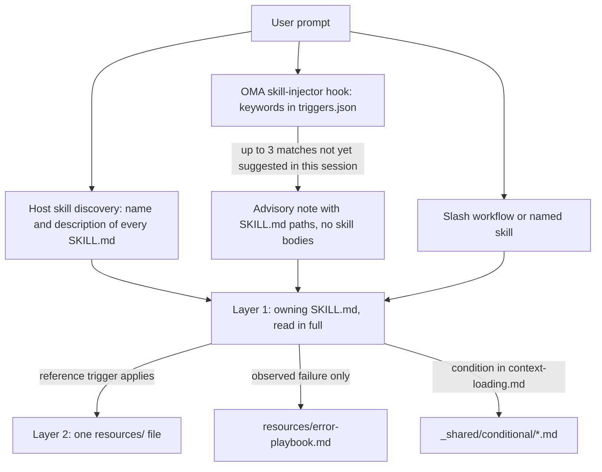
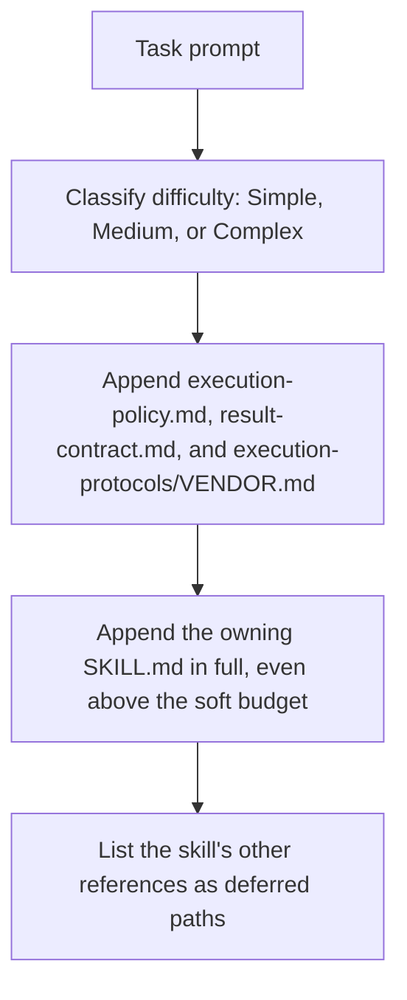

# Skill

[Skill](../getting-started/glossary.md#skill) là các gói kiến thức có cấu trúc, cung cấp hướng dẫn theo lĩnh vực cho một vai trò dispatch. Mỗi gói chứa protocol thực thi, tham chiếu tech stack, mẫu mã, playbook lỗi, checklist chất lượng và ví dụ khi skill có cung cấp, được tổ chức theo kiến trúc hai tầng để tiết kiệm token. Để xem danh sách skill đã cài đặt, hãy xem [danh mục skill](./agents.md#skill-catalog).

---

## Thiết kế hai tầng {#the-two-layer-design}

Skill đi vào ngữ cảnh theo từng giai đoạn. Bước chọn chỉ đưa một đường dẫn hoặc một mô tả tới model; SKILL.md sở hữu được đọc toàn bộ khi skill đã được chọn; các file hỗ trợ được đọc lần lượt từng file khi trigger của chúng áp dụng.



Nguồn: `.agents/hooks/core/skill-injector.ts`, `.agents/skills/_shared/core/skill-routing.md` và `.agents/skills/_shared/core/context-loading.md`.

### Tầng 1: SKILL.md (đọc khi skill được chọn) {#layer-1-skillmd-read-when-the-skill-is-selected}

Mỗi skill có tệp `SKILL.md` ở thư mục gốc. Hook injector truyền một **tham chiếu đường dẫn** chứ không truyền nội dung, nên skill chưa được chọn không tốn gì ngoài trường `description`. Mọi `SKILL.md` đều có frontmatter YAML và cùng bốn section cấp cao; `oma skill lint` báo cáo skill nào bỏ sót một section hoặc có body vượt quá 500 dòng.

| Phần | Nội dung |
|------|----------|
| Frontmatter | `name` và `description` dùng để định tuyến (skill làm gì và khi nào dùng) |
| `## Scheduling` | Mục tiêu, chữ ký ý định, khi nào dùng, khi nào KHÔNG dùng, đầu vào và đầu ra dự kiến, phụ thuộc |
| `## Structural Flow` | Chuyển tiếp, thất bại và phục hồi, trạng thái kết thúc |
| `## Logical Operations` | Canonical command hoặc workflow path, phạm vi tài nguyên, guardrail |
| `## References` | Các file tầng 2, mỗi file kèm điều kiện biện minh cho việc đọc nó |

Frontmatter hiện tại của `oma-frontend`:

```yaml
---
name: oma-frontend
description: "Implement or modify web UI in React, Next.js, or Angular. Use for components, pages, styles, forms, and frontend state or data flows."
---
```

Runtime host hiển thị `description` của mỗi skill cho model, nên nó được viết như một câu định tuyến. Hook từ khóa của OMA không đọc trường này; các từ khóa của hook nằm trong `.agents/hooks/core/triggers.json`.

### Tầng 2: resources/ (tải theo nhu cầu) {#layer-2-resources-loaded-on-demand}

Thư mục `resources/` chứa kiến thức thực thi chuyên sâu. Các tệp này chỉ được tải khi:
1. Host hoặc workflow đã chọn skill (ví dụ qua native skill match hoặc lệnh tường minh)
2. Task hiện tại đáp ứng điều kiện tải của tham chiếu

Việc tải theo nhu cầu được hướng dẫn bởi tài liệu context-loading (`.agents/skills/_shared/core/context-loading.md`), tài liệu này phân biệt chỉ dẫn entry với các tham chiếu do task chọn.

### Những gì `oma agent spawn` inject {#what-oma-agent-spawn-injects}

Dispatch qua CLI tự lắp ghép prompt của subagent, nên subagent bắt đầu với các contract và skill sở hữu đã có sẵn trong ngữ cảnh:



Nguồn: `cli/commands/agent/spawn-status.ts`, `cli/platform/agent-config/loaders.ts` và `cli/platform/context-loader.ts`. Subagent native nhận cùng ngữ cảnh task từ `oma agent context <agent-id>` và tự đọc policy cùng result contract nếu runtime chưa cung cấp.

---

## Ví dụ cấu trúc file {#file-structure-example}

```text
.agents/skills/oma-frontend/
├── SKILL.md                          ← Layer 1: read when selected
└── resources/
    ├── execution-protocol.md         ← Layer 2: step-by-step workflow
    ├── tech-stack.md                 ← Layer 2: detailed technology specs
    ├── tailwind-rules.md             ← Layer 2: Tailwind conventions
    ├── angular-rules.md              ← Layer 2: Angular-specific conventions
    ├── snippets.md                   ← Layer 2: copy-paste code patterns
    ├── error-playbook.md             ← Layer 2: error recovery procedures
    └── checklist.md                  ← Layer 2: quality verification checklist

.agents/skills/oma-backend/
├── SKILL.md
├── resources/
│   ├── execution-protocol.md
│   ├── orm-reference.md              ← Domain-specific (ORM queries, N+1, transactions)
│   ├── checklist.md
│   └── error-playbook.md
└── variants/                          ← Starter seeds for /stack-set
    ├── stack.schema.json
    ├── node/
    ├── python/
    └── rust/

.agents/skills/oma-mobile/
├── SKILL.md
├── resources/
│   ├── execution-protocol.md
│   ├── tech-stack.md
│   ├── screen-template.dart
│   ├── screen-template.swift         ← Swift native iOS screen template
│   ├── screen-template.tsx            ← React Native screen template
│   ├── checklist.md
│   └── error-playbook.md
└── variants/                          ← Platform seeds for /stack-set
    ├── README.md
    ├── stack.schema.json
    ├── flutter/                       ← stack.yaml, tech-stack.md, snippets.md, api-template.dart
    ├── react-native/                  ← stack.yaml, tech-stack.md, snippets.md, api-template.ts
    └── swift-ios/                     ← stack.yaml, tech-stack.md, snippets.md, api-template.swift

.agents/skills/oma-design/
├── SKILL.md
├── resources/
│   ├── execution-protocol.md
│   ├── anti-patterns.md
│   ├── asset-strategy.md
│   ├── checklist.md
│   ├── design-md-spec.md
│   ├── design-tokens.md
│   ├── getdesign-fetcher.md
│   ├── prompt-enhancement.md
│   ├── redesign-protocol.md
│   ├── stitch-integration.md
│   └── error-playbook.md
└── reference/                         ← Deep reference material
    ├── typography.md
    ├── color-and-contrast.md
    ├── spatial-design.md
    ├── motion-design.md
    ├── responsive-design.md
    ├── component-patterns.md
    ├── accessibility.md
    ├── visual-hierarchy.md
    └── shader-and-3d.md
```

---

## Loại tài nguyên theo skill {#per-skill-resource-types}

| Loại tài nguyên | Mẫu tên file | Mục đích | Khi tải |
|--------------|-----------------|---------|-------------|
| **Execution Protocol** | `execution-protocol.md` | Workflow từng bước: Analyze -> Plan -> Implement -> Verify | Thao tác được chọn cần chi tiết về lệnh hoặc contract của nó |
| **Tech Stack** | `tech-stack.md` | Thông số công nghệ, phiên bản và cấu hình chi tiết | Framework được chọn hoặc quyết định về stack |
| **Error Playbook** | `error-playbook.md` | Các bước từ triệu chứng đến phục hồi; thiếu thông tin hoặc thẩm quyền chỉ tạm dừng hành động phụ thuộc | Chỉ sau khi quan sát thấy lỗi |
| **Checklist** | `checklist.md` | Xác minh chất lượng theo lĩnh vực | Các phần liên quan, cho phần xác minh chưa giải quyết |
| **Snippets** | `snippets.md` | Mẫu mã sẵn sàng copy-paste | Cách triển khai hoặc dạng đầu ra chưa quen thuộc |
| **Examples** | `examples.md` | Ví dụ input/output đã giải (oma-pm, oma-db, oma-tf-infra, oma-observability, oma-search) | Cách triển khai hoặc dạng đầu ra chưa quen thuộc |
| **Variants** | Thư mục `variants/` | Seed khởi đầu theo ngôn ngữ/framework. Backend cung cấp `node`, `python` và `rust`; mobile cung cấp `flutter`, `react-native` và `swift-ios`. `/stack-set` dùng chúng để tạo `stack/` của dự án. | Khi đang thiết lập một stack tương ứng |
| **Templates** | `screen-template.{dart,swift,tsx}` (oma-mobile), `variants/*/api-template.*` | Boilerplate cho một screen hoặc module API mới | Khi tạo file đó |
| **Domain Reference** | `orm-reference.md`, `anti-patterns.md`, v.v. | Kiến thức lĩnh vực chuyên sâu cho subtask cụ thể | Theo loại task |

---

## Tài nguyên dùng chung (_shared/) {#shared-resources-_shared}

Mọi agent dùng chung nền tảng từ `.agents/skills/_shared/`. Các tài nguyên được chia thành ba nhóm:

### Tài nguyên cốt lõi (`.agents/skills/_shared/core/`) {#core-resources-agentsskills_sharedcore}

| Tài nguyên | Mục đích | Khi tải |
|----------|---------|-------------|
| **`execution-policy.md`** | Quy tắc ủy quyền, làm rõ, xác minh và hoàn tất cho mọi skill và workflow. | Được inject vào mọi prompt `oma agent spawn`; agent native đọc nếu chưa được cung cấp |
| **`skill-routing.md`** | Định tuyến theo kết quả task, quyền sở hữu và phụ thuộc thực tế; không có chuỗi agent bắt buộc hay hạn mức lượt. | Orchestrator và skill coordination tham chiếu |
| **`context-loading.md`** | Entry sở hữu, các tham chiếu có điều kiện và ranh giới tải ở runtime. | Khi soạn ngữ cảnh |
| **`prompt-structure.md`** | Hướng dẫn bàn giao task chưa quen thuộc bằng mục tiêu, ngữ cảnh, ràng buộc thực sự và bằng chứng nghiệm thu; không có template bắt buộc cho task trực tiếp. | Khi soạn một lần bàn giao chưa quen thuộc; không phải preload bắt buộc |
| **`clarification-protocol.md`** | Giải quyết các chi tiết thường lệ từ ngữ cảnh và chỉ hỏi khi thiếu thông tin quan trọng hoặc cần được ủy quyền. | Khi yêu cầu chưa rõ |
| **`code-intelligence.md`** | Dùng năng lực code-intelligence đã cấu hình để tìm kiếm mã, điều hướng và phân tích tác động. | Tìm kiếm hoặc điều hướng mã |
| **`test-approach.md`** | `test_approach` theo từng task từ plan của PM và khối `TDD_EVIDENCE` cho các task `tdd`. | Task có plan đặt `test_approach` |
| **`context-budget.md`** | Ước lượng kích thước file, đo prompt thực tế, đọc có phạm vi và checkpoint. | Task dài hoặc chẩn đoán overhead ngữ cảnh |
| **`difficulty-guide.md`** | Chọn độ sâu lập kế hoạch và sản phẩm bàn giao dựa trên phụ thuộc và nhu cầu xác minh. | Khi việc phân rã cần ước lượng độ khó |
| **`quality-principles.md`** | Hướng dẫn về phạm vi, khả năng bảo trì, bằng chứng và mức xác minh tương xứng. | Khi workflow tập trung chất lượng (ultrawork) bắt đầu |
| **`vendor-detection.md`** | Phân giải vendor đích của mỗi agent từ cấu hình và chọn điều phối native hoặc `oma agent spawn`. | Khi chi tiết điều phối chưa được giải quyết |
| **`session-metrics.md`** | Bằng chứng session tùy chọn, không có điểm phạt về hội thoại hay evaluator. | Retrospective được yêu cầu hoặc có sửa hướng đáng kể |
| **`common-checklist.md`** | Các kiểm tra liên lĩnh vực áp dụng được; không có giới hạn số dòng toàn cục hay yêu cầu catch áp dụng cho mọi trường hợp. | Review liên lĩnh vực khi liên quan |
| **`lessons-learned.md`** | Ghi nhận và áp dụng các bài học có bằng chứng kèm điều kiện phiên bản/trigger; không có ngưỡng RCA tự động. | Tham chiếu sau lỗi và khi kết thúc session |
| **`anti-ai-prose.md`** | Chẩn đoán văn phong dùng chung. | Audit văn phong học thuật và review văn phong bản dịch |
| **`stack-verify.schema.json`** | Định nghĩa `verify:` dùng chung, được tái sử dụng bởi stack schema của backend và mobile. | Xác thực stack schema |
| **`api-contracts/`** | Template contract tùy chọn. Dùng lại schema của project; contract được tạo ra nằm ngoài nguồn của skill. | Khi lập kế hoạch công việc qua ranh giới |

### Tài nguyên runtime (`.agents/skills/_shared/runtime/`) {#runtime-resources-agentsskills_sharedruntime}

| Tài nguyên | Mục đích |
|----------|---------|
| **`result-contract.md`** | Danh tính run, claim path và contract hoàn tất cho kết quả của agent. Được inject vào mọi prompt `oma agent spawn`; agent native tuân theo nó bằng `oma agent begin`, `oma agent verify` và `oma agent finish`. |
| **`memory-protocol.md`** | Định dạng và thao tác file memory cho CLI subagent. Định nghĩa protocol On Start, During Execution và On Completion dùng các memory tool có thể cấu hình (read/write/edit), gồm extension theo dõi thử nghiệm. |
| **`event-spec.md`** | Contract sự kiện workflow bền vững, được nối thêm vào `events.jsonl` trong profile OMA home và kiểm tra bằng `oma state get` hoặc `oma state list`. |
| **`execution-protocols/claude.md`** | Mẫu thực thi dành riêng cho Claude Code, được `oma agent spawn` inject khi vendor là claude. |
| **`execution-protocols/antigravity.md`** | Mẫu thực thi Antigravity CLI (`agy`). |
| **`execution-protocols/codex.md`** | Mẫu thực thi dành riêng cho Codex CLI. |
| **`execution-protocols/commandcode.md`** | Mẫu thực thi CommandCode. |
| **`execution-protocols/grok.md`** | Mẫu thực thi Grok. |
| **`execution-protocols/kimi.md`** | Mẫu thực thi Kimi Code. |
| **`execution-protocols/kiro.md`** | Mẫu thực thi Kiro. |
| **`execution-protocols/opencode.md`** | Mẫu thực thi OpenCode extension. |
| **`execution-protocols/pi.md`** | Mẫu thực thi pi extension. |
| **`execution-protocols/qwen.md`** | Mẫu thực thi dành riêng cho Qwen CLI. |

Các protocol thực thi theo vendor được tự động inject cho agent được spawn qua CLI bằng `oma agent spawn`. Subagent native sử dụng quy tắc tích hợp của vendor đã chọn.

### Tài nguyên có điều kiện (`.agents/skills/_shared/conditional/`) {#conditional-resources-agentsskills_sharedconditional}

Chỉ tải khi trong quá trình thực thi có điều kiện tương ứng:

| Tài nguyên | Điều kiện trigger | Agent tải |
|----------|-------------------|-----------|
| **`quality-score.md`** | Cần có baseline đã xác định hoặc phép so sánh thử nghiệm | Orchestrator (truyền vào prompt agent QA) |
| **`experiment-ledger.md`** | Một giả thuyết thực sự được so sánh với baseline hoặc một hướng tiếp cận khác | Coordinator (duy trì ledger dùng chung; các agent song song ghi kết quả theo phạm vi task/run để coordinator gộp lại) |
| **`exploration-loop.md`** | Phục hồi lặp lại không thành công và có phương án thay thế đáng thử trong ngân sách | Orchestrator (inline, trước khi spawn agent giả thuyết) |
| **`diagram-engine.md`** | Một workflow sắp xuất sơ đồ cấu trúc (kiến trúc, sequence, data-flow, vòng đời) | Workflow xuất sơ đồ đó |

Các tài nguyên này được hoãn tải cho đến khi trigger riêng của từng tài nguyên được đáp ứng. Chỉ riêng độ khó không khiến chúng được inject.

---

## Cách một skill được chọn {#how-skills-route-via-skill-routingmd}

Có ba đường đưa một skill vào ngữ cảnh. Không đường nào tự nó khởi động workflow hay cho phép ủy quyền.

1. **Khám phá native của host.** Các runtime hỗ trợ skill liệt kê `name` và `description` của mọi skill; model đọc SKILL.md có description khớp với kết quả được yêu cầu.
2. **Gợi ý từ khóa của OMA.** Ở nơi OMA cài prompt hook, `skill-injector` so khớp prompt với các từ khóa đa ngôn ngữ trong `.agents/hooks/core/triggers.json` và thêm ghi chú tư vấn `[OMA SKILLS DETECTED: ...]` liệt kê tối đa ba đường dẫn SKILL.md. Với “Build a login form with Tailwind CSS”, chỉ từ khóa `tailwind` khớp, nên ghi chú gợi ý `oma-frontend`.
3. **Gọi tường minh.** Một slash workflow như `/plan`, `/review` hoặc `/debug`, hoặc nêu tên skill trong prompt.

### Quyền sở hữu theo kết quả {#ownership-by-outcome}

Một skill sở hữu xử lý một task có phạm vi; chỉ thêm bàn giao khi skill khác cung cấp năng lực riêng biệt. Bảng này phản ánh `.agents/skills/_shared/core/skill-routing.md`. Với các lĩnh vực khác, hãy chọn từ description của các skill đã cài trong [danh mục skill](./agents.md#skill-catalog).

| Kết quả được yêu cầu | Skill sở hữu |
|-------------------|--------------|
| API ứng dụng, xác thực server, logic service/truy cập dữ liệu | oma-backend |
| Schema, thiết kế migration, đánh index, tinh chỉnh truy vấn, vận hành database | oma-db |
| Component web, page, form, client state | oma-frontend |
| Màn hình mobile, widget, tích hợp nền tảng | oma-mobile |
| Ranh giới hệ thống, đánh đổi kiến trúc, ADR | oma-architecture |
| Chẩn đoán và sửa hành vi sai | oma-debug |
| Review tính đúng đắn, bảo mật, accessibility, hiệu suất | oma-qa |
| Hệ thống trực quan, DESIGN.md, hướng thiết kế lại | oma-design |
| Lên ý tưởng hoặc khám phá phương án được yêu cầu | oma-brainstorm |
| Yêu cầu, phụ thuộc, tiêu chí chấp nhận | oma-pm |
| Thực thi specialist song song được yêu cầu | oma-orchestration |
| Điều phối đa agent thủ công được yêu cầu | oma-coordination |
| Branch Git, commit, merge, lịch sử repository | oma-scm |

### Phụ thuộc giữa các skill {#dependencies-between-skills}

Không có chuỗi thực thi cố định. Hãy sắp xếp công việc theo phụ thuộc thực tế:

- Giải quyết quyết định kiến trúc hoặc sản phẩm còn bỏ ngỏ trước công việc phụ thuộc vào nó. Các quyết định đã có không cần đi qua kiến trúc, brainstorming hay PM lần nữa.
- Công việc backend và client có thể tiến hành độc lập khi API contract dùng chung của chúng đã dùng được. Nếu chưa có, hãy cùng các bên sở hữu liên quan chốt ranh giới đó trước.
- Review có thể bắt đầu trên phần đã hoàn thành và có thể review trong khi phần triển khai độc lập vẫn tiếp tục. Không review một artifact chưa ổn định như bằng chứng cuối cùng.
- Bug phát hiện trong lúc triển khai có thể do chính bên sở hữu sửa. Thêm hỗ trợ debug khi việc chẩn đoán đòi hỏi; không có chuỗi bắt buộc từ triển khai sang debug.
- Với lỗi liên lĩnh vực, hãy xác định contract bị lỗi và bên chịu trách nhiệm dựa trên bằng chứng. Một chỗ lệch API không tự động có nghĩa là backend phải thay đổi.

### Khi gợi ý skill không xuất hiện {#when-a-skill-hint-does-not-appear}

Mọi hành vi dưới đây đều đến từ `.agents/hooks/core/skill-injector.ts`.

| Triệu chứng | Nguyên nhân | Cách xử lý |
|---------|-------|------------|
| Hoàn toàn không có ghi chú `[OMA SKILLS DETECTED]` | Prompt bắt đầu bằng `/`, một [workflow liên tục](../getting-started/glossary.md#persistent-workflow) đang hoạt động trong session, hoặc tin nhắn là tin nhắn agent được chuyển tiếp | Đúng như dự kiến: workflow sở hữu ngữ cảnh. Hãy nêu tên skill nếu bạn cần |
| Skill mong đợi không có trong ghi chú | Chỉ 3 kết quả khớp cao nhất được liệt kê (10 điểm cho mỗi từ khóa khớp) | Dùng thuật ngữ cụ thể hơn hoặc nêu tên skill |
| Skill đã gợi ý trước đó không được gợi ý lại | Mỗi đường dẫn SKILL.md chỉ được gợi ý một lần mỗi session; bản ghi trong `.agents/state/skill-sessions.json` hết hạn sau một giờ không có gợi ý mới | Gợi ý trước đó vẫn còn hiệu lực |
| Một từ khóa bị bỏ qua | Văn bản bên trong code fence, backtick hoặc dấu ngoặc kép bị loại bỏ trước khi so khớp | Nhắc thuật ngữ đó bằng văn bản thường |
| oma-academic-writing, oma-docs, oma-explanation, oma-scholar hoặc oma-skill-creation không bao giờ được gợi ý | Các skill này không có từ khóa trong `triggers.json` | Dùng `/docs` hoặc `/explain`, hoặc nêu tên skill; khám phá của host vẫn thấy description của chúng |
| Gợi ý nêu một skill không liên quan | So khớp dựa trên từ khóa và chỉ mang tính tư vấn | Nêu kết quả bạn muốn; ghi chú yêu cầu model tự phán đoán |

---

## Toán tiết kiệm token {#token-savings-math}

Hãy đo chi phí ngữ cảnh trước khi khẳng định mức tiết kiệm. Hai thứ khác nhau cùng dùng các từ simple, medium và complex:

- **Kịch bản của script** (`routed`, `simple`, `medium`, `complex`, `all`) là các phép so sánh kích thước file cộng dồn do `scripts/measure-skill-context.ts` in ra. Chúng không phải chính sách tải, và `all` chỉ là giới hạn trên.
- **Độ khó của loader** (Simple, Medium, Complex) chọn ngân sách mềm cho ngữ cảnh mà dispatch qua CLI inject. Xem [Tải tài nguyên theo task](#resource-loading-by-task).

```bash
bun scripts/measure-skill-context.ts
bun scripts/measure-skill-context.ts --skills oma-pm,oma-backend,oma-frontend --json
oma agent context backend --difficulty Medium
```

Script báo cáo các ước lượng UTF-8 byte / 4. `routed` chỉ gồm entry; `simple`, `medium` và `complex` thêm các file giả định gồm protocol, ví dụ và stack để so sánh. Tên của chúng được giữ lại để tương thích với script, không phải chỉ dẫn tải trước. Checkout mới có thể dùng một seed nền tảng làm proxy kích thước; việc này không tải mọi nền tảng.

Lệnh context in ra phần ngữ cảnh task thực tế được inject: header `## Task context (graph-selected, approximately N tokens)`, SKILL.md sở hữu và danh sách các tham chiếu được hoãn tải. Lệnh này không bao gồm phần còn lại của cuộc hội thoại hay mọi chỉ dẫn của host/runtime, và prompt được spawn sẽ lớn hơn vì `oma agent spawn` còn thêm execution policy, result contract và vendor protocol. Hãy dùng prompt đã được lắp ghép hoặc telemetry sử dụng để đo tổng token đầu vào, độ trễ và chi phí trên một model cụ thể. Không suy ra các số liệu đó từ kích thước repository hay số lượng bản mirror được tạo.

## Tải tài nguyên theo task {#resource-loading-by-task}

Mọi mức độ khó đều bắt đầu bằng skill sở hữu. Graph là một chỉ mục tham chiếu; việc kề cận trong graph không cho phép tải specialist khác, playbook lỗi hay workflow thử nghiệm có điều kiện.

Loader dùng ngân sách mềm 1.500 / 4.000 / 8.000 token ước tính cho Simple / Medium / Complex. Entry vượt ngân sách vẫn được giữ lại và phần vượt mức được báo cáo. Các tham chiếu hỗ trợ vẫn bị hoãn tải, trừ khi được chọn tường minh sau khi trigger theo task của chúng đã được xác định. Entry bắt buộc không bao giờ bị thay bằng các tài liệu nhỏ hơn không liên quan.

Việc xác minh tuân theo rủi ro của task và yêu cầu của project. Nhãn độ khó không đòi hỏi bộ test đầy đủ, phản hồi preflight cố định hay lần phê duyệt thứ hai cho công việc đã được ủy quyền.

## Bản đồ task context-loading (theo agent) {#context-loading-task-maps-per-agent}

Đây là các ví dụ về những tham chiếu cần tham khảo khi task cần đến. Hãy dùng chỉ mục hiện tại của skill sở hữu và chỉ chọn các phần áp dụng được:

### Backend agent

<!-- oma-docs:ignore-start -->

| Loại task | Tài nguyên bắt buộc |
|-----------|-------------------|
| Tạo CRUD API | `stack/snippets.md` và `stack/api-template.*` của dự án (do `/stack-set` tạo) khi có; nếu không, dùng mã hiện có của dự án |
| Xác thực | `stack/snippets.md` + `stack/tech-stack.md` khi có |
| Database migration | `stack/snippets.md` khi có; thiết kế schema chuyển sang oma-db |
| Tối ưu hiệu suất | `orm-reference.md` và mọi ví dụ tương ứng do skill cung cấp |
| Sửa mã hiện có | Provider code-intelligence của project và tài nguyên thực thi liên quan |

<!-- oma-docs:ignore-end -->

`variants/node`, `variants/python` và `variants/rust` là seed khởi đầu cho `/stack-set`; agent không đọc chúng khi sửa mã hiện có.

### Frontend agent

| Loại task | Tài nguyên bắt buộc |
|-----------|-------------------|
| Tạo component | snippets.md + mẫu component hiện có của project |
| Triển khai form | snippets.md (form + Zod) |
| Tích hợp API | snippets.md (TanStack Query) |
| Styling | tailwind-rules.md |
| Bố cục page | snippets.md (grid) |

### Design agent

| Loại task | Tài nguyên bắt buộc |
|-----------|-------------------|
| Tạo design system | reference/typography.md + reference/color-and-contrast.md + reference/spatial-design.md + design-md-spec.md |
| Thiết kế landing page | reference/component-patterns.md + reference/motion-design.md + prompt-enhancement.md |
| Audit design | checklist.md + anti-patterns.md |
| Xuất design token | design-tokens.md |
| Hiệu ứng 3D / shader | reference/shader-and-3d.md + reference/motion-design.md |
| Review accessibility | reference/accessibility.md + checklist.md |

### QA agent

| Loại task | Tài nguyên bắt buộc |
|-----------|-------------------|
| Review bảo mật | checklist.md (phần Security) |
| Review hiệu suất | checklist.md (phần Performance) |
| Review accessibility | checklist.md (phần Accessibility) |
| Audit đầy đủ | checklist.md (tất cả các phần), cùng iso-quality.md khi có yêu cầu review dựa trên tiêu chuẩn |
| So sánh số liệu đã xác định | quality-score.md (có điều kiện) |

---

## Thành phần prompt của Orchestrator {#orchestrator-prompt-composition}

Khi orchestrator viết prompt cho subagent (`oma-orchestration/resources/subagent-prompt-template.md`), nó chỉ cung cấp dữ liệu task: vai trò agent, task ID, workspace, đường dẫn được phép, mô tả task, tiêu chí chấp nhận, các tham chiếu của task kèm điều kiện tải và các ràng buộc quan trọng.

- Với dispatch qua CLI, `oma agent spawn` đã inject `execution-policy.md`, `result-contract.md`, vendor execution protocol và SKILL.md sở hữu, nên prompt không lặp lại chúng.
- Với dispatch native, hãy truyền đường dẫn của các file đó và của skill sở hữu nếu runtime chưa cung cấp.
- Chỉ thêm phần error-playbook sau khi đã quan sát thấy lỗi, và chỉ thêm `runtime/memory-protocol.md` khi agent điều phối hoặc resume trạng thái task bền vững.

Cách soạn nhắm đúng mục tiêu này tránh tải tài nguyên không cần thiết, dành tối đa ngữ cảnh khả dụng của subagent cho công việc thực tế.

---

## Bằng chứng session và review retrospective {#session-evidence-and-retrospective-review}

Bản ghi session lưu lại các lần sửa hướng đáng kể, thay đổi phạm vi, việc làm lại và các phát hiện review đã được phân xử, kèm bằng chứng. Việc làm rõ cần thiết không bị phạt. Điểm có trọng số CD và EA trước đây cùng các quy tắc RCA kích hoạt theo ngưỡng đã bị loại bỏ; chúng vốn là chỉ dẫn trong prompt chứ không phải số liệu do CLI tính toán.

Hãy dùng kết quả task hiện có khi có thể. File `session-metrics-{sessionId}.md` riêng là tùy chọn trong coordination store đã cấu hình. Việc thất bại lặp lại hoặc retrospective được yêu cầu có thể đủ cơ sở để rút ra một bài học, nhưng một check thất bại thông thường hay một phát hiện đang bị tranh luận thì không tự động tạo thành bài học. Hãy giữ nguyên log lịch sử; không viết lại chúng theo định dạng mới.

`oma stats` báo cáo năng suất và các bản tóm tắt sử dụng/chi phí đã ghi nhận. `oma retro` nhóm các sự kiện thực tế gồm gate, blocker và thiếu quyết định thành các gợi ý. Cả hai đều không tính điểm CD/EA từ các artifact Markdown này.

## Phân rã task và phục hồi ngữ cảnh {#task-decomposition-and-context-recovery}

Hãy lập kế hoạch xoay quanh các phụ thuộc và hành vi có thể xác minh độc lập. Số sprint, số file và số lượt ước tính cố định không quyết định độ sâu review hay việc hoàn thành. Hãy giữ test và xử lý lỗi đi kèm với hành vi mà chúng xác minh.

Khi quan sát thấy tình trạng đứng tiến độ hoặc mất ngữ cảnh hữu ích, hãy lưu lại công việc đã hoàn thành, tiêu chí còn lại, đường dẫn liên quan và bằng chứng xác minh trước khi tiếp tục hoặc dispatch lại. Hãy giữ nguyên công việc hiện có và tránh làm trùng lặp một lần thử đang chạy. Chỉ riêng tỷ lệ lượt/tiến độ không đòi hỏi phải reset.

## Đo lường và khám phá có điều kiện {#conditional-measurement-and-exploration}

Một baseline đã xác định hoặc phép so sánh thử nghiệm sẽ kích hoạt hướng dẫn đo lường; chỉ riêng việc có test hay lint thì không. Hãy ghi lại các số liệu có thể so sánh kèm đơn vị, phương pháp, revision và bằng chứng. Các kiểm tra bắt buộc về tính đúng đắn và bảo mật vẫn độc lập. OMA không có công thức tổng hợp mặc định, gate theo điểm chữ hay rollback kích hoạt theo điểm số.

Một thử nghiệm thực sự ghi lại giả thuyết, bằng chứng baseline và candidate, các kiểm tra bắt buộc, quyết định và các file do nó sở hữu. Việc thất bại lặp lại có thể đủ cơ sở để thử một cơ chế khác trong ngân sách phục hồi hiện có. Hãy cô lập thay đổi của thử nghiệm, giữ nguyên các chỉnh sửa không liên quan và xác minh candidate đã tích hợp trước khi tiếp tục gate.

---

## Liên quan {#related}

- [Các agent](./agents.md): danh mục skill, vai trò dispatch, định nghĩa và file agent native
- [Workflow](./workflows.md): các slash workflow đọc skill
- [Cấu trúc dự án](./project-structure.md): nơi `.agents/skills/` nằm sau khi cài đặt
- [Kết quả agent và resume](../guide/agent-results-and-resume.md): vòng đời native `oma agent begin` → `oma agent finish`
- [Đánh giá skill](../guide/skill-eval.md) và [Tối ưu skill](../guide/skill-opt.md)
- Soạn skill: dùng skill `oma-skill-creation`, sau đó chạy `oma skill lint` và `oma skill audit`
