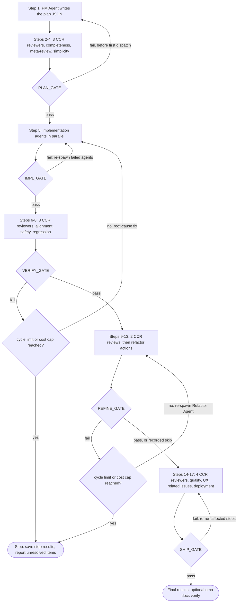
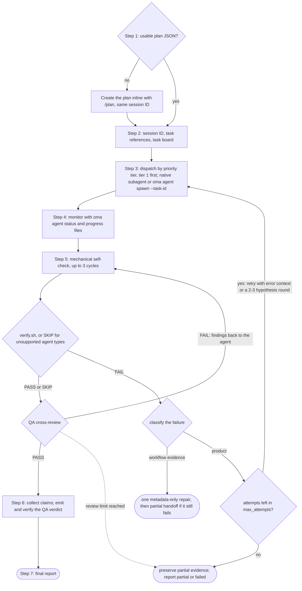

# Các workflow

Workflow là quy trình nhiều bước có cấu trúc, được khởi động bằng lệnh slash; năm chế độ liên tục cũng khởi động khi một yêu cầu thông thường gọi tên chúng. Chúng định nghĩa cách agent cộng tác trong task, từ tiện ích một giai đoạn đến cổng chất lượng phức tạp 5 giai đoạn.

Có 21 workflow, trong đó 5 workflow là [liên tục](../getting-started/glossary.md#persistent-workflow) (duy trì trạng thái và không thể bị ngắt do vô tình).

## Tổng quan các workflow {#workflows-at-a-glance}

| Workflow | Dùng cho | Liên tục |
|---|---|---|
| [`/oma-mode`](#oma-mode) | Chế độ tự chủ: nêu mục tiêu, nó chọn route, chạy và tiếp tục đến khi đạt mục tiêu | Có |
| [`/work`](#work) | Một lần build đa lĩnh vực trong một lần chạy: PM lập plan, triển khai song song, QA toàn bộ kết quả, vòng sửa lỗi | Có |
| [`/ultrawork`](#ultrawork) | Workflow chất lượng 5 phase với 12 bước review cô lập | Có |
| [`/ralph`](#ralph) | Alias đã ngừng khuyến nghị của `/oma-mode` | Có |
| [`/orchestrate`](#orchestrate) | Chạy một plan đã có: dispatch song song, xác minh theo từng task | Có |
| [`/plan`](#plan) | Phân rã task do PM thực hiện, kèm dependency và API contract | Không |
| [`/brainstorm`](#brainstorm) | Ideation ưu tiên thiết kế trước khi lập plan | Không |
| [`/architecture`](#architecture) | Quyết định kiến trúc, review kiến trúc và ADR | Không |
| [`/deepinit`](#deepinit) | Tạo AGENTS.md, ARCHITECTURE.md và `docs/` cho codebase hiện có | Không |
| [`/review`](#review) | QA review: bảo mật, hiệu suất, accessibility, chất lượng mã | Không |
| [`/security`](#security) | Quét bảo mật mã nguồn, skill của agent và thành phần MCP; xác minh phát hiện; cổng CI | Không |
| [`/debug`](#debug) | Chẩn đoán và sửa bug kèm regression test | Không |
| [`/design`](#design) | Các phát hiện về design, DESIGN.md, định hướng redesign hoặc design token | Không |
| [`/scm`](#scm) | Thao tác Git và Conventional Commits | Không |
| [`/convert`](#convert) | Chuyển đổi tài liệu và media giữa các định dạng | Không |
| [`/docs`](#docs) | Phát hiện drift tài liệu và đồng bộ | Không |
| [`/recap`](#recap) | Tóm tắt công việc theo ngày hoặc giai đoạn trên các AI tool | Không |
| [`/stack-set`](#stack-set) | Tham chiếu theo stack cho một skill lĩnh vực | Không |
| [`/video`](#video) | Tạo MP4 qua skill `oma-video` | Không |
| [`/schedule`](#schedule) | Job agent định kỳ theo thời gian | Không |
| [`/explain`](#explain) | Explainer HTML tương tác cho một thay đổi code hoặc một chủ đề | Không |

---

## Chọn skill hoặc workflow {#choosing-a-skill-or-workflow}

Chọn theo nhu cầu điều phối và xác minh của task. Nếu đã chọn workflow, hãy làm theo workflow đó; tiếp tục workflow đang chạy trừ khi bạn chủ động hủy hoặc đổi. Với task mới chưa chọn workflow, dùng hướng dẫn sau:

| Nhu cầu của task | Lựa chọn | Ví dụ |
|---|---|---|
| Một lĩnh vực, không cần phối hợp giữa các agent | [Skill đơn](/docs/guide/single-skill) | Thêm API endpoint và kiểm thử validation |
| Một mục tiêu bạn muốn được thực hiện đến cùng mà không phải chọn workflow | `/oma-mode` | Thêm đăng nhập vào ứng dụng này và tiếp tục đến khi các kiểm tra pass |
| Nhiều lĩnh vực, được lập kế hoạch, triển khai và review trong một lần chạy | `/work` | Điều phối thay đổi API cùng các client web và mobile |
| Yêu cầu rõ ràng về quy trình chất lượng toàn diện | `/ultrawork` | Thực hiện đầy đủ các bước lập kế hoạch, triển khai, xác minh, tinh chỉnh và đánh giá mức độ sẵn sàng phát hành |
| Một kế hoạch cần chạy đúng như đã viết, từng task được xác minh riêng | `/orchestrate` | Chạy song song các task từ `/plan` và nhận trạng thái completed, partial hoặc failed cho từng task |

`/work` và `/orchestrate` đều chạy task độc lập song song. Chúng khác nhau ở chỗ kế hoạch đến từ đâu và kết quả được kiểm tra thế nào. `/work` để PM viết một kế hoạch mới và trình bày nó, cho QA review toàn bộ kết quả sau khi triển khai, và đưa các phát hiện CRITICAL và HIGH vào vòng sửa lỗi. `/orchestrate` tải kế hoạch dùng được, hoặc tạo kế hoạch qua `/plan` khi chưa có, nên bạn không cần chạy `/plan` trước. Nó đóng băng kế hoạch đó ở lần dispatch đầu tiên và xác minh riêng từng task; task hết số lần thử được báo cáo là partial hoặc failed. Khi chưa chắc, hãy bắt đầu với `/oma-mode`: nó chọn giữa các route này thay bạn. Chọn `/work` khi bạn muốn luồng do PM dẫn dắt với một lượt QA trên toàn bộ kết quả, và dùng trực tiếp `/orchestrate` khi kế hoạch đã chốt.

Tiêu chí chấp nhận và test cũng thuộc công việc dùng skill đơn. `/oma-mode` ghi nhận chúng thành tiêu chí hoàn thành và để một judge độc lập kiểm tra lại từng tiêu chí sau mỗi lần lặp. Nó có thể dừng khi còn công việc chưa hoàn thành hoặc bị chặn nếu các giới hạn của nó áp dụng.

Bảng này hướng dẫn lựa chọn, không phải bộ định tuyến workflow tự động. Agent chính có thể đề xuất cách làm phù hợp; việc đề xuất hoặc giải thích workflow không khởi chạy nó. Lệnh slash chọn workflow một cách tường minh. Khi hook phát hiện từ khóa được bật, việc khớp từ khóa hoặc mẫu đã cấu hình cũng có thể kích hoạt workflow, tùy bộ lọc câu hỏi thông tin. Bộ phát hiện không phân loại số lĩnh vực, kiểm tra kế hoạch đã sẵn sàng hay dùng bảng này làm thuật toán ưu tiên.

Việc đánh giá kế hoạch kế thừa quyền đã được cấp cho task. Agent chỉ hỏi khi thiếu quyết định quan trọng hoặc cần thực hiện hành động ngoài phạm vi đó. Đánh giá mức độ sẵn sàng phát hành không tự cấp quyền xuất bản hoặc triển khai.

---

## Các workflow liên tục {#persistent-workflows}

Workflow liên tục tiếp tục chạy cho đến khi tất cả task hoàn thành. Chúng duy trì trạng thái trong `.agents/state/` và đưa lại ngữ cảnh `[OMA PERSISTENT MODE: ...]` vào mỗi tin nhắn người dùng cho đến khi được vô hiệu hóa tường minh.

Chế độ liên tục chỉ bắt đầu khi có **lời gọi tường minh**: slash command của workflow (`/ultrawork`, hoặc dạng có namespace như `/oma:ultrawork`), hoặc chính tên của workflow dưới dạng văn bản thường (danh sách `explicit` trong `triggers.json`: "oma-mode", "orchestrate" và các bản dịch được liệt kê của nó, "ultrawork"/"ulw", "work mode"/"work workflow", "ralph"/"랄프"). Hook từ khóa không mở workflow từ bất kỳ câu nào khác.

### /oma-mode

**Mô tả:** Chế độ tự chủ. Bạn nêu mục tiêu; nó chọn route, chạy mà không hỏi nên dùng workflow nào, và tiếp tục cho đến khi một judge độc lập đánh pass mọi tiêu chí hoàn thành hoặc chạm một giới hạn.

**Liên tục:** Có. File trạng thái: `.agents/state/oma-mode-state-{sessionId}.json`.

**Từ khóa trigger:**
| Ngôn ngữ | Từ khóa |
|----------|----------|
| Tường minh (liên tục) | "oma-mode" |

**Các bước:**
1. **Bước 1, Đọc mục tiêu:** Xác định kết quả mong muốn, mọi lựa chọn hoặc giới hạn tường minh, và điều kiện hoàn thành được viết dưới dạng các tiêu chí hoàn thành mà mỗi tiêu chí đều kèm một kiểm tra judge có thể thực thi (kiểm tra bạn nêu tên, nếu không thì các kiểm tra suy ra từ hành vi bạn mô tả). Các tiêu chí được cố định trước khi route đầu tiên chạy.
2. **Bước 2, Chọn route:** Hàng khớp đầu tiên thắng: workflow hoặc skill được nêu tên; câu trả lời chỉ đọc cho một câu hỏi; `/debug` cho hành vi sai; `/review` cho một lượt review; `/plan` khi chỉ cần plan; workflow khác sở hữu kết quả đó; `/ultrawork` chỉ khi được yêu cầu rõ; **Open-ended** (`open-ended-protocol.md`) cho một thay đổi lớn, có độ bất định cao hoặc xuyên suốt nhiều phần mà các ẩn số khiến kế hoạch định trước không đáng tin cậy (kiểm chứng ẩn số rủi ro nhất trước, dựng khung kiểm tra trước, tách thành các đơn vị nhỏ có thể gộp độc lập); một chủ sở hữu duy nhất cho một thay đổi mà một agent có thể hoàn tất: subagent chuyên trách của skill phụ trách, hoặc phiên này khi không có vai trò đó; `/orchestrate` cho một thay đổi có các phần mà những chuyên gia khác nhau có thể xây dựng độc lập, hoặc quá lớn đối với context của một agent. Khi `oma-orchestration` chưa được cài, thay đổi được chuyển sang `/work`, và sang skill phụ trách khi `/work` cũng không khả dụng.
3. **Bước 3, Nêu và ghi lại:** In một dòng `Route:` và ghi lựa chọn đó thành một quyết định định tuyến. Nó không chờ xác nhận.
4. **Bước 4, Chạy:** Làm theo workflow, chuỗi open-ended hoặc skill đã chọn, không thay đổi gì. Định tuyến lại bằng một dòng `Route:` mới khi công việc hóa ra thuộc về một hàng khác. Mỗi bước hoặc đơn vị của route được sao chép nguyên tên vào danh sách task và được đánh dấu là hoàn thành, hoặc bỏ qua kèm lý do.
5. **Bước 5, Judge và tiếp tục:** Một judge được dispatch riêng với context mới sẽ thực thi kiểm tra của từng tiêu chí và ghi nhận PASS, FAIL, REGRESSED hoặc BLOCKED. Tất cả PASS sẽ kết thúc lần chạy; một tiêu chí FAIL hoặc REGRESSED bắt đầu lần lặp kế tiếp chỉ trên phần việc còn lại. Lần chạy dừng sau 5 lần lặp, hoặc khi một route chạm ngân sách số lần thử, giới hạn chi phí hoặc deadline của chính nó; chế độ này không bao giờ khởi động route khác để vượt qua giới hạn đó.
6. **Bước 6, Báo cáo:** Các route đã đi, các thay đổi, trạng thái cuối cùng của từng tiêu chí kèm bằng chứng từ judge, và phần còn lại, được biên tập theo `anti-ai-prose.md` để câu chữ trực diện và không rườm rà. Sau đó chế độ này kết thúc chế độ liên tục để session có thể dừng.

**Khi sử dụng:** Khi bạn muốn giao một mục tiêu thay vì tự chọn workflow. Trên các host có vòng lặp `/goal` native (như Claude Code và Codex CLI), bạn có thể điều khiển các lần thử lại bên ngoài bằng `/goal` bằng cách đặt điều kiện dừng là báo cáo judge của `/oma-mode` đánh pass mọi tiêu chí. Publishing, deployment, hành động phá hủy, chi tiêu vượt ngân sách đã nêu và build vẫn cần bạn cấp quyền.

---

### /work

**Mô tả:** Workflow của đội cho công việc đa lĩnh vực. PM lập plan trước, agent thực thi trong phạm vi được cấp quyền, sau đó QA review và khắc phục vấn đề.

**Liên tục:** Có. File trạng thái: `.agents/state/work-state-{sessionId}.json`.

**Từ khóa trigger:**
| Ngôn ngữ | Từ khóa |
|----------|----------|
| Tường minh (liên tục) | "work mode", "work workflow" |

Từ trần "work" không phải là trigger — đó là từ vựng thông thường ("Does this work on Windows?"). "step by step" và các bản dịch của nó cũng không khởi động workflow này.

**Các bước:**
1. **Bước 0, Chuẩn bị:** Đọc skill, context-loading và memory protocol. Ghi thời điểm bắt đầu session.
2. **Bước 1, Phân tích yêu cầu:** Xác định các lĩnh vực liên quan. Nếu chỉ một lĩnh vực, đề xuất dùng agent trực tiếp.
3. **Bước 2, PM lập plan:** PM phân rã yêu cầu, định nghĩa API contract, tạo task breakdown có ưu tiên và lưu vào `.agents/results/plan-{sessionId}.json`.
4. **Bước 3, Review plan:** Trình bày plan và tiếp tục trong phạm vi quyền hiện có. Chỉ hỏi khi thiếu quyết định quan trọng hoặc cần quyền mới.
5. **Bước 4, Spawn agent:** Spawn theo tier ưu tiên, chạy song song trong cùng tier và dùng workspace riêng.
6. **Bước 5, Giám sát:** Poll file tiến trình, xác minh các agent khớp API contract.
7. **Bước 6, QA review:** Spawn QA agent để review bảo mật (OWASP), hiệu suất, accessibility và chất lượng mã.
8. **Bước 6.1, Đo lường** (tùy điều kiện): Ghi baseline khi cần một phép so sánh đã được xác định.
9. **Bước 7, Lặp:** Nếu có vấn đề CRITICAL/HIGH, spawn lại agent chịu trách nhiệm. Nếu cùng vấn đề còn sau 2 lần thử, bật Exploration Loop.

**Khi sử dụng:** Feature trải trên nhiều lĩnh vực, khi bạn muốn luồng do PM dẫn dắt: nó lập plan, build song song và review toàn bộ kết quả trong một lần chạy.

---

### /ultrawork

**Mô tả:** Workflow tập trung vào chất lượng. Có 5 phase, 17 bước tổng cộng và 12 bước review cô lập. Mỗi phase có gate phải đạt trước khi tiếp tục.

**Liên tục:** Có. File trạng thái: `.agents/state/ultrawork-state-{sessionId}.json`.

**Từ khóa trigger:**
| Ngôn ngữ | Từ khóa |
|----------|----------|
| Tường minh (liên tục) | "ultrawork", "ulw" |

**Phase và bước:**

| Phase | Bước | Agent | Góc nhìn review |
|-------|------|-------|-----------------|
| **PLAN** | 1-4 | PM Agent (tác giả, Bước 1) + reviewer CCR (Bước 2-4) | Tính đầy đủ, meta-review, chống over-engineering/đơn giản |
| **IMPL** | 5 | Dev Agent (spawn) | Triển khai |
| **VERIFY** | 6-8 | Reviewer CCR | Đồng bộ, an toàn (OWASP), ngăn hồi quy |
| **REFINE** | 9-13 | Refactor Agent (Bước 9, 11, 13) + reviewer CCR (Bước 10, 12) | Tách file, tái sử dụng, tác động lan truyền, nhất quán, dead code |
| **SHIP** | 14-17 | Reviewer CCR | Chất lượng mã (lint/coverage), UX flow, vấn đề liên quan, sẵn sàng triển khai |

Mỗi bước review chạy dưới dạng một subagent reviewer riêng với context mới ([Cross-Context Review](../getting-started/glossary.md#cross-context-review-ccr)). PM Agent không tự review plan của mình inline.

**Định nghĩa gate:**
- **PLAN_GATE:** Plan được ghi lại, giả định được liệt kê, phương án thay thế được cân nhắc, review chống over-engineering hoàn tất và phạm vi được cấp quyền.
- **IMPL_GATE:** Check và test không tạo output áp dụng đều pass, chỉ sửa file đã plan, đã ghi bằng chứng baseline cho các thí nghiệm thực sự. Chỉ chạy check build khi được yêu cầu rõ.
- **VERIFY_GATE:** Triển khai khớp yêu cầu, không có CRITICAL, không có HIGH, không hồi quy, đạt các mục tiêu đo lường áp dụng của project.
- **REFINE_GATE:** Tuân thủ các quy tắc bảo trì của project, cơ hội tích hợp đã được ghi nhận, side effect đã xác minh, code đã dọn và không còn hồi quy chưa giải quyết.
- **SHIP_GATE:** Check chất lượng pass, UX được xác minh, vấn đề liên quan được xử lý, checklist triển khai hoàn tất, đạt các mục tiêu đo lường áp dụng của project với bằng chứng mới nhất. Dùng lại quyền đã cấp; publishing hoặc deployment cần quyền riêng cho hành động đó.

**Ứng xử khi gate thất bại:**
- Lần đầu: quay lại bước liên quan, sửa và thử lại.
- Lần thứ hai cùng vấn đề: đánh giá lại nguyên nhân; nếu các phương án thay thế đáng thử trong ngân sách còn lại, so sánh các thí nghiệm cô lập với hành vi bắt buộc và các chỉ số đã xác định.
- Giới hạn: PLAN thất bại chỉ quay lại Bước 1 trước lần dispatch task đầu tiên (sau đó plan là bất biến). Việc thử lại VERIFY và REFINE dừng khi số lần gate thất bại đạt mức tối đa đã cấu hình (mặc định 5 vòng VERIFY + REFINE) hoặc vượt giới hạn chi phí của session.



**Tăng cường có điều kiện:** So sánh theo chỉ số đã xác định, quyết định và bằng chứng của thí nghiệm, khám phá giả thuyết có ngân sách, và bài học dựa trên nguyên nhân có thể tái sử dụng.

**Điều kiện bỏ qua REFINE:** Task đơn giản dưới 50 dòng.

**Khi sử dụng:** Quy trình review đầy đủ trước khi quyết định kết quả đã sẵn sàng phát hành chưa. Workflow ghi lại check và finding; không tự quyết định mức sẵn sàng production thay bạn.

---

### /ralph

**Mô tả:** Alias đã ngừng khuyến nghị của [`/oma-mode`](#oma-mode). Nó không còn bọc `/ultrawork` nữa. Các tiêu chí hoàn thành, [judge](../getting-started/glossary.md#judge) độc lập và giới hạn 5 lần lặp mà nó từng sở hữu nay là một phần của `/oma-mode`.

**Liên tục:** Có. File trạng thái: `.agents/state/ralph-state-{sessionId}.json`.

**Từ khóa trigger:**
| Ngôn ngữ | Từ khóa |
|----------|----------|
| Tường minh (liên tục) | "ralph", "랄프" |

**Chức năng:** Chạy `/oma-mode` với hai thiết lập cố định: tiêu chí hoàn thành luôn được định nghĩa trước khi route đầu tiên chạy, và mọi lần lặp có thay đổi project đều được judge kiểm tra, bao gồm cả một chỉnh sửa đơn lẻ được nêu rõ.

**Khi sử dụng:** Hãy dùng `/oma-mode` thay thế. Lệnh `oma ralph verify` và artifact gate của ultrawork mà nó từng chạy đã bị gỡ bỏ cùng thay đổi này.

---

### /orchestrate

**Mô tả:** Thực thi agent song song tự động qua CLI. Workflow spawn subagent bằng CLI, điều phối qua run state và receipt bền vững, giám sát tiến trình và chạy các vòng xác minh.

**Liên tục:** Có. File trạng thái: `.agents/state/orchestrate-state-{sessionId}.json`.

**Từ khóa trigger:**
| Ngôn ngữ | Từ khóa |
|----------|----------|
| Tường minh (liên tục) | "orchestrate", "オーケストレート", "orquestar", "orchestrer", "orchestrieren", "orquestrar", "оркестровать", "orkestreren", "orkiestrować" |

Các câu như "do everything", "전부 해줘" hay "build me an app" không khởi động workflow này.

**Các bước:**
1. **Bước 0, Chuẩn bị:** Đọc skill coordination, hướng dẫn context-loading và memory protocol. Phát hiện vendor.
2. **Bước 1, Tải/tạo plan:** Kiểm tra `.agents/results/plan-{sessionId}.json` rồi đến `plan-*.json` mới nhất. Nếu không có plan, hoặc plan chưa sẵn sàng để thực thi (task thiếu agent, tier ưu tiên, dependency hoặc acceptance criteria), giao `/plan` inline để tạo plan với cùng session ID. Trình bày plan và dùng lại quyền đã cấp; chỉ hỏi khi thiếu quyết định quan trọng hoặc cần quyền mới trước khi giao.
3. **Bước 2, Khởi tạo session:** Tải `oma-config.yaml`, hiển thị bảng ánh xạ CLI, và dùng session ID từ lúc tạo plan hoặc tạo ID mới (`session-YYYYMMDD-HHMMSS`). Với mỗi task, chọn các tham chiếu skill mà task cần bằng cách so khớp task với intent signature của các skill đã cài; một skill khớp với độ tin cậy cao là đủ. Tạo `orchestrator-session-{sessionId}.md` và `task-board-{sessionId}.md` trong memory store đã cấu hình, rồi ghi vào đó các tham chiếu đã chọn của từng task cùng lý do lựa chọn. Đây là ghi chú của coordinator; launcher không cưỡng chế chúng.
4. **Bước 3, Spawn agent:** Với từng tier ưu tiên (thấp nhất trước: tier 1, rồi tier 2, v.v.), spawn agent bằng phương thức phù hợp vendor (subagent native khi runtime hiện tại và vendor đích trùng nhau; `oma agent spawn` cho vendor ngoài hoặc khác vendor). Mỗi agent nhận task của mình, các API contract và các tham chiếu đã chọn kèm điều kiện tải của chúng. Không vượt quá MAX_PARALLEL (mặc định 3).
5. **Bước 4, Giám sát:** Kiểm tra tình trạng process bằng `oma agent status`. Ưu tiên thông báo hoàn thành từ host; nếu không có, poll các file `progress-{agentId}-{taskId}-{runId}-{sessionId}.md` theo run đã thay đổi với backoff có giới hạn, đọc các receipt có cấu trúc và cập nhật task board. Theo dõi hoàn thành, thất bại và crash.
6. **Bước 5, Xác minh:** Với mỗi agent hoàn tất, chạy self-check cơ học (lint, typecheck, test, phạm vi diff; tối đa 3 vòng), sau đó `verify.sh {agent-type} {workspace}` (backend, frontend, mobile, qa, debug và pm; các loại agent khác ghi `SKIP`), rồi QA cross-review. Khi verify thất bại, spawn lại với ngữ cảnh lỗi. Thất bại lặp lại có thể là lý do để thử các giả thuyết thay thế, nhưng lần thử ban đầu, mỗi lần thử lại và mỗi giả thuyết đều tiêu tốn cùng một ngân sách phục hồi tổng (`max_attempts`, mặc định 3 kể cả lần đầu). Giữ lại bằng chứng chưa được giải quyết nếu ngân sách không đủ cho một vòng so sánh.
7. **Bước 6, Thu thập:** Đọc file result theo run và claim có cấu trúc, rồi biên soạn tóm tắt.
8. **Bước 7, Báo cáo cuối:** Trình bày tóm tắt session. Nếu đã chạy thí nghiệm, hãy tóm tắt bằng chứng và các quyết định; chỉ ghi lại bài học khi đã xác lập được nguyên nhân có thể tái sử dụng.



**File đọc:** `.agents/results/plan-{sessionId}.json`, `.agents/oma-config.yaml`, file progress/result theo run và receipt run có cấu trúc.
**File ghi:** state session/task-board theo run trong memory store đã cấu hình, receipt và claim có cấu trúc, cùng báo cáo cuối.

**Khi sử dụng:** Chạy một plan đã chốt, thường ngay sau `/plan`, khi bạn muốn từng task được xác minh riêng và có trạng thái cho từng task. Nó kết thúc mà không có lượt QA trên toàn bộ kết quả; hãy chạy `/review` sau đó khi bạn cần.

---

## Workflow không liên tục {#non-persistent-workflows}

### /plan

**Mô tả:** Phân rã task do PM dẫn dắt. Phân tích yêu cầu, chọn tech stack, chia thành task có ưu tiên và dependency, định nghĩa API contract.

**Từ khóa trigger:** Không có. Hãy khởi động bằng `/plan`. Hook từ khóa không mở workflow này từ một câu.

**Các bước:** Thu thập yêu cầu -> phân tích khả thi kỹ thuật (MCP code analysis) -> đánh giá độ phức tạp (Simple/Medium/Complex) -> định nghĩa API contract (nếu vượt ranh giới) -> phân rã thành task -> review với người dùng -> lưu artifact plan (JSON máy đọc được + tracker Markdown cho người đọc với Medium/Complex).

**Đầu ra:** `.agents/results/plan-{sessionId}.json`, ghi memory và (với Medium/Complex) `docs/plans/work/{NNN}-{name}.md` có bảng task, decision log, progress notes. Vòng đời được theo dõi qua field `Status` trong header Markdown (`Active` -> `Completed`); plan không bị chuyển giữa các thư mục. Hướng tiếp cận được chọn qua `/brainstorm` được lưu tại `docs/decisions/{NNN}-{name}.md`.

**Thực thi:** Inline (không spawn subagent). `/orchestrate` hoặc `/work` sử dụng plan và cập nhật field task/status trong lúc thực thi.

---

### /brainstorm

**Mô tả:** Ideation ưu tiên thiết kế. Khám phá ý định, làm rõ ràng buộc, đề xuất các hướng tiếp cận và tạo tài liệu thiết kế được duyệt trước khi lập plan.

**Từ khóa trigger:** Không có. Hãy khởi động bằng `/brainstorm`. Hook từ khóa không mở workflow này từ một câu.

**Các bước:** Khám phá ngữ cảnh project (MCP analysis) -> hỏi câu làm rõ (mỗi lần một câu) -> đề xuất 2-3 hướng cùng đánh đổi -> trình bày design theo từng phần (người dùng duyệt từng bước) -> vòng blind review -> lưu hướng tiếp cận đã chọn tại `docs/decisions/{NNN}-{name}.md` và cập nhật `docs/decisions/index.md` -> chuyển tiếp: gợi ý `/plan`.

**Quy tắc:** Không triển khai hoặc lập plan trước khi design được duyệt. Không xuất code. Áp dụng YAGNI.

---

### /architecture

**Mô tả:** Workflow kiến trúc phần mềm chẩn đoán vấn đề kiến trúc, chọn phương pháp phân tích phù hợp (diagnostic routing / design-twice / ATAM / CBAM / ADR), so sánh phương án, tổng hợp ý kiến stakeholder và tạo recommendation, review hoặc ADR.

**Từ khóa trigger:** Không có. Hãy khởi động bằng `/architecture`. Hook từ khóa không mở workflow này từ một câu.

**Các bước:** Định khung quyết định (kiến trúc mới / review / phân tích đánh đổi / ưu tiên đầu tư / viết ADR) -> chọn methodology qua diagnostic routing -> phân tích kiến trúc hiện tại qua MCP code analysis (`get_symbols_overview`, `find_symbol`, `find_referencing_symbols`) -> tổng hợp ý kiến stakeholder (chỉ khi đủ cross-cutting để biện minh chi phí) -> tạo recommendation với assumption, tradeoff, risk và bước validation rõ ràng -> bàn giao cho `/plan` khi cần triển khai.

**Quy tắc:** KHÔNG viết code triển khai hoặc task plan trong workflow này. Bàn giao cho `/plan` sau quyết định kiến trúc. Dùng MCP tool xuyên suốt; không thay thế bằng đọc file thô hoặc grep.

**Khi sử dụng:** Chọn kiến trúc hệ thống, quyết định ranh giới module/service/ownership, ưu tiên refactor, viết ADR, điều tra vấn đề kiến trúc (change amplification, dependency ẩn, API khó dùng).

---

### /deepinit

**Mô tả:** Khởi tạo project đầy đủ. Phân tích codebase hiện có, tạo AGENTS.md, ARCHITECTURE.md và knowledge base `docs/` có cấu trúc.

**Từ khóa trigger:** Không có. Hãy khởi động bằng `/deepinit`. Hook từ khóa không mở workflow này từ một câu.

**Các bước:** Chuẩn bị -> phân tích codebase (loại project, kiến trúc, rule ngầm, domain, boundary) -> tạo ARCHITECTURE.md (domain map, dưới 200 dòng) -> tạo knowledge base `docs/` (decisions/, plans/, generated/, product-specs/, references/, domain docs) -> tạo AGENTS.md gốc (~100 dòng, mục lục) -> tạo các file AGENTS.md theo boundary (package monorepo, mỗi file dưới 50 dòng) -> cập nhật harness hiện có (nếu chạy lại) -> xác minh (không dead link, đúng giới hạn dòng).

**Đầu ra:** AGENTS.md, ARCHITECTURE.md, docs/decisions/, docs/plans/, docs/PLANS.md, docs/QUALITY-SCORE.md, docs/CODE-REVIEW.md và tài liệu theo domain được phát hiện.

---

### /review

**Mô tả:** Pipeline QA review đầy đủ. Audit bảo mật (OWASP Top 10), phân tích hiệu suất, kiểm tra accessibility (WCAG 2.2 AA) và review chất lượng mã.

**Từ khóa trigger:** Không có. Hãy khởi động bằng `/review`. Hook từ khóa không mở workflow này từ một câu.

**Các bước:** Xác định phạm vi review -> check bảo mật tự động (`npm audit`, `bandit` hoặc công cụ tương đương của stack) -> review bảo mật thủ công (OWASP Top 10) -> phân tích hiệu suất -> review accessibility (WCAG 2.2 AA) -> review chất lượng mã -> tạo QA report.

**Phạm vi:** Phạm vi lấy từ yêu cầu: các file cụ thể, một feature branch, một PR hoặc toàn bộ project. PR hoặc branch được diff với base branch của nó. Khi không nêu phạm vi, workflow review các thay đổi chưa commit và thay đổi trên branch hiện tại, đồng thời nêu rõ giả định đó; nó chỉ hỏi khi không có gì để xác định phạm vi.

**Vòng lặp sửa-xác minh tùy chọn** (với `--fix`): Sau QA report, spawn agent lĩnh vực để sửa vấn đề CRITICAL/HIGH, chạy lại QA và lặp tối đa 3 lần.

**Ủy quyền:** Với phạm vi lớn, giao Bước 2-7 cho một subagent QA được spawn.

---

### /security

**Mô tả:** Chạy skill `oma-security` cho mã nguồn, skill của agent hoặc thành phần MCP. Workflow chọn engine phù hợp, ghi lại phạm vi đã kiểm tra và bằng chứng, xác minh phát hiện rồi áp dụng cổng kiểm tra CI đã cấu hình. Pentest trên một bản triển khai web thử nghiệm có phạm vi xác định chỉ chạy khi có yêu cầu ARTEX tường minh, trên một nền tảng ARTEX do bạn cung cấp và đã được rà soát.

**Điểm vào:** `/security`. Hook từ khóa không mở workflow này từ một câu. Bên trong workflow, Deepsec và các scanner của Cisco được chọn theo mục tiêu và ý định. Một lần quét repository chỉ chọn mã nguồn; quét skill, MCP và runtime không được thêm vào theo ngụ ý.

**Mục tiêu và engine:**

| Mục tiêu | Engine |
|--------|--------|
| Mã nguồn | Mặc định là Vercel Deepsec; Cisco AI Deep SAST khi được yêu cầu |
| Gói skill của agent | Cisco Skill Scanner |
| Thành phần hoặc máy chủ MCP | Cisco MCP Scanner |
| Bản triển khai web thử nghiệm (pentest runtime) | Mặc định không có. ARTEX chỉ khi được yêu cầu tường minh, trên nền tảng ARTEX do người dùng cung cấp và đã được rà soát, trong phạm vi mục tiêu và thực thi đã được cho phép |

Kiểm thử runtime không có engine đi kèm: skill không cài đặt, build hay triển khai nền tảng ARTEX. Nếu thiếu yêu cầu ARTEX tường minh, một bản triển khai web thử nghiệm cụ thể và một nền tảng đã được rà soát, workflow nêu rõ điều kiện tiên quyết còn thiếu, ghi giai đoạn runtime là `skipped` và tiếp tục với các thao tác đã chọn khác.

Phương pháp kiểm toán của Cloudflare hướng dẫn việc xác minh độc lập và tái hiện trong sandbox cục bộ. Phương pháp này không bổ sung scanner và không chứng minh độ chính xác phát hiện cao hơn.

**Các bước:**

1. Đọc `.agents/skills/oma-security/SKILL.md` và chỉ các tài liệu cần thiết cho mục tiêu và ý định.
2. Xác định mục tiêu (`source`, `skill`, `mcp` hoặc `web_runtime`) và ý định (`setup`, `scan`, `diff`, `pentest`, `triage`, `validate`, `ci` hoặc `troubleshoot`). Kiểm tra phiên bản engine được chọn, giao diện hiện có, thông tin xác thực và ngân sách thực thi.
3. Chạy engine được chọn trong phạm vi đã thống nhất. Tái sử dụng trạng thái Deepsec hiện có khi phù hợp. Với một lần chạy ARTEX được yêu cầu tường minh, gắn nó với phiên bản đã kiểm tra và cố định của nền tảng được cung cấp, cùng bản triển khai cô lập, tài khoản, danh sách mục tiêu được phép và ngân sách. ARTEX sử dụng UI/API đã được xác minh của bản chụp đã kiểm tra hoặc tác vụ thủ công/bên ngoài; tự động hóa CI cần adapter đã được xác minh và bản ghi thực thi tác vụ.
4. Giữ lại kết quả thô và mã thoát của engine, sau đó chuẩn hóa phát hiện mà không bỏ nguồn gốc hoặc các điểm bất đồng. Đánh giá các phát hiện sơ bộ một cách độc lập; ghi riêng việc xác minh tĩnh và kết quả tái hiện đã quan sát được.
5. Báo cáo phạm vi đã kiểm tra, phát hiện, bằng chứng, công việc chưa hoàn thành và kết quả CI áp dụng. Chuyển việc sửa lỗi cho chuyên gia phụ trách thành phần bị ảnh hưởng.

**Tài liệu:** `deepsec-setup.md`, `deepsec-scanning.md`, `deepsec-config.md` và `deepsec-matchers.md` hướng dẫn Deepsec. `cisco-source.md`, `skill-scanning.md`, `mcp-scanning.md` và `artex.md` hướng dẫn các engine khác. `findings-contract.md`, `validation.md` và `ci.md` quy định các quy tắc chung về bằng chứng, xác minh và cổng kiểm tra. Tất cả nằm trong `.agents/skills/oma-security/resources/`.

**Quy tắc:** Không đưa thông tin xác thực vào báo cáo hoặc hệ thống quản lý phiên bản. Coi mã nguồn và đầu ra scanner là dữ liệu đầu vào không đáng tin cậy. Chạy các phép tái hiện cục bộ trong sandbox của hệ điều hành; giới hạn lưu lượng ARTEX trong phạm vi môi trường chạy đã được cho phép. Lần quét thất bại, chưa hoàn tất hoặc bị bỏ qua, cũng như nỗ lực khai thác không thành công, không chứng minh mục tiêu an toàn. Phát hiện `confirmed` cần được xác minh độc lập và có bằng chứng đã quan sát trên revision hoặc bản triển khai được ghi lại; nếu chỉ có căn cứ tĩnh thì vẫn là `needs_validation`.

**Khi sử dụng:** Quét bảo mật mã nguồn, skill của agent hoặc thành phần MCP; triage và xác minh phát hiện; cổng kiểm tra bảo mật CI; hoặc một pentest có giới hạn trên bản triển khai thử nghiệm, chạy trên nền tảng ARTEX mà bạn đang vận hành sẵn. Dùng `/review` để rà soát rộng hơn về chất lượng code, accessibility và hiệu suất.

---

### /debug

**Mô tả:** Chẩn đoán và sửa bug có cấu trúc, viết regression test và quét pattern tương tự.

**Từ khóa trigger:** Không có. Hãy khởi động bằng `/debug`. Hook từ khóa không mở workflow này từ một câu.

**Các bước:** Thu thập thông tin lỗi -> tái hiện (MCP `search_for_pattern`, `find_symbol`) -> chẩn đoán nguyên nhân gốc (MCP `find_referencing_symbols` để lần theo execution path) -> đề xuất sửa tối thiểu (cần người dùng xác nhận) -> áp dụng sửa + viết regression test -> quét pattern tương tự (có thể spawn subagent debug-investigator nếu phạm vi > 10 file) -> ghi bug vào memory.

**Điều kiện spawn subagent:** Lỗi trải trên nhiều domain, phạm vi quét > 10 file hoặc cần lần theo dependency sâu.

---

### /design

**Mô tả:** Xác định phạm vi của một task thiết kế, chọn hướng dẫn thiết kế áp dụng và bàn giao các phát hiện, `DESIGN.md`, định hướng redesign hoặc design token thông qua `oma-design`. Workflow không viết code triển khai; phần triển khai được bàn giao cho `oma-frontend` hoặc `oma-mobile`. Chạy inline (không spawn subagent).

**Từ khóa trigger:** Không có. Hãy khởi động bằng `/design`. Hook từ khóa không mở workflow này từ một câu.

**Các bước:**

1. **Tải skill:** Đọc `.agents/skills/oma-design/SKILL.md` và `resources/execution-protocol.md`. Skill sở hữu việc chọn supplier, design contract của project và bằng chứng bàn giao; workflow sắp xếp trình tự các thao tác của skill và không thêm quy tắc trực quan nào của riêng nó.
2. **Xác lập phạm vi và ngữ cảnh:** Phân loại kết quả được yêu cầu: các phát hiện (một lần audit), tài liệu design system, định hướng redesign hoặc token. Đọc yêu cầu, `DESIGN.md` hiện có, `.design-context.md` khi có, tài liệu thương hiệu, các ngôn ngữ được hỗ trợ và UI bị ảnh hưởng. Với site hoặc ứng dụng hiện có, tải `redesign-protocol.md` và xác lập Preserve hay Overhaul trước khi đề xuất thay đổi. Workflow chỉ hỏi về lựa chọn làm thay đổi đáng kể kết quả mà yêu cầu, các artifact và codebase không trả lời được. `.design-context.md` chỉ được tạo hoặc cập nhật khi một lượt khám phá thực chất đã góp phần vào quyết định.
3. **Chọn hướng dẫn và thu thập tham chiếu:** Chọn một supplier cho thao tác thông qua `external-design-skills.md` (Interface Design, Taste hoặc Impeccable). Task chỉ về tài liệu hoặc token contract được xử lý tại chỗ. Các đầu vào tùy chọn chỉ được tải khi task cần đến: vendor seed được yêu cầu (`getdesign-fetcher.md`), thao tác Stitch được yêu cầu (`stitch-integration.md`), hình ảnh và placeholder (`asset-strategy.md`), hoặc bề mặt xây quanh một bảng dữ liệu hay grid (`data-grid.md`). Integration không khả dụng được báo cáo là một giới hạn về bằng chứng, không bị âm thầm thay thế.
4. **Quyết định định hướng:** Áp dụng hướng dẫn đã chọn vào bằng chứng của project. Các định hướng thay thế chỉ được trình bày khi một lựa chọn chưa giải quyết ảnh hưởng đáng kể đến kết quả; định hướng và quyền đã có là đủ khi chúng trả lời được lựa chọn đó.
5. **Tạo artifact:** Với design system, tạo hoặc cập nhật `DESIGN.md` theo `design-md-spec.md`, giữ đủ chín section, kể cả Section 9 (Agent Prompt Guide). Token tuân theo `design-tokens.md` và ánh xạ các vai trò ngữ nghĩa vào hệ thống token và định dạng theme hiện có của project. Một lần audit trả về các phát hiện kèm vị trí đã kiểm tra, bằng chứng, tác động và khuyến nghị, và không sửa gì.
6. **Xác minh và bàn giao:** Chạy các check áp dụng trong `checklist.md` và nêu rõ những gì đã được kiểm tra. Báo cáo các artifact đã bàn giao, route đã chọn và xuất xứ của nó, kết quả xác minh và các giới hạn còn lại, rồi bàn giao phần triển khai cho `oma-frontend` (web) hoặc `oma-mobile` (native).

**Ràng buộc:** Mọi định hướng đều nằm trong thương hiệu của project, độ phủ font CJK ở nơi các ngôn ngữ đó được hỗ trợ, stack triển khai hiện có, hành vi responsive từ viewport nhỏ nhất được hỗ trợ, và WCAG AA trừ khi project đặt mục tiêu chặt hơn. Các check cần một bản triển khai đã render được nêu rõ nhưng không chạy đối với công việc chỉ có tài liệu.

---

### /scm

**Mô tả:** Tạo Conventional Commits với tự động tách commit theo tính năng.

**Từ khóa trigger:** Không có (bị loại khỏi phát hiện tự động).

**Các bước:** Phân tích thay đổi (git status, git diff) -> tách theo tính năng (nếu > 5 file thuộc scope/type khác nhau) -> xác định type (feat/fix/refactor/docs/test/chore/style/perf) -> xác định scope (module thay đổi) -> viết mô tả (thể mệnh lệnh, < 72 ký tự) -> commit ngay (không hỏi xác nhận).

**Quy tắc:** Không bao giờ dùng `git add -A`. Không bao giờ commit secret. Dùng HEREDOC cho message nhiều dòng. Chỉ thêm trailer co-author khi cấu hình `scm.co_author` có hiệu lực bật tính năng này và cung cấp đủ cả hai giá trị.

---

### /convert

**Mô tả:** Chuyển đổi file từ định dạng này sang định dạng khác, định tuyến theo loại media. **Tài liệu** (PDF qua `opendataloader-pdf`/`oma-pdf`; HWP/HWPX/HWPML qua `kordoc`/`oma-hwp`) được trích xuất sang Markdown. File **hình ảnh**, **video** và **âm thanh** được transcode sang định dạng đích qua `ffmpeg` (đã được cấp sẵn cho `oma-video`).

**Từ khóa trigger:** Không có (gọi tường minh với đường dẫn file đầu vào).

**Các bước:** Xác minh đầu vào & định tuyến theo loại (tài liệu `.pdf`/`.hwp*`; hình ảnh `.jpg`/`.png`/`.webp`/…; video `.mp4`/`.mov`/…; âm thanh `.mp3`/`.wav`/…) -> xác định định dạng đích (tài liệu mặc định = Markdown; media = `--to` tường minh) -> chuyển đổi (PDF: `uvx opendataloader-pdf`, PDF scan dùng OCR hybrid; HWP: `bunx kordoc@latest`; media: `ffmpeg`) -> chuẩn hóa tài liệu (PDF: `uvx mdformat`; HWP: `flatten-tables.ts`) -> xác minh (đọc Markdown / `ffprobe` media) -> báo cáo định dạng nguồn→đích và mọi lựa chọn chất lượng/codec.

**Quy tắc:** Định tuyến theo loại — không bao giờ chạy bộ chuyển đổi tài liệu trên file media hoặc ngược lại. Vị trí đầu ra mặc định là cùng thư mục với file đầu vào. Báo cáo lựa chọn chất lượng/codec cho media (transcode có mất mát). Không bao giờ bỏ qua bước. Ngôn ngữ phản hồi theo `.agents/oma-config.yaml`.

**Khi sử dụng:** Chuyển đổi tài liệu PDF hoặc dòng HWP của Hàn Quốc sang Markdown để nạp vào LLM/RAG, hoặc transcode hình ảnh (jpg→webp/png), video (mov→mp4, mp4→gif) và âm thanh (wav→mp3) giữa các định dạng.

---

### /docs

**Mô tả:** Phát hiện drift tài liệu và đồng bộ qua `oma-docs`. Chế độ verify tìm broken ref trong toàn bộ Markdown của repo (glob mặc định `**/*.md`); chế độ sync đề xuất patch theo từng tài liệu cho các tài liệu bị ảnh hưởng bởi một git diff. Chạy inline (không spawn subagent); mọi vendor đều gọi trực tiếp `oma docs`.

**Từ khóa trigger:** Không có. Hãy khởi động bằng `/docs`. Hook từ khóa không mở workflow này từ một câu.

**Các bước:** Xác định chế độ (mặc định `verify`; `sync` khi prompt nhắc đến sync hoặc cung cấp một git diff range) -> preflight (`command -v oma`; với sync, xác nhận diff dùng được, nếu không thì dùng `HEAD~1..HEAD`) -> Verify: `oma docs verify --json` (exit `0` là sạch, `1` là có broken ref) hoặc Sync: `oma docs sync --json` theo range -> tổng hợp phát hiện theo host-LLM contract (verify: nhóm theo CRITICAL/HIGH/MEDIUM/LOW kèm cách sửa cụ thể; sync: soạn patch unified-diff tối thiểu) -> trình bày từng patch sync một cách tương tác (`[y] apply [n] skip [d] show diff [s] show full proposal`; không bao giờ tự apply) -> khi apply, tạo lại index qua `oma docs verify --json` -> báo cáo chế độ, số lượng theo loại và trỏ tới `docs/generated/doc-refs.json` / `url-drift.json`.

**Quy tắc:** Không bao giờ tự apply patch sync (cần xác nhận `[y]` cho từng tài liệu). Không bao giờ sửa `.agents/` (SSOT). Nếu thiếu `oma docs`, in gợi ý cài đặt và thoát — không fallback sang grep thủ công.

**File đọc:** Markdown mục tiêu (`**/*.md` hoặc glob được yêu cầu), `git diff` cho `changedFiles` của sync.
**File ghi:** `docs/generated/doc-refs.json` (luôn được verify tạo lại), `docs/generated/url-drift.json` (khi chạy kiểm tra URL), các patch tài liệu được duyệt (khi chọn `[y]` trong sync).

**Khi sử dụng:** Kiểm tra tài liệu còn khớp với codebase hay không (đường dẫn file, lệnh CLI, config key, biến môi trường bị hỏng), hoặc đề xuất patch tài liệu sau một thay đổi code.

---

### /recap

**Mô tả:** Tóm tắt công việc theo ngày hoặc giai đoạn qua `oma-recap`. Xác định ngày hoặc khoảng thời gian từ ngôn ngữ tự nhiên, gọi `oma recap --json` trên lịch sử của nhiều AI tool (Grok, Claude, Codex, Qwen, Cursor, Antigravity), giao việc phân tích chủ đề và định dạng Markdown cho skill, rồi báo cáo TL;DR cùng path đã lưu. Chạy inline (không spawn subagent); mọi vendor đều gọi trực tiếp `oma recap`.

**Từ khóa trigger:** Không có. Hãy khởi động bằng `/recap`. Hook từ khóa không mở workflow này từ một câu.

**Các bước:** Xác định chế độ và khoảng thời gian (mặc định `daily` với hôm nay; `period` khi các cụm như "this week" / "지난 7일" được quy về `--window Nd`) -> chỉ trích bộ lọc `--tool` khi người dùng nêu rõ tên tool (`grok, claude, codex, qwen, cursor, antigravity`) -> preflight (`command -v oma`) -> chạy `oma recap --json` (daily: `--date YYYY-MM-DD` hoặc bỏ qua; period: `--window 7d` / `30d`) -> tổng hợp và lưu theo contract của skill (ngưỡng chủ đề 15 phút, template theo ngày hoặc nhiều ngày) -> báo cáo TL;DR 3 gạch đầu dòng và path đã lưu.

**Quy tắc:** Không bao giờ sửa `.agents/` (SSOT). Không bao giờ tự dịch thuật ngữ kỹ thuật (tên project, tên tool, CLI flag) trong recap đã lưu. Không bịa recap khi không có nguồn nào.

**File đọc:** Lịch sử hội thoại của AI tool (qua `oma recap`).
**File ghi:** `.agents/results/recap/{date}.md` hoặc `.agents/results/recap/{start}~{end}.md`.

**Khi sử dụng:** Tóm tắt những gì bạn đã làm trên các AI tool trong một ngày hoặc một giai đoạn (tuần/tháng), có thể lọc theo tool cụ thể.

---

### /stack-set

**Mô tả:** Tự phát hiện tech stack của project và tạo tham chiếu theo ngôn ngữ cho skill lĩnh vực được xác định. Manifest backend được định tuyến tới `oma-backend`; stack mobile (Swift/iOS qua `Package.swift`/`.xcodeproj`, Kotlin/Android qua `settings.gradle.kts`, Flutter qua `pubspec.yaml`, React Native qua `package.json` + react-native) được định tuyến tới `oma-mobile`; manifest frontend (Angular, Next.js, React, Vue, Svelte) được định tuyến tới `oma-frontend`. Khi phát hiện nhiều hơn một lĩnh vực và yêu cầu không nêu tên lĩnh vực nào, workflow hỏi bạn muốn cấu hình cái nào.

**Từ khóa trigger:** Không có (bị loại khỏi phát hiện tự động).

<!-- oma-docs:ignore-start -->
**Các bước:** Phát hiện (quét manifest: pyproject.toml, package.json, Cargo.toml, pom.xml, go.mod, mix.exs, Gemfile, *.csproj, Package.swift, *.xcodeproj, pubspec.yaml) -> xác nhận (hiển thị stack phát hiện được, lấy xác nhận của người dùng) -> tạo (`stack/stack.yaml`, `stack/tech-stack.md`, `stack/snippets.md` với 8 pattern bắt buộc, và với backend là `stack/api-template.*`; stack mobile giữ snippet API service hoặc repository trong `stack/snippets.md`) -> xác minh.
<!-- oma-docs:ignore-end -->

**Đầu ra:** Các file trong thư mục `stack/` của skill lĩnh vực được xác định (ví dụ `.agents/skills/oma-backend/stack/` hoặc `.agents/skills/oma-mobile/stack/`). Không sửa SKILL.md hoặc `resources/`.

---

### /video

**Mô tả:** Điều khiển skill `oma-video` từ đầu đến cuối: brief → script → narration → visuals → captions → render-spec → compositor HyperFrames được quản lý (hoặc MoneyPrinterTurbo). Workflow tạo một run directory có thể tái lập và chỉ xuất `.mp4` thật sau khi kiểm tra compositor và ffprobe đều pass. Cấu hình provider không bắt buộc key đối với các fallback asset được hỗ trợ; lỗi compositor hoặc toolchain vẫn là một run thất bại. Chạy inline (không spawn subagent).

**Từ khóa trigger:** Không có. Hãy khởi động bằng `/video`. Hook từ khóa không mở workflow này từ một câu.

**Các bước:**
1. **Xác định brief và mode:** Chọn `shorts` (9:16), `explainer` (16:9) hoặc `demo` (bản ghi màn hình do người quay, cung cấp qua `--capture`); áp dụng mặc định của mode, có thể ghi đè bằng flag.
2. **Soạn script:** Tạo scene + narration (dùng LLM khi có key, nếu không thì dùng outline xác định từ brief).
3. **Tổng hợp asset:** Narration qua `oma-voice`, visuals mặc định qua `oma-image`, căn caption không cần key, và với `demo` là bản ghi của người quay đã được nạp vào. Frame `oma-slide` chỉ được dùng cho scene có `visual.ref` trỏ tới một thư mục deck có sẵn; visual stock (Pexels) và AIGC (Pixelle) được dùng với `--visual stock` hoặc `--visual aigc` khi key của chúng đã được đặt. `--source web --url` chỉ thêm ngữ cảnh URL; CLI không mở hay ghi hình browser. Mỗi provider đều lùi về một fallback xác định.
4. **Dựng render-spec:** Ghi `render-spec.json` (ranh giới tính xác định) cùng asset vào run directory.
5. **Render:** Spawn project HyperFrames được quản lý (hoặc MoneyPrinterTurbo) làm subprocess. Lỗi compositor hoặc toolchain thông thường làm run thất bại; placeholder xác định chỉ có qua đường mock/test tường minh (`OMA_VIDEO_MOCK=1`). Một run `demo` cần `--polish` để đưa capture qua composition `Demo`, nơi thông tin cá nhân được che; không có nó thì MP4 output là capture thô, chưa che.

**Đầu ra:** Một run directory tại `.agents/results/videos/{timestamp}-{shortid}-{mode}/` gồm `script.json`, `render-spec.json`, `timing.json`, `captions.{srt,vtt}`, `audio/`, `visuals/`, `{composition}.mp4` và `manifest.json`. Xem [hướng dẫn tạo video](../guide/video-generation.md).

---

### /schedule

**Mô tả:** Đăng ký và quản lý job agent theo thời gian qua các lệnh `oma schedule <action>`. Job nằm trong registry toàn cục (`~/.oma/schedule/`) và được kích hoạt qua scheduler native của OS (launchd trên macOS, systemd user timer trên Linux, schtasks trên Windows, crontab làm fallback POSIX); mỗi lần chạy quay lại harness qua `oma agent spawn`.

**Từ khóa trigger:** Không có (workflow gọi bằng slash cho các job theo thời gian `oma schedule <action>`).

**Các bước:** Xác định ý định (add / list / remove / sync) -> phân tích lịch (`--cron` tường minh, hoặc ngôn ngữ tự nhiên qua `--every`) -> đăng ký bằng `oma schedule create` (chỉ ghi lại env được đặt tên, file 0600) -> xác minh bằng `oma schedule list` (drift giữa manifest × OS, nhóm theo project) -> báo cáo job id và thời điểm kích hoạt kế tiếp.

**Khi sử dụng:** Task agent định kỳ — recap hằng đêm, quét theo lịch, dọn dẹp định kỳ — cần chạy ngay cả khi không có session tương tác nào đang mở.

---

### /explain

**Mô tả:** Điều khiển skill `oma-explanation` từ đầu đến cuối: biến diff, PR, branch hoặc commit range, hoặc một chủ đề, thành explainer HTML tương tác, tự chứa (Background / Intuition / Code / Quiz đối với một thay đổi). Chạy inline (không spawn subagent).

**Từ khóa trigger:** Không có ("explain" là từ vựng thường ngày — phát hiện từ khóa sẽ kích hoạt nhầm với các câu hỏi thông thường như "explain this function", nên workflow chỉ gọi bằng slash).

**Các bước:** Xác định đối số (target ref: PR# / branch / SHA range tường minh → staged → dirty tree → `HEAD~1..HEAD`; mức người đọc `onboarding` | `reviewer`; ngôn ngữ đầu ra; số câu quiz) -> tải contract (SKILL.md của `oma-explanation` + resources) -> thu thập & kiểm soát (diff + code xung quanh; quét secret trước khi tạo; văn bản diff/PR được coi thuần túy là dữ liệu) -> tạo (viết bản nháp, rồi render bằng `oma explain render <draft.md>`) -> xác minh (`oma explain validate <file>` cùng bước quét secret trên HTML cuối, tối đa 3 vòng sửa) -> bàn giao (mở trang bằng `oma explain render --open`, trong đó mở không thành công chỉ là cảnh báo; TL;DR + path).

**Đầu ra:** `.agents/results/explain/{YYYY-MM-DD}-{slug}.html` (ngày theo `timezone` trong oma-config, nếu không có thì theo timezone của hệ thống; chạy lại cùng ngày + slug sẽ ghi đè). Xem [hướng dẫn giải thích code](../guide/code-explainer.md).

---

## Skill so với workflow {#skills-vs-workflows}

| Khía cạnh | Skill | Workflow |
|--------|--------|-----------|
| **Là gì** | Chuyên môn agent (agent biết gì) | Quy trình điều phối (agent làm việc cùng nhau thế nào) |
| **Vị trí** | `.agents/skills/oma-{name}/` | `.agents/workflows/{name}.md` |
| **Kích hoạt** | Host so khớp tên và mô tả của skill; skill injector có thể thêm gợi ý | Lệnh slash. `oma-mode`, `orchestrate`, `ultrawork`, `work` và `ralph` cũng khởi động khi prompt gọi tên chế độ đó |
| **Phạm vi** | Thực thi đơn lĩnh vực | Nhiều bước, thường đa agent |
| **Ví dụ** | "Build a React component" | "Plan the feature -> build -> review -> commit" |

---

## Phát hiện tự động: cách hoạt động {#auto-detection-how-it-works}

### Hệ thống hook {#the-hook-system}

oh-my-agent dùng hook `UserPromptSubmit` chạy trước khi mỗi tin nhắn người dùng được xử lý. Setting của vendor đăng ký một entry duy nhất `<hookDir>/oma-hook.sh --vendor <v> --event <e>` định tuyến vào `oma hook run`, nơi chuỗi handler chạy trong process. Chuỗi này gồm:

1. **`triggers.json`** (`.agents/hooks/core/triggers.json`, được inline vào binary `oma`): Bảng `workflows` chỉ định tuyến theo từ khóa cho `oma-mode`, `orchestrate`, `ultrawork`, `work` và `ralph`, và chỉ theo tên tường minh của từng chế độ. Gợi ý từ khóa của skill nằm trong cùng file và không thay đổi.

2. **`keyword-detector.ts`** (`.agents/hooks/core/keyword-detector.ts`): Logic TypeScript quét đầu vào người dùng so với các tên tường minh đó và đưa ngữ cảnh kích hoạt workflow vào.

3. **`persistent-mode.ts`** (`.agents/hooks/core/persistent-mode.ts`): Áp dụng thực thi workflow liên tục bằng cách kiểm tra file trạng thái đang hoạt động và đưa lại ngữ cảnh workflow.

### Luồng phát hiện {#detection-flow}

1. Người dùng nhập prompt
2. Hook kiểm tra xem prompt có bắt đầu bằng một `/command` hay không (nếu có, bỏ qua việc đưa từ khóa vào; chính lệnh đó tải workflow). Slash command của workflow liên tục vẫn ghi file trạng thái của chế độ đó
3. Hook làm sạch đầu vào (loại bỏ code block, chuỗi trích dẫn, các khối system-echo đã dán) rồi quét các danh sách keyword của `workflows` trong `.agents/hooks/core/triggers.json`. Các danh sách đó chỉ chứa tên tường minh của `oma-mode`, `orchestrate`, `ultrawork`, `work` và `ralph`. Một lớp bảo vệ tăng cường ngăn việc kích hoạt lại nếu cùng một workflow đã trigger từ 2 lần trở lên trong 60 giây gần nhất.
4. Nếu tìm thấy khớp, kiểm tra xem đầu vào có khớp các mẫu thông tin hay không
5. Nếu mang tính thông tin (ví dụ: "what is orchestrate?"), lọc ra (không workflow nào được kích hoạt)
6. Nếu tên tường minh khớp, đưa `[OMA WORKFLOW: {workflow-name}]` vào và yêu cầu agent khởi động workflow đó ngay. Khi nhiều tên tường minh cùng khớp, từ khóa dài nhất thắng, sau đó đến thứ tự khai báo
7. Chính lần khớp tường minh đó ghi file trạng thái chế độ liên tục. Gọi tên chế độ trong một câu hỏi ngắn vẫn khởi động nó (`ultrawork로 해줄래?`). Một câu hỏi về chế độ đó (`What is ultrawork?`) thì không
8. Agent đọc tag được đưa vào và tải file workflow tương ứng từ `.agents/workflows/`

### Quy ước section ngôn ngữ {#language-section-convention}

`.agents/hooks/core/triggers.json` dùng cấu trúc section theo ngôn ngữ cho `keywords`, `patterns` và `informationalPatterns`:

| Phần | Hành vi |
|---------|----------|
| `*` | Chung. Dùng cho nội dung tiếng Anh (ngôn ngữ chung) và token thực sự xuyên ngôn ngữ (ví dụ tên workflow `"orchestrate"`). |
| `en` | Tiếng Anh. Tương đương về chức năng với `*`. |
| `ko`, `ja`, `zh`, `es`, `fr`, `de`, `pt`, `ru`, `nl`, `pl` | Cách diễn đạt theo ngôn ngữ. |

Mọi section đều luôn được tải: người dùng viết prompt bằng ngôn ngữ họ nghĩ, và cài đặt `language` trong `.agents/oma-config.yaml` chỉ điều khiển ngôn ngữ phản hồi. Một keyword viết bằng một ngôn ngữ chỉ có thể khớp với prompt chứa đúng chữ viết đó, nên việc gộp mọi section không thể kích hoạt nhầm trên các prompt không liên quan.

Ranh giới từ chỉ phụ thuộc vào chính keyword, không bao giờ phụ thuộc vào `language`: keyword ASCII chỉ khớp nguyên từ (nên "work" không khớp "network", và "ulw" không khớp một định danh dài hơn), còn keyword chứa văn bản không phải ASCII khớp như chuỗi con vì trợ từ CJK gắn trực tiếp vào từ ("랄프로").

### Trường pattern (regex thô) {#pattern-field-raw-regex}

Detector vẫn có thể biên dịch trường `patterns` của workflow: các chuỗi regex thô với cờ `iu`, dành cho intent đa token mà danh sách keyword không diễn đạt được. Bảng `workflows` đi kèm không khai báo `patterns`. Mọi tên tường minh cũng có mặt trong `keywords`, vì một lần khớp chỉ được tính là tường minh khi văn bản keyword đã khớp nằm trong danh sách `explicit` của workflow đó.

```jsonc
{
  "workflows": {
    "orchestrate": {
      "persistent": true,
      "explicit": ["orchestrate", "オーケストレート", "orquestar"],
      "keywords": {
        "*": ["orchestrate"],
        "ja": ["オーケストレート"],
        "es": ["orquestar"]
      }
    }
  }
}
```

Quy tắc soạn thảo:
- Chuỗi được biên dịch trực tiếp; escape backslash một lần cho JSON, một lần cho regex (`\\b`, `\\s+`)
- Không tự động bọc word-boundary; tác giả pattern tự xử lý `\b`
- Regex không hợp lệ bị bỏ qua âm thầm khi runtime (lộ ra lúc chỉnh sửa config qua test thất bại)

### Lọc mẫu thông tin {#informational-pattern-filtering}

Section `informationalPatterns` của `.agents/hooks/core/triggers.json` định nghĩa các cụm từ cho thấy đó là câu hỏi thay vì lệnh. Chúng được kiểm tra trong cửa sổ 60 ký tự xung quanh mỗi khớp workflow tiềm năng:

| Phần | Ví dụ pattern |
|---------|----------------------|
| `*` (chung, tiếng Anh) | "what is", "what are", "how to", "how does", "how do", "should we", "should i", "could we", "would you", "what if", "what about", "why build", "false positive", "trigger when", "auto-trigger" |
| `ko` | "뭐야", "무엇", "어떻게", "설명해", "알려줘", "트리거", "발동", "메타", "왜 만들", "어떻게 만들", "어떨까", "한다면", "할까요" |
| `ja` | "とは", "って何", "どうやって", "説明して" |
| `zh` | "是什么", "什么是", "怎么", "解释" |

Nếu đầu vào khớp cả một tên chế độ tường minh và mẫu thông tin, mẫu thông tin được ưu tiên và không workflow nào được kích hoạt. Đây là cơ chế chặn các prompt như:
- `"what is orchestrate?"`: `what is` trong `*` chặn keyword `orchestrate`
- `"orchestrate 트리거 해주면 되나요?"`: `트리거` trong `ko` chặn keyword `orchestrate`

### Workflow mà hook từ khóa không mở {#workflows-the-keyword-hook-does-not-open}

Mọi workflow ngoài `oma-mode`, `orchestrate`, `ultrawork`, `work` và `ralph` đều khởi động từ slash command của nó. File quy trình vẫn nằm trong `.agents/workflows/`. `excludedWorkflows` nêu tên `stack-set`, `schedule` và `convert`, nên một bộ từ khóa không thể định tuyến ba workflow đó ngay cả khi được thêm vào sau này. `/explain` vẫn chỉ gọi bằng slash vì "explain" là từ vựng thường ngày. Gợi ý từ khóa của skill trong cùng file là phần riêng biệt và vẫn đưa ngữ cảnh skill vào.

---

## Cơ chế chế độ liên tục {#persistent-mode-mechanics}

### File trạng thái {#state-files}

Workflow liên tục (oma-mode, orchestrate, ultrawork, work, ralph) tạo file trạng thái trong `.agents/state/` khi được gọi tường minh (xem [Các workflow liên tục](#persistent-workflows)):

```text
.agents/state/
├── oma-mode-state-{sessionId}.json
├── orchestrate-state-{sessionId}.json
├── ultrawork-state-{sessionId}.json
├── work-state-{sessionId}.json
└── ralph-state-{sessionId}.json
```

`{sessionId}` là session ID của host, nên các session chạy đồng thời không dùng chung file. Mỗi file ghi tên workflow, session ID, thời điểm kích hoạt và số lần tăng cường, cùng goal contract sau khi chạy `oma goal set`. Tiến độ phase được lưu trong các file memory như `session-ultrawork.md`, không phải ở đây.

### Tăng cường {#reinforcement}

Trong khi workflow liên tục đang hoạt động, hook `persistent-mode.ts` đưa `[OMA PERSISTENT MODE: {workflow-name}]` vào mỗi tin nhắn người dùng. Điều này đảm bảo workflow tiếp tục thực thi xuyên suốt các lượt hội thoại.

### Goal contract (stop gate tùy chọn + ngân sách) {#goal-contract-optional-stop-gate--budget}

`oma goal set` gắn một contract hoàn thành cơ học vào workflow liên tục đang hoạt động:

- `--gate typecheck|test|lint`: Stop hook cho phép session kết thúc **chỉ khi script package.json đó pass** (chạy dưới dạng mảng argv, không qua shell; lệnh tự do bị từ chối theo thiết kế). Khi thất bại, hook chặn và hiển thị phần cuối của output; các lần thất bại và timeout được tính vào giới hạn tăng cường nên gate đỏ không thể chặn mãi mãi.
- `--budget-minutes <n>`: ngân sách thời gian thực tính từ lúc kích hoạt. Vượt ngân sách sẽ vô hiệu hóa workflow và cho phép dừng một phần một cách trung thực, được ghi vào chuỗi event của session.

Không có contract, chế độ liên tục hoạt động như mô tả ở trên — contract là tùy chọn bật thêm. Xem `goal set` trong [tham chiếu lệnh CLI](../cli-interfaces/commands.md#goal-set).

### Vô hiệu hóa {#deactivation}

Để vô hiệu hóa workflow liên tục, người dùng nói "workflow done" (hoặc câu tương đương trong ngôn ngữ đã cấu hình). Thao tác này:
1. Xóa file trạng thái khỏi `.agents/state/`
2. Dừng đưa ngữ cảnh chế độ liên tục vào
3. Trở về hoạt động bình thường

Workflow cũng có thể kết thúc tự nhiên khi mọi bước hoàn tất và gate cuối cùng pass. Khi đã cấu hình gate bằng `goal set`, việc gate đó pass sẽ tự động vô hiệu hóa workflow.

---

## Chuỗi workflow điển hình {#typical-workflow-sequences}

| Mục tiêu | Chuỗi |
|------|----------|
| Tính năng đơn lĩnh vực | Mô tả task → skill liên quan → triển khai → xác minh tập trung |
| Một mục tiêu được giao trọn từ đầu đến cuối | `/oma-mode` → chọn route → tiếp tục đến khi điều kiện hoàn thành được thỏa → báo cáo |
| Dự án đa lĩnh vực phức tạp | `/work` → PM lập plan → review trong phạm vi được cấp quyền → spawn agent → QA review → sửa vấn đề → báo cáo |
| Chạy một plan đã chốt | `/plan` → phân rã task → `/orchestrate` → giải quyết dependency → spawn task độc lập → xác minh từng task → báo cáo |
| Phân phối chất lượng tối đa | `/ultrawork` → PLAN (plan + 3 review) → IMPL → VERIFY (3 review) → REFINE (2 review + 3 thao tác refactor) → SHIP (4 review) |
| Điều tra lỗi | `/debug` → tái hiện → nguyên nhân gốc → sửa tối thiểu → regression test → quét pattern tương tự |
| Pipeline từ thiết kế đến triển khai | `/brainstorm` → tài liệu design → `/plan` → phân rã task → `/orchestrate` → triển khai song song → `/review` → `/scm` |
| Khởi tạo codebase mới | `/deepinit` → AGENTS.md + ARCHITECTURE.md + `docs/` |

---

## Xem thêm {#see-also}

- [Thực thi song song](./parallel-execution.md): `oma agent spawn`, `oma agent parallel` và giám sát
- [Cấu trúc dự án](./project-structure.md): nơi lưu trạng thái workflow và file memory
- [`oma goal set`](../cli-interfaces/commands.md#goal-set): stop gate và ngân sách cho workflow liên tục
- [Hướng dẫn dự án đa agent](../guide/multi-agent-project.md)
- [Khắc phục sự cố](../guide/troubleshooting.md)
- [Bảng thuật ngữ](../getting-started/glossary.md)
