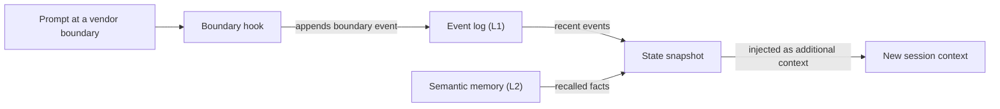

# Bảng thuật ngữ

## Các khối xây dựng

### Skill {#skill}

Skill là gói kiến thức theo lĩnh vực nằm trong `.agents/skills/oma-<name>/`. `SKILL.md` của skill được đưa vào context khi skill được định tuyến, còn các file trong `resources/` chỉ được tải khi task cần đến. Skill hướng dẫn cách agent làm việc trong một lĩnh vực; skill không định nghĩa quy trình nhiều bước. Xem [Skill](../core-concepts/skills.md).

### Workflow {#workflow}

Workflow là quy trình nhiều bước được định nghĩa trong `.agents/workflows/<name>.md`. Bạn khởi chạy workflow bằng lệnh slash của nó, chẳng hạn `/plan` hoặc `/orchestrate`; khi hook phát hiện từ khóa được bật, một cụm từ trigger khớp cũng có thể đưa workflow vào. Workflow điều phối một hoặc nhiều skill và agent. Xem [Các workflow](../core-concepts/workflows.md) và [Chọn skill hoặc workflow](../core-concepts/workflows.md#choosing-a-skill-or-workflow).

### Định nghĩa agent {#agent-definition}

Định nghĩa agent là file subagent được commit trong `.agents/agents/`, chẳng hạn `backend-engineer.md` hoặc `qa-reviewer.md`. File này đặt identity của agent, các skill mà agent tải (frontmatter `skills:`), một phần execution protocol và các quy tắc theo lĩnh vực. OMA chiếu các file này sang định dạng native của vendor như `.claude/agents/*.md` và `.codex/agents/*.toml`. Tài liệu cũng dùng "agent" để chỉ vai trò dispatch (`backend`, `qa`, `explore`) và một skill như `oma-backend`. Xem [Định nghĩa agent](../core-concepts/agents.md#agent-definitions).

## Preset

### Skill preset {#skill-preset}

Skill preset là bộ skill mà installer thêm vào project, chẳng hạn `all`, `fullstack`, `backend` hoặc `research`. Tài nguyên dùng chung `_shared/` được cài cùng mọi preset. Skill preset không ảnh hưởng đến việc model nào chạy agent. Xem [Preset](./installation.md#presets).

### Model preset {#model-preset}

Model preset là giá trị `model_preset` trong `.agents/oma-config.yaml` (hoặc `.cue`). Giá trị này quyết định vendor và model mà mỗi agent sử dụng. `auto`, mặc định cho cài đặt mới, theo cấu hình agent và model native của runtime hiện tại; các preset cố định như `claude`, `codex` hoặc `mixed` ghim chúng lại. Override `agents.<id>` được ưu tiên hơn preset, trừ khi dùng `free`, khi đó `free.model` thay thế model được ghim cho từng agent. Xem [Preset có sẵn](../guide/per-agent-models.md#built-in-presets).

## Thực thi workflow

### Workflow liên tục {#persistent-workflow}

Workflow liên tục tiếp tục chạy qua nhiều lượt cho đến khi công việc xong hoặc bạn vô hiệu hóa nó. Các workflow liên tục là `/orchestrate`, `/work`, `/ultrawork` và `/ralph`, và chỉ lời gọi tường minh mới kích hoạt chế độ liên tục. Trong khi một workflow đang hoạt động, hook đưa lại `[OMA PERSISTENT MODE: ...]` vào mỗi prompt, và Stop hook chặn session kết thúc cho đến khi đạt giới hạn tăng cường hoặc hết thời gian chờ do trạng thái cũ. Nói `workflow done` để vô hiệu hóa. Xem [Cơ chế chế độ liên tục](../core-concepts/workflows.md#persistent-mode-mechanics).

### Stop gate {#stop-gate}

Stop gate là kiểm tra hoàn thành tùy chọn mà bạn gắn vào workflow liên tục đang hoạt động bằng `oma goal set --gate typecheck|test|lint`. Khi đó Stop hook chỉ cho workflow kết thúc khi script `package.json` cùng tên pass. Các lần gate thất bại được tính vào giới hạn tăng cường, nên gate thất bại không thể chặn việc dừng mãi mãi. Xem [`goal set`](../cli-interfaces/commands.md#goal-set).

## Session và trạng thái

"Session" có hai nghĩa trong OMA: session do chính OMA theo dõi, và session hội thoại của AI CLI hoặc IDE bạn đang dùng. Hãy phân biệt hai nghĩa này khi đọc file trạng thái hoặc tùy chọn lệnh.

### Session OMA {#oma-session}

Session OMA là công việc OMA theo dõi dưới session ID riêng, độc lập với mọi hội thoại của vendor. Orchestration dùng ID này để đặt tên cho plan, task board, file progress và result, cùng bản ghi agent run; orchestrator tạo ID theo dạng `session-YYYYMMDD-HHMMSS`. Trạng thái workflow dùng session ID của OMA (`sid`) làm khóa cho [event log](#event-log), mà `oma state list` và `oma state get <sid>` kiểm tra. Xem [Chiến lược session ID](../guide/multi-agent-project.md#session-id-strategy).

### Vendor session ID {#vendor-session-id}

Vendor session ID là ID hội thoại do AI CLI hoặc IDE cấp, chẳng hạn session ID của Claude Code hoặc Codex. OMA ghi nó thành `vendorSid` trên các event, và file trạng thái của chế độ liên tục dùng nó làm khóa (`.agents/state/<workflow>-state-<vendor-session-id>.json`). Khi một session OMA đang hoạt động và prompt đến từ session vendor khác, vendor khác hoặc session vừa được compact, hook ghi một event `boundary` và đưa vào ảnh chụp trạng thái để công việc tiếp tục trong context mới. Xem [`state`](../cli-interfaces/commands.md#state).

Nếu semantic memory không khả dụng, ảnh chụp chỉ dùng các event cục bộ.

### Event log {#event-log}

Event log là bản ghi chỉ-nối-thêm (append-only) của một session OMA, lưu dưới dạng `events.jsonl` trong `${OMA_STATE_HOME:-~/.oma}/u/<profile>/sessions/<sid>/`. Mỗi dòng là một event, chẳng hạn `session.created`, `workflow.phase`, `gate.passed`, `decision.made` hoặc `session.ended`. Workflow nối thêm các quyết định bắt buộc bằng `oma state emit` và kiểm tra chúng bằng `oma state verify`; hãy đọc log bằng `oma state get` hoặc `oma state trajectory` thay vì mở file trực tiếp. Xem [`state`](../cli-interfaces/commands.md#state).

## Review và bằng chứng

### Judge {#judge}

"Judge" có hai nghĩa. Trong `/ralph`, judge là phase sau mỗi lần lặp ultrawork, kiểm tra từng tiêu chí hoàn thành so với trạng thái thực tế của project và ghi PASS, FAIL, REGRESSED hoặc BLOCKED. Một agent được spawn riêng với context mới thực hiện phase này, nên orchestrator không tự chấm công việc của chính mình. Trong đánh giá và tối ưu skill, `judge` là loại checker mặc định: một model chấm output của một arm theo rubric và trả về PASS hoặc FAIL. Xem [/ralph](../core-concepts/workflows.md#ralph) và [checker judge](../guide/skill-eval.md#judge-default).

### Cross-context review (CCR) {#cross-context-review-ccr}

Cross-context review là quy tắc yêu cầu mỗi bước review trong `/ultrawork` chạy trong một subagent reviewer mới, cô lập context. Reviewer chỉ nhận các artifact cần review, được tham chiếu bằng path (diff, file đã thay đổi, plan, kết quả trước đó, output test), cùng hướng dẫn của riêng lần review đó; reviewer không bao giờ thấy lịch sử của session chính hoặc lập luận của người triển khai. Mỗi reviewer ghi một verdict có cấu trúc để coordinator của phase thu thập. Xem [/ultrawork](../core-concepts/workflows.md#ultrawork).

### Charter {#charter}

Charter là khối preflight `CHARTER_CHECK` mà các agent triển khai từng phải ghi trước khi viết code. Các định nghĩa agent hiện tại không yêu cầu output preflight cố định. Thay vào đó, agent tuân theo execution policy dùng chung: nêu các giả định quan trọng, chỉ hỏi khi thông tin còn thiếu ảnh hưởng đến tính đúng đắn hoặc phạm vi, và chỉ tạm dừng phần việc phụ thuộc vào câu trả lời. Subagent được spawn không thể hỏi bạn trực tiếp, nên nó báo cáo thông tin còn thiếu trong kết quả `blocked` hoặc `partial`. Xem [Ủy quyền và làm rõ](../core-concepts/agents.md#charter-preflight-charter_check).

### Run record và claim {#run-record-and-claim}

Run record là biên nhận máy đọc được cho một lần thử của agent, lưu trong thư mục trạng thái theo project của profile, `~/.oma/u/<profile>/projects/<project-hash>/agent-runs/` (phiên bản cũ dùng `.agents/state/agent-runs/`); `oma agent begin` tạo run record và chụp lại task contract. Claim là báo cáo của chính agent tại path `.claim.json` tương ứng, với trạng thái `completed`, `partial`, `blocked` hoặc `failed`, cùng các file đã thay đổi, phần việc chưa giải quyết và artifact. `oma agent finish` đối chiếu claim với contract hiện tại, biên nhận xác minh và hash của artifact, nên claim có bằng chứng lỗi thời không giữ được trạng thái completed. Xem [Kết quả agent và resume](../guide/agent-results-and-resume.md).

## Memory và provider

### Memory L1 và L2 {#l1-and-l2-memory}

L1 là [event log](#event-log): trạng thái workflow cục bộ, chỉ nối thêm, được `oma state verify` và ảnh chụp boundary đọc. L2 là semantic memory, các thông tin được truy hồi do provider `providers.semantic_memory` đã chọn cung cấp: `agentmemory` (mặc định), `honcho` hoặc `none`. Các quyết định bắt buộc nằm trong L1, nên chúng tồn tại qua ranh giới session mà không cần L2. "L1" và "L2" còn có nghĩa khác: Layer 1 và Layer 2 của một skill là `SKILL.md` và thư mục `resources/` tải theo nhu cầu của skill đó, còn `oma docs verify` báo cáo "L2 references", tức các tham chiếu file, URL, CLI, script, biến môi trường và config mà nó trích xuất từ tài liệu. Xem [`memory`](../cli-interfaces/commands.md#memory) và [Honcho semantic memory](../guide/configuration-reference.md#honcho-semantic-memory).

### Capability provider {#capability-provider}

Capability provider là công cụ hoặc dịch vụ bên ngoài mà OMA dùng cho một capability, được chọn dưới `providers` trong `.agents/oma-config.yaml`. Các capability gồm tài liệu (`docs`, mặc định `context7`), tìm kiếm web (`web`, mặc định `native`), code intelligence (`code_intelligence`, mặc định `serena`) và semantic memory (`semantic_memory`, mặc định `agentmemory`). Chạy `oma link` sau khi đổi provider. Xem [Các key cấp cao nhất](../guide/configuration-reference.md#top-level-keys) và [Các mặc định quan trọng](./important-defaults.md).

## Plan và file nguồn

### Plan {#plan}

Plan là bản phân rã task máy đọc được tại `.agents/results/plan-<sessionId>.json`, do `/plan` ghi và được `/orchestrate` cùng `/work` sử dụng; `/orchestrate` tạo plan khi chưa có plan dùng được. Mỗi task nêu agent, workspace, dependency, tiêu chí chấp nhận và các check bắt buộc, và run record chụp lại contract này. Plan không liên quan đến việc phân giải model theo từng agent mà `oma doctor --profile` hiển thị, thứ mà một số trang gọi là inherited plan. Xem [/plan](../core-concepts/workflows.md#plan) và [Bắt đầu một native run](../guide/agent-results-and-resume.md#start-a-native-run).

### SSOT {#ssot}

Nguồn sự thật duy nhất (SSOT) là thư mục `.agents/`: `<project>/.agents/` với cài đặt theo project, hoặc `~/.oma/.agents/` với cài đặt global. Skill, workflow, định nghĩa agent, rule và cấu hình đều nằm ở đó, và `oma install`, `oma update` cùng `oma link` tạo các file native của vendor (`.claude/`, `.codex/` và các thư mục khác) từ thư mục này. Hãy sửa `.agents/` rồi chạy `oma link` thay vì sửa các file được tạo. Một số trang dùng SSOT cho nguồn hẹp hơn, chẳng hạn manifest của scheduled agents. Xem [.agents/: Nguồn sự thật](../core-concepts/project-structure.md#agents-the-source-of-truth).
