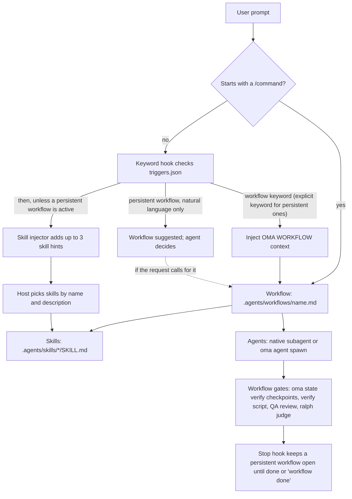

# Giới thiệu

oh-my-agent là framework điều phối đa agent dành cho IDE và công cụ CLI có AI, phân phối công việc qua 33 gói skill và 13 vai trò dispatch chuẩn. Mười hai tệp định nghĩa subagent được kiểm soát trong repository cung cấp các persona có thể tái sử dụng cho triển khai, review, lập kế hoạch, gỡ lỗi, tài liệu, nghiên cứu và hạ tầng. `research-explorer.md` ánh xạ tới vai trò chuẩn `explore`; `orchestrator` là vai trò điều phối ở runtime và không có tệp định nghĩa riêng.

OMA cung cấp các kiểm tra cơ học khi bạn gọi chúng hoặc chọn workflow có chứa chúng. `oma verify agent <agent-type>` chạy các kiểm tra cho loại agent đã chọn; `/ralph` thêm xác minh dựa trên artifact và vòng [judge](./glossary.md#judge); Stop hook của vendor đang bật ([stop gate](./glossary.md#stop-gate)) có thể giữ workflow mở trong khi các kiểm tra đã cấu hình chạy. Chỉ tải skill không tạo thành điều kiện chấp nhận, và prompt thông thường không tự động chạy mọi cổng kiểm tra của workflow. Hãy dùng tiêu chí chấp nhận của workflow và các tệp kết quả để quyết định việc gì đã hoàn tất.

Toàn bộ hệ thống nằm trong thư mục di động `.agents/` bên trong dự án. Bạn có thể chuyển giữa Claude Code, Codex CLI, Antigravity CLI hoặc IDE, Cursor, OpenCode và các công cụ được hỗ trợ khác, còn cấu hình agent đi cùng mã nguồn.

Nếu mới dùng OMA, hãy bắt đầu với [Quick Start](./quick-start.md), rồi đọc [Important Defaults](./important-defaults.md). Việc cài đặt tạo [SSOT](./glossary.md#ssot) và các tích hợp vendor; kiểm tra hữu ích đầu tiên là `oma doctor`, còn tác vụ hữu ích đầu tiên là một thay đổi nhỏ trong một domain. Chỉ chuyển sang `/work` hoặc `/orchestrate` khi tác vụ cần điều phối.

---

## Mô hình đa agent

Các trợ lý lập trình AI truyền thống thường xử lý frontend, backend, database, bảo mật và hạ tầng từ cùng một ngữ cảnh prompt. Điều đó có thể dẫn đến:

- **Pha loãng ngữ cảnh**: nạp kiến thức cho mọi domain làm lãng phí cửa sổ ngữ cảnh
- **Không rõ quyền sở hữu**: tác vụ liên domain không có ranh giới rõ ràng cho từng phần
- **Điều phối thủ công**: các tính năng phức tạp trải rộng nhiều domain cần host hoặc người dùng tự chọn các lần bàn giao

oh-my-agent giải quyết bằng chuyên môn hóa:

1. **Mỗi skill có một domain chính.** Skill frontend biết React/Next.js, shadcn/ui, TailwindCSS v4 và kiến trúc FSD-lite. Skill backend biết mẫu Repository-Service-Router, truy vấn tham số hóa và xác thực JWT. Các domain có thể giao nhau ở ranh giới, vì vậy hãy dùng tiêu chí chấp nhận của tác vụ để quyết định khi nào cần skill thứ hai hoặc workflow điều phối.

2. **Các agent có thể chạy song song.** Trong khi agent backend xây dựng API, agent frontend có thể làm việc trong workspace riêng. Orchestrator điều phối thông qua các tệp và receipt bền vững, gắn với từng lần chạy.

3. **Hướng dẫn chất lượng có sẵn.** Skill chứa checklist domain, playbook lỗi và quy tắc [charter](./glossary.md#charter). Charter preflight thu hẹp phạm vi trước khi viết mã; QA review chạy khi workflow đã chọn có bước đó hoặc khi bạn yêu cầu.

---

## Danh mục hiện tại: 33 skill, 12 định nghĩa, 21 workflow

Danh mục tách riêng ba khái niệm dễ nhầm:

- **[Skill](./glossary.md#skill)** là 33 gói kiến thức domain dưới `.agents/skills/*/SKILL.md`. Chúng định tuyến từ ý định trong ngôn ngữ tự nhiên và tải tài nguyên theo từng lớp.
- **[Định nghĩa agent](./glossary.md#agent-definition)** là 12 tệp dưới `.agents/agents/`. Chúng cung cấp persona subagent theo vendor và tham chiếu tới một hoặc nhiều skill.
- **[Workflow](./glossary.md#workflow)** là 21 định nghĩa quy trình dưới `.agents/workflows/`. Bốn workflow là [liên tục](./glossary.md#persistent-workflow) (`orchestrate`, `work`, `ultrawork` và `ralph`); các workflow còn lại chạy tới báo cáo rồi không giữ chế độ liên tục.

Các phần dưới đây giữ lại danh mục skill chi tiết. Khi tên hoặc mô tả thay đổi, frontmatter của `SKILL.md` đang chạy là nguồn có thẩm quyền.

Mười hai tệp định nghĩa được kiểm soát bao phủ 13 vai trò runtime thông qua alias: `research-explorer.md` ánh xạ tới `explore`, còn `orchestrator` chỉ tồn tại ở runtime. Các tệp định nghĩa còn lại ánh xạ tới những vai trò được nêu trong [Agents](../core-concepts/agents.md).

### Ý tưởng, kiến trúc và lập kế hoạch

| Agent | Vai trò | Khả năng chính |
|-------|------|-----------------|
| **oma-brainstorm** | Khơi gợi ý tưởng theo thiết kế trước | Khám phá ý định người dùng, đề xuất 2-3 hướng với phân tích đánh đổi, tạo tài liệu thiết kế trước khi viết mã. Workflow 6 giai đoạn: Context, Questions, Approaches, Design, Documentation, chuyển sang `/plan`. |
| **oma-architecture** | Chuyên gia kiến trúc hệ thống | Ranh giới module/service/quyền sở hữu, phân tích đánh đổi, tổng hợp stakeholder. Phương pháp: định tuyến chẩn đoán, so sánh design-twice, phân tích rủi ro kiểu ATAM, ưu tiên kiểu CBAM, ghi quyết định kiểu ADR. Mặc định có ý thức về chi phí. |
| **oma-pm** | Quản lý sản phẩm | Phân rã yêu cầu thành các task có ưu tiên và dependency. Định nghĩa API contract. Xuất `.agents/results/plan-{sessionId}.json` và bảng task theo session. Hỗ trợ khái niệm ISO 21500, khung rủi ro ISO 31000 và quản trị ISO 38500. |

### Triển khai

| Agent | Vai trò | Tech stack và tài nguyên |
|-------|------|----------------------|
| **oma-frontend** | Chuyên gia UI/UX | React, Next.js, TypeScript, TailwindCSS v4, shadcn/ui, kiến trúc FSD-lite. Thư viện: luxon (ngày tháng), ahooks hoặc @mantine/hooks (hooks), es-toolkit (tiện ích), Jotai/Zustand (client state), TanStack Query qua hook do orval tạo (server state), @tanstack/react-form + Zod (form), better-auth (auth), nuqs (state URL). Tài nguyên: `execution-protocol.md`, `tech-stack.md`, `tailwind-rules.md`, `snippets.md`, `angular-rules.md`, `error-playbook.md`, `checklist.md`. |
| **oma-backend** | Chuyên gia API và server | Kiến trúc sạch (Router-Service-Repository-Models). Không phụ thuộc stack; phát hiện Python/Node.js/Rust/Go/Java/Elixir/Ruby/.NET từ manifest dự án. Xác thực bằng JWT + Argon2id. Tài nguyên: `execution-protocol.md`, `orm-reference.md`, `checklist.md`, `error-playbook.md`. Hỗ trợ `/stack-set` để tạo tham chiếu `stack/` theo ngôn ngữ. |
| **oma-mobile** | Mobile đa nền tảng | Flutter, Dart, Riverpod/Bloc để quản lý state, Dio với interceptor cho lời gọi API, GoRouter để điều hướng. Kiến trúc sạch: domain-data-presentation. Material Design 3 (Android) + iOS HIG. Mục tiêu 60fps. Cũng hỗ trợ iOS native bằng Swift: SwiftUI + `@Observable` (iOS 17+), `swift-openapi-generator` của Apple cho API client, bố cục dự án `App/Core/Features/Shared`. Tài nguyên: `execution-protocol.md`, `tech-stack.md`, `screen-template.dart`, `screen-template.swift`, `screen-template.tsx`, `checklist.md`, `error-playbook.md`; `/stack-set` materialize biến thể theo nền tảng. |
| **oma-db** | Kiến trúc database | Mô hình hóa database SQL, NoSQL và vector. Thiết kế schema (mặc định 3NF), chuẩn hóa, đánh index, transaction, quy hoạch dung lượng và chiến lược backup. Hỗ trợ thiết kế nhận biết ISO 27001/27002/22301. Tài nguyên: `execution-protocol.md`, `document-templates.md`, `anti-patterns.md`, `vector-db.md`, `iso-controls.md`, `checklist.md`, `error-playbook.md`. |

### Thiết kế

| Agent | Vai trò | Khả năng chính |
|-------|------|-----------------|
| **oma-design** | Chuyên gia design system | Tạo DESIGN.md với token, typography, hệ thống màu, motion design (motion/react, GSAP, Three.js), bố cục ưu tiên responsive và tuân thủ WCAG 2.2. Workflow 7 giai đoạn: Setup, Extract, Enhance, Propose, Generate, Audit, Handoff. Thực thi anti-pattern, không chấp nhận “AI slop”. Tích hợp Stitch MCP tùy chọn. Tài nguyên: `design-md-spec.md`, `design-tokens.md`, `anti-patterns.md`, `prompt-enhancement.md`, `stitch-integration.md`, cùng thư mục `reference/` chứa hướng dẫn typography, màu, không gian, chuyển động, responsive, component, accessibility và shader. |

### Hạ tầng, DevOps và observability

| Agent | Vai trò | Khả năng chính |
|-------|------|-----------------|
| **oma-tf-infra** | Infrastructure-as-code | Terraform đa cloud (AWS, GCP, Azure, Oracle Cloud). Xác thực OIDC-first, IAM quyền tối thiểu, policy-as-code (OPA/Sentinel), tối ưu chi phí. Hỗ trợ kiểm soát AI ISO/IEC 42001, tính liên tục ISO 22301 và tài liệu kiến trúc ISO/IEC/IEEE 42010. Tài nguyên: `multi-cloud-examples.md`, `cost-optimization.md`, `policy-testing-examples.md`, `iso-42001-infra.md`, `checklist.md`. |
| **oma-dev-workflow** | Tự động hóa task monorepo | mise task runner, pipeline CI/CD, database migration, điều phối release, git hooks và xác nhận pre-commit. Tài nguyên: `validation-pipeline.md`, `database-patterns.md`, `api-workflows.md`, `i18n-patterns.md`, `release-coordination.md`, `troubleshooting.md`. |
| **oma-observability** | Bộ định tuyến observability theo ý định | Bao phủ tín hiệu MELT+P (metrics/logs/traces/profiles/cost/audit/privacy), tinh chỉnh transport (UDP/MTU, OTLP gRPC và HTTP, topology Collector, sampling), truyền W3C Trace Context, quản lý SLO và cảnh báo burn-rate, điều tra pháp y sự cố (định vị 6 chiều), meta-observability (tự kiểm tra, đồng bộ đồng hồ, cardinality, retention). Ưu tiên CNCF; Fluentd đã lỗi thời (dùng Fluent Bit hoặc OTel Collector). |

### Chất lượng và gỡ lỗi

| Agent | Vai trò | Khả năng chính |
|-------|------|-----------------|
| **oma-qa** | Đảm bảo chất lượng | Audit bảo mật (OWASP Top 10), phân tích hiệu suất, accessibility (WCAG 2.2 AA), review chất lượng mã. Mức độ: CRITICAL/HIGH/MEDIUM/LOW kèm file:line và mã khắc phục. Hỗ trợ đặc tính chất lượng ISO/IEC 25010 và tương thích kiểm thử ISO/IEC 29119. Tài nguyên: `execution-protocol.md`, `iso-quality.md`, `checklist.md`, `verify-ship-protocol.md`, `error-playbook.md`. |
| **oma-debug** | Chẩn đoán và sửa lỗi | Phương pháp tái hiện trước. Phân tích nguyên nhân gốc, sửa tối thiểu, bắt buộc kiểm thử hồi quy, quét mẫu tương tự. Dùng công cụ MCP code-intelligence (Gortex hoặc Serena) để truy vết symbol. Tài nguyên: `execution-protocol.md`, `common-patterns.md`, `debugging-checklist.md`, `bug-report-template.md`, `error-playbook.md`. |
| **oma-refactor** | Tái cấu trúc bảo toàn hành vi | Tái cấu trúc tăng dần an toàn, có safety net từ characterization test. Nhắm hotspot (complexity × churn), chọn code smell/SATD, hoàn nguyên theo phương pháp Mikado khi thất bại, dùng expand-contract cho thay đổi có state, chỉ tạo commit refactor (không trộn thay đổi hành vi). Biến đổi ưu tiên engine (IDE rename, jscodeshift/ast-grep), đo bằng `uvx lizard` / `uvx radon`. Khả năng đọc là tiêu chí thành công; metric chỉ là đại diện. |

### Bản địa hóa, điều phối và git

| Agent | Vai trò | Khả năng chính |
|-------|------|-----------------|
| **oma-translation** | Dịch thuật theo ngữ cảnh | Luồng 6 cảnh: Prepare, Acquire, Reason, Act, Verify, Finalize. Phương pháp dịch gồm bốn bước: đọc ý nghĩa và cú pháp được bảo vệ, chọn ngữ vực, tái tạo bằng ngôn ngữ đích và giữ phong cách tác giả khi phù hợp. Profile theo ngôn ngữ đích (`resources/lang/{code}.md`) chứa quy tắc ngữ vực và typography. Tài nguyên: `translation-rubric.md`, `anti-ai-patterns.md`, `lang/{ko,ja,zh,en}.md`. |
| **oma-orchestration** | Điều phối đa agent tự động | Spawn subagent CLI song song, điều phối qua các tệp session, task-board, progress và result bền vững, đồng thời theo dõi vòng xác minh. Có thể cấu hình: MAX_PARALLEL (mặc định 3), MAX_RETRIES (mặc định 2), POLL_INTERVAL (mặc định 30s). Bao gồm vòng review giữa các agent và bằng chứng session tùy chọn. Tài nguyên: `subagent-prompt-template.md`, `memory-schema.md`. |
| **oma-scm** | Quản lý cấu hình phần mềm (SCM) và Git | Xử lý chiến lược branch, workflow merge/rebase/conflict, worktree, baseline và theo dõi trạng thái release. Đồng thời hướng dẫn Conventional Commit với staging an toàn; trailer co-author lấy từ cấu hình hiệu lực `scm.co_author` khi được bật. |
| **oma-coordination** | Hướng dẫn workflow đa agent thủ công | Điều phối PM, Frontend, Backend, Mobile và QA từng bước qua CLI `oma agent spawn`. Bắt đầu bằng phân rã của PM, spawn các task cùng ưu tiên trong workspace riêng, theo dõi tệp progress/result theo run, căn chỉnh API/data contract trước khi làm frontend/mobile và kết thúc bằng QA review. Là bản thủ công tương ứng với `oma-orchestration`. |

### Tìm kiếm, hồi tưởng và xử lý tài liệu

| Agent | Vai trò | Khả năng chính |
|-------|------|-----------------|
| **oma-search** | Bộ định tuyến tìm kiếm theo ý định | Định tuyến truy vấn tới Context7 (tài liệu), native web search, `gh`/`glab` (mã), code intelligence cục bộ (Gortex hoặc Serena). Chấm điểm độ tin cậy theo domain cho mọi kết quả không cục bộ. Định tuyến fail-forward (docs→web→fetch). Flags: `--docs`, `--code`, `--web`, `--strict`, `--wide`, `--gitlab`. |
| **oma-recap** | Hồi tưởng công việc đa công cụ | Phân tích lịch sử hội thoại từ Grok, Claude, Codex, Gemini, Qwen, Cursor và Antigravity. Giải quyết đầu vào ngày/cửa sổ bằng ngôn ngữ tự nhiên, nhóm theo tool+session, trích xuất chủ đề, dựng tóm tắt theo ngày/kỳ và ghi lại khi CLI giới hạn cửa sổ yêu cầu ở 30 ngày. |
| **oma-hwp** | HWP/HWPX/HWPML → Markdown | Chuyển đổi tài liệu trình xử lý văn bản Hàn Quốc qua `bunx kordoc@latest`. Giữ tiêu đề, bảng (kể cả bảng lồng), footnote, hyperlink và hình ảnh. Xóa ký tự Hancom Private Use Area qua bộ xử lý hậu kỳ `flatten-tables.ts`. |
| **oma-pdf** | PDF → Markdown | Chuyển đổi tài liệu PDF qua `uvx opendataloader-pdf`. Giữ tiêu đề, bảng, danh sách, hình ảnh; chế độ hybrid OCR cho PDF quét; chuẩn hóa đầu ra bằng `uvx mdformat`. |

### Viết học thuật và nghiên cứu

| Agent | Vai trò | Khả năng chính |
|-------|------|-----------------|
| **oma-academic-writing** | Văn phong tiếng Anh cấp xuất bản | Soạn, sửa và audit essay, report, executive summary, conclusion và literature review. Đồng thời thực thi bốn protocol: Sentence Structure (4 loại, độ dài/mở đầu đa dạng), Verb (thay generic verb bị cấm bằng corpus học thuật phân tầng), Hedging (cường độ khớp với bằng chứng) và Anti-AI compliance. Cổng rubric quote-before-judgment, Claim-Evidence Map, reverse outlining. Chế độ: `draft` / `revise` / `review`. |
| **oma-scholar** | Trợ lý sidecar cho bài nghiên cứu | Tìm kiếm, tạo, xác thực, review và so sánh bài nghiên cứu qua đặc tả sidecar Knows `.knows.yaml` (v0.9.0 / `paper@1`). Truy cập claim/evidence/relation tiết kiệm token (~700 token chỉ claim so với ~10K PDF đầy đủ). `oma scholar search/resolve/get/lint` trên knows.academy với fallback OpenAlex tự động cho bài trước 2026. Chống bịa: bỏ qua field chưa biết thay vì đoán. |

### Bảo mật

| Agent | Vai trò | Khả năng chính |
|-------|------|-----------------|
| **oma-security** | Quét và xác thực bảo mật | Quét mã nguồn ứng dụng, agent skill và thành phần MCP; chạy kiểm thử xâm nhập (penetration test) trên các bản triển khai web thử nghiệm trong phạm vi cho phép, xác thực phát hiện và cấu hình scan gate. Engine mặc định theo mục tiêu: Deepsec cho mã nguồn ứng dụng hoặc diff, Cisco Skill Scanner cho gói agent skill, Cisco MCP Scanner cho thành phần MCP, và ARTEX cho bản triển khai web thử nghiệm. Dùng `oma-qa` cho review chất lượng tổng quát và các skill domain để khắc phục. |

### Tài liệu và meta-tooling

| Agent | Vai trò | Khả năng chính |
|-------|------|-----------------|
| **oma-docs** | Bộ phát hiện drift tài liệu | Chế độ `verify` kiểm tra xác định `docs/**/*.md` để tìm ref hỏng (đường dẫn file, lệnh CLI, config key, env var, script) và thoát 0/1; chế độ `sync` liên hệ git diff với tài liệu ứng viên và tạo đề xuất patch của host-LLM để xác nhận theo từng tài liệu (không tự áp dụng). Kiểm tra URL do `lychee` đảm nhiệm; CLI phát JSON có cấu trúc, host LLM thực hiện toàn bộ tổng hợp (không gọi vendor SDK). Không sửa `.agents/`. |
| **oma-skill-creation** | Chuyên gia tạo skill theo SSL-lite | Tạo, cập nhật và audit skill OMA theo định dạng SSL-lite với bốn phần bắt buộc (Scheduling / Structural Flow / Logical Operations / References). Phân loại loại skill, chèn đúng một path chuẩn inline, thực thi route `When NOT to use` và chạy `oma skill audit` để phát hiện mô tả trùng (cảnh báo ≥ 60%, fail ≥ 75% TF-IDF cosine). Đẩy chi tiết biến thể dài vào `resources/`. |
| **oma-explanation** | Bộ giải thích thay đổi mã | Biến diff, PR, branch hoặc khoảng commit thành explainer HTML offline tự chứa với các phần Background, Intuition, Code và Quiz. Workflow `/explain` xác thực artifact cuối và ghi vào `.agents/results/explain/`. |

### Nghiên cứu thị trường

| Agent | Vai trò | Khả năng chính |
|-------|------|-----------------|
| **oma-market** | Tình báo tín hiệu cộng đồng | Chạy engine upstream `last30days` (Reddit với upvote và comment thực, X, transcript YouTube, TikTok, HN, Polymarket, GitHub, arXiv, Techmeme, Bluesky, web và hơn nữa) qua `oma market run`; oma luôn giữ engine **ở release mới nhất** (`~/.cache/oma-market/`), gate mọi lần chạy bằng `detect-trap`, phân loại ý định (pain / trend / competitor / discovery) và thêm các phần SWOT / Porter's 5F / PESTEL. Xuất một brief tuân thủ LAW tại `.agents/results/market/{slug}-{YYYYMMDD}.md`. |

### Media và tạo nội dung

| Agent | Vai trò | Khả năng chính |
|-------|------|-----------------|
| **oma-image** | Bộ định tuyến hình ảnh đa vendor | Dispatch song song có nhận biết xác thực tới Codex (`gpt-image-2` qua ChatGPT OAuth, ưu tiên CLI), các model “nano-banana” họ Gemini của Antigravity qua CLI `agy` + Gemini Code Assist (model chính xác do bên trong chọn), và Pollinations (`flux`/`zimage` miễn phí). Có protocol làm rõ/khuếch đại trước khi tạo, tối đa 10 ảnh tham chiếu, guardrail chi phí (xác nhận ở mức ≥ $0.20), `manifest.json` để tái lập. CLI: `oma image generate`, `oma image doctor` và `oma image vendor list`. |
| **oma-slide** | Bộ tạo deck HTML giàu animation | Tạo deck trình bày khác biệt, chống “AI slop”, trên canvas cố định 1920×1080, sau đó xác thực hình học có tính xác định, bundle thành HTML một file và xuất PDF/PNG/PPTX qua CLI `oma slide`. Preset style + template đậm, quy tắc CJK→Pretendard, bắt buộc `prefers-reduced-motion` + focus nhìn thấy, vòng validate tự sửa tối đa 3 lần. Ủy quyền hình ảnh cho `oma-image`; tùy chọn xuất/nhập Canva MCP. |
| **oma-video** | Bộ định tuyến video ngắn, explainer và demo | Tạo shorts/reels (9:16), explainer (16:9) và demo do người ghi (16:9) qua CLI `oma video`. Asset bus xác định (`script.json` → `timing.json` → `render-spec.json`) cấp dữ liệu cho compositor HyperFrames được quản lý; provider asset có thể dùng fallback cục bộ, còn thiếu composition/toolchain hoặc lỗi render sẽ làm run thất bại. Capture của người không bao giờ tự động hóa credential. |
| **oma-voice** | TTS và STT local-first | Điều khiển server Voicebox MCP để thông báo trên thiết bị, TTS asset và chuyển lời mà không gọi cloud hay tính phí mỗi lượt. TTS mặc định WAV và có thể chuyển cục bộ sang MP3; transcription nhận path audio hoặc base64. Mỗi lần gọi TTS tối đa 5000 ký tự, input STT tối đa 30 phút; các run asset/transcription được lưu sẽ ghi manifest. |

---

## Mô hình tiết lộ lũy tiến

oh-my-agent dùng kiến trúc skill hai lớp để tránh làm cạn cửa sổ ngữ cảnh:

**Lớp 1: SKILL.md (tải khi skill được định tuyến)**
Chứa identity của agent, điều kiện định tuyến, quy tắc cốt lõi và hướng dẫn “when to use / when NOT to use”. Đây là toàn bộ nội dung được tải khi agent chưa làm việc chủ động.

**Lớp 2: resources/ (tải theo nhu cầu)**
Chứa protocol thực thi, tham chiếu tech stack, code snippet, playbook lỗi, checklist và ví dụ. Chỉ tải khi agent được gọi cho một tác vụ, và khi đó chỉ tải tài nguyên liên quan tới loại tác vụ cụ thể (dựa trên đánh giá độ khó và ánh xạ task-resource trong `context-loading.md`).

Lượng ngữ cảnh tiết kiệm được phụ thuộc vào skill và task, vì vậy hãy đo thay vì giả định một con số. Xem [toán tiết kiệm token](../core-concepts/skills.md#token-savings-math) để biết script và phạm vi các ước tính của nó.

---

## .agents/: Nguồn sự thật duy nhất (SSOT)

Mọi thứ oh-my-agent cần đều nằm trong thư mục `.agents/`:

```text
.agents/
├── oma-config.yaml   # Shared preferences and provider/model settings
├── oma-config.cue    # Optional schema-backed configuration
├── mcp.json          # MCP server configuration
├── skills/           # 33 skill directories + _shared resources
│   ├── _shared/      # Core resources used by all agents
│   └── oma-{skill}/  # Per-skill SKILL.md + resources/variants
├── workflows/        # 21 workflow definitions
├── agents/           # 12 subagent definitions
├── hooks/            # Hook sources, including core/triggers.json
├── rules/            # Project rules projected into vendor files
├── config/           # Shipped defaults (defaults.yaml)
├── results/          # Plans (plan-{sessionId}.json) and agent results
└── state/            # Active workflow state files
```

Thư mục `.claude/` chỉ là lớp tích hợp IDE. Nó chứa symlink trỏ về `.agents/`, cùng hook để phát hiện từ khóa và statusline HUD. Thư mục `.agents/state/memories/` chứa state điều phối runtime trong các session orchestration (project cũ fallback về đường dẫn legacy `.serena/memories/`).

Kiến trúc này khiến cấu hình agent của bạn:

- **Di động**: chuyển IDE mà không cần cấu hình lại
- **Được quản lý phiên bản**: commit `.agents/` cùng mã nguồn
- **Có thể chia sẻ**: thành viên trong team nhận cùng thiết lập agent

---

## IDE và công cụ CLI được hỗ trợ

oh-my-agent hoạt động với các IDE và CLI có AI đã chọn thông qua cơ chế tải skill/prompt native hoặc các tệp tích hợp được tạo:

| Công cụ | Phương thức tích hợp | Agent song song |
|------|-------------------|----------------|
| **Claude Code** | Skill native + Agent tool | Agent tool để chạy song song thực sự |
| **Antigravity CLI/IDE** | Skill và MCP setting chiếu cho `agy` | `oma agent spawn` |
| **Codex CLI** | Skill tự tải | Yêu cầu song song do model điều phối |
| **Cursor** | Skill qua tích hợp `.cursor/` | `@agent-name` + `oma agent spawn` |
| **OpenCode** | Skill + cầu nối plugin trong process + subagent được tạo (`.opencode/agents/`) | `oma agent spawn --vendor opencode` |
| **Kimi Code CLI** | Hook + skill trong `~/.kimi-code/` (ghi HOME cần consent; cũng đọc SSOT `.agents/skills/` native); Serena MCP theo project | `oma agent spawn --vendor kimi` |

Cách spawn agent thích ứng với từng vendor được chọn thông qua phát hiện vendor và cấu hình đang hoạt động. Runtime cùng vendor có thể dùng subagent native; công việc cross-vendor fallback về `oma agent spawn`. Xem [Parallel Execution](../core-concepts/parallel-execution.md) để biết quy tắc dispatch.

---

## Luồng xử lý một yêu cầu

Keyword hook, skill injector và Stop hook chỉ chạy trên các host có bật tích hợp hook. Keyword hook và skill injector chạy lần lượt trên cùng một prompt, và context mà chúng chèn vào được gộp lại.



Nguồn: `.agents/hooks/core/keyword-detector.ts` (bỏ qua slash command, khớp trigger, gợi ý workflow liên tục), `.agents/hooks/core/skill-injector.ts`, `.agents/hooks/core/persistent-mode.ts` và các tệp workflow dưới `.agents/workflows/`. Không phải workflow nào cũng có mọi cổng kiểm tra: `/orchestrate` chạy verify script, `/review` chạy QA review, còn `/ralph` thêm [judge](./glossary.md#judge).

---

## Hệ thống định tuyến skill

Host chọn skill dựa trên tên và mô tả của các skill đã cài. Bản đồ định tuyến của OMA (`.agents/skills/_shared/core/skill-routing.md`) xác định skill nào sở hữu kết quả nào; hãy định tuyến theo kết quả được yêu cầu và các dependency của nó, không chỉ dựa vào một từ khóa. Việc chọn skill không khởi động workflow và cũng không cho phép ủy quyền.

| Kết quả được yêu cầu | Skill sở hữu |
|---|---|
| API ứng dụng, auth phía server, logic service/truy cập dữ liệu | oma-backend |
| Schema, thiết kế migration, đánh index, tinh chỉnh query, vận hành database | oma-db |
| Component, trang, form web, client state | oma-frontend |
| Màn hình mobile, widget, tích hợp nền tảng | oma-mobile |
| Ranh giới hệ thống, đánh đổi kiến trúc, ADR | oma-architecture |
| Chẩn đoán và sửa hành vi sai | oma-debug |
| Review tính đúng, bảo mật, accessibility, hiệu suất | oma-qa |
| Hệ thống thị giác, DESIGN.md, định hướng redesign | oma-design |
| Ý tưởng hoặc khám phá phương án thay thế theo yêu cầu | oma-brainstorm |
| Yêu cầu, dependency, tiêu chí chấp nhận | oma-pm |
| Thực thi song song các chuyên gia theo yêu cầu | oma-orchestration |
| Điều phối đa agent thủ công theo yêu cầu | oma-coordination |
| Git branch, commit, merge, lịch sử repository | oma-scm |

Với các domain khác, host chọn từ mô tả của các skill đã cài. Công việc đa domain không có chuỗi cố định: quyết định kiến trúc hoặc sản phẩm chưa chốt sẽ được giải quyết trước, và công việc backend với client có thể chạy song song khi API contract dùng chung đã sẵn sàng.

---

## HUD statusline

Khi chạy trong Claude Code, oh-my-agent hiển thị chỉ báo trạng thái liên tục `[OMA]` trên status bar, cho biết:

- Tên model (ví dụ Opus, Sonnet)
- Mức sử dụng context với màu (xanh < 70%, vàng 70-85%, đỏ > 85%)
- State workflow đang hoạt động (nếu có workflow liên tục)

HUD được cung cấp bởi `.claude/hooks/hud.ts`, dùng tính năng hook `statusLine` của Claude Code.

---

## Tự động phát hiện workflow

Bạn không cần gõ `/command` để kích hoạt workflow. Hệ thống hook của oh-my-agent quét input ngôn ngữ tự nhiên theo các trigger keyword trong `.agents/hooks/core/triggers.json` (được inline vào binary `oma` và dùng chung cho mọi vendor), hỗ trợ 11 ngôn ngữ (English, Korean, Japanese, Chinese, Spanish, French, German, Portuguese, Russian, Dutch, Polish).

- **Input có thể thực hiện** (ví dụ “plan the auth feature”) → tự động tải workflow
- **Input mang tính thông tin** (ví dụ “what is orchestrate?”) → bị lọc, không kích hoạt workflow
- **`/command` rõ ràng** → hook bỏ qua detection để tránh trùng lặp
- **Workflow liên tục** (`orchestrate`, `work`, `ultrawork`, `ralph`) nếu chỉ được khớp từ ngôn ngữ tự nhiên thì chỉ được gợi ý, không khởi động; chế độ liên tục chỉ bật khi prompt dùng keyword tường minh của workflow (ví dụ `ultrawork` hoặc `ralph`)
- **Workflow liên tục đang hoạt động** bơm lại context ở mỗi message cho tới khi bạn nói “workflow done”

Mọi hook event được gửi qua ABI chuẩn `oma hook run`: vendor gọi `oma-hook.sh --vendor <v> --event <nativeEvent>`, lệnh này chuyển tới chuỗi handler trong process và xuất dialect riêng của vendor trên stdout (luôn exit 0, fail-open).

---

## Hỗ trợ cross-vendor

oh-my-agent không chỉ giới hạn ở Claude Code. Vendor có hook dùng chung ABI `oma hook run`, còn vendor mở rộng dùng bridge trong process:

| Vendor | Phân phối hook | StatusLine |
|--------|--------------|------------|
| **Claude Code** | `oma-hook.sh --vendor claude --event UserPromptSubmit` / `PreToolUse` / `Stop` | `bun .claude/hooks/hud.ts` (trực tiếp, không thay đổi) |
| **Codex CLI** | `oma-hook.sh --vendor codex --event UserPromptSubmit` / `PreToolUse` / `Stop` | Không có |
| **Qwen Code** | `oma-hook.sh --vendor qwen --event UserPromptSubmit` / `PreToolUse` / `Stop` | Đường dẫn `bun` qua `ui.statusLine` |
| **Cursor** | `oma-hook.sh --vendor cursor --event beforeSubmitPrompt` / `preToolUse` / `stop` | Không có |
| **Grok** | `oma-hook.sh --vendor grok --event UserPromptSubmit` / `PreToolUse` / `Stop` | Không có |
| **Kiro** | `oma-hook.sh --vendor kiro --event userPromptSubmit` / `preToolUse` / `stop` | Không có |
| **Kimi Code** | `oma-hook.sh --vendor kimi --event UserPromptSubmit` / `PreToolUse` / `Stop` (TOML `[[hooks]]` chỉ global trong `~/.kimi-code/config.toml`) | Không có |
| **Antigravity** | `.agents/hooks.json` → `bun .agents/hooks/core/*.ts` (`PreInvocation` / `PostToolUse` / `Stop`) | `statusLine` → `~/.gemini/antigravity-cli/settings.json` |
| **CommandCode** | `oma-hook.sh --vendor commandcode --event SessionStart` / `PostToolUse` / `Stop` | Không có |
| **OpenCode** | Bridge trong process (`installOpencodePlugin`) không đi qua `oma hook run` | Không có |
| **pi** | Bridge trong process (`installPiExtension`) không đi qua `oma hook run` | Không có |

Thư mục `.agents/` vẫn là nguồn sự thật. Việc cài đặt link hoặc project skill, workflow, hook và định nghĩa agent vào vendor bạn chọn; khả năng khác nhau theo vendor. Subagent native cùng vendor và agent cross-vendor spawn bằng CLI đều đọc từ nguồn đó.

---

## Tiếp theo

- **[Cài đặt](./installation.md)**: Ba phương pháp cài đặt, preset, thiết lập CLI và xác minh
- **[Các agent](/docs/core-concepts/agents)**: Tìm hiểu sâu 33 skill, 13 vai trò dispatch và charter preflight
- **[Skill](/docs/core-concepts/skills)**: Giải thích kiến trúc hai lớp
- **[Các workflow](/docs/core-concepts/workflows)**: Toàn bộ 21 workflow cùng trigger và phase
- **[Hướng dẫn sử dụng](/docs/guide/usage)**: Ví dụ thực tế từ task đơn lẻ tới orchestration đầy đủ
