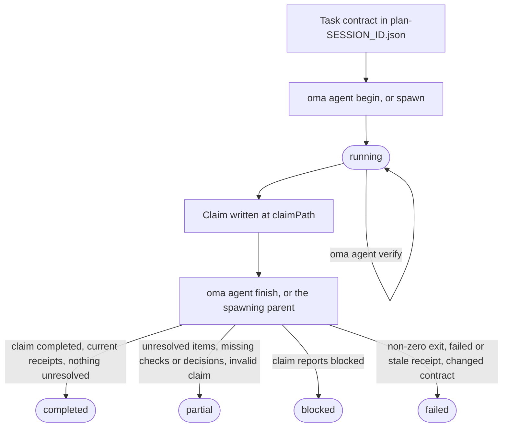
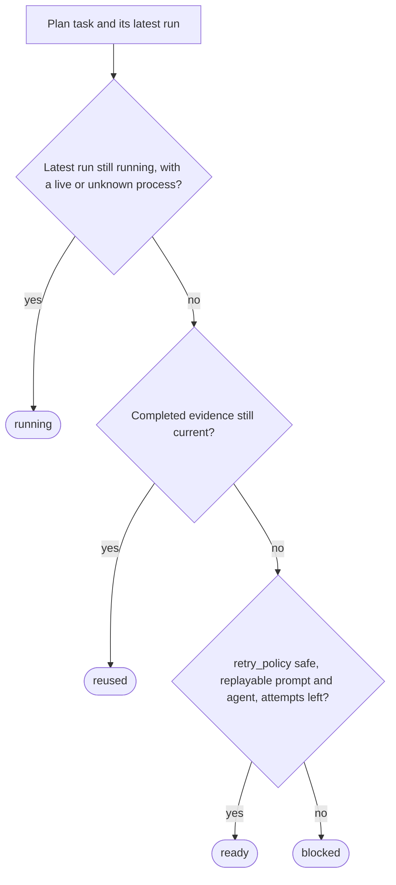

# Agent result và resume {#agent-results-and-resume}

OMA coi agent result là một evidence record nhỏ, không chỉ là process exit code. Một run ghi task và session ID, workspace fingerprint, verification receipt, file đã thay đổi, công việc chưa giải quyết và artifact hash. Nhờ vậy coordinator chỉ có thể dùng lại task đã hoàn tất khi acceptance contract và input vẫn khớp.

Dùng trực tiếp lifecycle này khi chạy native agent. Workflow và `oma agent spawn` tạo cùng các record cho bạn và giao việc finalize managed run cho parent coordinator. Về các thuật ngữ dùng ở đây, xem [Run record và claim](../getting-started/glossary.md#run-record-and-claim) và [Plan](../getting-started/glossary.md#plan) trong glossary.

## Tổng quan lifecycle {#lifecycle-at-a-glance}

| Bước | Lệnh | Ghi nhận | Cần giữ |
| --- | --- | --- | --- |
| 1. Contract | Sửa `.agents/results/plan-SESSION_ID.json` | `acceptance_criteria` và `required_checks` của task | Session ID, task ID |
| 2. Begin | `oma agent begin AGENT TASK SESSION_ID --workspace .` | Run record với status `running` | `runId`, `claimPath` |
| 3. Context (tùy chọn) | `oma agent context AGENT --difficulty Medium` | Không có | Prompt context |
| 4. Verify | `oma agent verify RUN_ID --required` | Một receipt cho mỗi check | Exit code |
| 5. Claim | Ghi JSON tại `claimPath` | Claim file | Không có |
| 6. Finish | `oma agent finish RUN_ID CLAIM_PATH` | Status cuối cùng | `status` |
| 7. Recover | `oma agent resume SESSION_ID --dry-run`, sau đó chạy không có `--dry-run` | Recovery checkpoint và session lease | Status theo từng task |

`oma agent spawn` và `oma agent parallel` thực hiện bước 2 và 6 cho bạn: parent process bắt đầu run và finalize nó khi child thoát.



Claim cũng có thể báo trực tiếp `partial` hoặc `failed`. Finish không bao giờ nâng cấp claim: nó hạ cấp claim `completed` khi bằng chứng không đứng vững, và exit code khác không khiến mọi run thành `failed`.

## Bắt đầu native run {#start-a-native-run}

Trước tiên, định nghĩa task cùng `acceptance_criteria` và `required_checks` của nó trong plan ở `.agents/results/plan-SESSION_ID.json`. Với một generic project check nhỏ, plan có thể có một task như sau:

```json
{
  "tasks": [
    {
      "id": "docs",
      "agent": "docs",
      "task": "Review README.md and report any documentation issues",
      "workspace": ".",
      "acceptance_criteria": [
        { "id": "diff-clean", "description": "The current Git diff has no whitespace errors" }
      ],
      "required_checks": [
        { "id": "whitespace", "criteria": ["diff-clean"], "command": ["git", "diff", "--check"], "cwd": "." }
      ],
      "retry_policy": "manual"
    }
  ]
}
```

Check này chỉ chứng minh Git diff không có whitespace error; hãy thay task, criterion và check bằng acceptance contract thực tế của project. Từ project root, bắt đầu run:

```bash
oma agent begin docs docs SESSION_ID --workspace .
```

Thay `SESSION_ID` bằng session ID dùng trong plan. Lệnh in JSON gồm UUID `runId` được tạo và `claimPath`, ví dụ:

```json
{
  "runId": "<generated-run-id>",
  "taskId": "docs",
  "sessionId": "<your-session-id>",
  "status": "running",
  "claimPath": ".agents/state/agent-runs/<generated-run-id>.claim.json"
}
```

Các giá trị trong dấu nhọn là placeholder; hãy dùng giá trị thật được run in ra. Begin thành công tạo run record trong `.agents/state/agent-runs/` và snapshot task contract. Claim path luôn là run record path với `.claim.json` thay cho `.json`.

## Nạp context và chạy task {#load-context-and-run-the-task}

Nạp graph-selected reference trước khi sửa:

```bash
oma agent context docs --difficulty Medium
```

Difficulty phải là `Simple`, `Medium` hoặc `Complex`. Lệnh in context được assemble cho agent đã chọn. Nếu không có graph-backed context, hãy sửa task definition hoặc tiếp tục theo native search path đã ghi trong project; không tự tạo context receipt.

Chạy task trong workspace được `begin` ghi nhận. Giữ session plan cố định khi run đang hoạt động. Nếu task thay đổi acceptance criteria hoặc required check, hãy bắt đầu run mới sau khi cập nhật plan.

## Ghi nhận verification {#record-verification}

Chạy mọi check được ghim trong acceptance contract:

```bash
oma agent verify RUN_ID --required
```

Thay `RUN_ID` bằng UUID nhận từ `begin`. Lệnh thực thi argv đã khai báo và ghi exit code thực cùng workspace fingerprint trước/sau. Có thể ghi một exact command khi task contract có check đó:

```bash
oma agent verify RUN_ID -- git diff --check
```

Chỉ dùng exact-command form cho check thuộc contract của task; nếu không, giữ plan với `required_checks` và dùng `--required` để receipt chứng minh acceptance criteria đã khai báo.

Dùng `--affected PATH...` chỉ khi graph có test selection đầy đủ cho các path đó. Check chạy tuần tự theo run. Exit code khác không hoặc workspace thay đổi trong check sẽ làm receipt không hợp lệ.

## Ghi claim và kết thúc {#write-and-finish-the-claim}

Với task chọn API contract, chính sách authentication, data model, chiến lược migration, state owner, phạm vi truy cập infrastructure, hoặc một quyết định khác mà công việc sau phụ thuộc vào, hãy khai báo `required_decisions` trong task trước khi dispatch:

```json
"required_decisions": [
  {
    "subject": "db.migration-strategy",
    "description": "Choose the compatibility window and rollback strategy for the account migration."
  }
]
```

Bỏ trường này với task đi theo một quyết định đã có. Requirement được ghim cùng task contract và không thể xóa hay thay đổi sau khi dispatch. Liệt kê các subject gợi ý cho một agent bằng `oma state decisions list --agent db-engineer --json`. Các subject này là lựa chọn để dùng khi phù hợp; catalog không biến mọi lựa chọn thành bắt buộc.

Ghi claim file vào đúng path mà `begin` in ra:

```json
{
  "status": "completed",
  "changedFiles": [],
  "unresolved": [],
  "artifacts": []
}
```

`status` nhận một trong `completed`, `partial`, `blocked` hoặc `failed`. Path là tương đối với project root và mọi artifact phải là regular file trong workspace. Chỉ dùng `verificationSkipped` cho review cụ thể không có executable check; trường này không biến check thất bại thành pass.

Đưa các quyết định quan trọng vào mảng tùy chọn `decisions` của claim:

```json
"decisions": [
  {
    "subject": "db.migration-strategy",
    "decision": "Use an expand-and-contract migration; retain the old column for one release.",
    "rationale": "Both deployed app versions must work during the rollout; rollback switches reads to the retained column.",
    "alternatives": ["Replace the column during a maintenance window"],
    "evidence": ["docs/account-migration.md"]
  }
]
```

Parent lưu mỗi quyết định thành một event `decision.made` trong session của run và gắn agent, task và run ID thực tế của nó. Thiếu một required decision sẽ giữ result ở mức partial, kể cả khi executable check đều pass. Quyết định từ task hoặc attempt khác không thể đáp ứng requirement. Receipt ghim event ID và content hash của các quyết định; khi reuse, OMA kiểm tra các event đó vẫn tồn tại, hợp lệ và nội dung không đổi.
Quyết định tùy chọn cũng được ghi nhận. Read-only agent trả cùng mảng đó trong claim `OMA_RESULT_JSON` để parent có thể lưu lại.

Finalize native run sau khi ghi claim:

```bash
oma agent finish RUN_ID CLAIM_PATH
```

Thay cả hai giá trị bằng dữ liệu từ JSON của `begin`. `CLAIM_PATH` là generated `.claim.json` path; không tự tạo filename mới.

Lệnh finish xác thực claim, contract hiện tại, receipt hiện tại và artifact hash. Completed claim với bằng chứng cũ sẽ trở thành failed hoặc partial. Lệnh từ chối finalize managed run mà parent process sở hữu lifecycle.

## Hành vi spawned và native {#spawned-and-native-behavior}

`oma agent spawn` và `oma agent parallel` tạo run, inject run identity và result instruction vào child prompt, sau đó để parent capture child exit code. Child nên ghi claim và báo artifact; parent finalize managed receipt. Read-only child trả về một dòng `OMA_RESULT_JSON: {...}`; parent lưu dòng này, còn giải thích `verificationSkipped` được giữ riêng với executable verification.

Human-readable result file trong `.agents/results/` và memory note trong `.agents/state/memories/` giúp mọi người theo dõi tiến độ. Machine-readable receipt trong `.agents/state/agent-runs/` là bằng chứng dùng cho việc reuse và resume.

## Kiểm tra recovery trước khi retry {#inspect-recovery-before-retrying}

Trước hết hãy hỏi OMA sẽ làm gì:

```bash
oma agent resume SESSION_ID --dry-run
```

Report phân loại từng task thành `reused`, `ready`, `running` hoặc `blocked`, kèm lý do:



Một dependency không ở trạng thái `reused` sẽ đưa task phụ thuộc đang `reused` trở lại `ready` (hoặc `blocked` khi không thể replay), và task `ready` có dependency đang `blocked` hoặc `running` sẽ thành `blocked`. Completed receipt hợp lệ chỉ được reuse khi contract, input, artifact hash và dependency evidence vẫn hiện tại. Managed process đang chạy hoặc native run không có bằng chứng liveness sẽ không bị duplicate.

Khi report cho biết an toàn để thực thi, resume task ready theo thứ tự dependency:

```bash
oma agent resume SESSION_ID
```

Automatic replay cần `retry_policy: "safe"` cùng prompt có thể replay và agent trong plan hoặc saved dispatch. Mặc định là `manual`. `--max-attempts` mặc định là `3`, tính cả attempt đầu tiên:

```bash
oma agent resume SESSION_ID --max-attempts 2
```

OMA ghi recovery checkpoint trong `.agents/state/agent-resume/` và dùng session lease để ngăn hai coordinator retry cùng session. Plan được ghim trong lúc recovery chạy. Nếu plan hoặc dependency đổi, hoặc retry sau làm thay đổi input trước đó, task bị ảnh hưởng sẽ trở thành blocked và cần verification run mới.

Resume bắt đầu attempt mới; nó không khôi phục model conversation đã gián đoạn. Trước khi resume native run bị gián đoạn, đánh dấu run cũ là `partial` hoặc `failed` với result và unresolved work thực tế. Sau đó kiểm tra dry-run report và chỉ retry task có safe replay path.

## Ví dụ khôi phục {#recovery-examples}

| Tình huống | Hành động | Kết quả mong đợi |
| --- | --- | --- |
| Required check thất bại | Sửa task, chạy lại `oma agent verify RUN_ID --required`, sau đó finish bằng claim mới. | Receipt mới nhất thay kết quả thất bại khi workspace fingerprint hiện tại. |
| Process chết trước khi có claim | Đánh dấu run là partial hoặc failed, rồi chạy `oma agent resume SESSION_ID --dry-run`. | Attempt cũ được giữ; safe task là `ready`, còn manual task là `blocked`. |
| Dependency thay đổi | Chạy lại dependency và xem report lần nữa. | Việc reuse phụ thuộc bị vô hiệu dù file của chính task không đổi. |
| Plan hoặc input thay đổi | Bắt đầu run mới sau khi plan ổn định. | Run mới snapshot contract mới; bằng chứng cũ không được reuse. |
| Task cần quyết định | Ghi task là `blocked` kèm giải thích. | Resume giữ task blocked cho đến khi có quyết định và prompt. |

## Bước tiếp theo {#next-steps}

- Thông báo lỗi từ `begin`, `verify`, `finish` và `resume`: [Khắc phục sự cố](./troubleshooting.md#find-your-error)
- Parse error, vendor tool thiếu, dashboard state, schedule và evaluation data cũ: [Khắc phục sự cố](./troubleshooting.md)
- Theo dõi managed run trong lúc chúng làm việc: [Dashboard Monitoring](./dashboard-monitoring.md)
- Định nghĩa plan với task contract: [Multi-Agent Projects](./multi-agent-project.md)
