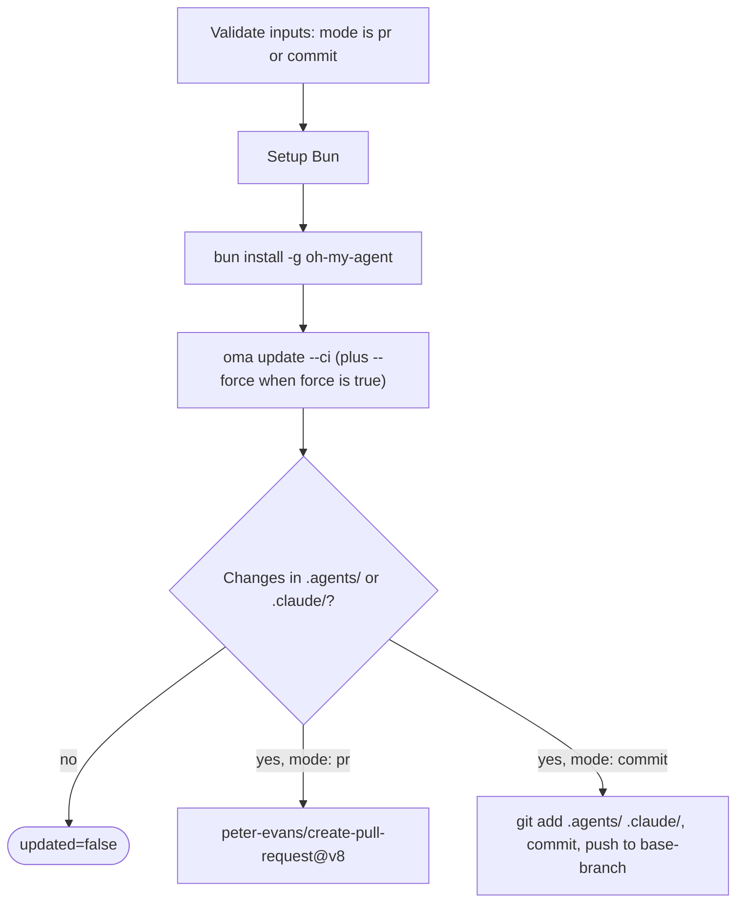

# Hướng dẫn: Cập nhật tự động

## Tổng quan

GitHub Action của oh-my-agent (`first-fluke/oma-update-action@v1`) tự động cập nhật skill agent của project bằng cách chạy `oma update` trong CI. Action hỗ trợ hai mode: tạo pull request để review hoặc commit trực tiếp vào branch.

---

## Thiết lập nhanh

<!-- oma-docs:ignore-start -->
Thêm file này vào project tại `.github/workflows/update-oh-my-agent.yml`:
<!-- oma-docs:ignore-end -->

```yaml
name: Update oh-my-agent

on:
  schedule:
    - cron: '0 9 * * 1'  # Every Monday at 9am UTC
  workflow_dispatch:        # Allow manual trigger

permissions:
  contents: write
  pull-requests: write

jobs:
  update:
    runs-on: ubuntu-latest
    steps:
      - uses: actions/checkout@v4

      - uses: first-fluke/oma-update-action@v1
```

Đây là cấu hình tối thiểu. Khi component đã cài có thay đổi, action kết thúc với `updated=true`, output version và pull request. Khi không có file đổi, action kết thúc với `updated=false` và không có PR.

---

## Toàn bộ input của action

| Input | Kiểu | Bắt buộc | Mặc định | Mô tả |
|:------|:-----|:---------|:--------|:-----------|
| `mode` | string | Không | `"pr"` | Cách áp dụng thay đổi. `"pr"` tạo pull request. `"commit"` push trực tiếp vào base branch. |
| `base-branch` | string | Không | `"main"` | Base branch cho PR ở mode `pr` hoặc branch đích cho direct commit ở mode `commit`. Input này không thay đổi branch được checkout; hãy đặt `ref:` của `actions/checkout` thành cùng branch đó. |
| `force` | string | Không | `"false"` | Truyền `--force` cho `oma update`. Khi `"true"`, ghi đè config user tùy chỉnh, gồm `oma-config.yaml`, `mcp.json` và thư mục `stack/`. Bình thường các file này được giữ. |
| `pr-title` | string | Không | `"chore(deps): update oh-my-agent skills"` | Tiêu đề PR tùy chỉnh, chỉ dùng ở mode `pr`. |
| `pr-labels` | string | Không | `"dependencies,automated"` | Label phân tách bằng comma thêm vào PR, chỉ dùng ở mode `pr`. |
| `commit-message` | string | Không | `"chore(deps): update oh-my-agent skills"` | Commit message tùy chỉnh, dùng ở cả hai mode, làm message PR commit hoặc direct commit. |
| `token` | string | Không | `${{ github.token }}` | GitHub token để tạo PR. Dùng Personal Access Token (PAT) nếu cần PR trigger workflow khác; `GITHUB_TOKEN` mặc định không trigger workflow run trên PR do nó tạo. |

---

## Toàn bộ output của action

| Output | Kiểu | Mô tả | Có sẵn |
|:-------|:-----|:-----------|:----------|
| `updated` | string | `"true"` nếu phát hiện thay đổi sau `oma update`; `"false"` nếu đã up to date. | Luôn |
| `version` | string | Version oh-my-agent sau update, đọc từ `.agents/skills/_version.json`. | Khi `updated` là `"true"` |
| `pr-number` | string | Số pull request. | Chỉ ở mode `pr` khi tạo PR |
| `pr-url` | string | URL đầy đủ của pull request đã tạo. | Chỉ ở mode `pr` khi tạo PR |

---

## Ví dụ chi tiết

### Ví dụ 1: mode PR mặc định

Thiết lập phổ biến nhất, tạo PR mỗi thứ Hai nếu có update.

```yaml
name: Update oh-my-agent

on:
  schedule:
    - cron: '0 9 * * 1'
  workflow_dispatch:

permissions:
  contents: write
  pull-requests: write

jobs:
  update:
    runs-on: ubuntu-latest
    steps:
      - uses: actions/checkout@v4

      - uses: first-fluke/oma-update-action@v1
        id: update

      - name: Summary
        if: steps.update.outputs.updated == 'true'
        run: |
          echo "Updated to version ${{ steps.update.outputs.version }}"
          echo "PR: ${{ steps.update.outputs.pr-url }}"
```

**Điều gì xảy ra:**
- Checkout repository.
- Cài Bun rồi cài oh-my-agent global.
- Chạy `oma update --ci`.
- Kiểm tra `.agents/` hoặc `.claude/` có thay đổi.
- Nếu có, dùng `peter-evans/create-pull-request@v8` tạo PR trên branch `chore/update-oh-my-agent`.
- PR có label `dependencies,automated` và version mới trong body.

### Ví dụ 2: mode commit trực tiếp với PAT

Dùng cho team muốn áp dụng update ngay, không qua bước review PR. Dùng PAT để commit có thể trigger workflow downstream.

```yaml
name: Update oh-my-agent (Direct)

on:
  schedule:
    - cron: '0 6 * * *'  # Daily at 6am UTC
  workflow_dispatch:

permissions:
  contents: write

jobs:
  update:
    runs-on: ubuntu-latest
    steps:
      - uses: actions/checkout@v4
        with:
          ref: develop
          token: ${{ secrets.OH_MY_AGENT_PAT }}

      - uses: first-fluke/oma-update-action@v1
        with:
          mode: commit
          token: ${{ secrets.OH_MY_AGENT_PAT }}
          commit-message: "chore: auto-update oh-my-agent skills"
          base-branch: develop
```

**Điều gì xảy ra:**
- Checkout branch `develop` bằng PAT. `ref: develop` là bắt buộc: `base-branch` chỉ đặt đích push, còn action push bất kỳ `HEAD` nào mà bước checkout tạo ra.
- Chạy `oma update --ci`.
- Nếu có thay đổi, cấu hình git là `github-actions[bot]` rồi commit trực tiếp vào `develop`.
- PAT bảo đảm commit trigger mọi workflow lắng nghe push trên `develop`.

**Quan trọng:** Dùng `secrets.OH_MY_AGENT_PAT`, một Fine-Grained PAT có quyền Contents: Write, thay cho `github.token`. `GITHUB_TOKEN` mặc định tạo commit không trigger workflow khác, có thể làm hỏng pipeline CI chờ push event.

### Ví dụ 3: thông báo có điều kiện

Update kèm Slack notification khi version mới có sẵn.

```yaml
name: Update oh-my-agent

on:
  schedule:
    - cron: '0 9 * * 1'
  workflow_dispatch:

permissions:
  contents: write
  pull-requests: write

jobs:
  update:
    runs-on: ubuntu-latest
    steps:
      - uses: actions/checkout@v4

      - uses: first-fluke/oma-update-action@v1
        id: update

      - name: Notify Slack
        if: steps.update.outputs.updated == 'true'
        uses: slackapi/slack-github-action@v2
        with:
          webhook: ${{ secrets.SLACK_WEBHOOK }}
          webhook-type: incoming-webhook
          payload: |
            {
              "text": "oh-my-agent updated to v${{ steps.update.outputs.version }}. PR: ${{ steps.update.outputs.pr-url }}"
            }

      - name: Skip notification
        if: steps.update.outputs.updated == 'false'
        run: echo "Already up to date, no notification needed."
```

**Pattern chính:** Dùng `steps.update.outputs.updated == 'true'` để chỉ chạy downstream step khi update thật sự xảy ra. Điều này tránh noise từ run “no changes”.

### Ví dụ 4: force mode với label tùy chỉnh

Dùng cho project muốn reset toàn bộ config về default khi update.

```yaml
name: Update oh-my-agent (Force)

on:
  workflow_dispatch:  # Manual trigger only for force updates

permissions:
  contents: write
  pull-requests: write

jobs:
  update:
    runs-on: ubuntu-latest
    steps:
      - uses: actions/checkout@v4

      - uses: first-fluke/oma-update-action@v1
        with:
          force: 'true'
          pr-title: "chore(deps): force-update oh-my-agent skills (reset configs)"
          pr-labels: "dependencies,automated,force-update"
          commit-message: "chore(deps): force-update oh-my-agent skills"
```

**Cảnh báo:** Force mode ghi đè `oma-config.yaml`, `mcp.json` và thư mục `stack/`. Chỉ dùng khi muốn reset mọi tùy biến; update bình thường thì bỏ input `force`.

---

## Cách hoạt động bên trong

Action là [composite action](https://docs.github.com/en/actions/creating-actions/creating-a-composite-action) được định nghĩa trong `action/action.yml`. Đầu tiên nó kiểm tra `mode` là `pr` hoặc `commit`, sau đó chạy các bước dưới đây và kết thúc bằng pull request hoặc direct commit:



### Bước 1: thiết lập Bun

```yaml
- uses: oven-sh/setup-bun@v2
```

Cài runtime Bun, cần để chạy CLI oh-my-agent.

### Bước 2: cài oh-my-agent

```bash
bun install -g oh-my-agent
```

Cài CLI global từ npm registry, cung cấp command `oma`.

### Bước 3: chạy oma update

```yaml
- name: Run oma update
  shell: bash
  env:
    FORCE: ${{ inputs.force }}
  run: |
    FLAGS="--ci"
    if [ "$FORCE" = "true" ]; then
      FLAGS="$FLAGS --force"
    fi
    oma update $FLAGS
```

Input được đưa vào script qua `env:` thay vì interpolation `${{ }}` bên trong `run:`, nhờ đó giá trị input không bị thực thi như shell code.

Flag `--ci` chạy update ở non-interactive mode, bỏ prompt và in text thường thay spinner. Flag `--force` khi bật sẽ ghi đè config user đã tùy chỉnh.

`oma update --ci` thực hiện bên trong:

1. Fetch `prompt-manifest.json` từ branch chính để lấy version mới nhất.
2. So với version local trong `.agents/skills/_version.json`.
3. Nếu trùng, thoát với “Already up to date.”
4. Nếu có version mới, tải và giải nén tarball mới.
5. Giữ file user tùy chỉnh, trừ khi có `--force`: `oma-config.yaml`, `mcp.json` và thư mục stack.
6. Copy file mới lên thư mục `.agents/` hiện có.
7. Khôi phục file đã giữ.
8. Update adaptation (hook, setting, agent definition) cho các vendor trong danh sách `vendors:` của config (danh sách rỗng nghĩa là không vendor nào). Khi không có danh sách `vendors:`, chỉ update các vendor có thư mục project đã tồn tại.
9. Refresh CLI symlink.

Action gọi `oma update --ci` không có `--with-new-skills`. Lệnh này refresh skill set đã cài và báo skill mới; chạy `oma update --with-new-skills` có chủ ý khi project cần thêm skill mới trong update.

### Bước 4: kiểm tra thay đổi

```bash
if [ -n "$(git status --porcelain .agents/ .claude/ 2>/dev/null)" ]; then
  echo "updated=true" >> "$GITHUB_OUTPUT"
  if [ -f ".agents/skills/_version.json" ]; then
    VERSION=$(jq -r '.version' .agents/skills/_version.json)
    echo "version=$VERSION" >> "$GITHUB_OUTPUT"
  fi
else
  echo "updated=false" >> "$GITHUB_OUTPUT"
fi
```

Kiểm tra `oma update` có thực sự đổi file trong `.agents/` hoặc `.claude/` không, rồi đặt output `updated` và `version` tương ứng. Thay đổi bên ngoài hai thư mục đó (ví dụ `.codex/` hoặc `AGENTS.md`) không đặt `updated=true`.

Sau đó, tùy input `mode`:

- **Mode `pr`:** Dùng `peter-evans/create-pull-request@v8` tạo PR trên branch `chore/update-oh-my-agent`. PR có version mới, link repository oh-my-agent và label đã cấu hình. Nếu branch đã tồn tại từ PR cũ chưa đóng, action cập nhật PR hiện có.

- **Mode `commit`:** Cấu hình git là `github-actions[bot]`, stage `.agents/` và `.claude/`, commit bằng message đã cấu hình rồi push lên base branch.

---

## Xem thêm

- [Global install](./global-install.md): `oma update --global` và các lưu ý CI cho cài đặt cấp user
- [Configuration reference](./configuration-reference.md#update-and-ownership-rules): những config file mà `oma update` giữ nguyên
- [Tích hợp vào project hiện có](./integration.md): các file mà `oma update` refresh trong project
