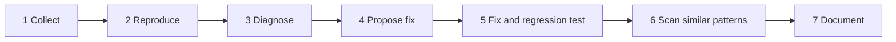

# Hướng dẫn: Sửa lỗi

## Khi nào dùng workflow debug

Dùng `/debug`, hoặc nói “fix bug”, “fix error”, “debug” bằng ngôn ngữ tự nhiên, khi có lỗi cụ thể cần chẩn đoán và sửa. Workflow đưa ra các bước có cấu trúc và có thể tái hiện để tìm và sửa nguyên nhân gốc của lỗi.

Workflow hỗ trợ mọi vendor đã cấu hình. Bước 1 đến 5 chạy inline. Bước 6, quét mẫu tương tự, có thể giao cho subagent `debug-investigator` khi phạm vi quét rộng, từ 10 file trở lên hoặc lỗi xuyên nhiều lĩnh vực; tiếp theo là bản ghi memory của bước 7.

---

## Mẫu báo cáo lỗi

Cung cấp càng nhiều trường sau càng tốt. Mỗi trường giúp workflow thu hẹp tìm kiếm.

### Trường bắt buộc

| Trường | Mô tả | Ví dụ |
|:------|:-----------|:--------|
| **Thông báo lỗi** | Text lỗi hoặc stack trace chính xác | `TypeError: Cannot read properties of undefined (reading 'id')` |
| **Bước tái hiện** | Hành động theo thứ tự kích hoạt lỗi | 1. Đăng nhập bằng admin. 2. Đi tới /users. 3. Nhấn “Delete” trên user bất kỳ. |
| **Hành vi mong đợi** | Điều gì nên xảy ra | User bị xóa khỏi danh sách. |
| **Hành vi thực tế** | Điều gì thực sự xảy ra | Trang crash với màn hình trắng. |

### Trường tùy chọn (rất nên có)

<!-- oma-docs:ignore-start -->
| Trường | Mô tả | Ví dụ |
|:------|:-----------|:--------|
| **Môi trường** | Browser, OS, phiên bản Node, thiết bị | Chrome 124, macOS 15.3, Node 22.1 |
| **Tần suất** | Luôn, đôi khi, chỉ lần đầu | Luôn tái hiện được |
| **Thay đổi gần đây** | Thay đổi trước khi lỗi xuất hiện | Đã merge PR #142 (tính năng xóa user) |
| **Code liên quan** | File hoặc function nghi ngờ | `src/api/users.ts`, `deleteUser()` |
| **Log** | Log server và output console | `[ERROR] UserService.delete: user.organizationId is undefined` |
| **Ảnh chụp/ghi hình** | Bằng chứng trực quan | Ảnh màn hình lỗi |
<!-- oma-docs:ignore-end -->

Càng có đủ context ban đầu, workflow debug càng ít hỏi qua lại.

---

## Phân loại mức độ nghiêm trọng (P0-P3)

Mức độ quyết định cách xử lý và tốc độ sửa.

### P0: critical (phản hồi ngay)

**Định nghĩa:** Production ngừng hoạt động, dữ liệu mất hoặc hỏng, hoặc đang có vi phạm bảo mật.

**Kỳ vọng:** Dừng mọi việc; chỉ xử lý task này cho đến khi xong.

**Ví dụ:**
- Bypass được authentication, mọi user truy cập admin endpoint.
- Database migration làm hỏng bảng users.
- Thanh toán tính tiền khách hàng hai lần.
- API endpoint trả dữ liệu cá nhân của user khác.

**Cách debug:** Bỏ qua template đầy đủ, gửi thông báo lỗi và stack trace; workflow bắt đầu ngay ở Step 2 (Reproduce).

### P1: high (trong cùng session)

**Định nghĩa:** Tính năng cốt lõi hỏng với nhiều user. Có workaround nhưng không chấp nhận được lâu dài.

**Kỳ vọng:** Sửa trong session hiện tại, không bắt đầu feature mới trước khi xong.

**Ví dụ:**
- Search không trả kết quả cho query có ký tự đặc biệt.
- Upload file thất bại trên 5MB dù giới hạn phải là 50MB.
- Mobile app crash khi khởi động trên Android 14.
- Email reset password không gửi vì tích hợp email service hỏng.

**Cách debug:** Dùng đủ vòng lặp bảy bước, nên có QA review.

### P2: medium (trong sprint này)

**Định nghĩa:** Tính năng vẫn hoạt động nhưng hành vi suy giảm, ảnh hưởng usability chứ không mất chức năng.

**Kỳ vọng:** Lên lịch trong sprint hiện tại và sửa trước release tiếp theo.

**Ví dụ:**
- Sort bảng phân biệt hoa thường, “apple” đứng sau “Zebra”.
- Dark mode có text khó đọc trong settings panel.
- API /users phản hồi 8 giây thay vì dưới 1 giây.
- Pagination hiển thị “Page 1 of 0” khi danh sách rỗng.

**Cách debug:** Dùng đủ vòng lặp bảy bước và thêm vào QA regression suite.

### P3: low (backlog)

**Định nghĩa:** Lỗi thẩm mỹ, edge case hoặc bất tiện nhỏ.

**Kỳ vọng:** Đưa vào backlog, sửa khi thuận tiện hoặc gộp với thay đổi liên quan.

**Ví dụ:**
- Tooltip viết “Delet” thay vì “Delete”.
- Console cảnh báo lifecycle method React deprecated.
- Footer lệch 2 pixel ở viewport rộng 768 đến 800px.
- Spinner chạy thêm 200ms sau khi content đã hiển thị.

**Cách debug:** Có thể không cần đủ vòng lặp; sửa trực tiếp kèm regression test là đủ.

---

## Chi tiết vòng lặp debug bảy bước {#the-seven-stage-debug-loop-in-detail}

Workflow `/debug` chạy các bước này theo thứ tự. Nó dùng provider code-intelligence đã cấu hình. Native search chỉ dành cho path nằm ngoài project hoặc path bị ignore khi provider không khả dụng hoặc timeout.



### Bước 1: thu thập thông tin lỗi

Workflow hỏi (hoặc nhận từ người dùng):
- Thông báo lỗi và stack trace
- Bước tái hiện
- Hành vi mong đợi so với thực tế
- Chi tiết môi trường

Nếu prompt đã có sẵn thông báo lỗi, workflow chuyển ngay sang Bước 2.

### Bước 2: tái hiện lỗi

**Công cụ:** các công cụ search và symbol đã cấu hình, hoặc `rg` native cùng việc đọc file có phạm vi khi công cụ đã cấu hình không khả dụng.

Mục tiêu là định vị lỗi trong codebase: tìm chính xác dòng ném exception, function tạo output sai hoặc điều kiện gây hành vi bất ngờ.

Bước này biến triệu chứng người dùng báo cáo (“trang crash”) thành vị trí ở mức codebase (`src/api/users.ts:47, deleteUser() throws TypeError`).

### Bước 3: chẩn đoán nguyên nhân gốc

**Công cụ:** điều hướng reference và symbol khi khả dụng, sau đó đọc native có mục tiêu khi không khả dụng.

Workflow truy ngược từ vị trí lỗi để tìm nguyên nhân thực sự. Nó kiểm tra các pattern nguyên nhân gốc phổ biến sau:

| Pattern | Cần tìm gì |
|:--------|:----------------|
| **Truy cập null/undefined** | Thiếu null check, cần optional chaining, biến chưa khởi tạo |
| **Race condition** | Async hoàn tất sai thứ tự, thiếu await, shared mutable state |
| **Thiếu xử lý lỗi** | Thiếu try/catch, promise rejection không xử lý, thiếu error boundary |
| **Sai kiểu dữ liệu** | Dùng string thay number, thiếu type coercion, schema sai |
| **State cũ** | React state không cập nhật, cache chưa invalidate, closure giữ giá trị cũ |
| **Thiếu validation** | Input chưa sanitize, body request chưa validation, bỏ sót boundary condition |

Hãy chẩn đoán nguyên nhân gốc, không phải triệu chứng. Nếu `user.id` undefined, hãy hỏi vì sao `user` undefined tại điểm đó trong luồng thực thi, thay vì hỏi cách chặn giá trị undefined.

### Bước 4: đề xuất bản sửa tối thiểu

Workflow trình bày:
1. Nguyên nhân gốc đã xác định (kèm bằng chứng từ việc trace code).
2. Bản sửa đề xuất (chỉ thay đổi phần cần thiết).
3. Giải thích vì sao bản sửa xử lý nguyên nhân gốc chứ không chỉ triệu chứng.

Workflow trình bày đề xuất trước khi chỉnh sửa. Nó chờ xác nhận khi thay đổi chưa được request hoặc execution policy cho phép; authorization đã có cho phép tiếp tục mà không cần hỏi lần hai.

**Nguyên tắc sửa tối thiểu:** Đổi ít dòng nhất có thể. Không refactor, không cải thiện code style, không thêm feature không liên quan. Bản sửa phải review được trong dưới 2 phút.

### Bước 5: áp dụng sửa và viết regression test

Bước này gồm hai hành động:

1. **Triển khai bản sửa**: Áp dụng thay đổi tối thiểu đã được duyệt.
2. **Viết regression test**: Một test:
   - Tái hiện lỗi ban đầu (test phải fail khi chưa có bản sửa)
   - Xác minh bản sửa hoạt động (test phải pass khi có bản sửa)
   - Ngăn cùng lỗi tái xuất hiện trong các thay đổi sau này

Regression test là output quan trọng nhất của workflow debug. Không có nó, bất kỳ thay đổi nào sau này cũng có thể đưa lại cùng lỗi.

### Bước 6: quét mẫu tương tự

Sau khi áp dụng bản sửa, workflow quét toàn bộ codebase để tìm cùng pattern đã gây lỗi.

**Công cụ:** pattern search đã cấu hình hoặc native search có phạm vi, với pattern đã được xác định là nguyên nhân gốc.

Ví dụ, nếu lỗi do truy cập `user.organization.id` mà không kiểm tra `organization` có null không, đợt quét tìm mọi chỗ khác truy cập `organization.id` không có null check.

**Tiêu chí giao subagent:** Workflow spawn subagent `debug-investigator` khi:
- Lỗi trải qua nhiều domain (ví dụ cả frontend và backend đều bị ảnh hưởng).
- Phạm vi quét pattern tương tự bao gồm từ 10 file trở lên.
- Cần trace dependency sâu để chẩn đoán đầy đủ vấn đề.

Phương thức spawn theo vendor:

| Vendor | Phương thức spawn |
|:-------|:------------|
| Claude Code | Agent tool với `.claude/agents/debug-investigator.md` |
| Codex CLI | Yêu cầu subagent do model điều phối, kết quả JSON |
| Antigravity / Fallback | `oma agent spawn debug "scan prompt" {session_id} -w {workspace}` |

Mọi vị trí có nguy cơ tương tự đều được báo cáo. Các instance đã xác nhận được sửa trong cùng session.

### Bước 7: ghi tài liệu lỗi

Workflow ghi một memory file gồm:
- Symptom và nguyên nhân gốc
- Bản sửa đã áp dụng và các file đã thay đổi
- Vị trí regression test
- Các pattern tương tự tìm thấy trong codebase

---

## Mẫu prompt cho /debug

Khi gọi workflow, có thể dùng prompt có cấu trúc:

```text
/debug

Error: TypeError: Cannot read properties of undefined (reading 'id')
Stack trace:
  at deleteUser (src/api/users.ts:47:23)
  at handleDelete (src/routes/users.ts:112:5)

Steps to reproduce:
1. Log in as admin
2. Navigate to /users
3. Click "Delete" on a user whose organization was deleted

Expected: User is deleted
Actual: 500 Internal Server Error

Environment: Node 22.1, PostgreSQL 16
```


**Vì sao cấu trúc này hiệu quả:**

- **Error và stack trace** cho phép Step 2 định vị ngay code, chẳng hạn search `deleteUser` tìm function và `find_symbol` xác định vị trí.
- **Bước tái hiện** với điều kiện “user whose organization was deleted” gợi ý null foreign key.
- **Environment** loại trừ giả thuyết sai do khác phiên bản.

Với lỗi đơn giản, prompt ngắn hơn cũng được:

```text
/debug The login page shows "Invalid credentials" even with correct password
```


Workflow sẽ hỏi thêm chi tiết nếu cần.

---

## Tín hiệu cần nâng cấp phạm vi

Các tín hiệu sau cho thấy lỗi cần vượt khỏi vòng lặp debug chuẩn.

### Tín hiệu 1: đã thử cùng bản sửa hai lần

Nếu workflow đề xuất một bản sửa, áp dụng nó, và cùng lỗi đó lại tái diễn, thì vấn đề sâu hơn chẩn đoán ban đầu. Hãy đánh giá lại nguyên nhân. Nếu các phương án thay thế đáng thử và ngân sách phục hồi hiện có cho phép, dùng **Exploration Loop** trong workflow đang chạy (ultrawork, orchestrate, work):

- Tạo 2 đến 3 giả thuyết thay thế cho nguyên nhân gốc.
- Cô lập từng thí nghiệm và bảo toàn baseline, bằng chứng của nó cũng như công việc không liên quan.
- Chọn cách tiếp cận đáp ứng hành vi bắt buộc và tiêu chí đo lường có thể so sánh, rồi xác minh kết quả đã tích hợp.

### Tín hiệu 2: nguyên nhân gốc xuyên nhiều lĩnh vực

Lỗi ở frontend do một thay đổi backend gây ra, còn thay đổi backend đó lại do database schema migration gây ra. Khi nguyên nhân gốc vượt qua ranh giới domain, hãy nâng cấp lên `/work` hoặc `/orchestrate` để gọi các domain agent liên quan.

**Ví dụ:** Frontend hiển thị “undefined” cho tên user; backend trả null ở `user.display_name`; migration thêm column nhưng row cũ có NULL. Cần backfill database, null handling ở backend và fallback ở frontend.

### Tín hiệu 3: thiếu môi trường tái hiện

Lỗi chỉ xảy ra ở production và bạn không thể tái hiện ở local. Dấu hiệu gồm:
- Khác biệt cấu hình theo môi trường.
- Race condition chỉ xuất hiện dưới tải production.
- Hành vi của dịch vụ third-party khác nhau giữa staging và production.

**Hành động:** Thu thập log production, xin quyền truy cập monitoring production và cân nhắc thêm instrumentation/logging trước khi thử sửa.

### Tín hiệu 4: hạ tầng test thất bại

Không thể viết regression test vì test infrastructure hỏng, thiếu hoặc không đủ.

**Hành động:** Sửa test infrastructure trước (hoặc dùng `oma install` để cấu hình), rồi quay lại workflow debug. Nếu executable check không áp dụng, ghi lý do trong result contract thay vì tạo check pass giả.

---

## Checklist xác minh sau sửa

Sau khi áp dụng bản sửa và regression test, hãy xác minh:

- [ ] **Regression test fail khi chưa có bản sửa:** Tạm revert bản sửa để xác nhận test bắt lỗi.
- [ ] **Regression test pass khi có bản sửa:** Áp dụng lại và xác nhận pass.
- [ ] **Check hiện có liên quan vẫn pass:** Chạy check bao phủ hành vi đổi; chỉ build khi task yêu cầu.
- [ ] **Đã quét pattern tương tự:** Hoàn thành Bước 6 và xử lý hoặc ghi lại mọi vị trí.
- [ ] **Bản sửa tối thiểu:** Chỉ đổi dòng cần thiết.
- [ ] **Đã ghi nguyên nhân gốc:** Memory có symptom, root cause, bản sửa, file đổi, vị trí regression test và pattern tương tự.

---

## Tiêu chí hoàn tất

Workflow debug hoàn tất khi:

1. Root cause được xác định và ghi lại.
2. Bản sửa tối thiểu được áp dụng theo authorization.
3. Có regression test fail trước sửa và pass sau sửa.
4. Codebase được scan cho pattern tương tự, mọi instance được xử lý hoặc ghi lại.
5. Bug report được ghi vào memory với đầy đủ symptom, root cause, bản sửa, file đổi, regression test và pattern.
6. Mọi test hiện có tiếp tục pass.

---

## Bước tiếp theo

- Nguyên nhân gốc xuyên nhiều lĩnh vực: [Dự án đa agent](./multi-agent-project.md)
- Ghi lại hoặc tiếp tục lần chạy sửa lỗi: [Kết quả và Resume](./agent-results-and-resume.md)
- Có gì đó trong chính OMA bị lỗi: [Troubleshooting](./troubleshooting.md)
