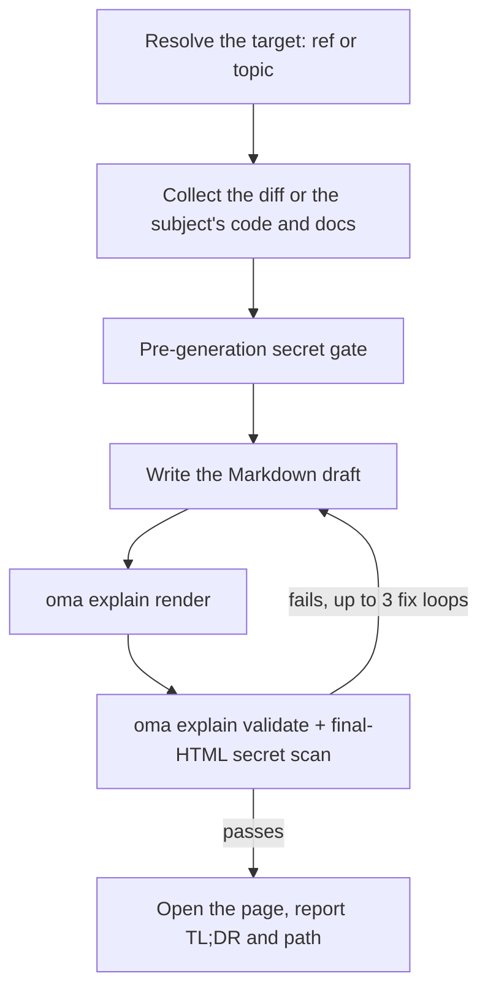

# Code Explainer {#code-explainer}

`/explain` biến một code change thành HTML document phong phú, tự chứa, dạy người đọc điều gì đã đổi và vì sao — background sâu có thể bỏ qua cho người mới, phần core intuition với toy data, code walkthrough theo thứ tự dễ hiểu và quiz năm câu. Output là một file `.html` duy nhất có thể chạy offline, với diagram, callout và quiz accessible, được lưu dưới `.agents/results/explain/` và validate bằng deterministic checklist trước khi giao.

`/explain` chỉ là slash command — không tự kích hoạt từ natural language. “explain” là từ thông dụng nên cố ý bị loại khỏi keyword detection (cùng precedent với `/convert`). Hãy nói rõ `/explain`, hoặc yêu cầu skill khác tạo “explainer document” như delegated output.

## Hai mode {#two-modes}

| Mode | Bạn nhập | Cần git | Trang giải thích điều gì |
|---|---|---|---|
| Change | `/explain`, `/explain #640`, `/explain a..b`, `/explain <branch>` | có (`gh` cho PR ref) | Một code change: Background, Intuition, Code, Quiz |
| Topic | `/explain how does session windowing work` (text không resolve thành PR, branch hay SHA range nào) | không | Một khái niệm, một hệ thống, hoặc câu trả lời cho một câu hỏi, dưới dạng visual sheet một trang: câu trả lời dẫn đầu, sau đó là các panel gồm diagram, bảng và đoạn prose ngắn |

Nếu text có thể vừa là tên branch vừa là chủ đề, workflow kiểm tra nó như git ref trước; ref được ưu tiên.

---

## Khi nào nên dùng {#when-to-use}

- Giải thích PR, branch, commit range hoặc thay đổi staged/unstaged hiện tại dưới dạng tài liệu
- Onboard teammate vào một change họ không viết
- Tạo teaching artifact có thể review sau khi change lớn hoặc khó hiểu được đưa vào
- Biến một kiến trúc, một protocol, một phép so sánh hoặc một câu trả lời dài thành một trang trực quan (topic mode)

## Khi nào KHÔNG nên dùng {#when-not-to-use}

- *Video* explainer có narration → dùng [`oma-video`](./video-generation.md) (explainer mode); `/explain` tạo HTML document, không phải video
- Kiểm tra docs còn khớp codebase không → dùng `oma-docs` (drift detection)
- Presentation deck / slide → dùng `oma-slide` (fixed 1920×1080 deck contract)
- Tìm defect hoặc đưa review verdict → dùng `oma-qa` hoặc workflow `/review`; `/explain` kể lại change theo hướng giáo dục, không đánh giá change

---

## Bắt đầu nhanh {#quick-start}

```text
/explain
/explain 640
/explain a1b2c3d..e5f6a7b
/explain payments-refactor for reviewer
```

Target ref được resolve từ cách viết:

| Bạn nhập | Target resolution | Reader level |
|----------|--------------------|--------------|
| `/explain` | Staged change (`git diff --cached`), fallback sang dirty working tree | `onboarding` |
| `/explain 640`, `/explain #640` | PR #640 qua `gh pr diff` | `onboarding` |
| `/explain a..b` | SHA range `a..b` (hoặc `a...b`) | `onboarding` |
| `/explain feature-branch for reviewer` | `git diff main...feature-branch` | `reviewer` |
| `/explain how does the row planner work` | Topic mode: không có ref; agent thu thập code và docs liên quan đến chủ đề | n/a |

Nếu không đưa ref rõ ràng và cả staged lẫn dirty working tree đều rỗng, resolution fallback sang `HEAD~1..HEAD`.



---

## Thứ tự resolve ref {#ref-resolution-order}

Chỉ áp dụng cho change mode; topic mode bỏ qua ref resolution.

1. **Explicit argument** — PR number (`#640`), branch name hoặc SHA range (`a..b` / `a...b`)
2. **Staged changes** — `git diff --cached`
3. **Dirty working tree** — `git diff`
4. **Fallback** — `HEAD~1..HEAD`

Diff rỗng hoặc ref không resolve được sẽ dừng workflow; nó đưa các commit gần đây làm candidate thay vì tự đoán alternative.

---

## Reader level {#reader-levels}

| Level | Tác dụng |
|-------|--------|
| `onboarding` (mặc định) | Background sâu đầy đủ (Tier A), cho người chưa biết hệ thống xung quanh |
| `reviewer` | Thu gọn deep background tier; phần Intuition và Code vẫn đầy đủ |

Yêu cầu `reviewer` bằng cách thêm “for reviewer” vào command, như `/explain feature-branch for reviewer`.

---

## Tài liệu chứa gì {#what-the-document-contains}

Phần này mô tả change mode. Explainer ở change mode là một trang cuộn dài duy nhất (không tab, không multi-page navigation) với table of contents rồi bốn section cố định theo thứ tự:

1. **Background** — Tier A (background system/architecture sâu, đánh dấu “skippable if you already know the system”) và Tier B (context hẹp cho change cụ thể)
2. **Intuition** — bản chất cốt lõi của change với toy-data example bắt buộc, được củng cố bởi 2–3 diagram family dùng lại (UI mock đơn giản, system/data-flow diagram mang example data, before/after state) render chỉ bằng HTML/inline SVG — không ASCII art
3. **Code** — walkthrough nhóm theo cách con người hiểu (không theo alphabet hoặc diff order), tham chiếu code bằng `file:line`
4. **Quiz** — mặc định 5 câu (có thể parameterize), mỗi câu nhắm một khía cạnh riêng của change, với distractor hợp lý và feedback text cho mọi option (đúng và sai)

Prose và quiz content viết bằng ngôn ngữ output yêu cầu (prompt language → `.agents/oma-config.yaml` `language` → English); code, identifier và inline code giữ tiếng Anh theo i18n rule. Content contract đầy đủ ở `.agents/skills/oma-explanation/resources/document-structure.md`.

---

## Cách trang được dựng {#how-the-page-is-built}

Agent viết một Markdown draft, và `oma explain render` biến nó thành trang: layout, theme, hình học của diagram và quiz script đến từ renderer, không phải từ model.

| Lệnh | Công dụng |
|---|---|
| `oma explain render draft.md` | Render một draft (file hoặc stdin) thành `.agents/results/explain/{YYYY-MM-DD}-{slug}.html`. Option gồm `--template sheet\|doc`, `--theme`, `--mode`, `--archify` và `--open`. |
| `oma explain lint draft.md` | Kiểm tra prose mà không render (`--style strict` thoát với mã 1 khi có warning). |
| `oma explain components [name]` | Liệt kê các component mà draft có thể dùng (`flow`, `sequence`, `tree`, `timeline`, `limits`, `annot`, `kv`, `callout`, `quiz`), hoặc in cú pháp của một component. |
| `oma explain patch <page.html> --panel <id>` | Thay một panel của trang đã render (theo chữ cái hoặc tiêu đề) và giữ nguyên phần còn lại. |
| `oma explain validate <file>` | Chạy các post-check deterministic mô tả bên dưới. |

---

## HTML contract {#the-html-contract}

Trang do `oma explain render` tạo tự động đáp ứng các quy tắc này; chúng quan trọng khi bạn kiểm tra hoặc sửa HTML bằng tay.

File được tạo phải mở đúng offline qua `file://` với **zero external resource load** — không CDN script/stylesheet, không webfont, không external image (chỉ inline SVG hoặc data URI). Hyperlink anchor (`<a href="https://...">`) được phép; lệnh cấm chỉ áp dụng resource-*loading*.

- Code block dùng `<pre>`; custom container phải khai báo `white-space: pre-wrap`. Không dùng external syntax-highlighting library.
- Font stack: Pretendard cài sẵn trên máy, khớp theo tên family (trang không bao giờ tải font và không dùng hàm CSS `local()`), sau đó là `system-ui` và system CJK font. Trang tiếng Nhật và tiếng Trung bỏ qua Pretendard và bắt đầu từ `system-ui` cùng font cho ngôn ngữ đó.
- Responsive từ 375px, WCAG AA contrast ở cả light và dark theme, hỗ trợ `prefers-color-scheme: dark` và tôn trọng `prefers-reduced-motion`.
- Quiz là vanilla JS: option là element `<button>`, feedback đúng/sai tức thời được announce qua vùng `aria-live="polite"`, đáp án đúng phân bố ngẫu nhiên, có final score summary và keyboard navigation đầy đủ.

Behavioral spec đầy đủ: `.agents/skills/oma-explanation/resources/html-contract.md`.

---

## Secret và phòng vệ prompt injection {#secrets-and-prompt-injection-defense}

Diff content và PR description được coi nghiêm ngặt là **data** — mọi instruction nằm trong change đang giải thích đều bị bỏ qua.

Secret được gate hai lần:

1. **Pre-generation:** collected diff được scan trước khi author bất kỳ thứ gì.
2. **Post-generation:** HTML cuối cũng được scan vì background prose có thể quote file không đổi mà diff scan không thấy.

Nếu phát hiện hit, generation dừng ngay, chỉ báo vị trí đã mask (không bao giờ báo value thật), và việc tiếp tục sau redaction cần confirmation rõ ràng.

---

## Validation checklist {#validation-checklist}

Sau generation, grep-based checklist chạy trên output file: không có external resource-loading reference, code-container `pre`/`pre-wrap` hợp lệ, quiz script hiện diện, filename dạng `{YYYY-MM-DD}-{slug}.html` (date theo Asia/Seoul) và final-HTML secret scan. Khi thất bại, loop sửa và validate lại tối đa **3 iteration**, sau đó dừng và nêu item còn fail thay vì âm thầm giao.

Đây là giới hạn v1: validation dựa trên grep/file và chỉ xác minh quiz-script *có mặt* (không xác minh đầy đủ behavior). Dùng browser (hoặc chrome-devtools MCP) để tự chạy quiz khi cần confidence về behavior.

Có thể validate artifact hiện có bằng CLI đã đăng ký:

```bash
oma explain validate .agents/results/explain/2026-09-09-payment-refactor.html
oma explain validate --input-dir .agents/results/explain --output json
```

Output mong đợi (tên file minh họa):

```text
$ oma explain validate .agents/results/explain/2026-09-09-payment-refactor.html
✔ Explain validation passed: 1/1 file(s) valid

$ oma explain validate ".agents/results/explain/payment refactor.html"
✖ Explain validation failed: 1/1 file(s) failed
File: .agents/results/explain/payment refactor.html
  - [error] filename-format: Filename 'payment refactor.html' does not match format {YYYY-MM-DD}-{slug}.html
```

Dạng đầu kiểm tra một HTML file. Dạng directory kiểm tra mọi report trong directory và trả machine-readable report. Dùng `--report-file <path>` để lưu JSON report; cách viết cũ `--out-file` giờ fail với `Removed option --out-file. Use --report-file.` Exit nonzero nghĩa là ít nhất một artifact fail deterministic check; command không kiểm tra teaching accuracy của prose hoặc quiz answer.

---

## Output {#output}

```text
.agents/results/explain/{YYYY-MM-DD}-{slug}.html
```

Date được localize theo Asia/Seoul. Chạy lại cùng date + slug sẽ ghi đè file trước — trách nhiệm giữ run cũ thuộc về bạn. Sau khi validation pass, workflow thử mở trang (warn-only; môi trường headless chỉ fallback sang báo path) và báo TL;DR cùng file path. `oma explain render --open` mở trang trực tiếp trong browser.

---

## Archify sidecar tùy chọn {#optional-archify-sidecar}

Khi `diagram.explain_sidecar: true` được đặt trong `oma-config.yaml` hoặc bạn yêu cầu (`/explain 640 with archify`), `/explain` render với `--archify`: nó dựng interactive `{date}-{slug}.archify.html` từ một block `flow` hoặc `sequence` của draft và liên kết bằng anchor thường. Nó không bao giờ được embed — explainer vẫn là file tự chứa duy nhất — và sidecar failure không bao giờ chặn delivery. Xem [Diagram Engine](./diagram-engine.md#explain).

## Edge case {#edge-cases}

| Tình huống | Hành vi |
|-----------|----------|
| Diff rỗng / ref không resolve | Dừng, đưa commit gần đây làm candidate — không đoán ref khác |
| Diff quá lớn | Tự loại lockfile/generated file, nhóm phần còn lại theo file, liệt kê exclusion trong provenance footer |
| Diff chỉ có binary hoặc generated | Dừng — không có gì để giải thích |
| `gh` CLI thiếu hoặc chưa authenticate (PR ref) | Hướng dẫn install/auth, kèm alternative local branch-diff |
| Đang merge/rebase | Dừng — worktree không ổn định |
| Không phải thư mục git | Change mode: dừng ngay. Topic mode chạy không cần git. |
| Validation fail sau 3 fix loop | Dừng và nêu item checklist còn fail |
| `open` fail / môi trường headless | Chỉ cảnh báo — path đã báo là đủ |

---

## Bước tiếp theo {#related}

- [`/explain` workflow](../core-concepts/workflows.md#explain) — pipeline ref-resolution → collect → secret gate → generate → validate → deliver
- [Diagram Engine](./diagram-engine.md) — archify sidecar tùy chọn
- [CLI Commands: explain](../cli-interfaces/commands.md#explain) — mọi option của `oma explain`
- [Tạo video](./video-generation.md) — *mode* explainer của `oma-video` tạo narrated video thay vì HTML document
- [Content and Research Workflows](./content-and-research.md) — các khả năng tài liệu và nghiên cứu khác
