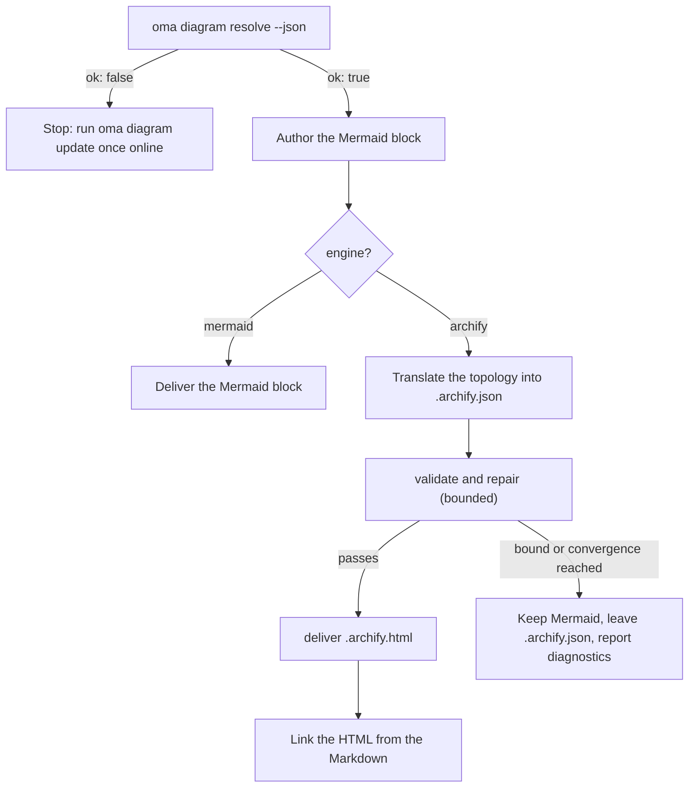

# Diagram Engine {#diagram-engine}

`/architecture` (ADR, recommendation, review) và `/explain` (code-change explainer) đều tạo diagram cấu trúc. Output của `/architecture` luôn có block **Mermaid** trong Markdown artifact. `/explain` tự vẽ diagram inline SVG. Khi [archify](https://github.com/tt-a1i/archify) resolve được, OMA cũng tạo **interactive, validated HTML diagram** cạnh artifact. Diagram này hỗ trợ theme sáng/tối, pan-zoom, search, relationship tracing và export PNG/SVG/WebM từ typed JSON spec.

Mermaid là SSOT dạng văn bản trong Markdown và git diff. archify tạo artifact dẫn xuất.

---

<a id="always-the-latest-archify--nothing-to-install"></a>
## Cài đặt archify {#install-archify}

archify là agent skill MIT-licensed (Node ≥ 18, không có runtime dependency). oh-my-agent dùng bản được cài qua [skills CLI](https://github.com/vercel-labs/skills) và không giữ bản riêng nào:

- `oma diagram update` cài archify khi chưa có (`bunx skills add tt-a1i/archify --skill archify -g -y`), còn nếu đã có thì cập nhật nó (`bunx skills update archify -g -y`).
- `oma diagram resolve` chỉ đọc các skill directory đã cài và không bao giờ chạm vào network. Khi chưa cài, `auto` fallback sang Mermaid và nêu tên lệnh cài.
- `oma update` không cài archify.

```bash
# Illustrative output; the version, install path, and quality can vary.
oma diagram update
oma diagram resolve
# engine:   archify  (requested: auto)
# reason:   archify 2.15.0 via home:~/.agents/skills
# root:     /Users/you/.agents/skills/archify
# bin:      /Users/you/.agents/skills/archify/bin/archify.mjs
# version:  2.15.0
# quality:  showcase
# sidecar:  off (explain)
```

Thứ tự resolve (hit đầu tiên thắng, giống nhau ở mọi vendor runtime):

1. `diagram.archify.path` trong `oma-config.yaml` — pin rõ ràng
2. Biến môi trường `ARCHIFY_HOME` — pin rõ ràng
3. Skill dir đã cài: project `.agents` / `.claude` / `.codex` / `.cursor` / `.qwen` / `.kiro` / `.gemini` / `.copilot` `/skills/archify`, sau đó cùng vị trí dưới `~`, rồi `~/.config/agents/skills/archify` và `~/.raven/workspace/skills/archify`

<!-- oma-docs:ignore-start -->
Một hit yêu cầu archify directory đã cài hoặc được pin chứa `bin/archify.mjs`.
<!-- oma-docs:ignore-end -->

Các release trước giữ bản riêng dưới `~/.cache/oma-diagram/`. Bản này không còn được đọc nữa; bạn có thể xóa nó.

---

## Cấu hình {#configuration}

Sparse section trong `.agents/oma-config.yaml` (key bị bỏ qua dùng default bên dưới):

```yaml
diagram:
  engine: auto                # auto | archify | mermaid
  explain_sidecar: false      # /explain also writes an archify sidecar
  archify:
    path: null                # explicit install dir (pin)
    quality: showcase         # showcase | standard  → --quality
    open: false               # pass --open to deliver
```

`archify.managed`, `archify.channel` và `archify.check_interval_min` đã deprecated: chúng vẫn qua validate nhưng bị bỏ qua, và `resolve` in cảnh báo chừng nào chúng còn được đặt.

### Engine nào chạy {#which-engine-runs}

Một quyết định duy nhất bao quát giá trị config, việc archify có resolve được hay không, và workflow giao ra gì. "Resolve được" nghĩa là một bước bất kỳ trong [thứ tự resolve](#always-the-latest-archify--nothing-to-install) tìm thấy installation: một pin hoặc một skill dir đã cài.

| `diagram.engine` | archify resolve được? | `oma diagram resolve --json` | Kết quả `/architecture` |
|---|---|---|---|
| `auto` (mặc định) | có | `engine: archify`, `ok: true` | Mermaid block + `.archify.html` được link |
| `auto` | không (archify chưa được cài) | `engine: mermaid`, `ok: true` | Chỉ Mermaid; report nêu tên `oma diagram update` |
| `archify` | có | `engine: archify`, `ok: true` | Mermaid block + `.archify.html` được link |
| `archify` | không | `engine: mermaid`, `ok: false`, exit 1 | Workflow dừng với hint `oma diagram update` thay vì âm thầm downgrade |
| `mermaid` | không kiểm tra | `engine: mermaid`, `ok: true` | Chỉ Mermaid; archify không bao giờ được gọi |

`oma diagram resolve --engine <auto|archify|mermaid>` ghi đè config cho một lần gọi, và prompt có thể làm điều tương tự cho một run (`/explain 640 with archify`).

---

## CLI {#cli}

```bash
oma diagram resolve [--engine auto|archify|mermaid] [--json]
oma diagram update  [--json]
oma diagram archify <archify args…>
```

`oma diagram update` buộc refresh và thoát với mã 1 khi không resolve được archify installation nào.

`oma diagram archify` chạy resolved archify executable với `ARCHIFY_UPDATE_CHECK_DISABLED=1` (không network) và truyền exit code, nên `validate` / `deliver` / `visual-check` hoạt động đúng như archify documentation:

```bash
oma diagram archify guide "show the auth request lifecycle" --json
oma diagram archify validate architecture adr-auth.archify.json --quality showcase --json
oma diagram archify deliver  architecture adr-auth.archify.json adr-auth.archify.html --quality showcase --json
oma diagram archify visual-check adr-auth.archify.html --json   # exit 2 = no Chrome (skipped), or archify itself could not be resolved
```

`--json` trên `resolve` trả `{ ok, requested, engine, quality, open, explainSidecar, archify?: { root, bin, version, source }, reason, probed, warnings }` — `source` là `config:…`, `env:…` hoặc skill-dir label như `home:~/.agents/skills`; `warnings` liệt kê các key deprecated bị bỏ qua. `--refresh` và `--offline` được chấp nhận như no-op deprecated.

---

## Workflow dùng nó thế nào {#how-the-workflows-use-it}

Protocol dùng chung nằm trong `.agents/skills/_shared/conditional/diagram-engine.md`. `/architecture` theo sequence sau:

1. `oma diagram resolve --json`
2. Author Mermaid block trước (luôn luôn).
3. Nếu `engine: archify`: dịch topology Mermaid sang archify JSON IR (`architecture` / `sequence` / `dataflow` / `lifecycle` / `workflow`), chỉ đọc schema tương ứng và một example từ installation.
4. `validate` → repair → `deliver`, có giới hạn: dừng khi spec pass, khi convergence rule của archify kích hoạt, sau 3 lần repair, sau tổng cộng 10 phút, hoặc khi cùng một diagnostic lặp lại. Không xóa semantic label chỉ để pass.
5. Link HTML — không embed.



### `/architecture` {#architecture}

Chỉ dùng cho structural decision (boundary, dependency, data flow). Output cạnh Markdown artifact dưới `.agents/results/architecture/`:

```text
adr-notification-service.md            # Mermaid block + "Interactive:" link
adr-notification-service.archify.json  # frozen spec (kept even on failure)
adr-notification-service.archify.html  # delivered viewer
```

### `/explain` {#explain}

Opt-in vì contract riêng của explainer (single self-contained file, CSS-variable theming) không cho embed HTML document đầy đủ thứ hai. Bật bằng `diagram.explain_sidecar: true`, truyền `oma explain render --archify`, hoặc hỏi trong prompt ("with archify"). Không có Mermaid block và không có JSON viết tay: renderer derive archify spec từ một block `flow` hoặc `sequence` của draft (panel được đánh dấu `{archify}`), chạy `deliver` (fallback một lần từ quality `showcase` sang `standard`), và link `{date}-{slug}.archify.html` bằng plain `<a href>`. Lệnh báo `linked`, `skipped` (kèm lý do), hoặc `failed` (diagnostic đầu tiên). Workflow không lặp lại với sidecar thất bại, và sidecar failure không bao giờ chặn explainer.

---

## Stack poster (stack-diagram) {#stack-posters-stack-diagram}

Khi diagram là tech-stack hoặc topology hạ tầng mà các node là sản phẩm của vendor (AWS, Vercel, Postgres, …) và bạn yêu cầu logo, `/architecture` đi theo **stack route** thay vì archify. Nó chạy upstream agent skill [Caru-ini/stack-diagram](https://github.com/Caru-ini/stack-diagram) (MIT; Python 3.9+, cần network để lấy logo) theo cùng cách `oma-slide` chạy ppt-master: không có command oma và không có config key. Bảng route nằm trong `.agents/skills/_shared/conditional/diagram-engine.md`.

- Resolve: runtime skill catalog trước, nếu không thì `bunx skills use caru-ini/stack-diagram@stack-diagram`. Nếu không resolve được, workflow fallback về quyết định archify ↔ Mermaid ở trên và nói rõ điều đó.
- Output: `<artifact-stem>.stack.html` cạnh Markdown artifact, được link dưới section Diagram dưới dạng `Stack: …`. Mermaid block vẫn là SSOT.
- Chỉ HTML. PNG export và screenshot check của upstream cần Playwright + Chromium; oma không bao giờ cài hoặc chạy chúng.
- Gallery upload của upstream (`share.py`) bị bỏ qua trừ khi bạn yêu cầu publish một cách rõ ràng.
- Giới hạn: 2 lần build, tổng cộng 5 phút; một lần chạy `build.py` sạch là tiêu chí chấp nhận.
- `/explain` không bao giờ đi theo route này; sidecar của nó được derive trong code từ draft.

Viết "archify" trong prompt để buộc dùng structural route, hoặc "stack-diagram" / "with logos" để buộc dùng stack route.

---

## Failure mode {#failure-modes}

Trường hợp archify không resolve được đã được bao quát trong [bảng quyết định engine](#which-engine-runs). Các trường hợp còn lại:

| Tình huống | Kết quả |
|---|---|
| `oma diagram update` thất bại (offline, thiếu `bunx`) | Hiển thị lỗi của skills CLI; installation hiện có vẫn tiếp tục hoạt động |
| `validate` không hội tụ | Mermaid vẫn là diagram được giao; `.archify.json` cuối để lại cho người; diagnostics được báo nguyên văn |
| Thiếu Chrome cho `visual-check` | Báo `skipped`, không bao giờ coi là pass |
| `oma diagram archify …` thoát với mã 2 | Hoặc thiếu Chrome (`visual-check`), hoặc không resolve được archify; hãy kiểm tra `oma diagram resolve --json` trước |

---

## Bước tiếp theo {#related}

- [Code Explainer](./code-explainer.md) — workflow `/explain` và archify sidecar tùy chọn của nó
- [`/architecture` workflow](../core-concepts/workflows.md#architecture) — ADR và review chứa Mermaid block
- [Ngữ nghĩa oma-config.yaml](./oma-config-semantics.md) — cách section `diagram:` được merge
- [CLI Commands: diagram](../cli-interfaces/commands.md#diagram) — danh sách option đầy đủ
- [Market Research](./market-research.md) — cùng pattern cài qua skills CLI cho engine last30days
- archify upstream: [tt-a1i/archify](https://github.com/tt-a1i/archify)
- stack-diagram upstream: [Caru-ini/stack-diagram](https://github.com/Caru-ini/stack-diagram)
