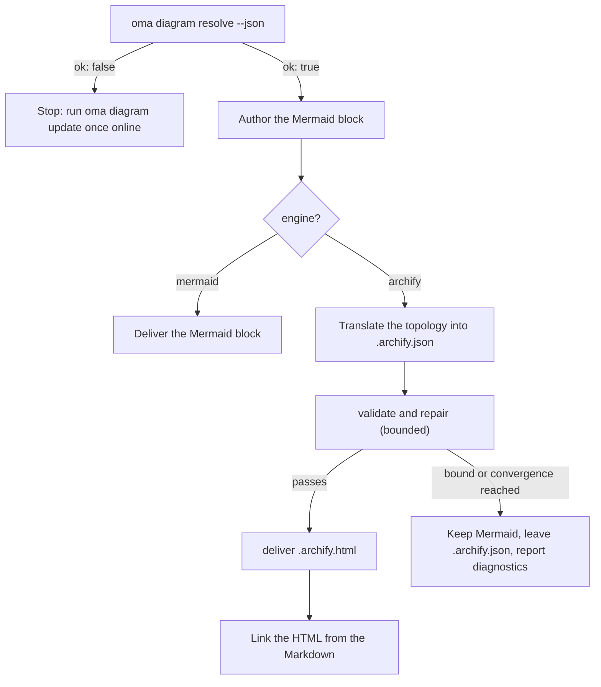

# Diagram Engine {#diagram-engine}

`/architecture` (ADR, recommendation, review) và `/explain` (code-change explainer) đều tạo diagram cấu trúc. Output của `/architecture` luôn có block **Mermaid** trong Markdown artifact. `/explain` tự vẽ diagram inline SVG. Khi [archify](https://github.com/tt-a1i/archify) resolve được, thường là trường hợp bình thường, OMA cũng tạo **interactive, validated HTML diagram** cạnh artifact. Diagram này hỗ trợ theme sáng/tối, pan-zoom, search, relationship tracing và export PNG/SVG/WebM từ typed JSON spec.

Mermaid là SSOT dạng văn bản trong Markdown và git diff. archify tạo artifact dẫn xuất.

---

## Cache archify và cập nhật phiên bản {#always-the-latest-archify--nothing-to-install}

archify là agent skill MIT-licensed (Node ≥ 18, không có runtime dependency). oh-my-agent không dựa vào bản bạn cài một lần; nó giữ **managed copy riêng** và theo dõi release mới nhất:

- Cache: `~/.cache/oma-diagram/archify/<tag>/` cùng pointer `state.json`.
- Trước mỗi lần dùng, `oma diagram resolve` hỏi GitHub release tag mới nhất (throttled một lần mỗi `check_interval_min`, mặc định 60 phút), tải source tarball khi có tag mới (atomic theo tag directory; tag cũ bị prune), nếu không thì dùng lại cache.
- Network failure không bao giờ fatal: dùng cached copy và báo `stale` kèm lý do. Chỉ lần chạy đầu tiên không network và không cache mới fallback sang skill copy do user cài, sau đó fallback sang Mermaid.

```bash
# Illustrative output; the release tag, cache path, and quality can vary.
oma diagram update          # force a check / download now
oma diagram resolve
# engine:   archify  (requested: auto)
# reason:   archify 2.15.0 via managed:v2.15.0 (current)
# root:     /Users/you/.cache/oma-diagram/archify/v2.15.0
# bin:      /Users/you/.cache/oma-diagram/archify/v2.15.0/bin/archify.mjs
# version:  2.15.0
# quality:  showcase
# sidecar:  off (explain)
oma diagram resolve --offline   # never touch the network
```

Thứ tự resolve (hit đầu tiên thắng, giống nhau ở mọi vendor runtime):

1. `diagram.archify.path` trong `oma-config.yaml` — pin rõ ràng, opt out auto-latest
2. Biến môi trường `ARCHIFY_HOME` — pin rõ ràng
3. **Managed latest** (`~/.cache/oma-diagram/archify`)
4. User-installed skill dir: project `.agents` / `.claude` / `.codex` / `.cursor` / `.qwen` / `.kiro` `/skills/archify`, sau đó cùng vị trí dưới `~`, rồi `~/.raven/workspace/skills/archify`

<!-- oma-docs:ignore-start -->
Một hit yêu cầu archify installation được managed hoặc pinned chứa `bin/archify.mjs`.
<!-- oma-docs:ignore-end -->

---

## Cấu hình {#configuration}

Sparse section trong `.agents/oma-config.yaml` (key bị bỏ qua dùng default bên dưới):

```yaml
diagram:
  engine: auto                # auto | archify | mermaid
  explain_sidecar: false      # /explain also writes an archify sidecar
  archify:
    managed: true             # false = never download; use pins / skill dirs only
    channel: stable           # stable (latest GitHub Release) | main (HEAD of main)
    check_interval_min: 60    # minutes between remote checks; 0 = every call
    path: null                # explicit install dir (pin)
    quality: showcase         # showcase | standard  → --quality
    open: false               # pass --open to deliver
```

### Engine nào chạy {#which-engine-runs}

Một quyết định duy nhất bao quát giá trị config, việc archify có resolve được hay không, và workflow giao ra gì. "Resolve được" nghĩa là một bước bất kỳ trong [thứ tự resolve](#always-the-latest-archify--nothing-to-install) tìm thấy installation: một pin, managed latest copy, hoặc user-installed skill dir.

| `diagram.engine` | archify resolve được? | `oma diagram resolve --json` | Kết quả `/architecture` |
|---|---|---|---|
| `auto` (mặc định) | có | `engine: archify`, `ok: true` | Mermaid block + `.archify.html` được link |
| `auto` | không (ví dụ lần chạy đầu offline, hoặc `managed: false` mà không có skill dir) | `engine: mermaid`, `ok: true` | Chỉ Mermaid; report nhắc chạy `oma diagram update` một lần khi online |
| `archify` | có | `engine: archify`, `ok: true` | Mermaid block + `.archify.html` được link |
| `archify` | không | `engine: mermaid`, `ok: false`, exit 1 | Workflow dừng với hint `oma diagram update` thay vì âm thầm downgrade |
| `mermaid` | không kiểm tra | `engine: mermaid`, `ok: true` | Chỉ Mermaid; archify không bao giờ được gọi |

`oma diagram resolve --engine <auto|archify|mermaid>` ghi đè config cho một lần gọi, và prompt có thể làm điều tương tự cho một run (`/explain 640 with archify`).

---

## CLI {#cli}

```bash
oma diagram resolve [--engine auto|archify|mermaid] [--refresh] [--offline] [--json]
oma diagram update  [--json]
oma diagram archify <archify args…>
```

`oma diagram update` buộc refresh và thoát với mã 1 khi không resolve được archify installation nào.

`oma diagram archify` chạy resolved archify executable với `ARCHIFY_UPDATE_CHECK_DISABLED=1` (không network) và truyền exit code, nên `validate` / `deliver` / `visual-check` hoạt động đúng như archify documentation:

```bash
oma diagram archify guide "show the auth request lifecycle" --json
oma diagram archify validate architecture adr-auth.archify.json --quality showcase --json
oma diagram archify deliver  architecture adr-auth.archify.json adr-auth.archify.html --quality showcase --json
oma diagram archify visual-check adr-auth.archify.html --json   # exit 2 = no Chrome (skipped), or archify itself could not be resolved
```

`--json` trên `resolve` trả `{ ok, requested, engine, quality, open, explainSidecar, archify?: { root, bin, version, source, status?, note? }, reason, probed }` — `source` là `managed:<tag>`, `config:…`, `env:…` hoặc skill-dir label; `status` (`fresh` / `current` / `stale`) và `note` được đặt cho managed copy.

---

## Workflow dùng nó thế nào {#how-the-workflows-use-it}

Protocol dùng chung nằm trong `.agents/skills/_shared/conditional/diagram-engine.md`. `/architecture` theo sequence sau:

1. `oma diagram resolve --json`
2. Author Mermaid block trước (luôn luôn).
3. Nếu `engine: archify`: dịch topology Mermaid sang archify JSON IR (`architecture` / `sequence` / `dataflow` / `lifecycle` / `workflow`), chỉ đọc schema tương ứng và một example từ installation.
4. `validate` → repair → `deliver`, có giới hạn: dừng khi spec pass, khi convergence rule của archify kích hoạt, sau 3 lần repair, sau tổng cộng 10 phút, hoặc khi cùng một diagnostic lặp lại. Không xóa semantic label chỉ để pass.
5. Link HTML — không embed.



### `/architecture` {#architecture}

Chỉ dùng cho structural decision (boundary, dependency, data flow). Output cạnh Markdown artifact dưới `.agents/results/architecture/`:

```text
adr-notification-service.md            # Mermaid block + "Interactive:" link
adr-notification-service.archify.json  # frozen spec (kept even on failure)
adr-notification-service.archify.html  # delivered viewer
```

### `/explain` {#explain}

Opt-in vì contract riêng của explainer (single self-contained file, CSS-variable theming) không cho embed HTML document đầy đủ thứ hai. Bật bằng `diagram.explain_sidecar: true`, truyền `oma explain render --archify`, hoặc hỏi trong prompt ("with archify"). Không có Mermaid block và không có JSON viết tay: renderer derive archify spec từ một block `flow` hoặc `sequence` của draft (panel được đánh dấu `{archify}`), chạy `deliver` (fallback một lần từ quality `showcase` sang `standard`), và link `{date}-{slug}.archify.html` bằng plain `<a href>`. Lệnh báo `linked`, `skipped` (kèm lý do), hoặc `failed` (diagnostic đầu tiên). Workflow không lặp lại với sidecar thất bại, và sidecar failure không bao giờ chặn explainer.

---

## Failure mode {#failure-modes}

Trường hợp archify không resolve được đã được bao quát trong [bảng quyết định engine](#which-engine-runs). Các trường hợp còn lại:

| Tình huống | Kết quả |
|---|---|
| Update check thất bại (offline, rate-limited) | Dùng cached copy và báo `stale` kèm lý do |
| `validate` không hội tụ | Mermaid vẫn là diagram được giao; `.archify.json` cuối để lại cho người; diagnostics được báo nguyên văn |
| Thiếu Chrome cho `visual-check` | Báo `skipped`, không bao giờ coi là pass |
| `oma diagram archify …` thoát với mã 2 | Hoặc thiếu Chrome (`visual-check`), hoặc không resolve được archify; hãy kiểm tra `oma diagram resolve --json` trước |

---

## Bước tiếp theo {#related}

- [Code Explainer](./code-explainer.md) — workflow `/explain` và archify sidecar tùy chọn của nó
- [`/architecture` workflow](../core-concepts/workflows.md#architecture) — ADR và review chứa Mermaid block
- [Ngữ nghĩa oma-config.yaml](./oma-config-semantics.md) — cách section `diagram:` được merge
- [CLI Commands: diagram](../cli-interfaces/commands.md#diagram) — danh sách option đầy đủ
- [Market Research](./market-research.md) — cùng pattern managed-latest cho engine last30days
- archify upstream: [tt-a1i/archify](https://github.com/tt-a1i/archify)
