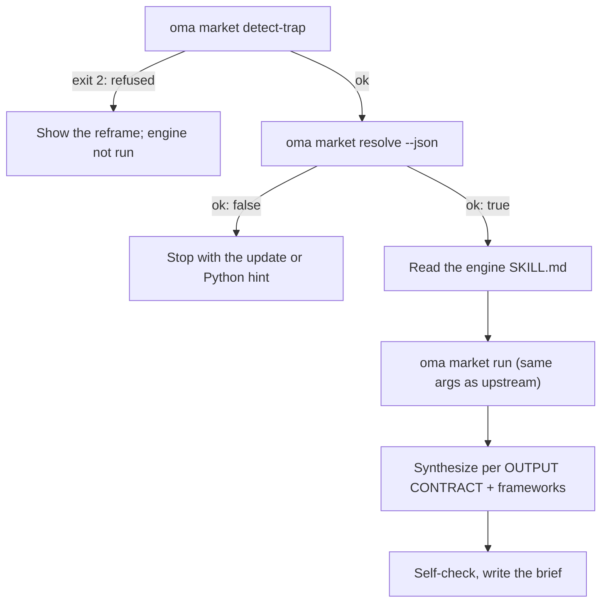

# Nghiên cứu thị trường {#market-research}

`oma-market` trả lời “mọi người thực sự đang nói gì về X trong N ngày qua” — pain point, trend, sentiment đối thủ và discovery — từ community source kèm engagement number thực: Reddit (upvote và top comment), X, YouTube transcript, TikTok, Instagram, Hacker News, Polymarket, GitHub, arXiv, Techmeme, Digg, LinkedIn, StockTwits, Bluesky, web và hơn nữa.

Nghiên cứu chạy trên upstream [**last30days**](https://github.com/mvanhorn/last30days-skill) engine (MIT, Python 3.12+). oh-my-agent không fork nó: giữ **managed copy luôn mới nhất**, gate mọi run và thêm strategic-framework layer lên trên. Release cadence, star count và provider coverage thuộc upstream project và có thể thay đổi.

---

## Bắt đầu nhanh {#quick-start}

Hỏi agent bằng ngôn ngữ thông thường. Các cụm như "market research", "pain points", "competitor analysis", "voice of customer" hoặc "trend detection" sẽ kích hoạt skill `oma-market`:

```text
Tìm các pain point hàng đầu mà developer báo cáo về VS Code remote containers trong 30 ngày qua.
So sánh community sentiment giữa Cursor và Windsurf trong 90 ngày qua, frameworks swot,5f.
```

| Điều hướng bằng | Tác dụng |
|---|---|
| "A vs B", hoặc `--vs B` | Intent competitor: upstream comparison flow + SWOT + Porter's 5F |
| `--days 7`, `30`, `90` hoặc `180` | Cửa sổ nghiên cứu |
| `--intent pain`, `trend`, `competitor` hoặc `discovery` | Ghi đè phân loại intent tự động |
| `--frameworks none`, hoặc danh sách như `swot,5f,pestel` | Tắt các framework section, hoặc chọn framework |

Kết quả là một brief tại `.agents/results/market/{topic-slug}-{YYYYMMDD}.md`. Dòng đầu tiên là engine badge (`🌐 last30days v<version> · synced <date>`), tiếp theo là các evidence cluster xếp hạng kèm link, các framework section và engine footer liệt kê các source bị bỏ qua.

| Chạy không cần key | Cần upstream setup wizard (key hoặc cookie) |
|---|---|
| Reddit, Hacker News, GitHub, Polymarket, arXiv, Techmeme, Digg, web | X, YouTube transcript, TikTok, Instagram và các keyed source khác; source bị bỏ qua được liệt kê ở footer |

---

## Engine luôn mới nhất (cần Python 3.12+) {#always-the-latest-engine--nothing-to-install}

```bash
# Illustrative output; the release tag, cache path, and Python version vary.
oma market resolve
# engine:   last30days
# reason:   last30days 3.21.1 via managed:v3.21.1 (current)
# root:     ~/.cache/oma-market/last30days/v3.21.1
# skill:    ~/.cache/oma-market/last30days/v3.21.1/SKILL.md
# version:  3.21.1
# python:   python3.14 (3.14.7, PATH)
# save_dir: <workspace>/.agents/results/market/raw
```

- Cache: `~/.cache/oma-market/last30days/<tag>/` + `state.json`.
- Trước mỗi lần dùng, `resolve` hỏi GitHub release mới nhất (throttled một lần mỗi `check_interval_min`, mặc định 60 phút), tải tag mới vào directory riêng (tag cũ bị prune), nếu không thì dùng lại cache. Network failure dùng cached copy và báo `stale`.
- Python: `LAST30DAYS_PYTHON` → `market.python` → `python3.14`, `python3.13`, `python3.12`, `python3`, `python` trong PATH (phải ≥ 3.12) → `uv python find '>=3.12'`. Nếu không tìm thấy, `resolve` không ok và in install hint; skill dừng thay vì degrade sang nghiên cứu chỉ dùng web search.
- Engine config và API key nằm trong `~/.config/last30days/` (được upstream setup wizard ghi với sự đồng ý), nên tồn tại qua engine upgrade.

Thứ tự resolve (hit đầu tiên thắng): `market.path` → `LAST30DAYS_HOME` → **managed latest** → user-installed copy (`.agents|.claude|.codex|.cursor|.qwen|.kiro/skills/last30days` trong project và dưới `~`, sau đó Claude Code plugin cache).

```bash
oma market update            # force a check / download now
oma market resolve --offline # never touch the network
oma market run -- --help     # the engine's own flags (without `--`, oma prints its own help)
```

---

## Cấu hình {#configuration}

```yaml
market:
  managed: true                   # false = never download; pins / skill dirs only
  channel: stable                 # stable (latest Release) | main (HEAD)
  check_interval_min: 60          # 0 = check on every call
  path: null                      # explicit engine dir (pin)
  python: null                    # interpreter override
  save_dir: .agents/results/market/raw
```

---

## Một run hoạt động thế nào {#how-a-run-works}



1. `oma market detect-trap "<topic>"` — từ chối keyword-trap và demographic-shopping topic (exit 2), kèm đề xuất reframe. Topic rỗng hoặc dài hơn 200 ký tự sẽ exit 4.
2. `oma market resolve --json` — engine + Python; dừng khi `ok: false`.
3. Agent đọc `SKILL.md` của engine đã resolve từ đầu đến cuối và làm theo: first-run setup wizard, pre-research resolution cho handle / subreddit / hashtag (khi có WebSearch), query planning và precondition gate.
4. `oma market run "<topic>" <flags> --emit=compact` — argument giống hệt call upstream `python3 scripts/last30days.py`; thêm `--save-dir` từ `market.save_dir`.
5. Synthesis theo upstream OUTPUT CONTRACT (badge ở dòng đầu, evidence cluster xếp hạng, LAW 1–8), sau đó oma thêm framework section chỉ cite engine cluster:

| Intent | Engine shaping | Framework |
|---|---|---|
| pain | complaint-shaped topic, `--days 30`, `--deep` khi dữ liệu mỏng | SWOT |
| trend | `--days 7/30/90/180`, `--discover "<domain>"` cho “what's hot” | SWOT |
| competitor | `"A vs B"` → upstream comparison flow | SWOT + Porter's 5F |
| discovery | `--discover`, sau đó follow-up `--drill` | SWOT + PESTEL |

6. Tự kiểm tra, sau đó ghi `.agents/results/market/{topic-slug}-{YYYYMMDD}.md`.

---

## Failure mode {#failure-modes}

| Tình huống | Kết quả |
|---|---|
| Topic bị detect-trap từ chối | Hiện reframe; engine không chạy. `--force` chỉ dùng sau explicit user reconfirmation |
| Không có engine cache và offline | `ok: false` → chạy `oma market update` một lần khi online |
| Không có Python 3.12+ | `ok: false` kèm install hint (brew / apt / `uv python install 3.12`), hoặc đặt `LAST30DAYS_PYTHON` / `market.python`; không thay bằng web-search-only |
| Release check thất bại | Dùng cached engine, báo `stale` |
| Source không có key | Engine bỏ qua và liệt kê ở footer; bật qua upstream setup wizard |

---

## Bước tiếp theo {#next-steps}

- [Workflow nội dung và nghiên cứu](./content-and-research.md) — chọn đúng capability cho các task nghiên cứu và tài liệu khác
- [Diagram Engine](./diagram-engine.md) — cùng managed-latest pattern cho archify
- [Ngữ nghĩa oma-config.yaml](./oma-config-semantics.md) — cách section `market:` được merge
- [CLI Commands: market](../cli-interfaces/commands.md#market) — danh sách option đầy đủ
- Upstream: [mvanhorn/last30days-skill](https://github.com/mvanhorn/last30days-skill)
