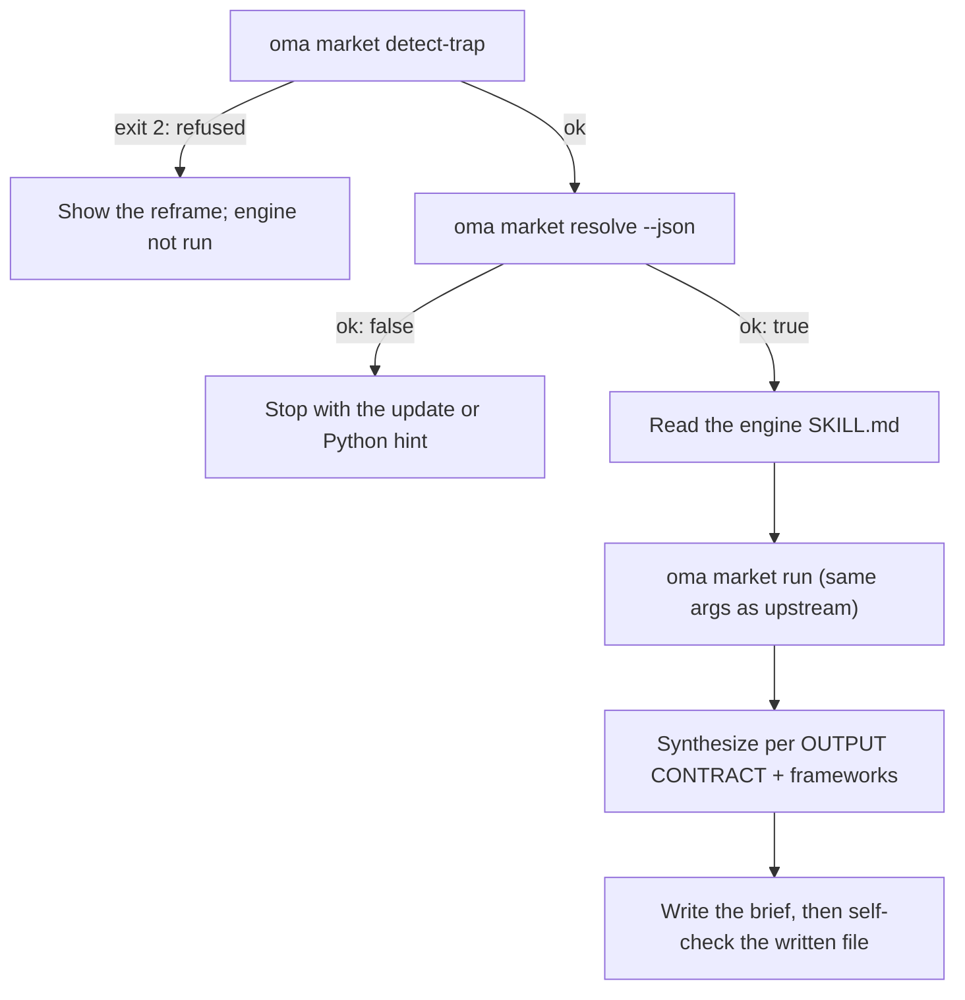

# Nghiên cứu thị trường {#market-research}

`oma-market` tìm pain point, xu hướng, sentiment về đối thủ và chủ đề được quan tâm trong khoảng N ngày, dựa trên các nguồn cộng đồng và số liệu engagement thực tế. Các nguồn gồm Reddit (upvote và top comment), X, YouTube transcript, TikTok, Instagram, Hacker News, Polymarket, GitHub, arXiv, Techmeme, Digg, LinkedIn, StockTwits, Bluesky và web.

Nghiên cứu chạy trên upstream [**last30days**](https://github.com/mvanhorn/last30days-skill) engine (MIT, Python 3.12+). oh-my-agent không fork dự án này: duy trì một bản sao được quản lý, áp dụng gate chủ đề trong mỗi lượt chạy và thêm lớp framework chiến lược. Tần suất release, số sao và độ phủ provider phụ thuộc dự án upstream và có thể thay đổi.

---

## Bắt đầu nhanh {#quick-start}

Hỏi agent bằng ngôn ngữ thông thường. Các cụm như "market research", "pain points", "competitor analysis", "voice of customer" hoặc "trend detection" sẽ kích hoạt skill `oma-market`:

```text
Tìm các pain point hàng đầu mà developer báo cáo về VS Code remote containers trong 30 ngày qua.
So sánh community sentiment giữa Cursor và Windsurf trong 90 ngày qua, frameworks swot,5f.
```

| Điều hướng bằng | Tác dụng |
|---|---|
| "A vs B", hoặc `--vs B` | Intent competitor: upstream comparison flow + SWOT + Porter's 5F |
| `--days 7`, `30`, `90` hoặc `180` | Cửa sổ nghiên cứu |
| `--intent pain`, `trend`, `competitor` hoặc `discovery` | Ghi đè phân loại intent tự động |
| `--frameworks none`, hoặc danh sách như `swot,5f,pestel` | Tắt các framework section, hoặc chọn framework |

Kết quả là một brief tại `.agents/results/market/{topic-slug}-{YYYYMMDD}.md`. Dòng đầu tiên là engine badge (`🌐 last30days v<version> · synced <date>`), tiếp theo là các evidence cluster xếp hạng kèm link, các framework section và engine footer liệt kê các source bị bỏ qua.

| Chạy không cần key | Cần upstream setup wizard (key hoặc cookie) |
|---|---|
| Reddit, Hacker News, GitHub, Polymarket, arXiv, Techmeme, Digg, web | X, YouTube transcript, TikTok, Instagram và các keyed source khác; source bị bỏ qua được liệt kê ở footer |

---

## Cài đặt engine (yêu cầu Python 3.12+) {#always-the-latest-engine--nothing-to-install}

```bash
oma market update   # installs last30days when missing, otherwise updates it
# runs: bunx skills add mvanhorn/last30days-skill --skill last30days -g -y
#   or: bunx skills update last30days -g -y
```

```bash
# Illustrative output; the version, install path, and Python version vary.
oma market resolve
# engine:   last30days
# reason:   last30days 3.21.1 via home:~/.agents/skills
# root:     ~/.agents/skills/last30days
# skill:    ~/.agents/skills/last30days/SKILL.md
# version:  3.21.1
# python:   python3.14 (3.14.7, PATH)
# save_dir: <workspace>/.agents/results/market/raw
```

- `resolve` chỉ đọc các thư mục skill đã cài và không bao giờ kết nối mạng. Khi chưa cài gì, nó trả về không ok và nêu tên lệnh cài đặt; skill hỏi trước khi chạy `oma market update`.
- `oma update` không cài đặt engine. Cập nhật nó bằng `oma market update` (hoặc `bunx skills update last30days -g -y`).
- Python: `LAST30DAYS_PYTHON` → `market.python` → `python3.14`, `python3.13`, `python3.12`, `python3`, `python` trong PATH (phải ≥ 3.12) → `uv python find '>=3.12'`. Nếu không tìm thấy, `resolve` không ok và in install hint; skill dừng thay vì degrade sang nghiên cứu chỉ dùng web search.
- Engine config và API key nằm trong `~/.config/last30days/` (được upstream setup wizard ghi với sự đồng ý), nên tồn tại qua engine update.

Thứ tự resolve (hit đầu tiên thắng): `market.path` → `LAST30DAYS_HOME` → thư mục skill đã cài (`.agents|.claude|.codex|.cursor|.qwen|.kiro|.gemini|.copilot/skills/last30days` trong project, sau đó dưới `~`, rồi `~/.config/agents/skills/last30days` và Claude Code plugin cache). Bản cài plugin Claude Code được cập nhật qua `/plugin`, không phải `oma market update`.

```bash
oma market run -- --help     # the engine's own flags (without `--`, oma prints its own help)
```

Các bản phát hành trước lưu bản sao riêng tại `~/.cache/oma-market/`. Đường dẫn đó không còn được đọc; bạn có thể xóa nó.

---

## Cấu hình {#configuration}

```yaml
market:
  path: null                      # explicit engine dir (pin)
  python: null                    # interpreter override
  save_dir: .agents/results/market/raw
```

`managed`, `channel` và `check_interval_min` đã lỗi thời: chúng vẫn pass bước validate nhưng bị bỏ qua, và `resolve` in cảnh báo khi chúng được đặt.

---

## Một run hoạt động thế nào {#how-a-run-works}



1. `oma market detect-trap "<topic>"` — từ chối keyword-trap và demographic-shopping topic (exit 2), kèm đề xuất reframe. Topic rỗng hoặc dài hơn 200 ký tự sẽ exit 4.
2. `oma market resolve --json` — engine + Python; dừng khi `ok: false`.
3. Agent đọc `SKILL.md` của engine đã resolve từ đầu đến cuối và làm theo: first-run setup wizard, pre-research resolution cho handle / subreddit / hashtag (khi có WebSearch), query planning và precondition gate.
4. `oma market run "<topic>" <flags> --emit=compact` — argument giống hệt call upstream `python3 scripts/last30days.py`; thêm `--save-dir` từ `market.save_dir`.
5. Synthesis theo upstream OUTPUT CONTRACT (badge ở dòng đầu, evidence cluster xếp hạng, LAW 1–8), sau đó oma thêm các framework section, đặt giữa phần thân engine và footer engine, chỉ cite engine cluster:

| Intent | Engine shaping | Framework |
|---|---|---|
| pain | complaint-shaped topic, `--days 30`, `--deep` khi dữ liệu mỏng | SWOT |
| trend | `--days 7/30/90/180`, `--discover "<domain>"` cho “what's hot” | SWOT |
| competitor | `"A vs B"` → upstream comparison flow | SWOT + Porter's 5F |
| discovery | `--discover`, sau đó follow-up `--drill` | SWOT + PESTEL |

6. Ghi `.agents/results/market/{topic-slug}-{YYYYMMDD}.md`, sau đó chạy tự kiểm tra trên file đã ghi; sửa và kiểm tra lại trước khi bàn giao brief.

---

## Failure mode {#failure-modes}

| Tình huống | Kết quả |
|---|---|
| Topic bị detect-trap từ chối | Hiện reframe; engine không chạy. `--force` chỉ dùng sau explicit user reconfirmation |
| Không có engine cache và offline | `ok: false` → chạy `oma market update` một lần khi online |
| Không có Python 3.12+ | `ok: false` kèm install hint (brew / apt / `uv python install 3.12`), hoặc đặt `LAST30DAYS_PYTHON` / `market.python`; không thay bằng web-search-only |
| Release check thất bại | Dùng cached engine, báo `stale` |
| Source không có key | Engine bỏ qua và liệt kê ở footer; bật qua upstream setup wizard |

---

## Bước tiếp theo {#next-steps}

- [Workflow nội dung và nghiên cứu](./content-and-research.md) — chọn đúng capability cho các task nghiên cứu và tài liệu khác
- [Diagram Engine](./diagram-engine.md) — cùng managed-latest pattern cho archify
- [Ngữ nghĩa oma-config.yaml](./oma-config-semantics.md) — cách section `market:` được merge
- [CLI Commands: market](../cli-interfaces/commands.md#market) — danh sách option đầy đủ
- Upstream: [mvanhorn/last30days-skill](https://github.com/mvanhorn/last30days-skill)
