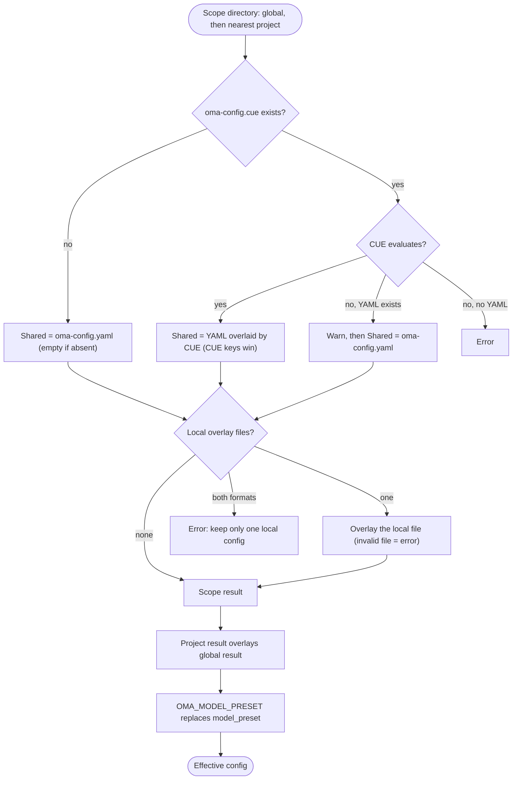

## Tổng quan {#overview}

OMA đọc giá trị mặc định global từ `$OMA_HOME/.agents/` (mặc định `~/.oma/.agents/`),
rồi overlay thư mục `.agents/` của project gần nhất tìm thấy phía trên thư mục làm việc.
Mỗi scope có thể có các layer sau:

- **Shared**: `.agents/oma-config.yaml` và `.agents/oma-config.cue`. Khi cả hai cùng tồn tại và file CUE evaluate được, mọi key mà file CUE đặt sẽ override key tương ứng trong file YAML; key chỉ có trong file YAML vẫn giữ vai trò giá trị mặc định. Khi file CUE không evaluate được, OMA cảnh báo và chỉ dùng file YAML.
- **Local**: `.agents/oma-config.local.cue` hoặc `.agents/oma-config.local.yaml` (chỉ một file, overlay lên kết quả shared; hãy giữ file này riêng tư).

Thiết lập shared và local của project override thiết lập global. Các project root
ở thư mục tổ tiên khác nhau không bao giờ được merge; một `.agents/` gần nhất dù rỗng vẫn là ranh giới
project. Giá trị mặc định global không thay đổi danh tính của project. Xem
[Configuration reference](/docs/guide/configuration-reference) để biết key và giá trị mặc định được hỗ trợ.

## Luồng phân giải {#resolution-flow}

OMA chạy cùng các bước cho scope global và scope project gần nhất, rồi merge hai kết quả:



Khi không tìm thấy `.agents/` của project, hoặc khi quá trình đi ngược chạm tới chính thư mục `.agents/` global, chỉ kết quả global được dùng.

## Bảng ưu tiên {#precedence-table}

Hàng sau thắng hàng trước. Map thường merge đệ quy; array, scalar và `null` thay thế giá trị trước đó.

| Thứ tự | Layer | Quy tắc |
|:-----:|-------|------|
| 1 | `oma-config.yaml` global | Giá trị mặc định nằm dưới file CUE global khi cả hai cùng tồn tại. |
| 2 | `oma-config.cue` global | Override YAML global theo từng key. Nếu evaluate thất bại (ví dụ thiếu CLI `cue`) và có YAML, OMA in `[config] CUE evaluation failed at ... Falling back to oma-config.yaml` và chỉ dùng YAML. |
| 3 | `oma-config.local.cue` hoặc `oma-config.local.yaml` global | Chỉ một file. File local malformed là lỗi. |
| 4 | `oma-config.yaml` của project | `.agents/` của project gần nhất, tại hoặc phía trên thư mục làm việc. |
| 5 | `oma-config.cue` của project | Override hàng 4 theo từng key, với cùng fallback như hàng 2. |
| 6 | `oma-config.local.cue` hoặc `oma-config.local.yaml` của project | Chỉ một file. File local malformed là lỗi. |
| 7 | `OMA_MODEL_PRESET` | Giá trị không rỗng thay thế `model_preset` cho process đó. Giá trị rỗng là lỗi. |

:::tip[Nên sửa file nào?]
Nếu `.agents/oma-config.cue` tồn tại, key đặt trong đó sẽ override key tương ứng trong `oma-config.yaml`. Hãy đổi key đó trong file CUE, hoặc đặt giá trị riêng cho máy vào overlay local. `oma doctor --profile` liệt kê các file nó đã load trong mục **Configuration sources**.
:::

Với override local của project, chỉ đặt leaf đã thay đổi trong file local. Ví dụ, giữ lựa chọn model local ngoài file shared:

```yaml
# .agents/oma-config.local.yaml
model_preset: claude
agents:
  backend:
    model: anthropic/claude-sonnet-5-5
```

Chạy command từ project để chọn thư mục `.agents/` gần nhất. File local malformed sẽ fail rõ ràng; sửa hoặc xóa trước khi retry.

## Kiểm tra cấu hình {#check-your-configuration}

```bash
oma doctor --profile                           # loaded files, resolved preset, per-role model and CLI
cue export --out json .agents/oma-config.cue   # what the CUE layer evaluates to (requires the cue CLI)
```

| Triệu chứng hoặc thông báo | Nguyên nhân | Cách sửa |
|--------------------|-------|-----|
| Thay đổi trong YAML không có tác dụng | `oma-config.cue` đặt cùng key đó | Đổi key trong file CUE, hoặc override nó trong file local |
| `[config] CUE evaluation failed at ... Falling back to oma-config.yaml` | Thiếu CLI `cue`, hoặc file CUE không evaluate được | Cài `cue`, hoặc sửa lỗi mà `cue export` báo |
| `Both local CUE and YAML configs exist in ...; keep only one local config.` | Có hai file overlay local | Xóa một trong hai |
| `OMA_MODEL_PRESET must be non-empty` | Biến được export nhưng rỗng | `unset OMA_MODEL_PRESET` |
| `Unknown model_preset "..."` | Gõ sai, hoặc thiếu entry trong `custom_presets` | Dùng preset có tên trong thông báo lỗi |
| `Legacy preset name "..." is no longer valid` | Key từ trước khi đổi tên, như `claude-only` | Đổi tên theo thông báo, hoặc chạy `oma update` |
| `[model-registry] User inline model "..." failed validation` | Entry `models:` thiếu hoặc không hợp lệ | Xem [Inline model slug](/docs/guide/per-agent-models#inlining-model-slugs) |

## Giá trị mặc định {#default-values}

| Key | Mặc định | Khi áp dụng |
|-----|---------|--------------|
| `auto_update_cli` | `true` | Cả hai file vắng hoặc thiếu key |
| `serena.mode` | `bridge` | Cả hai file vắng hoặc thiếu key |
| `serena.auto_update` | `true` | Cả hai file vắng hoặc thiếu key |
| `telemetry` | `false` | Cả hai file vắng hoặc thiếu key |
| `language` | `en` | Cả hai file vắng hoặc thiếu key |
| `model_preset` | Bắt buộc | Template project đã ship dùng `auto`; schema yêu cầu giá trị không rỗng. |
| `translation_voice` | `balanced` | Cả hai file vắng hoặc thiếu key |
| `timezone` | Múi giờ hệ thống | Cả hai file vắng hoặc thiếu key |

## Lý do thứ tự đọc {#read-order-rationale}

Sửa `~/.oma/.agents/oma-config.yaml` (khi đặt `OMA_HOME`: `<OMA_HOME>/.agents/oma-config.yaml`)
cho giá trị mặc định cấp user. File shared/local của project override các giá trị mặc định đó
mà không kế thừa các project tổ tiên không liên quan. Lựa chọn `none` của project
cho semantic memory override lựa chọn AgentMemory global.

## Ghi chú {#notes}

- `language` trong `oma-config.yaml` điều khiển ngôn ngữ phản hồi của agent. Nó **không** quyết định ngôn ngữ warning lúc install/update; phần đó dùng locale hệ thống (`$LANG`) vì `oma-config.yaml` chưa được load lúc install.
- `auto_update_cli` dùng override của project trước giá trị mặc định global, và mặc định bật khi không scope nào đặt nó.
- `telemetry` (mặc định `false`) ánh xạ tới opt-out riêng của từng vendor, được `oma install` / `oma update` / `oma link` ghi ra: Claude dùng `DISABLE_TELEMETRY` và `CLAUDE_CODE_DISABLE_FEEDBACK_SURVEY`; Gemini/Qwen dùng `privacy.usageStatisticsEnabled`; Codex dùng `analytics.enabled` và `feedback.enabled`; Grok dùng `[features] telemetry`; Antigravity (agy) dùng `enableTelemetry` trong `~/.gemini/antigravity-cli/settings.json`. Đặt `telemetry: true` để opt in lại bằng cách bỏ opt-out của oma cho vendor đó.
- `diagram`, gồm engine `auto` / `archify` / `mermaid`, `explain_sidecar` và `archify.managed|channel|check_interval_min|path|quality|open`, là sparse skill-override section giống `video` / `image`; xem [Diagram Engine](/docs/guide/diagram-engine).
- `video.hyperframes.check_interval_min` giới hạn tần suất check latest-version cho HyperFrames toolchain và heygen-com/hyperframes theo từng run (`oma video compose`, `oma update`). CUE schema đã ship chưa định nghĩa `video.hyperframes`, nên `cue export` từ chối nó bên trong schema block (`field not allowed`); hãy đặt nó trong `oma-config.yaml` hoặc một overlay YAML local.
- `market`, gồm `managed|channel|check_interval_min|path|python|save_dir`, cấu hình engine `last30days` luôn mới phía sau `oma market`; xem [Market Research](/docs/guide/market-research).
- Typed runtime schema bao phủ `providers`, `free`, `agents`, `models`, `custom_presets`, `vendors`, `session`, `docs` và các sparse skill section. Template đã ship cũng có block thuộc consumer như `scm`, `memory`, `serena_reaper` và `mcp`; consumer của block đó sở hữu nested key. Không suy ra key chỉ từ danh sách này; dùng [Configuration reference](/docs/guide/configuration-reference) và feature guide tương ứng.
- Sửa trực tiếp `oma-config.yaml` là an toàn. `oma install` và `oma update` dùng thay thế field ở mức regex, giữ các key user đã sửa mà chúng không quản lý, như override `agents:` tùy biến và `session.quota_cap`.
- `oma update` còn thêm top-level key mà template đã ship có nhưng file của bạn thiếu, dùng template default và marker `# Added by oma update`. Key đã có không bao giờ bị sửa, nội dung hiện tại vẫn byte-identical. Key bạn cố ý xóa sẽ xuất hiện lại với default; hãy đặt giá trị rõ ràng thay vì xóa để opt out.
