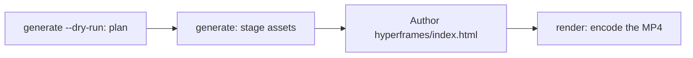

# Tạo video {#video-generation}

`oma-video` là video router của oh-my-agent. Từ một brief một dòng, nó kết hợp script, narration, visual và caption, sau đó ghi plan vào run directory. Provider stage không bắt buộc key và có thể dùng fallback local hoặc deterministic; MP4 thật vẫn cần compositor hoạt động và composition hợp lệ.

Skill kích hoạt với "shorts", "reels", "screencast", hoặc các cụm như "make a video", "explainer video", "demo video", "walkthrough video" hay "video from README", hoặc khi skill khác cần video làm side effect.

> **TL;DR** `oma video generate` lên plan cho run và stage asset. Với HyperFrames compositor mặc định, lệnh này không encode MP4: hãy author `<runDir>/hyperframes/index.html` (workflow `/video` làm việc này cho bạn), sau đó chạy `oma video render <runDir>`. Ở lần chạy đầu tiên, bắt đầu bằng `oma video doctor --install`.

---

## Khi nào nên dùng {#when-to-use}

- Biến brief, README, code hoặc data thành clip ngắn.
- Tạo narrated explainer hoặc demo/walkthrough recording.
- Bất kỳ pipeline tái lập nào dạng “brief → `.mp4`” muốn chạy lại xác định.

## Khi nào KHÔNG nên dùng {#when-not-to-use}

- Ảnh still đơn lẻ → dùng [`oma-image`](/docs/guide/image-generation).
- Live screen broadcast / streaming → ngoài phạm vi (oma không bao giờ ghi màn hình; bạn tự cung cấp recording).
- Audio narration độc lập → dùng `oma-voice`.

---

## Các mode nhìn nhanh {#modes-at-a-glance}

| Mode | Aspect | Nó kết hợp gì |
|------|--------|------------------|
| `shorts` | 9:16 | Clip dọc short-form (script → narration → visual → caption). |
| `explainer` | 16:9 | Explainer ngang từ README, code hoặc data brief. |
| `demo` | derived | Walkthrough dựng từ chính screen recording của bạn, cung cấp qua `--capture <file>`. `--source web --url <url>` chỉ lưu URL đã mask làm context; oma không bao giờ mở browser, ghi màn hình hay tự động login. |

Mode chọn mặc định hợp lý; truyền flag liên quan khi cần giá trị khác.

---

## Bắt đầu nhanh {#quick-start}

Trong agent, `/video three quick tips for better focus` chạy mọi bước bên dưới cho bạn. Khi làm thủ công, pipeline có bốn bước:



```bash
oma video doctor --install   # first run only: HyperFrames toolchain, Chrome Headless Shell, Pretendard

# 1. Plan from an agent-authored script (schema: .agents/skills/oma-video/resources/script-schema.md)
oma video generate "three quick tips for better focus" --mode shorts --script ./script.json --dry-run --output json

# 2. Stage assets (narration needs --voice <profile>; the default is a silent video)
oma video generate "three quick tips for better focus" --mode shorts --script ./script.json --output json

# 3. Author <runDir>/hyperframes/index.html per its AUTHORING.md, then encode
oma video compose <runDir>
oma video render <runDir> --output json

# Demo from your own recording; without --polish the recording itself becomes the output
oma video generate "product walkthrough" --mode demo --capture ./capture.mp4
```

<!-- oma-docs:ignore-start -->

| Bước | Lệnh | Kết quả |
|---|---|---|
| Plan | `generate --dry-run` | `script.json`, `render-spec.json`, `manifest.json`; không render |
| Stage asset | `generate` | visual, caption, audio và nhạc tùy chọn, scaffold `hyperframes/` và cảnh báo `composition pending` |
| Author | sửa `hyperframes/index.html` | composition |
| Render | `render <runDir>` | `{mode}-{slug}.mp4` và manifest đã cập nhật |

<!-- oma-docs:ignore-end -->

Không có `--script`, CLI dựng skeleton ba scene deterministic từ nội dung brief. `--locale` đặt language tag cho narration và caption nhưng không dịch chúng; hãy viết brief hoặc `script.json` bằng ngôn ngữ đích.

Mỗi run in run directory của nó. `--seed` cố định input planning deterministic; live provider output và capture footage vẫn có thể thay đổi. Render lại run directory hiện có khi cần dùng lại render spec và asset đã lưu.

Tool khác gọi shell tới `oma video generate --output json` sẽ parse JSON envelope từ stdout: `{exitCode, runDir, manifestPath, scriptPath, renderSpecPath, warnings, error}`. JSON không có key `outputs`. Đọc output hoặc asset path từ manifest tại `manifestPath`.

---

## Cache HyperFrames và cách author composition {#always-latest-hyperframes-you-author-the-composition}

oh-my-agent **không ship HyperFrames composition code**. Mỗi run có project riêng tại `<runDir>/hyperframes/`, được scaffold bởi `oma video compose` trên npm HyperFrames mới nhất (toolchain cache `~/.cache/oma-video/hyperframes/<version>/`, dùng chung qua symlink `node_modules`) cùng [heygen-com/hyperframes](https://github.com/heygen-com/hyperframes) tại HEAD (`~/.cache/oma-video/hyperframes-skills/`). Agent author generated composition source theo `AUTHORING.md` của scaffold, skill và mode spec trong `.agents/skills/oma-video/resources/hyperframes-authoring/`.

```bash
oma video generate "…"                     # → render-spec.json + <runDir>/hyperframes/ (composition pending)
oma video compose <runDir> --output json   # refresh scaffold / print the contract (idempotent)
#   author hyperframes/index.html as instructed by AUTHORING.md
oma video render <runDir> --output json    # lint → render with the cached HyperFrames CLI → ffprobe; exit 1 on any failure
```

- Latest-version check (npm + GitHub) bị giới hạn bởi `video.hyperframes.check_interval_min` (mặc định 60; `0` = mỗi compose). `oma update` tuân theo interval; `oma video doctor --upgrade` force check; offline run dùng cached toolchain và báo `stale`.
- Tính tái lập nằm trong run dir: `render-spec.json`, authored composition source và toolchain version ghi trong generated HyperFrames package metadata. Render lại cùng run dùng lại render contract; run mới kiểm tra HyperFrames mới nhất.
- Lint hoặc render failure **không** bị che bằng placeholder (chỉ tồn tại khi `OMA_VIDEO_MOCK=1`): `oma video render` thoát 1 kèm diagnostics và agent sửa composition bằng skill mới nhất. Hỏng trên HyperFrames release mới là composition bug, không phải lý do pin.

```yaml
video:
  hyperframes:
    check_interval_min: 60    # 0 = check on every compose
```

---

## Tham chiếu CLI {#cli-reference}

```bash
oma video generate <brief...> [options]
oma video doctor [--install|--upgrade|--install-mpt|--install-strudel]  # toolchain readiness / provisioning
oma video compose <runDir>       # prepare HTML project and authoring contract
oma video render <runDir>        # re-render from render-spec.json (deterministic)
oma video provider list         # provider availability + key/fallback status
```

### Flag chính {#key-flags}

| Flag | Mục đích |
|------|---------|
| `--mode <m>` | `shorts` \| `explainer` \| `demo`. |
| `--aspect <a>` | `9:16` \| `16:9` \| `1:1` \| `auto`. |
| `--locale <lang>` | Language tag của narration/caption. |
| `--captions <s>` | `tiktok` \| `lower-third` \| `none` (alignment không cần key). |
| `--visual <m>` | `auto` \| `generate` \| `stock` \| `aigc` \| `slide`. |
| `--voice <profile>` | Narration voice hoặc `none` (mặc định; bỏ qua để video silent với caption timing ước tính). |
| `--music <mode>` | `upbeat`, `calm`, `cinematic`, `lofi`, `piano` hoặc `none`. |
| `--compositor <c>` | `hyperframes` (mặc định) \| `mpt`. |
| `--capture <path>` | Recording của bạn cho demo mode: `.mp4`, `.mov`, `.webm` hoặc `.mkv`, lưu bên trong project. |
| `--source <k>` | Demo capture source: `file` hoặc `web` (mặc định: `file`). |
| `--url <url>` | Context URL cho `--source web`, được lưu dạng mask trong `manifest.json`. Bắt buộc khi dùng `--source web`; nó không bao giờ bắt đầu capture và không thay thế `--capture`. |
| `--polish` | Overlay HyperFrames composition lên footage đã capture. |
| `--device`, `--ready-selector`, `--show-cursor`, `--capture-timeout`, `--capture-stop` | Được chấp nhận nhưng không dùng: oma không điều khiển browser hay ghi màn hình. |
| `--output-dir <path>` | Output base directory. Path nằm ngoài `$PWD` cần `--allow-external-output`. |
| `--allow-external-output` | Cho phép output path nằm ngoài `$PWD`. |
| `--max-usd <n>` | Trần chi phí (mặc định `0.2`). Khi chi phí ước tính lũy kế chạm mức này, run dừng với exit 1; chạy lại với `-y` hoặc giá trị cao hơn. |
| `--duration <sec>` | Độ dài mục tiêu tính bằng giây (1–180), hoặc `auto`. |
| `--seed <n>` | Deterministic seed. |
| `--dry-run` | Xuất script / render-spec / manifest, bỏ qua render. |
| `--script <path>` | Agent-authored `script.json` để inject (ghi đè skeleton; điều khiển narration, on-screen text và visual prompt theo scene). |
| `-y, --yes` | Cho phép provider có chi phí ước tính chạm `--max-usd` (giống `OMA_VIDEO_YES=1`). |
| `--timeout <sec>` | Giới hạn thời gian tính bằng số giây nguyên cho mỗi lần gọi provider hình ảnh và âm nhạc (mặc định `600`). Hậu tố đơn vị không được parse: `2m` nghĩa là 2 giây. |
| `--output <f>` | CLI output: `text` (mặc định) hoặc `json`. |
| `--no-brief-in-manifest` | Lưu SHA-256 của brief thay vì brief thô. |

---

## Provider không bắt buộc key {#key-optional-providers}

Provider stage resolve tới **real branch** và, khi stage hỗ trợ, **deterministic fallback**. Key thiếu vì vậy vẫn có thể để planned run với timing ước tính hoặc asset local. Compositor là final stage bắt buộc và không có placeholder fallback thông thường:

| Capability | Real branch (điều gì kích hoạt nó) | Fallback |
|------------|-------------|----------|
| script | `script.json` do agent author, truyền bằng `--script <path>` (workflow `/video` ghi file này) | skeleton ba scene deterministic từ nội dung brief |
| voice | `oma-voice` (Voicebox, local) với `--voice <profile>` | video silent với timing ước tính (`--voice none`, mặc định) |
| visual | `oma-image`, `oma-slide`, stock clip từ Pexels khi đặt `PEXELS_API_KEY` | placeholder asset |
| visual: `aigc` | chưa được nối; `RUNNINGHUB_API_KEY` bật provider, nhưng provider vẫn ghi placeholder | placeholder asset |
| caption | `.srt` và `.vtt` căn theo `timing.json`, bằng ngôn ngữ của script | như cũ; việc dịch sang `--locale` chưa được nối |
| music | nhạc nền Strudel sau `oma video doctor --install-strudel` | không có music track |
| capture | recording bạn cung cấp bằng `--capture <file>` | không có: thiếu `--capture`, demo mode in hướng dẫn ghi hình và thoát với code 3 |
| compositor | HyperFrames (được quản lý) hoặc MoneyPrinterTurbo | không có compositor fallback; run thất bại kèm diagnostics |

Không tự động hóa credential: bạn tự thực hiện mọi login trên màn hình trong lúc ghi hình; URL và query token được mask trong log và manifest.

Caption render dưới dạng **static windowed cue**: một caption line hoạt động ở frame hiện tại, được CSS wrap và không có per-word animation.

---

## Toolchain và `doctor` {#toolchain-and-doctor}

Heavy toolchain (`node_modules` của project HyperFrames được quản lý, Pretendard font nhúng, MoneyPrinterTurbo checkout, Strudel music project, Chrome Headless Shell) được **provision on demand**, không ship trong package. Plain `doctor` chỉ report — không cài gì:

```bash
oma video doctor
```

Nó báo cáo `node`, `chromium`, `ffmpeg`, `ffprobe`, `hyperframes-toolchain`, `hyperframes-skills`, `pretendard-font`, `mpt-project`, `strudel`, `voicebox`, `oma-image`, `pixelle` và `cap`, đồng thời in install hint cho thứ còn thiếu. Chạy `oma video doctor --output json` để xem danh sách chính thức. Baseline yêu cầu Node.js 22+, HyperFrames toolchain cùng Chrome browser của nó, FFmpeg/FFprobe và `oma-image`. MP4 thật còn cần HTML đã được author.

Dùng install flag để provision toolchain:

```bash
oma video doctor --install             # warm the latest HyperFrames toolchain + Chrome Headless Shell + Pretendard + heygen-com/hyperframes
oma video doctor --upgrade             # force a latest-version check now
oma video doctor --install-mpt         # MoneyPrinterTurbo checkout (clone + venv + deps) for --compositor mpt
oma video doctor --install-strudel     # Strudel music renderer for --music (installs AGPL-3.0-or-later packages locally)
```

`--install` cũng fetch Pretendard font nhúng (pinned release) vào shared toolchain cache. Font này là một phần của determinism boundary. Khi network failure, command cảnh báo và render fallback sang system font; khác biệt về browser và OS vẫn có thể ảnh hưởng đến output đã encode.

---

## Bố cục output {#output-layout}

```text
.agents/results/videos/{timestamp}-{shortid}-{mode}/
├── script.json          # scenes + narration
├── render-spec.json     # the deterministic render contract
├── timing.json          # per-segment timing (voicebox-stt or estimated)
├── captions.srt / .vtt
├── audio/narration-01.wav     # one track; absent when the video is silent
├── music/                     # pattern.strudel, bgm.wav, bgm.mp3 (with --music and Strudel installed)
├── visuals/scene-*.{png,svg,…}
├── hyperframes/         # index.html, AUTHORING.md, local assets and toolchain link
├── {mode}-{slug}.mp4    # the rendered output (slug derived from the script title)
└── manifest.json        # providers, assets, cost, warnings
```

`render-spec.json` + asset là determinism boundary.

---

## Khắc phục sự cố {#troubleshooting}

<!-- oma-docs:ignore-start -->

| Triệu chứng | Nguyên nhân / cách sửa |
|---------|-------------|
| Không tạo MP4 | Compositor, composition hoặc toolchain check thất bại. Chạy `oma video doctor`, sau đó `oma video compose <runDir>` và sửa composition được báo trước khi chạy lại `oma video render <runDir>`. |
| Narration im lặng (`source: estimated`) | `--voice` mặc định là `none`, hoặc không truy cập được Voicebox. Truyền `--voice <profile>` với một profile từ ứng dụng Voicebox và khởi động `oma-voice` server, hoặc chấp nhận timing ước tính. |
| Demo run thoát với code 3 kèm hướng dẫn ghi hình | Không có file `--capture` nào được truyền (kể cả với `--source web`); oma không ghi màn hình. Ghi lại flow bằng Cap, QuickTime hoặc OBS, lưu bên trong project và chạy lại với `--capture ./walkthrough.mp4`. |
| `--capture` bị từ chối (exit 4) | File không tồn tại, nằm ngoài project directory, hoặc không phải `.mp4` / `.mov` / `.webm` / `.mkv`. Copy recording vào project, ví dụ `./captures/demo.mp4`. |
| Run dừng ở trần chi phí (exit 1) | Chi phí ước tính lũy kế đã chạm `--max-usd`. Chạy lại với `-y` hoặc `--max-usd` cao hơn. |
| `--out path "…" is outside $PWD. Use --allow-external-out to override.` (exit 1) | `--output-dir` trỏ ra ngoài project. Chạy lại với `--allow-external-output` (thông báo vẫn hiển thị tên flag cũ), hoặc chọn một thư mục bên trong project. |
| `oma video doctor` liệt kê `oma-image` là thiếu | Nếu phần chi tiết ghi `Removed option --format. Use --output.`, thì chính readiness probe đã thất bại và không nói gì về vendor của bạn; hãy kiểm tra trực tiếp bằng `oma image doctor`. Nếu không, chưa có image vendor nào sẵn sàng nên visual fallback về placeholder: chạy `oma image doctor` và thiết lập một vendor. |
| Render chậm ở lần đầu | HyperFrames browser / MPT checkout đang được provision một lần; run sau dùng lại cache. |

<!-- oma-docs:ignore-end -->

---

## Bước tiếp theo {#next-steps}

- [Workflow `/video`](../core-concepts/workflows.md#video) — pipeline brief → script → asset → render-spec → HyperFrames.
- [Tạo hình ảnh](./image-generation.md) — still-image router được dùng lại như video visual provider.
- [Workflow nội dung và nghiên cứu](./content-and-research.md) — voice, slide và các capability nội dung khác.
- [Lệnh CLI: video](../cli-interfaces/commands.md#video) — danh sách đầy đủ option của `oma video`.
