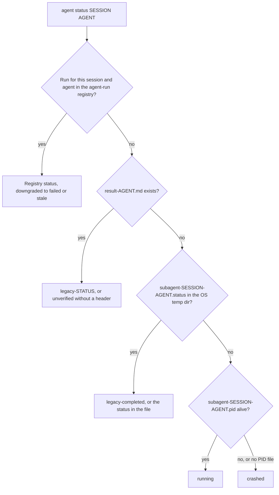

# CLI 选项

## 快速参考 {#quick-reference}

| 我想要…… | 使用 |
|:-------------|:----|
| 无提示运行 | `-y` / `--yes`（也识别 `OMA_YES=1`、`CI=true`）；需要纯文本、非交互式输出时用 `oma update --ci` |
| 获取 JSON | `--json`、`--output json` 或 `OH_MY_AG_OUTPUT_FORMAT=json`。例外情况参见[输出选项](#output-options) |
| 作用于全局安装 | `-g` / `--global`，或 `OMA_INSTALL_GLOBAL=1`；`OMA_HOME` 用于移动全局存储根目录 |
| 在做任何更改前预览 | 在命令列出 `--dry-run` 时使用它。参见[哪些命令支持 JSON](#commands-supporting-json-output) |
| 查看某个命令的标志 | `oma <command> --help`、`oma describe "<command>"`，或本页末尾的[注册表](#complete-public-option-registry) |
| 修复升级后失效的脚本 | [已更名的命令和选项](#renamed-commands-and-options) |
| 在脚本中按失败类型分支 | [退出码](#exit-codes) |

---

## 全局选项 {#global-options}

以下选项可用于根命令 `oma` / `oh-my-agent`：

| 标志 | 说明 |
|:-----|:-----------|
| `-g, --global` | 作用于 OMA 全局安装（`~/.oma/.agents/` 或 `$OMA_HOME/.agents/`），而不是 `<cwd>/.agents/` |
| `-y, --yes` | 在所选命令支持确认时跳过提示；命令自身的安全检查仍然有效。也识别 `OMA_YES=1` 和 `CI=true` |
| `-V, --version` | 输出版本号并退出 |
| `-h, --help` | 显示命令的帮助信息 |

所有子命令也都支持 `-h, --help`，用于显示各自的帮助文本。

`--global` 会为整个进程设置安装根目录，因此无论当前目录在哪里，`install`、`update`、`link` 和 `uninstall` 都会解析到全局安装：

| 模式 | 选择方式 | `.agents/` 位置 |
|:-----|:-----------------|:--------------------|
| 项目（默认） | 无需设置 | `<cwd>/.agents/` |
| 全局 | `--global` 或 `OMA_INSTALL_GLOBAL=1` | `$OMA_HOME/.agents/`（默认 `~/.oma/.agents/`） |

`OMA_HOME=<abs-path>` 用于更改全局存储根目录，必须是绝对路径。项目安装仍使用 cwd。运行 `oma home --json` 可显示解析后的位置，运行 `oma home migrate --dry-run` 可预览旧版数据迁移。参见[全局安装](../guide/global-install.md)。

---

## 已更名的命令和选项 {#renamed-commands-and-options}

命令路径使用空格而不是冒号分隔，部分命令和选项也已更名。旧写法会被拒绝，不作为别名保留：

- 旧命令会失败并报错 `Unknown command: ... Use oma --help.` 或 `Unexpected argument for oma <group>. Use oma <replacement>.`
- 单独输入命令组名 `dashboard`、`state` 和 `stats` 时，现在会打印该组的帮助，而不是直接运行。
- 旧选项会失败并报错 `Removed option <old>. Use <new>.`；已移除的 `state` 和 `stats` 操作标志会报错 `Removed option <old>. Use an explicit action; see oma --help.`

只有 `schedule:run` 和 `serena daemon:gc` 仍能解析，因此旧版本写入的操作系统调度条目可以继续工作。

| 旧命令 | 现在使用 |
|:------------|:--------|
| 任何 `a:b` 冒号路径（`agent:spawn`、`state:emit` 等） | 以空格分隔的路径（`agent spawn`、`state emit`） |
| `dashboard`、`dashboard:web` | `dashboard terminal`、`dashboard web` |
| `hook --vendor ...` | `hook run --vendor ...` |
| `intel run` | `intel suggest` |
| `state`、`state:get <id>` | `state list`、`state get <id>` |
| `state --activate` / `--archive` / `--purge` | `state activate` / `state archive` / `state purge` |
| `state:required-decisions` | `state decisions list` |
| `state:inject-log ... --entry <file>` | `state inject-log list`、`state inject-log get <session-id> <file>` |
| `stats`、`stats --reset` | `stats get`、`stats reset` |
| `memory:retry-drain` | `memory retry drain` |
| `vault rm` | `vault delete` |
| `search api <url>`、`search rss <url>` | `search api fetch <url>`、`search rss fetch <url>` |
| `search api:search`、`search rss:google` | `search api search`、`search rss google` |
| `skills audit` / `lint` / `eval` / `promotions` / `rollback` / `procedure` / `meta-optimize` / `evolution-stats` / `matrix` | `skill ...`（单数） |
| `skills opt` | `skill optimize` |
| `slide new`、`slide viewer` | `slide create`、`slide preview` |
| `slide pdf` / `png` / `pptx` | `slide export pdf` / `png` / `pptx` |
| `slide import-pptx`、`slide fetch-video`、`slide styles ...` | `slide import pptx`、`slide asset fetch-video`、`slide style ...` |
| `image list-vendors`、`video list-providers` | `image vendor list`、`video provider list` |
| `schedule:add`、`schedule:remove` | `schedule create`、`schedule delete` |
| `verify <agent-type>` | `verify agent <agent-type>` |

| 旧选项 | 现在使用 |
|:-----------|:--------|
| `-m, --model <vendor>` | `--vendor <vendor>` |
| `-r, --root <path>` | `--project-root <path>` |
| `--sid`、`--session` | `--session-id <id>` |
| `--format <fmt>` | `--output <format>`（`search media --format` 不变） |
| `--out <dir>`、`--out-dir` | `--output-dir <path>` |
| `--out <file>`、`--out-file` | `--output-file <path>`；在 `slide validate` 和 `explain validate` 上为 `--report-file <path>` |
| `--dir` | 在 `slide` 命令上为 `--workspace <path>`，在 `slide create` 上为 `--output-dir <path>`，在 `explain validate` 上为 `--input-dir <path>` |
| `--max` | 在 `scholar search` 上为 `--limit <n>` |
| `--allow-external-out` | `--allow-external-output` |
| `--timeout <seconds>`、`--timeout <ms>`、`--timeout-minutes` | `--timeout <duration>`（`30s`、`2m`）。旧值以毫秒或分钟为单位时，必须带上单位 |
| `--max-age-days` | `--max-age <duration>`；在 `schedule create` 上为 `--expires-after <duration>` |

---

## 输出选项 {#output-options}

许多命令支持机器可读输出，供 CI/CD 流水线和自动化使用。请求 JSON 输出有三种方式。

### 1. --json 标志 {#1---json-flag}

```bash
oma stats get --json
oma doctor --json
oma cleanup --json
```

`--json` 标志只在列出它的命令路径上可用。不要根据命令族推断是否支持：例如，`image`、`video` 和 `slide` 的叶子命令在注册表列出时提供 `--output`，而 `search` 始终输出 JSON。

### 2. --output 标志 {#2---output-flag}

```bash
oma stats get --output json
oma doctor --output text
```

大多数命令的 `--output` 接受 `text` 或 `json`。它提供与 `--json` 相同的功能，还允许你显式请求文本输出，这在环境变量已设为 `json` 时很有用。

**验证**：如果提供的格式无效，CLI 会抛出：`Invalid output format: {value}. Expected one of text, json`。

### 3. OH_MY_AG_OUTPUT_FORMAT 环境变量 {#3-oh_my_ag_output_format-environment-variable}

```bash
export OH_MY_AG_OUTPUT_FORMAT=json
oma stats get # outputs JSON
oma doctor # outputs JSON
oma retro # outputs JSON
```

将此环境变量设为 `json` 后，支持 JSON 的命令会默认输出 JSON。只识别 `json`；其他任何值都会被忽略，输出保持为文本。

### 格式的选择方式 {#how-the-format-is-chosen}

命令行上的标志优先于环境变量。同时传入 `--json` 和非 JSON 的 `--output` 会报错，而不是按优先级处理。

| 传入内容 | 未设置变量 | `OH_MY_AG_OUTPUT_FORMAT=json` |
|:---------|:---------------|:------------------------------|
| 不传 | text | JSON |
| `--json` 或 `--output json` | JSON | JSON |
| `--output text` | text | text |
| `--json --output text` | 报错：`--json conflicts with --output. Choose one output format.` | 同样报错 |

部分命令使用自己的格式值：

| 命令 | 格式控制 |
|:---------|:---------------|
| `search ...` | 始终为 JSON；`--pretty` 只控制缩进。`search providers` 和 `search web` 也接受 `--json` |
| `describe` | 始终为 JSON |
| `image ...`、`video ...` | `--output text\|json`（默认 `text`） |
| `slide validate` | `--output json\|concise`（默认 `concise`） |
| `explain validate` | `--output concise\|json`（默认 `concise`）或 `--json` |
| `hook probe` | `--output text\|md\|json` |

### 哪些命令支持 JSON {#commands-supporting-json-output}

所有接受 `--json` 或 `--output` 的命令都会在 `oma describe` 中报告 `supportsJsonOutput: true`，本页末尾的[注册表](#complete-public-option-registry)按路径列出了这些标志。无需标志就始终输出 JSON 的命令（`describe` 和大多数 `search` 子命令）不会被标记。要从 CLI 列出这些路径：

```bash
oma describe | jq -r '.. | objects | select(.supportsJsonOutput? == true) | .path'
```

用同样的方式使用 `select(.supportsDryRun? == true)`，可以找出带 `--dry-run` 的命令。

---

## 按命令配置的选项 {#per-command-options}

### install（安装） {#install}

```text
oma install [--web-search <provider>] [--code-intelligence <provider>] [--semantic-memory <provider>] [--honcho-url <url>] [--honcho-workspace <id>]
```

交互式安装器会将所选的提供方设置写入 `.agents/oma-config.yaml`。若存在 `.agents/oma-config.cue`，它的优先级高于该文件，因此 CUE 配置中尚未包含的选择会写入被 gitignore 忽略的本地覆盖层 `.agents/oma-config.local.yaml`；浏览器 DevTools 选择和 `oma memory keys` 的 vault 引用也遵循同一规则，CLI 供应商选择和 `oma model propose --write` 则在没有 `oma-config.yaml` 时遵循该规则。提供方标志用于选择网页搜索、代码智能和语义内存集成；选中 Honcho 提供方时，`--honcho-url` 和 `--honcho-workspace` 用于配置 Honcho 内存服务。安装流程请求确认时，根级 `-y, --yes` 标志生效。

### doctor（诊断） {#doctor}

```text
oma doctor [--json] [--output <format>] [--profile] [--heal-check <agentType>]
```

| 标志 | 说明 | 默认值 |
|:-----|:-----------|:--------|
| `--json` | 输出 JSON，而不是格式化文本。 | `false` |
| `--output <format>` | 显式指定输出格式（`text` 或 `json`）。参见[输出选项](#output-options)。 | `text` |
| `--profile` | 显示配置档健康矩阵（每个智能体根据当前 `model_preset` 和 `agents:` 覆盖项解析出的模型 slug、CLI 和身份验证状态）。参见[按智能体配置模型](../guide/per-agent-models.md)。 | `false` |
| `--heal-check <agentType>` | 包含某个智能体的自愈关卡检查。 | |

使用 `--json` 时，报告带有顶层字段 `ok` 和 `issues`；`issues` 大于零时，`doctor` 以 `1` 退出。

### update（更新） {#update}

```text
oma update [-f | --force] [--with-new-skills] [--ci] [-y | --yes] [--all] [--vendor <vendors>]
oma update mcp [-y | --yes] [--ci] [--all] [--vendor <vendors>]
```

| 标志 | 短标志 | 说明 | 默认值 |
|:-----|:------|:-----------|:--------|
| `--force` | `-f` | 更新时覆盖用户自定义的配置文件。影响范围：`oma-config.yaml`、`mcp.json` 和 `stack/` 目录。不使用此标志时，这些文件会在更新前备份，并在更新后恢复。 | `false` |
| `--with-new-skills` | | 安装自当前安装以来新加入注册表的技能。 | `false` |
| `--ci` | | 以非交互式 CI 模式运行。跳过所有确认提示，使用纯文本控制台输出，不显示加载指示器和动画。在 stdin 不可用的 CI/CD 流水线中必须使用。 | `false` |
| `--yes` | `-y` | 跳过提示。除非同时使用 `--all` 或 `--vendor`，否则不会创建缺失的供应商目录。 | `false` |
| `--all` | | 创建或更新所有受支持的项目级供应商。 | `false` |
| `--vendor <vendors>` | | 创建或更新以逗号分隔列出的供应商，例如 `claude,qwen`。 | 仅限已有的供应商目录 |

`oma update mcp` 在选择浏览器 MCP 服务器时使用相同的 `--yes`、`--ci`、`--all` 和 `--vendor` 控制项，但不使用 `--force` 或 `--with-new-skills`。

**使用 --force 时的行为：**
- `oma-config.yaml` 会替换为注册表中的默认版本。
- `mcp.json` 会替换为注册表中的默认版本。
- 后端 `stack/` 目录（各语言专用资源）会被替换。
- 无论是否使用此标志，其他所有文件都会更新。

**使用 --ci 时的行为：**
- 启动时不调用 `console.clear()`。
- 用普通的 `console.log` 代替 `@clack/prompts`。
- 跳过竞品检测提示。
- 出错时抛出异常，而不是调用 `process.exit(1)`。

**供应商范围：**
- `oma update` 只更新已存在的供应商目录。
- `oma update --yes` 使用相同的供应商范围，但不显示提示。
- `oma update --all` 创建或更新所有受支持的项目级供应商。
- `oma update --vendor claude,qwen` 只创建或更新列出的供应商。

### stats（统计） {#stats}

```text
oma stats get [--json | --output <format>]
oma stats reset [--json | --output <format>]
```

| 标志 | 说明 | 默认值 |
|:-----|:-----------|:--------|
| `--json` | 输出 JSON。`stats get` 打印指标对象；`stats reset` 打印 `{"reset":true}`。 | `false` |
| `--output <format>` | 输出 `text` 或 `json`。 | `text` |

`oma stats reset` 是重置命令；`oma stats get --reset` 会失败并报错 `Removed option --reset`。

:::note
`stats get` 并非只读。每次调用都会计为一个会话，并把最近 10 次提交的 diff 累加到 `.agents/state/metrics.json` 中的文件数和行数累计计数器，因此不要轮询它。
:::

### retro（复盘） {#retro}

```text
oma retro [window] [--json] [--output <format>] [--interactive] [--compare]
```

| 标志 | 说明 | 默认值 |
|:-----|:-----------|:--------|
| `--interactive` | 旧版引导式录入：询问你完成了什么、主要收获和下一步计划。会忽略窗口参数、`--compare` 和 `--json`。 | `false` |
| `--compare` | 将当前时间窗口与前一个等长窗口对比。显示变化量指标（例如提交 +12、新增行数 -340）。 | `false` |

**窗口参数格式：** 数字后跟 `h`、`d` 或 `w`。
- `24h`：24 小时
- `7d`：7 天
- `2w`：2 周
- 省略时使用默认值（7 天）

不支持按月：`oma retro 1m` 会失败并报错 `Invalid window: 1m. Use: 24h, 7d, 14d, 30d, 2w`。

### cleanup（清理） {#cleanup}

```text
oma cleanup [--dry-run] [-y | --yes] [--json] [--output <format>]
```

| 标志 | 短标志 | 说明 | 默认值 |
|:-----|:------|:-----------|:--------|
| `--dry-run` | | 预览模式。列出所有将被清理的项，但不做任何更改。无论发现什么，退出码都是 0。 | `false` |
| `--yes` | `-y` | 跳过所有确认提示，不经询问直接清理全部内容。适用于脚本和 CI。 | `false` |

**清理内容：**
1. 孤立的 PID 文件：所引用的进程已不再运行的 `/tmp/subagent-*.pid`。
2. 孤立的日志文件：与已终止 PID 对应的 `/tmp/subagent-*.log`。
3. Gemini Antigravity 目录：`.gemini/antigravity/brain/`、`.gemini/antigravity/implicit/`、`.gemini/antigravity/knowledge/`。这些目录会随时间累积状态，可能变得很大。

### agent spawn（启动智能体） {#agent-spawn}

```text
oma agent spawn <agent-id> <prompt> <session-id> [options]
```

| 标志 | 短标志 | 说明 | 默认值 |
|:-----|:------|:-----------|:--------|
| `--resumed-from` | 无 | 将重试关联到前一次运行的 ID。 | |
| `--fallback-vendors` | 无 | 显式指定的回退供应商链，按顺序排列并以逗号分隔。 | |
| `--task-id` | 无 | 会话计划中的任务 ID。 | 智能体 ID |
| `--vendor` | 无 | 覆盖 CLI 供应商。`--help` 列出 `antigravity`、`claude`、`codex`、`cursor`、`opencode`、`qwen`、`grok` 和 `pi`。 | 从配置解析 |
| `--workspace` | `-w` | 智能体的工作目录。省略或设为 `.` 时，CLI 会根据 monorepo 配置文件（pnpm-workspace.yaml、package.json、lerna.json、nx.json、turbo.json、mise.toml）自动检测工作区。 | 自动检测或 `.` |
| `--isolation` | 无 | 隔离模式：`worktree` 会为每次启动创建一个 Git 工作树；默认值为 `none`。 | `none` |
| `--read-only` | 无 | 将启动的智能体限制为只能使用非破坏性工具，并且不附加自动批准标志。 | `false` |

**验证：**
- `agent-id` 和 `session-id` 不得包含 `..`、`?`、`#`、`%` 或控制字符。`agent spawn` 没有固定的智能体 ID 列表；模型和供应商路由识别 `orchestrator`、`architecture`、`qa`、`pm`、`backend`、`frontend`、`mobile`、`db`、`debug`、`refactor`、`docs`、`tf-infra` 和 `explore`，以及 `backend-engineer`、`qa-reviewer`、`research-explorer` 等别名。
- `--vendor` 必须是 oma 供应商 ID：`antigravity`、`claude`、`codex`、`commandcode`、`copilot`、`cursor`、`grok`、`hermes`、`kimi`、`kiro`、`opencode`、`pi`、`qwen` 或 `zcode`。下表涵盖 `--help` 中列出的八个供应商。

**供应商特定行为：**

| 供应商 | 命令 | 自动批准标志 | 提示词标志 |
|:-------|:--------|:-----------------|:-----------|
| antigravity | `agy` | `--dangerously-skip-permissions` | `-p` |
| claude | `claude` | （无） | `-p` |
| codex | `codex` | `--sandbox workspace-write` | （无；提示词为位置参数） |
| cursor | `cursor-agent` | 因供应商而异 | `-p` |
| opencode | `opencode` | 因供应商而异 | `-p` |
| qwen | `qwen` | `--yolo` | `-p` |
| grok | `grok` | 因供应商而异 | `-p` |
| pi | `pi` | `--read-only` 模式下不附加 | 提示词为位置参数 |

这些默认值可以在 `.agents/skills/oma-orchestration/config/cli-config.yaml` 中覆盖。

Codex 保持其 workspace-write 沙箱。oma 会启用网络访问，并把项目根目录、OMA 状态主目录（`~/.oma`）和已有的包管理器缓存添加为可写目录。`oma update` 会替换 `cli-config.yaml`，因此请用 `OMA_CODEX_SANDBOX` 设置持久的模式：`read-only`、`workspace-write`（默认）或 `danger-full-access`（无沙箱、无审批）。

### agent status（智能体状态） {#agent-status}

```text
oma agent status <session-id> [agent-ids...] [--project-root <path>]
```

| 标志 | 说明 | 默认值 |
|:-----|:-----------|:--------|
| `--project-root <path>` | 读取其智能体运行注册表和 `.agents/state/memories/result-{agent}.md` 文件的项目。`-r` 和 `--root` 已移除，会失败并报错 `Removed option -r. Use --project-root.` | 当前工作目录 |

该命令为每个请求的智能体打印一行 `{agent-id}:{status}`。对每个智能体，它使用下列来源中第一个存在的来源：



| 状态 | 含义 |
|:-------|:--------|
| `running`、`completed`、`partial`、`blocked`、`failed` | 智能体运行注册表中记录的状态 |
| `failed` | 已注册的运行处于 `running`，但其运行器进程已不存在时，也会报告此状态 |
| `stale` | 已注册的运行为 `completed`，但其结果证据已无法通过校验 |
| `legacy-<status>` | 没有已注册的运行；`result-{agent}.md` 带有 `## Status: <status>` 标题 |
| `unverified` | 没有已注册的运行；`result-{agent}.md` 没有状态标题 |
| `legacy-completed` | 没有运行记录或结果文件；会话的 `.status` 文件写着 `completed`（其他值原样打印） |
| `crashed` | 什么都没找到，或旧版 PID 文件指向已终止的进程 |

运行的记录方式参见[智能体结果与恢复](../guide/agent-results-and-resume.md)。

### agent parallel（并行智能体） {#agent-parallel}

```text
oma agent parallel [tasks...] [--session-id <id>] [--vendor <vendor>] [-i | --inline] [--no-wait]
```

| 标志 | 短标志 | 说明 | 默认值 |
|:-----|:------|:-----------|:--------|
| `--session-id <id>` | 无 | 每次启动的运行所用的会话 ID。把同一个 ID 传给 `oma agent status`。 | 运行目录名 `parallel-<timestamp>-<suffix>` |
| `--vendor` | 无 | 覆盖所有启动的智能体使用的 CLI 供应商。 | 按智能体从配置解析 |
| `--inline` | `-i` | 将任务参数解释为 `agent:task[:workspace]` 字符串，而不是文件路径。 | `false` |
| `--no-wait` | | 后台模式。启动所有智能体后立即返回，不等待其完成。PID 列表和日志保存到 `.agents/results/parallel-<timestamp>-<suffix>/`。 | `false`（等待完成） |

**内联任务格式**：`agent:task` 或 `agent:task:workspace`
- 如果最后一个以冒号分隔的片段以 `./` 或 `/` 开头，或者等于 `.`，就将其识别为工作区。
- 示例：`backend:Implement auth API:./api` 表示 agent=backend、task="Implement auth API"、workspace=./api。
- 示例：`frontend:Build login page` 表示 agent=frontend、task="Build login page"、workspace 自动检测。

**YAML 任务文件格式：**

```yaml
tasks:
  - id: api            # optional; default <agent>-<index>
    agent: backend
    task: "Implement user API"
    workspace: ./api   # optional; auto-detected when omitted
  - agent: frontend
    task: "Build user dashboard"
```

### recap（回顾） {#recap}

```text
oma recap [--window <period>] [--date <date>] [--tool <tools>] [--top <n>] [--sort <metric>] [--mermaid] [--graph] [--json] [--output <format>]
```

| 标志 | 说明 | 默认值 |
|:-----|:-----------|:--------|
| `--window <period>` | 时间窗口，格式为 `<n>h`、`<n>d` 或 `<n>w`（例如 `1d`、`3d`、`7d`、`2w`、`30d`）。超过 30 天的值会被限制为 30 天并给出警告。设置了 `--date` 时忽略。 | `1d` |
| `--date <date>` | 指定日期（`YYYY-MM-DD`），优先于 `--window`。 | |
| `--tool <tools>` | 按工具筛选会话，多个值以逗号分隔：`antigravity`、`claude`、`codex`、`cursor`、`gemini`、`grok`、`qwen`。 | 所有工具 |
| `--top <n>` | 摘要中只显示前 N 个项目/主题。 | 不限 |
| `--sort <metric>` | 按 `count` 或 `duration` 对会话排序。 | `count` |
| `--mermaid` | 输出 Mermaid 甘特图，而不是默认摘要。`--json` 优先。 | `false` |
| `--graph` | 在 Web 仪表盘（`/recap`）中打开交互式图表。优先于 `--mermaid` 和 `--json`。 | `false` |

### search（搜索） {#search}

```text
oma search <subcommand> [...]
```

所有 `search` 子命令无需任何标志就会把 JSON 写到 stdout；`providers` 和 `web` 也接受 `--json`。它们都不接受 `--output`。`--pretty` 只改变缩进。

| 子命令 | 主要选项 |
|:-----------|:---------------|
| `providers` | `--json`、`--pretty` |
| `web <query>` | `--provider <id>`、`--limit <n>`（默认 `10`）、`--timeout <duration>`（默认 `15s`）、`--json`、`--pretty` |
| `fetch <url>` | `--only`、`--skip`、`--include-archive`、`--timeout <duration>`（默认 `15s`）、`--locale`、`--pretty` |
| `meta <url>` / `archive <url>` / `api fetch <url>` / `rss fetch <url>` | `--timeout <duration>`（默认 `15s`）、`--locale`（默认 `en-US,en;q=0.9`）、`--pretty` |
| `api search <query>` | `--platforms <list>`、`--timeout <duration>`、`--locale`、`--pretty` |
| `rss google <query>` | `--locale`（默认 `en-US`） |
| `media <url>` | `--subs`、`--sub-lang <list>`（默认 `en`）、`--format <spec>`、`--timeout <duration>`（默认 `30s`）、`--pretty` |
| `code <query>` | `--host <github\|gitlab>`（默认 `github`）、`--language`、`--repo`、`--limit`（默认 `20`）、`--pretty` |
| `trust <domain>` | `--pretty` |
| `doctor` | 无（检查 Chrome / `python3 curl_cffi` / `yt-dlp` / `gh` 二进制是否可用） |

`search` 使用共享的退出码体系，参见[退出码](#exit-codes)。

### image（图像） {#image}

```text
oma image <subcommand> [...]
```

输出格式由各子命令的 `--output <text|json>` 控制。

`image generate` 接受以下选项：

| 标志 | 短标志 | 说明 | 默认值 |
|:-----|:------|:-----------|:--------|
| `--vendor <name>` | | `auto` \| `pollinations` \| `codex` \| `antigravity` \| `all`。`auto` 根据当前的 `image:` 配置和可用的身份验证解析供应商。 | `auto` |
| `--size <size>` | | `WxH`，两边都须能被 16 整除，取值 16 到 3840，宽高比在 1:3 到 3:1 之间；也可以是 `auto`。 | 供应商默认值 |
| `--quality <level>` | | `low` \| `medium` \| `high` \| `auto`。 | 供应商默认值 |
| `--count <n>` | `-n` | 图像数量，1 到 5。 | `1` |
| `--output-dir <dir>` | | 输出目录。除非设置了 `--allow-external-output`，否则必须位于 `$PWD` 内。 | `.agents/results/images/{timestamp}/` |
| `--allow-external-output` | | 允许 `--output-dir` 路径位于 `$PWD` 之外。 | `false` |
| `--model <name>` | | 覆盖供应商专属的模型。antigravity 的模型由 `agy` 选择。 | 供应商默认值 |
| `--timeout <duration>` | | 每张图像的超时时间，取值为时长。 | 供应商默认值 |
| `--reference <path>` | `-r` | 用于迁移风格或主体的参考图像。可重复使用（`-r a.png -r b.png`），也可以用逗号分隔。会校验大小（≤5MB）、格式（通过魔数识别 PNG/JPEG/GIF/WebP）和数量（≤10）。`codex` 和 `antigravity` 支持此选项；`pollinations` 会以退出码 4 拒绝。 | |
| `--yes` | `-y` | 跳过成本确认提示。 | `false` |
| `--no-prompt-in-manifest` | | 在 `manifest.json` 中存储提示词的 SHA256，而不是原文。 | `false` |
| `--dry-run` | | 打印计划和成本估算，但不实际执行。 | `false` |
| `--output <format>` | | `text` \| `json`。 | `text` |

`image doctor` 和 `image vendor list` 接受 `--output <text|json>`。请用 `image vendor list` 查找供应商；旧写法 `image list-vendors` 会失败。

### video（视频） {#video}

```text
oma video generate <brief...> [options]
oma video doctor [--output <format>] [--install|--upgrade|--install-mpt|--install-strudel]
oma video compose <run-dir> [--output <format>] [--refresh] [--offline]
oma video render <run-dir> [--output <format>]
oma video provider list [--output <format>]
```

`video generate` 接受以下规划和采集控制选项：`--mode`、`--aspect`、`--locale`、`--captions`、`--visual`、`--voice`、`--music`、`--duration`、`--compositor`、`--capture`、`--source`、`--url`、`--device`、`--ready-selector`、`--show-cursor`、`--polish`、`--capture-timeout` 和 `--capture-stop`。它还接受 `--output-dir`、`--allow-external-output`、`--max-usd`、`--seed`、`--timeout`、`--script`、`--dry-run`、`--yes`、`--output` 和 `--no-brief-in-manifest`。浏览器采集使用 `--source web --url <url>`；默认来源为 `file`。正常渲染需要已编写的组合和可用的合成器；占位内容仅限 `OMA_VIDEO_MOCK=1` 测试路径使用。

`video doctor` 报告或配置 HyperFrames/MPT/Strudel 工具链。`compose` 准备本次运行的组合契约，`render` 负责 lint、渲染和输出探测。`provider list` 报告提供方和密钥状态。运行清单和恢复步骤请参阅[视频生成](../guide/video-generation.md)。

### memory init（初始化内存） {#memory-init}

```text
oma memory init [--json] [--output <format>] [--force]
```

| 标志 | 说明 | 默认值 |
|:-----|:-----------|:--------|
| `--force` | 覆盖 `.agents/state/memories/` 中为空或已存在的 schema 文件。不使用此标志时，不会改动已有文件。 | `false` |

### verify（验证） {#verify}

```text
oma verify agent <agent-type> [-w <workspace>] [--session-id <id>] [--task-id <id>] [--run-id <id>] [--json] [--output <format>]
oma verify triggers [--corpus <path>] [--max-false-fire <pct>] [--max-missed-fire <pct>] [--json] [--output <format>]
```

| 标志 | 短标志 | 说明 | 默认值 |
|:-----|:------|:-----------|:--------|
| `--workspace` | `-w` | 要验证的工作区目录路径。 | 当前工作目录 |
| `--session-id <id>` | | 选择会话计划和报告。存在多个计划时必须提供，除非运行回执能识别会话。 | |
| `--task-id <id>` | | 选择单个任务的范围和报告。需要 `--session-id` 或 `--run-id`。 | |
| `--run-id <id>` | | 选择确切的运行报告。会从本地回执推断会话/任务；没有回执时，请显式提供这两个 ID。 | |

**智能体类型**：`backend`、`frontend`、`mobile`、`qa`、`debug`、`pm`。

`verify triggers` 根据带标签的语料库衡量关键词检测器的准确率。百分比阈值起关卡作用；CI 作业需要逐条检查发现项时，请使用 JSON 输出。旧写法 `oma verify <agent-type>` 会失败，请使用 `verify agent <agent-type>`。

---

## 退出码 {#exit-codes}

**共享体系（`image`、`video`、`search`）：**

| 代码 | 含义 |
|:-----|:--------|
| `0` | 成功 |
| `1` | 一般错误 |
| `2` | 被拦截，或提供方出于安全原因拒绝 |
| `3` | 未找到 |
| `4` | 输入无效 |
| `5` | 需要身份验证，或未安装提供方二进制 |
| `6` | 超时 |

**命令专属：**

| 命令 | 代码 |
|:--------|:------|
| `doctor --json` | `0` 无问题，`1` 存在一个或多个问题 |
| `verify agent` | `0` 所有检查通过，`1` 有检查失败或智能体类型无效，`2` 未找到工作区 |
| `verify triggers` | `0` 在阈值以内，`1` 超出某个阈值 |
| `docs verify` | `1` 发现失效引用 |
| `vault get` | `1` 键名无效，`2` 没有该条目 |

---

## 实际示例 {#practical-examples}

### CI 流水线：更新并验证 {#ci-pipeline-update-and-verify}

```bash
# Update in CI mode, then fail the job when doctor reports any issue
oma update --ci
oma doctor --json | jq -e '.ok' > /dev/null
```

### 批量运行智能体并监控状态 {#batch-agent-execution-with-status-monitoring}

```bash
# Choose the session ID first and pass it to both commands
SESSION_ID="session-$(date +%Y%m%d-%H%M%S)"
oma agent parallel tasks.yaml --session-id "$SESSION_ID" --no-wait

# Check status every 5 seconds
watch -n 5 "oma agent status $SESSION_ID backend frontend mobile"
# Without `watch` (stock macOS), loop instead:
# while sleep 5; do oma agent status "$SESSION_ID" backend frontend mobile; done
```

### 测试后在 CI 中清理 {#cleanup-in-ci-after-tests}

```bash
# Clean up all orphaned processes without prompts
oma cleanup --yes --json
```

### 工作区感知验证 {#workspace-aware-verification}

```bash
# Verify each domain in its workspace
oma verify agent backend -w ./apps/api
oma verify agent frontend -w ./apps/web
oma verify agent mobile -w ./apps/mobile
```

### 冲刺评审中的对比复盘 {#retro-with-comparison-for-sprint-reviews}

```bash
# Two-week sprint retro with comparison to previous sprint
oma retro 2w --compare
```

### 完整健康状态检查脚本 {#full-health-check-script}

```bash
#!/usr/bin/env bash
set -euo pipefail

echo "=== oh-my-agent Health Check ==="

report="$(mktemp)"
# doctor exits 1 when it finds issues; keep the report and continue
oma doctor --json > "$report" || true

# Check CLI installations
jq -r '.clis[] | "\(.name): \(if .installed then "OK (\(.version // "unknown"))" else "MISSING" end)"' "$report"
jq -r '"Issues: \(.issues)"' "$report"

# Check auth status (an object of booleans keyed by github and each vendor ID)
oma auth status --json | jq -r 'to_entries[] | "\(.key): \(if .value then "authenticated" else "not authenticated" end)"'

echo "=== Done ==="
```

### 通过 describe 实现智能体内省 {#describe-for-agent-introspection}

```bash
# An AI agent can discover available commands
oma describe | jq '.command.subcommands[] | {name, description}'

# Get details about a specific command
oma describe "agent spawn" | jq '.command.options[] | {flags, description}'
```

---

## 完整公共选项注册表 {#complete-public-option-registry}

每一行都是一个可以单独运行的命令路径；只打印帮助的命令组已省略，共享的根标志参见[全局选项](#global-options)。默认值显示在对应选项旁边。运行 `oma describe "<path>"` 可获取单个路径的完整 JSON。

:::note
此表由 `oma describe` 生成，请勿手动编辑：运行 `node cli/scripts/generate-cli-reference.mjs` 重新生成，或加上 `--check`，在表格过期时让检查失败。
:::

<!-- oma:generated cli-registry:start -->

| Command | Arguments | Options | Description |
|:--|:--|:--|:--|
| `agent begin` | `<agent-id> <task-id> <session-id>` | `--project-root <path>`, `-w, --workspace <path>` | Start an evidence-backed native agent run |
| `agent context` | `<agent-id>` | `--project-root <path>`, `--difficulty <level>` (default: `Medium`) | Load graph-selected context for a native dispatch prompt |
| `agent finish` | `<run-id> <result-file>` | `--project-root <path>` | Validate a native agent result against its verification receipts |
| `agent parallel` | `[tasks...]` | `--session-id <id>`, `--vendor <vendor>`, `-i, --inline`, `--no-wait` | Run multiple sub-agents in parallel |
| `agent resume` | `<session-id>` | `--project-root <path>`, `--dry-run`, `--max-attempts <count>` (default: `3`) | Resume safe incomplete tasks, reusing current acceptance evidence |
| `agent review` | — | `--vendor <vendor>`, `-p, --prompt <prompt>`, `-w, --workspace <path>`, `--no-uncommitted` | Run code review using external CLI (codex/claude/qwen/grok) |
| `agent spawn` | `<agent-id> <prompt> <session-id>` | `--resumed-from <run-id>`, `--fallback-vendors <vendors>`, `--task-id <id>`, `--vendor <vendor>`, `-w, --workspace <path>`, `--isolation <mode>`, `--read-only` | Spawn a subagent (prompt can be inline text or a file path) |
| `agent status` | `<session-id> [agent-ids...]` | `--project-root <path>` (default: current directory) | Check status of subagents |
| `agent verify` | `<run-id> [command...]` | `--project-root <path>`, `--required`, `--affected <paths...>` | Execute verification argv after -- and record its real exit code |
| `auth status` | — | `--json`, `--output <format>` | Check authentication status of all supported CLIs |
| `bridge` | `[url]` | `--context <name>` (default: `ide`), `--oma-home <path>`, `--oma-state-home <path>` | Proxy MCP stdio to a shared per-project Serena server (started on demand) |
| `cleanup` | — | `--dry-run`, `-y, --yes`, `--json`, `--output <format>` | Clean up orphaned subagent processes and temp files |
| `dashboard terminal` | — | `--project-root <path>` | Start terminal dashboard (real-time agent monitoring) |
| `dashboard web` | — | `--project-root <path>` | Start web dashboard on http://127.0.0.1:9847 |
| `describe` | `[command-path]` | — | Describe CLI commands as JSON for runtime introspection |
| `diagram archify` | `[args...]` | — | Run the installed archify CLI (doctor \| guide \| validate \| deliver \| visual-check …) with update checks disabled |
| `diagram resolve` | — | `--engine <engine>`, `--refresh`, `--offline`, `--json`, `--output <format>` | Report which diagram engine workflows should use, and where archify lives |
| `diagram update` | — | `--json`, `--output <format>` | Download the latest archify release into oma's managed cache (~/.cache/oma-diagram/archify) |
| `docs i18n` | — | `--json`, `--min-severity <level>` (default: `MEDIUM`) | Detect drift between English source docs (web/docs) and i18n translations (web/i18n/{lang}/...). Emits structural signals (line count, heading count, last-commit timestamp) per pair so the host LLM can decide which translations need a diff-sync patch. The CLI never edits translations. |
| `docs lint` | — | `--json`, `--locales <list>` | Lint translated docs for content-level anti-patterns (em-dashes in CJK targets, etc.). Complements `oma docs i18n` (structural drift) with style/anti-pattern checks per oma-translation SKILL.md § Stage 4. The CLI never auto-fixes — it only reports issues for the host LLM to restructure. |
| `docs migrate` | — | `--dry-run`, `--json` | Consolidate engineering decisions and result reports into their canonical directories |
| `docs sync` | `[diff-range]` | `--json` | Given a git diff, list docs that reference changed files. The host LLM (skill runtime) is expected to read this list plus the diff and propose patches per the SKILL.md contract — the CLI never auto-edits docs. Default diff-range: --cached (staged changes), fallback to HEAD~1..HEAD. |
| `docs verify` | `[path]` | `--json`, `--report-file <path>`, `--no-urls`, `--urls-sync` | Extract file, link, and script references from docs and report broken targets. Regenerates docs/generated/doc-refs.json as a side effect. Exit code: 0 = clean, 1 = broken refs found. URL link checking is delegated to `lychee` (install: brew install lychee). |
| `doctor` | — | `--profile`, `--heal-check <agentType>`, `--json`, `--output <format>` | Check CLI installations, MCP configs, and skill status |
| `emit` | — | `--target <target>` (default: `all`), `--output-dir <path>` (default: `.`), `--json`, `--output <format>` | Emit standards-conformant artifacts from the .agents/ SSOT (Agent Skills spec, Agent Plugins package, Claude Code plugin marketplace, AGENTS.md, cli/AGENTS.md) |
| `explain components` | `[name]` | `--json`, `--output <format>` | List the components a draft can use, or print one component's syntax |
| `explain lint` | `[file]` | `--style <level>`, `--lang <code>`, `--json`, `--output <format>` | Check the prose of a draft (file or stdin) without rendering |
| `explain patch` | `<html> [file]` | `--panel <id>`, `--open`, `--json`, `--output <format>` | Replace one panel of a rendered page from its embedded draft (new panel from file or stdin) |
| `explain render` | `[file]` | `--output-file <path>`, `--template <name>`, `--theme <name>`, `--mode <mode>`, `--style <level>`, `--lang <code>`, `--archify`, `--no-archify`, `--open`, `--json`, `--output <format>` | Render a Markdown draft (file or stdin) into one self-contained HTML explanation |
| `explain validate` | `[file]` | `--input-dir <path>`, `--output <format>` (default: `concise`), `--report-file <path>`, `--json` | Validate self-contained explain HTML report artifacts |
| `goal set` | — | `--workflow <name>`, `--session-id <id>`, `--gate <keyword>`, `--budget-minutes <n>`, `--description <text>`, `--json`, `--output <format>` | Attach a goal contract (deterministic stop gate / wall-clock budget) to an active persistent workflow |
| `harness eval` | — | `--suite <path>`, `--candidate <path>`, `--partition <name>` (default: `validation`), `--mock`, `--action <mode>`, `--transcript <path>`, `--live`, `--record`, `--record-file <path>`, `--yes`, `--timeout <duration>` (default: `15m`), `--require-coverage`, `--json`, `--output <format>` | Compare a candidate .agents overlay with the current baseline |
| `harness evolution disable` | — | `--json`, `--output <format>` | Disable harness evolution and remove its scheduled job |
| `harness evolution enable` | — | `--max-dispatches <n>`, `--cron <expr>` (default: `0 3 * * *`), `--mode <mode>` (default: `apply`), `--json`, `--output <format>` | Enable scheduled harness evolution with a dispatch budget |
| `harness evolution run` | — | `--scheduled`, `--json`, `--output <format>` | Run one harness evolution tick now |
| `harness evolution status` | — | `--json`, `--output <format>` | Show the evolution config, schedule, pending retries, and overlay conflicts |
| `harness feedback` | — | `--live`, `--apply`, `--max-epochs <n>` (default: `1`), `--incident <ids...>`, `--scan-runs`, `--json`, `--output <format>` | Promote captured incidents to skill fixtures and optimize the affected skills |
| `harness incident capture` | — | `--spec <path>`, `--run <id>`, `--json`, `--output <format>` | Record a failure from an incident spec as a captured incident |
| `harness incident export` | `<id>` | `--json`, `--output <format>` | Export a captured incident as a one-task eval suite |
| `harness incident promote` | `<id>` | `--skill <id>`, `--draft`, `--force`, `--json`, `--output <format>` | Turn a captured incident into a regression fixture for a skill |
| `harness incident reproduce` | `<id>` | `--candidate <path>`, `--action <mode>`, `--record-file <path>`, `--transcript <path>`, `--record`, `--yes`, `--timeout <duration>` (default: `15m`), `--json`, `--output <format>` | Inspect, rescore, replay, or rerun a captured incident against a candidate |
| `harness incident scan` | — | `--limit <n>`, `--skeleton <run-id>`, `--json`, `--output <format>` | List failed, blocked, or partial agent runs that no captured incident references yet |
| `harness incident show` | `<id>` | `--json`, `--output <format>` | Show a captured incident and its provenance |
| `help` | — | — | Show help information |
| `home` | — | `--json`, `--output <format>` | Inspect and migrate OMA global storage |
| `home migrate` | — | `--dry-run`, `--json`, `--output <format>` | Copy legacy OMA global files; preserve originals |
| `hook probe` | — | `--vendor <list>`, `--output <format>` (default: `text`), `--hooks-dir <dir>` | Probe per-vendor L1 hook compatibility and print a matrix |
| `hook run` | — | `--vendor <v>`, `--event <e>`, `--matcher <m>` | Dispatch a vendor hook event through the centralised oma hook router |
| `image doctor` | — | `--output <format>` (default: `text`) | Check authentication and install status per vendor |
| `image generate` | `<prompt...>` | `--vendor <name>` (default: `auto`), `--size <size>`, `--quality <level>`, `-n, --count <n>`, `--output-dir <path>`, `--allow-external-output`, `--model <name>`, `--timeout <duration>`, `-r, --reference <path>`, `-y, --yes`, `--no-prompt-in-manifest`, `--dry-run`, `--output <format>` (default: `text`) | Generate images via pollinations (flux/zimage, free), codex (gpt-image-2, ChatGPT OAuth), or antigravity (gemini nano-banana via `agy` CLI, free with Gemini Code Assist sign-in) |
| `image vendor list` | — | `--output <format>` (default: `text`) | List registered vendors and supported models |
| `install` | — | `--web-search <provider>`, `--code-intelligence <provider>`, `--semantic-memory <provider>`, `--honcho-url <url>`, `--honcho-workspace <id>` | Install oh-my-agent skills and configurations |
| `intel suggest` | — | `--config <path>`, `--topic <topic>`, `--target <target>`, `--repos <repos>`, `--since <window>`, `--last-commits <n>`, `--output-dir <path>`, `--dry-run`, `--fixture <path>`, `--create-issue`, `--base-repo <owner/name>`, `--yes`, `--json`, `--output <format>` | Suggest high-value product work from market/code intelligence |
| `link` | `[vendors...]` | `--dry-run` | Regenerate vendor files (.claude/, .cursor/, etc.) from .agents/ SSOT |
| `market detect-trap` | `<topic>` | `--force` | Preflight check that refuses keyword-trap queries |
| `market resolve` | — | `--refresh`, `--offline`, `--json`, `--output <format>` | Report the last30days engine oma will run (managed latest, pin, or local copy) and the Python it uses |
| `market run` | `[args...]` | — | Run the last30days engine (scripts/last30days.py) with the given arguments; --save-dir defaults to market.save_dir |
| `market update` | — | `--json`, `--output <format>` | Download the latest last30days release into oma's managed cache (~/.cache/oma-market/last30days) |
| `memory daemon restart` | — | `--port <port>` (default: `3111`), `--dry-run`, `--json`, `--output <format>` | Restart the OMA-owned AgentMemory daemon |
| `memory daemon start` | — | `--port <port>` (default: `3111`), `--dry-run`, `--json`, `--output <format>` | Start AgentMemory in the background |
| `memory daemon status` | — | `--json`, `--output <format>` | Show daemon status |
| `memory daemon stop` | — | `--dry-run`, `--json`, `--output <format>` | Stop the OMA-owned AgentMemory daemon |
| `memory gc` | — | `--scope <scope>` (default: `all`), `--keep <count>`, `--max-age <duration>`, `--dry-run`, `--json`, `--output <format>` | Garbage-collect project-local memory: prune old L1 sessions and ephemeral Serena files |
| `memory import` | — | `--source <source>` (default: `all`), `--since <since>` (default: `30d`), `--dry-run`, `--force-partial`, `--json`, `--output <format>` | Import vendor conversation history into AgentMemory |
| `memory init` | — | `--force`, `--json`, `--output <format>` | Initialize the coordination store in .agents/state/memories |
| `memory keys` | — | `--kind <kind>` (default: `connection`), `--profile <name>` (default: `oma`), `--key-env <name>` (default: `LLM_OPENAI_API_KEY`), `--from-env <name>`, `--dry-run`, `--json`, `--output <format>` | Configure Honcho connection or local embedding credentials |
| `memory maintain` | `<action>` | `--keep <count>` (default: `5`), `--dry-run`, `--json`, `--output <format>` | Maintain AgentMemory local storage: backup, prune, vacuum |
| `memory maintain backup` | — | `--keep <count>` (default: `5`), `--dry-run`, `--json`, `--output <format>` | Back up AgentMemory local storage |
| `memory maintain prune` | — | `--keep <count>` (default: `5`), `--dry-run`, `--json`, `--output <format>` | Delete AgentMemory backups beyond --keep |
| `memory maintain vacuum` | — | `--keep <count>` (default: `5`), `--dry-run`, `--json`, `--output <format>` | Run SQLite VACUUM on AgentMemory storage |
| `memory retry drain` | — | `--dry-run`, `--json`, `--output <format>` | Drain queued semantic-memory deliveries |
| `memory service install` | — | `--port <port>` (default: `3111`), `--dry-run`, `--json`, `--output <format>` | Install AgentMemory launchd/systemd service integration |
| `memory service uninstall` | — | `--dry-run`, `--json`, `--output <format>` | Uninstall AgentMemory launchd/systemd service integration |
| `memory setup` | — | `--endpoint <url>`, `--port <port>`, `--install`, `--start`, `--dry-run`, `--json`, `--output <format>` | Prepare AgentMemory endpoint configuration |
| `memory status` | — | `--json`, `--output <format>` | Show selected semantic-memory provider health |
| `memory upgrade` | — | `--port <port>`, `--dry-run`, `--json`, `--output <format>` | Stop, backup, upgrade, restart, and health-check AgentMemory |
| `model check` | — | `--json`, `--fail-on-drift`, `--owner <name>`, `--probe` | Check model registry against live vendor model lists |
| `model probe` | `<slug>` | `--json`, `--timeout <duration>` | Probe a model slug against its vendor CLI to verify it is accepted |
| `model propose` | — | `--json`, `--owner <name>`, `--write`, `--timeout <duration>` | Run model:check --probe internally and generate an oma-config `models:` patch for accepted candidates |
| `profile create` | `<slot>` | `--json`, `--output <format>` | Create a local profile |
| `profile list` | — | `--json`, `--output <format>` | List local profiles |
| `profile run` | `<slot> <command> [args...]` | — | Run one command with OMA_PROFILE set for the child process |
| `profile show` | `[slot]` | `--json`, `--output <format>` | Show a local profile |
| `profile use` | `<slot>` | `--shell <shell>`, `--json`, `--output <format>` | Print shell code to activate an existing profile |
| `ralph verify` | — | `--session-id <id>`, `--newer-than <iso>`, `--no-emit`, `--json`, `--output <format>` | Verify ralph EXEC artifacts (anti-circumvention gate, ralph.md Step 1.3) |
| `recap` | — | `--window <period>` (default: `1d`), `--date <date>`, `--tool <tools>`, `--top <n>`, `--sort <metric>` (default: `count`), `--mermaid`, `--graph`, `--json`, `--output <format>` | Recap AI tool conversation history |
| `retro` | `[window]` | `--interactive`, `--compare`, `--json`, `--output <format>` | Engineering retrospective with metrics & trends |
| `schedule create` | `<agent-id> <prompt>` | `--cron <expr>`, `--every <phrase>`, `--vendor <vendor>`, `-w, --workspace <path>`, `--once`, `--expires-after <duration>`, `--env <keys>`, `--dry-run`, `--accept-rounded` | Register a scheduled agent job |
| `schedule delete` | `<id>` | — | Remove a scheduled job from manifest and OS scheduler |
| `schedule list` | — | `--json`, `--output <format>` | List scheduled jobs with OS drift state (synced/stale/missing-in-os/orphan-in-os), grouped by project |
| `schedule run` | `<id>` | `--oma-home <path>`, `--oma-state-home <path>`, `--registration <identity>` | Execute a scheduled job by id (invoked by OS scheduler; not normally called directly) |
| `schedule sync` | — | `--prune` | Re-sync manifest → OS scheduler (registers missing jobs, rewrites stale commands). Use --prune to remove orphan OS jobs. |
| `scholar get` | `<id>` | `--section <name>` | Fetch a sidecar (knows record_id) or work metadata (W-id, DOI, arXiv:&lt;id&gt;, CorpusId:&lt;n&gt;, S2 paperId) |
| `scholar lint` | `<file>` | `--lenient`, `--fail-on-warning` | Validate a .knows.yaml or .knows.json sidecar (v0.9.0) |
| `scholar resolve` | `<query...>` | — | Find best paper match across knows.academy, OpenAlex, Semantic Scholar |
| `scholar search` | `<query...>` | `--limit <n>` (default: `10`), `--year-min <year>`, `--always-fallback` | Search papers (knows.academy → OpenAlex → Semantic Scholar) |
| `search api fetch` | `<url>` | `--timeout <duration>` (default: `15s`), `--locale <value>` (default: `en-US,en;q=0.9`), `--pretty` | Fetch a URL through its matched platform API |
| `search api search` | `<query>` | `--platforms <list>`, `--timeout <duration>` (default: `15s`), `--locale <value>` (default: `en-US,en;q=0.9`), `--pretty` | Fan-out keyword search across platforms that support it |
| `search archive` | `<url>` | `--timeout <duration>` (default: `15s`), `--locale <value>` (default: `en-US,en;q=0.9`), `--pretty` | Fetch via AMP / archive.today / Wayback |
| `search code` | `<query>` | `--host <github\|gitlab>` (default: `github`), `--language <lang>`, `--repo <owner/repo>`, `--limit <n>` (default: `20`), `--pretty` | Search code via gh / glab |
| `search doctor` | — | — | Check dependencies (Chrome, python3 curl_cffi, yt-dlp, gh) |
| `search fetch` | `<url>` | `--only <strategies>`, `--skip <strategies>`, `--include-archive`, `--timeout <duration>` (default: `15s`), `--locale <value>` (default: `en-US,en;q=0.9`), `--pretty` | Fetch URL via auto-escalating strategy pipeline |
| `search media` | `<url>` | `--subs`, `--sub-lang <list>` (default: `en`), `--format <spec>`, `--timeout <duration>` (default: `30s`), `--pretty` | Extract media metadata via yt-dlp (1858 sites) |
| `search meta` | `<url>` | `--timeout <duration>` (default: `15s`), `--locale <value>` (default: `en-US,en;q=0.9`), `--pretty` | Extract OGP / JSON-LD / Schema.org from URL |
| `search providers` | — | `--json`, `--pretty` | List registered search providers and inspect selection without network calls |
| `search rss fetch` | `<url>` | `--timeout <duration>` (default: `15s`), `--locale <value>` (default: `en-US,en;q=0.9`), `--pretty` | Discover and parse RSS/Atom feed for a URL |
| `search rss google` | `<query>` | `--locale <value>` (default: `en-US`) | Build Google News RSS URL for a query |
| `search trust` | `<domain>` | `--pretty` | Resolve trust level / score for a domain |
| `search web` | `<query>` | `--provider <id>`, `--limit <n>` (default: `10`), `--timeout <duration>` (default: `15s`), `--json`, `--pretty` | Search with the selected web provider (Brave has a CLI adapter) |
| `serena check` | — | `--project <path>` (default: `apps/mobile`), `--dart-sdk <path>`, `--timeout <duration>` (default: `60s`), `--staged` | Analyze a Dart package using the managed shared Serena LSP |
| `serena daemon gc` | — | `--quiet` | Stop shared Serena daemons with no clients after the idle grace period |
| `serena reap` | — | `--dry-run`, `--quiet` | Kill idle Serena LSP children to reclaim memory (Serena self-heals on next tool call) |
| `serena reaper disable` | — | `--dry-run` | Uninstall the periodic Serena Reaper scheduled task |
| `serena reaper enable` | — | `--dry-run` | Install the periodic Serena Reaper scheduled task (runs every 5 minutes) |
| `serena setup` | — | — | Repair the managed adapter and install the oma-dart-check compatibility launcher |
| `skill audit` | — | `--json`, `--output <format>` | Check frontmatter description similarity between installed skills |
| `skill eval` | — | `--skill <id>`, `--mock`, `--live`, `--record`, `--yes`, `--task-dir <path>`, `--max-tasks <n>`, `--trials <n>`, `--require-coverage`, `--neg-transfer`, `--routing`, `--json`, `--output <format>` | Measure per-skill utility lift (treatment vs baseline on held-out tasks) |
| `skill evolution-stats` | — | `--skill <id>`, `--json`, `--output <format>` | Aggregate recorded optimization runs: proposals, acceptance, verified improvements, rollbacks, by memory mode and procedure |
| `skill lint` | — | `--skill <id>`, `--json`, `--output <format>` | Detect per-skill authoring smells (frontmatter, structure, broken refs) |
| `skill matrix` | — | `--suite <path>`, `--project-root <path>`, `--skills <names>`, `--delivery <mode>` (default: `native`), `--vendors <ids>` (default: `claude,codex`), `--cases <ids>`, `--live`, `--yes`, `--timeout-seconds <n>` (default: `120`), `--claude-model <model>`, `--codex-model <model>`, `--report <path>`, `--json`, `--output <format>` | Test native skill discovery, references and output contracts across CLI vendors |
| `skill meta-optimize` | — | `--target <part>` (default: `optimizer`), `--skill <ids...>`, `--anchor <ids...>`, `--repeats <n>` (default: `3`), `--candidates <n>` (default: `2`), `--max-epochs <n>` (default: `1`), `--edits-per-epoch <k>` (default: `4`), `--live`, `--apply`, `--memory <mode>` (default: `none`), `--yes`, `--json`, `--output <format>` | Propose and score changes to the evolution procedure itself on held-out skills; promote only with a paired bootstrap interval above zero |
| `skill optimize` | — | `--skill <id>`, `--dry-run`, `--apply`, `--mock`, `--live`, `--max-epochs <n>` (default: `8`), `--edits-per-epoch <k>` (default: `4`), `--lr <chars>` (default: `600`), `--yes`, `--memory <mode>` (default: `recall`), `--json`, `--output <format>` | Optimize a skill's SKILL.md to maximize measured held-out utility lift |
| `skill procedure` | — | `--export`, `--json`, `--output <format>` | Show the evolution procedure (optimizer/maintainer prompts, constitution) and its hashes; --export writes editable defaults |
| `skill promotions` | — | `--skill <id>`, `--all`, `--json`, `--output <format>` | List recorded SKILL.md promotions and rollbacks for a skill, or every skill and the procedure with --all |
| `skill rollback` | — | `--skill <id>`, `--json`, `--output <format>` | Restore the SKILL.md body replaced by the most recent recorded promotion |
| `slide asset fetch-video` | `<url>` | `--workspace <path>`, `--output-name <name>` | Download video via yt-dlp into ./assets/ and print local ref |
| `slide bundle` | — | `--workspace <path>`, `--output-file <path>`, `--inline-fonts` | Merge per-slide files into a single self-contained .html deliverable |
| `slide create` | — | `--output-dir <path>` (default: `my-deck`), `--force` | Scaffold a new slide working directory with starter HTML, assets/, and meta.json |
| `slide doctor` | — | — | Probe required deps (chrome, puppeteer-core) and optional deps (yt-dlp, pptxgenjs) |
| `slide edit` | — | `--workspace <path>`, `--port <n>` (default: `0`) | Open browser bbox editor (node:http server at 127.0.0.1, dispatches to oma agent runner) |
| `slide export pdf` | — | `--workspace <path>`, `--output-file <path>`, `--mode <mode>` (default: `capture`) | Export slides to PDF via puppeteer-core |
| `slide export png` | — | `--workspace <path>`, `--output-dir <path>`, `--resolution <res>` (default: `1080p`) | Export each slide as a PNG image via puppeteer-core |
| `slide export pptx` | — | `--workspace <path>`, `--output-file <path>` | [EXPERIMENTAL] Export to PPTX via pptxgenjs (raster-backed, gradients rasterized) |
| `slide import pptx` | `<file>` | `--workspace <path>` | Import a .pptx file into slide fragments via officeparser (bunx, best-effort) |
| `slide preview` | — | `--workspace <path>` | Build viewer.html (deck-stage web component + speaker-notes panel, toggle with `n`) |
| `slide style get` | `<slug>` | `--refresh` | Fetch a bold template design.md (always-latest main; cached for offline fallback) |
| `slide style list` | — | — | List available style presets (vendored + bold-template index) |
| `slide style preview` | `<slug>` | — | Preview a style preset in the terminal |
| `slide validate` | — | `--workspace <path>`, `--output <format>` (default: `concise`), `--slide <file>`, `--report-file <path>` | Geometric quality gate — renders slides via puppeteer-core and checks overflow/overlap/font-size |
| `star` | — | — | Star oh-my-agent on GitHub |
| `state activate` | `<session-id>` | `--category <category>` (default: `main`), `--archived`, `--all-projects`, `--project <project>`, `--search <text>`, `--older-than <duration>` (default: `90d`), `--dry-run`, `--json`, `--output <format>` | Set the active session for a category |
| `state archive` | — | `--category <category>` (default: `main`), `--archived`, `--all-projects`, `--project <project>`, `--search <text>`, `--older-than <duration>` (default: `90d`), `--dry-run`, `--json`, `--output <format>` | Move inactive terminal sessions to the state archive |
| `state decisions list` | `[workflow]` | `--agent <id>`, `--json`, `--output <format>` | List workflow checkpoints or available agent decision subjects |
| `state emit` | `<kind> [payload]` | `--session-id <id>`, `--category <category>` (default: `main`), `--vendor <vendor>`, `--vendor-sid <vendorSid>`, `--parent-event-id <eventId>`, `--causality-key <key>`, `--ts <iso>`, `--no-mirror`, `--json`, `--output <format>` | Append an OMA L1 workflow event |
| `state get` | `<sid>` | `--json`, `--output <format>` | Inspect one OMA L1 session by ID |
| `state heal-check` | — | `--agent <agentType>`, `--json`, `--output <format>` | Check whether self-healing is allowed for an agent |
| `state inject-log get` | `<session-id> <file>` | `--json`, `--output <format>` | Print one inject audit log entry for a session |
| `state inject-log list` | `<sid>` | `--entry <file>`, `--json`, `--output <format>` | List or view per-boundary inject audit logs |
| `state list` | — | `--category <category>` (default: `main`), `--archived`, `--all-projects`, `--project <project>`, `--search <text>`, `--older-than <duration>` (default: `90d`), `--dry-run`, `--json`, `--output <format>` | Inspect OMA L1 workflow state |
| `state migrate` | — | `--runtime`, `--include-active`, `--dry-run`, `--json`, `--output <format>` | Migrate project state to the home profile |
| `state purge` | — | `--category <category>` (default: `main`), `--archived`, `--all-projects`, `--project <project>`, `--search <text>`, `--older-than <duration>` (default: `90d`), `--dry-run`, `--json`, `--output <format>` | Delete inactive sessions older than --older-than |
| `state repair` | — | `--dry-run`, `--json`, `--output <format>` | Repair OMA L1 workflow state files |
| `state summary` | `[sid]` | `--category <category>` (default: `main`), `--json`, `--output <format>` | Export a session summary to the coordination store |
| `state trajectory` | `[sid]` | `--category <category>` (default: `main`), `--open`, `--width <columns>`, `--sequence`, `--ascii`, `--json`, `--output <format>` | Show a session trajectory: L1 events joined with vendor transcripts |
| `state verify` | — | `--workflow <workflow>`, `--checkpoint <checkpoint>`, `--instance <id>`, `--session-id <id>`, `--category <category>` (default: `main`), `--no-emit-missing`, `--json`, `--output <format>` | Verify required L1 events for a workflow checkpoint |
| `stats get` | — | `--json`, `--output <format>` | View productivity metrics |
| `stats reset` | — | `--json`, `--output <format>` | Reset productivity metrics data |
| `uninstall` | — | `--dry-run`, `-y, --yes` | Remove oh-my-agent's owned files (preserves oma-config.yaml, mcp.json, and user-authored skills) |
| `update` | — | `-f, --force`, `--with-new-skills`, `--ci`, `-y, --yes`, `--all`, `--vendor <vendors>` | Update skills to latest version from registry |
| `update mcp` | — | `-y, --yes`, `--ci`, `--all`, `--vendor <vendors>` | Choose browser MCP servers (Aside, Chrome DevTools, Firefox DevTools) |
| `vault delete` | `<name>` | — | Remove a secret from the keychain and the index |
| `vault get` | `<name>` | — | Print stored value to stdout (for: export KEY=$(oma vault get &lt;name&gt;)) |
| `vault list` | — | `--json` | List stored secret names (values never displayed) |
| `vault store` | `<name>` | `--value <value>` | Store a secret under &lt;name&gt; (interactive password prompt) |
| `verify agent` | `<agent-type>` | `-w, --workspace <path>` (default: current directory), `--session-id <id>`, `--task-id <id>`, `--run-id <id>`, `--json`, `--output <format>` | Run the check battery on one agent's output (backend, frontend, mobile, qa, debug, pm) |
| `verify triggers` | — | `--corpus <path>`, `--max-false-fire <pct>`, `--max-missed-fire <pct>`, `--json`, `--output <format>` | Measure keyword-detector trigger accuracy against a labeled prompt corpus |
| `version` | — | — | Show version number |
| `video compose` | `<runDir>` | `--output <format>` (default: `text`), `--refresh`, `--offline` | Scaffold the run's Hyperframes project on the latest toolchain + heygen-com/hyperframes; prints the authoring contract |
| `video doctor` | — | `--output <format>` (default: `text`), `--install`, `--upgrade`, `--install-mpt`, `--install-strudel` | Check video provider and compositor readiness |
| `video generate` | `<brief...>` | `--mode <mode>`, `--aspect <aspect>`, `--locale <lang>`, `--captions <style>`, `--visual <mode>`, `--voice <profile>`, `--music <mode>`, `--duration <sec>`, `--compositor <name>`, `--capture <path>`, `--source <kind>` (default: `file`), `--url <url>`, `--device <name>`, `--ready-selector <css>`, `--show-cursor`, `--polish`, `--capture-timeout <sec>`, `--capture-stop <mode>`, `--output-dir <path>`, `--allow-external-output`, `--max-usd <n>`, `--seed <n>`, `--timeout <duration>`, `-y, --yes`, `--dry-run`, `--script <path>`, `--output <format>` (default: `text`), `--no-brief-in-manifest` | Generate a video run directory from a brief |
| `video provider list` | — | `--output <format>` (default: `text`) | List video providers and availability |
| `video render` | `<runDir>` | `--output <format>` (default: `text`) | Re-render a run directory from render-spec.json |
| `visualize` | — | `--focus <node-or-path>`, `--affected <paths...>`, `--json`, `--output <format>` | Visualize project structure as a dependency graph |

<!-- oma:generated cli-registry:end -->

---

## 另请参阅 {#see-also}

- [CLI 命令](./commands.md)：各命令的行为和示例。
- 供应商规则文件（`.cursor/rules` 等）由 [`oma link <vendor>`](./commands.md#link) 重新生成，没有单独的 `export` 命令。
- [配置参考](../guide/configuration-reference.md)：这些标志所覆盖的配置键。
- [自动更新](../guide/automated-updates.md)：通过 GitHub Action 运行 `oma update`。
- [仪表盘监控](../guide/dashboard-monitoring.md)：`agent status` 和各仪表盘。
- [全局安装](../guide/global-install.md)：项目安装根目录和全局安装根目录。
- [故障排查](../guide/troubleshooting.md)
