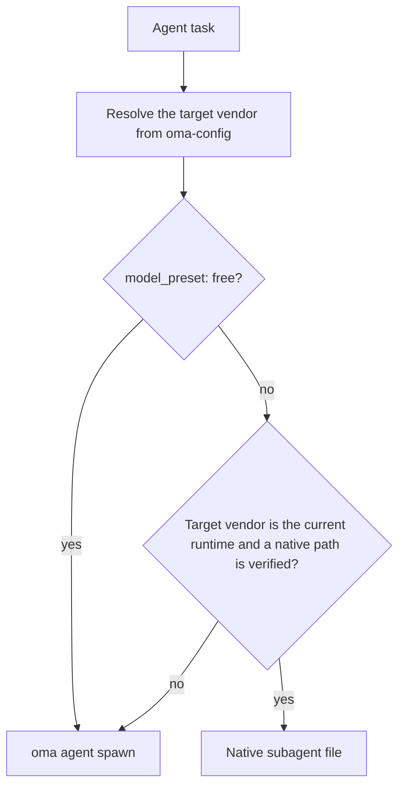
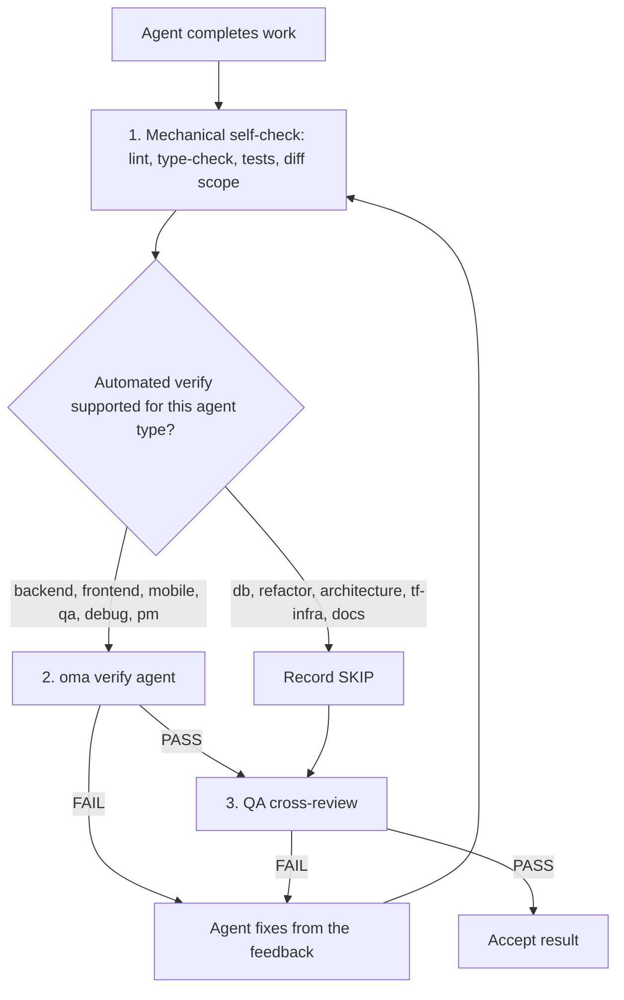

# 智能体

OMA 将[技能](../getting-started/glossary.md#skill)、调度角色和[智能体定义](../getting-started/glossary.md#agent-definition)分开。技能负责路由并加载领域指导；规范角色是运行时调度使用的身份；已签入的定义为子智能体提供供应商原生的人设。这些层有意重叠，因此应根据任务边界和验收标准判断一个技能是否足够。

---

## 技能目录 {#skill-catalog}

此表是已安装技能的权威列表。它由 `cli/scripts/generate-skill-catalog.mjs` 根据每个 `.agents/skills/<name>/SKILL.md` 的 frontmatter 生成；使用 `--check` 运行该脚本可检测漂移。每个技能 SKILL.md 中的 `## References` 章节列出其资源文件以及何时读取它们。

<!-- oma:generated skill-catalog:start -->
<!-- Generated from SKILL.md frontmatter under .agents/skills by cli/scripts/generate-skill-catalog.mjs. Do not edit this block by hand. -->

| Skill | Use it for |
|---|---|
| [`oma-academic-writing`](https://github.com/first-fluke/oh-my-agent/blob/main/.agents/skills/oma-academic-writing/SKILL.md) | Draft and revise academic prose against a rubric, evidence, and citation requirements. Use for essays, reports, literature reviews, or academic style audits. |
| [`oma-architecture`](https://github.com/first-fluke/oh-my-agent/blob/main/.agents/skills/oma-architecture/SKILL.md) | Evaluate system boundaries and architectural tradeoffs. Use for architecture decisions, design reviews, and ADRs. |
| [`oma-backend`](https://github.com/first-fluke/oh-my-agent/blob/main/.agents/skills/oma-backend/SKILL.md) | Implement server APIs, authentication, and application data access. Schema modeling and query tuning use oma-db. |
| [`oma-brainstorm`](https://github.com/first-fluke/oh-my-agent/blob/main/.agents/skills/oma-brainstorm/SKILL.md) | Explore goals, constraints, and alternative approaches before choosing a design. Use when the user requests ideation or design exploration. |
| [`oma-coordination`](https://github.com/first-fluke/oh-my-agent/blob/main/.agents/skills/oma-coordination/SKILL.md) | Coordinate assigned specialist tasks and handoffs manually. Use when supervising a multi-agent project step by step. |
| [`oma-db`](https://github.com/first-fluke/oh-my-agent/blob/main/.agents/skills/oma-db/SKILL.md) | Design schemas and migrations, tune queries, or plan vector retrieval and database operations. Application API implementation uses oma-backend. |
| [`oma-debug`](https://github.com/first-fluke/oh-my-agent/blob/main/.agents/skills/oma-debug/SKILL.md) | Diagnose a reproducible failure, fix its cause, and verify the regression. Use for crashes, incorrect behavior, and failing tests. |
| [`oma-design`](https://github.com/first-fluke/oh-my-agent/blob/main/.agents/skills/oma-design/SKILL.md) | Define or review a visual system, DESIGN.md, or redesign direction. Use for typography, layout, color, motion, and interaction design decisions. |
| [`oma-dev-workflow`](https://github.com/first-fluke/oh-my-agent/blob/main/.agents/skills/oma-dev-workflow/SKILL.md) | Configure development tasks, git hooks, CI/CD, or release automation. Use when creating or fixing a repository development workflow. |
| [`oma-docs`](https://github.com/first-fluke/oh-my-agent/blob/main/.agents/skills/oma-docs/SKILL.md) | Check documentation references, sync docs to code changes, and detect translation drift. Use for documentation maintenance in a repository. |
| [`oma-explanation`](https://github.com/first-fluke/oh-my-agent/blob/main/.agents/skills/oma-explanation/SKILL.md) | Create an offline HTML explanation of a code change (diff, PR, branch) or of a topic, system, or question. Use when a visual walkthrough document is requested. |
| [`oma-frontend`](https://github.com/first-fluke/oh-my-agent/blob/main/.agents/skills/oma-frontend/SKILL.md) | Implement or modify web UI in React, Next.js, or Angular. Use for components, pages, styles, forms, and frontend state or data flows. |
| [`oma-hwp`](https://github.com/first-fluke/oh-my-agent/blob/main/.agents/skills/oma-hwp/SKILL.md) | Convert Hangul HWP, HWPX, or HWPML documents to Markdown with kordoc. Use for text, table, and image extraction from these formats. |
| [`oma-image`](https://github.com/first-fluke/oh-my-agent/blob/main/.agents/skills/oma-image/SKILL.md) | Generate raster images or reference-guided variations through the OMA image CLI. Use for image assets or explicit vendor comparisons; pixel editing uses an editor. |
| [`oma-market`](https://github.com/first-fluke/oh-my-agent/blob/main/.agents/skills/oma-market/SKILL.md) | Research customer pain points, trends, and competitors through the OMA market engine. Use for market discovery or voice-of-customer analysis. |
| [`oma-mobile`](https://github.com/first-fluke/oh-my-agent/blob/main/.agents/skills/oma-mobile/SKILL.md) | Implement Flutter, React Native, native Swift, or native Kotlin Android apps. Use for mobile screens, widgets, platform integrations, and application data flows. |
| [`oma-observability`](https://github.com/first-fluke/oh-my-agent/blob/main/.agents/skills/oma-observability/SKILL.md) | Design or troubleshoot telemetry, SLOs, and incident diagnostics. Route to the relevant signal, system boundary, or vendor guide. |
| [`oma-orchestration`](https://github.com/first-fluke/oh-my-agent/blob/main/.agents/skills/oma-orchestration/SKILL.md) | Dispatch and supervise parallel specialist agents with durable task state. Use when automated multi-agent execution is requested. |
| [`oma-pdf`](https://github.com/first-fluke/oh-my-agent/blob/main/.agents/skills/oma-pdf/SKILL.md) | Extract PDF text, headings, tables, and images into Markdown using opendataloader-pdf. Use for PDF parsing, not PDF layout creation. |
| [`oma-pm`](https://github.com/first-fluke/oh-my-agent/blob/main/.agents/skills/oma-pm/SKILL.md) | Turn product requirements into scoped tasks with dependencies and acceptance criteria. Use for implementation planning and prioritization. |
| [`oma-qa`](https://github.com/first-fluke/oh-my-agent/blob/main/.agents/skills/oma-qa/SKILL.md) | Review changes for correctness, security, accessibility, and performance. Use for scoped quality reviews or verification plans; bug fixes use oma-debug. |
| [`oma-recap`](https://github.com/first-fluke/oh-my-agent/blob/main/.agents/skills/oma-recap/SKILL.md) | Summarize AI conversation histories for a specified date or period. Use for daily work recaps and cross-tool activity summaries. |
| [`oma-refactor`](https://github.com/first-fluke/oh-my-agent/blob/main/.agents/skills/oma-refactor/SKILL.md) | Restructure existing code while preserving observable behavior. Use for targeted technical debt or hotspot work with characterization tests. |
| [`oma-scholar`](https://github.com/first-fluke/oh-my-agent/blob/main/.agents/skills/oma-scholar/SKILL.md) | Search academic literature and generate, validate, or compare Knows paper sidecars. Use for claim/evidence analysis and literature synthesis. |
| [`oma-scm`](https://github.com/first-fluke/oh-my-agent/blob/main/.agents/skills/oma-scm/SKILL.md) | Manage Git branches, merges, conflicts, commits, and release baselines. Use for repository history and change-management operations. |
| [`oma-search`](https://github.com/first-fluke/oh-my-agent/blob/main/.agents/skills/oma-search/SKILL.md) | Find external documentation, web sources, or remote code with citations. Local code navigation uses the configured code tools. |
| [`oma-security`](https://github.com/first-fluke/oh-my-agent/blob/main/.agents/skills/oma-security/SKILL.md) | Scan application source, agent skills, and MCP components; run penetration tests against scoped web test deployments, validate findings, and configure scan gates. Use oma-qa for broad quality reviews and domain skills for remediation. |
| [`oma-skill-creation`](https://github.com/first-fluke/oh-my-agent/blob/main/.agents/skills/oma-skill-creation/SKILL.md) | Create or revise OMA skills and their references. Use for skill routing, execution contracts, conditional loading, and authoring validation. |
| [`oma-slide`](https://github.com/first-fluke/oh-my-agent/blob/main/.agents/skills/oma-slide/SKILL.md) | Create, import, revise, or export presentation decks through the OMA slide CLI. Use for HTML slides and PDF, PNG, or PPTX deck delivery. |
| [`oma-tf-infra`](https://github.com/first-fluke/oh-my-agent/blob/main/.agents/skills/oma-tf-infra/SKILL.md) | Create or review Terraform infrastructure and plans. Use for cloud resources, IAM, networking, state management, and infrastructure changes. |
| [`oma-translation`](https://github.com/first-fluke/oh-my-agent/blob/main/.agents/skills/oma-translation/SKILL.md) | Translate or revise localized UI strings and prose while preserving meaning, terminology, placeholders, and structure. |
| [`oma-video`](https://github.com/first-fluke/oh-my-agent/blob/main/.agents/skills/oma-video/SKILL.md) | Create videos through the OMA video CLI, or analyze and edit existing clips with media tools. Use for frame extraction, visual analysis, silence cuts, dubbing assembly, scripts, and composition; audio-only work uses oma-voice. |
| [`oma-voice`](https://github.com/first-fluke/oh-my-agent/blob/main/.agents/skills/oma-voice/SKILL.md) | Generate or transcribe speech with Voicebox, or process existing audio locally. Use for narration, transcripts, timed speech, and loudness conversion; video editing uses oma-video. |
<!-- oma:generated skill-catalog:end -->

---

## 调度角色 {#dispatch-roles}

运行时按规范角色调度。除 `orchestrator` 外，每个角色在 `.agents/agents/` 下都有一个已签入的定义，其 `skills:` frontmatter 列出它要加载的技能。列出的第一个技能负责该任务。

| 角色 | 定义文件 | 也接受 | 技能 |
|------|---------|-------|------|
| `orchestrator` | 无（运行时协调角色） | | |
| `pm` | `pm-planner.md` | `pm-planner` | oma-pm |
| `architecture` | `architecture-reviewer.md` | `architecture-reviewer` | oma-architecture |
| `qa` | `qa-reviewer.md` | `qa-reviewer` | oma-qa |
| `backend` | `backend-engineer.md` | `backend-engineer` | oma-backend |
| `frontend` | `frontend-engineer.md` | `frontend-engineer` | oma-frontend, oma-design |
| `mobile` | `mobile-engineer.md` | `mobile-engineer` | oma-mobile |
| `db` | `db-engineer.md` | `db-engineer` | oma-db |
| `debug` | `debug-investigator.md` | `debug-investigator` | oma-debug |
| `refactor` | `refactor-engineer.md` | `refactor-engineer` | oma-refactor |
| `docs` | `docs-curator.md` | `docs-curator` | oma-docs |
| `tf-infra` | `tf-infra-engineer.md` | `tf-infra-engineer` | oma-tf-infra |
| `explore` | `research-explorer.md` | `research-explorer`, `explorer` | oma-search, oma-market, oma-scholar |

也接受末尾带 `-agent` 后缀的名称（`qa-agent` 解析为 `qa`）。

### 原生智能体文件 {#native-agent-files}

`.agents/agents/` 下的智能体定义是事实来源。OMA 会将它们投影为支持自定义子智能体的运行时所需的供应商原生文件：

| 运行时 | 原生智能体文件 |
|--------|--------------|
| Claude Code | `.claude/agents/<name>.md` |
| Codex CLI | `.codex/agents/<name>.toml` |
| Cursor | `.cursor/agents/` |
| OpenCode | `.opencode/agents/` |
| Kiro | `.kiro/agents/` |
| Grok | `.grok/agents/` |
| CommandCode | `.commandcode/agents/` |
| Qwen Code | `.qwen/agents/` |

pi 没有智能体文件系统，因此 `oma agent spawn` 会把定义中的人设内联到提示中。生成的文件由 `oma link`、`oma install` 和 `oma update` 刷新。

### 角色如何调度 {#how-a-role-is-dispatched}

当工作流将智能体映射到与当前运行时相同的供应商时，会优先使用该运行时的原生智能体文件。跨供应商任务回退到 `oma agent spawn`。



> **按智能体调度模型：** 每个角色的供应商、模型和推理强度来自 `.agents/oma-config.yaml`（或 `.agents/oma-config.cue`，可选 `.local` 覆盖层）。使用新安装的默认值 `model_preset: auto` 时，没有 `agents:` 覆盖项的角色遵循当前运行时的原生智能体和模型设置；`model_preset: free` 始终通过 `oma agent spawn` 调度。配置详情请参见[按智能体选择模型](../guide/per-agent-models.md)，使用 [`oma doctor --profile`](../cli-interfaces/commands.md#doctor) 查看当前矩阵。

---

## 技能分类 {#agent-categories}

| 类别 | 技能 | 职责 |
|------|------|------|
| **构思** | oma-brainstorm | 探索想法，提出方案，产出设计文档 |
| **架构** | oma-architecture | 系统、模块和服务边界，ADR/ATAM/CBAM 风格分析，权衡记录 |
| **规划** | oma-pm | 需求分解、任务拆分、API 契约、优先级分配 |
| **实现** | oma-frontend、oma-backend、oma-mobile、oma-db | 在各自领域编写代码 |
| **设计** | oma-design | 设计系统、DESIGN.md、令牌、排版、色彩、动效、无障碍 |
| **基础设施** | oma-tf-infra | 多云 Terraform 配置、IAM、成本优化、策略即代码 |
| **DevOps** | oma-dev-workflow | mise 任务运行器、CI/CD、迁移、发布协调、单体仓库自动化 |
| **可观测性** | oma-observability | 可观测性管道、可追溯性路由、MELT+P 信号（metrics/logs/traces/profiles/cost/audit/privacy）、SLO 管理、事件取证、传输层调优 |
| **质量** | oma-qa | 安全审计（OWASP）、性能、无障碍（WCAG）、代码质量审查 |
| **调试** | oma-debug | Bug 复现、根因分析、最小修复、回归测试 |
| **本地化** | oma-translation | 保留语气、语域和领域术语的上下文感知翻译 |
| **协调** | oma-orchestration、oma-coordination | 自动化和手动多智能体编排 |
| **Git** | oma-scm | Conventional Commits 生成、按功能拆分提交 |
| **搜索与检索** | oma-search | 带信任度评分的意图驱动搜索路由（Context7 文档、网络、`gh`/`glab` 代码、本地代码智能） |
| **回顾** | oma-recap | 跨工具对话历史分析与主题化工作摘要 |
| **文档处理** | oma-hwp、oma-pdf | 将 HWP/HWPX/HWPML 和 PDF 转为 Markdown，供 LLM/RAG 摄取 |
| **文档** | oma-docs | 文档维护：损坏引用、受 diff 影响的文档、翻译漂移，以及译文文档 lint |
| **讲解** | oma-explanation | 为代码变更（diff、PR、分支、提交范围）或主题、系统、问题生成离线 HTML 讲解 |
| **学术写作** | oma-academic-writing、oma-scholar | 面向发表的学术写作起草与审查，以及 Knows sidecar 学术研究、搜索和同行评审 |
| **安全** | oma-security | 扫描应用源码、智能体技能包、MCP 组件和已授权的 Web 测试部署（Deepsec、Cisco 扫描器、ARTEX），并进行独立的发现验证和 CI 关卡 |
| **重构** | oma-refactor | 以保持行为为目标的渐进式重组，定位热点并使用特征测试安全网，提交仅含重构 |
| **市场研究** | oma-market | 基于社区信号的痛点、趋势、竞品和发现研究，并使用意图自动选择的 SWOT、Porter 五力和 PESTEL 框架 |
| **技能编写** | oma-skill-creation | 以 SSL-lite 格式创建并验证 OMA 技能 |
| **媒体生成** | oma-image、oma-slide、oma-video、oma-voice | AI 图像生成、HTML 演示文稿、短视频、讲解视频或演示视频，以及本地 TTS/STT |

---

## 详细智能体参考 {#detailed-agent-reference}

以下摘要说明每个技能的领域和关键规则。技能自身的 SKILL.md 是事实来源：其 `## References` 章节列出资源文件以及读取每个文件的条件，因此本页不复制这些列表。

### oma-brainstorm

**领域：** 规划或实现之前的设计优先构思。

**何时使用：** 探索新功能想法、理解用户意图、比较方案。对于复杂或模糊的请求，在 `/plan` 之前使用。

**何时不使用：** 需求明确（交给 oma-pm）、实现（交给领域智能体）、代码审查（交给 oma-qa）。

**核心规则：**
- 设计批准前不进行实现或规划
- 一次只问一个澄清问题（不批量提问）
- 当备选方案有助于决策时，比较两到三种可行方案；若约束使可选方案更少，说明原因而不是凭空编造选项
- 逐节呈现设计，只解决仍未确定的关键选择
- YAGNI：只设计需要的部分

**工作流：** 7 个阶段：上下文、提问、方案（可选用 TRIZ-lite 提供初始思路）、设计、盲审、文档（保存到 `docs/plans/designs/`）、过渡到 `/plan`。

---

### oma-architecture

**领域：** 软件/系统架构，包括模块与服务边界、权衡分析、利益相关者综合和决策记录。

**何时使用：** 选择或审查系统架构，定义模块/服务/归属边界，带显式权衡比较架构方案，诊断架构痛点（变更放大、隐藏依赖、别扭的 API），确定架构投资或重构的优先级，编写架构建议或 ADR。

**何时不使用：** 视觉/设计系统（使用 oma-design），功能规划与任务分解（使用 oma-pm），Terraform 实现（使用 oma-tf-infra），Bug 诊断（使用 oma-debug），安全/性能/无障碍审查（使用 oma-qa）。

**方法论：** 诊断路由、design-twice 对比、ATAM 风格风险分析、CBAM 风格优先级排序、ADR 风格决策记录。

**核心规则：**
- 先诊断架构问题，再选择方法
- 对当前决策使用最轻量且足够的方法论
- 将架构设计与 UI/视觉设计以及 Terraform 交付区分开
- 仅当决策足够横切以证明成本合理时，才咨询利益相关者智能体
- 建议质量重于共识表演：广泛咨询，明确决策
- 每项建议必须说明前提、权衡、风险和验证步骤
- 默认具备成本意识：实现成本、运维成本、团队复杂度、未来变更成本

---

### oma-pm

**领域：** 产品管理，包括需求分析、任务分解和 API 契约。

**何时使用：** 分解复杂功能、判断可行性、确定工作优先级、定义 API 契约。

**核心规则：**
- API 优先设计：在实现任务之前定义契约
- 每个任务必须包含：智能体、标题、验收标准、优先级、依赖关系
- 最小化依赖以实现最大并行执行
- 安全和测试是每个任务的一部分（不是独立阶段）
- 任务必须可由单个智能体完成
- 输出 JSON 计划和会话范围的任务看板，以兼容编排器

**输出：** `.agents/results/plan-{sessionId}.json`，使用数字优先级层级（`1` = 独立，层级越低越先运行），以及配置的内存存储中运行范围的报告 `result-{agentId}-{taskId}-{runId}-{sessionId}.md`。

---

### oma-frontend

**领域：** 使用 TypeScript 的 React/Next.js 或 Angular Web UI。React 项目使用 FSD-lite；Angular 项目遵循 `resources/angular-rules.md`。

**何时使用：** 构建用户界面、组件、客户端逻辑、样式、表单验证和 API 集成。

**技术栈：**
- React + Next.js（默认服务端组件，交互时使用客户端组件）
- TypeScript（严格模式）
- TailwindCSS v4 + shadcn/ui（只读原语，通过 cva/包装器扩展）
- FSD-lite：根目录 `src/` + 功能目录 `src/features/*/`（禁止跨功能导入）

**库（React/Next.js 项目）：**
| 用途 | 库 |
|------|-----|
| 日期 | luxon |
| 样式 | TailwindCSS v4 + shadcn/ui |
| Hooks | ahooks 或 @mantine/hooks |
| 工具 | es-toolkit |
| 类型 | type-fest |
| URL 状态 | nuqs |
| 服务端状态 | TanStack Query（存在 OpenAPI 规范时使用 orval 生成的 hooks） |
| 客户端状态 | Jotai 或 Zustand，按意图选择，没有默认值（尽量少用） |
| 表单 | @tanstack/react-form + Zod |
| 认证 | better-auth |
| 动画 | 新项目使用 motion（`motion/react`） |

**核心规则：**
- shadcn/ui 优先，通过 cva 扩展，永远不要直接修改 `components/ui/*`
- 设计令牌 1:1 映射（永远不硬编码颜色）
- 请求代理：保留现有的 Next.js 16+ `proxy.ts` 约定；在提议重命名为 `middleware.ts` 之前，先检查已安装的版本和路由
- 属性传递不超过 3 层；使用项目的客户端状态库（Jotai atoms 或 Zustand store）
- 必须使用 `@/` 绝对导入
- FCP 目标 < 1s
- 响应式断点：320px、768px、1024px、1440px

**质量关卡检查清单：**
- 无障碍：ARIA 标签、语义化标题、键盘导航
- 移动端：在移动视口上验证
- 性能：无 CLS、快速加载
- 健壮性：错误边界和加载骨架屏
- 测试：逻辑由 Vitest 覆盖
- 质量：类型检查和 lint 通过

---

### oma-backend

**领域：** API、服务端逻辑、认证、数据库操作。

**何时使用：** REST/GraphQL API、数据库迁移、认证、服务端业务逻辑和后台任务。

**架构：** Router（HTTP）-> Service（业务逻辑）-> Repository（数据访问）-> Models。

**栈检测：** 读取项目清单文件（pyproject.toml、package.json、Cargo.toml、go.mod 等）确定语言和框架。如果缺少项目专用约定，要求用户运行 `/stack-set`；该命令会根据随附的 schema 和模板物化解析后的 `stack/` 参考资料。

**核心规则：**
- 整洁架构：路由处理器中不放业务逻辑
- 使用项目的验证库验证所有输入
- 仅使用参数化查询（SQL 中禁止字符串插值）
- JWT + Argon2id 用于认证（bcrypt 仅可用于旧版兼容）；限制认证端点速率
- 在支持的地方使用异步；所有签名加类型注解
- 通过集中错误模块处理自定义异常
- 显式 ORM 加载策略、事务边界和安全生命周期

<!-- oma-docs:ignore-start -->
项目专用的 `stack/stack.yaml`、`stack/tech-stack.md`、代码片段和 API 模板由 `/stack-set` 按需生成；在栈被物化之前这些文件不存在。
<!-- oma-docs:ignore-end -->

---

### oma-mobile

**领域：** 跨平台和原生移动应用（Flutter、React Native 和 Swift 原生 iOS）。

**何时使用：** 原生移动应用（iOS + Android）、移动端特定 UI 模式、平台功能（相机、GPS、推送通知）、离线优先架构；采用 SwiftUI 和 `swift-openapi-generator` 的 Swift 原生 iOS 应用。

**架构：** 整洁架构：domain -> data -> presentation。Swift iOS 使用 `App/Core/Features/Shared` 项目布局。

**技术栈：**
- Flutter/Dart：Riverpod/Bloc（状态管理）、带拦截器的 Dio（API）、GoRouter（导航）、Material Design 3（Android）+ iOS HIG。
- Swift 原生 iOS（iOS 17+）：SwiftUI + `@Observable`（Observation 框架），使用 Apple `swift-openapi-generator` 生成 API 客户端，`App/Core/Features/Shared` 布局。

**核心规则：**
- 使用 Riverpod/Bloc 管理状态（复杂逻辑不使用原始 setState）
- 所有控制器在 `dispose()` 方法中释放
- 使用带拦截器的 Dio 调用 API；优雅处理离线状态
- 目标 60fps；在两个平台上测试
- Swift：iOS 17+ 使用 `@Observable` 而不是 `ObservableObject`；通过 `swift-openapi-generator` 根据 OpenAPI 规范生成 API 客户端

**平台种子：** `variants/` 提供 `flutter/`、`react-native/` 和 `swift-ios/`，每个都包含 `stack.yaml`、`tech-stack.md`、`snippets.md` 和一个 API 模板，另有共享的 `stack.schema.json`。它们是 `/stack-set` 的起始素材，编辑现有代码时无需阅读。

---

### oma-db

**领域：** 跨 SQL、NoSQL 和向量数据库的数据库架构。

**何时使用：** 模式设计、ERD、规范化、索引、事务、容量规划、备份策略、迁移设计、向量数据库/RAG 架构、反模式审查、合规感知设计（ISO 27001/27002/22301）。

**默认工作流：** 探索（识别实体、访问模式、数据量）-> 设计（模式、约束、事务）-> 优化（索引、分区、归档、反模式）。

**核心规则：**
- 先选择模型，再选择引擎
- 关系型默认 3NF；分布式系统需文档化 BASE 权衡
- 记录所有三个模式层：外部、概念、内部
- 完整性是核心：实体、域、引用、业务规则
- 并发永远不是隐式的：定义事务边界和隔离级别
- 向量数据库是检索基础设施，不是数据源头
- 不要将向量搜索当作词法搜索的直接替代品

**必需交付物：** 外部模式摘要、概念模式、内部模式、数据标准表、术语表、容量估算、备份/恢复策略。向量/RAG：嵌入版本策略、分块策略、混合检索策略。

---

### oma-design

**领域：** 设计系统、UI/UX、DESIGN.md 管理。

**何时使用：** 创建或修订设计系统和 DESIGN.md，重新设计现有网站或应用（保留或彻底改造），着陆页、设计令牌、调色板、排版、响应式布局、无障碍审查。

**工作流：** 7 个阶段：设置（上下文收集）-> 提取（可选，从参考 URL）-> 增强（模糊提示增强）-> 提案（2-3 个设计方向）-> 生成（DESIGN.md + 令牌）-> 审计（响应式、WCAG、Nielsen、AI 泛滥检查）-> 交接。

**反模式强制执行（"杜绝 AI 泛滥"）：**
- 排版：默认系统字体栈；无正当理由不使用默认 Google Fonts
- 色彩：禁止紫蓝渐变、渐变球体/斑块、纯白配纯黑
- 布局：禁止嵌套卡片、仅桌面布局、千篇一律的 3 指标统计布局
- 动效：禁止到处使用弹跳缓动、禁止超过 800ms 的动画、必须尊重 prefers-reduced-motion
- 组件：禁止到处使用毛玻璃效果，所有交互元素需要键盘/触摸替代

**核心规则：**
- 存在时复用 `.design-context.md` 和 `DESIGN.md`；仅当实质性的探索过程为决策提供依据时才创建 `.design-context.md`
- 对现有网站或应用，遵循 `resources/redesign-protocol.md`，并在提案前判定 Preserve 还是 Overhaul
- 默认系统字体栈（ko/ja/zh 使用 CJK 就绪字体）
- 所有设计至少达到 WCAG AA 标准
- 响应式优先（移动端为默认）
- 提出 2-3 个方向，获得确认

---

### oma-tf-infra

**领域：** 使用 Terraform 的基础设施即代码，多云。

**何时使用：** 在 AWS/GCP/Azure/Oracle Cloud 上部署、Terraform 配置、CI/CD 认证（OIDC）、CDN/负载均衡/存储/网络、状态管理、ISO 合规基础设施。

**云检测：** 读取 Terraform 提供者和资源前缀（`google_*` = GCP、`aws_*` = AWS、`azurerm_*` = Azure、`oci_*` = Oracle Cloud）。包含完整的多云资源映射表。

**核心规则：**
- 提供者无关：从项目上下文检测云
- 带版本控制和锁定的远程状态
- CI/CD 认证优先使用 OIDC
- 始终先 plan 再 apply
- 最小权限 IAM
- 为一切打标签（Environment、Project、Owner、CostCenter）
- 代码中不存放密钥
- 版本锁定所有提供者和模块
- 生产环境禁止自动批准

---

### oma-dev-workflow

**领域：** 单体仓库任务自动化和 CI/CD。

**何时使用：** 运行开发服务器、跨应用执行 lint/format/typecheck、数据库迁移、API 生成、i18n 构建、生产构建、CI/CD 优化、提交前验证。

**核心规则：**
- 始终使用 `mise run` 任务而非直接使用包管理器命令
- 仅对变更的应用运行 lint/test
- 使用 commitlint 验证提交消息
- CI 应跳过未变更的应用
- 存在 mise 任务时不要使用直接的包管理器命令

---

### oma-observability

**领域：** 跨层、跨边界、跨信号的基于意图的可观测性与可追溯性路由器。

**何时使用：**
- 管道搭建：OTel SDK + Collector + 供应商后端
- 跨服务与领域边界的可追溯性：W3C propagator、baggage、多租户、多云
- 传输层调优：UDP/MTU 阈值、OTLP gRPC vs HTTP、Collector DaemonSet vs sidecar 拓扑、采样配方
- 事件取证：六维定位（code / service / layer / host / region / infra）
- 供应商类别选型：OSS 全栈 vs 商用 SaaS vs 高基数专精 vs 剖析专精
- Observability-as-code：Grafana Jsonnet 仪表板、PrometheusRule CRD、OpenSLO YAML、SLO burn-rate 告警
- 元可观测性：管道自身健康度、时钟偏差、基数护栏、保留策略矩阵
- MELT+P 信号覆盖：metrics、logs、traces、profiles、cost、audit、privacy
- 日志管道迁移，需对照当前上游支持情况和项目要求进行评估

**何时不使用：** LLM ops / gen_ai 可观测性（使用 Langfuse、Arize Phoenix、LangSmith、Braintrust）、数据管道 lineage（OpenLineage + Marquez、dbt test、Airflow lineage）、IoT / 数据中心物理层遥测（Nlyte、Sunbird、Device42）、混沌工程编排（Chaos Mesh、Litmus、Gremlin、ChaosToolkit）、GPU / TPU 基础设施（NVIDIA DCGM Exporter）、软件供应链（sigstore、in-toto、SLSA）、事件响应工作流 / 告警派单（PagerDuty、OpsGenie、Grafana OnCall）、已由该供应商自有技能 覆盖的单供应商配置。

**核心规则：**
- 路由前先分类意图：setup | migrate | investigate | alert | trace | tune | route
- 类别优先，而非供应商注册表：通过 `resources/vendor-categories.md` 委派给供应商自有技能；不重复供应商文档
- 传输层调优是护城河：UDP/MTU 阈值、OTLP 协议选择、Collector 拓扑与采样配方是其他 skill 未覆盖的深度
- 元可观测性不可妥协：在声明搭建完成前，验证管道自身健康度、时钟同步（< 100 ms 漂移）、基数与保留策略
- CNCF 优先偏好：Prometheus、Jaeger、Thanos、Fluent Bit、OpenTelemetry、Cortex、OpenCost、OpenFeature、Flagger、Falco
- Fluentd 仍是 CNCF Graduated 项目；CNCF 2025-10 发布的 Fluentd 到 Fluent Bit 指南是迁移指南，而非弃用声明。应根据工作负载、插件和运维要求在 Fluentd、Fluent Bit 或 OTel Collector 之间选择
- W3C Trace Context 作为默认 propagator；按云做转换（AWS X-Ray `X-Amzn-Trace-Id`、GCP Cloud Trace、Datadog、Cloudflare、Linkerd）
- 隐私优先于功能：PII 脱敏、采样感知的 baggage 规则、SOC2/ISO 不可变审计 + GDPR/PIPA 删除应在采集时应用，而不仅是在存储层

---

### oma-qa

**领域：** 质量保证，涵盖安全、性能、无障碍和代码质量。

**何时使用：** 部署前的最终审查、安全审计、性能分析、无障碍合规、测试覆盖率分析。

**审查优先级顺序：** 安全 > 性能 > 无障碍 > 代码质量。

**严重级别：**
- **CRITICAL**：安全漏洞、数据丢失风险
- **HIGH**：阻碍发布
- **MEDIUM**：本迭代修复
- **LOW**：待办

**核心规则：**
- 每个发现必须包含文件:行号、描述和修复方案
- 先运行自动化工具（npm audit、bandit、lighthouse）
- 不允许误报；每个发现必须可复现
- 提供修复代码，而非仅描述

---

### oma-debug

**领域：** Bug 诊断与修复。

**何时使用：** 用户报告的 Bug、崩溃、性能问题、间歇性故障、竞态条件和回归 Bug。

**方法论：** 先复现，再诊断。永远不要猜测修复方案。

**核心规则：**
- 找到根因，而非仅处理症状
- 最小修复：只改必要的部分
- 每个修复都要有回归测试
- 在其他地方搜索相似模式
- 记录到 `.agents/results/`

**使用的代码智能工具（Gortex 或 Serena）：**
- `find_symbol("functionName")` 或 Gortex 符号导航：定位函数
- `find_referencing_symbols("Component")` 或 Gortex 影响分析：查找所有用法
- `search_for_pattern("error pattern")` 或 Gortex 搜索：查找相似问题

---

### oma-translation

**领域：** 上下文感知的多语言翻译。

**何时使用：** 翻译 UI 字符串、文档、营销文案，审查现有翻译，创建术语表。

**六幕流程：** Prepare、Acquire、Reason、Act、Verify 和 Finalize。翻译方法有四步：阅读含义和受保护语法，选择语域，在目标语言中重构，并在适当处保留作者风格。

**核心规则：**
- 先扫描现有区域设置文件以匹配惯例
- 翻译含义，而非逐字翻译
- 保留情感内涵
- 永远不要逐字翻译
- 同一篇文章中不混合语域
- 保留领域特定术语原文

---

### oma-orchestration

**领域：** 通过 CLI 启动的自动化多智能体协调。

**何时使用：** 需要多个智能体并行处理的复杂功能、自动化执行、全栈实现。

**配置默认值：**

| 设置 | 默认值 | 说明 |
|------|-------|------|
| MAX_PARALLEL | 3 | 最大并发子智能体数 |
| MAX_RECOVERY_ATTEMPTS | 3 | 每个任务的重试和探索假设总数，包括原始尝试 |
| POLL_INTERVAL | 30s | `oma agent spawn` 运行的状态检查间隔（Claude Code 原生子智能体同步返回） |

**工作流阶段：** 规划 → 参考资料（为每个任务选择参考资料）→ 设置（会话和任务看板工件）→ 执行（在 MAX_PARALLEL 范围内调度就绪任务）→ 监控 → 验证（审查循环）→ 收集（声明和运行范围的报告）。

**智能体间审查循环：** 图示和循环上限参见[编排流程](#orchestration-flow)。

**会话证据：** 有帮助时，记录实质性纠正和已裁定的审查发现，并附上原因、影响和验证情况。没有惩罚评分，也没有由评分触发的暂停。

---

### oma-scm

**领域：** 软件配置管理（SCM）和 Git，涵盖分支、合并、工作树、基线、审计就绪性和 Conventional Commits。

**何时使用：** 代码变更完成后（`/scm`）、合并冲突、分支策略、发布或标签，以及任何仓库配置管理问题。

**提交类型：** feat、fix、docs、style、refactor、perf、test、chore、build、ci、revert。

**工作流（提交）：** 分析变更 → 必要时按功能拆分 → 类型 → 范围 → 描述（祈使语气、不超过 72 个字符、小写、末尾不加句号）→ 使用明确路径提交。

**规则：**
- 未经明确授权，不要使用 `git add -A` 或 `git add .`
- 永远不要提交密钥文件
- 暂存时始终明确指定文件
- 将提交消息写入文件，并使用 `git commit -F <message-file>` 提交
- 未经明确授权不要改写共享历史；使用 `--force-with-lease`，绝不使用普通的 `--force`
- 仅当有效的 `scm.co_author` 配置启用共同作者并提供姓名和邮箱时，才加入共同作者尾注。

---

### oma-coordination

**领域：** 手动逐步多智能体协调指南。

**何时使用：** 多领域工作中，希望逐步监督启动、监控、契约对齐和 QA，而不是完全自动化编排。

**何时不使用：** 完全自动化的并行执行（使用 oma-orchestration）、单一领域的任务（直接使用对应领域的智能体）。

**核心规则：**
- 复用有效的计划；仅当分解或契约必须变更时才调用 oma-pm
- 并行启动同一优先级层的独立任务，每个任务使用独立工作区或 `--isolation worktree`
- 在依赖它的前端或移动端工作之前，先为已变更的 API 边界更新契约
- QA 审查始终是最后一步
- 将阻塞性 QA 缺陷和必需的验证缺口交回负责的智能体，然后重跑受影响的检查

**工作流：** 规划（复用或交给 PM）→ 按优先级层启动 → 监控 → QA 审查 → 修复问题 → 交付。

**与 oma-orchestration 的区别：** coordination 是手动且有引导的（用户控制节奏），orchestrator 是自动化的（智能体以最少的用户干预启动并运行）。

---

### oma-search

**领域：** 带域信任度评分的意图驱动搜索路由，将查询路由到 Context7（文档）、原生网络搜索、`gh`/`glab`（代码）、本地代码智能（Gortex 或 Serena）。

**何时使用：** 查找官方库/框架文档，关于教程/示例/对比/解决方案的网络调研，针对实现模式的 GitHub/GitLab 代码搜索，搜索通道不明确的查询（自动路由），需要搜索基础设施的其他技能（共享调用）。

**何时不使用：** 仅限本地的代码库探索（直接使用代码智能 MCP），Git 历史或 blame 分析（使用 oma-scm），完整架构调研（使用 oma-architecture，该技能可能在内部调用本技能）。

**核心规则：**
- 显式的 `--docs`、`--code` 或 `--web` 决定路由；否则使用 `resources/intent-rules.md` 分类意图
- 一次查询、一条最佳路由：除非意图模糊，否则避免冗余的多路由
- 为每个结果评信任分：所有非本地结果均从注册表获得域信任标签
- 其他标志：`--strict` 在评分后按信任度过滤结果，`--wide` 保留已标注的较低信任度结果，`--gitlab` 选择 GitLab 作为代码托管方
- 失败则前进：如主路由失败，优雅降级（docs→web，web→`oma search fetch` 策略）
- 无需额外 MCP：文档用 Context7，网络用运行时原生能力，代码用 CLI，本地用配置的提供程序（Gortex 或 Serena）
- 供应商中立的网络搜索：使用当前运行时提供的任何方案（WebSearch、Google、Bing）
- 仅域级信任度：无子路径或页面级评分

---

### oma-recap

**领域：** 分析多个 AI 工具（Claude、Codex、Gemini、Antigravity、Qwen、Cursor、Grok）的对话历史，生成主题化的每日或周期工作摘要。

**何时使用：** 汇总一天或一段时间的工作活动，理解多个 AI 工具之间的工作流，分析会话之间的工具切换模式，准备每日站会、每周回顾或工作日志。

**何时不使用：** 基于 Git 提交的代码变更回顾（使用 `oma retro`）、实时智能体监控（使用 `oma dashboard terminal`）、生产力指标（使用 `oma stats get`）。

**流程：**
1. 从自然语言输入（今天、昨天、上周一、明确日期）解析日期或时间窗口
2. 通过 `oma recap --date YYYY-MM-DD --json` 获取某个日历日的对话数据，或通过 `oma recap --window 7d --json` 获取滚动窗口（`1d`、`3d`、`7d`、`2w`、`30d`）的数据；使用 `--tool` 缩小范围
3. 按内容（项目和主题）而不是按工具分组；3 天或以上的窗口按项目而非按天分组
4. 提取主题（完成的功能、修复的 Bug、探索的工具）
5. 生成主题化的每日或周期摘要

---

### oma-hwp

**领域：** 使用 `kordoc` 将 HWP / HWPX / HWPML（韩文字处理器）转换为 Markdown。

**何时使用：** 将韩文 HWP 文档（`.hwp`、`.hwpx`、`.hwpml`）转换为 Markdown，为 LLM 上下文或 RAG 准备韩国政府/企业文档，从 HWP 中提取结构化内容（表格、标题、列表、图像、脚注、超链接）。

**何时不使用：** PDF 文件（使用 oma-pdf），XLSX/DOCX（超出范围），生成/编辑 HWP（超出范围），已是文本的文件（直接使用 Read 工具）。

**核心规则：**
- 使用 `bunx kordoc@latest` 运行（无需安装）；始终传递 `@latest` 或固定版本
- 默认输出格式为 Markdown
- 若未指定输出目录，则输出到与输入相同的目录
- kordoc 负责结构保留（标题、表格、嵌套表格、脚注、超链接、图像）
- 安全防护（ZIP 炸弹、XXE、SSRF、XSS）由 kordoc 提供；不要另行添加自定义防护
- 对于加密或 DRM 锁定的 HWP，向用户清晰报告限制
- 使用 `resources/flatten-tables.ts` 后处理，将 HTML `<table>` 块转换为 GFM 管道表格，并去除 Hancom 字体私用区域字符

---

### oma-pdf

**领域：** 使用 `opendataloader-pdf` 将 PDF 转换为 Markdown。

**何时使用：** 将 PDF 文档转换为 Markdown 以用于 LLM 上下文或 RAG，从 PDF 中提取结构化内容（表格、标题、列表），为 AI 消费准备 PDF 数据。

**何时不使用：** 生成/创建 PDF（使用合适的文档工具），编辑现有 PDF（超出范围），简单读取已是文本的文件（直接使用 Read 工具）。

**核心规则：**
- 使用 `uvx opendataloader-pdf` 运行（无需安装）
- 默认输出格式为 Markdown
- 若未指定输出目录，则输出到与输入 PDF 相同的目录
- 保留文档结构（标题、表格、列表、图像）
- 对扫描 PDF，使用带 OCR 的混合模式
- 始终对输出运行 `uvx mdformat` 以规范化 Markdown 格式
- 验证输出 Markdown 是否可读且结构良好
- 向用户报告任何转换问题（缺失表格、乱码文本）

---

### oma-academic-writing

**领域：** 面向发表质量的学术英文写作：起草、修订和审查论文、报告、分析章节、执行摘要、结论和文献综述。

**何时使用：** 起草或修订学术报告、论文或分析章节，撰写执行摘要、结论或文献综述，将带有 AI 腔的文字改写为自然的学术英语，将草稿打磨到评分标准的最高档（HD、A、top-band），审查文字的句式变化、动词质量、限定语和反 AI 合规性。

**何时不使用：** 翻译（使用 oma-translation），来源发现、引文收集或文献检索（使用 oma-scholar），评分标准解析与任务分解（使用 oma-pm），代码文档、README 或 API 参考文本（使用相应领域技能），非正式或营销文案，非英语学术写作（先用英语起草，再交给 oma-translation）。

**模式：** `draft`（标题 + 正文 + Writing Notes + Claim-Evidence Map），`revise`（原文 + 修订稿 + 变更列表），`review`（PASS/FAIL 合规报告，涵盖句式结构、动词质量、反 AI、具体性、限定语、段落清晰度、节奏以及主张与证据的对应）。

**核心规则：**
- 先引用再判断：应用任何规则前，先引用评分标准或约束的原文
- 每句话都可验证；绝不编造数据、统计或引文
- 禁用的泛化动词（`show`、`have`、`make`、`do`、`get`、`use`……）不得作为主要动词
- 变换句型、长度和句首；同类句子不得连续出现 3 句或以上
- 限定语强度与证据强度相匹配；不使用第一人称 `I think`/`I believe`
- 每个主张都要在 Claim-Evidence Map 中对应证据；削弱或删除缺乏支持的主张

**工作流：** 6 个步骤：READ（阅读评分标准或草稿并引用约束）、PLAN（按 Topic-Support-Conclude 规划段落）、DRAFT（遵循全部四项协议起草）、AUDIT（对照反 AI 检查清单审查）、REVERSE-OUTLINE（反向大纲并构建 Claim-Evidence Map）、POLISH（朗读、衔接、具体性、字数、节奏）。

---

### oma-security

**领域：** 针对应用源码、智能体技能包、MCP 组件和已授权 Web 测试部署的安全扫描与验证。

**何时使用：** 扫描仓库或源码 diff；检查技能包、MCP 服务器或配置；对具体且已授权的测试部署运行有边界的渗透测试；验证扫描器候选结果；配置特定引擎的 CI 关卡；排查扫描器的凭据、覆盖范围、匹配器、配额或可恢复状态问题。

**何时不使用：** 广泛的正确性、性能、无障碍或质量审查（使用 oma-qa），不实际执行的工具比较或调研（使用 oma-search），安全架构决策（使用 oma-architecture），产品代码中的修复（使用 oma-debug 或负责的后端、前端、移动端、基础设施技能）。

**按目标划分的默认引擎：**

| 目标 | 默认引擎 |
|------|---------|
| 应用源码或源码 diff | Deepsec（明确选择时使用 Cisco AI Deep SAST） |
| 智能体技能目录或包 | Cisco Skill Scanner |
| MCP 源码、配置或服务器 | Cisco MCP Scanner |
| Web 测试部署 | ARTEX |
| 有边界的本地复现 | Cloudflare 验证方法（无外部网络） |

**核心规则：**
- 一般的仓库扫描只选择源码；不会隐含地加入技能、MCP 和运行时扫描
- 失败或空结果绝不会自动选择其他引擎、模型或付费分析器
- 保留并恢复现有的 `.deepsec/` 状态；绝不为抹掉失败或噪声较多的运行而重新初始化
- 已安装的密钥或工具并不授权付费调用或更大的范围；按共享执行策略复用已有授权
- 每个唯一候选都交给未发现它的全新验证者；`confirmed` 需要独立观察到的证据
- 任何结果都不能证明目标是安全的；仍有必需检查未完成时，关卡不能通过

**输出：** 每次调用生成一个 `.agents/results/security/<run-id>/`，包含 `run.json`、`findings.json` 和 `report.md`（Web 运行时另有 `runtime.json`，CI 另有 `gate.json`）。

---

### oma-docs

**领域：** 四种模式的文档维护：`verify`（损坏引用；重新生成 `docs/generated/doc-refs.json`）、`sync`（引用了 diff 中变更文件的文档）、`i18n`（翻译漂移）和 `lint`（译文文档中的风格问题）。

**何时使用：** 重构、重命名或删除文件后查找文档中的过时引用；发布前确认 CLI 命令、文件路径和配置键仍然存在；较大的 git diff 之后查找哪些文档引用了变更文件；例行的翻译漂移检查。

**何时不使用：** 一般源码调研（使用 oma-search），应用实现（使用负责的专业技能），翻译已知文本（使用 oma-translation）。

**核心规则：**
- 仅审查的请求只产出提案；已有的限定范围编辑请求即授权应用这些修正，无需逐文件再次批准
- CLI 输出结构化数据；由宿主 LLM 进行综合和补丁起草。不要编造 CLI 发现，也不要从 docs CLI 调用供应商 LLM API
- 含密钥的文件（`.env*`、私钥、凭据）绝不出现在 diff 报告或补丁中
- 遵守忽略块、`oma-docs: skip` 和配置的排除项
- URL 检查委托给 `lychee`（可选）；工作流钩子仅在启用 `docs.auto_verify` 时运行，且只发出警告

**工作流：** `oma docs verify --json`、`oma docs sync <range> --json`、`oma docs i18n --json` 或 `oma docs lint --json` → 检查结构化结果 → 对照当前代码验证每项修正 → 应用已授权的修正 → 重跑受影响的检查。`verify` 无问题时退出码为 0，发现损坏引用时为 1。

---

### oma-explanation

**领域：** 两种模式的离线、自包含 HTML 讲解：变更模式（diff、PR、分支或提交范围，包含背景、直觉、代码导读和五题测验）和主题模式（将概念、系统或问题做成一页可视化讲解）。

**何时使用：** 将 diff、拉取请求、分支或提交范围，或者主题、系统、问题讲解为一个可离线使用的 HTML 页面。

**工作流：** 模型先写 Markdown 草稿；`oma explain render` 将其转为位于 `.agents/results/explain/{YYYY-MM-DD}-{slug}.html` 的单个 HTML 文件，`oma explain validate` 对其进行检查。只能通过 `/explain`、点名该技能或委派来激活；该技能不参与关键词提示。

**何时不使用：** 普通文档页面、实际功能实现或幻灯片（演示文稿使用 `oma-slide`）。

---

### oma-image

**领域：** 多供应商 AI 图像生成，按认证状态并行调度（Codex `gpt-image-2`；Antigravity 的 Gemini 系列 “nano-banana” 模型，经由 `agy` 调用并在内部选定具体模型；Pollinations flux/zimage）。

**何时使用：** 生成图像、视觉素材、插画、产品照片、概念艺术或样机；针对同一提示词比较多个图像模型的输出；在编辑器工作流中根据提示词生成图像。

**何时不使用：** 编辑现有图像或照片处理，生成视频或音频（使用 oma-video / oma-voice），根据结构化数据内联合成矢量/SVG，简单的素材缩放或格式转换。

**核心规则：**
- 调用前先澄清：若主体、风格、构图或用途不明确，先询问，或扩展提示词并向用户展示扩展后的版本
- 按认证状态调度：只运行已认证的供应商；使用 `--vendor all` 时，每个请求的供应商都必须可用
- 成本护栏：预估成本 ≥ $0.20 的运行需先确认（`--yes`/`OMA_IMAGE_YES=1` 可绕过）；默认的 `pollinations` 和 `antigravity` 免费
- 路径安全：输出到 `$PWD` 之外需要 `--allow-external-output`；`n` 最大为 5
- 记录输出：每次运行都会在图像旁写入 `manifest.json`，包含提示词、供应商/模型、输入和工件元数据。它记录的是可复现性数据，不保证生成像素完全相同的图像。
- 通过 `--reference <path>` 自动转发附带的参考图像（codex/antigravity）

**工作流：** PREPARE（澄清或扩展提示词，选择供应商）→ ACQUIRE（验证认证、参考图和输出路径）→ ACT（`oma image generate`）→ VERIFY（清单、文件、退出码）→ FINALIZE（输出路径 + 警告）。

---

### oma-market

**领域：** 基于社区信号的市场研究：痛点提取、趋势检测、竞品定位和发现。研究在上游 [`last30days`](https://github.com/mvanhorn/last30days-skill) 引擎上运行（Reddit、X、YouTube、TikTok、Instagram、HN、Polymarket、GitHub、arXiv、Techmeme、Digg、LinkedIn、StockTwits、Bluesky、网页等），oma 会自动将其保持在最新版本。

**何时使用：** 从社区帖子中提取真实用户痛点，在 7/30/90/180 天窗口内检测某个类别的趋势，竞品情绪分析以及 SWOT / Porter 五力定位，开放式发现（`--discover`），人物 / 公司 / 股票代码研究，招聘信号，后续深挖。

**何时不使用：** 没有市场框架的一般网络调研（直接使用 oma-search），学术文献（使用 oma-scholar），实时仪表板或定时监控（用 `oma schedule <action>` 包装本技能）。

**核心规则：**
- 先 detect-trap：没有预检绝不运行引擎（仅在用户明确再次确认时使用 `--force`）
- 唯一引擎，始终最新：`oma market resolve` 在使用前刷新托管副本（`~/.cache/oma-market/last30days/<tag>/`）；只有离线且没有缓存时，过时的用户安装副本才作为回退
- 逐字遵循解析出的引擎 `SKILL.md`；唯一的替换是用 `oma market run <args>` 代替原始的 `python3 scripts/last30days.py` 调用
- 绝不仅依赖 WebSearch：没有引擎、没有 Python 3.12+ 或退出码非零 → 停止并报告
- 带密钥的来源只有通过上游设置向导并获得用户同意后才启用；跳过的来源仍在页脚中显示
- 框架只引用引擎聚类；写入文件前强制执行首行徽章和上游 LAW
- 每次运行在 `.agents/results/market/{topic-slug}-{YYYYMMDD}.md` 生成一份简报；框架按意图自动切换（pain/trend → SWOT，competitor → SWOT + Porter 五力，discovery → SWOT + PESTEL）

**工作流：** detect-trap → `oma market resolve` → 读取上游 SKILL.md → 上游研究前步骤（设置向导、handle/subreddit 解析、查询计划）→ `oma market run … --emit=compact` → 按上游 OUTPUT CONTRACT 综合 → 添加框架 → 自检 → 写入。

---

### oma-refactor

**领域：** 保持行为的重构：以安全的渐进式重组处理代码异味、SATD 和热点，并使用特征测试安全网，提交仅含重构。

**何时使用：** 对特定文件或模块执行重构（提取、移动、重命名、拆分、惯用法对齐）；在功能开发前预先重构；救援遗留或棕地代码（接缝发现 + 特征测试）；按热点（变更频率 × 复杂度）选择重构目标；审查代码现在是否可以安全重构。

**何时不使用：** 修复报告的 Bug 或失败行为（使用 oma-debug；重构不得改变行为），安全/性能/无障碍审查（使用 oma-qa），系统设计 / 模块边界 / ADR（使用 oma-architecture），数据库模式设计或迁移机制（使用 oma-db），提交拆分 / 暂存（使用 oma-scm），以性能优化为目标的工作。

**核心规则：**
- 保持行为：消费者契约（考虑 Hyrum 定律）不可破坏；调优只能是副作用，绝不是目标
- 可验证：没有安全网就不重组；安全网缺失或薄弱时，先以独立提交编写特征（golden-master）测试
- 渐进式：每个提交只进行一个命名变换；反复失败时使用 Mikado（记录前置条件、完整回退、递归处理）
- 分离（两顶帽子）：绝不把行为变更混入重构提交（仅限 `refactor:` 类型）
- 经济性：可读性是主要目标；不要重构计划删除的代码或冷门的低变更率代码
- 偏离约定需要走 oma-architecture ADR 路由，而不是局部修改；所有指标都只是代理（Goodhart）

**工作流：** PREPARE（分类 greenfield/brownfield、规模关卡、热点排序）→ ACQUIRE（通过符号工具读取代码，收集指标和 git 信号）→ REASON（规划原子变换序列 / expand-contract）→ ACT（一个以引擎为先的变换）→ VERIFY（不修改测试并重跑 → 提交，或 Mikado 回退）→ FINALIZE（指标变化 + 可读性结论）。

---

### oma-scholar

**领域：** 使用 Knows `.knows.yaml` sidecar 规范的学术研究助手：生成、验证、审查、查询和比较结构化论文 sidecar，并从 knows.academy 获取内容。

**何时使用：** 用 sidecar 高效阅读论文（仅主张约 700 个令牌，完整 PDF 约 10K），从草稿、LaTeX 或笔记生成 `.knows.yaml`，分享前验证 sidecar 结构，生成 sidecar 形式的同行评审，查询或总结现有 sidecar，结构化比较两篇论文，从 knows.academy 搜索或获取内容。

**何时不使用：** 一般网络搜索或非学术内容（使用 oma-search），翻译论文（使用 oma-translation），只做 PDF 解析而不需要 sidecar（使用 oma-pdf），带编辑系统的完整同行评审工作流。

**模式：** Generate、Validate、Review、Analyze、Compare、Remote（搜索或获取）。

**核心规则：**
- 目标规范是 v0.9.0 / `paper@1` 配置；由宿主 LLM 生成 sidecar（绝不调用外部 LLM SDK）
- 防止编造：若源文未显示 DOI、期刊或年份，则完全省略该键；永远不要写 `doi: TODO` 或猜测
- 字段名必须准确，`provenance.actor` 为单个对象，枚举封闭，数字不加引号
- 有证据的主张使用 `supported_by`；定义和开放问题可以只锚定来源。每条陈述的关系少于 1.5 时 `oma scholar lint` 会警告，但该比例只是诊断指标，不是配额
- 分享前验证（`oma scholar lint`）；第三方 sidecar 使用 `--lenient`
- 对较旧或非 2026 年论文使用 knows.academy → OpenAlex 回退；公共代理 API 不需要认证

**工作流：** PREPARE（模式和来源）→ ACQUIRE（元数据、章节或本地文本）→ REASON（提取主张、证据和关系）→ ACT（生成、lint、审查、分析、比较或获取）→ VERIFY（schema、枚举、ID、关系）→ FINALIZE（带有注意事项的 sidecar、报告或摘要）。

---

### oma-skill-creation

**领域：** 以 SSL-lite Markdown 格式（Scheduling / Structural Flow / Logical Operations / References）编写并验证 OMA 技能。

**何时使用：** 在 `.agents/skills/{name}/SKILL.md` 下创建新技能，将现有技能更新为 SSL-lite 格式，为执行繁重的技能添加规范命令或工作流路径，审查技能是否具备足够的路由、执行、验证和恢复细节，决定示例应内联还是放在 `resources/`。

**何时不使用：** 将第三方技能安装到 `$CODEX_HOME/skills`（外部），创建 Codex 插件包（外部），编写与技能编写无关的一般项目计划（使用 oma-pm），直接编辑产品、基础设施、前端、后端或移动代码（使用相应专业技能）。

**核心规则：**
- 四个顶层部分必须完全保留：Scheduling、Structural Flow、Logical Operations、References
- 保留 YAML frontmatter，并包含明确的 `name` 和 `description`；修改 description 后运行 `oma skill audit`（TF-IDF 余弦碰撞 ≥ 60% 警告，≥ 75% 失败）
- 包含具体的 `When NOT to use` 边界，并交叉路由到相邻技能
- 添加且只添加一条内联规范路径（脆弱或可重复的命令用 `Canonical command path`，判断或研究流程用 `Canonical workflow path`）
- 将较长的变体专用细节放入 `resources/`，而不是正文；不要在技能内创建 README、变更日志或安装文档

**工作流：** PREPARE（目的、触发器、边界、输入输出、依赖）→ ACQUIRE（读取 1 至 3 个相似技能和约定）→ REASON（内联还是 `resources/`）→ ACT（从 SSL-lite 模板起草）→ VERIFY（结构、路由、执行和格式检查）→ FINALIZE（变更文件和验证报告）。

---

### oma-slide

**领域：** 在固定 1920×1080 舞台上生成带丰富动画的 HTML 演示文稿，并通过 `oma slide` CLI 确定性地验证、打包和导出为 PDF/PNG/PPTX。

**何时使用：** 根据主题或大纲创建新演示文稿，增强或重新排版现有演示文稿，生成带动画和设计规范审美的逐页 HTML，将演示文稿导出为 PDF/PNG/PPTX，应用命名样式预设，导出到 Canva 或从 Canva 导入。

**何时不使用：** 没有幻灯片的普通文档创建，单独生成图像（直接使用 oma-image），定义品牌或设计系统（使用 oma-design），不需要生成而只做确定性 CLI 操作（validate/bundle/export）（直接调用 `oma slide` CLI）。

**核心规则：**
- 技能负责编写 HTML；CLI 负责其他所有工作（脚手架、验证、打包、导出）
- 仅使用本地素材：``/`<video src>` 中不得使用远程 URL，只能使用 `./assets/<file>`
- CJK → 任意韩语、日语或中文幻灯片都必须使用 Pretendard 字体
- 每张幻灯片都必须有 `prefers-reduced-motion` 包装器、可见焦点状态和 `data-om-validate`
- 验证最多自动修复 3 次，之后将 diff 提交给用户
- 图像生成交给 oma-image；Canva MCP 是可选的，只有在用户明确同意后才会自动配置

**工作流：** 7 个阶段：DETECT（模式）、DISCOVER（澄清并评估素材）、STYLE（3 个实时预览 → 用户选择）、GENERATE（以 1920×1080 生成 `slide-NN.html`）、VALIDATE（`oma slide validate`，≤3 次自动修复循环）、REVIEW（查看器 + 可选 bbox 编辑器）、DELIVER（`bundle` + 可选 PDF/PNG/PPTX 导出）。

---

### oma-video

**领域：** 通过 `oma video` CLI 生成短视频、讲解视频和真人录制演示视频，组合脚本 → 旁白 → 视觉素材 → 字幕 → HyperFrames 渲染。

**何时使用：** 从主题生成短视频（shorts/reels，9:16），从 README、代码或数据生成讲解视频（16:9/9:16），从屏幕录制（`--source file`）或对任意 URL 的监督式有头 Web 应用录制（`--source web`）生成演示或导览视频，确定性地重新渲染现有运行。

**何时不使用：** 生成单张静态图像（使用 oma-image），生成演示文稿（使用 oma-slide；视频会在内部调用它生成讲解帧），只生成语音音频（使用 oma-voice），对现有成品 mp4 做非线性编辑，直播（监督式 Web 录制在范围内）。

**核心规则：**
- 调用前先澄清或推断模式；向用户展示推断出的计划，而不是根据含糊简报静默渲染
- 对受支持的素材回退，供应商配置可以不使用密钥；付费供应商（Pexels、Pixelle）仅在存在环境密钥时自动启用，而合成器失败时绝不会用回退视频替代
- 成本护栏：≥ `$0.20`（`--yes`/`OMA_VIDEO_YES=1` 可绕过）；时长上限 180 秒、场景上限 40 个
- 渲染输入记录在 `render-spec.json`、素材、种子和嵌入的 Pretendard 中；`OMA_VIDEO_MOCK=1` 是用于 golden fixture 的测试工具，不是用户交付物
- 演示需要人在回路中：Web 录制只打开有头浏览器，在人驱动流程时录制，禁止凭据自动化；日志和清单中会遮蔽 `--url` 和令牌
- 路径安全（输出到 `$PWD` 之外需使用 `--allow-external-output`）

**工作流：** PREPARE（模式、画面比例、语区，澄清或扩展简报）→ ACQUIRE（探测供应商可用性、验证录制路径、检查成本）→ ACT（脚本 → 语音 ∥ 视觉素材 ∥ 字幕 → render-spec → 渲染）→ VERIFY（schema、清单哈希、退出码、mp4）→ FINALIZE（运行目录 + mp4 路径 + 覆盖率警告）。

---

### oma-voice

**领域：** 通过 Voicebox MCP 服务器进行本地优先的文本转语音和语音转文本，完全在设备上运行，无云端、无 API 密钥、无单次调用费用。

**何时使用：** 生成智能体任务完成或阻塞时的短通知音频，制作旁白或音频素材（mp3 或 wav），将本地音频文件（mp3、wav、m4a、webm、flac）转录为 Markdown，对不同 profile id 重新运行相同文本以比较语音配置。

**何时不使用：** 云端 TTS 或高保真多语言云端语音，实时终端麦克风听写（使用 Voicebox 的热键听写），上传语音克隆样本或创建 profile（在 Voicebox 桌面应用界面中完成），视频、音乐或声音设计。

**核心规则：**
- 必须使用 Voicebox：握手或 `GET /health` 失败时退出，并给出一次性安装或启动提示；不要重试或自动重新启动
- 必须有 profile：若 `voicebox_list_profiles` 为空，指引用户打开应用界面，然后退出
- 长度限制：每次 TTS 最多 5000 个字符（2000 个字符时警告），STT 最长 30 分钟；v1 不会自动分块
- 自动调用透明度：只有任务超过 `auto_notify_after_sec`（默认 60 秒）时才发送通知；始终用一行说明意图
- 路径安全（输出到 `$PWD` 之外时警告并确认）；SIGINT 不写入部分输出
- 每次生成都必须有清单；不设成本护栏（Voicebox 免费）

**工作流：** PREPARE（验证文本、音频、语言、路径和 profile）→ ACQUIRE（缺少信号时仅澄清一次）→ ACT（MCP `voicebox_speak` 或 `voicebox_transcribe`）→ VERIFY（音频或转录存在且清单字段完整）→ FINALIZE（写入 `manifest.json`，报告路径）。

---

## 授权与澄清 {#charter-preflight-charter_check}

智能体不会输出固定的预检块。`.agents/agents/` 中的每个定义都遵循 `.agents/skills/_shared/core/execution-policy.md`，`oma agent spawn` 会将它与 `.agents/skills/_shared/runtime/result-contract.md` 一起注入每个子智能体提示。

| 情况 | 智能体的做法 |
|------|------------|
| 目标和授权明确；仍有常规细节 | 采用仓库约定，说明有影响的假设，然后继续 |
| 某项偏好可能改善结果 | 提出一个简洁的可选问题，并继续独立的工作 |
| 缺失的信息会实质性影响正确性或范围 | 提出具体问题，只暂停依赖它的工作 |
| 某项操作需要尚未给予的授权 | 准备可审查的结果，说明该操作，然后询问 |

启动的子智能体不能直接询问用户。它会在结构化的 `blocked` 或 `partial` 结果中报告确切缺失的事实以及已完成的独立工作，由协调者根据现有上下文作答或询问用户。参见 `.agents/skills/_shared/core/clarification-protocol.md`。

---

## 技能加载 {#two-layer-skill-loading}

智能体会完整阅读其所属的 SKILL.md，并逐个读取 `resources/` 文件，且仅在任务满足每个文件声明的触发条件时读取：存在未解决的验证时读取检查清单章节，错误处理手册仅在观察到失败后读取，`common-checklist.md` 仅用于广泛的跨领域审查。难度设定的是软性大小预算；它从不增加技能或完整检查清单。加载模型参见[技能](./skills.md)，另见[按任务加载资源](./skills.md#resource-loading-by-task)。

---

## 限定执行 {#scoped-execution}

智能体受严格的领域边界约束：

- 前端智能体不会修改后端代码
- 后端智能体不会触碰 UI 组件
- 数据库智能体不会实现 API 端点
- 智能体会为其他智能体记录范围外依赖

如果执行期间发现任务属于其他领域，智能体会在结果文件中将其记录为升级事项，而不是尝试处理。

---

## 工作区策略 {#workspace-strategy}

多智能体项目使用独立工作区来避免文件冲突：

```text
./apps/api → backend agent workspace
./apps/web → frontend agent workspace
./apps/mobile → mobile agent workspace
```

启动智能体时使用 `-w` 标志指定工作区：

```bash
oma agent spawn backend "Implement auth API" session-01 -w ./apps/api
oma agent spawn frontend "Build login form" session-01 -w ./apps/web
```

`-w` 是可选的；省略时会自动检测工作区。使用 `--task-id` 让每次运行与其计划任务对应，使用 `--isolation worktree` 为每次启动提供独立的 git worktree，使用 `--read-only` 将审查过程限制为非破坏性工具：

```bash
oma agent spawn backend prompts/auth-api.md session-01 --task-id task-2 --isolation worktree
oma agent spawn qa prompts/review.md session-01 --task-id task-5 --read-only
```

---

## 编排流程 {#orchestration-flow}

运行多智能体工作流（`/orchestrate` 或 `/work`）时：

1. **PM 智能体**将请求分解为带数字优先级层级（`1` = 无依赖；层级越低越先运行）、依赖关系和验收标准的任务。有效的现有计划会被复用
2. **初始化会话**：生成会话 ID，并在配置的内存存储中创建 `orchestrator-session-{sessionId}.md` 和 `task-board-{sessionId}.md`
3. **第 1 层任务**并行启动（最多 MAX_PARALLEL 个并发智能体）
4. **监控进度**：对于 `oma agent spawn` 运行，编排器每隔 POLL_INTERVAL 轮询运行范围的 `progress-{agentId}-{taskId}-{runId}-{sessionId}.md` 文件；Claude Code 原生子智能体同步返回
5. **后续层级**在其依赖完成后启动
6. **审查循环**对每个完成的智能体运行（见下文）
7. **收集结果**：来自运行范围的结果文件和结构化声明
8. **最终报告**：会话摘要、变更文件、剩余问题

### 智能体间审查循环 {#agent-to-agent-review-loop}

来源：`.agents/skills/oma-orchestration/SKILL.md`（PHASE 4.5）。



自检仅限机械检查。设计质量和验收标准在 QA 交叉审查中判断，因为智能体往往高估自己的产出。

| 计数器 | 上限 | 超出时 |
|--------|-----|-------|
| 自检与修复循环 | 3 | 无论如何都升级到交叉审查 |
| 交叉审查拒绝 | 2 | 连同审查历史报告给用户 |
| 循环总迭代次数 | 5 | 停止恢复；保留失败的检查，并返回 `partial` 或 `failed` |

---

## 智能体定义 {#agent-definitions}

`.agents/agents/` 包含 12 个已签入的事实来源子智能体定义，[调度角色](#dispatch-roles)表中每个角色一个。每个文件设定智能体的身份和 `skills:`、一个指向共享执行策略和结果契约的执行协议章节，以及领域规则；有些还会添加架构或流程摘要。通过 Task/Agent 工具（Claude Code）或 CLI 启动子智能体时会使用这些定义，OMA 还会把它们投影为每个运行时的[原生智能体文件](#native-agent-files)。

---

## 运行时状态（项目内存存储） {#runtime-state-project-memory-store}

在编排会话期间，智能体通过 `.agents/state/memories/` 中的共享内存文件协调（较旧的项目会回退到旧版 `.serena/memories/` 路径）。要更改路径或工具名称，请在 `.agents/mcp.json` 中修改 `memoryConfig`，而不是仓库根目录的 `.mcp.json`，后者是 Claude Code 的 MCP 服务器列表：

| 文件 | 所有者 | 用途 | 其他 |
|------|-------|------|------|
| `orchestrator-session-{sessionId}.md` | 编排器 | 会话 ID、状态、开始时间、阶段追踪 | 只读 |
| `task-board-{sessionId}.md` | 编排器 | 任务分配、优先级、状态更新 | 只读 |
| `progress-{agentId}-{taskId}-{runId}-{sessionId}.md` | 该运行 | 逐回合进度：执行的操作、读取或修改的文件、当前状态 | 编排器读取 |
| `result-{agentId}-{taskId}-{runId}-{sessionId}.md` | 该运行 | 最终输出：状态（completed/failed）、摘要、变更文件、验收标准清单 | 编排器读取 |
| `session-metrics-{sessionId}.md` | 编排器 | 可选的会话证据：实质性纠正、返工、已裁定的审查发现 | QA 读取 |
| `lessons-{sessionId}.md` | 编排器 | 该会话中有证据支持的经验教训 | 全部读取 |
| `experiment-ledger-{sessionId}.md` | 编排器/QA | 实际实验的证据 | 全部读取 |

内存工具可配置。默认情况下，智能体使用原生文件工具（`Read`、`Write`、`Edit`）直接读写这些协调文件，也可以在 `.agents/mcp.json` 中配置自定义工具和自定义基础路径：

```json
{
  "memoryConfig": {
    "provider": "file",
    "basePath": ".agents/state/memories",
    "tools": {
      "read": "Read",
      "write": "Write",
      "edit": "Edit"
    }
  }
}
```

仪表盘（`oma dashboard terminal` 和 `oma dashboard web`）会监视这些内存文件，用于实时监控。

---

## 相关内容 {#related}

- [技能](./skills.md)：如何选择技能以及如何加载其资源
- [工作流](./workflows.md)：读取技能的斜杠工作流
- [并行执行](./parallel-execution.md)
- [智能体结果与恢复](../guide/agent-results-and-resume.md)：`oma agent begin` → `oma agent verify` → `oma agent finish` 生命周期
- [按智能体选择模型](../guide/per-agent-models.md)
- [仪表盘监控](../guide/dashboard-monitoring.md)
