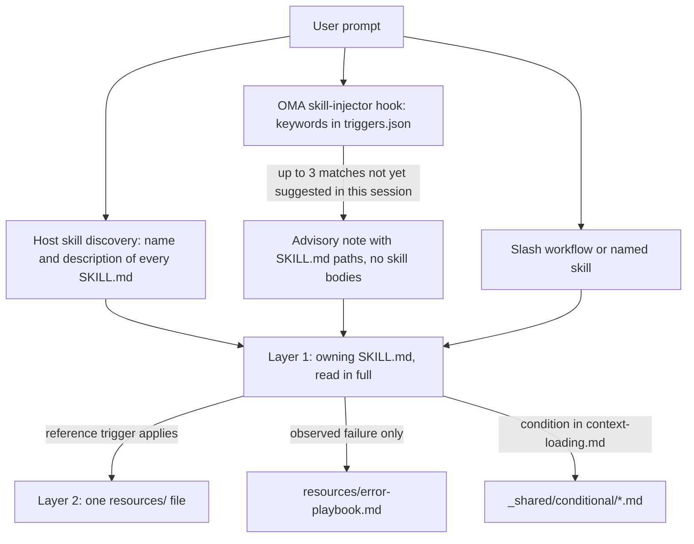
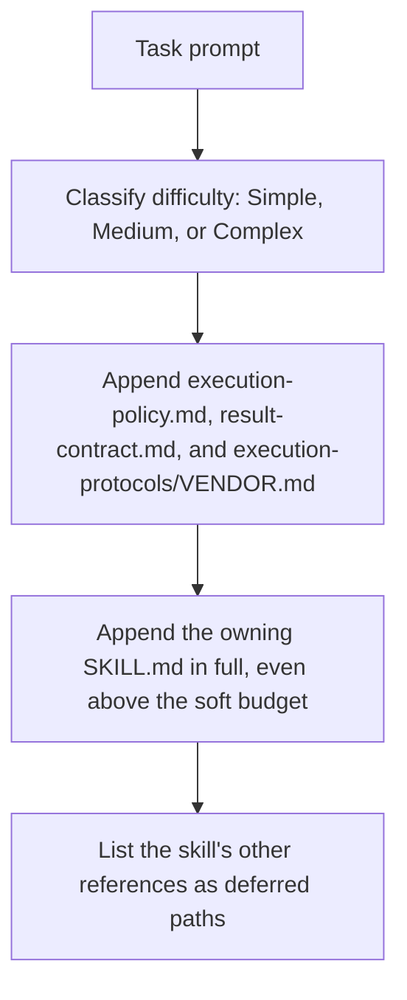

# 技能

[技能](../getting-started/glossary.md#skill)是为调度角色提供领域指导的结构化知识包。它们包含执行协议、技术栈参考、代码模板、错误处理手册、质量检查清单，以及技能提供的示例，并按为节省令牌而设计的两层架构组织。已安装技能的列表请参见[技能目录](./agents.md#skill-catalog)。

---

## 两层设计 {#the-two-layer-design}

技能分阶段进入上下文。选择阶段只把路径或描述呈现给模型；选定技能后，会完整读取所属的 SKILL.md；辅助文件则在各自的触发条件成立时逐个读取。



来源：`.agents/hooks/core/skill-injector.ts`、`.agents/skills/_shared/core/skill-routing.md` 和 `.agents/skills/_shared/core/context-loading.md`。

### 第一层：SKILL.md（选定技能时读取） {#layer-1-skillmd-read-when-the-skill-is-selected}

每个技能的根目录都有一个 `SKILL.md` 文件。注入器钩子传递的是**路径引用**，而不是文件正文，因此未被选定的技能除了 `description` 外不会产生额外开销。每个 `SKILL.md` 都有 YAML frontmatter 和相同的四个顶层章节；缺少其中某个章节或正文超过 500 行的技能，会被 `oma skill lint` 报告。

| 部分 | 内容 |
|------|------|
| Frontmatter | `name` 和用于路由的 `description`（技能做什么、何时使用） |
| `## Scheduling` | 目标、意图签名、何时使用、何时不使用、预期输入和输出、依赖 |
| `## Structural Flow` | 状态转换、失败与恢复、退出状态 |
| `## Logical Operations` | 规范命令或工作流路径、资源范围、护栏 |
| `## References` | 第二层文件，每个文件都附有读取它的依据条件 |

当前 `oma-frontend` 的 frontmatter：

```yaml
---
name: oma-frontend
description: "Implement or modify web UI in React, Next.js, or Angular. Use for components, pages, styles, forms, and frontend state or data flows."
---
```

宿主运行时会向模型展示每个技能的 `description`，因此它写成一句路由说明。OMA 的关键词钩子不读取它；其关键词位于 `.agents/hooks/core/triggers.json`。

### 第二层：resources/（按需加载） {#layer-2-resources-loaded-on-demand}

`resources/` 目录包含深入的执行知识。只有满足以下条件时才会加载其中的文件：
1. 宿主或工作流已选择该技能（例如通过原生技能匹配或显式命令）
2. 当前任务满足相应参考资料的加载条件

这种按需加载由上下文加载指南（`.agents/skills/_shared/core/context-loading.md`）控制，该指南区分入口指令与按任务选定的参考资料。

### `oma agent spawn` 注入的内容 {#what-oma-agent-spawn-injects}

CLI 调度会自行组装子智能体提示，因此子智能体启动时上下文中已包含各项契约和所属技能：



来源：`cli/commands/agent/spawn-status.ts`、`cli/platform/agent-config/loaders.ts` 和 `cli/platform/context-loader.ts`。原生子智能体通过 `oma agent context <agent-id>` 获得相同的任务上下文；如果运行时没有提供执行策略和结果契约，则自行读取。

---

## 文件结构示例 {#file-structure-example}

```text
.agents/skills/oma-frontend/
├── SKILL.md                          ← Layer 1: read when selected
└── resources/
    ├── execution-protocol.md         ← Layer 2: step-by-step workflow
    ├── tech-stack.md                 ← Layer 2: detailed technology specs
    ├── tailwind-rules.md             ← Layer 2: Tailwind conventions
    ├── angular-rules.md              ← Layer 2: Angular-specific conventions
    ├── snippets.md                   ← Layer 2: copy-paste code patterns
    ├── error-playbook.md             ← Layer 2: error recovery procedures
    └── checklist.md                  ← Layer 2: quality verification checklist

.agents/skills/oma-backend/
├── SKILL.md
├── resources/
│   ├── execution-protocol.md
│   ├── orm-reference.md              ← Domain-specific (ORM queries, N+1, transactions)
│   ├── checklist.md
│   └── error-playbook.md
└── variants/                          ← Starter seeds for /stack-set
    ├── stack.schema.json
    ├── node/
    ├── python/
    └── rust/

.agents/skills/oma-mobile/
├── SKILL.md
├── resources/
│   ├── execution-protocol.md
│   ├── tech-stack.md
│   ├── screen-template.dart
│   ├── screen-template.swift         ← Swift native iOS screen template
│   ├── screen-template.tsx            ← React Native screen template
│   ├── checklist.md
│   └── error-playbook.md
└── variants/                          ← Platform seeds for /stack-set
    ├── README.md
    ├── stack.schema.json
    ├── flutter/                       ← stack.yaml, tech-stack.md, snippets.md, api-template.dart
    ├── react-native/                  ← stack.yaml, tech-stack.md, snippets.md, api-template.ts
    └── swift-ios/                     ← stack.yaml, tech-stack.md, snippets.md, api-template.swift

.agents/skills/oma-design/
├── SKILL.md
├── resources/
│   ├── execution-protocol.md
│   ├── anti-patterns.md
│   ├── asset-strategy.md
│   ├── checklist.md
│   ├── design-md-spec.md
│   ├── design-tokens.md
│   ├── getdesign-fetcher.md
│   ├── prompt-enhancement.md
│   ├── redesign-protocol.md
│   ├── stitch-integration.md
│   └── error-playbook.md
└── reference/                         ← Deep reference material
    ├── typography.md
    ├── color-and-contrast.md
    ├── spatial-design.md
    ├── motion-design.md
    ├── responsive-design.md
    ├── component-patterns.md
    ├── accessibility.md
    ├── visual-hierarchy.md
    └── shader-and-3d.md
```

---

## 每种技能资源的类型 {#per-skill-resource-types}

| 资源类型 | 文件名模式 | 用途 | 加载时机 |
|---------|-----------|------|---------|
| **执行协议** | `execution-protocol.md` | 分步工作流：分析 -> 规划 -> 实现 -> 验证 | 所选操作需要其命令或契约细节时 |
| **技术栈** | `tech-stack.md` | 详细技术规范、版本和配置 | 所选框架或技术栈决策 |
| **错误处理手册** | `error-playbook.md` | 从症状到恢复的步骤；缺少信息或权限时只暂停依赖它的操作 | 仅在观察到失败之后 |
| **检查清单** | `checklist.md` | 领域专用的质量验证 | 存在未解决的验证时读取相关章节 |
| **代码片段** | `snippets.md` | 可直接复制的代码模式 | 不熟悉的实现方式或输出形态 |
| **示例** | `examples.md` | 完整的输入输出示例（oma-pm、oma-db、oma-tf-infra、oma-observability、oma-search） | 不熟悉的实现方式或输出形态 |
| **变体** | `variants/` 目录 | 语言或框架的起始种子。后端提供 `node`、`python` 和 `rust`；移动端提供 `flutter`、`react-native` 和 `swift-ios`。`/stack-set` 用它们生成项目的 `stack/`。 | 正在搭建匹配的技术栈时 |
| **模板** | `screen-template.{dart,swift,tsx}`（oma-mobile）、`variants/*/api-template.*` | 新屏幕或 API 模块的样板 | 创建相应文件时 |
| **领域参考** | `orm-reference.md`、`anti-patterns.md` 等 | 特定子任务的深入领域知识 | 按任务类型 |

---

## 共享资源（_shared/） {#shared-resources-_shared}

所有智能体都共享 `.agents/skills/_shared/` 中的公共基础。这些资源分为三类：

### 核心资源（`.agents/skills/_shared/core/`） {#core-resources-agentsskills_sharedcore}

| 资源 | 用途 | 加载时机 |
|------|------|---------|
| **`execution-policy.md`** | 适用于每个技能和工作流的授权、澄清、验证和完成规则。 | 注入每个 `oma agent spawn` 提示；未提供时由原生智能体自行读取 |
| **`skill-routing.md`** | 按任务结果、归属和实际依赖路由；没有强制的智能体链，也没有回合配额。 | 由编排技能和协调技能引用 |
| **`context-loading.md`** | 所属技能的入口、按条件加载的参考资料，以及运行时加载边界。 | 组合上下文时 |
| **`prompt-structure.md`** | 指导不熟悉任务的交接，涵盖目标、上下文、真实约束和验收证据；直接任务没有强制模板。 | 组合不熟悉的交接时；不是强制预加载 |
| **`clarification-protocol.md`** | 根据上下文确定常规细节，仅在缺少关键信息或授权时才询问。 | 需求不明确时 |
| **`code-intelligence.md`** | 使用配置的代码智能能力进行代码搜索、导航和影响分析。 | 代码搜索或导航 |
| **`test-approach.md`** | PM 计划中每个任务的 `test_approach`，以及 `tdd` 任务的 `TDD_EVIDENCE` 块。 | 计划设置了 `test_approach` 的任务 |
| **`context-budget.md`** | 文件大小估算、实际提示测量、限定范围的读取和检查点。 | 长任务或上下文开销诊断 |
| **`difficulty-guide.md`** | 根据依赖关系和验证需求，选择规划深度和交付物。 | 任务分解需要难度估计时 |
| **`quality-principles.md`** | 范围、可维护性、证据，以及与任务相称的验证指导。 | 以质量为重点的工作流（ultrawork）开始时 |
| **`vendor-detection.md`** | 根据配置解析每个智能体的目标供应商，并选择原生调度或 `oma agent spawn`。 | 调度细节尚未确定时 |
| **`session-metrics.md`** | 可选的会话证据，不含对话或评估器罚分。 | 被要求的复盘或实质性纠正 |
| **`common-checklist.md`** | 适用的跨领域检查；没有全局行数限制，也没有一刀切的异常捕获要求。 | 跨领域审查（相关时） |
| **`lessons-learned.md`** | 记录并应用有证据支持、带版本和触发条件的经验教训；不设自动 RCA 阈值。 | 出错后和会话结束时引用 |
| **`anti-ai-prose.md`** | 共享的文字诊断规则。 | 学术文字审查和翻译风格审查 |
| **`stack-verify.schema.json`** | 后端和移动端栈 schema 复用的共享 `verify:` 定义。 | 栈 schema 验证 |
| **`api-contracts/`** | 可选的契约模板。复用项目现有模式；生成的契约位于技能源码之外。 | 规划跨边界工作时 |

### 运行时资源（`.agents/skills/_shared/runtime/`） {#runtime-resources-agentsskills_sharedruntime}

| 资源 | 用途 |
|------|------|
| **`result-contract.md`** | 智能体结果的运行标识、声明路径和完成契约。注入每个 `oma agent spawn` 提示；原生智能体通过 `oma agent begin`、`oma agent verify` 和 `oma agent finish` 遵循它。 |
| **`memory-protocol.md`** | CLI 子智能体的内存文件格式和操作。定义使用可配置内存工具（read/write/edit）的 On Start、During Execution 和 On Completion 协议，并包含实验追踪扩展。 |
| **`event-spec.md`** | 持久的工作流事件契约，追加到 OMA 主目录配置下的 `events.jsonl`，可用 `oma state get` 或 `oma state list` 查看。 |
| **`execution-protocols/claude.md`** | Claude Code 专用执行模式。供应商为 claude 时由 `oma agent spawn` 注入。 |
| **`execution-protocols/antigravity.md`** | Antigravity CLI（`agy`）执行模式。 |
| **`execution-protocols/codex.md`** | Codex CLI 专用执行模式。 |
| **`execution-protocols/commandcode.md`** | CommandCode 执行模式。 |
| **`execution-protocols/grok.md`** | Grok 执行模式。 |
| **`execution-protocols/kimi.md`** | Kimi Code 执行模式。 |
| **`execution-protocols/kiro.md`** | Kiro 执行模式。 |
| **`execution-protocols/opencode.md`** | OpenCode 扩展的执行模式。 |
| **`execution-protocols/pi.md`** | pi 扩展的执行模式。 |
| **`execution-protocols/qwen.md`** | Qwen CLI 专用执行模式。 |

供应商专用的执行协议会由 `oma agent spawn` 自动注入 CLI 启动的智能体。原生子智能体使用所选供应商的集成规则。

### 条件资源（`.agents/skills/_shared/conditional/`） {#conditional-resources-agentsskills_sharedconditional}

只有执行过程中满足特定条件时才会加载这些资源：

| 资源 | 触发条件 | 加载方 |
|------|---------|-------|
| **`quality-score.md`** | 需要已定义的基线或实验对比 | 编排器（传递给 QA 智能体提示） |
| **`experiment-ledger.md`** | 将实际假设与基线或其他方案进行比较 | 协调者（维护共享台账；并行智能体写入任务/运行范围的结果，由协调者合并） |
| **`exploration-loop.md`** | 多次恢复失败，且有值得在预算内测试的替代方案 | 编排器（启动假设智能体前内联） |
| **`diagram-engine.md`** | 工作流即将输出结构图（架构、时序、数据流、生命周期） | 输出该图的工作流 |

这些资源会推迟加载，直到各自的触发条件成立。仅凭难度不会注入它们。

---

## 如何选择技能 {#how-skills-route-via-skill-routingmd}

有三条路径会把技能带入上下文。它们本身都不会启动工作流，也不会授权委派。

1. **宿主原生发现。** 支持技能的运行时会列出每个技能的 `name` 和 `description`；模型读取描述与所需结果匹配的 SKILL.md。
2. **OMA 关键词提示。** 在 OMA 安装了提示钩子的地方，`skill-injector` 会将提示与 `.agents/hooks/core/triggers.json` 中的多语言关键词进行匹配，并添加一条建议性的 `[OMA SKILLS DETECTED: ...]` 注释，最多列出三个 SKILL.md 路径。对于“使用 Tailwind CSS 构建登录表单”（Build a login form with Tailwind CSS），只有 `tailwind` 关键词匹配，因此该注释会建议 `oma-frontend`。
3. **显式调用。** 使用 `/plan`、`/review` 或 `/debug` 等斜杠工作流，或在提示中点名该技能。

### 按结果确定归属 {#ownership-by-outcome}

一个所属技能负责一个限定范围的任务；只有当另一个技能提供不同的能力时才增加交接。此表与 `.agents/skills/_shared/core/skill-routing.md` 保持一致。其他领域请从[技能目录](./agents.md#skill-catalog)中已安装技能的描述里选择。

| 所需结果 | 所属技能 |
|---------|---------|
| 应用 API、服务端认证、服务/数据访问逻辑 | oma-backend |
| 模式、迁移设计、索引、查询调优、数据库运维 | oma-db |
| Web 组件、页面、表单、客户端状态 | oma-frontend |
| 移动端屏幕、组件、平台集成 | oma-mobile |
| 系统边界、架构权衡、ADR | oma-architecture |
| 诊断并修复错误行为 | oma-debug |
| 审查正确性、安全、无障碍、性能 | oma-qa |
| 视觉系统、DESIGN.md、重新设计方向 | oma-design |
| 被要求的构思或备选方案探索 | oma-brainstorm |
| 需求、依赖、验收标准 | oma-pm |
| 被要求的并行专业执行 | oma-orchestration |
| 被要求的手动多智能体协调 | oma-coordination |
| Git 分支、提交、合并、仓库历史 | oma-scm |

### 技能之间的依赖 {#dependencies-between-skills}

不存在固定的执行链。按实际依赖安排工作顺序：

- 先解决尚未确定的架构或产品决策，再进行依赖它的工作。已有的决策无需再次经过架构、构思或 PM。
- 当共享的 API 契约可用时，后端和客户端工作可以独立推进。如果契约缺失，先与相关负责方确定该边界。
- 独立的实现工作仍在继续时，可以开始审查已完成且可审查的部分。不要把不稳定的工件当作最终证据来审查。
- 实现过程中发现的 Bug 可由其负责方修复。诊断确有需要时再加入调试协助；不存在必须从实现转到调试的链条。
- 对于跨领域缺陷，要根据证据确定失败的契约和负责方。API 不匹配并不自动意味着必须修改后端。

### 技能提示没有出现时 {#when-a-skill-hint-does-not-appear}

以下所有行为都来自 `.agents/hooks/core/skill-injector.ts`。

| 现象 | 原因 | 处理方式 |
|------|------|---------|
| 完全没有 `[OMA SKILLS DETECTED]` 注释 | 提示以 `/` 开头，会话中有活跃的[持久化工作流](../getting-started/glossary.md#persistent-workflow)，或该消息是转发的智能体消息 | 属于预期行为：上下文由工作流负责。如有需要，请点名技能 |
| 注释中缺少预期的技能 | 只列出前 3 个匹配项（每个匹配关键词计 10 分） | 使用更具体的术语，或点名技能 |
| 之前建议过的技能不再被建议 | 每个 SKILL.md 路径在每个会话中只建议一次；`.agents/state/skill-sessions.json` 中的记录在一小时内没有新建议后过期 | 之前的建议仍然适用 |
| 某个关键词被忽略 | 匹配前会移除代码块、反引号或双引号内的文本 | 用普通文本提及该术语 |
| oma-academic-writing、oma-docs、oma-explanation、oma-scholar 或 oma-skill-creation 从未被建议 | 这些技能在 `triggers.json` 中没有关键词 | 使用 `/docs` 或 `/explain`，或点名技能；宿主发现仍能看到它们的描述 |
| 提示中出现无关的技能 | 匹配基于关键词，仅供参考 | 说明你想要的结果；该注释会提醒模型自行判断 |

---

## 令牌节省计算 {#token-savings-math}

先测量上下文成本，再声称节省。simple、medium 和 complex 这几个词被用于两种不同的东西：

- **脚本场景**（`routed`、`simple`、`medium`、`complex`、`all`）是 `scripts/measure-skill-context.ts` 输出的累积文件大小对比。它们不是加载策略，`all` 只是上限。
- **加载器难度**（Simple、Medium、Complex）为 CLI 调度注入的上下文选择软预算。参见[按任务加载资源](#resource-loading-by-task)。

```bash
bun scripts/measure-skill-context.ts
bun scripts/measure-skill-context.ts --skills oma-pm,oma-backend,oma-frontend --json
oma agent context backend --difficulty Medium
```

该脚本报告的估算值按 UTF-8 字节数除以 4 计算。`routed` 只有入口；`simple`、`medium` 和 `complex` 会加入假设存在的协议、示例和技术栈文件，用于对比。保留这些名称是为了兼容脚本，不是预加载指令。全新检出时可能用一个平台种子作为大小代理值，并不会加载每个平台。

上下文命令会输出实际注入的任务上下文：一个 `## Task context (graph-selected, approximately N tokens)` 标题、所属的 SKILL.md，以及推迟加载的参考资料列表。它不包含对话的其余部分，也不包含全部宿主或运行时指令；启动后的提示会更大，因为 `oma agent spawn` 还会加入执行策略、结果契约和供应商协议。要测量指定模型上的总输入令牌数、延迟和成本，请使用组装好的提示或用量遥测。不要根据仓库大小或生成的镜像计数推断这些指标。

## 按任务加载资源 {#resource-loading-by-task}

每个难度级别都从所属技能开始。引用图是参考资料索引；相邻关系不授权加载其他专业技能、错误处理手册或条件实验工作流。

加载器为 Simple / Medium / Complex 分别设定 1,500 / 4,000 / 8,000 个估算令牌的软预算。超出预算的入口仍会保留，并报告超出部分。辅助参考资料保持推迟加载，除非在其任务触发条件确定后明确选定。必需的入口绝不会用更小的无关文档替换。

验证取决于任务风险和项目要求。难度标签不要求完整的测试套件、固定的预检响应，也不要求对已获授权的工作再次批准。

## 上下文加载任务映射（按智能体） {#context-loading-task-maps-per-agent}

以下示例列出任务需要时可查阅的参考资料。请使用所属技能当前的索引，只选取适用的章节：

### 后端智能体 {#backend-agent}

<!-- oma-docs:ignore-start -->

| 任务类型 | 所需资源 |
|---------|---------|
| CRUD API 创建 | 存在时使用项目的 `stack/snippets.md` 和 `stack/api-template.*`（由 `/stack-set` 生成）；否则参考现有项目代码 |
| 身份验证 | 存在时使用 `stack/snippets.md` + `stack/tech-stack.md` |
| 数据库迁移 | 存在时使用 `stack/snippets.md`；模式设计交给 oma-db |
| 性能优化 | `orm-reference.md` 和技能提供的匹配示例 |
| 修改现有代码 | 项目代码智能提供程序和相关执行资源 |

<!-- oma-docs:ignore-end -->

`variants/node`、`variants/python` 和 `variants/rust` 是 `/stack-set` 的起始种子；智能体编辑现有代码时不会读取它们。

### 前端智能体 {#frontend-agent}

| 任务类型 | 所需资源 |
|---------|---------|
| 创建组件 | snippets.md + 项目现有组件模式 |
| 实现表单 | snippets.md（表单 + Zod） |
| API 集成 | snippets.md（TanStack Query） |
| 样式处理 | tailwind-rules.md |
| 页面布局 | snippets.md（网格） |

### 设计智能体 {#design-agent}

| 任务类型 | 所需资源 |
|---------|---------|
| 创建设计系统 | reference/typography.md + reference/color-and-contrast.md + reference/spatial-design.md + design-md-spec.md |
| 设计着陆页 | reference/component-patterns.md + reference/motion-design.md + prompt-enhancement.md |
| 设计审计 | checklist.md + anti-patterns.md |
| 导出设计令牌 | design-tokens.md |
| 3D / 着色器效果 | reference/shader-and-3d.md + reference/motion-design.md |
| 无障碍审查 | reference/accessibility.md + checklist.md |

### QA 智能体 {#qa-agent}

| 任务类型 | 所需资源 |
|---------|---------|
| 安全审查 | checklist.md（安全章节） |
| 性能审查 | checklist.md（性能章节） |
| 无障碍审查 | checklist.md（无障碍章节） |
| 完整审计 | checklist.md（所有章节）；要求基于标准的审查时另加 iso-quality.md |
| 已定义指标的对比 | quality-score.md（条件资源） |

---

## 编排器提示组合 {#orchestrator-prompt-composition}

编排器编写子智能体提示（`oma-orchestration/resources/subagent-prompt-template.md`）时，只提供任务数据：智能体角色、任务 ID、工作区、允许的路径、任务描述、验收标准、带加载条件的任务参考资料，以及关键约束。

- 对于 CLI 调度，`oma agent spawn` 已经注入 `execution-policy.md`、`result-contract.md`、供应商执行协议和所属 SKILL.md，因此提示中不再重复它们。
- 对于原生调度，如果运行时没有提供这些文件和所属技能，就传入它们的路径。
- 只有在观察到失败后才加入 error-playbook 章节；只有当智能体需要协调或恢复持久任务状态时才加入 `runtime/memory-protocol.md`。

这种定向组合避免加载不必要的资源，使子智能体有更多上下文空间处理实际工作。

---

## 会话证据与复盘审查 {#session-evidence-and-retrospective-review}

会话记录会收录实质性纠正、范围变更、返工和已裁定的审查发现，并附上证据。必要的澄清不计罚分。原有的 CD 和 EA 加权评分，以及由阈值触发的 RCA 规则已经移除；它们是提示指令，不是 CLI 计算出的指标。

尽量使用已有的任务结果。在配置的协调存储下，单独的 `session-metrics-{sessionId}.md` 是可选的。重复失败或被要求的复盘可能值得记录经验教训，但普通的检查失败或有争议的发现不会自动构成经验教训。保留历史日志，不要把它们改写成新格式。

`oma stats` 报告生产力指标，以及已记录的用量和成本摘要。`oma retro` 把实际发生的关卡、阻塞和决策缺失事件归纳为建议。两者都不会根据这些 Markdown 工件计算 CD/EA 评分。

## 任务分解与上下文恢复 {#task-decomposition-and-context-recovery}

围绕依赖关系和可独立验证的行为制定计划。固定的迭代数量、文件数量和回合估计都不决定审查深度，也不决定任务是否完成。把测试和错误处理与它们验证的行为放在一起。

遇到实际观察到的停滞或有用上下文丢失时，先保存已完成的工作、剩余的验收标准、相关路径和验证证据，再恢复或重新调度。保留已有工作，避免重复启动仍在运行的尝试。仅凭回合与进度之比不要求重置。

## 条件度量与探索 {#conditional-measurement-and-exploration}

已定义的基线或实验对比会启用度量指导，仅有测试或 lint 则不会。记录可比较的指标，并附上单位、方法、修订版本和证据。必需的正确性和安全检查仍然保持独立。OMA 没有默认的综合评分公式、字母等级关卡，也没有由评分触发的回滚。

真正的实验会记录假设、基线与候选方案的证据、必需的检查、决策，以及归属该实验的文件。反复失败可能值得在现有恢复预算内测试另一种机制。隔离实验改动，保留无关改动，并在恢复关卡之前验证集成后的候选方案。

---

## 相关内容 {#related}

- [智能体](./agents.md)：技能目录、调度角色、定义和原生智能体文件
- [工作流](./workflows.md)：读取技能的斜杠工作流
- [项目结构](./project-structure.md)：安装后 `.agents/skills/` 的位置
- [智能体结果与恢复](../guide/agent-results-and-resume.md)：原生的 `oma agent begin` → `oma agent finish` 生命周期
- [技能评估](../guide/skill-eval.md)和[技能优化](../guide/skill-opt.md)
- 编写技能：使用 `oma-skill-creation` 技能，然后运行 `oma skill lint` 和 `oma skill audit`
