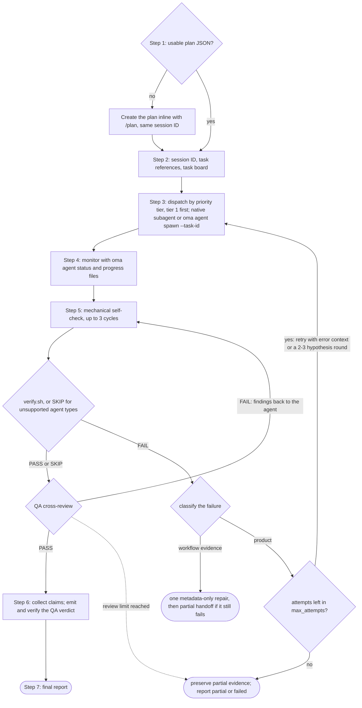
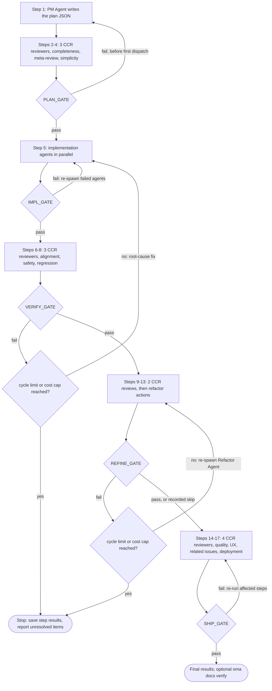
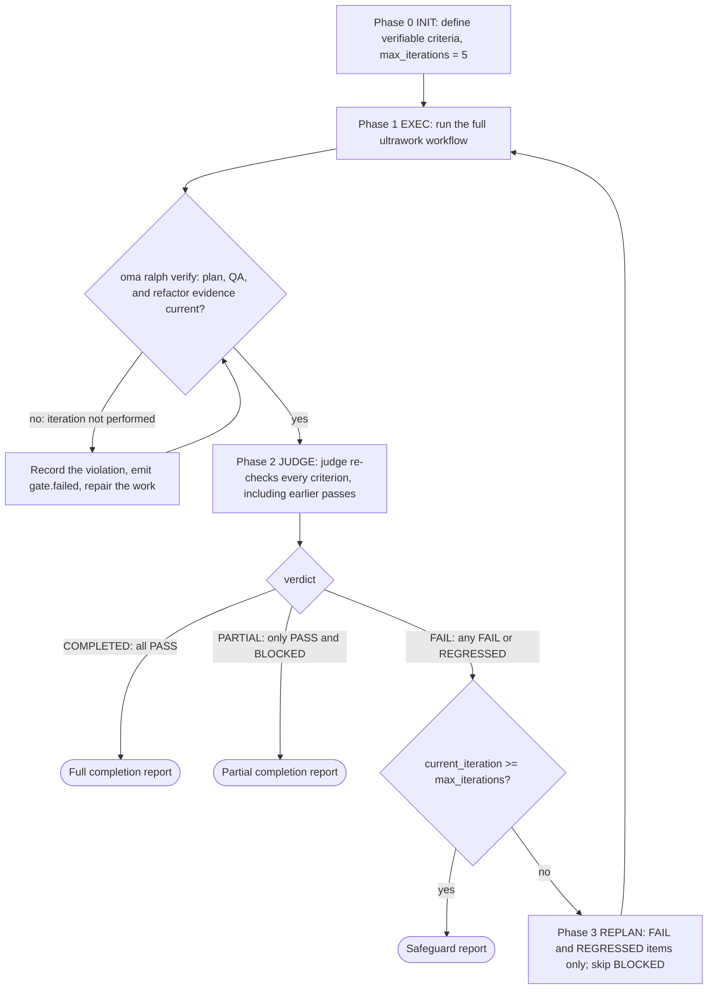

# 工作流

工作流是由斜杠命令启动的结构化多步骤流程；四种持久化模式在普通请求点名时也会启动。它们定义智能体如何协作处理任务，范围从单阶段工具到包含 5 个阶段的复杂质量关卡。

共有 20 个工作流，其中 4 个是[持久化工作流](../getting-started/glossary.md#persistent-workflow)（会维护状态，不能被意外中断）。

## 工作流概览 {#workflows-at-a-glance}

| 工作流 | 用途 | 持久化 |
|---|---|---|
| [`/orchestrate`](#orchestrate) | 基于计划自动并行执行智能体，并运行验证循环 | 是 |
| [`/work`](#work) | 逐步协调多个领域：规划、实现、QA、修复 | 是 |
| [`/ultrawork`](#ultrawork) | 包含 12 个隔离审查步骤的 5 阶段质量工作流 | 是 |
| [`/ralph`](#ralph) | 反复执行 ultrawork，直到机械可验证的标准通过 | 是 |
| [`/plan`](#plan) | PM 任务分解，包含依赖关系和 API 契约 | 否 |
| [`/brainstorm`](#brainstorm) | 规划前以设计为先的创意探索 | 否 |
| [`/architecture`](#architecture) | 架构决策、评审和 ADR | 否 |
| [`/deepinit`](#deepinit) | 为现有代码库生成 AGENTS.md、ARCHITECTURE.md 和 `docs/` | 否 |
| [`/review`](#review) | QA 审查：安全、性能、无障碍、代码质量 | 否 |
| [`/security`](#security) | 对源代码、智能体技能和 MCP 组件的安全扫描；发现验证；CI 关卡 | 否 |
| [`/debug`](#debug) | 诊断并修复 bug，附带回归测试 | 否 |
| [`/design`](#design) | 设计发现、DESIGN.md、重新设计方向或设计 token | 否 |
| [`/scm`](#scm) | Git 操作和 Conventional Commits | 否 |
| [`/convert`](#convert) | 在不同格式之间转换文档和媒体 | 否 |
| [`/docs`](#docs) | 文档漂移检测与同步 | 否 |
| [`/recap`](#recap) | 跨 AI 工具的每日或周期工作回顾 | 否 |
| [`/stack-set`](#stack-set) | 为领域技能生成技术栈专用参考资料 | 否 |
| [`/video`](#video) | 通过 `oma-video` 技能生成 MP4 | 否 |
| [`/schedule`](#schedule) | 按时间重复运行的智能体作业 | 否 |
| [`/explain`](#explain) | 针对代码变更或主题生成交互式 HTML 讲解 | 否 |

---

## 选择技能或工作流 {#choosing-a-skill-or-workflow}

根据任务所需的协调和验证方式选择。如果已经选择了工作流，就遵循该工作流；工作流启动后应持续执行，除非你明确取消或更换。新任务尚未选择工作流时，可参考下表：

| 任务需求 | 选择 | 示例 |
|---|---|---|
| 单一领域，无需协调智能体 | [单技能](/docs/guide/single-skill) | 添加 API 端点并测试输入验证 |
| 多个领域，需要逐步规划、实现和 QA | `/work` | 协调 API 变更及其 Web 和移动端客户端的修改 |
| 自动分派独立任务，并行执行 | `/orchestrate` | 解决依赖关系后并行实现后端和前端任务 |
| 明确要求完整的质量流程 | `/ultrawork` | 完整执行规划、实现、验证、改进和发布就绪审查 |
| 明确要求反复执行，直到机械可验证的标准通过 | `/ralph` | 在循环安全措施允许的范围内，反复实现并由 judge 验证，直到指定的回归检查通过 |

`/orchestrate` 会先加载可用计划，或通过 `/plan` 创建计划，再启动智能体。你无需先运行 `/plan`。因此，是否已有计划并不是 `/work` 和 `/orchestrate` 的区别；应根据所需的协调方式选择。两者都能并行执行独立任务。

单技能任务也需要验收标准和测试。仅有这些要求不意味着要用 `/ralph`：Ralph 每次迭代都会执行完整的 ultrawork 流程，并进行一轮 judge 检查，适合明确需要这种重复验证循环的任务。安全措施触发时，即使还有未完成或受阻的工作，循环也可能停止。

此表提供选择建议，并非自动工作流路由器。宿主智能体可以推荐合适的方式；推荐或解释工作流不会启动它。斜杠命令可以明确选择工作流。启用关键词检测钩子后，匹配配置中的关键词或模式也可能激活工作流，但仍受信息性查询过滤规则约束。检测器不会判断领域数量、检查计划是否可执行，也不会把此表用作优先级算法。

计划审查沿用任务已有的授权。智能体只会在缺少关键决策或操作超出授权范围时询问。发布就绪审查本身不构成发布或部署授权。

---

## 持久化工作流 {#persistent-workflows}

持久化工作流持续运行直到所有任务完成。它们在 `.agents/state/` 中维护状态，并在每条用户消息中重新注入 `[OMA PERSISTENT MODE: ...]` 上下文，直到显式停用。

只有**显式调用**才会启动持久化模式：工作流的斜杠命令（`/ultrawork`，或带命名空间的形式，例如 `/oma:ultrawork`），或以纯文本写出的工作流自己的名称（`triggers.json` 中的 `explicit` 列表：“orchestrate”及其列出的各语言译名、“ultrawork”/“ulw”、“work mode”/“work workflow”、“ralph”/“랄프”）。关键词钩子不会从任何其他句子打开工作流。

### /orchestrate

**说明**：基于 CLI 的自动化并行智能体执行。通过 CLI 启动子智能体，使用持久化运行状态和回执协调它们，监控进度并运行验证循环。

**持久化：** 是。状态文件：`.agents/state/orchestrate-state-{sessionId}.json`。

**触发关键词：**
| 语言 | 关键词 |
|------|-------|
| 显式（持久） | "orchestrate"、"オーケストレート"、"orquestar"、"orchestrer"、"orchestrieren"、"orquestrar"、"оркестровать"、"orkestreren"、"orkiestrować" |

“do everything”、“전부 해줘”或“build me an app”这样的句子不会启动此工作流。

**步骤：**
1. **步骤 0，准备**：读取协调技能、上下文加载指南和记忆协议。检测供应商。
2. **步骤 1，加载或创建计划**：先检查 `.agents/results/plan-{sessionId}.json`，再检查最新的 `plan-*.json`。如果没有计划，或计划尚不可执行（任务缺少智能体、优先级层、依赖关系或验收标准），则在当前流程中内联委派 `/plan` 创建计划，并沿用同一会话 ID。展示计划并沿用已有授权；只有缺少关键决策或需要新增授权时，才在委派前询问。
3. **步骤 2，初始化会话**：加载 `oma-config.yaml`，显示 CLI 映射表，沿用创建计划时的会话 ID，或生成新的会话 ID（`session-YYYYMMDD-HHMMSS`）。为每个任务选择所需的技能参考资料，方法是将任务与已安装技能的意图签名进行匹配；有一个可信匹配的技能就足够。在配置的记忆存储中创建 `orchestrator-session-{sessionId}.md` 和 `task-board-{sessionId}.md`，并在其中记录每个任务选定的参考资料和选择原因。这些是协调者备注；启动器不会强制执行它们。
4. **步骤 3，启动智能体**：按优先级层依次处理（从最低层开始：先第 1 层，再第 2 层，依此类推），使用供应商适配的方法启动智能体（当前运行时和目标供应商相同时使用原生子智能体；外部或跨供应商工作使用 `oma agent spawn`）。每个智能体会收到自己的任务、API 契约，以及为它选定的参考资料及其加载条件。绝不超过 MAX_PARALLEL（默认 3）。
5. **步骤 4，监控**：用 `oma agent status` 检查进程健康状况。优先使用宿主的完成通知；否则以有界退避轮询运行范围内发生变化的 `progress-{agentId}-{taskId}-{runId}-{sessionId}.md` 文件，读取结构化回执，并更新任务板。留意完成、失败和崩溃。
6. **步骤 5，验证**：对每个完成的智能体，先运行机械自检（lint、类型检查、测试、diff 范围；最多 3 轮），再运行 `verify.sh {agent-type} {workspace}`（支持 backend、frontend、mobile、qa、debug 和 pm；其他智能体类型记录 `SKIP`），然后进行 QA 交叉审查。验证失败时，带上错误上下文重新启动。反复失败时，可以考虑尝试其他假设，但首次尝试、每次重试和每个假设共用同一份恢复总预算（`max_attempts`，默认 3 次，含首次尝试）。如果预算不足以支撑一轮对比，则保留未解决的证据。
7. **步骤 6，收集**：读取运行范围内的结果文件和结构化声明，然后编写摘要。
8. **步骤 7，最终报告**：呈现会话摘要。如果运行了实验，则总结证据和决策；仅在确认了可复用的原因时才记录经验教训。



**读取文件：**`.agents/results/plan-{sessionId}.json`、`.agents/oma-config.yaml`、运行范围内的进度和结果文件，以及结构化运行回执。
**写入文件**：配置的记忆存储中的运行范围会话和任务板状态、结构化回执和声明，以及最终报告。

**何时使用**：需要最大并行度和自动化协调的大型项目。

---

### /work

**说明：** 逐步多领域协调。PM 先规划，然后智能体在授权范围内执行，接着完成 QA 审查和问题修复。

**持久化：** 是。状态文件：`.agents/state/work-state-{sessionId}.json`。

**触发关键词：**
| 语言 | 关键词 |
|------|-------|
| 显式（持久） | "work mode"、"work workflow" |

单独的“work”不是触发词，它只是普通词汇（“Does this work on Windows?”）。“step by step”及其各语言译法也不会启动此工作流。

**步骤：**
1. **步骤 0：准备** 读取技能、上下文加载、记忆协议。记录会话开始。
2. **步骤 1：分析需求** 识别涉及的领域。如果是单一领域，建议直接使用智能体。
3. **步骤 2：PM 智能体规划** PM 分解需求，定义 API 契约，创建优先级任务分解，保存到 `.agents/results/plan-{sessionId}.json`。
4. **步骤 3：审查计划** 展示计划，并在已有授权范围内继续执行。只有缺少关键决策或需要新增授权时才询问。
5. **步骤 4：启动智能体** 按优先级层启动，同层并行，使用各自的工作区。
6. **步骤 5：监控** 轮询进度文件，验证智能体间的 API 契约对齐。
7. **步骤 6：QA 审查** 启动 QA 智能体进行安全（OWASP）、性能、无障碍、代码质量审查。
8. **步骤 6.1：测量**（条件）：需要做明确定义的对比时，记录基线。
9. **步骤 7：迭代** 如果发现 CRITICAL/HIGH 问题，重新启动责任智能体。如果同一问题在 2 次尝试后仍存在，激活探索循环。

**何时使用：** 功能跨越多个领域，需要逐步协调规划、实现和 QA。

---

### /ultrawork

**说明**：以质量为核心的工作流。包含 5 个阶段、17 个总步骤和 12 个隔离审查步骤。每个阶段都有必须通过才能继续的关卡。

**持久化：** 是。状态文件：`.agents/state/ultrawork-state-{sessionId}.json`。

**触发关键词：**
| 语言 | 关键词 |
|------|-------|
| 显式（持久） | "ultrawork"、"ulw" |

**阶段和步骤：**

| 阶段 | 步骤 | 智能体 | 审查视角 |
|------|------|-------|---------|
| **PLAN** | 1-4 | PM 智能体（编写者，步骤 1）+ CCR 审查者（步骤 2-4） | 完整性、元审查、过度工程/简洁性 |
| **IMPL** | 5 | 开发智能体（启动） | 实现 |
| **VERIFY** | 6-8 | CCR 审查者 | 对齐性、安全性（OWASP）、回归预防 |
| **REFINE** | 9-13 | 重构智能体（步骤 9、11、13）+ CCR 审查者（步骤 10、12） | 文件拆分、复用性、级联影响、一致性、死代码 |
| **SHIP** | 14-17 | CCR 审查者 | 代码质量（lint/覆盖率）、UX 流程、相关问题、部署就绪 |

每个审查步骤都由各自的全新上下文审查子智能体执行（[跨上下文审查](../getting-started/glossary.md#cross-context-review-ccr)）。PM 智能体不会在流程内审查自己的计划。

**关卡定义：**
- **PLAN_GATE：** 计划已文档化、假设已列出、替代方案已考虑、过度工程审查已完成、工作范围已获授权。
- **IMPL_GATE：** 适用的不生成产物的检查和测试通过、仅修改了计划中的文件、已为实际实验记录基线证据。只有明确要求时才运行构建检查。
- **VERIFY_GATE：** 实现匹配需求、零 CRITICAL、零 HIGH、无回归、适用的项目测量目标已达成。
- **REFINE_GATE：** 遵循项目的可维护性规则、集成机会已捕获、副作用已验证、代码已清理、无未解决的回归。
- **SHIP_GATE：** 质量检查通过、UX 已验证、相关问题已解决、部署清单完成、适用的项目测量目标已达成并有最新证据支撑。沿用已有授权；发布或部署需获得针对该操作的授权。

**关卡失败行为：**
- 第一次失败：返回相关步骤，修复，重试。
- 同一问题第二次失败：重新评估原因；如果剩余预算内值得测试其他方案，则对照所需行为和已定义的指标，比较相互隔离的实验。
- 限制：PLAN 失败只有在首次分派任务之前才会返回步骤 1（此后计划不可更改）。当关卡失败次数达到配置的上限（默认 5 轮 VERIFY + REFINE）或超出会话成本上限时，VERIFY 和 REFINE 停止重试。



**条件增强：** 已定义指标的对比、实验决策与证据、有预算限制的假设探索，以及有可复用原因支撑的经验教训。

**REFINE 跳过条件：** 50 行以下的简单任务。

**何时使用**：在决定结果是否达到发布条件前运行完整的审查流程。工作流会记录检查和发现，但不会替你做出生产就绪决定。

---

### /ralph

**说明：** 持久化的自引用执行循环。用 [judge](../getting-started/glossary.md#judge) 包装 ultrawork，在每次迭代后检查完成标准。所有标准通过时报告全部完成，只剩已通过和受阻的标准时报告部分完成，安全措施触发时则停止。

**持久化：** 是。状态文件：`.agents/state/ralph-state-{sessionId}.json`。

**触发关键词：**
| 语言 | 关键词 |
|------|-------|
| 显式（持久） | "ralph", "랄프" |

单独的续接用语（“keep going”、“carry on”、“계속해”、“続けて”、“продолжай”等）和表示做到完成的说法（“don't stop”、“끝까지 해”）都不会启动此工作流。

**阶段：**
1. **Phase 0：INIT** 加载前置条件（context-loading、记忆协议、judge 协议）。定义并记录机械可验证的完成标准，例如测试断言、不生成产物的类型检查、退出码或文件是否存在。只有明确要求时才纳入构建检查。展示标准，并在授权范围内继续执行。以 `max_iterations: 5` 初始化会话。
2. **Phase 1：EXEC** 在 Ralph 的会话 ID 下，将 ultrawork（PLAN → IMPL → VERIFY → REFINE → SHIP）作为一次迭代执行。随后运行产物关卡 `oma ralph verify --json --session-id <sessionId> --newer-than <iteration start>`。如果关卡失败，本次迭代视为未执行：Ralph 记录违规，修复工作，然后重新运行关卡。
3. **Phase 2：JUDGE** judge 将每个完成标准与项目实际状态核对（运行已授权的检查，并验证文件是否存在）。工作流提示会要求编排器将 judge 作为单独的智能体启动，使用全新上下文，并只向其说明完成标准；但没有任何机制能确认它确实已被启动。无法启动子智能体的运行时会被告知在流程内直接评判，并记录 `ralph.judge-inline-fallback`。记录证据和标准状态，包括 PASS、FAIL、REGRESSED 或 BLOCKED。
4. **决策关卡：** 若所有标准 PASS → 报告全部完成。若只剩 PASS 和 BLOCKED → 报告部分完成。若存在 FAIL 或 REGRESSED → 在安全措施允许的范围内，将失败上下文带入下一次迭代。
5. **Phase 3：REPLAN** 将下一次迭代收窄到 FAIL 项和 REGRESSED 项（基于 diff 诊断），跳过 BLOCKED 项，并将 PASS 标准保留在 judge 的检查范围内。然后返回 Phase 1。
6. **安全措施：** 当 `current_iteration >= max_iterations`（默认 5）时，循环停止。同一标准因相同根本原因连续失败 3 次时，会变为 BLOCKED 且不再重试（卡住检测）。



judge 节点就是 Phase 2 所述、通过提示驱动的 judge：工作流要求编排器以全新上下文启动它；无法启动子智能体的运行时会在流程内直接评判，并记录这一回退。

**与 /ultrawork 的主要区别：** Ultrawork 执行 5 阶段流程，阶段关卡失败时会重试。Ralph 将 ultrawork 包装在重试循环中，由提示驱动的 judge 依据项目证据重新验证每个标准。循环结束时会给出全部完成报告、针对受阻工作的部分完成报告，或安全措施报告。

**读取文件：** `.agents/workflows/ralph/resources/judge-protocol.md`，以及所有 ultrawork 文件。
**写入文件：** `session-ralph-{sessionId}.md`（记忆）、迭代日志、最终报告。

**何时使用：** 明确需要反复执行，并由 judge 依据机械可验证的完成标准重新验证时。仅有测试要求并不需要 Ralph；选择时应考虑每次迭代都包含完整的 ultrawork 流程，以及循环本身的安全措施。

---

## 非持久化工作流 {#non-persistent-workflows}

### /plan

**说明**：PM 驱动的任务分解。分析需求，选择技术栈，分解为带依赖关系的优先级任务，并定义 API 契约。

**触发关键词：** 无。请用 `/plan` 启动。关键词钩子不会从一句话打开此工作流。

**步骤**：收集需求 -> 使用 MCP 代码分析评估技术可行性 -> 评估复杂度（Simple、Medium、Complex）-> 在跨边界时定义 API 契约 -> 分解任务 -> 与用户审查 -> 保存计划产物（Medium/Complex 时同时保存机器可读 JSON 和人类可读的 Markdown 跟踪文件）。

**输出：**`.agents/results/plan-{sessionId}.json`、记忆写入，以及 Medium/Complex 任务的 `docs/plans/work/{NNN}-{name}.md`，其中包含任务表、决策日志和进度备注。Markdown 标题中的 `Status` 字段记录生命周期（`Active` -> `Completed`），计划不会在目录间移动。通过 `/brainstorm` 选定的方案保存到 `docs/decisions/{NNN}-{name}.md`。

**执行方式**：内联执行（不启动子智能体）。由 `/orchestrate` 或 `/work` 消费，后者会在执行期间更新任务和状态字段。

---

### /brainstorm

**说明：** 设计优先的创意探索。探索意图，澄清约束，提出方案，在规划前产出一份经批准的设计文档。

**触发关键词：** 无。请用 `/brainstorm` 启动。关键词钩子不会从一句话打开此工作流。

**步骤：** 探索项目上下文（MCP 分析）-> 逐一提出澄清问题 -> 提出 2-3 个方案并分析权衡 -> 逐节展示设计（每步需用户批准）-> 盲审轮 -> 将选定的方案保存到 `docs/decisions/{NNN}-{name}.md` 并更新 `docs/decisions/index.md` -> 过渡：建议运行 `/plan`。

**规则：** 设计批准前不进行实现或规划。不输出代码。遵循 YAGNI 原则。

---

### /architecture

**说明：** 软件架构工作流，诊断架构问题，选择合适的分析方法（诊断路由 / design-twice / ATAM / CBAM / ADR），对比选项，综合利益相关者的意见，并产出建议、评审或 ADR。

**触发关键词：** 无。请用 `/architecture` 启动。关键词钩子不会从一句话打开此工作流。

**步骤：** 界定决策（新架构 / 评审 / 权衡分析 / 投资优先级 / 撰写 ADR）-> 通过诊断路由选择方法论 -> 通过 MCP 代码分析（`get_symbols_overview`、`find_symbol`、`find_referencing_symbols`）分析当前架构 -> 综合利益相关者意见（仅当决策足够横切以证明成本合理时）-> 产出带有明确假设、权衡、风险、验证步骤的建议 -> 需要实现时交接给 `/plan`。

**规则：** 不要在此工作流中编写实现代码或任务计划。架构决策后交接给 `/plan`。始终使用 MCP 工具；不要用原始文件读取或 grep 代替。

**何时使用：** 系统架构选择、模块/服务/所有权边界决策、重构优先级、撰写 ADR、调查架构痛点（变更放大、隐藏依赖、笨拙的 API）。

---

### /deepinit

**说明：** 完整项目初始化。分析现有代码库，生成 AGENTS.md、ARCHITECTURE.md 和结构化的 `docs/` 知识库。

**触发关键词：** 无。请用 `/deepinit` 启动。关键词钩子不会从一句话打开此工作流。

**步骤：** 准备 -> 分析代码库（项目类型、架构、隐含规则、领域、边界）-> 生成 ARCHITECTURE.md（领域地图，不超过 200 行）-> 生成 `docs/` 知识库（decisions/、plans/、generated/、product-specs/、references/、领域文档）-> 生成根 AGENTS.md（约 100 行，目录）-> 生成边界 AGENTS.md 文件（monorepo 包，每个不超过 50 行）-> 更新现有 harness（如果重新运行）-> 验证（无死链接，行数限制）。

**输出：** AGENTS.md、ARCHITECTURE.md、docs/decisions/、docs/plans/、docs/PLANS.md、docs/QUALITY-SCORE.md、docs/CODE-REVIEW.md 以及发现的领域特定文档。

---

### /review

**说明：** 完整 QA 审查流水线。安全审计（OWASP Top 10）、性能分析、无障碍检查（WCAG 2.2 AA）和代码质量审查。

**触发关键词：** 无。请用 `/review` 启动。关键词钩子不会从一句话打开此工作流。

**步骤：** 确定审查范围 -> 自动安全检查（`npm audit`、`bandit` 或技术栈的对应工具）-> 手动安全审查（OWASP Top 10）-> 性能分析 -> 无障碍审查（WCAG 2.2 AA）-> 代码质量审查 -> 生成 QA 报告。

**范围：** 范围来自请求：特定文件、功能分支、PR 或整个项目。PR 或分支会与其基础分支做 diff。没有给出范围时，工作流会审查当前未提交的变更和分支变更，并说明这一假设；只有在无从确定范围时才询问。

**可选的修复-验证循环**（使用 `--fix`）：QA 报告后，启动领域智能体修复 CRITICAL/HIGH 问题，重新运行 QA，最多重复 3 次。

**委派：** 对于大范围审查，将步骤 2-7 委派给启动的 QA 智能体子智能体。

---

### /security

**说明：** 针对源代码、智能体技能或 MCP 组件运行 `oma-security` 技能。工作流会选择相应引擎，记录覆盖范围和证据，验证发现，并应用已配置的 CI 关卡。对限定范围的 Web 测试部署的渗透测试，只有在明确请求 ARTEX 时才会运行，并且针对的是由你提供并已审查的 ARTEX 平台。

**入口：** `/security`。关键词钩子不会从一句话打开此工作流。在工作流内部，Deepsec 和 Cisco 扫描器按目标和意图选择。仓库扫描只选择源码；不会隐含地加入技能、MCP 和运行时扫描。

**目标与引擎：**

| 目标 | 引擎 |
|------|------|
| 源代码 | 默认使用 Vercel Deepsec；按要求使用 Cisco AI Deep SAST |
| 智能体技能包 | Cisco Skill Scanner |
| MCP 组件或服务器 | Cisco MCP Scanner |
| Web 测试部署（运行时渗透测试） | 默认没有。仅在明确请求时使用 ARTEX，须在用户提供并已审查的 ARTEX 平台上，并限于授权目标和执行范围内 |

运行时测试没有随附引擎：该技能不会安装、构建或部署 ARTEX 平台。如果没有明确的 ARTEX 请求、具体的 Web 测试部署和已审查的平台，工作流会说明缺少的前提条件，将运行时阶段记录为 `skipped`，并继续执行其他已选操作。

Cloudflare 审计方法用于指导独立验证和本地沙箱复现。这并非增加一个扫描器，也不能证明检测准确率更高。

**步骤：**

1. 读取 `.agents/skills/oma-security/SKILL.md`，仅加载目标和意图所需的资源。
2. 解析目标（`source`、`skill`、`mcp` 或 `web_runtime`）和意图（`setup`、`scan`、`diff`、`pentest`、`triage`、`validate`、`ci` 或 `troubleshoot`）。检查所选引擎的版本、可用接口、凭证和执行预算。
3. 在约定范围内运行所选引擎。适用时复用现有 Deepsec 状态。对于明确请求的 ARTEX 运行，将其绑定到所提供平台经审查并固定的版本，以及隔离部署、账户、目标允许列表和预算。ARTEX 使用经审查快照中已验证的 UI/API，或通过手动/外部任务运行。CI 自动化需要经过验证的适配器和任务执行记录。
4. 保留原始结果和引擎退出码，再规范化发现，同时保留来源和判断分歧。独立审查候选发现，分别记录静态验证与实际观察到的复现结果。
5. 报告覆盖范围、发现、证据、未完成工作和适用的 CI 结果。将修复交给负责受影响组件的专家。

**资源：** `deepsec-setup.md`、`deepsec-scanning.md`、`deepsec-config.md` 和 `deepsec-matchers.md` 涵盖 Deepsec。`cisco-source.md`、`skill-scanning.md`、`mcp-scanning.md` 和 `artex.md` 涵盖其他引擎。`findings-contract.md`、`validation.md` 和 `ci.md` 定义共用的证据、验证和关卡规则。所有资源都位于 `.agents/skills/oma-security/resources/`。

**规则：** 不将凭证写入报告或版本控制。将源代码和扫描器输出视为不可信输入。在 OS 沙箱中执行本地复现，将 ARTEX 流量限制在授权运行时范围内。失败、部分完成或跳过的扫描，以及未成功的利用尝试，都不能证明目标安全。判定为 `confirmed` 需要在记录的修订版本或部署上完成独立验证，并有实际观察到的证据。仅有静态分析支持时，仍标记为 `needs_validation`。

**使用场景：** 对源代码、智能体技能或 MCP 组件的安全扫描；发现分诊与验证；CI 安全关卡；或在你已自行运营的 ARTEX 平台上对测试部署进行有边界的渗透测试。代码质量、无障碍和性能等更广泛的审查使用 `/review`。

---

### /debug

**说明：** 结构化的 bug 诊断和修复，包含回归测试编写和类似模式扫描。

**触发关键词：** 无。请用 `/debug` 启动。关键词钩子不会从一句话打开此工作流。

**步骤：** 收集错误信息 -> 复现（MCP `search_for_pattern`、`find_symbol`）-> 诊断根因（MCP `find_referencing_symbols` 追踪执行路径）-> 提出最小修复方案（需用户确认）-> 应用修复 + 编写回归测试 -> 扫描类似模式（范围超过 10 个文件时可能启动 debug-investigator 子智能体）-> 在记忆中记录 bug。

**子智能体启动条件：** 错误跨越多个领域、扫描范围超过 10 个文件、或需要深层依赖追踪。

---

### /design

**说明：** 界定设计任务的范围，选择适用的设计指引，并通过 `oma-design` 交付发现、`DESIGN.md`、重新设计方向或设计 token。该工作流不编写实现代码；实现交给 `oma-frontend` 或 `oma-mobile`。内联执行（不启动子智能体）。

**触发关键词：** 无。请用 `/design` 启动。关键词钩子不会从一句话打开此工作流。

**步骤：**

1. **加载技能**：读取 `.agents/skills/oma-design/SKILL.md` 和 `resources/execution-protocol.md`。供给方选择、项目设计契约和交付证据由技能负责；工作流只安排其各项操作的顺序，不添加自己的视觉规则。
2. **确定范围和上下文**：对所请求的结果分类：发现（审计）、设计系统文档、重新设计方向或 token。读取请求、现有的 `DESIGN.md`、存在时的 `.design-context.md`、品牌资料、支持的语言和受影响的 UI。对于现有网站或应用，加载 `redesign-protocol.md`，并在提出变更前确定 Preserve 还是 Overhaul。只有当某个选择会实质性改变结果，且请求、产物和代码库都无法回答时，工作流才会询问。只有实质性的探索过程为决策提供了依据时，才创建或更新 `.design-context.md`。
3. **选择指引并收集参考资料**：通过 `external-design-skills.md` 为该操作选择一个供给方（Interface Design、Taste 或 Impeccable）。纯文档任务或 token 契约任务留在本地处理。可选输入只在任务需要时加载：请求的供应商种子（`getdesign-fetcher.md`）、请求的 Stitch 操作（`stitch-integration.md`）、图像素材和占位内容（`asset-strategy.md`），或围绕数据表格或网格构建的界面（`data-grid.md`）。集成不可用时，将其报告为证据方面的限制，而不是悄悄替换。
4. **决定方向**：将选定的指引应用到项目证据上。只有尚未解决的选择会实质性影响结果时，才提出备选方向；现有的方向和授权已能回答时，它们就足够了。
5. **产出产物**：设计系统任务按 `design-md-spec.md` 创建或更新 `DESIGN.md`，保留全部九个章节，包括第 9 节（Agent Prompt Guide）。token 遵循 `design-tokens.md`，并将语义角色映射到项目现有的 token 体系和主题格式。审计会返回发现，包含检查的位置、证据、影响和建议，且不做任何编辑。
6. **验证并交接**：运行 `checklist.md` 中适用的检查，并说明检查了什么。报告交付的产物、选定的路由及其出处、验证结果和剩余的限制，然后将实现交给 `oma-frontend`（Web）或 `oma-mobile`（原生）。

**约束：** 每个方向都不超出项目的品牌、所支持的 CJK 语言的字体覆盖、现有的实现技术栈、从最小支持视口起的响应式行为，以及 WCAG AA（项目设定了更严格目标时以项目为准）。需要已渲染实现才能进行的检查会被列明，但对于仅产出文档的工作保持不运行。

---

### /scm

**说明：** 生成符合 Conventional Commits 规范的提交，支持自动按功能拆分。

**触发关键词：** 无（排除在自动检测之外）。

**步骤：** 分析变更（git status、git diff）-> 分离功能（如果超过 5 个文件且跨越不同 scope/type）-> 确定类型（feat/fix/refactor/docs/test/chore/style/perf）-> 确定范围（变更的模块）-> 编写描述（祈使语气，< 72 字符）-> 立即执行提交（不需确认提示）。

**规则**：绝不使用 `git add -A`。绝不提交密钥。多行消息使用 HEREDOC。只有生效的 `scm.co_author` 配置启用并同时提供两个值时，才添加共同作者尾注。

---

### /convert

**说明：** 按媒体类别路由，将文件从一种格式转换为另一种格式。**文档**（PDF 通过 `opendataloader-pdf`/`oma-pdf`；HWP/HWPX/HWPML 通过 `kordoc`/`oma-hwp`）提取为 Markdown。**图像**、**视频**和**音频**文件通过 `ffmpeg` 转码为目标格式（`oma-video` 已预先配置）。

**触发关键词：** 无（须使用输入文件路径显式调用）。

**步骤：** 验证输入并按类别路由（文档 `.pdf`/`.hwp*`；图像 `.jpg`/`.png`/`.webp`/…；视频 `.mp4`/`.mov`/…；音频 `.mp3`/`.wav`/…）-> 确定目标格式（文档默认 = Markdown；媒体 = 显式 `--to`）-> 转换（PDF：`uvx opendataloader-pdf`，扫描 PDF 使用混合 OCR；HWP：`bunx kordoc@latest`；媒体：`ffmpeg`）-> 规范化文档（PDF：`uvx mdformat`；HWP：`flatten-tables.ts`）-> 验证（读取 Markdown / `ffprobe` 检查媒体）-> 报告源→目标格式以及任何质量/编解码器选择。

**规则：** 按类别路由：切勿对媒体文件运行文档转换器，反之亦然。默认输出位置是与输入文件相同的目录。报告媒体的质量/编解码器选择（转码并非无损）。永远不要跳过步骤。响应语言遵循 `.agents/oma-config.yaml`。

**何时使用：** 将 PDF 或韩文 HWP 系列文档转换为 Markdown 以用于 LLM/RAG 摄取，或在不同格式间转码图像（jpg→webp/png）、视频（mov→mp4、mp4→gif）和音频（wav→mp3）。

---

### /docs

**说明**：通过 `oma-docs` 检测文档漂移并同步。验证模式会检查仓库中全部 Markdown（默认 glob 为 `**/*.md`）的损坏引用；同步模式会为受 Git diff 影响的文档提出逐文档补丁。内联执行（不启动子智能体）；所有供应商都直接调用 `oma docs`。

**触发关键词**：无。请用 `/docs` 启动。关键词钩子不会从一句话打开此工作流。

**步骤**：检测模式（默认 `verify`；提示包含 sync 或 Git diff 范围时使用 `sync`）-> 预检（`command -v oma`；同步时确认可用 diff，回退到 `HEAD~1..HEAD`）-> 验证：运行 `oma docs verify --json`（干净时退出 `0`，有损坏引用时退出 `1`），或同步：针对范围运行 `oma docs sync --json` -> 按宿主 LLM 契约综合结果（验证：按 CRITICAL/HIGH/MEDIUM/LOW 分组并给出具体修复；同步：起草最小统一 diff 补丁）-> 逐个交互呈现同步补丁（`[y] apply [n] skip [d] show diff [s] show full proposal`，绝不自动应用）-> 应用后用 `oma docs verify --json` 重新生成索引 -> 报告模式、按类型统计的数量，以及 `docs/generated/doc-refs.json` / `url-drift.json` 的位置。

**规则**：绝不自动应用同步补丁（每篇文档都需要 `[y]` 确认）。绝不修改 `.agents/`（SSOT）。如果缺少 `oma docs`，打印安装提示后退出，不回退到手工 grep。

**读取文件**：目标 Markdown（`**/*.md` 或请求的 glob），以及同步模式中 `changedFiles` 对应的 `git diff`。
**写入文件：**`docs/generated/doc-refs.json`（验证时始终重新生成）、`docs/generated/url-drift.json`（运行 URL 检查时），以及获准的文档补丁（同步选择 `[y]` 时）。

**何时使用**：检查文档是否仍与代码库一致（损坏的文件路径、CLI 命令、配置键、环境变量），或在代码变更后提出补丁。

---

### /recap

**说明**：通过 `oma-recap` 生成每日或周期工作回顾。解析自然语言中的日期或时间窗口，通过 `oma recap --json` 汇总多个 AI 工具的历史（Grok、Claude、Codex、Qwen、Cursor、Antigravity），将主题分析和 Markdown 格式化交给技能，并报告 TL;DR 和保存路径。内联执行（不启动子智能体）；所有供应商都直接调用 `oma recap`。

**触发关键词**：无。请用 `/recap` 启动。关键词钩子不会从一句话打开此工作流。

**步骤**：检测模式并解析窗口（默认 `daily`，使用今天；短语如“this week”或“지난 7일”解析为 `--window Nd` 的 `period`）-> 只有用户明确指定工具时才提取 `--tool` 过滤器（`grok, claude, codex, qwen, cursor, antigravity`）-> 预检（`command -v oma`）-> 运行 `oma recap --json`（daily：`--date YYYY-MM-DD` 或省略；period：`--window 7d` / `30d`）-> 按技能契约综合（15 分钟主题阈值，使用 daily 或多日模板）-> 报告 3 条 TL;DR 和保存路径。

**规则**：绝不修改 `.agents/`（SSOT）。保存的回顾中绝不自动翻译技术术语（项目名、工具名、CLI 标志）。没有来源时不要编造回顾。

**读取文件**：AI 工具对话历史（通过 `oma recap`）。
**写入文件：**`.agents/results/recap/{date}.md` 或 `.agents/results/recap/{start}~{end}.md`。

**何时使用**：总结某一天或某个周期（周/月）内跨 AI 工具完成的工作，可选按特定工具过滤。

---

### /stack-set

**说明**：自动检测项目技术栈，为已解析的领域技能生成语言专用参考资料。后端清单路由到 `oma-backend`；移动端技术栈（通过 `Package.swift` / `.xcodeproj` 检测 Swift/iOS，通过 `settings.gradle.kts` 检测 Kotlin/Android，通过 `pubspec.yaml` 检测 Flutter，通过 `package.json` + react-native 检测 React Native）路由到 `oma-mobile`；前端清单（Angular、Next.js、React、Vue、Svelte）路由到 `oma-frontend`。检测到不止一个领域且请求没有点名其中之一时，工作流会询问要配置哪一个。

**触发关键词**：无（排除在自动检测之外）。

<!-- oma-docs:ignore-start -->
**步骤**：检测（扫描清单：pyproject.toml、package.json、Cargo.toml、pom.xml、go.mod、mix.exs、Gemfile、*.csproj、Package.swift、*.xcodeproj、pubspec.yaml）-> 确认（显示检测到的技术栈并获取用户确认）-> 生成（`stack/stack.yaml`、`stack/tech-stack.md`、包含 8 个必需模式的 `stack/snippets.md`，后端还有 `stack/api-template.*`；移动端技术栈把 API service 或 repository 代码片段保存在 `stack/snippets.md` 中）-> 验证。
<!-- oma-docs:ignore-end -->

**输出**：写入已解析领域技能的 `stack/` 目录，例如 `.agents/skills/oma-backend/stack/` 或 `.agents/skills/oma-mobile/stack/`。不会修改 SKILL.md 或 `resources/`。

---

### /video

**说明**：端到端驱动 `oma-video` 技能：简介 -> 脚本 -> 旁白 -> 视觉素材 -> 字幕 -> render-spec -> 受管的 HyperFrames（或 MoneyPrinterTurbo）合成器。工作流会创建可复现的运行目录，只有合成器和 ffprobe 检查通过后才输出真实的 `.mp4`。受支持素材回退的供应商配置可以不提供密钥；合成器或工具链失败仍会使运行失败。内联执行（不启动子智能体）。

**触发关键词：** 无。请用 `/video` 启动。关键词钩子不会从一句话打开此工作流。

**步骤：**
1. **解析简介和模式**：选择 `shorts`（9:16）、`explainer`（16:9）或 `demo`（通过 `--capture` 提供的真人屏幕录制），应用模式默认值，可用标志覆盖。
2. **组合脚本**：生成场景和旁白（有密钥时使用 LLM，否则从简介生成确定性大纲）。
3. **合成素材**：使用 `oma-voice` 生成旁白，默认使用 `oma-image` 生成视觉内容，使用免密钥字幕对齐；`demo` 则使用导入的真人录制内容。只有当场景的 `visual.ref` 指向已有的演示文稿目录时，才使用 `oma-slide` 帧；素材库（Pexels）和 AIGC（Pixelle）视觉内容需要设置相应密钥，并通过 `--visual stock` 或 `--visual aigc` 启用。`--source web --url` 只添加 URL 上下文；CLI 不会打开浏览器，也不会录制。每个供应商都会降级为确定性回退。
4. **构建 render-spec**：在运行目录中写入 `render-spec.json`（确定性边界）和素材。
5. **渲染**：以子进程启动受管的 HyperFrames 项目（或 MoneyPrinterTurbo）。普通合成器或工具链失败会使运行失败；确定性占位符仅可通过显式 mock/test 路径（`OMA_VIDEO_MOCK=1`）使用。`demo` 运行需要 `--polish` 才能让捕获内容经过 `Demo` 组合，个人信息在其中被遮蔽；不加该选项时，输出的 MP4 是未经遮蔽的原始捕获内容。

**输出：**`.agents/results/videos/{timestamp}-{shortid}-{mode}/` 下的运行目录，包含 `script.json`、`render-spec.json`、`timing.json`、`captions.{srt,vtt}`、`audio/`、`visuals/`、`{composition}.mp4` 和 `manifest.json`。参见[视频生成指南](../guide/video-generation.md)。

---

### /schedule

**说明**：通过 `oma schedule <action>` 命令注册和管理基于时间的智能体作业。作业保存在全局注册表（`~/.oma/schedule/`），通过操作系统原生调度器触发（macOS 为 launchd，Linux 为 systemd 用户计时器，Windows 为 schtasks，POSIX 回退为 crontab），每次运行都会通过 `oma agent spawn` 重新进入 harness。

**触发关键词**：无（针对 `oma schedule <action>` 时间作业的斜杠调用工作流）。

**步骤**：解析意图（add / list / remove / sync）-> 解析计划（显式 `--cron`，或通过 `--every` 使用自然语言）-> 使用 `oma schedule create` 注册（仅捕获命名环境变量，文件权限 0600）-> 使用 `oma schedule list` 验证（清单 × 操作系统漂移，按项目分组）-> 报告作业 ID 和下次触发时间。

**何时使用**：必须在没有交互式会话时也能触发的重复性智能体任务，例如夜间回顾、计划扫描和周期性维护。

---

### /explain

**说明**：端到端驱动 `oma-explanation` 技能，把 diff、PR、分支或提交范围，或者某个主题，转换为自包含的交互式 HTML 讲解（变更讲解包含 Background / Intuition / Code / Quiz）。内联执行（不启动子智能体）。

**触发关键词**：无（“explain”是日常词语，关键词检测会在普通“解释这个函数”问题中产生误报，因此只能通过斜杠命令调用）。

**步骤**：解析参数（目标引用：显式 PR# / 分支 / SHA 范围 → 暂存区 → dirty tree → `HEAD~1..HEAD`；读者级别 `onboarding` | `reviewer`；输出语言；题目数）-> 加载契约（`oma-explanation` SKILL.md 和资源）-> 收集并设关卡（diff + 周边代码；生成前机密扫描；将 diff/PR 文本严格作为数据）-> 生成（先写草稿，再用 `oma explain render <draft.md>` 渲染）-> 验证（`oma explain validate <file>` 加上最终 HTML 机密扫描，最多 3 个修复循环）-> 交付（用 `oma explain render --open` 打开页面，打开失败只是警告；TL;DR + 路径）。

**输出：**`.agents/results/explain/{YYYY-MM-DD}-{slug}.html`（日期使用 oma-config 的 `timezone`，未设置时使用系统时区；同一日期和 slug 再运行会覆盖）。参见[代码讲解指南](../guide/code-explainer.md)。

---

## 技能与工作流的区别 {#skills-vs-workflows}

| 方面 | 技能 | 工作流 |
|--------|--------|-----------|
| **定义** | 智能体的专业知识（智能体知道什么） | 编排流程（智能体如何协作） |
| **位置** | `.agents/skills/oma-{name}/` | `.agents/workflows/{name}.md` |
| **激活方式** | 宿主匹配技能名称和描述；技能注入器可能添加提示 | 斜杠命令。提示点名模式时，`orchestrate`、`ultrawork`、`work` 和 `ralph` 也会启动 |
| **范围** | 单领域执行 | 多步骤，通常涉及多个智能体 |
| **示例** | “构建 React 组件” | “规划功能 -> 构建 -> 审查 -> 提交” |

---

## 自动检测：工作原理 {#auto-detection-how-it-works}

### 钩子系统 {#the-hook-system}

oh-my-agent 使用 `UserPromptSubmit` 钩子，在处理每条用户消息前运行。供应商设置会注册一个 `<hookDir>/oma-hook.sh --vendor <v> --event <e>` 入口，将请求路由到 `oma hook run`，由处理器链在进程内运行。处理器链包括：

1. **`triggers.json`**（`.agents/hooks/core/triggers.json`，内联在 `oma` 二进制中）：`workflows` 表只对 `orchestrate`、`ultrawork`、`work` 和 `ralph` 做关键词路由，而且只按各模式的显式名称。技能关键词提示位于同一文件中，保持不变。
2. **`keyword-detector.ts`**（`.agents/hooks/core/keyword-detector.ts`）：对照这些显式名称扫描用户输入，并注入工作流激活上下文的 TypeScript 逻辑。
3. **`persistent-mode.ts`**（`.agents/hooks/core/persistent-mode.ts`）：检查活跃状态文件并重新注入工作流上下文，以强制执行持久化工作流。

### 检测流程 {#detection-flow}

1. 用户输入提示。
2. 钩子检查提示是否以 `/command` 开头（如果是，则跳过关键词注入；由该命令加载工作流）。持久化工作流的斜杠命令仍会写入该模式的状态文件。
3. 钩子会清理输入（去除代码块、引号字符串和粘贴的系统回显块），然后扫描 `.agents/hooks/core/triggers.json` 中的 `workflows` 关键词列表。这些列表只包含 `orchestrate`、`ultrawork`、`work` 和 `ralph` 的显式名称。如果同一工作流在最近 60 秒内已触发 2 次或更多次，强化保护机制会抑制再次触发。
4. 如果找到匹配项，检查输入是否匹配信息性模式。
5. 如果属于信息性问题（例如“什么是 orchestrate？”），将其过滤，不触发工作流。
6. 如果显式名称匹配，注入 `[OMA WORKFLOW: {workflow-name}]`，并让智能体立即启动该工作流。多个显式名称同时匹配时，最长的关键词优先，其次按声明顺序。
7. 同一次显式匹配会写入持久化模式状态文件。在简短的问句中点名模式仍会启动它（`ultrawork로 해줄래?`）。询问该模式本身的问题（`What is ultrawork?`）则不会。
8. 智能体读取注入的标签，并从 `.agents/workflows/` 加载对应的工作流文件。

### 语言分节约定 {#language-section-convention}

`.agents/hooks/core/triggers.json` 对 `keywords`、`patterns` 和 `informationalPatterns` 使用按语言分节的结构：

| 分节 | 行为 |
|----------|----------|
| `*` | 通用。用于英语内容（通用语）以及真正跨语言的标记，例如工作流名 `"orchestrate"`。 |
| `en` | 英语。功能上等同于 `*`。 |
| `ko`、`ja`、`zh`、`es`、`fr`、`de`、`pt`、`ru`、`nl`、`pl` | 特定语言的措辞。 |

所有区段始终加载：用户会用自己习惯的语言输入提示，而 `.agents/oma-config.yaml` 中的 `language` 设置只控制响应语言。用某种语言写成的关键词，只能匹配含有该种文字的提示，因此合并所有区段不会在无关的提示上触发。

单词边界只取决于关键词本身，与 `language` 无关：ASCII 关键词只匹配完整单词（所以“work”不会匹配“network”，“ulw”不会匹配更长的标识符），而含有非 ASCII 文本的关键词按子串匹配，因为 CJK 的助词会直接附着在词上（“랄프로”）。

### 模式字段（原始正则） {#pattern-field-raw-regex}

检测器仍然可以编译工作流的 `patterns` 字段：使用 `iu` 标志的原始正则字符串，用于表达关键词列表无法表达的多标记意图。随附的 `workflows` 表没有声明 `patterns`。每个显式名称也同时出现在 `keywords` 中，因为只有匹配到的关键词文本位于该工作流的 `explicit` 列表中时，匹配才算显式。

```jsonc
{
  "workflows": {
    "orchestrate": {
      "persistent": true,
      "explicit": ["orchestrate", "オーケストレート", "orquestar"],
      "keywords": {
        "*": ["orchestrate"],
        "ja": ["オーケストレート"],
        "es": ["orquestar"]
      }
    }
  }
}
```

编写规则：

- 字符串会直接编译。反斜杠要分别为 JSON 和正则转义一次（`\\b`、`\\s+`）。
- 不会自动包裹单词边界，模式作者要自行处理 `\b`。
- 无效正则会在运行时静默跳过，但可在配置编辑时通过测试失败发现。

### 信息性模式过滤 {#informational-pattern-filtering}

`.agents/hooks/core/triggers.json` 的 `informationalPatterns` 部分定义表示提问而非命令的短语。系统会在每个潜在工作流匹配项周围 60 个字符的窗口内检查这些短语：

| 分节 | 模式示例 |
|---------|----------|
| `*`（通用英语） | “what is”、“what are”、“how to”、“how does”、“how do”、“should we”、“should i”、“could we”、“would you”、“what if”、“what about”、“why build”、“false positive”、“trigger when”、“auto-trigger” |
| `ko` | “뭐야”、“무엇”、“어떻게”、“설명해”、“알려줘”、“트리거”、“발동”、“메타”、“왜 만들”、“어떻게 만들”、“어떨까”、“한다면”、“할까요” |
| `ja` | “とは”、“って何”、“どうやって”、“説明して” |
| `zh` | “是什么”、“什么是”、“怎么”、“解释” |

如果输入同时匹配显式模式名称和信息性模式，信息性模式优先，不触发工作流。正是这一点阻止了以下提示：

- `"what is orchestrate?"`：`*` 中的 `what is` 会阻止 `orchestrate` 关键词。
- `"orchestrate 트리거 해주면 되나요?"`：`ko` 中的 `트리거` 会阻止 `orchestrate` 关键词。

### 关键词钩子不会打开的工作流 {#workflows-the-keyword-hook-does-not-open}

除 `orchestrate`、`ultrawork`、`work` 和 `ralph` 之外，每个工作流都从其斜杠命令启动。流程文件仍位于 `.agents/workflows/`。`excludedWorkflows` 列出 `stack-set`、`schedule` 和 `convert`，因此即使日后为它们添加了关键词库，也无法路由这三个工作流。`/explain` 保持仅限斜杠调用，因为“explain”是日常词语。同一文件中的技能关键词提示是独立的，仍会注入技能上下文。

---

## 持久化模式机制 {#persistent-mode-mechanics}

### 状态文件 {#state-files}

持久化工作流（orchestrate、ultrawork、work、ralph）在被显式调用时会在 `.agents/state/` 中创建状态文件（参见[持久化工作流](#persistent-workflows)）：

```text
.agents/state/
├── orchestrate-state-{sessionId}.json
├── ultrawork-state-{sessionId}.json
├── work-state-{sessionId}.json
└── ralph-state-{sessionId}.json
```

`{sessionId}` 是宿主会话 ID，因此并发会话不会共用同一个文件。文件记录工作流名称、会话 ID、激活时间和强化次数；执行 `oma goal set` 后还会记录目标契约。阶段进度保存在 `session-ultrawork.md` 等记忆文件中，不在这里。

### 强化 {#reinforcement}

持久化工作流活跃时，`persistent-mode.ts` 钩子会在每条用户消息中注入 `[OMA PERSISTENT MODE: {workflow-name}]`。即使跨越多次对话轮次，工作流也会继续执行。

### 目标契约（可选的停止关卡和预算） {#goal-contract-optional-stop-gate--budget}

`oma goal set` 会为活跃的持久化工作流附加机械完成契约：

- `--gate typecheck|test|lint`：Stop 钩子只有在对应 `package.json` 脚本通过后才允许会话结束（以 argv 数组运行，不使用 shell；设计上拒绝自由格式命令）。失败时会用输出末尾阻塞；失败和超时会计入强化限制，因此失败的关卡不会永久阻塞会话。
- `--budget-minutes <n>`：从激活时起计算墙钟预算。超时会停用工作流，允许诚实地部分停止，并记录在会话事件轨迹中。

没有契约时，持久化模式仍按上文运行，契约是可选项。参见 [CLI 命令参考](../cli-interfaces/commands.md#goal-set) 中的 `goal set`。

### 停用 {#deactivation}

要停用持久化工作流，用户说“workflow done”（或配置语言中的等价表达）。这会：

1. 从 `.agents/state/` 删除状态文件。
2. 停止注入持久化模式上下文。
3. 返回普通操作。

当所有步骤完成且最终关卡通过时，工作流也可以自然结束。配置了 `goal set` 关卡时，关卡通过会自动停用工作流。

---

## 典型工作流序列 {#typical-workflow-sequences}

| 目标 | 序列 |
|------|----------|
| 单领域功能 | 描述任务 → 相关技能 → 实现 → 针对性验证 |
| 复杂多领域项目 | `/work` → PM 规划 → 在授权范围内审查 → 启动智能体 → QA 审查 → 修复问题 → 报告 |
| 自动并行实现 | `/orchestrate` → 加载或创建计划 → 解析依赖关系 → 启动独立任务 → 验证 → 报告 |
| 最高质量交付 | `/ultrawork` → PLAN（计划 + 3 次审查）→ IMPL → VERIFY（3 次审查）→ REFINE（2 次审查 + 3 个重构操作）→ SHIP（4 次审查） |
| Bug 调查 | `/debug` → 复现 → 根本原因 → 最小修复 → 回归测试 → 类似模式扫描 |
| 设计到实现的流水线 | `/brainstorm` → 设计文档 → `/plan` → 任务分解 → `/orchestrate` → 并行实现 → `/review` → `/scm` |
| 新代码库设置 | `/deepinit` → AGENTS.md + ARCHITECTURE.md + `docs/` |
| 反复执行并由 judge 验证 | `/ralph` → 定义标准 → ultrawork → 产物关卡 → judge → 按需重复 → 全部完成、部分完成或安全措施报告 |

---

## 另请参阅 {#see-also}

- [并行执行](./parallel-execution.md)：`oma agent spawn`、`oma agent parallel` 和监控
- [项目结构](./project-structure.md)：工作流状态和记忆文件的存放位置
- [`oma goal set`](../cli-interfaces/commands.md#goal-set)：持久化工作流的停止关卡和预算
- [多智能体项目指南](../guide/multi-agent-project.md)
- [故障排除](../guide/troubleshooting.md)
- [术语表](../getting-started/glossary.md)
