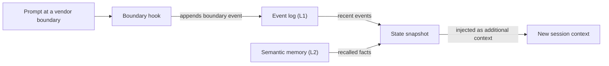

# 术语表

## 构建单元 {#building-blocks}

### 技能 {#skill}

技能是位于 `.agents/skills/oma-<name>/` 的领域知识包。路由到该技能时，其 `SKILL.md` 会进入上下文；`resources/` 中的文件只在任务需要时加载。技能指导智能体如何在某个领域中工作，但不定义多步骤流程。参见[技能](../core-concepts/skills.md)。

### 工作流 {#workflow}

工作流是定义在 `.agents/workflows/<name>.md` 中的多步骤流程。你可以用对应的斜杠命令启动工作流，例如 `/plan` 或 `/orchestrate`；启用关键词检测钩子时，匹配的触发短语也可以注入工作流。工作流负责协调一个或多个技能和智能体。参见[工作流](../core-concepts/workflows.md)和[选择技能或工作流](../core-concepts/workflows.md#choosing-a-skill-or-workflow)。

### 智能体定义 {#agent-definition}

智能体定义是 `.agents/agents/` 中已签入版本控制的子智能体文件，例如 `backend-engineer.md` 或 `qa-reviewer.md`。它规定智能体的身份、要加载的技能（`skills:` 前置元数据）、执行协议部分和领域规则。OMA 会把这些文件投射为供应商原生格式，例如 `.claude/agents/*.md` 和 `.codex/agents/*.toml`。文档中的“智能体”也可能指调度角色（`backend`、`qa`、`explore`）或 `oma-backend` 这样的技能。参见[智能体定义](../core-concepts/agents.md#agent-definitions)。

## 预设 {#presets}

### 技能预设 {#skill-preset}

技能预设是安装器添加到项目中的一组技能，例如 `all`、`fullstack`、`backend` 或 `research`。共享的 `_shared/` 资源会随每个预设一起安装。技能预设不影响由哪个模型运行智能体。参见[预设](./installation.md#presets)。

### 模型预设 {#model-preset}

模型预设是 `.agents/oma-config.yaml`（或 `.cue`）中的 `model_preset` 值，决定每个智能体使用的供应商和模型。新安装默认使用 `auto`，它遵循当前运行时自身的智能体和模型设置；`claude`、`codex` 或 `mixed` 等固定预设则会固定这些设置。`agents.<id>` 覆盖项优先于预设，但 `free` 除外：在 `free` 下，`free.model` 会取代按智能体固定的模型。参见[内置预设](../guide/per-agent-models.md#built-in-presets)。

## 工作流执行 {#workflow-execution}

### 持久化工作流 {#persistent-workflow}

持久化工作流会跨轮次持续运行，直到工作完成或你将其停用。持久化工作流包括 `/orchestrate`、`/work`、`/ultrawork` 和 `/ralph`，只有显式调用才会激活持久化模式。工作流处于活动状态时，钩子会在每条提示中重新注入 `[OMA PERSISTENT MODE: ...]`，Stop 钩子会阻止会话结束，直到达到强化次数上限或过期超时。说 `workflow done` 即可停用。参见[持久化模式机制](../core-concepts/workflows.md#persistent-mode-mechanics)。

### 停止关卡 {#stop-gate}

停止关卡是可选的完成检查，通过 `oma goal set --gate typecheck|test|lint` 附加到活动的持久化工作流上。此后，只有同名的 `package.json` 脚本通过时，Stop 钩子才允许工作流结束。关卡失败会计入强化次数上限，因此失败的关卡不会永远阻止停止。参见 [`goal set`](../cli-interfaces/commands.md#goal-set)。

## 会话与状态 {#sessions-and-state}

“会话”在 OMA 中有两种含义：一是 OMA 自己跟踪的会话，二是你所用 AI CLI 或 IDE 的对话会话。阅读状态文件或命令选项时，要区分这两者。

### OMA 会话 {#oma-session}

OMA 会话是 OMA 以自己的会话 ID 跟踪的工作，与任何供应商对话无关。编排流程用该 ID 命名计划、任务板、进度和结果文件以及智能体运行记录；编排器生成的 ID 格式为 `session-YYYYMMDD-HHMMSS`。工作流状态用 OMA 会话 ID（`sid`）作为[事件日志](#event-log)的键，可用 `oma state list` 和 `oma state get <sid>` 查看。参见[会话 ID 策略](../guide/multi-agent-project.md#session-id-strategy)。

### 供应商会话 ID {#vendor-session-id}

供应商会话 ID 是 AI CLI 或 IDE 分配的对话 ID，例如 Claude Code 或 Codex 的会话 ID。OMA 会在事件上将其记录为 `vendorSid`，持久化模式状态文件也以它为键（`.agents/state/<workflow>-state-<vendor-session-id>.json`）。OMA 会话处于活动状态时，如果提示来自另一个供应商会话、另一个供应商，或刚刚压缩过的会话，钩子会记录一个 `boundary` 事件并注入状态快照，让工作在新上下文中继续。参见 [`state`](../cli-interfaces/commands.md#state)。

如果语义记忆不可用，快照只使用本地事件。

### 事件日志 {#event-log}

事件日志是 OMA 会话的只追加记录，以 `events.jsonl` 形式保存在 `${OMA_STATE_HOME:-~/.oma}/u/<profile>/sessions/<sid>/` 下。每行是一个事件，例如 `session.created`、`workflow.phase`、`gate.passed`、`decision.made` 或 `session.ended`。工作流用 `oma state emit` 追加必需的决策，并用 `oma state verify` 检查它们；请用 `oma state get` 或 `oma state trajectory` 读取日志，而不是直接打开文件。参见 [`state`](../cli-interfaces/commands.md#state)。

## 审查与证据 {#review-and-evidence}

### Judge {#judge}

“Judge”有两种含义。在 `/ralph` 中，judge 是每次 ultrawork 迭代后的阶段，它对照项目实际状态检查每个完成标准，并记录 PASS、FAIL、REGRESSED 或 BLOCKED。该阶段由另行启动、使用全新上下文的智能体执行，因此编排器不会给自己的工作打分。在技能评估和优化中，`judge` 是默认的检查器类型：由模型依据评分标准给某个分支的输出打分，并返回 PASS 或 FAIL。参见 [/ralph](../core-concepts/workflows.md#ralph) 和 [judge 检查器](../guide/skill-eval.md#judge-default)。

### 跨上下文审查（CCR） {#cross-context-review-ccr}

跨上下文审查是一条规则：`/ultrawork` 中的每个审查步骤都在全新的、上下文隔离的审查子智能体中运行。审查者只会收到待审查的产物（通过路径引用：diff、变更文件、计划、先前结果、测试输出），以及该次审查的指南；它看不到主会话的历史，也看不到实现者的推理过程。每个审查者都会写出结构化结论，由阶段协调者收集。参见 [/ultrawork](../core-concepts/workflows.md#ultrawork)。

### 章程 {#charter}

章程是实现智能体过去在编写任何代码之前要输出的 `CHARTER_CHECK` 预检块。当前的智能体定义不再要求固定的预检输出，而是遵循共享执行策略：说明重要的假设，只有缺失的信息会影响正确性或范围时才提问，并且只暂停依赖该答案的工作。启动的子智能体无法直接询问你，因此会在 `blocked` 或 `partial` 结果中报告缺失的事实。参见[授权与澄清](../core-concepts/agents.md#charter-preflight-charter_check)。

### 运行记录与声明 {#run-record-and-claim}

运行记录是单次智能体尝试的机器可读回执，保存在该配置文件的按项目状态目录 `~/.oma/u/<profile>/projects/<project-hash>/agent-runs/` 中（旧版本使用 `.agents/state/agent-runs/`）；`oma agent begin` 会创建它，并为任务契约保存快照。声明是智能体自己的报告，位于对应的 `.claim.json` 路径，状态为 `completed`、`partial`、`blocked` 或 `failed`，并附有变更文件、未解决的工作和产物。`oma agent finish` 会对照当前契约、验证回执和产物哈希检查声明，因此证据过时的声明不会保持 completed 状态。参见[智能体结果与恢复](../guide/agent-results-and-resume.md)。

## 记忆与提供商 {#memory-and-providers}

### L1 和 L2 记忆 {#l1-and-l2-memory}

L1 是[事件日志](#event-log)：本地、只追加的工作流状态，供 `oma state verify` 和边界快照读取。L2 是语义记忆，即由所选 `providers.semantic_memory` 提供商提供的召回事实：`agentmemory`（默认）、`honcho` 或 `none`。必需的决策保存在 L1 中，因此即使没有 L2 也能跨越会话边界保留。“L1”和“L2”还有其他含义：技能的第 1 层和第 2 层分别是它的 `SKILL.md` 和按需加载的 `resources/` 目录；`oma docs verify` 报告的“L2 references”是它从文档中提取的文件、URL、CLI、脚本、环境变量和配置引用。参见 [`memory`](../cli-interfaces/commands.md#memory) 和 [Honcho 语义记忆](../guide/configuration-reference.md#honcho-semantic-memory)。

### 能力提供商 {#capability-provider}

能力提供商是 OMA 为某项能力使用的外部工具或服务，在 `.agents/oma-config.yaml` 的 `providers` 下选择。这些能力包括文档（`docs`，默认 `context7`）、Web 搜索（`web`，默认 `native`）、代码智能（`code_intelligence`，默认 `serena`）和语义记忆（`semantic_memory`，默认 `agentmemory`）。更换提供商后请运行 `oma link`。参见[顶层键](../guide/configuration-reference.md#top-level-keys)和[重要默认值](./important-defaults.md)。

## 计划与源文件 {#plans-and-source-files}

### 计划 {#plan}

计划是位于 `.agents/results/plan-<sessionId>.json` 的机器可读任务分解，由 `/plan` 写入，供 `/orchestrate` 和 `/work` 使用；没有可用计划时，`/orchestrate` 会创建一个。每个任务都会写明其智能体、工作区、依赖关系、验收标准和必需的检查，运行记录会为这份契约保存快照。它与 `oma doctor --profile` 显示的按智能体模型解析无关，尽管有些页面把后者称为继承的计划（inherited plan）。参见 [/plan](../core-concepts/workflows.md#plan) 和[启动原生运行](../guide/agent-results-and-resume.md#start-a-native-run)。

### SSOT {#ssot}

单一事实来源（SSOT）是 `.agents/` 目录：项目安装时为 `<project>/.agents/`，全局安装时为 `~/.oma/.agents/`。技能、工作流、智能体定义、规则和配置都位于此处，`oma install`、`oma update` 和 `oma link` 会据此生成供应商原生文件（`.claude/`、`.codex/` 等）。请编辑 `.agents/` 并运行 `oma link`，而不是编辑生成的文件。有些页面会用 SSOT 指代范围更窄的来源，例如计划任务智能体（scheduled agents）清单。参见 [.agents/：事实来源](../core-concepts/project-structure.md#agents-the-source-of-truth)。
