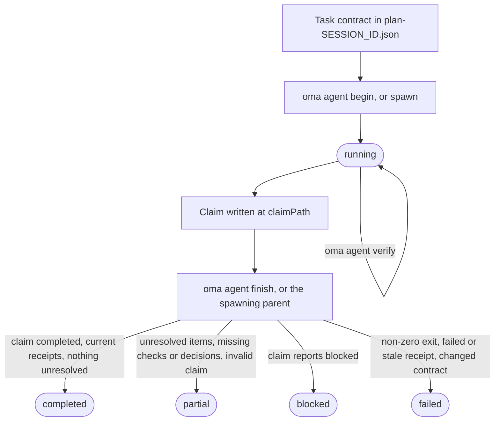
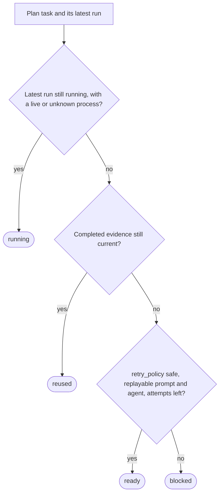

# 智能体结果与恢复

OMA 将智能体结果视为一份小型证据记录，而不只是进程退出码。一次运行会记录任务和会话 ID、工作区指纹、验证回执、已修改文件、未解决工作以及产物哈希。这样，协调器只有在验收契约和输入仍然匹配时，才能复用已完成的任务。

如果你运行的是原生智能体，请直接使用这里的生命周期。工作流和 `oma agent spawn` 会为你创建相同的记录，并将托管运行的最终化交给父级协调器。本文所用术语请参见术语表中的[运行记录与声明](../getting-started/glossary.md#run-record-and-claim)和[计划](../getting-started/glossary.md#plan)。

## 生命周期一览 {#lifecycle-at-a-glance}

| 步骤 | 命令 | 记录内容 | 需保留 |
| --- | --- | --- | --- |
| 1. 契约 | 编辑 `.agents/results/plan-SESSION_ID.json` | 任务的 `acceptance_criteria` 和 `required_checks` | 会话 ID、任务 ID |
| 2. 开始 | `oma agent begin AGENT TASK SESSION_ID --workspace .` | 状态为 `running` 的运行记录 | `runId`、`claimPath` |
| 3. 上下文（可选） | `oma agent context AGENT --difficulty Medium` | 无 | 提示上下文 |
| 4. 验证 | `oma agent verify RUN_ID --required` | 每项检查一份回执 | 退出码 |
| 5. 声明 | 在 `claimPath` 写入 JSON | 声明文件 | 无 |
| 6. 完成 | `oma agent finish RUN_ID CLAIM_PATH` | 最终状态 | `status` |
| 7. 恢复 | 先运行 `oma agent resume SESSION_ID --dry-run`，再去掉 `--dry-run` 运行 | 恢复检查点和会话租约 | 各任务状态 |

`oma agent spawn` 和 `oma agent parallel` 会替你执行第 2 步和第 6 步：父进程开始运行，并在子进程退出时完成运行。



声明也可以直接报告 `partial` 或 `failed`。finish 从不升级声明：证据不成立的 `completed` 声明会被降级，非零退出码会让任何运行变为 `failed`。

## 启动原生运行 {#start-a-native-run}

先在 `.agents/results/plan-SESSION_ID.json` 中的计划里定义任务、`acceptance_criteria` 和 `required_checks`。对于一个小型通用项目检查，计划可以只包含如下一个任务：

```json
{
  "tasks": [
    {
      "id": "docs",
      "agent": "docs",
      "task": "Review README.md and report any documentation issues",
      "workspace": ".",
      "acceptance_criteria": [
        { "id": "diff-clean", "description": "The current Git diff has no whitespace errors" }
      ],
      "required_checks": [
        { "id": "whitespace", "criteria": ["diff-clean"], "command": ["git", "diff", "--check"], "cwd": "." }
      ],
      "retry_policy": "manual"
    }
  ]
}
```

此检查只能证明 Git diff 没有空白错误；请将任务、条件和检查替换为项目真正的验收契约。在项目根目录开始运行：

```bash
oma agent begin docs docs SESSION_ID --workspace .
```

将 `SESSION_ID` 替换为计划中使用的会话 ID。命令会输出包含生成的 UUID `runId` 和 `claimPath` 的 JSON，例如：

```json
{
  "runId": "<generated-run-id>",
  "taskId": "docs",
  "sessionId": "<your-session-id>",
  "status": "running",
  "claimPath": ".agents/state/agent-runs/<generated-run-id>.claim.json"
}
```

尖括号中的值是占位符，请使用运行实际打印的值。成功的 begin 会在 `.agents/state/agent-runs/` 下创建运行记录，并保存任务契约的快照。声明路径始终是运行记录路径，将 `.json` 替换为 `.claim.json`。

## 加载上下文并运行任务 {#load-context-and-run-the-task}

编辑前加载图选择的参考资料：

```bash
oma agent context docs --difficulty Medium
```

难度必须是 `Simple`、`Medium` 或 `Complex`。命令会输出为所选智能体组装的上下文。如果不存在基于图的上下文，请修复任务定义，或继续使用项目文档规定的原生搜索路径；不要伪造上下文回执。

在 `begin` 记录的工作区中运行任务。运行处于活动状态时保持会话计划不变。如果任务改变验收条件或必需检查，请先更新计划，再开始新的运行。

## 记录验证 {#record-verification}

运行验收契约中固定的每项检查：

```bash
oma agent verify RUN_ID --required
```

将 `RUN_ID` 替换为 `begin` 返回的 UUID。命令会执行声明的 argv，并记录真实退出码以及前后工作区指纹。如果任务契约包含单个检查，可以记录精确命令：

```bash
oma agent verify RUN_ID -- git diff --check
```

只有任务契约中的检查才可以使用精确命令形式；否则保留计划中的 `required_checks` 并使用 `--required`，这样回执才能证明声明的验收条件。

仅当图包含完整的测试选择时才使用 `--affected PATH...`。一次运行内的检查会串行执行。非零退出码或检查期间工作区发生变化都会使回执失效。

## 写入并完成声明 {#write-and-finish-the-claim}

如果任务要选定 API 契约、认证策略、数据模型、迁移策略、状态归属、基础设施访问范围，或其他后续工作依赖的决策，请在调度前于任务中声明 `required_decisions`：

```json
"required_decisions": [
  {
    "subject": "db.migration-strategy",
    "description": "Choose the compatibility window and rollback strategy for the account migration."
  }
]
```

遵循既有决策的任务请省略此字段。这些要求会随任务契约一起固定，调度后不能删除或修改。
可以用 `oma state decisions list --agent db-engineer --json` 列出某个智能体的建议主题。这些主题是在相关时可选用的选项；目录并不会让每项选择都变成必需。

在 `begin` 打印的确切路径写入声明文件：

```json
{
  "status": "completed",
  "changedFiles": [],
  "unresolved": [],
  "artifacts": []
}
```

`status` 可为 `completed`、`partial`、`blocked` 或 `failed`。路径相对于项目根目录，所有产物都必须是工作区内的普通文件。只有特定审阅没有可执行检查时，才使用 `verificationSkipped`；它不能把失败的检查变成通过。

把实质性决策写入声明中可选的 `decisions` 数组：

```json
"decisions": [
  {
    "subject": "db.migration-strategy",
    "decision": "Use an expand-and-contract migration; retain the old column for one release.",
    "rationale": "Both deployed app versions must work during the rollout; rollback switches reads to the retained column.",
    "alternatives": ["Replace the column during a maintenance window"],
    "evidence": ["docs/account-migration.md"]
  }
]
```

父进程会把每项决策作为 `decision.made` 事件存入该运行的会话，并附上实际的智能体、任务和运行 ID。缺少必需决策时，即使可执行检查通过，结果也会保持 partial。来自其他任务或其他尝试的决策不能满足该要求。回执会固定决策事件 ID 和内容哈希；复用时会检查这些事件仍然存在、有效且内容未变。
可选决策也会被记录。只读智能体会在其 `OMA_RESULT_JSON` 声明中返回同样的数组，供父进程持久化。

写入声明后完成原生运行：

```bash
oma agent finish RUN_ID CLAIM_PATH
```

将这两个值替换为 `begin` JSON 中的值。`CLAIM_PATH` 是生成的 `.claim.json` 路径；不要自行创建新的文件名。

finish 命令会验证声明、当前契约、当前回执和产物哈希。声明已完成但证据过期时，运行会变为 failed 或 partial。父进程拥有生命周期的托管运行不能由此命令完成。

## 生成运行与原生运行的行为 {#spawned-and-native-behavior}

`oma agent spawn` 和 `oma agent parallel` 会创建运行，向子进程提示注入运行身份和结果说明，并让父进程捕获子进程退出码。子进程应写入声明并报告产物；父进程会完成托管回执。只读子进程返回一行 `OMA_RESULT_JSON: {...}`；父进程会持久化它，`verificationSkipped` 的说明仍与可执行验证区分开。

`.agents/results/` 中的人类可读结果文件和 `.agents/state/memories/` 中的记忆笔记有助于人们追踪进度。`.agents/state/agent-runs/` 中的机器可读回执才是复用和恢复所使用的证据。

## 重试前检查恢复状态 {#inspect-recovery-before-retrying}

先询问 OMA 将采取什么动作：

```bash
oma agent resume SESSION_ID --dry-run
```

报告会将每个任务归类为 `reused`、`ready`、`running` 或 `blocked`，并包含原因：



如果依赖不是 `reused`，依赖它的 `reused` 任务会退回 `ready`（无法重放时为 `blocked`）；依赖处于 `blocked` 或 `running` 的 `ready` 任务会变为 `blocked`。只有契约、输入、产物哈希和依赖证据都仍然有效时，才会复用有效的已完成回执。活动中的托管进程，或没有存活证据的原生运行，不会被重复启动。

报告显示可以安全执行时，按依赖顺序恢复 `ready` 任务：

```bash
oma agent resume SESSION_ID
```

自动重放需要 `retry_policy: "safe"`，以及计划或已保存调度中的可重放提示和智能体。默认值是 `manual`。`--max-attempts` 默认为 `3`，包括原始尝试：

```bash
oma agent resume SESSION_ID --max-attempts 2
```

OMA 将恢复检查点写入 `.agents/state/agent-resume/`，并使用会话租约，防止两个协调器重试同一个会话。恢复运行期间计划会被固定。如果计划或依赖发生变化，或后续重试改变了早期输入，受影响的任务会变为 blocked，需要重新运行验证。

恢复会开始新的尝试，不会恢复被中断的模型对话。在恢复中断的原生运行前，先用实际结果和未解决工作将旧运行标记为 `partial` 或 `failed`。然后检查 dry-run 报告，只重试存在安全重放路径的任务。

## 恢复示例 {#recovery-examples}

| 情况 | 操作 | 预期结果 |
| --- | --- | --- |
| 必需检查失败 | 修复任务，再次运行 `oma agent verify RUN_ID --required`，然后使用新声明完成。 | 工作区指纹仍然是当前值时，最新回执会替换失败结果。 |
| 声明写入前进程退出 | 将运行标记为 partial 或 failed，然后运行 `oma agent resume SESSION_ID --dry-run`。 | 旧尝试会保留；安全任务为 `ready`，手动任务为 `blocked`。 |
| 依赖发生变化 | 重新运行依赖，再次检查报告。 | 即使依赖方自身文件未变，其复用也会失效。 |
| 计划或输入发生变化 | 计划稳定后开始新的运行。 | 新运行会保存新契约的快照；旧证据不会复用。 |
| 任务需要决策 | 记录为 `blocked`，并说明原因。 | 在决策和提示可用前，恢复会让它保持 `blocked`。 |

## 后续步骤 {#next-steps}

- `begin`、`verify`、`finish` 和 `resume` 的错误消息：[故障排查](./troubleshooting.md#find-your-error)
- 解析错误、供应商工具缺失、仪表盘状态、计划任务和过期评估数据：[故障排查](./troubleshooting.md)
- 在托管运行工作时进行观察：[仪表盘监控](./dashboard-monitoring.md)
- 用任务契约定义计划：[多智能体项目](./multi-agent-project.md)
