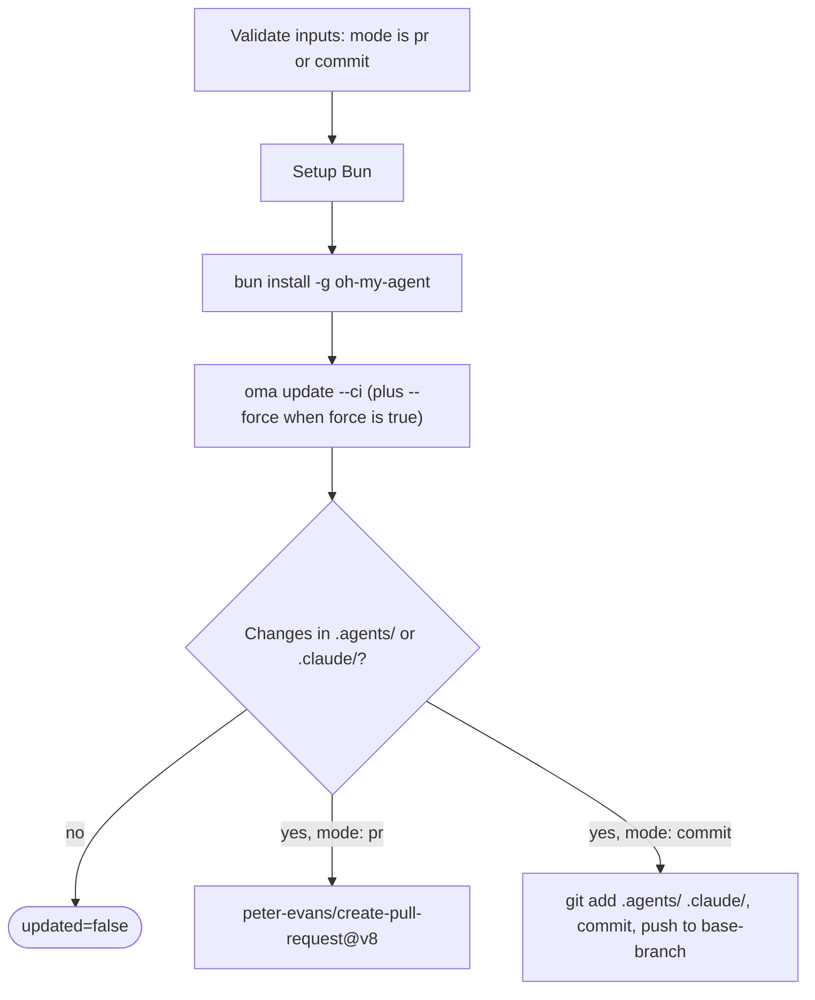

# 指南：自动更新

## 概述 {#overview}

oh-my-agent GitHub Action（`first-fluke/oma-update-action@v1`）通过在 CI 中运行 `oma update` 来自动更新项目的智能体技能。它支持两种模式：创建 Pull Request 供审查，或直接提交到分支。

---

## 快速设置 {#quick-setup}

<!-- oma-docs:ignore-start -->
将此文件添加到项目中作为 `.github/workflows/update-oh-my-agent.yml`：
<!-- oma-docs:ignore-end -->

```yaml
name: Update oh-my-agent

on:
  schedule:
    - cron: '0 9 * * 1'  # Every Monday at 9am UTC
  workflow_dispatch:        # Allow manual trigger

permissions:
  contents: write
  pull-requests: write

jobs:
  update:
    runs-on: ubuntu-latest
    steps:
      - uses: actions/checkout@v4

      - uses: first-fluke/oma-update-action@v1
```

这是最小配置。安装的组件发生变化时，Action 会以 `updated=true` 结束，输出版本并创建 PR。没有文件变化时，会以 `updated=false` 结束且不创建 PR。

---

## 所有 Action 输入 {#all-action-inputs}

| 输入 | 类型 | 必填 | 默认值 | 说明 |
|:-----|:-----|:-----|:-------|:-----|
| `mode` | string | 否 | `"pr"` | 如何应用变更。`"pr"` 创建 Pull Request。`"commit"` 直接推送到基础分支。 |
| `base-branch` | string | 否 | `"main"` | PR 的基础分支（`pr` 模式）或直接提交的目标分支（`commit` 模式）。它不会改变检出的内容；请将 `actions/checkout` 的 `ref:` 设置为同一分支。 |
| `force` | string | 否 | `"false"` | 传递 `--force` 给 `oma update`。为 `"true"` 时，覆盖用户自定义的配置文件（`oma-config.yaml`、`mcp.json`）和 `stack/` 目录。正常情况下这些会被保留。 |
| `pr-title` | string | 否 | `"chore(deps): update oh-my-agent skills"` | Pull Request 的自定义标题。仅在 `pr` 模式下使用。 |
| `pr-labels` | string | 否 | `"dependencies,automated"` | 添加到 PR 的逗号分隔标签。仅在 `pr` 模式下使用。 |
| `commit-message` | string | 否 | `"chore(deps): update oh-my-agent skills"` | 自定义提交消息。两种模式都使用：作为 PR 提交消息或直接提交消息。 |
| `token` | string | 否 | `${{ github.token }}` | 创建 PR 的 GitHub token。如果需要 PR 触发其他工作流，请使用 Personal Access Token（PAT）（默认的 `GITHUB_TOKEN` 不会在其创建的 PR 上触发工作流运行）。 |

---

## 所有 Action 输出 {#all-action-outputs}

| 输出 | 类型 | 说明 | 可用时机 |
|:-----|:-----|:-----|:---------|
| `updated` | string | 运行 `oma update` 后检测到变更时为 `"true"`。已是最新时为 `"false"`。 | 始终 |
| `version` | string | 更新后的 oh-my-agent 版本。从 `.agents/skills/_version.json` 读取。 | `updated` 为 `"true"` 时 |
| `pr-number` | string | Pull Request 编号。 | 仅在 `pr` 模式下创建 PR 时 |
| `pr-url` | string | 创建的 Pull Request 的完整 URL。 | 仅在 `pr` 模式下创建 PR 时 |

---

## 详细示例 {#detailed-examples}

### 示例 1：默认 PR 模式 {#example-1-default-pr-mode}

最常见的设置。每周一有更新可用时创建 PR。

```yaml
name: Update oh-my-agent

on:
  schedule:
    - cron: '0 9 * * 1'
  workflow_dispatch:

permissions:
  contents: write
  pull-requests: write

jobs:
  update:
    runs-on: ubuntu-latest
    steps:
      - uses: actions/checkout@v4

      - uses: first-fluke/oma-update-action@v1
        id: update

      - name: Summary
        if: steps.update.outputs.updated == 'true'
        run: |
          echo "Updated to version ${{ steps.update.outputs.version }}"
          echo "PR: ${{ steps.update.outputs.pr-url }}"
```

**发生了什么：**
- 检出仓库。
- 安装 Bun，然后全局安装 oh-my-agent。
- 运行 `oma update --ci`。
- 检查 `.agents/` 或 `.claude/` 是否有变更。
- 如果有变更，使用 `peter-evans/create-pull-request@v8` 在 `chore/update-oh-my-agent` 分支上创建 PR。
- PR 标记为 `dependencies,automated` 并在正文中包含新版本号。

### 示例 2：使用 PAT 的直接提交模式 {#example-2-direct-commit-mode-with-pat}

适合希望更新立即生效而无需 PR 审查步骤的团队。使用 PAT 使提交能触发下游工作流。

```yaml
name: Update oh-my-agent (Direct)

on:
  schedule:
    - cron: '0 6 * * *'  # Daily at 6am UTC
  workflow_dispatch:

permissions:
  contents: write

jobs:
  update:
    runs-on: ubuntu-latest
    steps:
      - uses: actions/checkout@v4
        with:
          ref: develop
          token: ${{ secrets.OH_MY_AGENT_PAT }}

      - uses: first-fluke/oma-update-action@v1
        with:
          mode: commit
          token: ${{ secrets.OH_MY_AGENT_PAT }}
          commit-message: "chore: auto-update oh-my-agent skills"
          base-branch: develop
```

**发生了什么：**
- 使用 PAT 检出 `develop`。`ref: develop` 是必需的：`base-branch` 只设置推送目标，而 Action 会推送检出所产生的任意 `HEAD`。
- 运行 `oma update --ci`。
- 如果有变更，配置 git 为 `github-actions[bot]` 并直接提交到 `develop`。
- PAT 确保提交触发任何监听 `develop` 推送的工作流。

**重要：** 使用 `secrets.OH_MY_AGENT_PAT`（具有 Contents: Write 权限的 Fine-Grained PAT）而非 `github.token`。默认的 `GITHUB_TOKEN` 创建的提交不会触发其他工作流，这可能破坏期望推送事件的 CI 流水线。

### 示例 3：条件通知 {#example-3-conditional-notification}

更新时发送 Slack 通知。

```yaml
name: Update oh-my-agent

on:
  schedule:
    - cron: '0 9 * * 1'
  workflow_dispatch:

permissions:
  contents: write
  pull-requests: write

jobs:
  update:
    runs-on: ubuntu-latest
    steps:
      - uses: actions/checkout@v4

      - uses: first-fluke/oma-update-action@v1
        id: update

      - name: Notify Slack
        if: steps.update.outputs.updated == 'true'
        uses: slackapi/slack-github-action@v2
        with:
          webhook: ${{ secrets.SLACK_WEBHOOK }}
          webhook-type: incoming-webhook
          payload: |
            {
              "text": "oh-my-agent updated to v${{ steps.update.outputs.version }}. PR: ${{ steps.update.outputs.pr-url }}"
            }

      - name: Skip notification
        if: steps.update.outputs.updated == 'false'
        run: echo "Already up to date, no notification needed."
```

**关键模式：** 使用 `steps.update.outputs.updated == 'true'` 有条件地运行下游步骤，仅在实际发生更新时执行。这防止"无变更"运行产生的噪音。

### 示例 4：强制模式与自定义标签 {#example-4-force-mode-with-custom-labels}

适合希望在更新时将所有配置文件重置为默认值的项目。

```yaml
name: Update oh-my-agent (Force)

on:
  workflow_dispatch:  # Manual trigger only for force updates

permissions:
  contents: write
  pull-requests: write

jobs:
  update:
    runs-on: ubuntu-latest
    steps:
      - uses: actions/checkout@v4

      - uses: first-fluke/oma-update-action@v1
        with:
          force: 'true'
          pr-title: "chore(deps): force-update oh-my-agent skills (reset configs)"
          pr-labels: "dependencies,automated,force-update"
          commit-message: "chore(deps): force-update oh-my-agent skills"
```

**警告：** 强制模式会覆盖 `oma-config.yaml`、`mcp.json` 和 `stack/` 目录。仅在你想重置所有自定义到默认值时使用。常规更新请省略 `force` 输入。

---

## 底层工作原理 {#how-it-works-under-the-hood}

该 action 是定义在 `action/action.yml` 中的[复合 action](https://docs.github.com/en/actions/creating-actions/creating-a-composite-action)。它先验证 `mode` 是否为 `pr` 或 `commit`，然后运行以下步骤，最后创建 Pull Request 或直接提交：



### 步骤 1：设置 Bun {#step-1-setup-bun}

```yaml
- uses: oven-sh/setup-bun@v2
```

安装 Bun 运行时，这是运行 oh-my-agent CLI 所必需的。

### 步骤 2：安装 oh-my-agent {#step-2-install-oh-my-agent}

```bash
bun install -g oh-my-agent
```

从 npm 注册表全局安装 CLI。这提供了 `oma` 命令的访问权限。

### 步骤 3：运行 oma update {#step-3-run-oma-update}

```yaml
- name: Run oma update
  shell: bash
  env:
    FORCE: ${{ inputs.force }}
  run: |
    FLAGS="--ci"
    if [ "$FORCE" = "true" ]; then
      FLAGS="$FLAGS --force"
    fi
    oma update $FLAGS
```

输入通过 `env:` 传入脚本，而不是在 `run:` 中使用 `${{ }}` 插值，这样可以防止输入值被当作 shell 代码执行。

`--ci` 标志以非交互模式运行更新（跳过所有提示，输出纯文本而非旋转动画）。启用 `--force` 标志时，覆盖用户自定义的配置文件。

`oma update --ci` 内部执行：

1. 从 main 分支获取 `prompt-manifest.json` 以获取最新版本号。
2. 与 `.agents/skills/_version.json` 中的本地版本比较。
3. 如果版本匹配，以"已是最新"退出。
4. 如果有新版本可用，下载并解压最新 tarball。
5. 保留用户自定义文件（除非 `--force`）：`oma-config.yaml`、`mcp.json` 和 stack 目录。
6. 将新文件覆盖到现有 `.agents/` 目录。
7. 恢复保留的文件。
8. 为配置中 `vendors:` 列表里的供应商更新供应商适配（钩子、设置、智能体定义）（空列表表示不更新任何供应商）。没有 `vendors:` 列表时，只更新项目目录已存在的供应商。
9. 刷新 CLI 符号链接。

Action 调用 `oma update --ci` 时不会带 `--with-new-skills`。这会刷新已安装的技能集并报告新提供的技能；只有在项目确实要在更新中加入新技能时，才应明确运行 `oma update --with-new-skills`。

### 步骤 4：检查变更 {#step-4-check-for-changes}

```bash
if [ -n "$(git status --porcelain .agents/ .claude/ 2>/dev/null)" ]; then
  echo "updated=true" >> "$GITHUB_OUTPUT"
  if [ -f ".agents/skills/_version.json" ]; then
    VERSION=$(jq -r '.version' .agents/skills/_version.json)
    echo "version=$VERSION" >> "$GITHUB_OUTPUT"
  fi
else
  echo "updated=false" >> "$GITHUB_OUTPUT"
fi
```

检查 `oma update` 是否实际更改了 `.agents/` 或 `.claude/` 中的文件。相应设置 `updated` 和 `version` 输出。这两个目录之外的变更（例如 `.codex/` 或 `AGENTS.md`）不会设置 `updated=true`。

之后，根据 `mode` 输入：

- **`pr` 模式：** 使用 `peter-evans/create-pull-request@v8` 在 `chore/update-oh-my-agent` 分支上创建 PR。PR 包含新版本号、oh-my-agent 仓库链接和配置的标签。如果分支已存在（来自之前未关闭的 PR），则更新现有 PR。

- **`commit` 模式：** 配置 git 为 `github-actions[bot]`，暂存 `.agents/` 和 `.claude/`，用配置的消息提交，并推送到基础分支。

---

## 另请参阅 {#see-also}

- [全局安装](./global-install.md)：`oma update --global` 以及用户级安装在 CI 中的注意事项
- [配置参考](./configuration-reference.md#update-and-ownership-rules)：`oma update` 会保留哪些配置文件
- [现有项目集成](./integration.md)：`oma update` 在项目中刷新的文件
