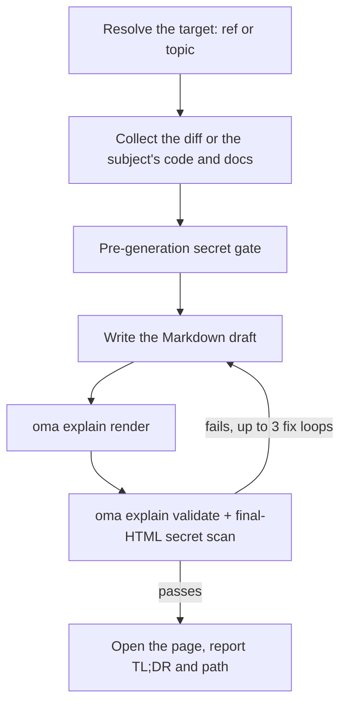

# 代码讲解器

`/explain` 会把代码改动转换成自包含的 HTML 文档，解释改动内容及原因。文档为新手提供可跳过的深入背景，包含使用玩具数据的核心直觉部分，按理解顺序组织代码讲解，并附带五道题的测验。输出是单个可离线使用的 `.html` 文件，包含图表、提示框和无障碍测验，保存在 `.agents/results/explain/` 下，交付前会根据确定性清单验证。

`/explain` 只能通过斜杠命令调用，不会由自然语言自动激活。“explain”属于日常词汇，因此有意排除在关键词检测之外（与 `/convert` 的先例相同）。请明确输入 `/explain`，或请求其他技能将“explainer document”作为委派产物生成。

## 两种模式 {#two-modes}

| 模式 | 输入 | 需要 git | 页面讲解的内容 |
|---|---|---|---|
| 改动（Change） | `/explain`、`/explain #640`、`/explain a..b`、`/explain <branch>` | 是（PR 引用需要 `gh`） | 代码改动：Background、Intuition、Code、Quiz |
| 主题（Topic） | `/explain how does session windowing work`（无法解析为 PR、分支或 SHA 范围的文本） | 否 | 概念、系统或某个问题的答案，以单页可视化形式呈现：先给出核心答案，再用图表、表格和简短正文组成的面板展开 |

如果文本既可能是分支名也可能是主题，工作流会先把它当作 git 引用检查；引用优先。

---

## 何时使用 {#when-to-use}

- 将 PR、分支、提交范围或当前暂存/未暂存改动讲解成文档
- 帮助没有编写某项改动的同事熟悉它
- 大型或细微改动落地后，生成可审阅的教学产物
- 将架构、协议、比较或较长的回答整理成一页可视化页面（主题模式）

## 何时不使用 {#when-not-to-use}

- 带旁白的讲解*视频*，使用 [`oma-video`](./video-generation.md)（explainer 模式）；`/explain` 生成 HTML 文档，不生成视频
- 检查文档是否仍与代码库匹配，使用 `oma-docs`（漂移检测）
- 演示文稿或幻灯片，使用 `oma-slide`（固定 1920×1080 的演示文稿契约）
- 查找缺陷或给出审查结论，使用 `oma-qa` 或 `/review` 工作流；`/explain` 以教学方式讲述改动，不评估改动

---

## 快速开始 {#quick-start}

```text
/explain
/explain 640
/explain a1b2c3d..e5f6a7b
/explain payments-refactor for reviewer
```

目标引用会根据输入措辞解析：

| 输入 | 目标解析 | 读者级别 |
|----------|--------------------|--------------|
| `/explain` | 暂存改动（`git diff --cached`），如果没有则使用脏工作树 | `onboarding` |
| `/explain 640`、`/explain #640` | 通过 `gh pr diff` 获取 PR #640 | `onboarding` |
| `/explain a..b` | SHA 范围 `a..b`（或 `a...b`） | `onboarding` |
| `/explain feature-branch for reviewer` | `git diff main...feature-branch` | `reviewer` |
| `/explain how does the row planner work` | 主题模式：没有引用；智能体收集该主题涉及的代码和文档 | 不适用 |

如果没有提供明确引用，且暂存区与脏工作树都为空，解析会回退到 `HEAD~1..HEAD`。



---

## 引用解析顺序 {#ref-resolution-order}

仅适用于改动模式；主题模式会跳过引用解析。

1. **明确参数**：PR 编号（`#640`）、分支名称或 SHA 范围（`a..b` / `a...b`）
2. **暂存改动**：`git diff --cached`
3. **脏工作树**：`git diff`
4. **回退**：`HEAD~1..HEAD`

空 diff 或无法解析的引用会停止工作流；系统会提供最近的提交作为候选，而不会猜测其他引用。

---

## 读者级别 {#reader-levels}

| 级别 | 效果 |
|-------|--------|
| `onboarding`（默认） | 完整的深入背景（Tier A），面向不熟悉周围系统的读者 |
| `reviewer` | 压缩深入背景层；Intuition 和 Code 部分保持完整 |

如需 `reviewer`，在命令中加入“for reviewer”，例如 `/explain feature-branch for reviewer`。

---

## 文档内容 {#what-the-document-contains}

本节介绍改动模式。改动模式的讲解文档是单页长滚动页面（没有标签页，也没有多页导航），包含目录以及按以下顺序排列的四个固定部分：

1. **Background**：Tier A（深入系统或架构背景，标记为“如果已经了解系统可跳过”）以及 Tier B（针对本次改动的窄范围上下文）
2. **Intuition**：改动的核心本质，必须配有玩具数据示例，并使用 2 到 3 组重复使用的图表族（简化 UI 模拟、携带示例数据的系统或数据流图、改动前后状态），只以 HTML 或内联 SVG 渲染，不使用 ASCII 图
3. **Code**：按人的理解方式分组的讲解（不按字母或 diff 顺序），通过 `file:line` 引用代码
4. **Quiz**：默认 5 道题（可配置），每道题针对改动的不同方面，提供合理的干扰项，并为每个选项提供反馈文本（无论对错）

正文和测验内容使用请求的输出语言（提示语言 → `.agents/oma-config.yaml` 的 `language` → English）；按照 i18n 规则，代码、标识符和内联代码保留英文。完整内容契约位于 `.agents/skills/oma-explanation/resources/document-structure.md`。

---

## 页面如何构建 {#how-the-page-is-built}

智能体先写 Markdown 草稿，再由 `oma explain render` 将其转换为页面：布局、主题、图表几何和测验脚本都来自渲染器，而不是模型。

| 命令 | 用途 |
|---|---|
| `oma explain render draft.md` | 将草稿（文件或 stdin）渲染到 `.agents/results/explain/{YYYY-MM-DD}-{slug}.html`。选项包括 `--template sheet\|doc`、`--theme`、`--mode`、`--archify` 和 `--open`。 |
| `oma explain lint draft.md` | 不渲染，只检查正文（`--style strict` 遇到警告时以 1 退出）。 |
| `oma explain components [name]` | 列出草稿可用的组件（`flow`、`sequence`、`tree`、`timeline`、`limits`、`annot`、`kv`、`callout`、`quiz`），或打印某个组件的语法。 |
| `oma explain patch <page.html> --panel <id>` | 替换已渲染页面中的某个面板（按字母或标题指定），保留其余部分。 |
| `oma explain validate <file>` | 运行下文所述的确定性后置检查。 |

---

## HTML 契约 {#the-html-contract}

由 `oma explain render` 生成的页面会自动满足这些规则；检查或手动编辑 HTML 时需要留意。

生成的文件必须能通过 `file://` 正确离线打开，且**不加载任何外部资源**：不使用 CDN 脚本或样式表、不使用 Web 字体、不使用外部图像（只能使用内联 SVG 或 data URI）。允许超链接锚点（`<a href="https://...">`），禁止的只是*加载*资源。

- 代码块使用 `<pre>`；任何自定义容器都声明 `white-space: pre-wrap`。不使用外部语法高亮库。
- 字体栈：先按字体族名称匹配本地安装的 Pretendard（页面从不下载字体，也不使用 CSS `local()` 函数），再使用 `system-ui` 和系统 CJK 字体。日文和中文页面跳过 Pretendard，从 `system-ui` 和对应语言的字体开始。
- 从 375px 起响应式布局，浅色和深色主题都满足 WCAG AA 对比度，支持 `prefers-color-scheme: dark`，并遵守 `prefers-reduced-motion`。
- 测验使用原生 JS：选项使用 `<button>` 元素，通过 `aria-live="polite"` 区域即时播报对错反馈，将正确答案随机分配到不同位置，显示最终得分摘要，并支持完整键盘导航。

完整行为规范：`.agents/skills/oma-explanation/resources/html-contract.md`。

---

## 机密与提示注入防御 {#secrets-and-prompt-injection-defense}

Diff 内容和 PR 描述严格作为**数据**处理，任何嵌入改动中的指令都会被忽略。

机密会经过两次关卡：

1. **生成前**：在创作任何内容前扫描收集到的 diff。
2. **生成后**：也扫描最终 HTML，因为背景正文可能引用扫描 diff 时遗漏的未改动文件。

命中后会立即停止生成，只报告经过屏蔽的位置（绝不报告实际值），继续生成脱敏内容需要明确确认。

---

## 验证清单 {#validation-checklist}

生成后会针对输出文件运行基于 grep 的清单：不得存在加载外部资源的引用，代码容器必须符合 `pre` / `pre-wrap` 规则，必须有测验脚本，文件名必须符合 `{YYYY-MM-DD}-{slug}.html` 格式（日期使用 oma-config 的 `timezone`，未设置时使用系统时区），并通过最终 HTML 机密扫描。失败时会最多修复并重新验证 **3 次**，之后停止并显示仍失败的项目，不会静默交付。

这是 v1 的限制：验证基于 grep 和文件，且只验证测验脚本*存在*，不验证完整行为。需要更高的行为信心时，使用浏览器（或 chrome-devtools MCP）手动操作测验。

可以使用已注册的 CLI 命令验证已有产物：

```bash
oma explain validate .agents/results/explain/2026-09-09-payment-refactor.html
oma explain validate --input-dir .agents/results/explain --output json
```

预期输出（文件名仅为示例）：

```text
$ oma explain validate .agents/results/explain/2026-09-09-payment-refactor.html
✔ Explain validation passed: 1/1 file(s) valid

$ oma explain validate ".agents/results/explain/payment refactor.html"
✖ Explain validation failed: 1/1 file(s) failed
File: .agents/results/explain/payment refactor.html
  - [error] filename-format: Filename 'payment refactor.html' does not match format {YYYY-MM-DD}-{slug}.html
```

第一种形式检查单个 HTML 文件。目录形式检查目录中的每份报告，并返回机器可读的报告。使用 `--report-file <path>` 保存 JSON 报告；旧写法 `--out-file` 现在会报错 `Removed option --out-file. Use --report-file.`。非零退出表示至少一个产物未通过确定性检查；它不会检查正文教学准确性或测验答案。

---

## 输出 {#output}

```text
.agents/results/explain/{YYYY-MM-DD}-{slug}.html
```

日期遵循 oma-config 中的 `timezone`，未设置时使用系统时区。再次运行相同的日期和 slug 会覆盖原文件，需自行负责保留早期运行结果。验证通过后，工作流会尝试打开页面（仅发出警告；无头环境会退回到报告路径），并报告 TL;DR 和文件路径。`oma explain render --open` 会直接在浏览器中打开页面。

---

## 可选的 archify sidecar {#optional-archify-sidecar}

当 `oma-config.yaml` 中设置 `diagram.explain_sidecar: true`，或你请求它（`/explain 640 with archify`）时，`/explain` 会使用 `--archify` 渲染：根据草稿中的 `flow` 或 `sequence` 块生成交互式 `{date}-{slug}.archify.html`，并用普通锚点链接。它不会嵌入文档，讲解文档仍是单个自包含文件；sidecar 失败不会阻止交付。请参阅[图表引擎](./diagram-engine.md#explain)。

## 边界情况 {#edge-cases}

| 情况 | 行为 |
|-----------|----------|
| 空 diff 或无法解析的引用 | 停止，提供最近的提交作为候选，不会猜测其他引用 |
| 过大的 diff | 自动排除锁文件和生成文件，按文件分组剩余内容，并在来源页脚列出排除项 |
| 仅包含二进制或生成文件的 diff | 停止，没有可讲解的内容 |
| `gh` CLI 缺失或未认证（PR 引用） | 提供安装或认证指引，以及本地分支 diff 替代方案 |
| 正在进行合并或变基 | 停止，工作树不稳定 |
| 非 Git 目录 | 改动模式：立即停止。主题模式无需 git 即可运行。 |
| 三次修复循环后验证仍失败 | 停止并显示失败的清单项目 |
| `open` 失败或无头环境 | 仅发出警告，报告路径即可 |

---

## 后续步骤 {#next-steps}

- [`/explain` 工作流](../core-concepts/workflows.md#explain)：引用解析 → 收集 → 机密关卡 → 生成 → 验证 → 交付管线
- [图表引擎](./diagram-engine.md)：可选的 archify sidecar
- [CLI 命令：explain](../cli-interfaces/commands.md#explain)：所有 `oma explain` 选项
- [视频生成](./video-generation.md)：`oma-video` 的 explainer *mode* 会生成带旁白的视频，而不是 HTML 文档
- [内容与研究工作流](./content-and-research.md)：其他文档和研究能力
