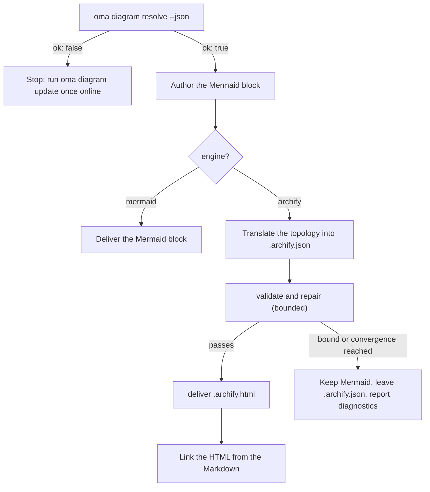

# 图表引擎

`/architecture`（ADR、建议、审阅）和 `/explain`（代码改动讲解）都会生成结构图。对 `/architecture` 来说，这些图始终以 **Mermaid** 块形式存在于 Markdown 产物中（`/explain` 自行绘制内联 SVG 图表）；只要能解析 [archify](https://github.com/tt-a1i/archify)（通常都可以），产物旁还会有**交互式、经过验证的 HTML 图表**，支持深色和浅色主题、平移缩放、搜索、关系追踪、PNG/SVG/WebM 导出，并从类型化 JSON 规格渲染。

Mermaid 始终保留：它是存放在 Markdown 和 git diff 中的文本 SSOT。archify 是派生产物。

---

## 受管的 archify 副本 {#always-the-latest-archify--nothing-to-install}

archify 是采用 MIT 许可证的智能体技能（Node ≥ 18，运行时零依赖）。oh-my-agent 不依赖你曾经安装的一份副本，而是维护**自己的受管副本**并跟踪最新版本：

- 缓存：`~/.cache/oma-diagram/archify/<tag>/`，以及指向当前版本的 `state.json`。
- 每次使用前，`oma diagram resolve` 会向 GitHub 请求最新发布标签（检查频率受 `check_interval_min` 控制，默认每 60 分钟一次）。有更新时下载源代码压缩包（按标签原子创建目录，并清理旧标签），否则复用缓存副本。
- 网络失败不会导致工作流失败：会使用缓存副本，并以 `stale` 状态及原因报告。只有首次运行且既无网络又无缓存时，才会回退到用户安装的技能副本，再之后回退到 Mermaid。

```bash
# Illustrative output; the release tag, cache path, and quality can vary.
oma diagram update          # force a check / download now
oma diagram resolve
# engine:   archify  (requested: auto)
# reason:   archify 2.15.0 via managed:v2.15.0 (current)
# root:     /Users/you/.cache/oma-diagram/archify/v2.15.0
# bin:      /Users/you/.cache/oma-diagram/archify/v2.15.0/bin/archify.mjs
# version:  2.15.0
# quality:  showcase
# sidecar:  off (explain)
oma diagram resolve --offline   # never touch the network
```

解析顺序如下，命中第一项即停止。在每个供应商运行时都相同：

1. `oma-config.yaml` 中的 `diagram.archify.path`，显式固定路径，会退出自动获取最新版本
2. `ARCHIFY_HOME` 环境变量，显式固定路径
3. **受管最新版本**（`~/.cache/oma-diagram/archify`）
4. 用户安装的技能目录：项目内 `.agents` / `.claude` / `.codex` / `.cursor` / `.qwen` / `.kiro` `/skills/archify`，然后是 `~` 下同样的目录，以及 `~/.raven/workspace/skills/archify`

<!-- oma-docs:ignore-start -->
受管或固定的 archify 安装必须包含 `bin/archify.mjs` 才算命中。
<!-- oma-docs:ignore-end -->

---

## 配置 {#configuration}

`.agents/oma-config.yaml` 中的精简配置区段（缺失的键使用以下默认值）：

```yaml
diagram:
  engine: auto                # auto | archify | mermaid
  explain_sidecar: false      # /explain also writes an archify sidecar
  archify:
    managed: true             # false = never download; use pins / skill dirs only
    channel: stable           # stable (latest GitHub Release) | main (HEAD of main)
    check_interval_min: 60    # minutes between remote checks; 0 = every call
    path: null                # explicit install dir (pin)
    quality: showcase         # showcase | standard  → --quality
    open: false               # pass --open to deliver
```

### 运行哪个引擎 {#which-engine-runs}

一张决策表涵盖了配置值、archify 能否解析，以及工作流交付的内容。“能解析”是指[解析顺序](#always-the-latest-archify--nothing-to-install)中的任一步找到了安装：固定路径、受管最新副本或用户安装的技能目录。

| `diagram.engine` | archify 能解析？ | `oma diagram resolve --json` | `/architecture` 结果 |
|---|---|---|---|
| `auto`（默认） | 是 | `engine: archify`、`ok: true` | Mermaid 块 + 链接的 `.archify.html` |
| `auto` | 否（例如首次离线运行，或 `managed: false` 且没有技能目录） | `engine: mermaid`、`ok: true` | 仅 Mermaid；报告提示在线时运行一次 `oma diagram update` |
| `archify` | 是 | `engine: archify`、`ok: true` | Mermaid 块 + 链接的 `.archify.html` |
| `archify` | 否 | `engine: mermaid`、`ok: false`，以 1 退出 | 工作流停止并给出 `oma diagram update` 提示，不会静默降级 |
| `mermaid` | 不检查 | `engine: mermaid`、`ok: true` | 仅 Mermaid；从不调用 archify |

`oma diagram resolve --engine <auto|archify|mermaid>` 可在单次调用中覆盖配置，提示也可以在单次运行中做到同样的事（`/explain 640 with archify`）。

---

## CLI

```bash
oma diagram resolve [--engine auto|archify|mermaid] [--refresh] [--offline] [--json]
oma diagram update  [--json]
oma diagram archify <archify args…>
```

`oma diagram update` 会强制刷新；无法解析任何 archify 安装时以 1 退出。

`oma diagram archify` 会在 `ARCHIFY_UPDATE_CHECK_DISABLED=1` 环境变量下运行已解析的 archify 可执行文件（不访问网络），并传递退出代码，因此 `validate` / `deliver` / `visual-check` 的行为与 archify 文档完全一致：

```bash
oma diagram archify guide "show the auth request lifecycle" --json
oma diagram archify validate architecture adr-auth.archify.json --quality showcase --json
oma diagram archify deliver  architecture adr-auth.archify.json adr-auth.archify.html --quality showcase --json
oma diagram archify visual-check adr-auth.archify.html --json   # exit 2 = no Chrome (skipped), or archify itself could not be resolved
```

`resolve` 上的 `--json` 返回 `{ ok, requested, engine, quality, open, explainSidecar, archify?: { root, bin, version, source, status?, note? }, reason, probed }`。其中 `source` 是 `managed:<tag>`、`config:…`、`env:…` 或技能目录标签；受管副本会设置 `status`（`fresh` / `current` / `stale`）和 `note`。

---

## 工作流如何使用 {#how-the-workflows-use-it}

共享协议位于 `.agents/skills/_shared/conditional/diagram-engine.md`。`/architecture` 遵循以下顺序：

1. `oma diagram resolve --json`
2. 先编写 Mermaid 块（始终如此）。
3. 如果 `engine: archify`，将 Mermaid 拓扑转换成 archify JSON IR（`architecture` / `sequence` / `dataflow` / `lifecycle` / `workflow`），只阅读安装目录中匹配的 schema 和一个示例。
4. `validate` → 修复 → `deliver`，有明确上限：规格通过、触发 archify 的收敛规则、修复尝试达到 3 次、总耗时达到 10 分钟，或同一诊断重复出现时停止。不得为了通过检查而删除语义标签。
5. 链接到 HTML，绝不嵌入。



### `/architecture`

只用于结构性决策（边界、依赖、数据流）。输出与 Markdown 产物放在 `.agents/results/architecture/` 下：

```text
adr-notification-service.md            # Mermaid block + "Interactive:" link
adr-notification-service.archify.json  # frozen spec (kept even on failure)
adr-notification-service.archify.html  # delivered viewer
```

### `/explain`

这是可选功能，因为讲解器自身的契约（单个自包含文件、CSS 变量主题）不允许嵌入另一个完整 HTML 文档。设置 `diagram.explain_sidecar: true`、传入 `oma explain render --archify`，或在提示中请求（“with archify”）即可启用。这里没有 Mermaid 块，也不需要手写 JSON：渲染器会根据草稿中的 `flow` 或 `sequence` 块（标记为 `{archify}` 的面板）生成 archify 规格，运行 `deliver`（从 `showcase` 质量回退一次到 `standard`），并通过普通 `<a href>` 链接 `{date}-{slug}.archify.html`。命令会报告 `linked`、`skipped`（附原因）或 `failed`（附第一条诊断）。工作流不会针对失败的 sidecar 循环重试，sidecar 失败也不会阻止讲解器交付。

---

## 失败模式 {#failure-modes}

无法解析 archify 的情况已在[引擎决策表](#which-engine-runs)中说明。其余情况如下：

| 情况 | 结果 |
|---|---|
| 更新检查失败（离线、达到频率限制） | 使用缓存副本，并以 `stale` 状态及原因报告 |
| `validate` 始终无法收敛 | Mermaid 仍是交付图表；为人工检查保留最后的 `.archify.json`，并逐字报告诊断信息 |
| `visual-check` 缺少 Chrome | 报告为 `skipped`，绝不报告为通过 |
| `oma diagram archify …` 以 2 退出 | 要么缺少 Chrome（`visual-check`），要么无法解析 archify；请先检查 `oma diagram resolve --json` |

---

## 后续步骤 {#next-steps}

- [代码讲解器](./code-explainer.md)：`/explain` 工作流及其可选的 archify sidecar
- [`/architecture` 工作流](../core-concepts/workflows.md#architecture)：携带 Mermaid 块的 ADR 和审阅
- [oma-config.yaml 语义](./oma-config-semantics.md)：`diagram:` 区段如何合并
- [CLI 命令：diagram](../cli-interfaces/commands.md#diagram)：完整选项列表
- [市场研究](./market-research.md)：last30days 引擎采用的同一受管最新版本模式
- archify 上游：[tt-a1i/archify](https://github.com/tt-a1i/archify)
