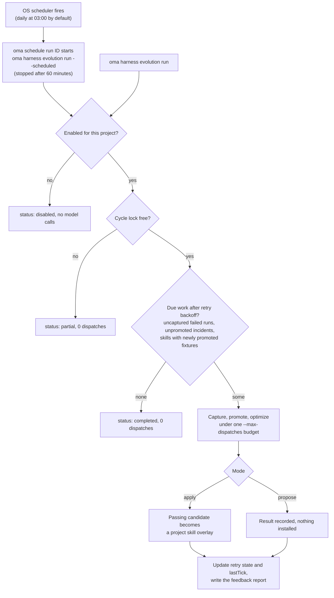

# 项目 Harness 演进

OMA 可以从被跟踪的智能体运行中收集证据，并在计划好的反馈周期里处理失败。技能的自动修改**在你为项目启用之前保持关闭**。每个周期都有有限的模型调用预算，被应用的修改必须通过现有的技能评估关卡。

自动路径改进的是技能文档。对优化器或维护者流程本身的修改，仍属于单独手动调用的[元优化](./skill-opt.md#meta-optimization-the-procedure-as-the-candidate)。

## 启用项目 {#enable-a-project}

在项目根目录运行：

```bash
# Example allowance: at most 300 model dispatches per scheduled cycle
oma harness evolution enable --max-dispatches 300

# Evaluate proposals without applying them
oma harness evolution enable --max-dispatches 300 --mode propose

# Choose a schedule in the operating system's local time
oma harness evolution enable --max-dispatches 300 --cron "0 3 * * *"

oma harness evolution status --json
```

`enable` 会打印保存的设置和调度器任务 ID：

```json
{
  "enabled": true,
  "scheduleId": "sch_abcdefgh2345",
  "mode": "apply",
  "maxDispatches": 300
}
```

`status --json` 返回 `config`、`schedule`（调度器条目，或 `exists: false`）、`pending`（未完成的重试数）、`conflicts`（按技能划分的覆盖层冲突）和 `state`（重试和 `lastTick`）。

默认计划是每天本地时间 03:00，默认模式是 `apply`。启用时 `--max-dispatches` 为必填，且必须是正整数。示例中的值只是调用额度，既不是费用估算，也不承诺一个周期一定会完成。fixture 套件越大、评分重复越多，消耗的调用就越多。

<!-- oma-docs:ignore-start -->
设置保存在 `.agents/evolution/harness-evolution.json`。生成的证据、重试状态和周期锁位于 `.agents/state/harness-evolution/` 之下。
<!-- oma-docs:ignore-end -->

启用后，会在 OMA 现有的[操作系统调度器](./scheduled-agents.md)中注册一个内置任务；它会以智能体 `__builtin__` 出现在 `oma schedule list` 中。到触发时间时，`oma schedule run <id>` 会在该项目中启动 `oma harness evolution run --scheduled`，并在 60 分钟后停止它，因此请按能在一小时内完成的周期来设定 `--max-dispatches`。再次启用会更新项目的任务，而不是另建一个。请使用 `oma harness evolution disable` 而不是 `oma schedule delete` 停止计划，以保持已保存设置的一致。

```bash
# Run one cycle now under the saved mode and budget
oma harness evolution run --json

# Stop future cycles; retain evidence and applied improvements
oma harness evolution disable
```

`run --json` 返回 `status`（`completed`、`partial` 或 `disabled`）、`dispatchesUsed` 和 `maxDispatches`。另一个周期持有锁时，`run` 返回 `partial`，派发数为 0。因错误（例如额度耗尽）而停止的周期会以该错误退出，并在 `state.lastTick` 中记录 `partial` 或 `failed`。

已禁用的项目不会通过 evolution 命令运行任何模型工作，包括迟到的计划调用。禁用不会回滚已经应用的修改。

## 自动发生的事情 {#what-happens-automatically}

下图展示一个周期，无论它由调度器触发还是由你手动运行。



1. **记录完成证据。** 被 OMA 跟踪的运行会留下指向其结果和验证证据的本地引用。这一完成步骤不产生额外的模型调用。同一运行重复完成不会产生重复证据。
2. **按计划收集失败。** 周期扫描符合条件的失败运行，从其记录的任务契约推导期望行为，并检查提议的回归 fixture 是否确实拒绝被保存的失败输出。
3. **优化受影响的技能。** 事故按技能分组。每个技能都在现有的训练、验证、最终测试、隔离和负迁移检查之下优化。
4. **应用或报告。** 在 `apply` 模式下，通过的候选会成为项目技能覆盖层。在 `propose` 模式下，周期只记录结果而不安装。
5. **报告修改。** 用 status 和现有的晋升历史查看结果。已应用的修改也会进入下一次会话的演进通知。

OMA 不会自动观测每一段原生对话或每一次用户纠正。输入是 OMA 实际跟踪的运行证据。没有保存输出或验收契约的运行，可能需要手工编写的[事故规格](./harness-incidents.md#capture-an-incident)。

## 预算与重试 {#budget-and-retries}

周期在捕获、评分细则起草、路由、评分、技能优化、相邻任务和最终评估之间共用一个调用额度。模型调用在派发前就从额度中扣除。执行层重试的调用同样计入。技能自身更严格的 constitution 限制仍然有效。

额度耗尽后，评估保持未完成，受影响的候选无法应用。报告会记录用量和待办工作。一个项目同一时间只运行一个周期。

创建 fixture 并不意味着该事故的优化已完成。被中断或失败的优化保持待处理，可在退避后恢复，且不会重复创建 fixture。每次尝试失败后退避时间加倍：2、4、8……分钟，最长 1024 分钟（约 17 小时）。已完整评估但没有可接受修改的结果会被记为已处理，因此同一份证据不会无限次触发重复优化。新证据可以触发新的尝试。

从提议模式切换到应用模式后，尚未应用的提议会进入处理范围。应用仍然需要当前的评估和未改动的源内容；旧提议不是无条件的写入指令。

## 持久的技能覆盖层 {#persistent-skill-overlays}

自动修改与受管的技能定义分开，保存在项目中由用户拥有的 evolution 区域 `.agents/evolution/skills/<skill>/`（附带一条 `overlay.json` 记录）。评估和项目本地的供应商技能链接使用从受管基线及其可用覆盖层中选出的有效正文。HOME 范围的供应商安装不会被重定向到项目覆盖层。项目供应商目录中若存在不受管的副本，必须先解决，自动应用才会进行。技能资源仍可通过其相对路径访问。

覆盖层会记录它被评估时所依据的基线。`oma update` 之后：

- 基线未变，继续使用其覆盖层。
- 基线已变，覆盖层保留但标记为冲突，并改用更新后的基线。旧的评估无法证明覆盖层在新基线上是安全的。

优化运行期间发生的编辑，会阻止候选覆盖被改动的内容。status 会报告需要审查的冲突。

## 查看与撤销 {#inspect-and-undo}

```bash
oma harness evolution status --json
oma skill promotions --all
oma skill rollback --skill oma-docs
```

晋升记录保留候选与父级的哈希、评估证据和可审查的补丁。回滚第一个覆盖层会恢复使用受管基线；回滚后续覆盖层会恢复到上一个覆盖层。未知的编辑会被保留：回滚拒绝丢弃与记录的候选不再一致的内容。

手动 `oma skill optimize --apply` 仍会写入受管的 `SKILL.md`，但当该技能有活动的项目覆盖层时会拒绝执行（`[oma skill opt] an active project overlay owns this skill; ...`）。请先用 `oma skill rollback --skill <id>` 回滚覆盖层，或让演进周期应用该修改。计划演进明确选择覆盖层应用路径。

## 证据的范围 {#scope-of-the-evidence}

通过的软件测试只能确认接线和评估规则正确。它不能证明反复的自动修改会随着时间改善项目的实际工作。在提高额度或扩大自动化之前，请检查实际的晋升、成本、回归和回滚历史。这一计划反馈回路不会调用 L5 流程晋升。

## 另请参阅 {#see-also}

- [事故回归用例](./harness-incidents.md)：捕获、晋升和复现该周期处理的事故。
- [技能优化](./skill-opt.md)：每项被应用的修改都要通过的关卡。
- [计划智能体](./scheduled-agents.md)：触发该周期的操作系统调度器。
