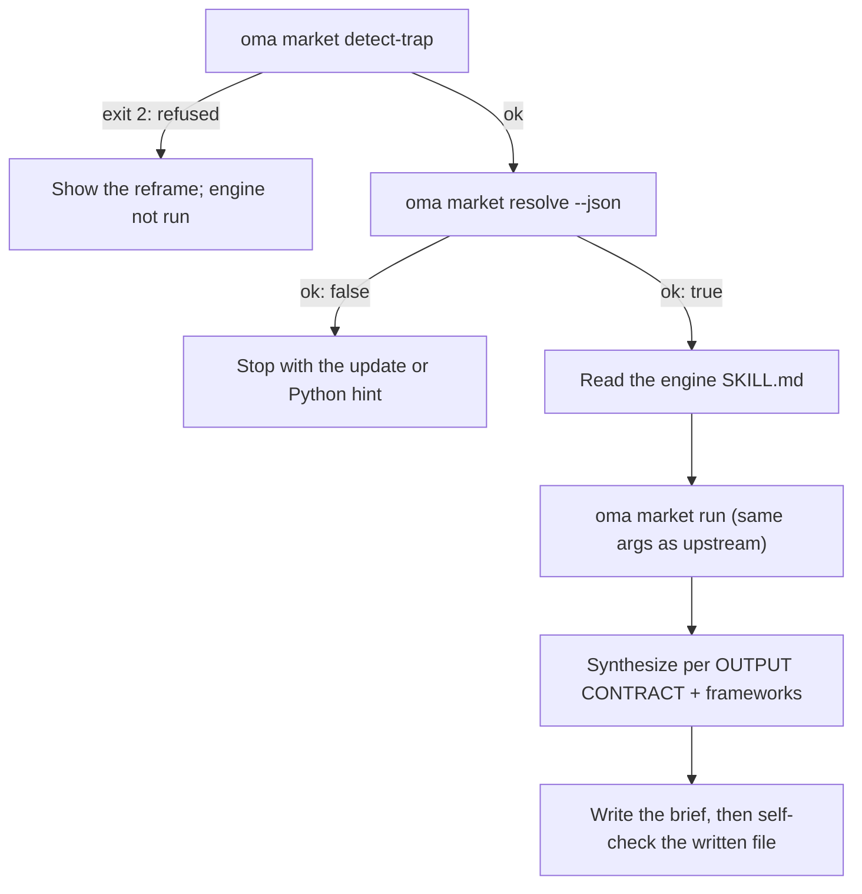

# 市场研究

`oma-market` 回答“过去 N 天里，人们实际上在说什么”这类关于 X 的问题，覆盖痛点、趋势、竞品情绪和发现，并从社区来源收集真实互动数据：Reddit（赞数和热门评论）、X、YouTube 转录、TikTok、Instagram、Hacker News、Polymarket、GitHub、arXiv、Techmeme、Digg、LinkedIn、StockTwits、Bluesky、Web 等。

研究本身运行在上游 [**last30days**](https://github.com/mvanhorn/last30days-skill) 引擎上（MIT，Python 3.12+）。oh-my-agent 不会 fork 它：引擎通过 [skills CLI](https://github.com/vercel-labs/skills) 作为智能体技能安装，oh-my-agent 为每次运行设置关卡，并在上层加入战略框架。发布节奏、星标数和供应商覆盖范围属于上游项目，可能发生变化。

---

## 快速开始 {#quick-start}

用自然语言向智能体提问即可。“市场研究”“痛点”“竞品分析”“用户之声”或“趋势检测”等说法会激活 `oma-market` 技能：

```text
找出过去 30 天里开发者反馈最多的 VS Code 远程容器痛点。
比较过去 90 天 Cursor 与 Windsurf 的社区情绪，frameworks swot,5f。
```

| 引导方式 | 效果 |
|---|---|
| "A vs B"，或 `--vs B` | 竞品意图：上游比较流程 + SWOT + Porter 的 5F |
| `--days 7`、`30`、`90` 或 `180` | 研究时间窗口 |
| `--intent pain`、`trend`、`competitor` 或 `discovery` | 覆盖自动意图分类 |
| `--frameworks none`，或 `swot,5f,pestel` 这样的列表 | 关闭框架部分，或选择要包含的框架 |

结果是一份位于 `.agents/results/market/{topic-slug}-{YYYYMMDD}.md` 的简报。它的第一行是引擎徽章（`🌐 last30days v<version> · synced <date>`），随后是带链接的按排名排列的证据集群、框架部分，以及列出被跳过来源的引擎页脚。

| 无需 key 即可运行 | 需要上游设置向导（key 或 cookie） |
|---|---|
| Reddit、Hacker News、GitHub、Polymarket、arXiv、Techmeme、Digg、Web | X、YouTube 转录、TikTok、Instagram 及其他需要 key 的来源；被跳过的来源会在页脚列出 |

---

## 安装引擎（需要 Python 3.12+） {#always-the-latest-engine--nothing-to-install}

```bash
oma market update   # installs last30days when missing, otherwise updates it
# runs: bunx skills add mvanhorn/last30days-skill --skill last30days -g -y
#   or: bunx skills update last30days -g -y
```

```bash
# Illustrative output; the version, install path, and Python version vary.
oma market resolve
# engine:   last30days
# reason:   last30days 3.21.1 via home:~/.agents/skills
# root:     ~/.agents/skills/last30days
# skill:    ~/.agents/skills/last30days/SKILL.md
# version:  3.21.1
# python:   python3.14 (3.14.7, PATH)
# save_dir: <workspace>/.agents/results/market/raw
```

- `resolve` 只读取已安装的技能目录，不会访问网络。未安装时返回不正常结果并给出安装命令；技能会在运行 `oma market update` 前先询问。
- `oma update` 不会安装该引擎。请使用 `oma market update`（或 `bunx skills update last30days -g -y`）更新。
- Python：`LAST30DAYS_PYTHON` → `market.python` → PATH 中的 `python3.14`、`python3.13`、`python3.12`、`python3`、`python`（必须 ≥ 3.12）→ `uv python find '>=3.12'`。找不到时，`resolve` 返回不正常并打印安装提示；技能停止，不会退回到仅 Web 搜索的研究。
- 引擎配置和 API key 位于 `~/.config/last30days/`（由上游设置向导在征得你同意后写入），因此引擎更新后仍会保留。

解析顺序（命中第一项即停止）：`market.path` → `LAST30DAYS_HOME` → 已安装的技能目录（项目内 `.agents|.claude|.codex|.cursor|.qwen|.kiro|.gemini|.copilot/skills/last30days`，然后是 `~` 下，再是 `~/.config/agents/skills/last30days` 和 Claude Code 插件缓存）。通过 Claude Code 插件安装的版本应通过 `/plugin` 更新，而不是 `oma market update`。

```bash
oma market run -- --help     # the engine's own flags (without `--`, oma prints its own help)
```

早期版本曾在 `~/.cache/oma-market/` 下保留自己的副本。该目录已不再读取，可以删除。

---

## 配置 {#configuration}

```yaml
market:
  path: null                      # explicit engine dir (pin)
  python: null                    # interpreter override
  save_dir: .agents/results/market/raw
```

`managed`、`channel` 和 `check_interval_min` 已弃用：它们仍可通过校验，但会被忽略；设置这些键时，`resolve` 会打印警告。

---

## 运行方式 {#how-a-run-works}



1. `oma market detect-trap "<topic>"`，拒绝关键词陷阱和人口统计购物类主题（退出码 2），并给出重新表述建议。主题为空或超过 200 个字符时，退出码为 4。
2. `oma market resolve --json`，解析引擎和 Python；`ok: false` 时停止。
3. 智能体从头到尾读取解析出的引擎 `SKILL.md` 并遵循其中步骤：首次运行设置向导、研究前解析账号、子版块和标签（WebSearch 可用时）、查询规划以及前置条件关卡。
4. `oma market run "<topic>" <flags> --emit=compact`，参数与上游 `python3 scripts/last30days.py` 调用相同；从 `market.save_dir` 添加 `--save-dir`。
5. 综合遵循上游 OUTPUT CONTRACT（首行徽章、按排名排列的证据集群、LAWs 1 至 8），然后由 oma 在引擎正文与引擎页脚之间加入只引用引擎集群的框架部分：

| 意图 | 引擎调整 | 框架 |
|---|---|---|
| pain | 投诉型主题，`--days 30`；结果过少时使用 `--deep` | SWOT |
| trend | `--days 7/30/90/180`；询问“最近什么热门”时使用 `--discover "<domain>"` | SWOT |
| competitor | `"A vs B"` → 上游比较流程 | SWOT + Porter 的 5F |
| discovery | `--discover`，然后进行 `--drill` 跟进 | SWOT + PESTEL |

6. 先写入 `.agents/results/market/{topic-slug}-{YYYYMMDD}.md`，再对已写入的文件运行自检；在交付简报前修复并重新检查。

---

## 失败模式 {#failure-modes}

| 情况 | 结果 |
|---|---|
| 主题被 detect-trap 拒绝 | 显示重新表述建议，不运行引擎。只有明确重新确认后才能使用 `--force` |
| 引擎未安装 | `ok: false` → `oma market update`（通过 skills CLI 安装） |
| 没有 Python 3.12+ | `ok: false` 并显示安装提示（brew / apt / `uv python install 3.12`），或设置 `LAST30DAYS_PYTHON` / `market.python`；不提供仅 Web 搜索的替代方案 |
| `oma market update` 失败 | 显示 skills CLI 错误；现有安装仍可继续使用 |
| 来源没有 key | 引擎内部跳过这些来源，并在页脚列出；通过上游设置向导启用 |

---

## 后续步骤 {#next-steps}

- [内容和研究工作流](./content-and-research.md)：为其他研究和文档任务选择合适的能力
- [图表引擎](./diagram-engine.md)：archify 同样采用 skills CLI 安装模式
- [oma-config.yaml 语义](./oma-config-semantics.md)：`market:` 区段如何合并
- [CLI 命令：market](../cli-interfaces/commands.md#market)：完整选项列表
- 上游：[mvanhorn/last30days-skill](https://github.com/mvanhorn/last30days-skill)
