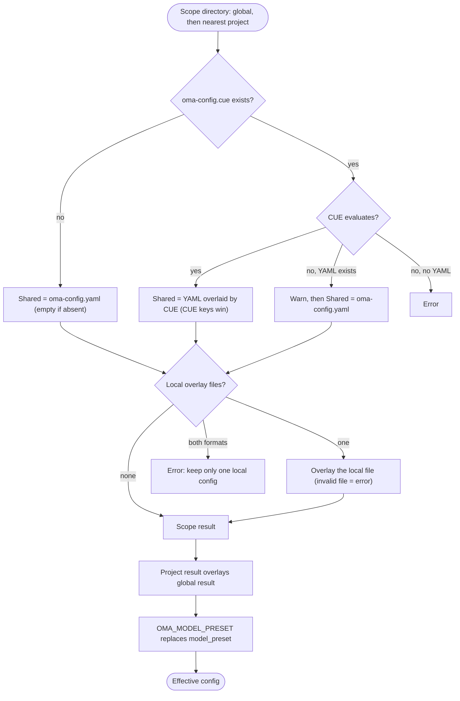

## 概览 {#overview}

OMA 先从 `$OMA_HOME/.agents/`（默认 `~/.oma/.agents/`）读取全局默认值，
再叠加从工作目录向上找到的最近项目 `.agents/`。
每个作用域都可以包含以下层：

- **共享配置：**`.agents/oma-config.yaml` 和 `.agents/oma-config.cue`。两者都存在且 CUE 文件可以求值时，CUE 文件设置的每个键都会覆盖 YAML 文件中的同名键；只存在于 YAML 文件中的键保留为默认值。CUE 文件无法求值时，OMA 会发出警告并只使用 YAML 文件。
- **本地配置：**`.agents/oma-config.local.cue` 或 `.agents/oma-config.local.yaml`（只能有一个文件，叠加在共享结果之上；请将此文件保密）。

项目的共享设置和本地设置会覆盖全局设置。不同祖先项目根目录永远不会合并；
即使最近的 `.agents/` 为空，它仍然是项目边界。全局默认值不会改变项目身份。
支持的键和默认值请参见[配置参考](/docs/guide/configuration-reference)。

## 解析流程 {#resolution-flow}

OMA 对全局作用域和最近项目作用域执行相同的步骤，然后合并两者的结果：



如果找不到项目 `.agents/`，或者向上查找时到达全局 `.agents/` 目录本身，则只使用全局结果。

## 优先级表 {#precedence-table}

靠后的行优先。普通映射递归合并；数组、标量和 `null` 会替换先前的值。

| 顺序 | 层 | 规则 |
|:-----:|-------|------|
| 1 | 全局 `oma-config.yaml` | 两者都存在时，作为全局 CUE 文件之下的默认值。 |
| 2 | 全局 `oma-config.cue` | 逐键覆盖全局 YAML。如果求值失败（例如缺少 `cue` CLI）且 YAML 存在，OMA 会输出 `[config] CUE evaluation failed at ... Falling back to oma-config.yaml`，并只使用 YAML。 |
| 3 | 全局 `oma-config.local.cue` 或 `oma-config.local.yaml` | 只能有一个文件。本地文件格式错误会报错。 |
| 4 | 项目 `oma-config.yaml` | 位于工作目录或其上层的最近项目 `.agents/`。 |
| 5 | 项目 `oma-config.cue` | 逐键覆盖第 4 行，回退规则与第 2 行相同。 |
| 6 | 项目 `oma-config.local.cue` 或 `oma-config.local.yaml` | 只能有一个文件。本地文件格式错误会报错。 |
| 7 | `OMA_MODEL_PRESET` | 非空值会在当前进程中替换 `model_preset`。空值会报错。 |

:::tip[应该编辑哪个文件？]
如果存在 `.agents/oma-config.cue`，其中设置的键会覆盖 `oma-config.yaml` 中的同名键。请在 CUE 文件中修改该键，或把特定于本机的值放进本地覆盖层。`oma doctor --profile` 会在 **Configuration sources** 下列出它加载的文件。
:::

本地覆盖只需在本地文件中写入已修改的叶节点。例如，可以把本地模型选择留在共享文件之外：

```yaml
# .agents/oma-config.local.yaml
model_preset: claude
agents:
  backend:
    model: anthropic/claude-sonnet-5-5
```

请从项目目录运行命令，这样才能选择最近的 `.agents/` 目录。本地文件格式错误会明确失败；修复或移除它后再重试。

## 检查配置 {#check-your-configuration}

```bash
oma doctor --profile                           # loaded files, resolved preset, per-role model and CLI
cue export --out json .agents/oma-config.cue   # what the CUE layer evaluates to (requires the cue CLI)
```

| 症状或消息 | 原因 | 解决方法 |
|--------------------|-------|-----|
| 修改 YAML 后没有效果 | `oma-config.cue` 设置了同一个键 | 在 CUE 文件中修改该键，或在本地文件中覆盖它 |
| `[config] CUE evaluation failed at ... Falling back to oma-config.yaml` | 缺少 `cue` CLI，或 CUE 文件无法求值 | 安装 `cue`，或修复 `cue export` 报告的错误 |
| `Both local CUE and YAML configs exist in ...; keep only one local config.` | 存在两个本地覆盖文件 | 删除其中一个 |
| `OMA_MODEL_PRESET must be non-empty` | 该变量已导出但值为空 | `unset OMA_MODEL_PRESET` |
| `Unknown model_preset "..."` | 拼写错误，或缺少 `custom_presets` 条目 | 使用错误消息中列出的预设 |
| `Legacy preset name "..." is no longer valid` | 使用了重命名前的键，例如 `claude-only` | 按消息提示重命名，或运行 `oma update` |
| `[model-registry] User inline model "..." failed validation` | `models:` 条目不完整或无效 | 请参见[内联模型 slug](/docs/guide/per-agent-models#inlining-model-slugs) |

## 默认值 {#default-values}

| 键 | 默认值 | 应用时机 |
|-----|---------|----------|
| `auto_update_cli` | `true` | 两个文件都不存在或缺少该键 |
| `serena.mode` | `bridge` | 两个文件都不存在或缺少该键 |
| `serena.auto_update` | `true` | 两个文件都不存在或缺少该键 |
| `telemetry` | `false` | 两个文件都不存在或缺少该键 |
| `language` | `en` | 两个文件都不存在或缺少该键 |
| `model_preset` | 必填 | 随附项目模板使用 `auto`；schema 要求非空值。 |
| `translation_voice` | `balanced` | 两个文件都不存在或缺少该键 |
| `timezone` | 系统时区 | 两个文件都不存在或缺少该键 |

## 读取顺序的原因 {#read-order-rationale}

用户级默认值请编辑 `~/.oma/.agents/oma-config.yaml`（设置了 `OMA_HOME` 时为 `<OMA_HOME>/.agents/oma-config.yaml`）。
项目的共享/本地文件会覆盖这些默认值，但不会继承无关的祖先项目。
项目将语义记忆选择为 `none` 时，会覆盖全局的 AgentMemory 选择。

## 说明 {#notes}

- `oma-config.yaml` 中的 `language` 控制智能体响应语言。它**不**用于确定安装或更新警告消息，这些消息使用系统区域设置（`$LANG`），因为安装时尚未加载 `oma-config.yaml`。
- `auto_update_cli` 先使用项目覆盖值，再使用全局默认值；两个作用域都未设置时默认启用。
- `telemetry`（默认 `false`）映射为各供应商自己的退出选项，由 `oma install`、`oma update` 和 `oma link` 写入：Claude 使用 `DISABLE_TELEMETRY` 与 `CLAUDE_CODE_DISABLE_FEEDBACK_SURVEY`，Gemini/Qwen 使用 `privacy.usageStatisticsEnabled`，Codex 使用 `analytics.enabled` 与 `feedback.enabled`，Grok 使用 `[features] telemetry`，Antigravity（agy）在 `~/.gemini/antigravity-cli/settings.json` 中使用 `enableTelemetry`。设置 `telemetry: true` 会移除 oma 为该供应商写入的退出设置，重新启用遥测。
- `diagram`（引擎 `auto` / `archify` / `mermaid`、`explain_sidecar`、`archify.managed|channel|check_interval_min|path|quality|open`）是类似 `video` / `image` 的稀疏技能覆盖段；请参见[图表引擎](/docs/guide/diagram-engine)。
- `video.hyperframes.check_interval_min` 会限制每次运行的 HyperFrames 工具链和 heygen-com/hyperframes 的最新版本检查频率（`oma video compose`、`oma update`）。随附的 CUE schema 尚未定义 `video.hyperframes`，因此 `cue export` 会在 schema 块中拒绝它（`field not allowed`）；请在 `oma-config.yaml` 或本地 YAML 覆盖层中设置。
- `market`（`managed|channel|check_interval_min|path|python|save_dir`）配置 `oma market` 背后的始终最新 `last30days` 引擎；请参见[市场研究](/docs/guide/market-research)。
- 类型化运行时 schema 涵盖 `providers`、`free`、`agents`、`models`、`custom_presets`、`vendors`、`session`、`docs` 和稀疏技能段。随附模板还包含 `scm`、`memory`、`serena_reaper` 和 `mcp` 等由消费者负责的区块，其嵌套键由各自消费者管理。不要从此列表推断键，请使用[配置参考](/docs/guide/configuration-reference)和相应功能指南。
- 直接编辑 `oma-config.yaml` 是安全的。`oma install` 和 `oma update` 以正则级字段替换，并保留不由其管理的用户键（例如自定义 `agents:` 覆盖和 `session.quota_cap`）。
- `oma update` 还会追加随附模板已定义但你的文件缺少的顶层键（使用模板默认值），并放在 `# Added by oma update` 标记下。已有键不会修改，现有内容保持字节级不变。你主动删除的键会以模板默认值重新出现；若要退出，请显式设置该键的值，不要删除该键。
