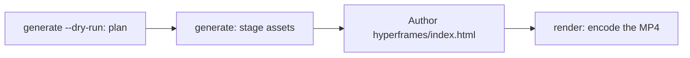

# 视频生成

`oma-video` 是 oh-my-agent 的视频路由器。它从一行简述出发，组合脚本、旁白、视觉素材和字幕，然后将计划记录到运行目录中。供应商阶段可以不提供密钥，并能使用本地或确定性回退；要得到真实 MP4，仍需要可用的合成器和有效的组合。

当出现 “shorts”、“reels”、“screencast”，或 “make a video”、“explainer video”、“demo video”、“walkthrough video”、“video from README” 等说法，或其他技能需要视频作为副产物时，该技能会激活。

> **TL;DR** `oma video generate` 负责规划运行并准备素材。使用默认的 HyperFrames 合成器时，它不会编码 MP4：先编写 `<runDir>/hyperframes/index.html`（`/video` 工作流会替你完成），再运行 `oma video render <runDir>`。首次运行时，请先执行 `oma video doctor --install`。

---

## 何时使用 {#when-to-use}

- 将简述、README、代码或数据制作成短片。
- 制作带旁白的讲解视频，或演示和操作流程录制。
- 任何需要反复确定性运行的“简述 → `.mp4`”管线。

## 何时不使用 {#when-not-to-use}

- 单张静态图像，使用 [`oma-image`](/docs/guide/image-generation)。
- 直播屏幕广播或流式传输，超出范围（oma 从不录制屏幕；录制内容由你提供）。
- 独立旁白音频，使用 `oma-voice`。

---

## 模式速览 {#modes-at-a-glance}

| 模式 | 画面比例 | 组合内容 |
|------|--------|------------------|
| `shorts` | 9:16 | 短视频竖屏片段（脚本 → 旁白 → 视觉素材 → 字幕）。 |
| `explainer` | 16:9 | 根据 README、代码或数据简述制作的横屏讲解视频。 |
| `demo` | 派生 | 根据你自己的屏幕录制（通过 `--capture <file>` 提供）制作的操作演示。`--source web --url <url>` 只会将屏蔽后的 URL 作为上下文保存；oma 从不打开浏览器、录制屏幕或自动执行登录。 |

模式会选择合适的默认值；需要不同值时传入相应标志。

---

## 快速开始 {#quick-start}

在智能体中，`/video three quick tips for better focus` 会替你执行下面的每一步。手动执行时，管线分为四步：



```bash
oma video doctor --install   # first run only: HyperFrames toolchain, Chrome Headless Shell, Pretendard

# 1. Plan from an agent-authored script (schema: .agents/skills/oma-video/resources/script-schema.md)
oma video generate "three quick tips for better focus" --mode shorts --script ./script.json --dry-run --output json

# 2. Stage assets (narration needs --voice <profile>; the default is a silent video)
oma video generate "three quick tips for better focus" --mode shorts --script ./script.json --output json

# 3. Author <runDir>/hyperframes/index.html per its AUTHORING.md, then encode
oma video compose <runDir>
oma video render <runDir> --output json

# Demo from your own recording; without --polish the recording itself becomes the output
oma video generate "product walkthrough" --mode demo --capture ./capture.mp4
```

<!-- oma-docs:ignore-start -->

| 步骤 | 命令 | 结果 |
|---|---|---|
| 规划 | `generate --dry-run` | `script.json`、`render-spec.json`、`manifest.json`；不渲染 |
| 准备素材 | `generate` | 视觉素材、字幕、可选的音频和音乐、`hyperframes/` 骨架，以及警告 `composition pending` |
| 编写 | 编辑 `hyperframes/index.html` | 组合 |
| 渲染 | `render <runDir>` | `{mode}-{slug}.mp4` 和更新后的清单 |

<!-- oma-docs:ignore-end -->

不使用 `--script` 时，CLI 会根据简述文本生成确定性的三场景骨架。`--locale` 设置旁白和字幕的语言标签，但不会翻译它们；请用目标语言编写简述或 `script.json`。

每次运行都会打印运行目录。固定 `--seed` 会稳定确定性规划输入，但实时供应商输出和采集素材仍可能变化。需要复用已保存的渲染规格和素材时，可重新渲染现有运行目录。

其他通过 `oma video generate --output json` 调用该工具的程序会从标准输出解析 JSON 信封：`{exitCode, runDir, manifestPath, scriptPath, renderSpecPath, warnings, error}`。不存在 `outputs` 键，请从 `manifestPath` 指向的清单中读取输出和素材路径。

---

## 始终使用最新 HyperFrames：由你编写组合 {#always-latest-hyperframes--you-author-the-composition}

oh-my-agent **不提供 HyperFrames 组合代码**。每次运行都会在 `<runDir>/hyperframes/` 中创建项目；`oma video compose` 使用最新 npm HyperFrames 搭建骨架（工具链缓存位于 `~/.cache/oma-video/hyperframes/<version>/`，通过 `node_modules` 符号链接共享），并使用 HEAD 版本的 [heygen-com/hyperframes](https://github.com/heygen-com/hyperframes)（位于 `~/.cache/oma-video/hyperframes-skills/`）。智能体遵循骨架中的 `AUTHORING.md`、这些技能以及 `.agents/skills/oma-video/resources/hyperframes-authoring/` 中的模式规范，编写生成的组合源代码。

```bash
oma video generate "…"                     # → render-spec.json + <runDir>/hyperframes/ (composition pending)
oma video compose <runDir> --output json   # refresh scaffold / print the contract (idempotent)
#   author hyperframes/index.html as instructed by AUTHORING.md
oma video render <runDir> --output json    # lint → render with the cached HyperFrames CLI → ffprobe; exit 1 on any failure
```

- 最新版本检查（npm + GitHub）由 `video.hyperframes.check_interval_min` 控制频率（默认 60；`0` 表示每次 compose）。`oma update` 遵循该间隔；`oma video doctor --upgrade` 会强制检查；离线运行使用缓存的工具链，并报告 `stale`。
- 可复现性保存在运行目录中：`render-spec.json`、编写的组合源代码，以及生成的 HyperFrames 软件包元数据中记录的工具链版本。重新渲染同一运行会复用该渲染契约；新运行会检查最新 HyperFrames。
- lint 或渲染失败**不会**通过占位内容隐藏（占位仅在 `OMA_VIDEO_MOCK=1` 时存在）：`oma video render` 会带诊断退出 1，智能体需使用最新技能修复组合。新 HyperFrames 版本导致的损坏属于组合缺陷，不能因此固定版本。

```yaml
video:
  hyperframes:
    check_interval_min: 60    # 0 = check on every compose
```

---

## CLI 参考 {#cli-reference}

```bash
oma video generate <brief...> [options]
oma video doctor [--install|--upgrade|--install-mpt|--install-strudel]  # toolchain readiness / provisioning
oma video compose <runDir>       # prepare HTML project and authoring contract
oma video render <runDir>        # re-render from render-spec.json (deterministic)
oma video provider list         # provider availability + key/fallback status
```

### 关键标志 {#key-flags}

| 标志 | 用途 |
|------|---------|
| `--mode <m>` | `shorts` \| `explainer` \| `demo`。 |
| `--aspect <a>` | `9:16` \| `16:9` \| `1:1` \| `auto`。 |
| `--locale <lang>` | 旁白或字幕的语言标签。 |
| `--captions <s>` | `tiktok` \| `lower-third` \| `none`（无需密钥的对齐）。 |
| `--visual <m>` | `auto` \| `generate` \| `stock` \| `aigc` \| `slide`。 |
| `--voice <profile>` | 旁白声音，或 `none`（默认值；省略后视频将静音，并使用估算的字幕时间）。 |
| `--music <mode>` | `upbeat`、`calm`、`cinematic`、`lofi`、`piano` 或 `none`。 |
| `--compositor <c>` | `hyperframes`（默认）\| `mpt`。 |
| `--capture <path>` | demo 模式使用的录制文件：`.mp4`、`.mov`、`.webm` 或 `.mkv`，需存放在项目内。 |
| `--source <k>` | demo 采集源：`file` 或 `web`（默认：`file`）。 |
| `--url <url>` | `--source web` 的上下文 URL，屏蔽后保存到 `manifest.json`。使用 `--source web` 时必填；它从不启动采集，也不能替代 `--capture`。 |
| `--polish` | 在采集的素材上叠加 HyperFrames 组合。 |
| `--device`、`--ready-selector`、`--show-cursor`、`--capture-timeout`、`--capture-stop` | 会被接受但不会使用：oma 不驱动浏览器，也不录制屏幕。 |
| `--output-dir <path>` | 输出基础目录。位于 `$PWD` 之外的路径需要 `--allow-external-output`。 |
| `--allow-external-output` | 允许输出路径位于 `$PWD` 之外。 |
| `--max-usd <n>` | 成本上限（默认 `0.2`）。累计预估达到该值时，运行会以退出码 1 停止；使用 `-y` 或更高的值重新运行。 |
| `--duration <sec>` | 目标时长，单位为秒（1–180），或 `auto`。 |
| `--seed <n>` | 确定性种子。 |
| `--dry-run` | 输出脚本、渲染规格和清单，跳过渲染。 |
| `--script <path>` | 要注入的智能体编写 `script.json`（会覆盖骨架，并控制旁白、屏幕文字和每个场景的视觉提示）。 |
| `-y, --yes` | 允许预估达到 `--max-usd` 的供应商（等同于 `OMA_VIDEO_YES=1`）。 |
| `--timeout <sec>` | 每次调用视觉或音乐供应商的时间上限，以整数秒计（默认 `600`）。不解析单位后缀：`2m` 表示 2 秒。 |
| `--output <f>` | CLI 输出：`text`（默认）或 `json`。 |
| `--no-brief-in-manifest` | 保存简述的 SHA-256，而不是原始简述。 |

---

## 无需密钥的供应商 {#key-optional-providers}

供应商阶段会解析为**真实分支**，并在阶段支持时提供**确定性回退**。因此缺少密钥时，规划中的运行仍可使用估算时间或本地素材。合成器是必需的最终阶段，通常没有占位回退：

| 能力 | 真实分支（启用条件） | 回退 |
|------------|-------------|----------|
| script | 通过 `--script <path>` 传入的智能体编写 `script.json`（由 `/video` 工作流写入） | 根据简述文本生成的确定性三场景骨架 |
| voice | 配合 `--voice <profile>` 使用的 `oma-voice`（本地 Voicebox 或 VoiceStudio，由 `voice.backend` 选择） | 使用估算时间的静音视频（`--voice none`，默认值） |
| visual | `oma-image`、`oma-slide`，设置 `PEXELS_API_KEY` 时使用 Pexels 素材片段 | 占位素材 |
| visual: `aigc` | 尚未接入；`RUNNINGHUB_API_KEY` 会启用该供应商，但它仍写入占位内容 | 占位素材 |
| caption | 与 `timing.json` 对齐的 `.srt` 和 `.vtt`，使用脚本的语言 | 相同；尚未接入翻译到 `--locale` |
| music | 运行 `oma video doctor --install-strudel` 后的 Strudel 背景音乐 | 无音乐轨道 |
| capture | 你通过 `--capture <file>` 提供的录制文件 | 无：没有 `--capture` 时，demo 模式会打印录制说明并以退出码 3 退出 |
| compositor | HyperFrames（受管）或 MoneyPrinterTurbo | 没有合成器回退，运行会失败并给出诊断 |

不会自动处理凭据：录制时由你完成屏幕上的登录；URL 和查询令牌会在日志和清单中屏蔽。

字幕以**静态窗口提示**渲染，也就是当前帧处于活动状态的单行字幕，使用 CSS 换行，不做逐词动画。

---

## 工具链与 `doctor` {#toolchain-and-doctor}

重量级工具链（受管 HyperFrames 项目的 `node_modules`、内置 Pretendard 字体、MoneyPrinterTurbo 检出目录、Strudel 音乐项目、Chrome Headless Shell）会**按需配置**，不会随软件包发布。直接运行 `doctor` 只生成报告，不会安装任何内容：

```bash
oma video doctor
```

它会报告 `node`、`chromium`、`ffmpeg`、`ffprobe`、`hyperframes-toolchain`、`hyperframes-skills`、`pretendard-font`、`mpt-project`、`strudel`、`voicebox`、`voicestudio`、`oma-image`、`pixelle` 和 `cap` 的状态，并为缺失项打印安装提示。运行 `oma video doctor --output json` 可获取权威列表。基线要求 Node.js 22+、HyperFrames 工具链及其 Chrome 浏览器、FFmpeg/FFprobe 和 `oma-image`。要得到真实 MP4，还需要编写好的 HTML。

使用安装标志配置工具链：

```bash
oma video doctor --install             # warm the latest HyperFrames toolchain + Chrome Headless Shell + Pretendard + heygen-com/hyperframes
oma video doctor --upgrade             # force a latest-version check now
oma video doctor --install-mpt         # MoneyPrinterTurbo checkout (clone + venv + deps) for --compositor mpt
oma video doctor --install-strudel     # Strudel music renderer for --music (installs AGPL-3.0-or-later packages locally)
```

`--install` 还会将内置 Pretendard 字体（固定版本）获取到共享的工具链缓存中，这是确定性边界的一部分。网络失败时会发出警告，渲染会回退到系统字体；浏览器和操作系统的差异仍可能影响编码后的输出。

---

## 输出布局 {#output-layout}

```text
.agents/results/videos/{timestamp}-{shortid}-{mode}/
├── script.json          # scenes + narration
├── render-spec.json     # the deterministic render contract
├── timing.json          # per-segment timing (voicebox-stt, voicestudio-stt, or estimated)
├── captions.srt / .vtt
├── audio/narration-01.wav     # one track; absent when the video is silent
├── music/                     # pattern.strudel, bgm.wav, bgm.mp3 (with --music and Strudel installed)
├── visuals/scene-*.{png,svg,…}
├── hyperframes/         # index.html, AUTHORING.md, local assets and toolchain link
├── {mode}-{slug}.mp4    # the rendered output (slug derived from the script title)
└── manifest.json        # providers, assets, cost, warnings
```

`render-spec.json` 与素材构成确定性边界。

---

## 故障排查 {#troubleshooting}

<!-- oma-docs:ignore-start -->

| 症状 | 原因或修复 |
|---------|-------------|
| 没有生成 MP4 | 合成器、组合或工具链检查失败。运行 `oma video doctor`，然后运行 `oma video compose <runDir>`，修复报告的组合问题，再重新运行 `oma video render <runDir>`。 |
| 旁白无声（`source: estimated`） | `--voice` 默认为 `none`，或无法连接任何语音后端。传入所选后端的配置档 `--voice <profile>`（Voicebox 应用中的配置档，或 `voice.backend` 为 `voicestudio` 或 `auto` 时的 VoiceStudio 配置档 ID）并启动该应用，或接受估算时间。 |
| demo 运行以退出码 3 退出并打印录制说明 | 没有提供 `--capture` 文件（使用 `--source web` 时也是如此）；oma 不录制屏幕。用 Cap、QuickTime 或 OBS 录制流程，保存到项目内，然后使用 `--capture ./walkthrough.mp4` 重新运行。 |
| `--capture` 被拒绝（退出码 4） | 文件不存在、位于项目目录之外，或不是 `.mp4` / `.mov` / `.webm` / `.mkv`。将录制文件复制到项目内，例如 `./captures/demo.mp4`。 |
| 运行在成本上限处停止（退出码 1） | 累计预估达到了 `--max-usd`。使用 `-y` 或更高的 `--max-usd` 重新运行。 |
| `--out path "…" is outside $PWD. Use --allow-external-out to override.`（退出码 1） | `--output-dir` 指向项目之外。使用 `--allow-external-output` 重新运行（消息中仍显示旧的标志名），或选择项目内的目录。 |
| `oma video doctor` 将 `oma-image` 列为缺失 | 如果详情显示 `Removed option --format. Use --output.`，说明就绪探测本身失败了，与你的供应商无关；请直接用 `oma image doctor` 检查。否则就是没有可用的图像供应商，视觉素材会回退为占位内容：运行 `oma image doctor` 并设置一个供应商。 |
| 首次运行渲染很慢 | HyperFrames 浏览器或 MPT 检出目录正在首次配置，后续运行会复用缓存。 |

<!-- oma-docs:ignore-end -->

---

## 后续步骤 {#next-steps}

- [`/video` 工作流](../core-concepts/workflows.md#video)：简述 → 脚本 → 素材 → 渲染规格 → HyperFrames 管线。
- [图像生成](./image-generation.md)：复用作视频视觉供应商的静态图像路由器。
- [内容与研究工作流](./content-and-research.md)：语音、幻灯片及其他内容能力。
- [CLI 命令：video](../cli-interfaces/commands.md#video)：完整的 `oma video` 选项列表。
